# Statistical Vignettes on the Grokking Phenomenon

Baye Malick Gning1,2

Elvis Dohmatob1,2

1Concordia University

2Mila – Quebec AI Institute

## Abstract

In this work, we study grokking in a simple, analytically tractable setting whose rich phenomenology allows us to disentangle the efects of initialization, signal strength, weight decay, sample size, and input dimension. These factors can produce superficially similar learning curves through distinct mechanisms, complicating their interpretation. Our analysis distinguishes early fitting through nuisance features, core feature learning, and delayed generalization. We identify sharp conditions under which grokking provably occurs and derive analytic asymptotic expressions for the lengths of the generalization plateaus. Our results also characterize regimes of early generalization and failure to reach a prescribed test accuracy target. We show that the interpolation edge constitutes a distinct dynamical regime, where vanishing spectral gaps separate core learning from generalization, helping clarify the role of proximity to interpolation in existing accounts of grokking. The resulting picture is analogous to fast and slow phases in chemical kinetics and suggests that the lazyto-rich transition discussed in the literature may reflect a similar separation of dynamical time scales. Our theoretical results are faithfully supported by extensive experiments.

## 1. Introduction

Grokking describes the delayed emergence of generalization after a model has already achieved high training accuracy. Since its discovery on algorithmic tasks (Power et al., 2022), it has been associated with representation learning, regularization, initialization, and proximity to interpolation. These perspectives raise a common question: what determines the delay between fitting the training data and generalizing? Answering this question requires understanding both optimization and statistics. High training accuracy, learning a useful feature, and attaining high test accuracy are distinct events, and similar learning curves can conceal diferent reasons for their separation.

We investigate these questions in a simple, analytically tractable setting with a planted core feature and a model that is bilinear on the core dimension. Despite its simplicity, this setting exhibits rich phenomenology, allowing us to disentangle the optimization dynamics of core learning and nuisance fitting from their statistical consequences for generalization. Our analysis identifies how initialization, signal strength, regularization, and sample-todimension ratio jointly determine whether and when grokking occurs. In particular, it quantifies grokking without weight decay and reveals the distinctive role of the interpolation edge: even when the core coeficient approaches its desired value, residual nuisance contributions can delay or prevent attainment of a prescribed test accuracy. This provides a unified setting in which to examine several mechanisms often studied separately.

## Contributions. Our main contributions are as follows:

• Quantitative separation of learning time scales. We derive the exact gradient-flow equations for our model (Section 2) and analyze their fast and slow dynamics using a singular perturbation perspective. We establish a logistic approximation for core learning and quantitative bounds on the relaxation and tracking of nuisance weights. These results distinguish the regime below interpolation from the interpolation edge, where a vanishing spectral gap slows nuisance relaxation and creates a further separation between core learning and generalization (Section 3).

• Conditions for grokking and plateau lengths. We establish a high-dimensional phase diagram separating early generalization, grokking, and failure to attain a prescribed test accuracy target. Where grokking provably occurs, we derive analytic asymptotic expressions for core-learning and test-accuracy hitting times, quantifying the generalization plateau. The resulting conditions make explicit the roles of initialization, signal strength, regularization, and dimensionality. They also clarify the role of weight decay: it is not necessary for grokking, and excessive regularization can prevent attainment of the target accuracy (Section 4).

• Experimental validation. We verify our predictions by sampling finite training datasets and numerically integrating the corresponding gradient flow. Across sample sizes and regularization regimes, we compare core trajectories, training and test accuracies, and hitting times with their theoretical predictions. The experiments illustrate both the separation of learning time scales below interpolation and the additional delay in generalization near the interpolation edge. See Figure 2, Figure 1, and Figure 4.

Appendix C contains further empirical validation.

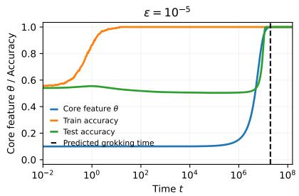

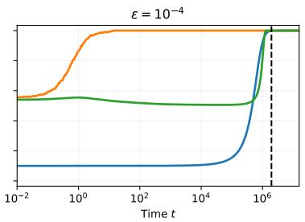

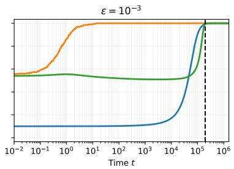  
Figure 1: Grokking near the interpolation edge $( \gamma = 1 )$ . Experiments for the simple model (2) trained with without regularization / weight decay $( \lambda = 0 )$ in the optimization objective (3), on $n = 4 0 0$ samples and $d = 3 9 5$ nuisance features $( d / n \approx 1 )$ from the data distribution (1), for diferent values of the signal strength ε. In all cases, the efective weight decay is $b = 0 < 1 / z _ { p } ;$ the core coeficient $\theta = \varepsilon u v$ approaches 1, and the test accuracy target $p = 9 5 \%$ is attained at a time consistent with the prediction of our theory (21). Under a very small signal, note that when weight decay is active $( \lambda \in \{ 1 0 ^ { - 4 } , 1 0 ^ { - 5 } \} )$ ), b exceeds the threshold, preventing grokking from occurring. See Appendix C for details and additional experiments.

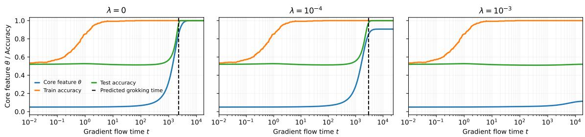

(a) Small signal strength $\varepsilon = 1 0 ^ { - 2 }$ . The vertical lines correspond to our theoretical estimate (20). For $\lambda = 1 0 ^ { - 3 }$ (rightmost plot), the efective weight decay is $\beta = 1 > 1 - \delta _ { p } = 0 . 1 7 ,$ and our theory (Theorem 3) correctly predicts that grokking does not occur here, contrary to the left and middle plots which correspond to values of $\beta$ smaller than the critical threshold $1 - \delta _ { p }$ . See Appendix C for details and additional experiments.  
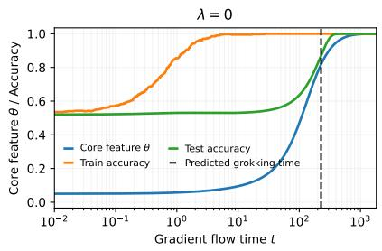

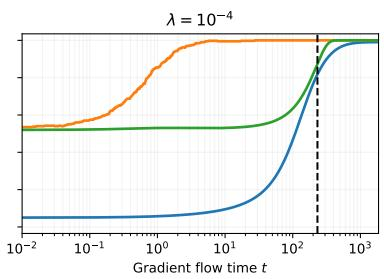

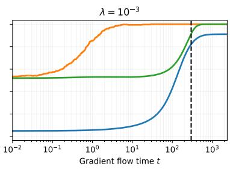  
(b) Moderate signal strength $\varepsilon = 1 0 ^ { - 1 }$ . Here, the signal is suficiently strong that grokking occurs even for small and moderately large values of weight decay λ. Indeed, for all values of $\lambda$ shown, the efective weight decay $\beta$ falls below the critical threshold $1 - \delta _ { p } ;$ our Theorem 3 correctly predicts that grokking occurs in time $T _ { p } \simeq H _ { \delta _ { p } } ( \beta ) \ell _ { n }$ (vertical line).

Figure 2: Grokking below interpolation threshold $( \gamma < 1 )$ . Experiments use $n = 4 0 0$ samples and $d = 3 6 0$ nuisance features $( \gamma = 0 . 9 )$ . The results support Theorem 3 across zero, weak and strong weight decay λ. The core coeficient approaches the limit $( 1 - \beta ) _ { + }$ predicted by our Theorem $^ { 3 , }$ while weight determines whether the test-accuracy target $p = 0 . 9 5$ is attained. Core convergence and target attainment need not coincide. Whenever the target is reached, the observed hitting time agrees with the theoretical prediction (vertical line). See Appendix C for details and more extensive experiments.

## 2. A Minimal Setup for Grokking

## 2.1. Data Distribution

We consider a binary classification problem with a planted core feature and independent nuisance features. A random input–label pair (x, y) is generated as follows:

$$
{ \begin{array} { r l r l } & { y \sim \operatorname { U n i f } ( \{ - 1 , 1 \} ) , } & { { \mathrm { ( c l a s s ~ l a b e l ) } } } \\ & { x ^ { ( 1 ) } = \varepsilon y , } & { { \mathrm { ( c o r e ~ f e a t u r e ) } } } \\ & { z \sim { \mathcal { N } } ( 0 , I _ { d } ) , } & { z \perp y , } & { { \mathrm { ( n u i s a n c e ~ f e a t u r e s ) } } } \\ & { x = ( x ^ { ( 1 ) } , z ) \in \mathbb { R } ^ { d + 1 } . } & { { \mathrm { ( i n p u t ~ v e c t o r ) } } } \end{array} }\tag{1}
$$

The parameter $\varepsilon > 0$ controls the amplitude of the core feature relative to the unit scale of each nuisance coordinate. For every $\varepsilon > 0$ , the core feature determines the label exactly, whereas the nuisance vector is independent of the label. Thus, reducing ε weakens the scale at which the signal enters the model without increasing the Bayes classification error, which remains zero. We are particularly interested in the small-signal regime $\varepsilon \ll 1$ , where this distinction allows us to separate the availability of predictive information from the time required to learn to use it. A similar distribution was also considered by Bayat et al. (2025) in the context out-of-distribution generalization.

The training dataset consists of n labeled samples $( x _ { 1 } , y _ { 1 } ) , \dotsc , ( x _ { n } , y _ { n } )$ which are iid copies of the pair $( x , y )$ defined above. Although the corresponding nuisance features $z _ { i } \in \mathbb { R } ^ { d }$ of each data point $x _ { i } \in \mathbb { R } ^ { 1 + d }$ contain no information about the label $y _ { i }$ , their empirical correlations with the training labels allow them to contribute to fitting the training data (memorization).

## 2.2. A simple bilinear model

We consider model class

$$
\begin{array} { r } { f ( x ) = f ( x ; u , v , w ) = u v x ^ { ( 1 ) } + z ^ { \top } w , } \end{array}\tag{2}
$$

with learnable parameters $u , v \in \mathbb { R }$ and $w \in \mathbb { R } ^ { d }$ . The model is linear in the input but bilinear in the parameters associated with the core feature. This factorization uv introduces nonlinear learning dynamics while retaining a tractable description of the competition between core learning and nuisance fitting.

The setup is motivated by sparse parity (Barak et al., 2022), a task on which two-layer ReLU networks exhibit grokking (Merrill et al., 2023). In this problem, the label is $\begin{array} { r } { y = \prod _ { j \in S } x ^ { ( j ) } } \end{array}$ for binary inputs $x \in \{ - 1 , 1 \} ^ { D }$ and a small, unknown subset S. Merrill et al. (2023) associate delayed generalization with competition between a dense memorizing subnetwork and a sparse generalizing subnetwork. This motivates our separation between a predictive core and nuisance features that can fit the training data. A parity feature admits the gating representation $\begin{array} { r } { \psi _ { g } ( x ) = \prod _ { j = 1 } ^ { D } ( 1 - g _ { j } + g _ { j } x ^ { ( j ) } ) } \end{array}$ , where $g \in \{ 0 , 1 \} ^ { D }$ selects the participating co ordinates. Learning these gates entails discovering the relevant feature. Our model isolates the subsequent competition between amplifying predictive structure and fitting nuisance features: the core is already present, but its contribution is learned through the bilinear coeficient uv. This simplification allows us to isolate the fine analysis of the resulting learning time scales, while stepping aside the combinatorial problem of discovering the unknown parity mask.

## 2.3. Regularized Optimization Objective and Progress Metrics

We train the student model (2) by minimizing the regularized squared loss

$$
R = R ( u , v , w ) : = L + \frac { \lambda } { 2 } ( u ^ { 2 } + v ^ { 2 } + \| w \| ^ { 2 } ) , \mathrm { w i t h } L = L ( u , v , w ) : = \frac { 1 } { 2 n } \sum _ { i = 1 } ^ { n } r _ { i } ^ { 2 } ,\tag{3}
$$

where $\lambda \geq 0$ is the weight-decay parameter and $r _ { i } : = f ( x _ { i } ) - y _ { i }$ . Let $Z = ( z _ { 1 } , \ldots , z _ { n } ) \in \mathbb { R } ^ { n \times d }$ be the nuisance matrix with rowsz and write $Y = ( y _ { 1 } , \dots , y _ { n } ) ^ { \top } \in \mathbb { R } ^ { n }$ , the response vector. Introducing the efective core coeficient

$$
\theta : = \varepsilon u v ,\tag{4}
$$

we obtain $L = \| r \| ^ { 2 } / ( 2 n )$ , where $r : = Z w - ( 1 - \theta ) Y$ is the vector of training residuals; exact interpolation corresponds to $r = 0$ , or equivalently $L = 0$ . Since $\boldsymbol { x } ^ { ( 1 ) } = \varepsilon \boldsymbol { y }$ , the prediction decomposes as $f ( x ) = \theta y + z ^ { \top } w$ . Thus, $\theta$ measures the contribution of the planted core feature, while $z ^ { \top } w$ captures the nuisance.

Interesting, the squared $L _ { 2 }$ regularization on the factors u and v translate into a an $L _ { 1 }$ prior on the core feature $\theta = \varepsilon u v$ . Indeed, observe that for an $\theta \in \mathbb { R }$

$$
\operatorname* { m i n } _ { u , v \in \mathbb { R } , \varepsilon u v = \theta } \frac { \lambda } { 2 } ( u ^ { 2 } + v ^ { 2 } ) = \frac { \lambda } { \varepsilon } | \theta | .
$$

For tracking learning progress during optimization, we consider the training accuracy and test accuracy of the student model $f$ are respectively defined by:

$$
\mathcal { A } _ { \mathrm { t e } } : = \frac { 1 } { n } \sum _ { i = 1 } ^ { n } 1 _ { \{ f ( x _ { i } ) y _ { i } > 0 \} } , \quad \mathcal { A } _ { \mathrm { t r } } : = \mathrm { P r } ( y f ( x ) > 0 ) ,
$$

for a random test point $( x , y ) \sim P$ independent of the training data. It is easy to see that

$$
\mathcal { A } _ { \mathrm { t r } } = \frac { 1 } { n } \sum _ { i = 1 } ^ { n } 1 _ { \left\{ 1 + y _ { i } r _ { i } \geq 0 \right\} } , \quad \mathcal { A } _ { \mathrm { t e } } = \Phi \left( \theta / \| w \| \right) ,\tag{5}
$$

where $\theta : = \varepsilon u v$ . Here, Φ is the standard normal CDF. Thus, the dynamics of the test accuracy is completely determined by the dynamics of the core weight θ and the nuisance norm $\lVert w \rVert$

## 3. High-Level Overview of Gradient-Flow Dynamics

We explain the geometric picture underlying the separation between early training-data fitting and delayed generalization. When the signal amplitude and weight decay are small, nuisance weights evolve rapidly while the core feature evolves slowly. Fenichel theory describes this separation through attraction toward a slow invariant manifold, followed by approximately logistic core learning. We use this picture to motivate the quantitative hitting-time analysis and highlight why approaching the interpolation edge requires additional care.

## 3.1. Equations of Motion and Stationary Points

Define the following auxiliary random quantities:

$$
\begin{array}{c} \begin{array} { r } { \left| B : = \frac { Z ^ { \top } Z } { n } \in \mathbb { R } ^ { d \times d } , \quad C : = B + \lambda I _ { d } \in \mathbb { R } ^ { d \times d } , \quad a : = \frac { Z ^ { \top } Y } { n } \in \mathbb { R } ^ { d } , \right.} \\ { \hat { w } : = C ^ { - 1 } a \in \mathbb { R } ^ { d } , \quad q : = 1 - a ^ { \top } \hat { w } \in [ 0 , 1 ] . } \end{array}   \end{array}\tag{6}
$$

Also introduce the ”dual” variable $\phi : = \varepsilon ( u ^ { 2 } - v ^ { 2 } ) / 2$

Proposition 1 (Equations of motion) The equations of motion of $( \theta , \phi , w )$ under gradient flow of the objective R given in (3) are the following system of ODEs:

$$
\begin{array} { r l } & { \dot { \boldsymbol { w } } = ( 1 - \theta ) \boldsymbol { a } - \boldsymbol { C } \boldsymbol { w } , \quad \dot { \theta } = 2 \varepsilon h \sqrt { \theta ^ { 2 } + \phi ^ { 2 } } - 2 \lambda \theta , } \\ & { \dot { \phi } = - 2 \lambda \phi , \quad h = h ( \theta , \boldsymbol { w } ) : = 1 - \theta - \boldsymbol { a } ^ { \top } \boldsymbol { w } . } \end{array}\tag{7}
$$

We can already see that if both ε and λ are small, then w is a fast variable while θ and $\phi$ are slow variables: w relaxes instantaneously compared to the clock of θ and $\phi .$ . This observation will ultimately be the main idea exploited to obtain a detailed account of the grokking phenomenon on this toy problem.

Proposition 2 (Finite-sample phase boundary) In terms of the $\theta , \phi ,$ and w variables, the efective global minimizer of the optimization objective (3) is unique:

$$
\theta _ { * } = \left( 1 - \frac { \lambda } { \varepsilon q } \right) _ { + } , \quad w _ { * } = ( 1 - \theta _ { * } ) \hat { w } , \quad \phi _ { * } = 0 .
$$

and the gradient-flow (7) converges to it.

Moreover, $i f \varepsilon q > \lambda$ , then there are two minima in u/v/w space: $u _ { * } = v _ { * } = \pm \sqrt { \theta _ { * } / \varepsilon }$ , and one saddle point $( u , v , w ) = ( 0 , 0 , \hat { w } )$ . Every initialization verifying $u _ { 0 } + v _ { 0 } \ne 0$ converges to a minimum point. $I f \varepsilon q \leq \lambda$ , the latter point is the only stationary point and every trajectory converges to it.

## 3.2. Qualitative Insights: Fenichel Theory

Suppose the signal strength ε and weight decay λ be small such that $\lambda / \varepsilon = O ( 1 )$ . The second equation in (10) evolves faster than the first: for every value of θ, w instantaneously relaxes to a value satisfying the equation $( 1 - \theta ) a - B w = 0$ , which corresponds to setting the RHS of the former to zero. This implicit equation defines a so-called slow manifold M in parameter space, on which the better part of the dynamics is trapped. Because $a : = Z ^ { \top } Y / n$ is in the image of $Z ^ { \top }$ , this invariant manifold is given explicitly by:

$$
\mathcal { M } : = \{ ( \theta , w ) \in \mathbb { R } ^ { 1 + d } \ | \ w - ( 1 - \theta ) b \in \mathrm { K e r } Z \} ,\tag{8}
$$

where $b : = B ^ { + } a$ is min-norm nuisance interpolator. It is easy to see that M is an afine subspace of $\mathbb { R } ^ { 1 + d }$ of dimension 1 if $d \leq n$ and $d - n + 1 { \mathrm { ~ i f ~ } } d > n$ . There are thus two qualitatively distinct sub-regimes to consider.

The sample-poor regime: $d > n$ . In this setting, one has $q | _ { \lambda = 0 } = 0$ almost-surely. The reduced ODEs along the slow manifold become M: $\dot { \theta } = - 2 \lambda \theta , w _ { \perp } = 0$ , where $w _ { \perp } : =$ $w - ( 1 - \theta ) b$ is the part of w which is in the kernel of $Z .$ . The dynamics converges to the pathological saddle (0, b) which does not generalize: the limiting test accuracy (5) is 50%, i.e. chance level.

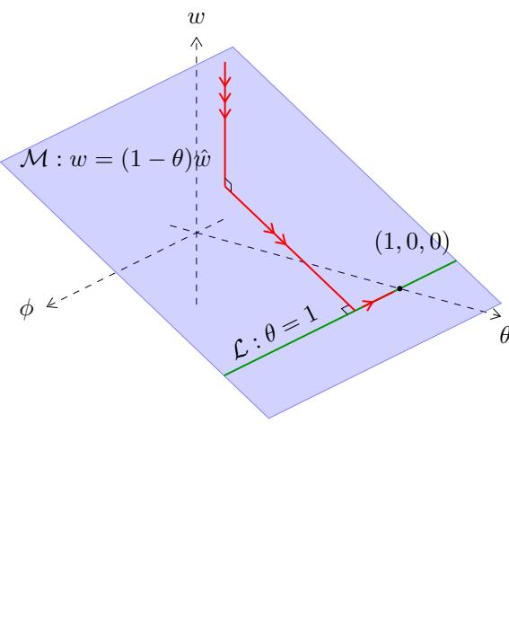  
Figure 3: Fast/slow dynamics of learning. Triple arrows indicate fast dynamics, double arrows indicate slow, and single arrows indicate very slow dynamics. In the fast phase, the dynamics (7) quickly relaxes onto the plane M in constant time $T ( w ) \asymp O ( 1 )$ . Then a slower phase begins where the dynamics relaxes towards the line ${ \mathcal { L } } \subseteq { \mathcal { M } }$ , corresponding to learning the core feature weight θ := εuv in the student (2). This happens on a time scale of order $T ( \theta ) \asymp 1 / \varepsilon \gg 1$ , where $\varepsilon \ll$ 1 is the SNR. This phase is responsible for the long test accuracy, long after memorization (perfect training accuracy) has occurred. In the final / slowest phase (which only exists in the case of unbalanced initialization), the ”harmonic dual” variable ϕ $: = \varepsilon ( u ^ { 2 } - v ^ { 2 } ) / 2$ relaxes to zero in time of order $T ( \phi ) \asymp 1 / \lambda \gg T ( \theta )$ , where $\lambda \ll \varepsilon$ is the weight decay.

The sample-rich regime: $d \leq n$ . In this regime, one has $q | _ { \lambda = 0 } > 0$ almost-surely. The transverse Jacobian of the limiting fast dynamics along $\mathcal { M } _ { 0 }$ is $J _ { 0 } = - B$ . Since B is positive definite (almost-surely), all transverse eigenvalues are strictly negative, establishing normal attraction. Now, consider the slow time $\tau : = 2 \varepsilon t$ , which allows us to zoom into the slow dynamics on $\mathcal { M }$ . Let primes denote rate of change measured in this new clock. Along M, the equations of motions reduce to the following decoupled system of ODEs:

$$
\theta ^ { \prime } = q ( 1 - \theta ) \theta - \kappa \theta , \quad w = ( 1 - \theta ) b .\tag{9}
$$

The first equation is a logistic ODE, with a natural relation time scale of $\tau \asymp q ^ { - 1 }$ , i.e $T ( \theta ) \asymp$ $( \varepsilon q ) ^ { - 1 }$ physical time. Actual crossing times also depend on initialization, regularization, and the target level. For fixed $d < n$ , Fenichel theory (Fenichel, 1979) then suggests the following picture:

• A fast phase during which nuisance weights approach a neighborhood of an attracting slow manifold. Entry within a fixed tolerance takes $O ( 1 )$ physical time for a fixed positive spectral gap. Training accuracy can already be high during this phase, tending to perfect memorization.

• A slow phase, during which the core evolves according to approximately logistic dynamics, while nuisance weights track its evolution. Whether this leads to the prescribed test accuracy depends on both regularization and the statistical regime.

Figure 3 illustrates this geometric picture. Note that formally, the invariant slow manifold is an $O ( \varepsilon )$ -perturbation $\mathcal { M } ^ { \varepsilon }$ of the critical manifold ${ \mathcal { M } } ,$ , rather than M itself (Fenichel, 1979).

This perspective is similar in spirit to the lazy-to-rich-transition account of Kumar et al. (2024); Nishiyama and Imaizumi (2026), in which early fitting precedes substantial feature learning. Our model makes a corresponding separation explicit through fast nuisance fitting and slow core learning, without identifying these phases with a neural tangent kernel transition. It also connects to Boursier et al. (2025), who analyze fast fitting followed by slow, weight-decay-driven norm minimization along a manifold of critical points. In our setting, small signal amplitude provides a distinct source of slow dynamics, allowing delayed generalization even without weight decay. Moreover, the statistical analysis determines when slow core learning translates into test accuracy, a distinction that becomes crucial near interpolation.

Turning the above geometric insights from Fenichel theory into a quantitative account of grokking requires comparing the core-learning scale with nuisance relaxation. The latter depends on the spectrum of the empirical covariance and need not remain bounded as the dimension grows. In particular, the proportional regime $d / n \to \gamma < 1$ difers from approaching interpolation with $d \digamma < n$ but $d / n  1$ , where the spectral gap vanishes. Section 4 establishes conditions under which the separation persists and translates it into explicit hitting-time estimates.

## 4. Main Results

To make our lives easy henceforth, we make the following balanced initialization assumption.

Assumption 1 $u ( 0 ) = v ( 0 ) \neq 0$

Under this assumption, one has $\phi ( t ) = 0 < \theta ( t )$ for all t in the dynamics (7). Thanks to Proposition 2 the only stationary point becomes $( \theta _ { * } , w _ { * } )$ defined above. Moreover, the equations of motion (7) reduce to the following coupled of ODEs:

$$
\dot { \theta } _ { n } ( t ) = 2 \varepsilon ( 1 - \theta _ { n } ( t ) - a ^ { \top } w _ { n } ( t ) ) \theta _ { n } - 2 \lambda \theta _ { n } ( t ) , \quad \dot { w } _ { n } ( t ) = ( 1 - \theta _ { n } ( t ) ) a - C w _ { n } ( t ) ,\tag{10}
$$

where $a = a _ { n }$ and $C = C _ { n } = B _ { n } + \lambda I$ are as defined in (6), were everything has been written to explicitly highlight the dependence on the sample size n. The analysis of the above system of ODEs will be our main focus henceforth.

In this section, we quantify the time required to learn the core feature θ and attain a prescribed test accuracy, and identify when these targets are unattainable. Starting from the gradient-flow system (10), we focus on the sample-rich setting $d < n$ discussed at the end of Section 3.2, where nuisance fitting alone cannot interpolate the training labels and core learning is necessary to drive the training loss to zero.

## 4.1. Preliminaries

Given some quantity $S _ { n }$ which evolves alongside the dynamics (10), and a threshold $\delta > 0$ define $T _ { \delta } ( S _ { n } )$ to be the time taken for $S _ { n }$ to cross level $\delta , \mathrm { i . e . }$

$$
T _ { \delta } ( S _ { n } ) : = \operatorname* { i n f } \{ t \geq 0 \mid S _ { n } ( t ) \geq \delta \} , \ \mathrm { w i t h ~ i n f } \ \varnothing : = \infty .\tag{11}
$$

We shall particularly be interested in: $T _ { \delta } ( \boldsymbol { \theta } _ { n } )$ , which is the time taken to learn the core feature weight above level δ; $T _ { p } ( { \mathcal { A } } _ { \mathrm { t e } , n } )$ , which is the time taken to reach a test accuracy of at least $1 0 0 p \% ; T _ { p } ( A _ { \mathrm { t r } , n } )$ , which is the time to reach a training accuracy of at least 100p%.

A reference slow ODE. Note that hitting times $T _ { \delta } ( S _ { n } )$ are a random quantities, due to randomness in the training dataset which drives the dynamics. It turns out that most of the hitting times of interest to us can be neatly expressed in terms of the following deterministic function. For any core initialization $\theta _ { 0 } \in ( 0 , 1 )$ , level $\delta \in ( \theta _ { 0 } , 1 )$ , signal strength ε, and scalar $\beta \geq 0$ with $\beta < \operatorname* { m i n } ( 1 - \theta _ { 0 } , 1 - \delta )$ , define

$$
H _ { \delta } ( \beta ) : = \frac { 1 } { 1 - \beta } \log \frac { ( 1 - \theta _ { 0 } - \beta ) \delta } { \theta _ { 0 } ( 1 - \beta - \delta ) } > 0 .\tag{12}
$$

Instructively, the ratio $H _ { \delta } ( \beta )$ is nothing but the time the solution $\bar { \Theta } ( s ) = \bar { \Theta } ( s ; \beta )$ of the following reference logistic ODE takes to cross a level δ:

$$
\begin{array} { r } { \boxed { \bar { \Theta } ^ { \prime } ( s ) = \bar { \Theta } ( s ) ( 1 - \bar { \Theta } ( s ) - \beta ) , \quad \bar { \Theta } ( 0 ) = \theta _ { 0 } . } } \end{array}\tag{13}
$$

The above reference trajectory is precisely the form of the ODE on the slow manifold (9) with $\kappa = \beta / q$ and rescaled time $s = \tau / q$

Displacement from invariant manifold. Recall the definition of the vector $a = a _ { n } \in$ $\mathbb { R } ^ { d }$ , the empirical nuisance covariance matrix $B \ = \ B _ { n } \ \in \ \mathbb { R } ^ { d \times d }$ , and the ridge nuisance interpolator $\hat { w } _ { n } \in \mathbb { R } ^ { d }$ . Thus, defining $e _ { n } : = w _ { n } - ( 1 - \theta _ { n } ) \hat { w } _ { n }$ , the quantity

$$
T ^ { \xi } ( \| e _ { n } \| ) = \operatorname* { i n f } \{ t _ { 0 } \geq 0 \ | \ \operatorname* { s u p } _ { t \geq t _ { 0 } } \| e _ { n } ( t ) \| \leq \xi \} .\tag{14}
$$

measures the time the dynamics take to relax in an ξ-neighborhood of the slow manifold

$$
\mathcal { M } _ { n } : = \left\{ ( \theta , w ) \in \mathbb { R } ^ { 1 + d } : w = ( 1 - \theta ) \hat { w } _ { n } \right\} .\tag{15}
$$

Along this manifold, the nuisance weights are given explicitly in terms of the core feature θ. Note that when the regularization is turned of $( \lambda _ { n } = 0 ) , \mathcal { M } _ { n }$ reduces to the slow invariant manifold (8).

Our analysis from Section 3.2 suggested that the system of ODEs (10) rapidly collapses in time $O ( 1 )$ to the slow manifold $\mathcal { M } _ { n }$ . The remainder of the dynamics is then reduced and ODE of the form (9), or (13) with appropriately normalized time and ”efective regularization” β. Thus, in this setting, one might expect that the original system relaxes in time of order $H _ { \delta } ( \beta ) \ell _ { n }$

Asymptotics scaling limits. We shall work in the setting where the nuisance dimension $d = d _ { n }$ , the weight decay $\lambda = \lambda _ { n } .$ , and the signal strength $\varepsilon = \varepsilon _ { n }$ vary with sample size as follows:

$$
\begin{array} { r l } & { \displaystyle \Big | \kappa _ { n } , \varepsilon _ { n } > 0 , \quad \lambda _ { n } \geq 0 , \quad \beta _ { n } , \| w _ { n } ( 0 ) \| = O ( 1 ) , } \\ & { \displaystyle n \to \infty , \quad \frac { d _ { n } } { n } \to \gamma \in ( 0 , 1 ] , \quad \kappa _ { n } \to \infty , \quad \frac { \varepsilon _ { n } } { \rho _ { n } } \to 0 , } \\ & { \displaystyle \mathrm { w h e r e } \ \kappa _ { n } : = n - d _ { n } , \quad \rho _ { n } : = \frac { \kappa _ { n } } { n } , \quad \ell _ { n } : = \frac { 1 } { 2 \varepsilon _ { n } \rho _ { n } } , \quad \beta _ { n } : = \frac { \lambda _ { n } } { \varepsilon _ { n } \rho _ { n } } . } \end{array}\tag{16}
$$

The conditions $\varepsilon _ { n } > 0$ and $\kappa _ { n } > 0$ are crucial: the first one ensures that there is signal to drive the learning of the core feature (albeit, possibly on an arbitrarily long time scale) while the second ensures that the nuisance design matrix Z always trivial kernel so that the dynamics does not get trapped inside a basin of invisible nuisance features. Also, the above conditions imply

$$
\varepsilon _ { n } , \lambda _ { n } \to 0 , \rho _ { n } = O ( 1 ) , \lambda _ { n } / \varepsilon _ { n } = O ( 1 ) , \ell _ { n } = \Omega ( \varepsilon _ { n } ^ { - 1 } ) .
$$

Thus, $\ell _ { n } \ \to \ \infty$ . Importantly, we allow for the possibility of no weight-decay $\lambda _ { n } ~ = ~ 0$ The case $\gamma \in \mathsf { \Gamma } ( 0 , 1 )$ corresponds to the under-parametrized regime, while $\gamma = 1$ is the interpolation edge where $d _ { n } \simeq n$

## 4.2. Delayed Generalization

For a fixed test-accuracy target $p \in ( 1 / 2 , 1 )$ , define

$$
z _ { p } : = \Phi ^ { - 1 } ( p ) , \quad \delta _ { n , p } : = \frac { z _ { p } \sqrt { \rho _ { n } ^ { - 1 } - 1 } } { 1 + z _ { p } \sqrt { \rho _ { n } ^ { - 1 } - 1 } } .\tag{17}
$$

Note that $z _ { p } > 0$ and $\delta _ { n , p } \in [ 0 , 1 )$ . Below interpolation, it holds that $\delta _ { n , p }  \delta _ { p }$ where

$$
\delta _ { p } : = \frac { z _ { p } \sqrt { \gamma / ( 1 - \gamma ) } } { 1 + z _ { p } \sqrt { \gamma / ( 1 - \gamma ) } } \in ( 0 , 1 ) ,\tag{18}
$$

whereas $\delta _ { n , p }  1$ at the interpolation edge. The following is one of our main results.

Theorem 3 (Informal) For each $\gamma \in \mathsf { \Gamma } ( 0 , 1 ]$ , there exists a threshold $p _ { \mathrm { f a s t } } ( \gamma ) \in \mathbf { \Gamma } ( 0 , 1 )$ such that the following holds. Fix a test target $p \in ( p _ { \mathrm { f a s t } } ( \gamma ) \land 0 . 5 , 1 )$ . Under (16) and the additional conditions in Table 1, the core dynamics, nuisance relaxation, and generalization behavior are as stated in the table. Limits and hitting-time estimates are understood in probability; non-attainment holds with probability tending to one.

Detailed statements appear as Proposition 5, Theorem 6, and Theorem 7 of Appendix A.2.

The highlight of the proof of Theorem 3 compares the equations of motion (10) with logistic ODE (13) with rescaled time $s = t / \ell _ { n }$

This theorem separates three events: fitting the training data, learning the core feature, and generalizing. Training targets significantly above chance are reached in O(1) time, while relaxation of the core requires the longer scale time of order $\ell _ { n } .$ Whether generalization follows on that same scale depends on dimensionality and regularization, as illustrated in Figures 2 and 1.

The threshold $p _ { \mathrm { f a s t } } ( \gamma )$ is defined in equation (25) of the appendix, and corresponds to the best test accuracy obtainable on a constant time scale. It is of order

$$
p _ { \mathrm { f a s t } } ( \gamma ) = 0 . 5 + O ( \theta _ { 0 } )
$$

<table><tr><td>Regime</td><td>Effective dynamics of core feature</td><td>Effective dynamics of nuisance</td><td>Conclusion</td></tr><tr><td>Under-parameterized, weak regularization  $( \gamma < 1 , \beta < 1 - \delta _ { p } )$ </td><td>Logistic ODE (13); limiting core trajec- tory converges to  $1 - \beta > \delta _ { p }$ </td><td>Enters fixed vicinity of the slow sheet  $\mathcal { M } _ { n }$  in constant time, then tracks the core feature</td><td>Grokking occurs on time scale of order  $\ell _ { n } \ll 1$  (given in (16)), which diverges with the sample size n</td></tr><tr><td>Under-parameterized, strong regularization  $( \gamma < 1 , \beta > 1 - \delta _ { p } )$ </td><td>Logistic ODE (13); limiting core trajec- tory converges to  $( 1 - \beta ) _ { + } < \delta _ { p }$ </td><td>Enters fixed vicinity of  $\mathcal { M } _ { n }$  in constant time, then tracks core</td><td>Target test accuracy p is never reached</td></tr><tr><td>Interpolation edge, weak regularization  $( \gamma = 1 , b < 1 / z _ { p } )$ </td><td>Logistic ODE (13); limiting core trajec- tory converges to 1</td><td>Entry time diverges, but is  $o ( \ell _ { n } )$  and  $O ( \rho _ { n } ^ { - 2 } \log { \rho _ { n } ^ { - 1 } } )$ </td><td>Fixed core levels reached on scale  $\ell _ { n }$  (diverging with n); grokking occurs on time scale of order  $\ell _ { n } \log \rho _ { n } ^ { - 1 } \gg \ell _ { n }$ </td></tr><tr><td>Interpolation edge, strong regularization  $( \gamma = 1 , b > 1 / z _ { p } )$ </td><td>Logistic ODE (13); limiting core trajec- tory converges to 1</td><td>Same upper-bounds as above; station- ary nuisance norm  $\| w _ { n } ( t ) \|$  tends to b</td><td>Fixed core levels reached on scale of order  $\ell _ { n } ,$  but target test accuracy p is never reached</td></tr></table>

Table 1: Phase diagram for the (non)emergence of grokking (Theorem 3). Here, the scales $\rho _ { n } ~ = ~ { \cal O } ( 1 )$ and $\ell _ { n } \ \to \ \infty$ are as defined in (16), while $z _ { p }$ and $\delta _ { p }$ are as defined in (17)–(18). The under-parametrized regimes additionally assume $\beta _ { n }  \beta$ , while interpolation-edge regimes assume $\varepsilon _ { n } \rho _ { n } ^ { - 2 } \to 0$ and $\beta _ { n } \sqrt { \rho _ { n } ^ { - 1 } - 1 } \to b \in [ 0 , \infty )$ ; in particular, $\beta = 0$ in both edge rows. Grokking denotes early attainment of the training target followed by delayed generalization, for the given test target p. A precise hitting-time equivalent is provided in (19); the logarithmic factor at the edge is already included in the displayed time scale. The scale $\ell _ { n }$ diverges with sample size $n ,$ accounting for long plateaus. Regularization / weight decay $\lambda _ { n }$ is classified relative to the target $p .$ Core convergence refers to the limiting slow trajectory as slow time tends to infinity; stationary nuisance limits are taken as $n  \infty$ . Limits and time estimates are in probability; non-attainment holds with probability tending to one. Detailed results are provided in $T ^ { \xi } ( \| e _ { n } \| )$ , defined in (14). Detailed claims are provided in Appendix A.2.

for small initialization $\theta _ { 0 } \in ( 0 , 1 )$ of the core feature.

The early dynamics of training accuracy is provided in Theorem 4, which establishes that every training accuracy less than an attainable ceiling $P _ { \gamma }$ is attainable in constant time.

## 4.3. What Controls the Plateau Length?

Under the assumptions in Theorem 3 ensuring delayed attainment of the test target, the plateau length is

$$
T _ { p } ( { \cal A } _ { \mathrm { t e } , n } ) \simeq H _ { \delta _ { n , p } } ( \beta _ { n } ) \ell _ { n } ,\tag{19}
$$

with $H _ { \delta }$ as in (12), $\delta _ { n , p }$ as in (17), and $\ell _ { n }$ as in (16). The plateau length therefore combines the base scale $\ell _ { n }$ with the efects of initialization, regularization, and the required core threshold.

Below interpolation. Consider the regime where $\gamma < 1$ in the limits (16). For $\beta < 1 - \delta _ { p } .$ the prediction (19) from our Theorem 3 simplifies to:

$$
T _ { p } ( { \cal A } _ { \mathrm { t e } , n } ) \simeq \ell _ { n } H _ { \delta _ { p } } ( \beta ) , ~ \mathrm { w i t h } ~ \ell _ { n } \simeq \frac { 1 } { 2 ( 1 - \gamma ) \varepsilon _ { n } } .\tag{20}
$$

Thus, the plateau length is inversely proportional to signal strength $\varepsilon _ { n }$ . Weight decay also afects this length: $H _ { \delta _ { p } } ( \beta )$ increases with $\beta$ and diverges as $\beta \uparrow 1 - \delta _ { p }$ . Above this threshold, there is no grokking: the target $p$ is not attained with probability tending to 1.

At the interpolation edge. Now consider the setting where $\gamma = 1$ in the limits (16). Under the additional edge assumptions, with $b < 1 / z _ { p }$ , observe that

$$
( 1 - \delta _ { n , p } ) / \sqrt { \rho _ { n } } \to 1 / z _ { p } , \quad \beta _ { n } / \sqrt { \rho _ { n } } \to b .
$$

Substitution into (19) and some algebra yields

$$
T _ { p } ( \mathcal { A } _ { \mathrm { t e } , n } ) - T _ { \delta } ( \theta _ { n } ) \simeq 0 . 5 \ell _ { n } \log \rho _ { n } ^ { - 1 } \gg \ell _ { n } .\tag{21}
$$

Thus, in this regime generalization, requires an additional long delay delay beyond learning a fixed core level. The growing nuisance contribution must be ofset by a vanishing core deficit before the test target accuracy p can be attained.

Efect of initialization. In the regimes where our theory guarantees grokking, (20)–(21) describe how the plateau depends on the initialization $\theta _ { 0 }$ . For small $\theta _ { 0 } \in ( 0 , 1 )$ , the normalized plateau length $T _ { p } / \ell _ { n }$ is predicted to grow logarithmically with $1 / \theta _ { 0 }$ , with coeficient $( 1 - \beta _ { n } ) ^ { - 1 }$ below interpolation. At the interpolation edge, $\beta _ { n }  0$ and the corresponding coeficient is one. Thus, early nuisance fitting can achieve high training accuracy while an initially weak core contribution takes much longer to become predictive. Increasing $\theta _ { 0 }$ shortens this delay. A similar dependence was found by Nishiyama and Imaizumi (2026) in the context of linear regression with diagonal networks.

This dependence on $\theta _ { 0 }$ gives a direct experimental diagnostic: at fixed signal amplitude, aspect ratio, and efective regularization, plotting $T _ { p } / \ell _ { n }$ against $\log ( 1 / \theta _ { 0 } )$ should approxi mately yield a line of slope $( 1 - \beta _ { n } ) ^ { - 1 }$ for small $\theta _ { 0 }$ below interpolation, and slope one at the edge. Figure 4 supports this prediction in the under-parameterized regime; corresponding edge experiments appear in Figure 9 of Appendix D.

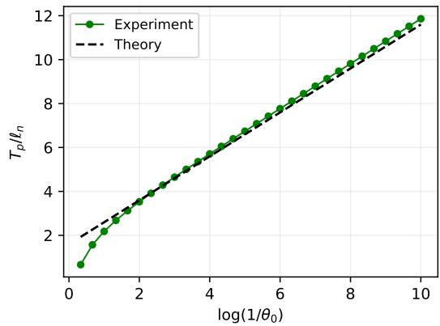  
Figure 4: Logarithmic scaling of grokking time w.r.t core feature initialization $\theta _ { 0 } .$ . Experiment with $n = 4 0 0$ samples, nuisance dimension $d = 3 6 0$ , a small signal strength $\varepsilon = 1 0 ^ { - 2 }$ ， and no weight decay $( \lambda = 0 )$ . Perfect terminal test accuracy (100%) is always attained in this setting. Empirically measured normalized hitting time $T _ { p } / \ell _ { n }$ scales linearly in $\log ( 1 / \theta _ { 0 } )$ in view of (12), as predicted by Theorem 3.

## 4.4. Grokking does not require weight decay

Weight decay is central to several accounts of grokking (Nanda et al., 2023; Varma et al., 2023; Lyu et al., 2024; Boursier et al., 2025), but is it unclear whether it is really necessary for the phenomenon. Setting $\lambda _ { n } = 0$ gives $\beta _ { n } = 0$ , placing the dynamics in the $\beta = 0$ regime below interpolation and the $b = 0$ regime at the interpolation edge. Under the corresponding assumptions, our Theorem 3 guarantees grokking. This is clearly visible empirically in Figure 2 (left), Figure 1, and Figure 4. Our results complement previous demonstrations of unregularized grokking (Gromov, 2023; Kumar et al., 2024) with explicit conditions and analytic plateau lengths. They also show that regularization can modify the delay or prevent attainment of the test target, without being necessary for delayed generalization.

Appendix C contains further empirical validation of our theoretical results.

## 5. Related work

In its current form, the grokking phenomenon was first observed by Power et al. (2022) as delayed generalization following early fitting of the training data. Subsequent work established that its occurrence depends on initialization, regularization, data, and architecture, and that it extends beyond algorithmic tasks (Liu et al., 2023). These observations motivate studying the mechanisms behind the delay separately from the appearance of a particular learning curve. Our analysis distinguishes three events: attaining high training accuracy, learning the core feature, and reaching a prescribed test-accuracy target. Their separation is essential near interpolation, where substantial core learning need not immediately produce generalization.

Plateau Phenomena and Singular Learning Theory. Prolonged plateaus in training error were studied well before grokking was documented (Power et al., 2022). Informationgeometric and statistical-mechanical analyses associated slow learning with singular parameter configurations induced by symmetries and redundancies, where the Fisher information becomes degenerate (Wei et al., 2008; Amari et al., 2018). Classical studies of online learning in soft-committee networks also identified long transients and examined their dependence on teacher–student alignment (Saad and Solla, 1995), while later work investigated how input spectra shape learning plateaus (Yoshida and Okada, 2019). From a complementary statistical perspective, singular learning theory relates model singularities to generalization and marginal likelihood through algebraic geometry (Watanabe, 2009). These results provide context for the slow modes and separated time scales associated with grokking. However, training-error plateaus and delayed generalization concern diferent observables: explaining grokking requires identifying why test performance remains poor after training accuracy has already become high.

Mechanistic explanations and feature learning. Studies of modular arithmetic have identified the representations and algorithms underlying generalization. Gromov (2023) construct explicit solutions and connect grokking to the discovery of task-specific feature maps. Nanda et al. (2023) identify continuous progress measures that distinguish memorization, circuit formation, and the removal of memorizing components. Zhong et al. (2023) show that changes in initialization and architecture can lead to qualitatively diferent algorithms for the same modular-addition task. Beyond neural networks, Mallinar et al. (2025) demonstrate grokking in recursive feature machines, relating generalization to the emergence of block-circulant structure through the average gradient outer product. These studies establish that progress toward a generalizing solution can precede its appearance in accuracy curves. Our model makes the corresponding distinction explicit through separate hitting times for the core coeficient and test accuracy.

Lazy-to-rich transitions and implicit bias. Kumar et al. (2024) explain grokking through a transition from an initial kernel-like regime to subsequent feature learning, emphasizing the learning rate of features and their initial alignment with the target. Lyu et al. (2024) prove that large initialization and small weight decay can induce a transition between early kernel bias and later minimum-norm or maximum-margin bias. For modular addition, Mohamadi et al. (2024) establish limitations of kernel-regime predictors and generalization guarantees for appropriately norm-controlled quadratic networks. Our fast nuisance dynamics and slow growth of the factorized core coeficient provide a tractable analogue of such staged learning. The resulting time-scale separation explains why the core can remain nearly frozen during early training. It also shows why core learning alone need not determine the onset of generalization: residual nuisance contributions can remain decisive after the core relaxes above a fixed threshold.

Regularization and slow geometric dynamics. Liu et al. (2023) relate grokking to the dependence of training and test losses on weight norm. Notsawo et al. (2025) extend regularization-based explanations beyond the Euclidean norm, including sparsity and lowrank structure, and show that Euclidean norm reduction is not a universal indicator of generalization. A particularly close theoretical connection is Boursier et al. (2025), who analyze gradient flow with vanishing weight decay. Under their assumptions, an initial approach to a critical manifold is followed by slow Riemannian norm minimization on the inverse-weight-decay time scale. Our analysis also separates fast and slow dynamics, while incorporating the statistical efects of signal strength and sample-to-dimension ratio. In our model, delayed generalization can persist without weight decay, and regularization determines whether a specified test target is attainable. We establish explicit nuisancetracking estimates and accuracy hitting times; near interpolation, these estimates account for the loss of a uniform spectral gap.

Solvable models and interpolation thresholds. Beck et al. (2025b) derive covariancebased learning dynamics for a Gaussian linear teacher–student model and use Marchenko– Pastur spectral analysis to characterize delayed generalization near interpolation. They also demonstrate that sharp accuracy changes can result from the evaluation criterion, without an accompanying discovery of a new representation. In a distinct logistic-classification setting, Beck et al. (2025a) identify long delays near the linear-separability threshold, where nearly flat directions slow optimization. Our results distinguish the fixed-aspect-ratio regime below interpolation from the hard interpolation edge, where the lower covariance spectral edge vanishes. They further separate the time needed to reach a fixed core level from the time needed to overcome nuisance interference. This yields regimes in which the limiting core trajectory approaches one but a prescribed test target remains unattainable. The classification is stated in terms of first accuracy hitting times, with explicit control of possible earlier crossings.

Predicting and accelerating grokking. Notsawo et al. (2023) use oscillations in early learning curves to predict subsequent grokking. Lee et al. (2024) accelerate generalization by amplifying slowly varying gradient components. Especially relevant to our dynamical perspective, Saheb Pasand and Dohmatob (2026) identify unequal learning speeds along principal gradient directions as a source of grokking and propose egalitarian gradient descent to equalize those speeds. Our contribution complements these diagnostic and algorithmic approaches with analytic asymptotic expressions for plateau lengths and conditions separating early generalization, delayed generalization, and non-attainment. The analysis also distinguishes slow core learning from slow nuisance relaxation: near the interpolation edge, nuisance relaxation itself need not occur in constant physical time.

## 6. Concluding Remarks

Our tractable model disentangles the optimization and statistical mechanisms underlying grokking. Its rich phenomenology reflects the interplay of initialization, signal strength, regularization, and dimensionality. Similar learning curves can conceal distinct dynamica and statistical constraints, requiring attention to both parameter evolution and its predictive consequences. Separating nuisance fitting, core learning, and test accuracy attainment yields explicit conditions for delayed generalization and analytic asymptotic plateau lengths. At the interpolation edge, substantial core learning need not immediately yield generalization. Weight decay afects both the delay and attainable accuracy, but does not dictate whether grokking occurs.

Limitations and future directions. Extending the analysis to models that must discover predictive features, such as ReLU networks learning sparse parity, is a natural next step. This would motivate non-proportional scalings of model complexity relative to sample size, potentially revealing a richer grokking phase diagram.

AI use statement. In this work, we have made limited use of generative AI tools for spell-checking, and also reformulating chunks of text in the introduction (Section 1) and detailed related works section (Appendix 5). Also, AI was used to generate Tikz code for displaying the cartoon in Figure (3). Finally, we used AI to better organize our proof of Theorem 3 in the appendix. We take responsibility for the final content of this work, including text, claims, or artifacts produced with the aid of AI.

Acknowledgement. We would like to proudly acknowledge that Baye Malick Gning is PhD student funded by boursaries from Canada Research Chair grant number CRC-2023- 00228 (Computing for the Greater Good) attributed to Elvis Dohmatob.

## References

Shun-ichi Amari, Tomoko Ozeki, Ryo Karakida, Yuki Yoshida, and Masato Okada. Dynamics of learning in mlp: Natural gradient and singularity revisited. Neural Computation, 30(1):1–33, 2018.

Boaz Barak, Benjamin Edelman, Surbhi Goel, Sham Kakade, Eran Malach, and Cyril Zhang. Hidden progress in deep learning: Sgd learns parities near the computational limit. Advances in Neural Information Processing Systems, 35:21750–21764, 2022.

Reza Bayat, Mohammad Pezeshki, Elvis Dohmatob, David Lopez-Paz, and Pascal Vincent. The pitfalls of memorization: When memorization hurts generalization. In International Conference on Learning Representations (ICLR), 2025.

Alon Beck, Noam Itzhak Levi, and Yohai Bar-Sinai. Grokking at the edge of linear separability. In Proceedings of the 42nd International Conference on Machine Learning, volume 267 of Proceedings of Machine Learning Research, pages 3307–3334. PMLR, 2025a.

Alon Beck, Noam Itzhak Levi, and Yohai Bar-Sinai. Grokking at the edge of linear separability. In Proceedings of the 42nd International Conference on Machine Learning, volume 267 of Proceedings of Machine Learning Research. PMLR, 2025b.

Etienne Boursier, Scott Pesme, and Radu-Alexandru Dragomir. A theoretical framework for grokking: Interpolation followed by riemannian norm minimisation. In The Thirty-ninth Annual Conference on Neural Information Processing Systems, 2025.

Neil Fenichel. Geometric singular perturbation theory for ordinary diferential equations. Journal of Diferential Equations, 31(1):53–98, 1979. doi: 10.1016/0022-0396(79)90152-9.

Andrey Gromov. Grokking modular arithmetic. 2023. URL https://arxiv.org/abs/ 2301.02679.

Tanishq Kumar, Blake Bordelon, Samuel J. Gershman, and Cengiz Pehlevan. Grokking as the transition from lazy to rich training dynamics. In International Conference on Learning Representations (ICLR), 2024.

Jaerin Lee, Bong Gyun Kang, Kihoon Kim, and Kyoung Mu Lee. Grokfast: Accelerated grokking by amplifying slow gradients. 2024. URL https://arxiv.org/abs/2405. 20233. v2, 5 Jun 2024.

Ziming Liu, Eric J. Michaud, and Max Tegmark. Omnigrok: Grokking beyond algorithmic data. In International Conference on Learning Representations (ICLR), 2023. URL https://arxiv.org/abs/2210.01117. Spotlight.

Kaifeng Lyu, Jikai Jin, Zhiyuan Li, Simon Shaolei Du, Jason D. Lee, and Wei Hu. Dichotomy of early and late phase implicit biases can provably induce grokking. In The Twelfth International Conference on Learning Representations, 2024.

Neil Rohit Mallinar, Daniel Beaglehole, Libin Zhu, Adityanarayanan Radhakrishnan, Parthe Pandit, and Mikhail Belkin. Emergence in non-neural models: grokking modular arithmetic via average gradient outer product. In Proceedings of the 42nd International Conference on Machine Learning, volume 267 of Proceedings of Machine Learning Research. PMLR, 2025.

V.A. Marˇcenko and Leonid Pastur. Distribution of eigenvalues for some sets of random matrices. Math USSR Sb, 1:457–483, 01 1967.

William Merrill, Nikolaos Tsilivis, and Aman Shukla. A tale of two circuits: Grokking as competition of sparse and dense subnetworks. arXiv preprint arXiv:2303.11873, 2023.

Mohamad Amin Mohamadi, Zhiyuan Li, Lei Wu, and Danica J. Sutherland. Why do you grok? a theoretical analysis on grokking modular addition. In International Conference on Machine Learning (ICML), 2024.

Neel Nanda, Lawrence Chan, Tom Lieberum, Jess Smith, and Jacob Steinhardt. Progress measures for grokking via mechanistic interpretability. 2023. URL https://arxiv.org/ abs/2301.05217. v3, 19 Oct 2023.

Sota Nishiyama and Masaaki Imaizumi. Precise dynamics of diagonal linear networks: A unifying analysis by dynamical mean-field theory. In The 29th International Conference on Artificial Intelligence and Statistics, 2026.

Pascal Notsawo, Hattie Zhou, Mohammad Pezeshki, Irina Rish, Guillaume Dumas, et al. Predicting grokking long before it happens: A look into the loss landscape of models which grok. arXiv preprint arXiv:2306.13253, 2023.

Pascal Notsawo, Guillaume Dumas, and Guillaume Rabusseau. Grokking beyond the euclidean norm of model parameters. In International Conference on Machine Learning (ICML), 2025.

Alethea Power, Yuri Burda, Harri Edwards, Igor Babuschkin, and Vedant Misra. Grokking: Generalization beyond overfitting on small algorithmic datasets. 2022. URL https: //arxiv.org/abs/2201.02177.

David Saad and Sara A Solla. On-line learning in soft committee machines. Physical Review E, 52(4):4225, 1995.

Ali Saheb Pasand and Elvis Dohmatob. Egalitarian gradient descent: A simple approach to accelerated grokking. In International Conference on Learning Representations, volume 2026, 2026.

Vikrant Varma, Rohin Shah, Zachary Kenton, J´anos Kram´ar, and Ramana Kumar. Explaining grokking through circuit eficiency. arXiv preprint arXiv:2309.02390, 2023.

Sumio Watanabe. Algebraic geometry and statistical learning theory, volume 25. Cambridge university press, 2009.

Haikun Wei, Jun Zhang, Florent Cousseau, Tomoko Ozeki, and Shun-ichi Amari. Dynamics of learning near singularities in layered networks. Neural Comput., 20(3), 2008.

Yuki Yoshida and Masato Okada. Data-dependence of plateau phenomenon in learning with neural network—statistical mechanical analysis. Advances in Neural Information Processing Systems, 32, 2019.

Ziqian Zhong, Ziming Liu, Max Tegmark, and Jacob Andreas. The clock and the pizza: Two stories in mechanistic explanation of neural networks. In Advances in Neural Information Processing Systems (NeurIPS), 2023. URL https://proceedings.neurips.cc/.

## Appendix

A Detailed Theorems on Early/Late Dynamics and Plateau Length 19   
A.1 Early Dynamics of Accuracies . 20   
A.2 Generalization: Convergence and Plateau Lengths 25   
B Proofs of the Main Results 27   
B.1 Proof of Proposition 5 27   
B.2 Proof of Theorem 6 . 30   
B.3 Proof of Theorem 7 . 31   
C Experimental validation 34   
C.1 Setup 34   
C.2 Results . 34   
D Additional experimental results 36   
D.1 Dependence of Grokking Plateau Length on Initialization . 36

Appendix A. Detailed Theorems on Early/Late Dynamics and Plateau Length

The results in this section concern the high-dimensional dynamics (in the limits (16)) of $( \theta _ { n } , w _ { n } )$ defined by the system of ODEs (10). In all cases, the initialization $\theta _ { 0 } \in ( 0 , 1 )$ is fixed.

## A.1. Early Dynamics of Accuracies

Consider the scaling limit the input dimension $d = d _ { n }$ , the weight decay $\lambda = \lambda _ { n }$ , and the SNR $\varepsilon = \varepsilon _ { n }$ vary as a function of sample size in such a way that

$$
d _ { n } / n \to \gamma \in ( 0 , 1 ] , \quad \varepsilon _ { n } \to 0 , \quad \lambda _ { n } \to 0 .\tag{22}
$$

In the limit $d _ { n } / n \to \gamma ( 0 , 1 ]$ which is part of (16), the histogram of eigenvalues of the empirical covariance matrix $B _ { n } : = Z ^ { \top } Z / n$ converges weakly to a Marˇcenko-Pastur law (Marˇcenko and Pastur, 1967) $\mu _ { \gamma }$ . Define

$$
m _ { \gamma } ( t ) : = 1 - \gamma + \gamma \int e ^ { - b t } \mu _ { \gamma } ( \mathrm { d } b ) ,
$$

$$
V _ { \gamma } ( t ) : = \sigma ^ { 2 } \int e ^ { - 2 b t } \mu _ { \gamma } ( \mathrm { d } b ) + \gamma h _ { 0 } ^ { 2 } \int \frac { ( 1 - e ^ { - b t } ) ^ { 2 } } { b } \mu _ { \gamma } ( \mathrm { d } b ) ,
$$

$$
D _ { \gamma } ( t ) : = h _ { 0 } ^ { 2 } ( m _ { \gamma } ( 2 t ) - m _ { \gamma } ( t ) ^ { 2 } ) + \sigma ^ { 2 } \int b e ^ { - 2 b t } \mu _ { \gamma } ( \mathrm { d } b )
$$

Also, define the following deterministic reference accuracy curves

$$
\mathcal { A } _ { \mathrm { t e } , \gamma } ^ { \mathrm { t a s t } } ( t ) : = \Phi ( \frac { \theta _ { 0 } } { \sqrt { V _ { \gamma } ( t ) } } ) , \quad \mathcal { A } _ { \mathrm { t r } , \gamma } ^ { \mathrm { t a s t } } ( t ) : = \Phi ( \frac { 1 - h _ { 0 } m _ { \gamma } ( t ) } { \sqrt { D _ { \gamma } ( t ) } } ) .
$$

Finally, define a threshold $P _ { \gamma }$ as follows

$$
P _ { \gamma } : = \left\{ \begin{array} { l l } { \Phi \left( \frac { \gamma + \theta _ { 0 } / ( 1 - \theta _ { 0 } ) } { \sqrt { \gamma ( 1 - \gamma ) } } \right) , } & { \mathrm { i f } \gamma < 1 , } \\ { 1 , } & { \mathrm { i f } \gamma = 1 . } \end{array} \right.\tag{23}
$$

Theorem 4 In the limit (22), the following hold.

(A) Early memorization. For any fixed time $t > 0$ , it holds that ${ \mathcal { A } } _ { \mathrm { t r } , n } ( t ) \ { \stackrel { \mathbb { P } } { \longrightarrow } } \ { \mathcal { A } } _ { \mathrm { t r } , \gamma } ( t )$ Furthermore, every target training accuracy below $P _ { \gamma }$ is attained in constant time $O _ { \mathbb { P } } ( 1 )$

(B) No early generalization. For any finite time horizon $T > 0$ , it holds that

$$
\operatorname* { s u p } _ { 0 \leq t \leq T } | \theta _ { n } ( t ) - \theta _ { 0 } | \xrightarrow { \mathbb { P } } 0 , \quad \operatorname* { s u p } _ { 0 \leq t \leq T } | \mathcal { A } _ { \mathrm { t e } , n } ( t ) - \mathcal { A } _ { \mathrm { t e } , \gamma } ^ { \mathrm { f a s t } } ( t ) | \xrightarrow { \mathbb { P } } 0\tag{24}
$$

Moreover, for any target accuracy level $p > p _ { \mathrm { f a s t } } ( \gamma )$ , it holds that $\mathbb { P } ( T _ { p } ( \mathcal { A } _ { \mathrm { t e } , n } ) = \infty )  1$ where

$$
p _ { \mathrm { f a s t } } ( \gamma ) : = \operatorname* { s u p } _ { t \geq 0 } A _ { \mathrm { t e } , \gamma } ^ { \mathrm { f a s t } } ( t ) = 1 / 2 + O ( \theta _ { 0 } ) ,\tag{25}
$$

is the best test accuracy obtainable on a constant time scale.

Proof We prove the statement with the corrected conclusion

$$
\operatorname* { P r } \{ T _ { p } ( { \mathcal { A } } _ { \mathrm { t e } , n } ) \leq T \} \longrightarrow 0 \quad { \mathrm { f o r ~ e v e r y ~ f i x e d ~ } } T < \infty .
$$

Throughout, $h _ { 0 } = 1 - \theta _ { 0 }$ , and $w _ { n } ( 0 )$ is independent of the training sample and uniformly distributed on the sphere of radius $\sigma > 0$

Freezing the core on bounded time intervals. Fix $T < \infty$ . Standard Gaussian spectral bounds give $\| B _ { n } \| = O _ { \mathbb { P } } ( 1 )$ . Since $\| Y _ { n } \| = { \sqrt { n } }$

$$
\| a _ { n } \| = \| Z _ { n } ^ { \top } Y _ { n } / n \| \leq \sqrt { \| B _ { n } \| } = O _ { \mathbb { P } } ( 1 ) .
$$

We first work up to a possible first crossing of $\theta _ { n } = 2$ . Variation of constants and positivity of $B _ { n } + \lambda _ { n } I$ give, on this interval,

$$
\operatorname* { s u p } _ { t \leq T } \| w _ { n } ( t ) \| \leq \sigma + T \| a _ { n } \| .
$$

The core equation consequently implies

$$
\operatorname* { s u p } _ { t \leq T } | { \dot { \theta } } _ { n } ( t ) | = O _ { \mathbb { P } } ( \varepsilon _ { n } + \lambda _ { n } )
$$

up to that crossing. Since $\theta _ { 0 } < 1$ , integration excludes a crossing before T with probability tending to one. Therefore

$$
\operatorname* { s u p } _ { t \leq T } | \theta _ { n } ( t ) - \theta _ { 0 } | = O _ { \mathbb { P } } ( \varepsilon _ { n } + \lambda _ { n } ) \longrightarrow 0 .\tag{26}
$$

Let $v _ { n }$ be the nuisance trajectory with the core frozen at $\theta _ { 0 }$ and with zero weight decay:

$$
\dot { v } _ { n } = h _ { 0 } a _ { n } - B _ { n } v _ { n } , \quad v _ { n } ( 0 ) = w _ { n } ( 0 ) .
$$

Subtracting the two nuisance equations gives

$$
w _ { n } ( t ) - v _ { n } ( t ) = - \int _ { 0 } ^ { t } e ^ { - ( B _ { n } + \lambda _ { n } I ) ( t - s ) } \left[ a _ { n } ( \theta _ { n } ( s ) - \theta _ { 0 } ) + \lambda _ { n } v _ { n } ( s ) \right] \mathrm { d } s .
$$

Since su $) _ { s \leq T } \| v _ { n } ( s ) \| \leq \sigma + T \| a _ { n } \|$

$$
\operatorname* { s u p } _ { t \leq T } \| w _ { n } ( t ) - v _ { n } ( t ) \| \xrightarrow { \mathbb { P } } 0 .\tag{27}
$$

The limiting nuisance norm. Define

$$
F _ { t } ( b ) = { \left\{ \begin{array} { l l } { ( 1 - e ^ { - b t } ) / b , } & { b > 0 , } \\ { t , } & { b = 0 . } \end{array} \right. }
$$

The frozen trajectory is

$$
\begin{array} { r } { v _ { n } ( t ) = e ^ { - B _ { n } t } w _ { n } ( 0 ) + h _ { 0 } F _ { t } ( B _ { n } ) a _ { n } . } \end{array}
$$

Expanding its squared norm gives three terms.

First, spherical quadratic-form concentration yields, for fixed t,

$$
\| e ^ { - B _ { n } t } w _ { n } ( 0 ) \| ^ { 2 } - \frac { \sigma ^ { 2 } } { d _ { n } } \operatorname { t r } ( e ^ { - 2 B _ { n } t } ) \stackrel { \mathbb { P } } { \longrightarrow } 0 .
$$

Indeed, conditional on $B _ { n }$ , the variance is bounded by $2 \sigma ^ { 4 } \lVert e ^ { - 2 B _ { n } t } \rVert ^ { 2 } / d _ { n }$

For the second term, put $A _ { n } ( t ) = Z _ { n } F _ { t } ( B _ { n } ) ^ { 2 } Z _ { n } ^ { \top } / n ^ { 2 }$ . Then

$$
\| F _ { t } ( B _ { n } ) a _ { n } \| ^ { 2 } = Y _ { n } ^ { \top } A _ { n } ( t ) Y _ { n } ,
$$

and, conditional on $Z _ { n }$

$$
\begin{array} { r l } & { \mathbb { E } [ Y _ { n } ^ { \top } A _ { n } ( t ) Y _ { n } \mid Z _ { n } ] = \displaystyle \frac { 1 } { n } \operatorname { t r } ( B _ { n } F _ { t } ( B _ { n } ) ^ { 2 } ) , } \\ & { \operatorname { V a r } ( Y _ { n } ^ { \top } A _ { n } ( t ) Y _ { n } \mid Z _ { n } ) \leq 2 \operatorname { t r } ( A _ { n } ( t ) ^ { 2 } ) . } \end{array}
$$

On events where $\| B _ { n } \|$ is bounded, the last quantity is $O ( 1 / n )$ for fixed t. Thus

$$
\| F _ { t } ( B _ { n } ) a _ { n } \| ^ { 2 } - \frac { 1 } { n } \operatorname { t r } ( B _ { n } F _ { t } ( B _ { n } ) ^ { 2 } ) \xrightarrow { \mathbb { P } } 0 .
$$

Finally, the cross term vanishes in probability. Conditional on the sample, it is a centered linear functional of $w _ { n } ( 0 )$ , with variance bounded by

$$
\frac { \sigma ^ { 2 } } { d _ { n } } \| e ^ { - B _ { n } t } F _ { t } ( B _ { n } ) a _ { n } \| ^ { 2 } = O _ { \mathbb { P } } ( 1 / d _ { n } ) .
$$

Applying Marchenko–Pastur convergence to these trace expressions proves

$$
\| v _ { n } ( t ) \| ^ { 2 } \xrightarrow { \mathbb { P } } V _ { \gamma } ( t )
$$

at every fixed t. This convergence is uniform on [0, T]. To see this explicitly, the bounds on $B _ { n } , a _ { n }$ , and $v _ { n }$ imply

$$
\operatorname* { s u p } _ { t \leq T } \left| { \frac { \mathrm { d } } { \mathrm { d } t } } \| v _ { n } ( t ) \| ^ { 2 } \right| = O _ { \mathbb { P } } ( 1 ) .
$$

Given an error tolerance, first bound this Lipschitz constant with arbitrarily high probability, then choose a suficiently fine deterministic grid in [0, T]. Convergence at the finitely many grid points, together with continuity of $V _ { \gamma }$ , controls the supremum between grid points. Hence

$$
\operatorname* { s u p } _ { t \leq T } | \| w _ { n } ( t ) \| ^ { 2 } - V _ { \gamma } ( t ) | \xrightarrow { \mathbb { P } } 0 ,\tag{28}
$$

where we also used (27).

Because $\sigma > 0$

$$
\operatorname* { i n f } _ { 0 \leq t \leq T } V _ { \gamma } ( t ) \geq \sigma ^ { 2 } \int e ^ { - 2 b T } \mu _ { \gamma } ( \mathrm { d } b ) > 0 .
$$

The exact test-accuracy identity, together with (26) and (28), now gives

$$
\operatorname* { s u p } _ { t \leq T } \left. \mathcal { A } _ { \mathrm { t e } , n } ( t ) - \mathcal { A } _ { \mathrm { t e } , \gamma } ^ { \mathrm { f a s t } } ( t ) \right. \overset { \mathbb { P } } { \longrightarrow } 0 .
$$

Training margins for the frozen dynamics. It remains to analyze training accuracy, which depends on the signs of individual margins. Absorb the labels into the design by setting

$$
X _ { n } = \operatorname { d i a g } ( Y _ { n } ) Z _ { n } , \quad \mathbf 1 = ( 1 , \ldots , 1 ) ^ { \top } , \quad \kappa _ { n } = X _ { n } X _ { n } ^ { \top } / n .
$$

The entries of $X _ { n }$ are again independent standard Gaussians, and $X _ { n } ^ { \top } X _ { n } / n = B _ { n }$ . The vector of frozen training margins is

$$
M _ { n } ( t ) : = \theta _ { 0 } \mathbf { 1 } + X _ { n } v _ { n } ( t ) = \mathbf { 1 } - h _ { 0 } e ^ { - \kappa _ { n } t } \mathbf { 1 } + \xi _ { n } ( t ) ,
$$

where

$$
\xi _ { n } ( t ) = X _ { n } e ^ { - B _ { n } t } w _ { n } ( 0 ) .
$$

Let

$$
\overline { { M } } _ { n } ( t ) = \frac { \mathbf { 1 } ^ { \top } M _ { n } ( t ) } { n } , \quad R _ { n } ( t ) = M _ { n } ( t ) - \overline { { M } } _ { n } ( t ) \mathbf { 1 } .
$$

We claim that, for fixed $t ,$

$$
\overline { { { M } } } _ { n } ( t )  1 - h _ { 0 } m _ { \gamma } ( t ) , \quad \frac { \Vert R _ { n } ( t ) \Vert ^ { 2 } } { n }  D _ { \gamma } ( t ) \quad \mathrm { i n ~ p r o b a b i l i t y } .\tag{29}
$$

To verify this, write $u _ { n } = \mathbf { 1 } / \sqrt { n }$ . Orthogonal invariance of $\kappa _ { n }$ and spherical quadratic-form concentration imply

$$
u _ { n } ^ { \top } e ^ { - j \kappa _ { n } t } u _ { n } - \frac 1 n \operatorname { t r } ( e ^ { - j \kappa _ { n } t } ) \longrightarrow 0 , \quad j = 1 , 2 .
$$

The trace limits are $m _ { \gamma } ( j t )$ : the n-dimensional Gram matrix has a fraction $1 - d _ { n } / n$ of zero eigenvalues, and its remaining eigenvalues are those of $B _ { n }$

Conditional on $X _ { n } .$ , the vector $w _ { n } ( 0 )$ is centered and isotropic. In particular,

$$
\frac { \mathbf { 1 } ^ { \top } \xi _ { n } ( t ) } { n } \longrightarrow 0 ,
$$

and spherical quadratic-form concentration gives

$$
\frac { \| \xi _ { n } ( t ) \| ^ { 2 } } { n } = w _ { n } ( 0 ) ^ { \top } B _ { n } e ^ { - 2 B _ { n } t } w _ { n } ( 0 ) \longrightarrow \sigma ^ { 2 } \int b e ^ { - 2 b t } \mu _ { \gamma } ( \mathrm { d } b ) .
$$

The normalized cross term between $e ^ { - \kappa _ { n } t } \mathbf { 1 }$ and $\xi _ { n } ( t )$ also tends to zero. Indeed, conditional on $X _ { n }$ , it is centered and its variance is bounded by a constant times $1 / d _ { n }$ on events where $\| B _ { n } \|$ is bounded. Expanding $\| M _ { n } - { \overline { { M } } } _ { n } \mathbf { 1 } \| ^ { 2 } / n$ now proves (29).

From margin moments to training accuracy. Moments alone would not determine the fraction of positive margins. Here Gaussian rotational symmetry supplies the additional information.

For any orthogonal matrix O with $O \mathbf { 1 } = \mathbf { 1 }$ , the matrices $O X _ { n }$ and $X _ { n }$ have the same distribution, and replacing $X _ { n }$ by $O X _ { n }$ replaces $M _ { n } ( t )$ by $O M _ { n } ( t )$ . Consequently, conditional

on ${ \overline { { M } } } _ { n } ( t )$ and $\| R _ { n } ( t ) \|$ , the direction of $R _ { n } ( t )$ is uniform on the unit sphere in $\mathbf { 1 } ^ { \perp }$ . We may therefore represent its conditional distribution using independent standard Gaussian variables $G _ { 1 } , \ldots , G _ { n }$

$$
M _ { n , i } ( t ) \overset { \mathrm { d } } { = } \overline { { M } } _ { n } ( t ) + \frac { \| R _ { n } ( t ) \| } { \sqrt { n } } \frac { G _ { i } - \overline { { G } } } { \left[ n ^ { - 1 } \sum _ { j } ( G _ { j } - \overline { { G } } ) ^ { 2 } \right] ^ { 1 / 2 } } ,
$$

where the Gaussian vector is independent of the two conditioning quantities.

The law of large numbers gives $\overline { { G } }  0$ and $\begin{array} { r } { n ^ { - 1 } \sum _ { i } ( G _ { j } - \overline { { G } } ) ^ { 2 } \to 1 } \end{array}$ . Together with (29) and convergence of the empirical Gaussian distribution, this proves

$$
\frac { 1 } { n } \sum _ { i = 1 } ^ { n } \mathbf { 1 } \{ M _ { n , i } ( t ) > 0 \} \xrightarrow { \mathbb { P } } \Phi \left( \frac { 1 - h _ { 0 } m _ { \gamma } ( t ) } { \sqrt { D _ { \gamma } ( t ) } } \right) .
$$

The denominator is positive at every finite $t ,$ since $\sigma > 0$ and $\begin{array} { r } { \int b e ^ { - 2 b t } \mu _ { \gamma } ( \mathrm { d } b ) > 0 } \end{array}$

To transfer this conclusion to the original dynamics, let $M _ { n } ^ { \mathrm { a c t u a l } } ( t )$ denote its margin vector. Then

$$
\begin{array} { r l r } & { \frac { 1 } { n } \| M _ { n } ^ { \mathrm { a c t u a l } } ( t ) - M _ { n } ( t ) \| ^ { 2 } \leq 2 | \theta _ { n } ( t ) - \theta _ { 0 } | ^ { 2 } + 2 \| B _ { n } \| \| w _ { n } ( t ) - v _ { n } ( t ) \| ^ { 2 } } & \\ & { \qquad \xrightarrow { \mathbb { P } } 0 . } & \end{array}
$$

For any $a > 0$ , the fraction of signs that difer is at most

$$
\frac { 1 } { n } \sum _ { i } \mathbf { 1 } \{ | M _ { n , i } ( t ) | \leq a \} + \frac { \| M _ { n } ^ { \mathrm { a c t u a l } } ( t ) - M _ { n } ( t ) \| ^ { 2 } } { n a ^ { 2 } } .
$$

The first term converges to the probability that a nondegenerate Gaussian lies in $[ - a , a ]$ the second vanishes. Letting $a \downarrow 0$ proves

$$
{ \mathcal { A } } _ { \mathrm { t r } , n } ( t ) \stackrel { \mathbb { P } } { \longrightarrow } { \mathcal { A } } _ { \mathrm { t r } , \gamma } ^ { \mathrm { f a s t } } ( t ) .
$$

Training targets and exclusion of early test crossings. For $\gamma < 1$ , dominated convergence gives

$$
m _ { \gamma } ( t )  1 - \gamma , ~ D _ { \gamma } ( t )  h _ { 0 } ^ { 2 } \gamma ( 1 - \gamma ) .
$$

Thus ${ \mathcal A } _ { \mathrm { t r } , \gamma } ^ { \mathrm { f a s t } } ( t ) \to P _ { \gamma }$ . For $\gamma = 1$ , the Marchenko–Pastur law has no atom at zero, so $m _ { 1 } ( t ) \to \mathrm { { 0 } }$ and $D _ { 1 } ( t ) \to 0$ , while the numerator of the training-accuracy formula tends to one. Hence the limiting training accuracy tends to $P _ { 1 } = 1$

Given a training target $q < P _ { \gamma }$ , choose a finite deterministic $t _ { q }$ with $\mathcal { A } _ { \mathrm { t r } , \gamma } ^ { \mathrm { f a s t } } ( t _ { q } ) > q$ . Fixedtime convergence implies

$$
\begin{array} { r } { \operatorname* { P r } \{ T _ { q } ( \mathcal { A } _ { \mathrm { t r } , n } ) \leq t _ { q } \}  1 , } \end{array}
$$

establishing the claimed $O _ { \mathbb { P } } ( 1 )$ bound.

Finally, fix $p > p _ { \mathrm { f a s t } } ( \gamma )$ and $T < \infty$ . If the actual test accuracy reaches p before $T ,$ then

$$
\operatorname* { s u p } _ { t \leq T } \left| { \cal A } _ { \mathrm { t e } , n } ( t ) - { \cal A } _ { \mathrm { t e } , \gamma } ^ { \mathrm { f a s t } } ( t ) \right| \geq p - p _ { \mathrm { f a s t } } ( \gamma ) > 0 .
$$

Uniform convergence makes the probability of this event tend to zero. This proves exclusion of early attainment, while allowing a crossing on a diverging time scale. ■

## A.2. Generalization: Convergence and Plateau Lengths

The results in this section taken together, make the statement of Theorem 2 of the main text precise.

Proposition 5 (Core learning and nuisance tracking) Define

$$
\hat { w } _ { n } = ( B _ { n } + \lambda _ { n } I ) ^ { - 1 } a _ { n } , c _ { n } = \frac { 1 - a _ { n } ^ { \top } \hat { w } _ { n } } { \rho _ { n } } ,
$$

where $\rho _ { n }$ is as in (16), and let $L _ { n }$ solve the logistic ODE

$$
L _ { n } ^ { \prime } = L _ { n } ( c _ { n } - \beta _ { n } - c _ { n } L _ { n } ) , \quad L _ { n } ( 0 ) = \theta _ { 0 } .
$$

(A) Convergence of core feature trajectory. In the limit (16), it holds that

$$
c _ { n } \ { \stackrel { \mathbb { P } } { \longrightarrow } } \ 1 , \quad { \frac { \| { \hat { w } } _ { n } \| ^ { 2 } } { \rho _ { n } ^ { - 1 } - 1 } } \ { \stackrel { \mathbb { P } } { \longrightarrow } } \ 1 , \quad \operatorname* { s u p } _ { s \geq 0 } | \theta _ { n } ( \ell _ { n } s ) - L _ { n } ( s ) | = O _ { \mathbb { P } } ( \varepsilon _ { n } / \rho _ { n } ) .\tag{30}
$$

In particular, for every $S < \infty$ , it holds that

$$
\operatorname* { s u p } _ { 0 \leq s \leq S } | \theta _ { n } ( \ell _ { n } s ) - \bar { \Theta } ( s ) | \xrightarrow { \mathbb { P } } 0 ,\tag{31}
$$

where $\bar { \Theta }$ is as defined by the reference slow ODE (13).

(B) Core feature plateau length. For every fixed $\delta \in ( \theta _ { 0 } , 1 )$ , it holds in the limit (16) that

$$
\left\{ \begin{array} { l l } { T _ { \delta } ( \theta _ { n } ) \simeq _ { \mathbb { P } } \ell _ { n } H _ { \delta } ( \beta ) , } & { \beta < 1 - \delta , } \\ { \operatorname* { P r } ( T _ { \delta } ( \theta _ { n } ) = \infty ) \to 1 , } & { \beta > 1 - \delta , } \end{array} \right.\tag{32}
$$

where the function $H _ { \delta }$ is as defined in (12). Furthermore, $i f \beta = 1 - \delta$ , then $T _ { \delta } ( \theta _ { n } ) / \ell _ { n } \to$ ∞ in probability.

(C) Slow manifold Entry. For $e _ { n } ( t ) = w _ { n } ( t ) - ( 1 - \theta _ { n } ( t ) ) \hat { w } _ { n }$ , there exist deterministic constants $C , c > 0$ such that, in the limit (16), with probability tending to one,

$$
\begin{array} { r } { \| e _ { n } ( t ) \| \leq C \rho _ { n } ^ { - 1 } e ^ { - c \rho _ { n } ^ { 2 } t } + C \varepsilon _ { n } \rho _ { n } ^ { - 2 } \quad f o r \ a l l \ t \geq 0 . } \end{array}
$$

If additionally $\varepsilon _ { n } / \rho _ { n } ^ { 2 } \to 0$ , then, for every fixed $s _ { 0 } > 0$

$$
\operatorname* { s u p } _ { s \geq s _ { 0 } } \| w _ { n } ( \ell _ { n } s ) - ( 1 - L _ { n } ( s ) ) \hat { w } _ { n } \| \overset { \mathbb { P } } { \longrightarrow } 0 .
$$

Theorem 6 (Below interpolation) Consider the limit (16) with $\gamma \in ( 0 , 1 )$ . Then, for every $0 < s _ { 0 } < S < \infty _ { \it { i } }$ , it holds that

$$
\operatorname* { s u p } _ { s \in [ s _ { 0 } , S ] } \bigg | \| w _ { n } ( \ell _ { n } s ) \| ^ { 2 } - \frac { \gamma } { 1 - \gamma } ( 1 - \bar { \Theta } ( s ) ) ^ { 2 } \bigg | \overset { \mathbb { P } } { \longrightarrow } 0 ,\tag{33}
$$

$$
\operatorname* { s u p } _ { s \in [ s _ { 0 } , S ] } \left. { \cal A } _ { \mathrm { t e } , n } ( \ell _ { n } s ) - \Phi \left( \frac { \bar { \Theta } ( s ) } { ( 1 - \bar { \Theta } ( s ) ) \sqrt { \gamma / ( 1 - \gamma ) } } \right) \right. \overset { \mathbb { P } } { \longrightarrow } 0 .\tag{34}
$$

Furthermore, for every fixed $\xi > 0$ , it holds that $T ^ { \xi } ( \lVert e _ { n } \rVert ) = O _ { \mathbb { P } } ( 1 )$

Finally, for every target test accuracy $p \in ( p _ { \mathrm { f a s t } } ( \gamma ) , 1 )$ , it holds that

$$
\begin{array} { r } { \left\{ { \begin{array} { l l } { T _ { p } ( { \cal A } _ { \mathrm { t e } , n } ) \simeq _ { \mathbb { P } } \ell _ { n } H _ { \delta _ { p } } ( \beta ) , } & { \beta < 1 - \delta _ { p } , } \\ { \operatorname* { P r } ( T _ { p } ( { \cal A } _ { \mathrm { t e } , n } ) = \infty ) \to 1 , } & { \beta > 1 - \delta _ { p } . } \end{array} } \right. } \end{array}\tag{35}
$$

The equality case is excluded.

Theorem 7 (At the interpolation edge) Consider the limits (16) with $\gamma = 1$ , and additionally

$$
\varepsilon _ { n } / \rho _ { n } ^ { 2 } \to 0 , \quad \beta _ { n } \sqrt { \rho _ { n } ^ { - 1 } - 1 } \to b \in [ 0 , \infty ) .\tag{36}
$$

Then, $\beta _ { n }  \beta = 0$ and the following hold:

• The reference core trajectory (13) satisfies $\bar { \Theta } ( s ) \to 1$ as s → ∞.

• Every fixed $\delta \in ( \theta _ { 0 } , 1 )$ satisfies

$$
\begin{array} { r } { T _ { \delta } ( \theta _ { n } ) \simeq _ { \mathbb { P } } \ell _ { n } H _ { \delta } ( 0 ) . } \end{array}\tag{37}
$$

Furthermore, for every fixed $\xi > 0$ , it holds that

$$
T ^ { \xi } ( \| e _ { n } \| ) \stackrel { \mathbb { P } } { \longrightarrow } \infty ,\tag{38}
$$

$$
T ^ { \xi } ( \| e _ { n } \| ) = O _ { \mathbb { P } } \big ( \rho _ { n } ^ { - 2 } \log \rho _ { n } ^ { - 1 } ) \big ) = o _ { \mathbb { P } } ( \ell _ { n } ) ,\tag{39}
$$

and the stationary limits satisfy

$$
\theta _ { n } ( \infty ) \stackrel { \mathbb { P } } { \longrightarrow } 1 , \quad \| w _ { n } ( \infty ) \| \stackrel { \mathbb { P } } { \longrightarrow } b .\tag{40}
$$

Finally, for every target accuracy level $p \in ( p _ { \mathrm { f a s t } } ( 1 ) , 1 )$ , it holds that

$$
\begin{array} { r } { \left\{ \begin{array} { l l } { T _ { p } ( \mathcal { A } _ { \mathrm { t e } , n } ) \simeq _ { \mathbb { P } } \ell _ { n } H _ { \delta _ { n , p } } ( \beta _ { n } ) \simeq _ { \mathbb { P } } \frac { \ell _ { n } } { 2 } \log \frac { 1 } { \rho _ { n } } , } & { b < z _ { p } ^ { - 1 } , } \\ { \operatorname* { P r } ( T _ { p } ( \mathcal { A } _ { \mathrm { t e } , n } ) = \infty ) \to 1 , } & { b > z _ { p } ^ { - 1 } . } \end{array} \right. } \end{array}\tag{41}
$$

## Appendix B. Proofs of the Main Results

Throughout, convergence and stochastic order estimates are with respect to the training sample and initialization. We use the global existence and finite-sample convergence result established earlier, together with the fast-phase accuracy convergence. The random-matrix inputs used below are stated explicitly.

## B.1. Proof of Proposition 5

All asymptotics are w.r.t the limits (16). Write

$$
\begin{array} { r } { C _ { n } = B _ { n } + \lambda _ { n } I , \quad q _ { n } = 1 - a _ { n } ^ { \top } C _ { n } ^ { - 1 } a _ { n } , \quad g _ { n } = \| C _ { n } ^ { - 1 } a _ { n } \| ^ { 2 } , } \end{array}
$$

so that $\hat { w } _ { n } = C _ { n } ^ { - 1 } a _ { n }$ and $c _ { n } = q _ { n } / \rho _ { n }$

Sample estimates. We first record the Gaussian estimates needed in the proof. At zero regularization, let

$$
q _ { 0 , n } = 1 - a _ { n } ^ { \top } B _ { n } ^ { - 1 } a _ { n } , \quad g _ { 0 , n } = \| B _ { n } ^ { - 1 } a _ { n } \| ^ { 2 } .
$$

The random column space of $Z _ { n }$ is uniformly distributed and independent of $Y _ { n }$ . Consequently,

$$
q _ { 0 , n } \sim \mathrm { B e t a } ( \kappa _ { n } / 2 , d _ { n } / 2 ) , \quad \mathbb { E } q _ { 0 , n } = \rho _ { n } , \quad \mathrm { V a r } ( q _ { 0 , n } / \rho _ { n } ) = \frac { 2 d _ { n } } { ( n + 2 ) \kappa _ { n } } \longrightarrow 0 .
$$

Thus $q _ { 0 , n } / \rho _ { n } \to 1$ in probability.

For completeness, the corresponding inverse-covariance estimate is

$$
{ \frac { g _ { 0 , n } } { d _ { n } / \kappa _ { n } } } \stackrel { \mathbb { P } } { \longrightarrow } 1 .
$$

It follows from the Gaussian polar decomposition $\boldsymbol { Z _ { n } } = \boldsymbol { U _ { n } } \boldsymbol { W } _ { \boldsymbol { n } } ^ { 1 / 2 }$ , where $W _ { n } = Z _ { n } ^ { \top } Z _ { n }$ and $U _ { n }$ is independent of $W _ { n }$ . Indeed, $g _ { 0 , n } = Y _ { n } ^ { \top } U _ { n } W _ { n } ^ { - 1 } U _ { n } ^ { \top } Y _ { n } .$ , and spherical second and fourth moments give

$$
\operatorname { \mathbb { E } } [ g _ { 0 , n } \mid W _ { n } ] = \operatorname { t r } ( W _ { n } ^ { - 1 } ) , \quad \operatorname { V a r } ( g _ { 0 , n } \mid W _ { n } ) = { \frac { 2 } { n + 2 } } \left[ n \operatorname { t r } ( W _ { n } ^ { - 2 } ) - \operatorname { t r } ( W _ { n } ^ { - 1 } ) ^ { 2 } \right] .
$$

The inverse-Wishart moment identities

$$
\mathbb E \operatorname { t r } ( W _ { n } ^ { - 1 } ) = \frac { d _ { n } } { \kappa _ { n } - 1 } , \quad \mathbb E \operatorname { t r } ( W _ { n } ^ { - 2 } ) = \frac { d _ { n } ( n - 1 ) } { \kappa _ { n } ( \kappa _ { n } - 1 ) ( \kappa _ { n } - 3 ) } , \quad \mathbb V \mathrm { a r } ( \operatorname { t r } ( W _ { n } ^ { - 1 } ) ) = \frac { 2 d _ { n } ( n - 1 ) } { \kappa _ { n } ( \kappa _ { n } - 1 ) ^ { 2 } ( \kappa _ { n } - 3 ) }
$$

then imply the assertion by Chebyshev’s inequality, since $\kappa _ { n }  \infty$

We also use the standard extreme-singular-value estimates for rectangular Gaussian matrices: there are deterministic constants $c , C > 0$ such that

$$
\operatorname* { P r } \bigl \{ \lambda _ { \operatorname* { m i n } } ( B _ { n } ) \geq c \rho _ { n } ^ { 2 } , \quad \| B _ { n } \| \leq C \bigr \} \longrightarrow 1 .\tag{42}
$$

In particular,

$$
\begin{array} { r } { \lambda _ { n } / \lambda _ { \mathrm { m i n } } ( B _ { n } ) = O _ { \mathbb { P } } ( \varepsilon _ { n } / \rho _ { n } ) \longrightarrow 0 . } \end{array}
$$

Comparison in an eigenbasis of $B _ { n }$ therefore gives $g _ { n } / g _ { 0 , n } \to 1$ . Moreover,

$$
0 \leq q _ { n } - q _ { 0 , n } \leq \lambda _ { n } g _ { 0 , n } ,
$$

and hence

$$
0 \leq { \frac { q _ { n } - q _ { 0 , n } } { \rho _ { n } } } \leq \beta _ { n } \varepsilon _ { n } g _ { 0 , n } = O _ { \mathbb { P } } ( \varepsilon _ { n } / \rho _ { n } ) \longrightarrow 0 .
$$

This proves

$$
c _ { n }  1 , \quad \frac { g _ { n } } { \rho _ { n } ^ { - 1 } - 1 }  1 .
$$

A scalar identity for the core. The nuisance equation implies

$$
\begin{array} { r } { \hat { w } _ { n } ^ { \top } \dot { w } _ { n } = ( 1 - \theta _ { n } ) a _ { n } ^ { \top } \hat { w } _ { n } - a _ { n } ^ { \top } w _ { n } . } \end{array}
$$

Consequently,

$$
\begin{array} { r } { 1 - \theta _ { n } - a _ { n } ^ { \top } w _ { n } = q _ { n } ( 1 - \theta _ { n } ) + \hat { w } _ { n } ^ { \top } \dot { w } _ { n } . } \end{array}
$$

Set $\Theta _ { n } ( s ) = \theta _ { n } ( \ell _ { n } s )$ . Integrating the equation for log $\theta _ { n }$ gives the exact identity

$$
\log \frac { \Theta _ { n } ( s ) } { \theta _ { 0 } } = \int _ { 0 } ^ { s } [ c _ { n } ( 1 - \Theta _ { n } ( r ) ) - \beta _ { n } ] \mathrm { d } r + E _ { n } ( s ) ,\tag{43}
$$

where

$$
E _ { n } ( s ) = 2 \varepsilon _ { n } \hat { w } _ { n } ^ { \top } [ w _ { n } ( \ell _ { n } s ) - w _ { n } ( 0 ) ] .
$$

We bound this error before a possible first crossing of $\theta _ { n } = 2$ . On that interval, $| 1 - \theta _ { n } | \leq 1$ Variation of constants in an eigenbasis of $C _ { n }$ yields

$$
\lVert w _ { n } ( t ) \rVert \leq \lVert w _ { n } ( 0 ) \rVert + \lVert \hat { w } _ { n } \rVert ,
$$

because each coordinate of the forced response has magnitude at most the corresponding coordinate magnitude of $\hat { w } _ { n }$ . Thus

$$
| E _ { n } ( s ) | \leq D _ { n } : = 2 \varepsilon _ { n } \| \hat { w } _ { n } \| ( 2 \| w _ { n } ( 0 ) \| + \| \hat { w } _ { n } \| ) = O _ { \mathbb { P } } ( \varepsilon _ { n } / \rho _ { n } ) .
$$

Let $X _ { n } = \Theta _ { n } e ^ { - E _ { n } }$ . Diferentiating (43) gives

$$
X _ { n } ^ { \prime } = X _ { n } ( c _ { n } - \beta _ { n } - c _ { n } e ^ { E _ { n } } X _ { n } ) .
$$

Scalar comparison with the logistic equation defining $L _ { n }$ shows that, while $| E _ { n } | \leq D _ { n }$ 2

$$
e ^ { - D _ { n } } L _ { n } ( s ) \leq X _ { n } ( s ) \leq e ^ { D _ { n } } L _ { n } ( s ) ,
$$

and therefore

$$
e ^ { - 2 D _ { n } } L _ { n } ( s ) \leq \Theta _ { n } ( s ) \leq e ^ { 2 D _ { n } } L _ { n } ( s ) .\tag{44}
$$

Here $0 < L _ { n } ( s ) \leq 1$ . On the event $e ^ { 2 D _ { n } } < 2$ , the upper bound prevents $\Theta _ { n }$ from reaching 2. The preceding estimates thus hold for all $s \geq 0$ on an event whose probability tends to one. It follows that

$$
\operatorname* { s u p } _ { s \geq 0 } | \Theta _ { n } ( s ) - L _ { n } ( s ) | \leq e ^ { 2 D _ { n } } - 1 = O _ { \mathbb { P } } \ l ( \varepsilon _ { n } / \rho _ { n } ) .
$$

Since $c _ { n } \to 1$ and $\beta _ { n }  \beta$ , continuous dependence of the scalar logistic equation gives the stated convergence to $\bar { \Theta }$ on bounded slow-time intervals.

Core hitting times. If $\beta < 1 - \delta$ , the limiting trajectory crosses $\delta$ strictly increasingly at $H _ { \delta } ( \beta )$ . For every suficiently small $h > 0$ ，

$$
\operatorname* { m a x } _ { 0 \leq s \leq H _ { \delta } ( \beta ) - h } \bar { \Theta } ( s ) < \delta , \quad \bar { \Theta } ( H _ { \delta } ( \beta ) + h ) > \delta .
$$

Uniform convergence on this interval implies, with probability tending to one,

$$
H _ { \delta } ( \beta ) - h < T _ { \delta } ( \theta _ { n } ) / \ell _ { n } < H _ { \delta } ( \beta ) + h .
$$

Letting $h \downarrow 0$ proves the equivalent.

If $\beta > 1 - \delta$ , then the quantity

$$
\operatorname* { s u p } _ { s \geq 0 } L _ { n } ( s ) = \operatorname* { m a x } \{ \theta _ { 0 } , ( 1 - \beta _ { n } / c _ { n } ) _ { + } \}
$$

converges to a value strictly below $\delta .$ The global bound (44) excludes any crossing with probability tending to one. At equality, $\bar { \Theta } ( s ) < \delta$ on every bounded interval, which proves $T _ { \delta } ( \theta _ { n } ) / \ell _ { n } \to \infty$

Nuisance tracking. Direct diferentiation of $e _ { n } = w _ { n } - ( 1 - \theta _ { n } ) \hat { w } _ { n }$ gives

$$
\dot { e } _ { n } = \ - \left( C _ { n } + 2 \varepsilon _ { n } \theta _ { n } \hat { w } _ { n } a _ { n } ^ { \top } \right) e _ { n } + 2 \varepsilon _ { n } \theta _ { n } \hat { w } _ { n } [ q _ { n } ( 1 - \theta _ { n } ) - \lambda _ { n } / \varepsilon _ { n } ] .
$$

Put $z _ { n } = C _ { n } ^ { 1 / 2 } e _ { n }$ and $u _ { n } = C _ { n } ^ { - 1 / 2 } a _ { n }$ . Then

$$
\dot { z } _ { n } = - \left( C _ { n } + 2 \varepsilon _ { n } \theta _ { n } u _ { n } u _ { n } ^ { \top } \right) z _ { n } + 2 \varepsilon _ { n } \theta _ { n } u _ { n } \big [ q _ { n } ( 1 - \theta _ { n } ) - \lambda _ { n } / \varepsilon _ { n } \big ] .
$$

The matrix in the first line is symmetric and bounded below by $C _ { n }$ . Also,

$$
\| u _ { n } \| ^ { 2 } = a _ { n } ^ { \top } C _ { n } ^ { - 1 } a _ { n } = 1 - q _ { n } \leq 1 .
$$

On events of probability tending to one, the preceding estimates give $\theta _ { n } \leq 2 , q _ { n } \leq C \rho _ { n }$ $\lambda _ { n } / \varepsilon _ { n } \leq C \rho _ { n }$ , and $\| z _ { n } ( 0 ) \| \leq C$ . Writing $m _ { n } = \lambda _ { \operatorname* { m i n } } ( C _ { n } )$ , the norm inequality yields

$$
\| z _ { n } ( t ) \| \leq C e ^ { - m _ { n } t } + C \varepsilon _ { n } \rho _ { n } / m _ { n } .
$$

Using $m _ { n } \geq c \rho _ { n } ^ { 2 }$ and $\| e _ { n } \| \leq m _ { n } ^ { - 1 / 2 } \| z _ { n } \|$ proves

$$
\| e _ { n } ( t ) \| \le C \rho _ { n } ^ { - 1 } e ^ { - c \rho _ { n } ^ { 2 } t } + C \varepsilon _ { n } \rho _ { n } ^ { - 2 }
$$

uniformly for $t \geq 0$

Suppose now that $\varepsilon _ { n } / \rho _ { n } ^ { 2 } \to 0$ . For $s \geq s _ { 0 } > 0$ , the first term is bounded by

$$
C \rho _ { n } ^ { - 1 } \exp \biggl ( - \frac { c s _ { 0 } \rho _ { n } } { 2 \varepsilon _ { n } } \biggr ) \longrightarrow 0 ,
$$

and the second term also vanishes. Finally,

$$
\begin{array} { r } { \| w _ { n } ( \ell _ { n } s ) - ( 1 - L _ { n } ( s ) ) \hat { w } _ { n } \| \leq \| e _ { n } ( \ell _ { n } s ) \| + | \Theta _ { n } ( s ) - L _ { n } ( s ) | \| \hat { w } _ { n } \| . } \end{array}
$$

The second term is uniformly $O _ { \mathbb { P } } ( \varepsilon _ { n } / \rho _ { n } ^ { 3 / 2 } ) = o _ { \mathbb { P } } ( 1 )$ . This completes the proof.

## B.2. Proof of Theorem 6

Since $\rho _ { n }  1 - \gamma > 0$ , the additional tracking condition in Proposition 5 holds automatically. Moreover,

$$
\Vert \hat { w } _ { n } \Vert ^ { 2 }  G _ { \gamma } : = \frac { \gamma } { 1 - \gamma } .
$$

Combining nuisance tracking with core convergence gives, uniformly on every $[ s _ { 0 } , S ] \subseteq$ $( 0 , \infty )$ ，

$$
\| w _ { n } ( \ell _ { n } s ) \| ^ { 2 } \longrightarrow G _ { \gamma } ( 1 - \bar { \Theta } ( s ) ) ^ { 2 } .
$$

The limiting core stays strictly below one on every such compact interval. The limiting nuisance norm is therefore bounded away from zero there. Applying the exact test-accuracy formula proves the asserted uniform accuracy convergence.

The mismatch bound reduces to

$$
\| e _ { n } ( t ) \| \le C e ^ { - c t } + C \varepsilon _ { n }
$$

on events of probability tending to one. Given $\xi > 0$ , the second term is eventually at most $\xi / 2$ , and the first is at most $\xi / 2$ after a deterministic time. Thus $T ^ { \xi } ( \lVert e _ { n } \rVert ) = O _ { \mathbb { P } } ( 1 )$

Excluding crossings before the slow phase. Define

$$
F _ { \gamma } ( x ) = \Phi \left( \frac { x } { ( 1 - x ) \sqrt { G _ { \gamma } } } \right) , \quad 0 \leq x < 1 .
$$

The fast test curve tends to $F _ { \gamma } ( \theta _ { 0 } )$ . Since $p > p _ { \mathrm { f a s t } } ( \gamma )$ ，

$$
F _ { \gamma } ( \theta _ { 0 } ) < p , \quad \theta _ { 0 } < \delta _ { p } .
$$

We claim that, for suficiently small fixed $s _ { 0 } > 0$ , there is no crossing before $\ell _ { n } s _ { 0 }$ with probability tending to one. On every fixed interval $[ 0 , T ]$ , this follows from uniform fastphase convergence and the strict gap $p - p _ { \mathrm { f a s t } } ( \gamma ) > 0$

For the remaining interval $[ T , \ell _ { n } s _ { 0 } ]$ , core convergence and continuity at $s = 0$ ensure that $\theta _ { n } ( t )$ stays arbitrarily close to $\theta _ { 0 }$ when $s _ { 0 }$ is small. Meanwhile,

$$
\| w _ { n } ( t ) - ( 1 - \theta _ { n } ( t ) ) \hat { w } _ { n } \| \leq C e ^ { - c T } + C \varepsilon _ { n } .
$$

First choose $s _ { 0 }$ small, then $T$ large. The exact accuracy formula and $F _ { \gamma } ( \theta _ { 0 } ) < p$ then keep the test accuracy strictly below $p$ throughout this interval, with probability tending to one.

Attainable targets. Suppose $\beta < 1 - \delta _ { p }$ The limiting accuracy $F _ { \gamma } ( \bar { \Theta } ( s ) )$ crosses p strictly increasingly at $s = H _ { \delta _ { p } } ( \beta )$ . Uniform convergence on compact positive slow-time intervals brackets this crossing, exactly as in the core hitting-time argument. The preceding early-time exclusion ensures that it is the first crossing. Hence

$$
T _ { p } ( { \mathcal { A } } _ { \mathrm { t e } , n } ) / \ell _ { n } \stackrel { \mathbb { P } } { \longrightarrow } H _ { \delta _ { p } } ( \beta ) .
$$

Unattainable targets. Suppose $\beta > 1 - \delta _ { p }$ . The global core bound gives

$$
\operatorname* { s u p } _ { s \geq 0 } \Theta _ { n } ( s ) \leq \operatorname* { m a x } \{ \theta _ { 0 } , ( 1 - \beta ) _ { + } \} + o _ { \mathbb { P } } ( 1 ) ,
$$

whose right-hand side is strictly below $\delta _ { p }$ . For every fixed $s _ { 0 } > 0$ , nuisance tracking holds uniformly for all $s \geq s _ { 0 }$ . The nuisance norm is then bounded away from zero, and the exact accuracy formula gives

$$
\operatorname* { s u p } _ { s \geq s _ { 0 } } { \mathcal { A } } _ { \mathrm { t e } , n } ( \ell _ { n } s ) \leq F _ { \gamma } ( \operatorname* { m a x } \{ \theta _ { 0 } , ( 1 - \beta ) _ { + } \} ) + o _ { \mathbb { P } } ( 1 ) < p
$$

with probability tending to one. Together with the early-time exclusion, this proves nonattainment. □

## B.3. Proof of Theorem 7

Here $\rho _ { n } \to 0$ . Since $\beta _ { n } \sqrt { \rho _ { n } ^ { - 1 } - 1 } \to b < \infty$ , we have $\beta _ { n }  0$ . The core conclusions therefore follow directly from Proposition 5 with $\beta = 0$

Nuisance entry and stationary limits. The mismatch bound shows that, for every fixed $\xi > 0$ , permanent entry occurs by a time of order $\rho _ { n } ^ { - 2 } \log \rho _ { n } ^ { - 1 }$ with probability tending to one. Furthermore,

$$
\frac { \rho _ { n } ^ { - 2 } \log \rho _ { n } ^ { - 1 } } { \ell _ { n } } = \frac { 2 \varepsilon _ { n } } { \rho _ { n } } \log \frac { 1 } { \rho _ { n } } \longrightarrow 0 .
$$

To prove divergence of the entry time, fix $T < \infty$ . Fast-phase convergence gives $\theta _ { n } ( T ) \to \theta _ { 0 }$ while $\| w _ { n } ( T ) \| = O _ { \mathbb { P } } ( 1 )$ and $\sqrt { \rho _ { n } } \| \hat { w } _ { n } \|  1$ . The triangle inequality therefore gives

$$
\sqrt { \rho _ { n } } \| e _ { n } ( T ) \| \stackrel { \mathbb { P } } { \longrightarrow } 1 - \theta _ { 0 } > 0 .
$$

Thus $\operatorname* { P r } \{ \| e _ { n } ( T ) \| > \xi \}  1$ , which implies $\operatorname* { P r } \{ T ^ { \xi } ( \| e _ { n } \| ) > T \}  1$

The finite-sample stationary formula is

$$
\theta _ { n } ( \infty ) = ( 1 - \beta _ { n } / c _ { n } ) _ { + } , \quad w _ { n } ( \infty ) = ( 1 - \theta _ { n } ( \infty ) ) \hat { w } _ { n } .
$$

Since $c _ { n }  1 , \beta _ { n }  0$ , and $\beta _ { n } \| \hat { w } _ { n } \|  b$ , the stated stationary limits follow.

A time after which absolute tracking holds. Set

$$
t _ { n } ^ { \circ } = \rho _ { n } ^ { - 2 } \log ^ { 2 } \rho _ { n } ^ { - 1 } , \quad s _ { n } ^ { \circ } = t _ { n } ^ { \circ } / \ell _ { n } .
$$

The assumptions imply $s _ { n } ^ { \circ } \to 0$ . The mismatch estimate and the global core approximation give

$$
\operatorname* { s u p } _ { s \geq s _ { n } ^ { \circ } } \| w _ { n } ( \ell _ { n } s ) - ( 1 - L _ { n } ( s ) ) \hat { w } _ { n } \| \overset { \mathbb { P } } { \longrightarrow } 0 .\tag{45}
$$

Indeed, the decaying term is at most $C \rho _ { n } ^ { - 1 } \exp [ - c \log ^ { 2 } \rho _ { n } ^ { - 1 } ]$ , and both remaining errors vanish under $\varepsilon _ { n } / \rho _ { n } ^ { 2 } \to 0$ . The same core approximation shows that

$$
\operatorname* { s u p } _ { 0 \leq t \leq t _ { n } ^ { \circ } } | \theta _ { n } ( t ) - \theta _ { 0 } |  0 .
$$

Excluding early test crossings. For every fixed $T ,$ , fast-phase convergence excludes a crossing on [0, T] when $p > p _ { \mathrm { f a s t } } ( 1 )$ . We also need to exclude the interval $[ T , t _ { n } ^ { \circ } ]$

On an event whose probability tends to one, $1 - \theta _ { n } ( t ) \geq ( 1 - \theta _ { 0 } ) / 2$ for $t \ \leq \ t _ { n } ^ { \circ }$ . In an eigenbasis of $B _ { n }$ , variation of constants therefore gives, for $T \leq t \leq t _ { n } ^ { \circ }$

$$
\| w _ { n } ( t ) \| \ge \frac { 1 - \theta _ { 0 } } { 2 } \left[ \sum _ { j } a _ { n , j } ^ { 2 } \left( \frac { 1 - e ^ { - ( b _ { n , j } + \lambda _ { n } ) T } } { b _ { n , j } + \lambda _ { n } } \right) ^ { 2 } \right] ^ { 1 / 2 } - \| w _ { n } ( 0 ) \| .
$$

For each fixed $T ,$ , Gaussian quadratic-form concentration and Marcenko–Pastur convergence imply that the sum converges in probability to

$$
J ( T ) = \int \frac { ( 1 - e ^ { - x T } ) ^ { 2 } } { x } \mu _ { 1 } ( \mathrm { d } x ) .
$$

This uses a bounded continuous spectral function at fixed T. As $T \to \infty , J ( T ) \to \infty$ because the density of $\mu _ { 1 }$ is asymptotic to $1 / ( \pi { \sqrt { x } } )$ at zero. Choose a fixed T large enough that the preceding lower bound exceeds $2 / z _ { p }$ with probability tending to one. Since $\theta _ { n } ( t ) \leq 2$ on the same event, the test accuracy then stays below $p$ on $[ T , t _ { n } ^ { \circ } ]$

Logistic behavior on the longer clock. With probability tending to one, put

$$
q _ { n } = c _ { n } - \beta _ { n } > 0 , \quad \kappa _ { n } = 1 - \beta _ { n } / c _ { n } > \theta _ { 0 } , \quad A _ { n } = \kappa _ { n } / \theta _ { 0 } - 1 > 0 .
$$

The explicit comparison trajectory is

$$
L _ { n } ( s ) = \frac { \kappa _ { n } } { 1 + A _ { n } e ^ { - q _ { n } s } } ,
$$

and so

$$
1 - L _ { n } ( s ) = \frac { \beta _ { n } } { c _ { n } } + \frac { \kappa _ { n } A _ { n } e ^ { - q _ { n } s } } { 1 + A _ { n } e ^ { - q _ { n } s } } .\tag{46}
$$

Here $q _ { n } \to 1 , \kappa _ { n } \to 1$ , and $A _ { n }  ( 1 - \theta _ { 0 } ) / \theta _ { 0 } > 0$

Now, fix $a \in ( 0 , 1 / 2 )$ and define

$$
s _ { n } ^ { - } = ( 1 / 2 - a ) \log \rho _ { n } ^ { - 1 } , \quad s _ { n } ^ { + } = ( 1 / 2 + a ) \log \rho _ { n } ^ { - 1 } .
$$

Equation (46) gives

$$
( 1 - L _ { n } ( s _ { n } ^ { - } ) ) \| \hat { w } _ { n } \| \to \infty , \quad ( 1 - L _ { n } ( s _ { n } ^ { + } ) ) \| \hat { w } _ { n } \| \to b
$$

in probability. For the first assertion, the decaying term has size $\rho _ { n } ^ { 1 / 2 - a + o _ { \mathbb { P } } ( 1 ) }$ before multiplication by $\| \hat { w } _ { n } \| \simeq _ { \mathbb { P } } \rho _ { n } ^ { - 1 / 2 }$ . For the second, its size is $\rho _ { n } ^ { 1 / 2 + a + o \bar { \mathbb { P } } } ^ { ( 1 ) }$ , while the stationary term converges to b after that multiplication.

Attainable targets. Suppose $b < z _ { p } ^ { - 1 }$ . Since $L _ { n }$ is increasing, the first preceding limit and (45) imply that the nuisance norm diverges uniformly over $s \in [ s _ { n } ^ { \circ } , s _ { n } ^ { - } ]$ . Thus test accuracy stays below $p$ there with probability tending to one. Together with early-time exclusion, this gives

$$
T _ { p } ( { \mathcal { A } } _ { \mathrm { t e } , n } ) > \ell _ { n } s _ { n } ^ { - }
$$

with probability tending to one.

At $s _ { n } ^ { + }$ , core convergence through the global approximation gives $\theta _ { n } ( \ell _ { n } s _ { n } ^ { + } ) \to 1$ , and (45) gives $\| w _ { n } ( \ell _ { n } s _ { n } ^ { + } ) \|  b$ . The test accuracy therefore tends to $\Phi ( 1 / b ) > p ,$ with the value interpreted as one when $b = 0$ . Consequently,

$$
T _ { p } ( { \mathcal { A } } _ { \mathrm { t e } , n } ) \leq \ell _ { n } s _ { n } ^ { + }
$$

with probability tending to one. Letting $a \downarrow 0$ proves

$$
T _ { p } ( { \mathcal { A } } _ { \mathrm { t e } , n } ) \simeq _ { \mathbb { P } } { \frac { \ell _ { n } } { 2 } } \log { \frac { 1 } { \rho _ { n } } } .
$$

Finally, direct substitution in (11) gives

$$
H _ { \delta _ { n , p } } ( \beta _ { n } ) = \frac { 1 } { 2 } \log \frac { 1 } { \rho _ { n } } + O ( 1 ) ,
$$

which proves the other equivalent in the statement.

Unattainable targets. Suppose $b > z _ { p } ^ { - 1 }$ . From (46),

$$
( 1 - L _ { n } ( s ) ) \| \hat { w } _ { n } \| \geq \frac { \beta _ { n } } { c _ { n } } \| \hat { w } _ { n } \| = b + o _ { \mathbb { P } } ( 1 )
$$

uniformly for all $s \geq 0$ . Combining this with (45) and $\begin{array} { r } { \operatorname* { s u p } _ { s } \Theta _ { n } ( s ) \le 1 + o _ { \mathbb { P } } ( 1 ) } \end{array}$ gives

$$
\operatorname* { s u p } _ { s \geq s _ { n } ^ { \circ } } \mathcal { A } _ { \mathrm { t e } , n } ( \ell _ { n } s ) \leq \Phi ( 1 / b ) + o _ { \mathbb { P } } ( 1 ) < p
$$

with probability tending to one. Early-time exclusion handles the remaining interval, proving non-attainment. This completes the proof of the theorem. □

## Appendix C. Experimental validation

In this section, we provide extended experimental results under continuous gradient dynamics analyzed in the main text. Furthermore, we show that our theoretical predictions directly extend to Gradient Descent via rescaled time $\tau = k \cdot \eta$ , where η denotes the step size and k the iteration index.

## C.1. Setup

All experiments are run on a synthetic dataset generated according to the distribution defined in Equation 1. Continuous-time trajectories are obtained by numerically integrating the exact ODEs (Equation 7). For discrete-time Gradient Descent, student models (Equation 2) are trained using vanilla gradient descent with a learning rate of $\eta = 0 . 5$ . Core feature weights u and v are initialized following Assumption 1. Nuisance feature weights w0 are initialized using PyTorch’s default uniform initialization and subsequently normalized to unit norm $( \| w \| = 1 )$ ).

## C.2. Results

We empirically validate our main Theorem 3 across both continuous gradient dynamics and gradient descent.

Grokking trajectories $( \gamma < 1 )$ Figure 5 compares the temporal evolution of accuracy and the core feature θ under gradient dynamics and gradient descent. Both experiments use $n = 4 0 0$ samples, $d = 3 6 0$ nuisance features $( \gamma = d / n = 0 . 9 )$ , and initial core feature scale $\theta _ { 0 } = 1 0 ^ { - 1 }$ . The close agreement confirms that discrete gradient descent trajectories converge to the corresponding gradient dynamics limit under the time rescaling.

Logarithmic scaling of grokking time Figure 6 illustrates the normalized grokking time $T _ { p } / \ell _ { n }$ as a function of log-inverse core feature initialization $\log ( 1 / \theta _ { 0 } )$ under gradient descent $( n ~ = ~ 4 0 0 , d ~ = ~ 3 6 0 , \varepsilon ~ = ~ 1 0 ^ { - 2 } , \lambda ~ = ~ 0 )$ The empirically measured hitting times scale linearly with $\log ( 1 / \theta _ { 0 } )$ and closely follow the theoretical prediction $H _ { \delta _ { p } } ( \beta ) \ ( 1 1 )$ . This demonstrates that the logarithmic plateau time derived for continuous gradient dynamics holds identically for discrete gradient descent.

Phase portrait Figure 8 presents the phase portrait of $\lVert \boldsymbol { w } \rVert$ against θ in the underparametrized regime. Notice the fast relaxation of the fast variable W and the slow evolution along the neighborhood of the slow manifold, following Fenichel theory. Notably, when grokking fails to occur, the phase trajectory shifts toward the left.

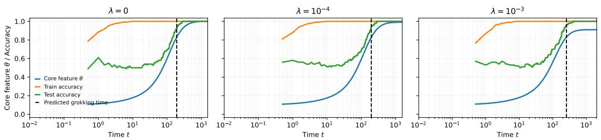

(a) Gradient Descent (Discrete Dynamics)  
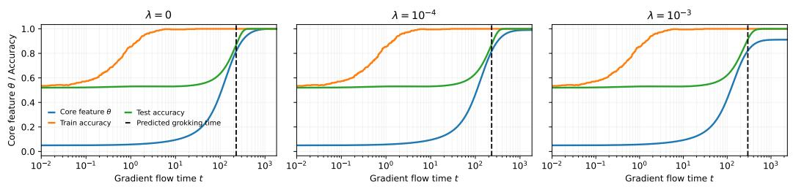  
(b) Gradient Flow (Continuous ODE)  
Figure 5: Grokking in the under-parameterized regime $( \gamma < 1 )$ for gradient descent and continuous gradient flow. Both experiments use $n = 4 0 0$ samples, $d = 3 6 0$ nuisance features $( \gamma = d / n = 0 . 9 )$ , and initial core feature scale $\theta _ { 0 } = 1 0 ^ { - 1 }$ . Signal strength is $\varepsilon = 1 0 ^ { - 1 }$ . (a) Gradient Descent with rescaled time. (b) Continuous Gradient Flow ODE. The close match confirms that the theoretical continuous-time analysis accurately captures discrete GD dynamics.

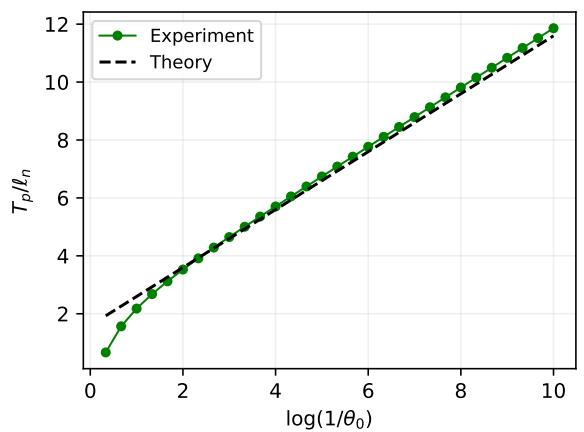

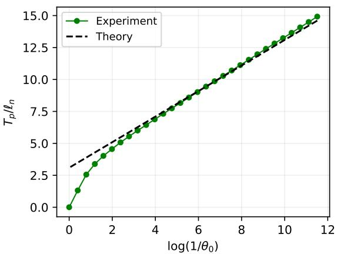  
Figure 6: Logarithmic scaling of grokking time w.r.t core feature initialization $\theta _ { 0 }$ under Gradient Descent. Comparing gradient-flow (left) and gradient-descent (right). The settings are identity to Figure 4 of the main text. GD is run with setup as described in Section C.1.

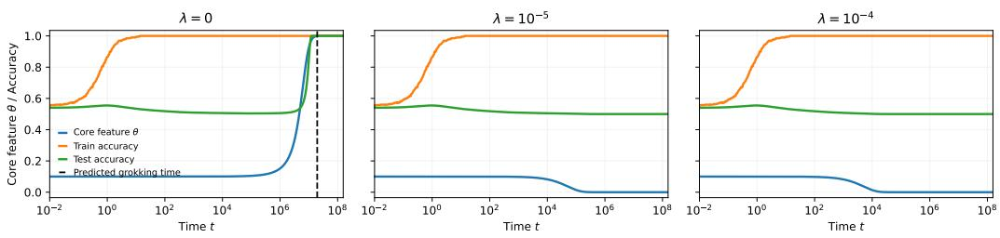  
(a) Vanishing SNR $\varepsilon = 1 0 ^ { - 5 }$

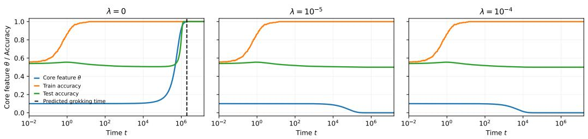  
(b) Very weak SNR $\varepsilon = 1 0 ^ { - 4 }$

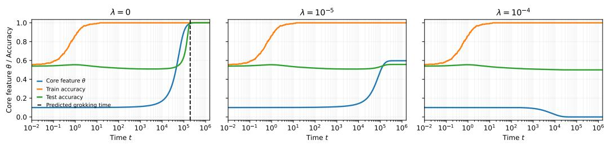  
(c) Weak SNR $\varepsilon = 1 0 ^ { - 3 }$  
Figure 7: Grokking at hard interpolation $\gamma = 1$ . Here we use $n = 4 0 0$ samples and $d = 3 9 5$ nuisance features $( d / n \approx 1 )$ . This is an extension of experiments in Figure 1, using regularized models $\lambda \in \{ 1 0 ^ { - 5 } , 1 0 ^ { - 4 } \}$ . Here, critical threshold is $1 / z _ { p } = 0 . 6 0$ and $b > 1 / z _ { p }$ in last two columns. For fixed n and $d , \beta _ { n } / \sqrt { \rho _ { n } } \to b$ increases as the regularization increases, making grokking harder to happen.

## Appendix D. Additional experimental results

## D.1. Dependence of Grokking Plateau Length on Initialization

See Figure 9.

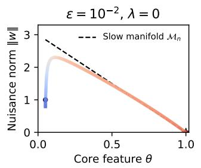

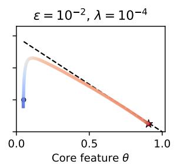

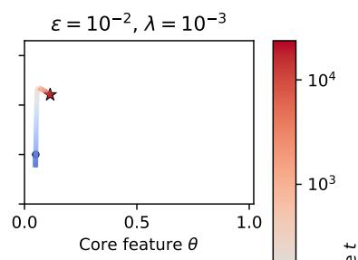

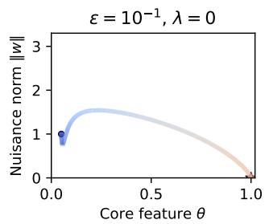

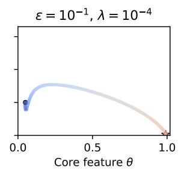

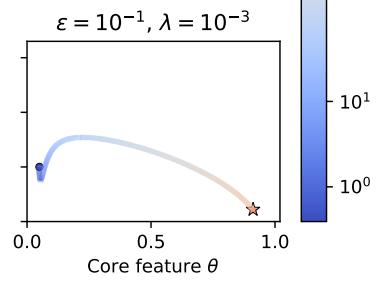  
Figure 8: Phase portrait $\lVert \boldsymbol { w } \rVert$ against θ in under-parametrized model $( \gamma = 0 . 9 )$ Experiments use $n = 4 0 0$ samples, and $d = 3 6 0$ nuisance features. Results illustrate phase portraits from experiments in Figure 2. For small SNR $\varepsilon = 1 0 ^ { - 2 }$ (top row), dynamics exhibit a fast inital relaxation in time scale of O(1) (visible as a near-vertical trajectory at the beginning of training), after which nuisance feature weights w are trapped in slow manifold $\mathcal { M } _ { 0 } ,$ directly validating Theorem 3 via Fenichel theory. Notice that moderate $\mathrm { S R N } \ \varepsilon = 1 0 ^ { - 1 }$ (bottom row) accelerates grokking, yielding a reduced hitting time, in exact agreement with our analytical $T _ { p } \simeq H _ { p } ( \beta ) \ell _ { n }$

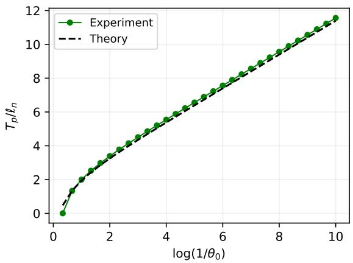  
Figure 9: Plateau length as a function of initialization scale. For these experiments, the signal strength is set to $\varepsilon = 1 0 ^ { - 2 }$ and the weight decay is turned of $( \lambda = 0 )$ . In each case, the straight broken line (theory) represents $y = x + b$ , where $x = \log 1 / \theta _ { 0 }$ and the intercept $b$ is an explicit function of the target test accuracy (here $p = 0 . 9 5 )$ , but not on the initialization $\theta _ { 0 } .$ , etc. The grokking time $T _ { p }$ is measured empirically. The scale $\ell _ { n }$ is as defined in (16). Left: Under-parametrized regime $\gamma < 1$ . We use $n = 4 0 0$ and $d = 3 6 0$ as in Figure 4. The theoretical curve is given by (20). Right: Near the hard interpolation edge $\gamma = 1$ . Here, we use $n = 2 0 0 0$ and $d = 1 8 0 0$ . For the theory curve, we use (21). As in (20), notice the perfect match between experiment and our theoretical predictions from Section 4.3.

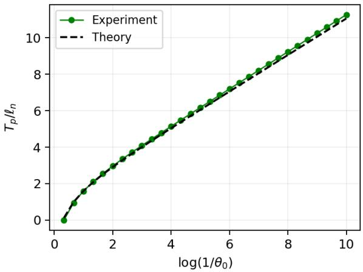  
Figure 10: Plateau length in under-parametrized regime $\gamma < 1$ . Here $n = 1 0 0 0 0$ samples and $d = 8 0 0 0$ , making $k = n - d$ larger. Signal strength is $\varepsilon = 1 0 ^ { - 2 }$ and regularization is odd. Under the limit 16, the measured normalized grokking time is close to the theory as expected.