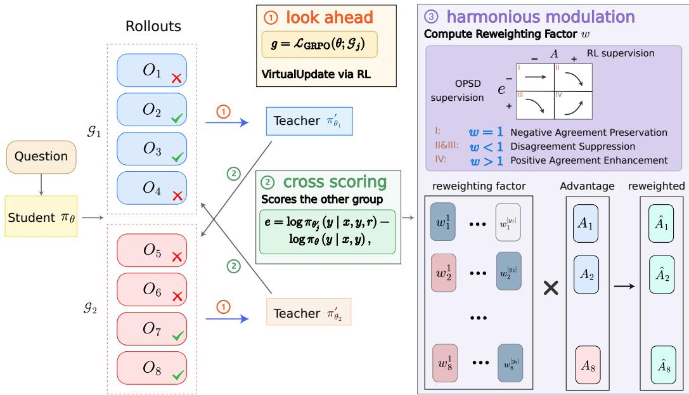
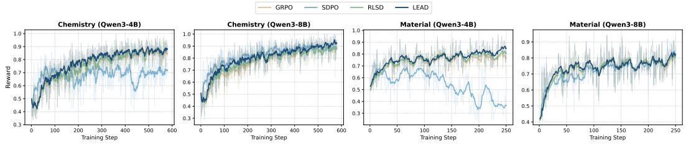
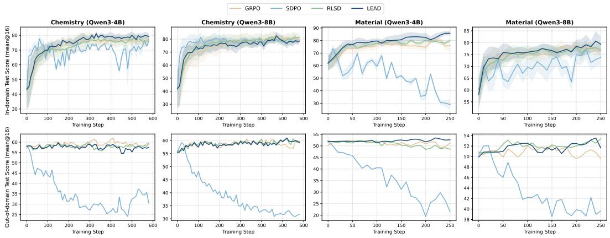

# TEACH ME AFTER YOU LEARN IT: LOOKAHEAD SELF-DISTILLATION FOR RLVR

Zepeng Zhai Meilin Chen∗   
Xiaohongshu Inc.   
{zhaizepeng,chenmeilin2}@xiaohongshu.com

TL;DR: The self-distillation teacher first learns from other on-policy rollouts: a virtual RL update on one half of each rollout group scores the other half, and the agreement between that signal and the GRPO advantage modulates the update.

## ABSTRACT

On-policy self-distillation (OPSD) has emerged as a popular training paradigm for LLMs, providing dense, token-level supervision by aligning a model’s own distribution with the distribution induced by privileged information. However, existing OPSD methods derive supervision solely from privileged information of the same instance, leaving inter-instance supervision largely unexplored. We propose LookahEAd self-Distillation (LEAD), which introduces inter-instance distillation by allowing the teacher to first learn from other on-policy rollouts before teaching the student. LEAD constructs lookahead teachers through virtual RL updates on disjoint subsets of on-policy rollouts, and uses each teacher to provide cross-group token-level supervision for the other subset. To reconcile the complementary yet potentially conflicting signals from OPSD and RLVR, we introduce harmonious modulation, which adaptively modulates the GRPO advantage based on the agreement between the two signals. Extensive experiments on scientific reasoning and interactive-agent benchmarks show that LEAD achieves the best in-domain average performance across model scales while maintaining out-of-domain generalization comparable to GRPO.

## 1 INTRODUCTION

Reinforcement Learning with Verifiable Rewards (RLVR) has emerged as an effective paradigm for improving the reasoning capabilities of large language models (LLMs), where each trajectory receives only a single scalar signal determined by the outcome from the environment. On-policy distillation (OPD) (Agarwal et al., 2024; Gu et al., 2024) complements this by leveraging a stronger teacher model to provide dense, token-level logits as learning signals along the student’s trajectories, enriching the trajectory-level supervision to the token level and thereby achieving faster convergence. Recent work has shown that OPD from advanced teachers can match or even outperform RLVR (Lu & Lab, 2025; Li et al., 2026b), establishing it as an equally compelling paradigm.

Despite its effectiveness, OPD introduces considerable computational overhead due to relying on a separate teacher model, which is typically substantially larger than the student. In addition, OPD performs token-level distribution matching over a shared vocabulary, requiring the teacher and student to adopt the same vocabulary spaces. This architectural constraint further limits the scalability and flexibility of OPD in practice. On-policy self-distillation (OPSD) (Zhao et al., 2026; Hubotter et al.,¨ 2026) provides a more lightweight alternative by dispensing with an external teacher altogether. Instead, a single model plays both roles: it acts as the teacher when conditioned on privileged information, such as a verified reasoning trace or environmental feedback, and as the student when given only the query.

Despite these advantages, recent studies have revealed an inherent limitation of naive OPSD: the privileged teacher can induce undesirable shifts in the student’s output style and cause leakage of privileged information, ultimately leading to degraded out-of-domain generalization (Yang et al., 2026; Pan et al., 2026). Motivated by this, recent approaches seek to combine the benefits of OPSD with the robust optimization signal provided by RLVR. RLSD (Yang et al., 2026) uses the RLVR objective to determine the optimization direction, while treating the self-distillation signal as a modulation of the update magnitude. RLCSD (Pan et al., 2026) further improves the quality of privileged self-distillation signals by contrasting correct and incorrect privileged contexts, thereby suppressing task-irrelevant components such as privilege-induced style shifts. Refer to Appendix A for detailed analysis of related works.

Nevertheless, these approaches still follow the prior OPSD paradigm, where the supervision signal for the i-th query $x _ { i }$ in dataset $D$ is derived from $e _ { i , t } ~ = ~ \log \pi _ { \theta } ^ { T } \left( y _ { i , t } ~ | ~ x _ { i } , y _ { i , < t } , r _ { i } \right) -$ log $\pi _ { \theta } ^ { S } \left( y _ { i , t } \mid x _ { i } , y _ { i , < t } \right)$ , where $y _ { i }$ is a student-sampled rollout, $T$ and S denote the same model under different conditioning, and $r _ { i }$ represents privileged information associated with query $x _ { i }$ . In this paradigm, the supervision signal for $x _ { i }$ is solely derived from privileged information of the current instance $x _ { i }$ , without explicitly considering others in dataset D. We refer to this paradigm as intra-instance distillation. Therefore, an important question arises:

Can the supervision signalfor an instance come not onlyfrom privileged information about the instance itself, but alsofrom others?

Building on this idea, we propose LookahEAd self-Distillation (LEAD), which introduces interinstance distillation by allowing the teacher to first learn from other on-policy rollouts before teaching the student. Specifically, to avoid the supervision entanglement during inter-instance distillation, we split the on-policy rollouts into two groups and perform a Lookahead update on each group independently, yielding two lookahead teachers. Each lookahead teacher then evaluates the rollouts from the other group, forming a Cross Scoring mechanism that transfers knowledge acquired from one group to another. Moreover, existing approaches typically treat the OPSD and RLVR supervision signals independently, overlooking that they may provide complementary yet potentially conflicting guidance. To reconcile them, we introduce Harmonious Modulation, which adaptively modulates the GRPO advantage according to the agreement between the two signals.

In contrast to prior OPSD, where the supervision signal for $x _ { i }$ is solely obtained by conditioning the model on privileged information specific to $x _ { i }$ , LEAD derives supervision from a teacher that has first learned from other instances. Taking advantage of this, the resulting signal provides a more effective and stable optimization direction. Overall, our contributions are threefold:

• We propose LookahEAd self-Distillation (LEAD), which extends self-distillation from intrainstance to inter-instance distillation, enabling the teacher to acquire information from other onpolicy rollouts before providing supervision to the student.

• We introduce Cross Scoring to prevent supervision entanglement by explicitly transferring information across disjoint groups of on-policy rollouts, and Harmonious Modulation to reconcile the complementary yet potentially conflicting OPSD and RLVR signals.

• Extensive experiments across the scientific-reasoning and interactive-agent suites demonstrate LEAD achieves the best in-domain average performance across model scales while maintaining out-of-domain generalization comparable to GRPO.

## 2 PRELIMINARIES

GRPO. Consider a language model $\pi _ { \theta }$ trained to solve reasoning tasks. Given a question $x ,$ the model generates a response $y = ( y _ { 1 } , \dots , y _ { T } )$ autoregressively. In the RLVR setting, a verifier provides a binary reward $R ( x , y ) \in \{ 0 , 1 \}$ indicating whether the response is correct. Group Relative Policy Optimization (GRPO) (Shao et al., 2024) samples a group of $G$ responses $\{ y _ { 1 } , \dots , y _ { G } \}$ from the current policy for each question $x ,$ and computes a sequence-level advantage for each response relative to the group:

$$
A _ { i } = \frac { R ( x , y _ { i } ) - \mu _ { G } } { \sigma _ { G } } ,\tag{1}
$$

  
Figure 1: Overview of LEAD. LEAD consists of three steps: Lookahead, Cross Scoring, and Harmonious Modulation. Refer to Section 3.1 for the details.

where $\mu _ { G }$ and $\sigma _ { G }$ are the mean and standard deviation of the rewards within the group. The policy is then updated via a clipped surrogate objective:

$$
\mathcal { L } _ { \mathrm { G R P O } } ( \theta ) = \mathbb { E } \left[ \frac { 1 } { G } \sum _ { i = 1 } ^ { G } \frac { 1 } { | y _ { i } | } \sum _ { t = 1 } ^ { | y _ { i } | } \operatorname* { m i n } ( \rho _ { i } A _ { i } , \ \mathrm { c l i p } ( \rho _ { i } , 1 - \epsilon , 1 + \epsilon ) A _ { i } ) \right] ,\tag{2}
$$

where $\rho _ { i } = \pi _ { \theta } ( y _ { i , t } \mid x , y _ { i , < t } ) / \pi _ { \theta _ { \mathrm { o l d } } } ( y _ { i , t } \mid x , y _ { i , < t } )$ is the importance sampling ratio between the current and old policies. A key limitation of GRPO is that all tokens within a response share the same advantage $A _ { i } ,$ , as the reward signal is provided only at the sequence level.

OPSD. On-Policy Distillation (OPD) (Agarwal et al., 2024) addresses the sparse reward problem by having the student $\pi _ { S }$ sample its own trajectories while a separate, typically larger, teacher model $\pi _ { T }$ provides dense token-level supervision. While effective, maintaining a distinct teacher model throughout training introduces significant computational overhead. On-Policy Self-Distillation (OPSD) (Zhao et al., 2026; Hubotter et al., 2026) eliminates this requirement by instantiating both¨ roles from a single model $\pi _ { \theta } \colon$ the teacher gains its informational advantage not from greater capacity, but from conditioning on privileged information $r \ ( { \mathrm { e . g . } }$ , a verified reasoning trace).

In OPSD, the teacher and the student are the same model; the teacher is simply granted access to privileged context unavailable to the student, such as a ground-truth solution or terminal feedback from the environment. The standard OPSD objective takes the following dense distillation form:

$$
\mathcal { L } _ { \mathrm { O P S D } } ( \theta ) = \mathbb { E } _ { y \sim \pi _ { S } } \left[ \frac { 1 } { | y | } \sum _ { t = 1 } ^ { | y | } \mathrm { K L } \left( \pi _ { S } ( \cdot  { | } x , y _ { < t } ) \| \mathrm { s g } [ \pi _ { T } ( \cdot  { | } x , r , y _ { < t } ) ] \right) \right] ,\tag{3}
$$

where $T$ and S denote the same model, and $r$ is the privileged context. Inherited from OPD, the OPSD objective is equivalent to reinforcement learning with per-token advantage $A _ { t } = \log \pi _ { T } ( y _ { t } \ |$ $x , r , y _ { < t } ) - \log \pi _ { S } ( y _ { t } \mid x , y _ { < t } )$

## 3 LEAD: LOOKAHEAD SELF-DISTILLATION

## 3.1 FORMULATION

The key idea of LEAD is to let the teacher first acquire information from the current on-policy batch through a lookahead update, and then use the resulting lookahead teacher to provide privileged token-level supervision. This differs from conventional OPSD, where the teacher supervision for a rollout is determined only by privileged information associated with that same rollout.

To understand why such a lookahead teacher can provide additional supervision, consider a batch of N on-policy rollouts $\boldsymbol { B } = \{ z _ { i } = ( x _ { i } , y _ { i } , r _ { i } ) \} _ { i = 1 } ^ { N }$ . For a token $y _ { i , t }$ , we then examine how post update from model parameter πθ to πθ+ with this rollout changes the privileged log-probability of a token from rollout i. Define the post-update privileged log-probability increment

$$
\Delta _ { i , t } = \log \pi _ { \theta ^ { + } } ( y _ { i , t } \mid x _ { i } , y _ { i , < t } , r _ { i } ) - \log \pi _ { \theta } ( y _ { i , t } \mid x _ { i } , y _ { i , < t } , r _ { i } ) .\tag{4}
$$

Proposition 1 (Post-update Privileged Log-probability Decomposition). For a token $y _ { i , t }$ in rollout i, after a first-order policy-gradient update on the whole batch B, the post-update privileged logprobability increment on the $y _ { i , t }$ admits the decomposition

$$
\Delta _ { i , t } = \underbrace { \eta A _ { i } { h _ { i , t } } ^ { \top } V _ { i } } _ { \mathrm { s e l f - i n d u c e d } } + \underbrace { \eta \sum _ { j \ne i } A _ { j } { h _ { i , t } } ^ { \top } V _ { j } } _ { \mathrm { c r o s s i n d u c e d } } + o ( \eta ) .\tag{5}
$$

where $u _ { i , t } ~ = ~ \log \pi _ { \theta } ( y _ { i , t } ~ \vert ~ x _ { i } , y _ { i , < t } )$ , and $s _ { i , t } = \log \pi _ { \theta } ( y _ { i , t } \mid x _ { i } , y _ { i , < t } , r _ { i } )$ define the RL logprobability and the privileged log-probability, with corresponding gradients $v _ { i , t } = \nabla _ { \theta } u _ { i , t } , h _ { i , t } =$ $\dot { \nabla } _ { \theta } s _ { i , t }$ respectively. $\begin{array} { r } { V _ { i } = \sum _ { k } v _ { i , k } } \end{array}$ denote the aggregate RL gradient of rollout $i . A _ { i } \in \mathbb { R }$ denotes the advantage of rollout i and η is the learning rate of RL update. Refer to Appendix C.1 for detailed proof.

Proposition 1 reveals that the post-update privileged log-probability increment of an instance consists of two distinct components. The self-induced term reflects how the RL signal of the instance itself changes its privileged prediction, whereas the cross-induced term captures how learning from other instances affects the privileged prediction of the current instance.

Importantly, the self-induced term introduces a phenomenon we refer to as supervision entanglement: the RL signal first updates the model based on this instance, and the updated model is then used to evaluate the privileged prediction of the very same instance. Such supervision entanglement can amplify instance-specific biases that are not necessarily beneficial for generalization. In contrast, the cross-induced term arises from the interaction between the privileged prediction of one instance and the RL learning signal from other instances. The resulting supervision therefore reflects information acquired across instances rather than repeatedly reusing supervision from the same instance.

Motivated by this observation, LEAD introduces a cross-scoring design: the teacher is first updated using one set of on-policy rollouts and then used to score another set of rollouts. This design explicitly exploits the inter-instance distillation while avoiding the supervision entanglement, as detailed in the following section.

## 3.2 LEAD

As shown in Figure 1, given an on-policy batch of queries and their sampled rollouts, LEAD pro ceeds through three key steps. First, in Lookahead, we split the on-policy rollouts into subsets and perform a virtual RL update on each subset, allowing the model to acquire information from the corresponding rollouts without modifying the actual model parameters. Second, in Cross Scoring, the resulting lookahead teacher from one subset is used to evaluate rollouts from another subset, thereby transferring learning signals across instances and explicitly capturing the inter-instance supervision identified in Proposition 1. Finally, in Harmonious Modulation, we combine the resulting OPSD signal with the RLVR signal, leveraging their complementary information while accounting for the potential conflict between the two supervision signals.

## 3.2.1 LOOKAHEAD

Let θ denote the current policy parameters and let ${ \mathcal { L } } _ { \mathrm { G R P O } } ( \theta ; { \mathcal { G } } )$ denote the GRPO objective trained on a subset of rollouts ${ \bar { \mathcal { G } } } .$ Concretely, consider an on-policy batch consisting of $Q$ queries with G sampled rollouts each, so that $N = { \dot { Q } } G$ . We partition the rollouts along the rollout dimension into two disjoint groups of ${ \frac { 1 } { 2 } } Q G$ rollouts each, denoted by $\mathcal { G } _ { 1 }$ and $\mathcal { G } _ { 2 }$

For each group $\mathcal { G } _ { j }$ , we first use the RL gradient to construct a lookahead parameter state that approximates the model after learning from $\mathcal { G } _ { j }$

$$
\theta _ { j } ^ { \prime } = \mathrm { V i r t u a l U p d a t e } ( \theta , \mathcal { L } _ { \mathrm { G R P O } } ( \theta ; \mathcal { G } _ { j } ) ) , \qquad j \in \{ 1 , 2 \} .\tag{6}
$$

In practice, VirtualUpdate follows the same parameter-update rule as the underlying optimizer, including its accumulated optimization statistics, while keeping the original model parameters and the optimizer state unchanged. Thus, $\theta _ { j } ^ { \prime }$ represents a learned model that has taken one RL update on the rollouts in $\mathcal { G } _ { j }$

## 3.2.2 CROSS SCORING

After constructing the two lookahead teachers, we evaluate each group using the teacher obtained from the other group. Specifically, for a rollout $y _ { i }$ belonging to $\mathcal { G } _ { 2 }$ , its token-level OPSD supervision under the lookahead teacher $\theta _ { 1 } ^ { \prime }$ is

$$
e _ { i , t } = \log \pi _ { \theta _ { 1 } ^ { \prime } } \left( y _ { i , t } \mid x _ { i } , y _ { i , < t } , r _ { i } \right) - \log \pi _ { \theta } \left( y _ { i , t } \mid x _ { i } , y _ { i , < t } \right) ,\tag{7}
$$

Similarly, rollouts in $\mathcal { G } _ { 1 }$ are scored by $\theta _ { 2 } ^ { \prime }$ . Since the magnitude of $e _ { i , t }$ depends on the scale of the virtual update, we normalize the signal within the batch:

$$
\hat { e } _ { i , t } = \mathrm { c l i p } \left( \frac { e _ { i , t } - \mu _ { e } } { \sigma _ { e } + 1 0 ^ { - 6 } } , - c , c \right) ,\tag{8}
$$

where $\mu _ { e }$ and $\sigma _ { e }$ denote the batch mean and standard deviation of $e _ { i , t } ,$ , and c is a hyperparameter that controls the maximum magnitude of the normalized signal. This normalization removes the dependence of the signal magnitude on the absolute scale of the virtual update while retaining its directional information.

## 3.2.3 HARMONIOUS MODULATION

Existing approaches typically treat the two supervision signals independently, overlooking that they may provide complementary yet potentially conflicting guidance during optimization. GRPO provides outcome-based credit assignment from the current on-policy rollouts, whereas LEAD captures how the model’s token-level log-probabilities would change after learning from other rollouts. Their learning signals may therefore point in different directions. To reconcile these two sources of supervision, LEAD introduces Harmonious Modulation, which adaptively modulates the GRPO advantage according to the agreement between the two signals.

The GRPO advantage is modulated by a reweighting factor:

$$
\hat { A } _ { i , t } = w _ { i , t } A _ { i , t } .\tag{9}
$$

Positive Agreement Enhancement applies when both the lookahead signal and the GRPO advantage are positive. Since the two signals reinforce the same positive learning direction, we increase the magnitude of the advantage accordingly. Disagreement Suppression applies when the two signals point in opposite directions. We reduce the magnitude of the GRPO advantage to mitigate the conflict while preserving the outcome-based RL direction. Finally, Negative Agreement Preservation applies when both signals are non-positive. In this case, we leave the advantage unchanged rather than further amplifying a negative update. Specifically, we define the reweighting factor as

$$
w _ { i , t } = \left\{ \begin{array} { l l } { 1 + \rho _ { a } \frac { \left| \hat { e } _ { i , t } \right| } { c } , } & { \hat { e } _ { i , t } > 0 , ~ A _ { i , t } > 0 , ~ \mathrm { ( i ) ~ P o s i t i v e ~ A g r e e m e n t ~ E n h a n c e m e n t } } \\ { 1 - \rho _ { b } \frac { \left| \hat { e } _ { i , t } \right| } { c } , } & { \hat { e } _ { i , t } A _ { i , t } < 0 , ~ \mathrm { ( i i ) ~ D i s a g r e e m e n t ~ S u p p r e s s i o n } } \\ { 1 , } & { \mathrm { o t h e r w i s e } . } \end{array} \right.\tag{10}
$$

where $\rho _ { a } \geq 0$ and $\rho _ { b } \in [ 0 , 1 ]$ control the strengths of positive-agreement enhancement and disagreement suppression, respectively. Since $\hat { e } _ { i , t }$ is clipped to $[ - c , c ]$ , the normalized magnitude $| \hat { e } _ { i , t } | / c$ lies in [0, 1].

Therefore, the reweighting factor satisfies

$$
w _ { i , t } \in [ 1 - \rho _ { b } , 1 + \rho _ { a } ] .\tag{11}
$$

where $\rho _ { a }$ determines the maximum relative amplification under positive agreement, whereas $\rho _ { b }$ determines the maximum relative attenuation under disagreement.

LEAD only modulates the magnitude of the GRPO advantage without changing its sign. The resulting $\hat { A } _ { i , t }$ is then used in place of Ai in the standard GRPO objective.

## 4 EXPERIMENTS

## 4.1 SETUPS

Models and Benchmarks. We evaluate all methods with two Qwen3 (Yang et al., 2025) backbone models of different scales, Qwen3-4B and Qwen3-8B, to examine whether the benefits of LEAD persist across model sizes. We evaluate LEAD on two complementary datasets: scientific reasoning, which focuses on single-response reasoning with outcome-based rewards, and interactive agents, which requires long-horizon, multi-turn decision making with sparse and delayed rewards. Together, these benchmarks allow us to examine whether the benefits of inter-instance supervision extend from conventional reasoning tasks to more challenging agentic settings.

• Scientific reasoning. Following prior works (Hubotter et al., 2026; Yang et al., 2026), we train¨ on four datasets from the reasoning subset (L3) of SciKnowEval (Feng et al., 2024), covering undergraduate-level Biology, Chemistry, Materials Science, and Physics.

• Interactive agents. We further evaluate on three agent benchmarks following SDAR (Lu et al., 2026): ALFWorld (Shridhar et al., 2021) for embodied household tasks, WebShop (Yao et al., 2022) for web navigation and purchase, and Search (Jin et al., 2025) for tool-augmented question answering. This setting provides a more challenging test of LEAD because each training example consists of multiple agent turns with sparse, end-of-episode rewards.

Scientific Reasoning Dataset Curation. SciKnowEval (Feng et al., 2024) is widely used by prior works (Hubotter et al., 2026; Yang et al., 2026) for evaluations. However, we identified inconsis-¨ tencies in the original dataset release, including malformed options and questions without a valid answer. We therefore perform a systematic audit using independent judgments from GPT-5.5 and Claude Opus 5. For the training split, items with consistent judgments are retained, relabelled, or minimally rewritten, while inconsistent cases are removed. The curation primarily affects Physics: approximately 27% of its training items require correction or removal, compared with less than 4% in Biology, Chemistry, and Materials Science combined. The test split is affected far less: 4.8% of its items are removed and 2.7% are corrected. Human verification further shows 99.3% agreement with the curated answers across randomly sampled items. Detailed curation criteria, statistics, and representative cases are provided in Appendix B.

Evaluation Settings. Following Pan et al. (2026), we adopt a unified evaluation protocol to separately assess in-domain performance and cross-domain generalization. For each method and each domain, we train one model using the training split of that domain, starting from the corresponding base model. The resulting model is then evaluated on the test splits of all domains within the same suite. Specifically:

• In-domain evaluation. The model is evaluated on the test split of the same domain used for training. This measures performance on the domain seen during training.

• Out-of-domain (OOD) evaluation. The same model is evaluated on the test splits of all other domains in the suite, without any further training or adaptation. We report the average performance across these unseen domains to measure cross-domain generalization.

Metrics. On the scientific-reasoning suite we sample 16 responses per test question and report the mean accuracy, denoted mean@16; a response counts as correct only if the verifier matches it against the ground-truth answer. On the interactive-agent suite, ALFWorld and WebShop are scored by the environment’s episode success rate over a fixed held-out set, and Search by the mean exact-match score over its seven constituent QA datasets. All numbers are reported in percent.

Following Hubotter et al. (2026), in-domain scores are the maximum value reached over the eval-¨ uation checkpoints of a run, whereas OOD scores are averaged over the last three checkpoints: the former measures how far a method can push the training domain, the latter describes the model obtained at the end of training and is therefore insensitive to a transient peak. Evaluation is run every 10 global steps on the scientific suite and every 5 steps on the agent suite.

Table 1: In-domain results across the scientific-reasoning and interactive-agent suites. Each result is evaluated on the test split of the same domain used for training. Maximum mean@16 (%) and success rate (%) is reported on the scientific-reasoning and interactive-agent suites, respectively. Base is the untrained model and is listed for reference and excluded from the ranking. Bold indicates the best result among the four training methods and underline the second best. On the scientificreasoning suite, both the training and the test splits are curated as described in Appendix B, and all methods use the same curated splits.
<table><tr><td rowspan="2">Method</td><td colspan="4">Scientific Reasoning</td><td rowspan="2"></td><td colspan="4">Interactive Agent</td></tr><tr><td>Bio.</td><td>Chem.</td><td>Mate.</td><td>Phy.</td><td>AlfWorld</td><td>WebShop</td><td>Search</td><td>Avg.</td></tr><tr><td colspan="10">Qwen3-4B</td></tr><tr><td>Base Model</td><td>31.86</td><td>43.67</td><td>61.74</td><td>79.67</td><td>54.24</td><td>30.68</td><td>2.73</td><td>27.03</td><td>20.15</td></tr><tr><td>GRPO</td><td>52.50</td><td>78.05</td><td>80.51</td><td>94.77</td><td>76.46</td><td>71.40</td><td>75.80</td><td>41.60</td><td>62.93</td></tr><tr><td>SDPO</td><td>52.12</td><td>77.48</td><td>73.72</td><td>86.99</td><td>72.58</td><td>57.00</td><td>79.20</td><td>39.56</td><td>58.59</td></tr><tr><td>RLSD</td><td>52.88</td><td>78.51</td><td>80.38</td><td>94.67</td><td>76.61</td><td>68.80</td><td>78.10</td><td>40.50</td><td>62.47</td></tr><tr><td>LEAD (ours)</td><td>53.87</td><td>81.19</td><td>85.82</td><td>93.65</td><td>78.63</td><td>72.70</td><td>79.30</td><td>42.50</td><td>64.83</td></tr><tr><td colspan="10">Qwen3-8B</td></tr><tr><td>Base Model</td><td>30.47</td><td>41.87</td><td>58.78</td><td>78.84</td><td>52.49</td><td>18.20</td><td>5.47</td><td>18.26</td><td>13.98</td></tr><tr><td>GRPO</td><td>54.87</td><td>82.57</td><td>78.83</td><td>91.80</td><td>77.02</td><td>71.10</td><td>84.40</td><td>41.99</td><td>65.83</td></tr><tr><td>SDPO</td><td>60.88</td><td>81.40</td><td>77.15</td><td>87.91</td><td>76.84</td><td>75.00</td><td>84.40</td><td>41.19</td><td>66.86</td></tr><tr><td>RLSD</td><td>56.88</td><td>81.52</td><td>78.23</td><td>92.32</td><td>77.24</td><td>73.30</td><td>88.30</td><td>41.56</td><td>67.72</td></tr><tr><td>LEAD (ours)</td><td>58.50</td><td>82.60</td><td>80.70</td><td>94.26</td><td>79.02</td><td>84.40</td><td>86.70</td><td>42.19</td><td>71.10</td></tr></table>

Baselines. We compare LEAD against three baselines: (1) GRPO (Shao et al., 2024) group relative policy optimization with binary outcome rewards verified against ground-truth answers; (2) SDPO (Hubotter et al., 2026) is a representative¨ dense OPSD method, which constructs denselogit distillation using Jensen–Shannon divergence; (3) RLSD (Yang et al., 2026) that uses the teacher–student probability gap on sampled tokens to modulate advantage.

Implementation Details. For each dataset in scientific-reasoning suite, we sample G = 8 onpolicy rollouts with a training batch of 32 queries (256 rollouts per global batch). For the agent suite, we follow the protocol of SDAR (Lu et al., 2026) and refer to Appendix B.1 for detailed implementation. For LEAD, the virtual RL update uses an inner learning rate of $\eta _ { \mathrm { i n } } = 1 0 ^ { - 5 }$ to obtain the lookahead teacher parameters. We disable this virtual update for the first 10 global steps and use a first-moment estimate consisting of 0.7 historical momentum and 0.3 of the current halfbatch gradient. The resulting virtual RL update is applied only to construct the lookahead teacher and does not modify the actual model parameters. The lookahead signal is clipped at $c = 3 . 0 \AA$ with $\rho _ { a } = 0 . 1$ and $\rho _ { b } = 0 . 3 ; \rho _ { b }$ is linearly annealed to zero over the first 70% of training. More implementation details are provided in Appendix B.1.

## 4.2 MAIN RESULTS

In-Domain Results. As shown in Table 1, LEAD consistently improves in-domain performance across both model scales and task suites. In scientific reasoning, LEAD achieves the highest performance for both Qwen3-4B and Qwen3-8B, outperforming the strongest baseline by 2.02 and 1.78 points, respectively. The same trend extends to interactive agents. On Qwen3-4B, LEAD is the best method on all three benchmarks (72.70, 79.30 and 42.50), giving an agent average of 64.83 against 62.93 for GRPO and 62.47 for RLSD. On Qwen3-8B, LEAD is the best on ALFWorld (84.40) and Search (42.19) and the second best on WebShop. These results suggest that the inter-instance supervision captured by the lookahead teacher remains beneficial across both conventional reasoning and sparse-reward, multi-turn agent tasks.

Table 2: Out-of-domain results across the scientific-reasoning and interactive-agent suites. Each result is the averaged performance of the model trained on the corresponding domain while evaluated on the remaining domains of the same suite. Bold indicates the best result among the four training methods and underline the second best.
<table><tr><td rowspan="2">Method</td><td colspan="4">Scientific Reasoning</td><td rowspan="2"></td><td colspan="4">Interactive Agent</td></tr><tr><td>Bio.</td><td>Chem.</td><td>Mate.</td><td>Phy.</td><td>AlfWorld</td><td>WebShop</td><td>Search</td><td>Avg.</td></tr><tr><td colspan="10">Qwen3-4B</td></tr><tr><td>Base Model</td><td>61.69</td><td>57.76</td><td>51.73</td><td>45.76</td><td>54.24</td><td>14.88</td><td>28.85</td><td>16.70</td><td>20.14</td></tr><tr><td>GRPO</td><td>60.52</td><td>58.89</td><td>50.06</td><td>48.37</td><td>54.46</td><td>14.28</td><td>30.67</td><td>20.45</td><td>21.80</td></tr><tr><td>SDPO</td><td>33.98</td><td>33.53</td><td>25.92</td><td>38.23</td><td>32.92</td><td>12.93</td><td>25.05</td><td>21.35</td><td>19.78</td></tr><tr><td>RLSD</td><td>59.88</td><td>58.63</td><td>48.83</td><td>47.20</td><td>53.64</td><td>14.43</td><td>28.41</td><td>18.02</td><td>20.29</td></tr><tr><td>LEAD (ours)</td><td>58.98</td><td>57.31</td><td>52.72</td><td>48.07</td><td>54.27</td><td>15.01</td><td>28.09</td><td>21.73</td><td>21.61</td></tr><tr><td colspan="10">Qwen3-8B</td></tr><tr><td>Base Model</td><td>59.83</td><td>56.03</td><td>50.39</td><td>43.71</td><td>52.49</td><td>11.87</td><td>18.23</td><td>11.84</td><td>13.98</td></tr><tr><td>GRPO</td><td>61.53</td><td>59.66</td><td>50.57</td><td>45.45</td><td>54.30</td><td>8.65</td><td>13.19</td><td>19.50</td><td>13.78</td></tr><tr><td>SDPO</td><td>41.72</td><td>31.35</td><td>40.26</td><td>43.41</td><td>39.19</td><td>11.71</td><td>11.14</td><td>11.15</td><td>11.33</td></tr><tr><td>RLSD</td><td>61.12</td><td>59.55</td><td>53.01</td><td>45.37</td><td>54.76</td><td>11.16</td><td>13.76</td><td>16.22</td><td>13.71</td></tr><tr><td>LEAD (ours)</td><td>61.21</td><td>59.64</td><td>52.79</td><td>45.93</td><td>54.89</td><td>10.01</td><td>14.05</td><td>18.40</td><td>14.15</td></tr></table>

Out-of-Domain Results. Table 2 shows that LEAD largely preserves the OOD performance of GRPO while achieving substantially higher in-domain accuracy. On scientific reasoning, LEAD obtains OOD averages of 54.27 and 54.89 on Qwen3-4B and Qwen3-8B, nearly matching GRPO at the smaller scale and achieving the best OOD performance at the larger scale, while improving its in-domain averages over GRPO by 2.17 and 2.00 points as shown in Table 1. In contrast, SDPO exhibits a substantial OOD degradation at both scales, whereas RLSD remains close to GRPO, suggesting that directly injecting dense privileged supervision can be detrimental to cross-domain generalization, while bounded advantage modulation better preserves the outcome-supervised learning behavior. On the interactive-agent suite, however, the OOD performance of all methods falls to 19–22% on Qwen3-4B and 11–15% on Qwen3-8B, far below their in-domain scores. LEAD ranks second on Qwen3-4B (21.61 vs. 21.80 for GRPO) and achieves the highest OOD performance on Qwen3-8B (14.15). In contrast to the scientific domains, ALFWorld, WebShop, and Search differ substantially in their action spaces and observation formats, making cross-benchmark transfer more challenging and limiting the benefit of any single training objective. Overall, these results show that LEAD improves in-domain performance without sacrificing the generalization.

## 4.3 TRAINING DYNAMICS

Figures 2 and 3 provide a step-by-step view of training on Chemistry and Materials Science, complementing the final results reported in Tables 1 and 2. LEAD consistently achieves strong training rewards and in-domain performance throughout training, with faster convergence in the early stages and a sustained advantage toward the end of training. Meanwhile, its out-of-domain performance remains relatively stable across the training process, in contrast to the progressive degradation observed for SDPO. Overall, these dynamics show that LEAD accelerates in-domain learning while better preserving performance on unseen domains throughout training.

## 4.4 MORE ANALYSIS

We conduct the ablation study on the scientific-reasoning suite with Qwen3-4B, keeping all other hyperparameters identical to the main experiments. Table 3 evaluates the contribution of the three key components of LEAD: Lookahead, Cross-Scoring, and Harmonious Modulation.

Lookahead. Removing the lookahead update (w/o lookahead) reduces the in-domain average from 78.63 to 76.10, a drop of 2.53 points. This variant uses the current model θ directly as the teacher, retaining the privileged-context supervision without allowing the teacher to first acquire information from the on-policy batch. The degradation across Biology, Chemistry, and Materials

Table 3: Ablation study on the scientific-reasoning suite (Qwen3-4B). In-domain is the maximum mean@16 (%) reached during training on that domain; out-of-domain is the accuracy of the same model on the remaining three domains, averaged over the last three evaluation checkpoints. Bold indicates the best result in each column and underline the second best.
<table><tr><td rowspan="2">Variant</td><td colspan="5">In-domain</td><td colspan="5">Out-of-domain</td></tr><tr><td>Bio.</td><td>Chem.</td><td>Mate.</td><td>Phy.</td><td>Avg.</td><td>Bio.</td><td>Chem.</td><td>Mate.</td><td>Phy.</td><td>Avg.</td></tr><tr><td>LEAD</td><td>53.87</td><td>81.19</td><td>85.82</td><td>93.65</td><td>78.63</td><td>58.98</td><td>57.31</td><td>52.72</td><td>48.07</td><td>54.27</td></tr><tr><td>Lookahead</td><td></td><td></td><td></td><td></td><td></td><td></td><td></td><td></td><td></td><td></td></tr><tr><td>w/o lookahead</td><td>51.50</td><td>79.34</td><td>80.51</td><td>93.06</td><td>76.10</td><td>60.04</td><td>56.23</td><td>51.60</td><td>48.49</td><td>54.09</td></tr><tr><td>Cross-Scoring</td><td></td><td></td><td></td><td></td><td></td><td></td><td></td><td></td><td></td><td></td></tr><tr><td>w/ self-induced</td><td>52.38</td><td>80.92</td><td>81.45</td><td>92.83</td><td>76.90</td><td>59.25</td><td>56.05</td><td>53.06</td><td>46.43</td><td>53.70</td></tr><tr><td>Harmonious Modulation</td><td></td><td></td><td></td><td></td><td></td><td></td><td></td><td></td><td></td><td></td></tr><tr><td>w/o (i)</td><td>57.12</td><td>78.77</td><td>80.71</td><td>93.85</td><td>77.61</td><td>55.00</td><td>57.27</td><td>50.57</td><td>45.41</td><td>52.06</td></tr><tr><td>w/o (ii) (A &gt; 0)</td><td>51.12</td><td>79.16</td><td>80.71</td><td>92.62</td><td>75.90</td><td>59.17</td><td>57.84</td><td>51.19</td><td>47.93</td><td>54.03</td></tr><tr><td>w/o (ii) (A &lt; 0)</td><td>51.75</td><td>80.38</td><td>82.53</td><td>93.55</td><td>77.05</td><td>56.56</td><td>57.58</td><td>51.20</td><td>48.64</td><td>53.50</td></tr><tr><td>w/o(iii)</td><td>49.75</td><td>80.47</td><td>81.38</td><td>93.03</td><td>76.16</td><td>59.67</td><td>56.82</td><td>51.45</td><td>47.38</td><td>53.83</td></tr></table>

Science indicates that the additional information acquired through the virtual RL update contributes meaningfully to the learning signal. The OOD average also decreases slightly from 54.27 to 54.09.

Cross-Scoring. To isolate the effect of cross-scoring, we replace the cross-group scoring scheme with a self-induced variant (w/ self-induced), where each lookahead teacher scores the same rollouts that were used to construct it. This modification reintroduces the self-induced component identified in Proposition 1 while preserving the lookahead update itself. The in-domain average drops from 78.63 to 76.90, corresponding to a 1.73-point degradation. This result highlights the importance of using information acquired from other instances rather than repeatedly coupling the privileged signal with the RL signal from the same instance.

Harmonious Modulation. We further ablate the three cases defined in Eq. 10: Positive Agreement Enhancement (i), Disagreement Suppression (ii), and Negative Agreement Preservation (iii). Removing Positive Agreement Enhancement (w/o (i)) reduces the in-domain average to 77.61 and the OOD average to 52.06; this variant reaches the highest Biology (57.12) and Physics (93.85) scores of the table, but its average over the four domains remains below LEAD’s. Removing Disagreement Suppression for positive advantages (w/o (ii) (A > 0)) reduces the in-domain average to 75.90, while the OOD average is 54.03. The corresponding ablation for negative advantages (w/o (ii) (A < 0)) reduces the in-domain average to 77.05, while the OOD average is 53.50. Finally, removing Negative Agreement Preservation (w/o (iii)) reduces the in-domain average to 76.16 and the OOD average to 53.83. These results suggest that the effectiveness of Harmonious Modulation comes from coordinating the three cases: strengthening positive agreement, suppressing disagreement, and preserving the magnitude of negative updates when the two signals agree.

Computational Cost. LEAD introduces an additional lookahead update compared with prior OPSD methods. Table 4 reports the wall-clock time per training step on the scientific-reasoning suite with Qwen3-4B. The additional overhead of LEAD is small: it is 7.8% slower than GRPO and 6.0% slower than RLSD. This overhead is expected to be even smaller for long-reason tasks, such as mathematics and code generation, where rollout generation accounts for a larger fraction of the total step time. In comparison, SDPO is 16.5% slower than GRPO and 8.0% slower than LEAD. This larger overhead likely stems from its dense token-level distillation over the top-k vocabulary, which makes the optimization stage more expensive than the sampled-token-level modulation used by RLSD and LEAD.

Table 4: Wall-clock time per training step (seconds), scientific-reasoning suite with Qwen3-4B, averaged over the four domains. Generation is the rollout stage; Update covers the teacher forward passes, the log-probability recomputation and the policy update.
<table><tr><td>Method</td><td>Generation (s/step)</td><td>Update (s/step)</td><td>Total step (s/step)</td></tr><tr><td>GRPO</td><td>16.30</td><td>9.06</td><td>25.36</td></tr><tr><td>SDPO</td><td>16.03</td><td>13.52</td><td>29.55</td></tr><tr><td>RLSD</td><td>15.88</td><td>9.92</td><td>25.80</td></tr><tr><td>LEAD (ours)</td><td>15.78</td><td>11.57</td><td>27.35</td></tr></table>

## 5 CONCLUSION

We introduced LEAD, a novel on-policy self-distillation method that enables the teacher to first learn from other on-policy rollouts before teaching the student. Results on reasoning and agent tasks demonstrate consistent in-domain improvements and strong OOD robustness.

## AI USE STATEMENT

In this work, we used generative AI tools for aiding and polishing the writing of the manuscript, including improving grammar, clarity, readability, and presentation. We have not used generative AI tools for research design, data collection, data analysis, experimental execution, or the generation or verification of experimental results, and the rest of the required disclosure tasks are not applicable to this work. We have reviewed all AI-assisted work and verified the accuracy and consistency of the resulting text. We take responsibility for the final content of this work, including text, claims, and artifacts produced with the aid of generative AI.

## REFERENCES

Rishabh Agarwal, Nino Vieillard, Yongchao Zhou, Piotr Stanczyk, Sabela Ramos Garea, Matthieu Geist, and Olivier Bachem. On-policy distillation of language models: Learning from selfgenerated mistakes. In International Conference on Learning Representations, volume 2024, pp. 21246–21263, 2024.

Kehua Feng, Keyan Ding, Weijie Wang, Xiang Zhuang, Zeyuan Wang, Ming Qin, Yu Zhao, Jianhua Yao, Qiang Zhang, and Huajun Chen. Sciknoweval: Evaluating multi-level scientific knowledge of large language models. arXiv preprint arXiv:2406.09098, 2024.

Lang Feng, Zhenghai Xue, Tingcong Liu, and Bo An. Group-in-group policy optimization for llm agent training. arXiv preprint arXiv:2505.10978, 2025.

Yuxian Gu, Li Dong, Furu Wei, and Minlie Huang. Minillm: Knowledge distillation of large language models. In International Conference on Learning Representations, volume 2024, pp. 32694–32717, 2024.

Zihao Han, Tiangang Zhang, Huaibin Wang, and Yilun Sun. Adaptive teacher exposure for selfdistillation in llm reasoning. arXiv preprint arXiv:2605.11458, 2026.

Guangya Hao, Yitong Shang, Yunbo Long, Zhuokai Zhao, and Hanxue Liang. Self-policy distillation via capability-selective subspace projection. arXiv preprint arXiv:2605.22675, 2026.

Jonas Hubotter, Frederike L¨ ubeck, Lejs Behric, Anton Baumann, Marco Bagatella, Daniel Marta,¨ Ido Hakimi, Idan Shenfeld, Thomas Kleine Buening, Carlos Guestrin, et al. Reinforcement learning via self-distillation. arXiv preprint arXiv:2601.20802, 2026.

Bowen Jin, Hansi Zeng, Zhenrui Yue, Dong Wang, Hamed Zamani, and Jiawei Han. Search-r1: Training llms to reason and leverage search engines with reinforcement learning. arXiv preprint arXiv:2503.09516, 2025.

Jongwoo Ko, Sungnyun Kim, Tianyi Chen, and Se-Young Yun. Distillm: Towards streamlined distillation for large language models. arXiv preprint arXiv:2402.03898, 2024.

Gengsheng Li, Tianyu Yang, Junfeng Fang, Mingyang Song, Mao Zheng, Haiyun Guo, Dan Zhang, Jinqiao Wang, and Tat-Seng Chua. Unifying group-relative and self-distillation policy optimization via sample routing. arXiv preprint arXiv:2604.02288, 2026a.

Yaxuan Li, Yuxin Zuo, Bingxiang He, Jinqian Zhang, Chaojun Xiao, Cheng Qian, Tianyu Yu, Huanang Gao, Wenkai Yang, Zhiyuan Liu, et al. Rethinking on-policy distillation of large language models: Phenomenology, mechanism, and recipe. arXiv preprint arXiv:2604.13016, 2026b.

Zichen Liu, Changyu Chen, Wenjun Li, Penghui Qi, Tianyu Pang, Chao Du, Wee Sun Lee, and Min Lin. Understanding r1-zero-like training: A critical perspective. arXiv preprint arXiv:2503.20783, 2025.

Kevin Lu and Thinking Machines Lab. On-policy distillation. Thinking Machines Lab: Connectionism, 2025. doi: 10.64434/tml.20251026. https://thinkingmachines.ai/blog/on-policy-distillation.

Zhengxi Lu, Zhiyuan Yao, Qi Gu, and Yongliang Shen. SDAR: Self-distilled agentic reinforcement learning. arXiv preprint arXiv:2605.15155, 2026.

Leyi Pan, Shuchang Tao, Yunpeng Zhai, Zheyu Fu, Liancheng Fang, Minghua He, Lingzhe Zhang, Zhaoyang Liu, Bolin Ding, Aiwei Liu, et al. d-treerpo: Towards more reliable policy optimization for diffusion language models. arXiv preprint arXiv:2512.09675, 2025.

Leyi Pan, Shuchang Tao, Yunpeng Zhai, Lingzhe Zhang, Zhaoyang Liu, Bolin Ding, Aiwei Liu, and Lijie Wen. Rlcsd: Reinforcement learning with contrastive on-policy self-distillation. arXiv preprint arXiv:2606.11709, 2026.

Zhihong Shao, Peiyi Wang, Qihao Zhu, Runxin Xu, Junxiao Song, Xiao Bi, Haowei Zhang, Mingchuan Zhang, YK Li, Yang Wu, et al. Deepseekmath: Pushing the limits of mathematical reasoning in open language models. arXiv preprint arXiv:2402.03300, 2024.

Guangming Sheng, Chi Zhang, Zilingfeng Ye, Xibin Wu, Wang Zhang, Ru Zhang, Yanghua Peng, Haibin Lin, and Chuan Wu. Hybridflow: A flexible and efficient rlhf framework. In Proceedings ofthe Twentieth European Conference on Computer Systems, pp. 1279–1297. ACM, March 2025. doi: 10.1145/3689031.3696075. URL http://dx.doi.org/10.1145/3689031. 3696075.

Mohit Shridhar, Xingdi Yuan, Marc-Alexandre Cotˆ e, Yonatan Bisk, Adam Trischler, and Matthew´ Hausknecht. ALFWorld: Aligning text and embodied environments for interactive learning. In International Conference on Learning Representations (ICLR), 2021.

Yecheng Wu, Song Han, and Hai Cai. Lightning opd: Efficient post-training for large reasoning models with offline on-policy distillation. arXiv preprint arXiv:2604.13010, 2026.

Bangjun Xiao, Bingquan Xia, Bo Yang, Bofei Gao, Bowen Shen, Chen Zhang, Chenhong He, Chiheng Lou, Fuli Luo, Gang Wang, et al. Mimo-v2-flash technical report. arXiv preprint arXiv:2601.02780, 2026.

An Yang, Anfeng Li, Baosong Yang, Beichen Zhang, Binyuan Hui, Bo Zheng, Bowen Yu, Chang Gao, Chengen Huang, Chenxu Lv, et al. Qwen3 technical report. arXiv preprint arXiv:2505.09388, 2025.

Chenxu Yang, Chuanyu Qin, Qingyi Si, Minghui Chen, Naibin Gu, Dingyu Yao, Zheng Lin, Weiping Wang, Jiaqi Wang, and Nan Duan. Self-distilled rlvr. arXiv preprint arXiv:2604.03128, 2026.

Shunyu Yao, Howard Chen, John Yang, and Karthik Narasimhan. WebShop: Towards scalable real-world web interaction with grounded language agents. In Advances in Neural Information Processing Systems (NeurIPS), 2022.

Tianzhu Ye, Li Dong, Zewen Chi, Xun Wu, Shaohan Huang, and Furu Wei. Black-box on-policy distillation of large language models. arXiv preprint arXiv:2511.10643, 2025.

  
Figure 2: Reward curve during training on Chemistry and Materials Science datasets of the scientific-reasoning suite.

  
Figure 3: Evaluation dynamics on the scientific-reasoning suite. Top row: in-domain mean@16 on the training domain. Bottom row: out-of-domain mean@16, averaged over the three domains that were not used for training.

Qiying Yu, Zheng Zhang, Ruofei Zhu, Yufeng Yuan, Xiaochen Zuo, Yu Yue, Weinan Dai, Tiantian Fan, Gaohong Liu, Lingjun Liu, et al. Dapo: An open-source llm reinforcement learning system at scale. Advances in Neural Information Processing Systems, 38:113222–113244, 2026a.

Xin Yu, Liuchen Liao, Yiwen Zhang, Yingchen Yu, Lingzhou Xue, and Qinzhen Guo. Preferencebased self-distillation: Beyond kl matching via reward regularization. arXiv preprint arXiv:2605.05040, 2026b.

Siyan Zhao, Zhihui Xie, Mengchen Liu, Jing Huang, Guan Pang, Feiyu Chen, and Aditya Grover. Self-distilled reasoner: On-policy self-distillation for large language models. arXiv preprint arXiv:2601.18734, 2026.

Chujie Zheng, Shixuan Liu, Mingze Li, Xiong-Hui Chen, Bowen Yu, Chang Gao, Kai Dang, Yuqiong Liu, Rui Men, An Yang, et al. Group sequence policy optimization. arXiv preprint arXiv:2507.18071, 2025.

## A RELATED WORK

## A.1 RLVR AND ON-POLICY DISTILLATION

Reinforcement learning with verifiable rewards (RLVR) (Shao et al., 2024; Yu et al., 2026a; Liu et al., 2025; Zheng et al., 2025; Pan et al., 2025) has become an important post-training paradigm for large language models, particularly for reasoning. GRPO (Shao et al., 2024) estimates advantages by normalizing rewards across multiple rollouts sampled from the same query. However, the resulting supervision remains at the response level: a single scalar advantage is shared by all tokens, providing limited credit assignment for intermediate reasoning steps. On-policy distillation (OPD) (Gu et al., 2024; Agarwal et al., 2024) provides a complementary token-level learning signal by measuring the distributional gap between a teacher and the student along the student’s own trajectories. Most existing OPD methods use reverse-KL, while subsequent work explores alternative divergences, black-box teachers, and more efficient distillation procedures (Ye et al., 2025; Wu et al., 2026; Ko et al., 2024). Recent work has further combined token-level OPD signals with outcome-based RLVR supervision (Xiao et al., 2026).

Table 5: Curation results for the SciKnowEval L3 reasoning subset. Unchanged denotes items whose original question, options, and ground-truth label are retained. Relabelled denotes items for which the ground-truth letter is corrected while the question and options remain unchanged. Rewritten denotes items for which both models agree that none of the provided options is correct and derive the same answer; the labelled option is then replaced with the derived answer. Removed denotes items for which the two models reach inconsistent judgments.
<table><tr><td rowspan="2">Domain</td><td colspan="5">Training split</td><td colspan="5">Test split</td></tr><tr><td>Original</td><td>Unchanged</td><td>Relabelled</td><td>Rewritten</td><td>Removed</td><td>Original</td><td>Unchanged</td><td>Relabelled</td><td>Rewritten</td><td>Removed</td></tr><tr><td>Biology</td><td>450</td><td>447</td><td>0</td><td>0</td><td>3</td><td>50</td><td>50</td><td>0</td><td>0</td><td>0</td></tr><tr><td>Chemistry</td><td>1,890</td><td>1,856</td><td>1</td><td>4</td><td>29</td><td>210</td><td>208</td><td>1</td><td>0</td><td>1</td></tr><tr><td>Material</td><td>841</td><td>801</td><td>1</td><td>0</td><td>39</td><td>94</td><td>93</td><td>0</td><td>0</td><td>1</td></tr><tr><td>Physics</td><td>720</td><td>524</td><td>26</td><td>64</td><td>106</td><td>80</td><td>50</td><td>4</td><td>7</td><td>19</td></tr><tr><td>Total</td><td>3,901</td><td>3,628</td><td>28</td><td>68</td><td>177</td><td>434</td><td>401</td><td>5</td><td>7</td><td>21</td></tr></table>

Our method builds on both RLVR and on-policy distillation. It retains the outcome-based optimization direction of RLVR while introducing token-level supervision through a lookahead selfdistillation signal.

## A.2 ON-POLICY SELF-DISTILLATION

Despite success, OPD introduces considerable computational overhead due to relying on a separate teacher model, which is typically substantially larger than the student. In addition, OPD performs token-level distribution matching over a shared vocabulary, requiring the teacher and student to adopt the same vocabulary spaces. To address these limitations, on-policy self-distillation (OPSD) has emerged (Zhao et al., 2026; Han et al., 2026; Yu et al., 2026b; Hao et al., 2026). In OPSD, the teacher and the student are the same model; the teacher is simply granted access to privileged context unavailable to the student, such as a ground-truth solution or terminal feedback from the environment. Most existing OPSD methods perform dense per-token distillation, using either forward KL or Jensen–Shannon divergence to match the teacher and student distributions (Zhao et al., 2026; Hubotter et al., 2026). SRPO (Li et al., 2026a) further introduces sample-level routing, applying¨ GRPO to correct samples and dense distillation to incorrect ones.

More recently, RLSD (Yang et al., 2026; Pan et al., 2026) moves away from dense distribution matching and instead incorporate OPSD with RLVR. RLSD argues that OPSD should complement rather than replace the verifier-derived learning signal. Specifically, the RLVR determines the update direction, while the OPSD signal only modulates its magnitude. This design preserves the outcomegrounded direction of RLVR while incorporating finer-grained privileged supervision.

Nevertheless, these approaches still follow the previous OPSD paradigm, where the supervision signal is derived solely from the privileged information of the same instance. LEAD instead obtains supervision from other rollouts through lookahead updates and cross-scoring, extending on-policy self-distillation from the intra-instance to the inter-instance setting.

## B DATASET CURATION

The reasoning subset (L3) of SciKnowEval (Feng et al., 2024) is released as four-way multiplechoice questions with a single letter as the ground truth, covering undergraduate-level Biology, Chemistry, Materials Science, and Physics. It is widely used by prior works (Hubotter et al., 2026;¨ Yang et al., 2026).

Noise in Dataset. We identified inconsistencies in the original dataset release. As shown in Table 7 and Table 8, some items contain part of the question stem as one of the four answer options, with the malformed option also marked as the answer key. Other items contain no valid answer among the provided options. To ensure the reliability and consistency of our evaluation, we therefore audited all items across the four domains in both the training and test splits, corrected identifiable issues, and removed the remaining problematic items.

Data Curation. Each item is independently reviewed by GPT-5.5 and Claude Opus 5. The two models determine whether a valid answer exists among the provided options and, when applicable, identify the correct answer. We retain and curate an item only when the two models reach the same conclusion; otherwise, the item is removed. Specifically, we consider the following three cases:

• A valid answer exists. If both models identify the same option as correct, we compare it with the original label. If the identified option agrees with the original label, the item is left unchanged. If it differs, we relabel the item by updating only the ground-truth letter, while leaving the question stem and all options unchanged.

• No valid answer exists. If both models conclude that none of the provided options is correct and independently derive the same correct answer, we rewrite the labelled option using the derived answer. The question stem, option positions, and ground-truth letter remain unchanged.

• Inconsistent judgment. If the two models disagree on whether a valid answer exists, identify different correct answers, or derive different answers when no provided option is correct, the item is removed rather than further modified.

This procedure follows a principle of minimal intervention on both splits: among items with consistent judgments, only the ground-truth label or the text of the labelled option is modified, and the question stem is never altered.

Curation Results. As summarized in Table 5, the curation primarily affects the Physics domain. Among the 273 training items that are either corrected or removed, 196 (71.8%) are from Physics, including 90 relabelled or rewritten items and 106 removed items. By comparison, Biology requires no corrections and only 3 items are removed. In Physics, 524 of the 720 training items (72.8%) remain unchanged, 26 are relabelled, 64 are rewritten, and 106 are removed, leaving 614 curated items. The test split is affected far less: 21 (4.8%) of its 434 items are removed and 12 (2.7%) are corrected, leaving 50, 209, 93, and 61 curated items for Biology, Chemistry, Materials Science, and Physics, respectively, compared with 50, 210, 94, and 80 items in the original release. All 7 rewritten test items and 4 of the 5 relabelled ones are in Physics. Refer to Table 7 and Table 8 fo detailed cases.

Human Verification. To ensure the correctness of curation results, we randomly selected 100 samples from the curated samples from dataset. 9 human experts (with bachelor or higher degree) are divided into 3 groups, each with 3 person. They were asked to judge the following question: Whether the answers to the questions was correct. The human verification with an accuracy rate of 100.0%, 99.0% and 99.0%, with an averaged accuracy of 99.3%, indicating the effectiveness of our curation method.

## B.1 DETAILED IMPLEMENTATION

Table 6: Method-specific hyperparameters. Training hyperparameters for GRPO, SDPO, RLSD, and LEAD.
<table><tr><td></td><td>GRPO</td><td>SDPO</td><td>RLSD</td><td>LEAD (ours)</td></tr><tr><td>Learning rate</td><td>1e-6</td><td>1e-5</td><td>1e-6</td><td>1e-6</td></tr><tr><td>Entropy coefficient</td><td>0</td><td>0</td><td>0.001</td><td>0</td></tr><tr><td>KL loss coefficient</td><td>0.001</td><td>off</td><td>0.01</td><td>0.001</td></tr><tr><td>Optimizer</td><td colspan="4">AdamW</td></tr><tr><td>Clip ratio (low, high) Sampling parameters (training)</td><td></td><td>0.2, 0.28; dual-clip cclip = 3.0</td><td></td><td></td></tr><tr><td></td><td>temperature 0.6 with 16 samples at top-p 0.95</td><td></td><td>temperature 1.0 with 16 samples at top-p 0.95</td><td></td></tr><tr><td>Sampling parameters (evaluation) Privileged context (scientific reasoning)</td><td></td><td></td><td></td><td></td></tr><tr><td>Privileged context (Interactive agents)</td><td>the skill document of the task type</td><td></td><td>a correct rollout from the same group</td><td></td></tr></table>

LEAD is implemented on top of verl (Sheng et al., 2025). All experiments are conducted on 8×H800 GPUs with FSDP, bfloat16 parameters and gradient checkpointing, with $G = 8$ on-policy rollouts per query. Specifically:

• Scientific reasoning. Each batch samples 32 questions with 8 rollouts per question, a maximum prompt length of 2,048 and a maximum response length of 8,192 tokens. Each question is answered in a single turn, and training runs for 10 epochs over the corresponding training split.

• Interactive agents. We follow the protocol of SDAR (Lu et al., 2026) and train for 150 steps on each benchmark. For ALFWorld we adopt the training data split of Feng et al. (2025), with each batch sampling 16 tasks and 8 rollouts per task and a maximum prompt length of 2,048 tokens. For Search we follow the setup of Search-R1 (Jin et al., 2025) and use $\mathrm { E 5 }$ as the retriever; the training data are drawn from NQ and HotpotQA, so that two of the seven evaluation QA datasets are seen during training and the remaining five are not; the reported Search score averages all seven. Each batch samples 128 tasks with a maximum prompt length of 4,096 tokens. For WebShop, 1,000 tasks are selected for training, with each batch sampling 16 tasks and 8 rollouts per task and a maximum prompt length of 4,096 tokens. A single turn emits at most 512 tokens, and an episode is capped at 50, 15 and 4 turns on ALFWorld, WebShop and Search respectively. In all three environments the privileged context is a skill document retrieved from the SkillBank used by Lu et al. (2026).

More Method-specific hyperparameters are listed in Table 6.

## C DEFERRED PROOFS

## C.1 PROOF OF PROPOSITION 1

Consider a batch of N rollouts

$$
z _ { i } = ( x _ { i } , y _ { i } , r _ { i } ) , \qquad i = 1 , \ldots , N ,
$$

where $x _ { i }$ is the input, yi is the sampled rollout, and $r _ { i }$ denotes the privileged information associated with rollout i. Let $A _ { i } \in$ R denote the scalar advantage of rollout i.

For a token $y _ { i , t }$ in rollout $i ,$ define the RL log-probability as

$$
u _ { i , t } ( \theta ) = \log \pi _ { \theta } \left( y _ { i , t } \mid x _ { i } , y _ { i , < t } \right) ,
$$

and define the corresponding privileged log-probability as

$$
s _ { i , t } ( \theta ) = \log \pi _ { \theta } \left( y _ { i , t } \mid x _ { i } , y _ { i , < t } , r _ { i } \right) .
$$

Their gradients with respect to the model parameters are

$$
v _ { i , t } = \nabla _ { \theta } u _ { i , t } ( \theta ) , \qquad h _ { i , t } = \nabla _ { \theta } s _ { i , t } ( \theta ) .
$$

For each rollout $i ,$ define its aggregate RL gradient as

$$
V _ { i } = \sum _ { k } v _ { i , k } .
$$

We consider the following first-order batch policy-gradient update:

$$
\theta ^ { + } = \theta + \eta \sum _ { j = 1 } ^ { N } A _ { j } V _ { j } ,
$$

where $\eta > 0$ is the learning rate. Equivalently,

$$
\theta ^ { + } = \theta + \eta \sum _ { j = 1 } ^ { N } \sum _ { k } A _ { j } v _ { j , k } .
$$

For token $y _ { i , t } ,$ we evaluate the change in the privileged log-probability after this update:

$$
\Delta _ { i , t } = s _ { i , t } ( \theta ^ { + } ) - s _ { i , t } ( \theta ) .
$$

Since $s _ { i , t } ( \theta )$ is differentiable with respect to $\theta ,$ its first-order Taylor expansion around $\theta$ gives

$$
s _ { i , t } ( \theta ^ { + } ) = s _ { i , t } ( \theta ) + \nabla _ { \theta } s _ { i , t } ( \theta ) ^ { \top } ( \theta ^ { + } - \theta ) + o \big ( \| \theta ^ { + } - \theta \| _ { 2 } \big ) .
$$

Using

$$
\nabla _ { \theta } s _ { i , t } ( \theta ) = h _ { i , t } ,
$$

we obtain

$$
\begin{array} { r } { \Delta _ { i , t } = h _ { i , t } ^ { - } ( \theta ^ { + } - \theta ) + o \left( \Vert \theta ^ { + } - \theta \Vert _ { 2 } \right) . } \end{array}
$$

Substituting the batch policy-gradient update gives

$$
\begin{array} { r } { \Delta _ { i , t } = \eta h _ { i , t } \overset { \mathcal { T } } { \underset { j = 1 } { \sum } } A _ { j } V _ { j } + o ( \eta ) } \\ { = \eta \overset { N } { \underset { j = 1 } { \sum } } A _ { j } h _ { i , t } \overset { \mathcal { T } } { V _ { j } } + o ( \eta ) . } \end{array}
$$

We now separate the contribution from the same rollout i from those of all other rollouts:

$$
\Delta _ { i , t } = \eta A _ { i } h _ { i , t } { ^ \top } V _ { i } + \eta \sum _ { j \neq i } ^ { } A _ { j } h _ { i , t } { ^ \top } V _ { j } + o ( \eta ) .
$$

The first term contains the aggregate RL gradient generated by rollout i itself and it therefore represents the contribution of the target rollout’s own training signal to its post-update privileged logprobability. We refer to this term as the self-induced component. The second term contains only the training signals generated by other rollouts. We refer to this term as the cross-scoring component.

Therefore,

$$
\Delta _ { i , t } = \underbrace { \eta A _ { i } { h _ { i , t } } ^ { \top } V _ { i } } _ { \mathrm { s e l f - i n d u c e d } } + \underbrace { \eta \sum _ { j \ne i } A _ { j } { h _ { i , t } } ^ { \top } V _ { j } } _ { \mathrm { c r o s s i n d u c e d } } + o ( \eta ) ,
$$

which proves the proposition.

Table 7: Curated cases of Physics domain.
<table><tr><td>Domain / split</td><td>Original item</td><td>Original label</td><td>Curation</td></tr><tr><td>Physics / train</td><td>Question: A current-carrying helix has 518 turns with a radius of 7 cm and a current of 5 A: Calculate the magnetic field at a point that is located on the axis of the helix and is 74 cm away from its center. Additionally, please select the option from the given choices that you believe is closest to the correct answer!(Please note that the following content involves constants might be used in the calculations : \mu_0 = 1.26 * 10^(−6)V·s/(A·m) B: 1.94 x 10^(-5) Tesla C: 8.65 x 10^(-5) Tesla D: 4.53 x 10^(-5) Tesla</td><td>A</td><td>relabel: ground truth A → B</td></tr><tr><td>Physics / test</td><td>Question: Determine the magnetic field strength at a distance of 1 cm from a straight wire carrying a current of 2 A: The wire has a length of 2 cm, and the current flows in the direction perpendicular to the wire. Additionally, please select the option from the given choices that you believe is closest to the correct answer!(Please note that the following content involves constants might be used in the calculations : \mu_0 = 1.26 * 10^(−6)V·s/(A·m) B: 66.43 x 10^(-6) Tesla C: 80.87 x 10^(-6) Tesla D: 40.0 x 10^(-6) Tesla Question: What is the density of a</td><td>C</td><td>relabel: ground truth C → D</td></tr><tr><td>Physics / train</td><td>plasma with a temperature of 11 electron volts and an electron number density of 2.4e+19 m^-3? Use the Saha equation to determine the ionization state of the plasma assuming it consists of only hydrogen atoms. Please note that the following content involves constants might be used in the calculations : Vacuum tolerance ε = 8.85e-12 ; Boltzmann constant k = 1.38e-23 ; electronic mass m_e = 9.11e-31 kg ; e = 1.6e-19 C ; proton mass m-p = 1.673e-27 kg ; neutral hydrogen atom mass m_h = 1.673e-27 kg. Additionally, please select the option from the given choices that you believe is closest to the correct answer! A: 4.02e-27 kg/m^3 B: 1.28e-27 kg/m^3 C: 8.26e-27 kg/m^3</td><td>A</td><td>rewrite: option A rewritten to 4.02e-08 kg/m^3 and ground truth stays A</td></tr></table>

Table 8: Curated cases of Chemistry and Materials Science domains.
<table><tr><td>Domain / split</td><td>Original item</td><td>Original label</td><td>Curation</td></tr><tr><td>Chemistry / train</td><td>What is the molar weight (g/mol) of the molecule with the canonical SMILES representation ′ C1CC (NC1) C (=O) O′? A: 118.150 B:152.140 C: 114.150 D: 115.150</td><td>A</td><td>relabel: A → D</td></tr><tr><td>Chemistry / train</td><td>What is the molar weight (g/mol) of the molecule with the canonical SMILES representation ′C1CC (NC1) C (=O) O′? A: 122.170 B:145.200 C: 114.150 D: 182.020</td><td>A</td><td>rewrite: option A rewritten to 115.130 and ground truth stays A</td></tr><tr><td></td><td>Given the following data on dilute solute elements and their diffusion barriers in different host elements, compare these values and answer the question. The diffusion barrier of the dilute solute elements (in eV) is calculated using DFT methods. Choose the combination with the highest diffusion rate. Given data: Solute Element 1: Fe, Host Element</td><td></td><td></td></tr><tr><td></td><td></td><td></td><td></td></tr><tr><td></td><td>-0.28547 eV</td><td></td><td></td></tr><tr><td></td><td></td><td></td><td></td></tr><tr><td></td><td></td><td></td><td></td></tr><tr><td></td><td></td><td>3: Sc, Diffusion Barrier 3:</td><td></td></tr><tr><td></td><td></td><td></td><td></td></tr><tr><td></td><td></td><td></td><td></td></tr><tr><td></td><td>-0.14447 eV</td><td>1: Pd, Diffusion Barrier 1:</td><td></td></tr><tr><td></td><td></td><td></td><td></td></tr><tr><td></td><td>Solute Element 2: Fe, Host Element</td><td></td><td></td></tr><tr><td></td><td>2: Pt, Diffusion Barrier 2:</td><td></td><td></td></tr><tr><td></td><td>-0.00302 eV</td><td></td><td></td></tr><tr><td></td><td>Solute Element 3: Fe, Host Element</td><td></td><td></td></tr><tr><td></td><td></td><td></td><td></td></tr><tr><td></td><td></td><td></td><td></td></tr><tr><td></td><td></td><td>Solute Element 4: Fe, Host Element</td><td></td></tr><tr><td></td><td></td><td>4: Ta, Diffusion Barrier 4:</td><td></td></tr><tr><td></td><td>-0.19922 eV</td><td></td><td></td></tr><tr><td></td><td></td><td></td><td></td></tr><tr><td></td><td>A: Fe in Pd</td><td></td><td></td></tr><tr><td></td><td></td><td></td><td></td></tr><tr><td></td><td>B: Fe in Pt</td><td></td><td></td></tr><tr><td></td><td></td><td></td><td></td></tr><tr><td></td><td></td><td></td><td></td></tr><tr><td></td><td></td><td></td><td></td></tr><tr><td></td><td></td><td></td><td></td></tr><tr><td></td><td></td><td></td><td></td></tr><tr><td></td><td></td><td></td><td></td></tr><tr><td></td><td></td><td></td><td></td></tr><tr><td></td><td></td><td></td><td></td></tr><tr><td></td><td></td><td></td><td></td></tr><tr><td></td><td></td><td></td><td></td></tr><tr><td></td><td></td><td></td><td></td></tr><tr><td></td><td></td><td></td><td></td></tr><tr><td></td><td></td><td></td><td></td></tr><tr><td></td><td></td><td></td><td></td></tr><tr><td></td><td></td><td></td><td></td></tr><tr><td></td><td></td><td></td><td></td></tr><tr><td></td><td></td><td></td><td></td></tr><tr><td></td><td></td><td></td><td></td></tr><tr><td></td><td></td><td></td><td></td></tr><tr><td></td><td></td><td></td><td></td></tr><tr><td></td><td></td><td></td><td></td></tr><tr><td></td><td></td><td></td><td></td></tr><tr><td></td><td></td><td></td><td></td></tr><tr><td></td><td></td><td></td><td></td></tr><tr><td></td><td></td><td></td><td></td></tr><tr><td></td><td></td><td></td><td></td></tr><tr><td></td><td></td><td></td><td></td></tr><tr><td></td><td></td><td></td><td></td></tr><tr><td></td><td></td><td></td><td></td></tr><tr><td></td><td></td><td></td><td></td></tr><tr><td></td><td></td><td></td><td></td></tr><tr><td></td><td></td><td></td><td></td></tr><tr><td></td><td></td><td></td><td></td></tr><tr><td></td><td></td><td></td><td></td></tr><tr><td></td><td></td><td></td><td></td></tr><tr><td></td><td></td><td></td><td></td></tr><tr><td></td><td></td><td></td><td></td></tr><tr><td></td><td></td><td></td><td></td></tr><tr><td></td><td></td><td></td><td></td></tr><tr><td></td><td>C: Fe in Sc</td><td></td><td></td></tr><tr><td></td><td></td><td></td><td></td></tr><tr><td></td><td></td><td></td><td></td></tr><tr><td></td><td></td><td></td><td></td></tr><tr><td></td><td></td><td></td><td></td></tr><tr><td></td><td></td><td></td><td></td></tr><tr><td></td><td></td><td></td><td></td></tr><tr><td></td><td></td><td></td><td></td></tr><tr><td></td><td></td><td></td><td></td></tr><tr><td></td><td></td><td></td><td></td></tr><tr><td></td><td></td><td></td><td></td></tr><tr><td></td><td></td><td></td><td></td></tr><tr><td></td><td></td><td></td><td></td></tr><tr><td></td><td></td><td></td><td></td></tr><tr><td></td><td></td><td></td><td></td></tr><tr><td></td><td></td><td></td><td></td></tr><tr><td></td><td></td><td></td><td></td></tr><tr><td></td><td>D: Fe in Ta</td><td></td><td></td></tr></table>