# TWO FOR THE PRICE OF ONE: CURVATURE-AWARE PRUNING PRESERVES INFLUENCE FUNCTIONS TOO

Mehdi Makni1∗ Natalia Ponomareva2 Rahul Mazumder1 1Operations Research Center, Massachusetts Institute of Technology 2Google Research

## ABSTRACT

Post-training pruning enables efficient deployment, but conventional methods do not explicitly preserve internal-gradient alignment between sparse and dense models. We study novel connections between downstream performance of compressed models and the ability to retain gradient information via influence-function preservation. Central to this connection is a curvature-aware objective that accounts for both layer activations and backpropagated gradients. Despite its promise, this objective remains underexplored in pruning due to a lack of efficient solvers. We introduce CACTUS, a novel ADMM-based optimizer supporting both pruning and sparse-plus-low-rank decompositions of pre-trained weights. Compared to LLM-Surgeon which targets the same objective, CACTUS can achieve over an order-ofmagnitude speedup. At 50% pruning of Qwen3-4B, CACTUS reduces the C4 perplexity gap to the dense model by 45%, improves compressed-to-dense per-sample gradient cosine similarity on WikiText-2 from 0.670 to 0.755, and runs over 28× faster than LLM-Surgeon on substantially weaker hardware. By preserving influence functions, CACTUS supports effective data selection. On Llama-3.2-3B, fine-tuning a fresh dense model on the 5% of data selected by CACTUS achieves 49.44% accuracy on BIG-Bench Hard, compared with 47.22% using ALPS and 49.54% using dense-model selection. Finally, integrating CACTUS with LoGRA, a recent gradient-projection strategy, on Qwen3-4B with MLP layers pruned to 2:4 sparsity and a rank-64 correction retains a 0.711 cosine alignment with dense LoGRA-projected C4 gradients.

## 1 INTRODUCTION

Large Language Models (LLMs) (Achiam et al., 2023; Dubey et al., 2024; Google, 2023) have driven advances in reasoning, code, and mathematics, but their sheer size, often measured in billions of parameters, makes both deployment and downstream inference expensive. These costs have motivated two parallel research threads that have advanced largely independently.

The first thread is post-training pruning. Methods such as SparseGPT (Frantar and Alistarh, 2023), WANDA (Sun et al., 2024), and ALPS (Meng et al., 2024) use a small calibration dataset to minimize the layerwise-reconstruction error ∥XW − XWc∥2 subject to a structural constraint, where X contains input activations and W and Wc are the dense and compressed weights, and ∥ · ∥F is the Frobenius norm. Pruning (pure sparsity) zeroes out the weights in an unstructured pattern or in hardware-friendly n:m patterns that keep n nonzeros in each contiguous block of m weights; the common 2:4 case is natively accelerated by recent NVIDIA sparse Tensor Cores (Zhou et al., 2021). Sparse-plus-low-rank (SLR) compression, denoted in this paper by (S + L), combines a sparse backbone S with a low-rank correction L under the same framework, improving compression-utility tradeoffs over either component alone (Zhang and Papyan, 2025; Makni et al., 2025; 2026).

The layerwise-reconstruction procedure above matches each layer’s outputs given its input activations and is therefore gradient-blind to the LLM loss (see Figure 1). LLM-Surgeon (van der Ouderaa et al., 2024) (pruning) and YAQA (Tseng et al., 2026) (quantization) additionally incorporate downstream gradients from the calibration dataset. This curvature-aware objective improves model quality, but its optimization can require multiple GPU hours per model (LLM-Surgeon in Table 2), limiting its adoption. Our solver minimizes the curvature-aware loss function more than an order of magnitude faster than LLM-Surgeon while improving perplexity (Table 2). It also extends beyond pure pruning to curvature-aware (S + L) compression. Figure 3 studies Llama-3-8B with 2:4 sparsity and a rank-256 correction, matching the (S + L) configuration with serving speed and memory gains reported by Mozaffari et al. (2024).

The second thread is efficient influence function (IF) estimation. Influence functions, with early roots in robust statistics (Hampel, 1974), estimate the counterfactual effect of a training example via $\mathcal { T } ( \boldsymbol { z } , \boldsymbol { z } ^ { \prime } ) = \nabla \ell ( \boldsymbol { z } ^ { \prime } ) ^ { \top } \mathcal { H } ^ { - 1 } \bar { \nabla } \ell ( \boldsymbol { z } )$ , where z and $z ^ { \prime }$ are training and query examples, ∇ℓ is the per-example parameter gradient, and H is the training-loss Hessian. Applications include data attribution (Pruthi et al., 2020; Park et al., 2023), training-data selection (Xia et al., 2024), model debugging and provenance (Grosse et al., 2023), and machine unlearning. At LLM scale, evaluating this expression is prohibitively expensive. Existing methods reduce the cost on two fronts: (i) inverse-Hessian approximations (Kronecker-Factored Approximate Curvature (KFAC) (Martens and Grosse, 2015; Grosse et al., 2023), its eigenvalue-corrected variant (EK-FAC), identity-Hessian as in TracIn (Pruthi et al., 2020), Adam-style preconditioners), and (ii) on the gradient side: random or architecture-aware gradient sketches (TRAK (Park et al., 2023), Low-rank Gradient Approximation (LoGRA) (Choe et al., 2025)); see Section 4. These methods still require per-sample gradient computations, which remain costly for large models and datasets.

IProX (Chen et al., 2026) introduced compressed-model proxies: with the idea of computing influ ence estimates using a smaller surrogate model whose gradients mimic those of the dense model. They show that minimizing the curvature-aware objective, also used by LLM-Surgeon, helps preserve per-sample gradients. IProX instantiates this idea using low-rank proxies with a two-stage pipeline: (i) each weight matrix is approximated by a product of two smaller matrices, obtained through a closed-form weighted singular value decomposition (SVD), termed influence-preserving SVD (IPSVD); and (ii) gradient-alignment distillation further adapts the low-rank proxy.

In this paper, we study the connection between these two different research threads for pruning. The bridge is the curvature-aware objective in Equation (1), and the enabler is a single algorithm that makes it practical for both high-quality pruning and influence-preserving sparse proxies. Here, influence preservation means retaining the dense model’s gradient-based influence estimates after compression. This is the sense in which the paper offers “Two for the Price of One.”

Our main contributions can be summarized as follows.

1. Efficient Curvature-Aware Compression. We introduce CACTUS1, a highly-efficient algorithm tailored for Equation (1) with convergence guarantees. It handles both pure pruning (CACTUSprune) and sparse-plus-low-rank (CACTUS-SLR) constraints, and runs over an order of magnitude faster than LLM-Surgeon on substantially weaker hardware on Qwen3-4B. The updates are derived in Section 2. With this new unifying algorithm, we make contributions in model compression on two fronts: preserving downstream utility and influence function preservation.

2. Compression Quality. On Llama-3.2-1B at 50% compression, CACTUS reduces the C4 perplexity gap to the dense model by 25% for pure pruning and 28% for (S + L) decompositions relative to the strongest corresponding baseline. Additionally, it maintains its advantage at different compression ratios, architectures, and model sizes (see Tables 2, 9 and 11 to 13). In particular, we show in Table 14 that CACTUS reduces the C4 perplexity gap to dense by over 25% compared to SparseGPT under 2:4 sparsity for Qwen3.8-27B.

3. Influence Preservation. On Llama-3.2-1B at 50% pruning, CACTUS improves the cosine similarity between compressed and dense per-example gradients on WikiText-2 from 0.445 (LLM-Surgeon) to 0.512 (Table 7). We then use pruned models with 50% sparsity to select 5% of data from an instruction-tuning mixture for fine-tuning a fresh Llama-3.2-3B model. CACTUS selected subset overlaps the dense model’s selection by 54.13%, compared with 52.24% for ALPS, and yields 49.44% versus 47.22% BBH accuracy (Table 3). On Qwen3-4B, compressing MLP layers to 2:4 sparsity with a rank-64 correction retains a cosine similarity of 0.711 between compressed and dense per-example gradients on C4, measured using the same LoGRA projection.

The same W to be compressed – 3 levels of data-awareness.  
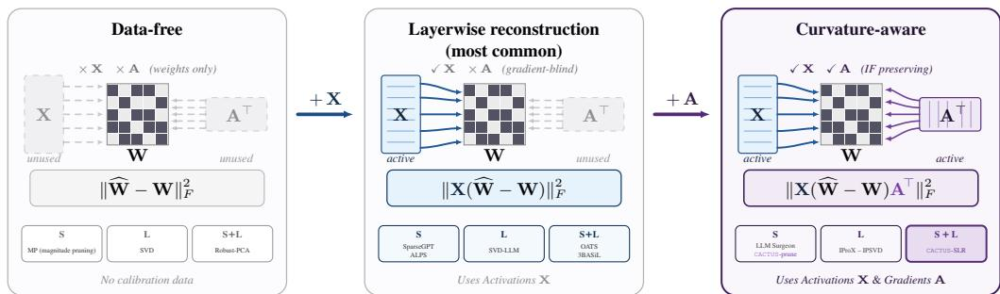  
Figure 1: Each panel is a layer-level reconstruction problem centered on the same weight matrix W. Input activations from the previously compressed layer are represented by $\mathbf { X } \in \mathbb { R } ^ { N _ { \mathrm { c a l } } \times d _ { \mathrm { i n } } } ;$ ; the downstream gradients incoming from the next layer are represented by $\mathbf { A } \in \breve { \mathbb { R } } ^ { N _ { \mathrm { c a l } } \times d _ { \mathrm { o u t } } }$ . (Left) Data-free. Neither X nor A is available; both sides reduce to parallel gray passes and the objective collapses to $\| \widehat { \mathbf { W } } - \mathbf { W } \| _ { F } ^ { 2 }$ . (Middle) Layerwise reconstruction (most common). Calibration activations X light up the left side, giving $\| \mathbf { X } ( \widehat { \mathbf { W } } - \mathbf { W } ) \| _ { F } ^ { 2 } ;$ outputs are matched but the method remains gradientblind (SparseGPT, ALPS, 3BASiL, SVD-LLM). (Right) Curvature-aware. Both activations and the downstream gradients are used, yielding $\| \mathbf { X } ( \widehat { \mathbf { W } } - \mathbf { W } ) \mathbf { A } ^ { \top } \| _ { F } ^ { 2 }$ , as studied in this paper.

## 2 CURVATURE-AWARE MODEL COMPRESSION

## 2.1 PROBLEM FORMULATION

We compress a pretrained LLM on a layer-by-layer basis. For a linear layer $\mathbf { W } \in \mathbb { R } ^ { d _ { \mathrm { i n } } \times d _ { \mathrm { o u t } } }$ , we use $N _ { \mathrm { c a l } }$ calibration data points to introduce (i) its input activations $\mathbf { X } \in \mathbb { R } ^ { \mathbf { \check { N } } _ { \mathrm { c a l } } \times d _ { \mathrm { i n } } }$ , and (ii) its downstream gradients $\mathbf { A } \in \mathbb { R } ^ { N _ { \mathrm { c a l } } \times d _ { \mathrm { o u t } } }$ . We seek a compressed weight $\widehat { \bf W }$ satisfying a structural constraint $\widehat { \mathbf { W } } \in \mathcal { C }$ (see below) that minimizes the Kronecker-Factored Approximate Curvature (KFAC) loss:

$$
\mathcal { L } _ { \mathrm { k f a c } } ( \widehat { \mathbf { W } } ) = \| \mathbf { X } ( \widehat { \mathbf { W } } - \mathbf { W } ) \mathbf { A } ^ { \top } \| _ { F } ^ { 2 } = \operatorname { T r } \left( \mathbf { H } \left( \widehat { \mathbf { W } } - \mathbf { W } \right) \mathbf { G } \left( \widehat { \mathbf { W } } - \mathbf { W } \right) ^ { \top } \right) ,\tag{1}
$$

where Tr denotes the matrix trace, $\mathbf { H } = \mathbf { X } ^ { \top } \mathbf { X } \in \mathbb { R } ^ { d _ { \mathrm { i n } } \times d _ { \mathrm { i n } } }$ is the input activations covariance and $\mathbf { G } = \mathbf { A } ^ { \top } \mathbf { A } \in \mathbb { R } ^ { d _ { \mathrm { o u t } } \times d _ { \mathrm { o u t } } }$ is the downstream gradients covariance. For efficiency, we collect G for all layers at the start of the algorithm using a single forward-backward pass on the $N _ { \mathrm { c a l } }$ calibration data points and store them on CPU. We then proceed to compress layers sequentially by constructing H from outputs of previously compressed layers. Compared to the statistics collected using a layerwise reconstruction error method (e.g., SparseGPT), we only add the collection of G for all layers once at the start of the algorithm. We denote Eq (1) by KFAC loss because it can be derived using the Kronecker factorization approximation in two distinct ways (i) a downstream compression quality perspective in LLM-Surgeon and (ii) influence function preservation perspective in IProX, see more details in Section A (Figure 5). For compression, we consider two structural constraints C:

• Pure pruning: either unstructured sparsity $\mathcal { C } _ { k } = \{ \mathbf { S } \in \mathbb { R } ^ { d _ { \mathrm { i n } } \times d _ { \mathrm { o u t } } } : \| \mathbf { S } \| _ { 0 } \leq k \}$ , or n:m-structured sparsity $\mathcal { C } _ { n : m }$ that keeps at most n non-zeros in each contiguous block of m entries. Here, ∥.∥0 counts the number of non-zero elements. In Algorithm 1, $\bar { \mathcal { C } } _ { S }$ denotes either sparsity set.

• Sparse + low rank $( \mathbf { S } + \mathbf { L } ) \colon { \mathcal { C } } _ { \mathbf { S } + \mathbf { L } } = { \mathcal { C } } _ { S } + { \mathcal { C } } _ { L } , { \mathrm { i . e . } } \widehat { \mathbf { W } } = \mathbf { S } + \mathbf { L }$ with simultaneous sparsity and rank budgets, where ${ \mathcal { C } } _ { L } = \left\{ \mathbf { L } : { \mathrm { r a n k } } \left( \mathbf { L } \right) \leq r \right\}$ and r is the rank budget.

## 2.2 CACTUS ALGORITHM DERIVATION

We treat the (S + L) family as the general case, with pure pruning (obtained by setting rank $r = 0 )$ as a special case. We use the Alternating Direction Method of Multipliers (ADMM) (Boyd et al., 2011) for the Kronecker-Factored Approximate Curvature (KFAC) objective (1). Using variable splitting for the sparse component, our problem formulation is given as:

$$
\begin{array} { r l } { \underset { \mathbf { S } , \mathbf { A } , \mathbf { L } } { \operatorname* { m i n } } } & { \operatorname { T r } \left( \mathbf { H } ( \mathbf { W } - \mathbf { S } - \mathbf { L } ) \mathbf { G } ( \mathbf { W } - \mathbf { S } - \mathbf { L } ) ^ { \top } \right) } \\ { \mathrm { s . t . } } & { \mathbf { S } ~ = ~ \mathbf { \Delta } \Delta , \qquad \mathbf { \Delta } \in \mathcal { C } _ { S } , \quad \mathrm { r a n k } \left( \mathbf { L } \right) \le r , } \end{array}\tag{2}
$$

where $\pmb { \Delta } \in \mathcal { C } _ { S }$ is set to be sparse and S is its copy; L is the low-rank component with rank $\mathbf { \Psi } ( \mathbf { L } ) \leq r$ The sparsity constraint is decoupled from the smooth objective through the consensus equality $\mathbf { S } =$ $\Delta .$ . The augmented Lagrangian with scaled dual variable V and penalty $\rho > 0$ is

$$
\begin{array} { r } { \mathcal { L } _ { \rho } ( \mathbf { S } , \mathbf { L } , \Delta , \mathbf { V } ) \ = \ \mathrm { T r } \left( \mathbf { H } ( \mathbf { W } - \mathbf { S } - \mathbf { L } ) \mathbf { G } ( \mathbf { W } - \mathbf { S } - \mathbf { L } ) ^ { \top } \right) \ + \ \frac { \rho } { 2 } \big \| \mathbf { S } - \Delta + \mathbf { V } \big \| _ { F } ^ { 2 } \ - \ \frac { \rho } { 2 } \| \mathbf { V } \| _ { F } ^ { 2 } . } \end{array}\tag{3}
$$

In practice, we damp H and G using separate ridge parameters $\lambda _ { H }$ and $\lambda _ { G }$ to improve conditioning (see Section C). In what follows, H and G denote these damped factors. We perform an eigendecomposition of H and G once, then ADMM alternates across three primal blocks (S, ∆, L) one at a time followed by a dual update in V. We minimize (3) over each primal block $\mathbf { S } , \pmb { \Delta } \in \mathcal { C } _ { S }$ and rank $\mathbf { \Psi } ( \mathbf { L } ) \leq r$ one at a time. Each primal subproblem minimization admits a closed-form solution and the S- and L-updates reuse the same eigenspaces throughout the ADMM iterations:

$$
\mathbf { H } \ = \ \mathbf { Q } _ { H } \mathbf { \Lambda } _ { H } \mathbf { Q } _ { H } ^ { \top } , \qquad \mathbf { G } \ = \ \mathbf { Q } _ { G } \mathbf { \Lambda } _ { G } \mathbf { Q } _ { G } ^ { \top } , ( \mathrm { e i g e n d e c o m p o s i t i o n s } )\tag{4}
$$

with $\pmb { \Lambda } _ { H } = \operatorname { d i a g } \left( \lambda _ { H , 1 } , \ldots , \lambda _ { H , d _ { \mathrm { i n } } } \right)$ and ΛG = diag (λG,1, . . . , λG,dout ).

(i) S-update: Sylvester equation. Holding $\mathbf { L } , \mathbf { \Delta \Delta } , \mathbf { V }$ fixed, the augmented Lagrangian (3) is a strictly convex quadratic in S. Setting $\nabla _ { \mathbf { S } } \mathcal { L } _ { \rho } \overset { = } = 0$ yields the matrix linear system

$$
\begin{array} { r } { { \bf { H } } { \bf { S } } { \bf { G } } + \frac { \rho } { 2 } { \bf { S } } = { \bf { H } } \left( { \bf { W } } - { \bf { L } } \right) { \bf { G } } + \frac { \rho } { 2 } \left( { \bf { \Delta } } { \bf { \Delta } } - { \bf { V } } \right) , } \end{array}\tag{5}
$$

which is a generalized Sylvester equation in S (Sylvester, 1909). Crucially, this is what differentiates CACTUS from prior ADMM-based layerwise reconstruction methods such as ALPS (Meng et al., 2024) or 3BASiL (Makni et al., 2026): those methods only deal with a one-sided system $( \mathbf { H } +$ ${ \bf \Pi } _ { 2 } ^ { \rho } { \bf I } ) { \bf S } = { \bf R } { \bf H } { \bf S }$ under our normalization, whereas the curvature-aware KFAC objective forces a twosided coupling that, naively solved, would cost $O ( ( d _ { \mathrm { i n } } d _ { \mathrm { o u t } } ) ^ { 3 } )$ via a vectorized Kronecker formulation $( \mathbf { G } ^ { \top } \otimes \mathbf { H } ^ { \bullet } + \frac { \rho } { 2 } \mathbf { I } ) \operatorname { v e c } ( \mathbf { S } ) = \operatorname { v e c } ( \mathbf { R } \mathbf { H } \mathbf { S } )$ , which is completely intractable for LLM-scale matrices.

Closed-form solve in the two eigenbases. The Sylvester structure admits an exact solution by substituting $\mathbf { S } = \mathbf { Q } _ { H } \widetilde { \mathbf { S } } \mathbf { Q } _ { G } ^ { \top }$ into (5); the equation decouples elementwise:

$$
\begin{array} { r } { \left( \lambda _ { H , i } \lambda _ { G , j } + \frac { \rho } { 2 } \right) \widetilde { \mathbf { S } } _ { i j } \ = \ \widetilde { \mathrm { R H S } } _ { i j } , \qquad \widetilde { \mathrm { R H S } } \ = \ \mathbf { Q } _ { H } ^ { \top } \left[ \mathbf { H } ( \mathbf { W } - \mathbf { L } ) \mathbf { G } + \frac { \rho } { 2 } ( \mathbf { \Delta } - \mathbf { V } ) \right] \mathbf { Q } _ { G } . } \end{array}\tag{6}
$$

We obtain each entry of Se by a single scalar division with $\lambda _ { H , i } \lambda _ { G , j } + \rho / 2 > 0 \mathrm { . }$ —the S-step remains nonsingular for any $\rho > 0$ and positive definite H, G. The final solution is $\mathbf { S } = \mathbf { Q } _ { H } \widetilde { \mathbf { S } } \mathbf { Q } _ { G } ^ { \top }$

Algorithmic implications. The whole inner solve thus reduces to (i) matmuls to form $\mathbf { Q } _ { H } ^ { \top } ( \cdot ) \mathbf { Q } _ { G }$ (ii) an elementwise division on a $d _ { \mathrm { i n } } \times d _ { \mathrm { o u t } }$ matrix, and (iii) matmuls to undo the basis change. The smooth solve costs $O ( d _ { \mathrm { i n } } d _ { \mathrm { o u t } } ( d _ { \mathrm { i n } } + d _ { \mathrm { o u t } } ) )$ per iteration, with the eigenbases reused across all T iterations and in the L-update for whitening. The ability to solve (5) exactly and at matmul cost is key to making curvature-aware ADMM tractable and yields the runtimes reported in Section 3.

(ii) L-update: IPSVD (Chen et al., 2026). Holding S, ∆, V fixed, for the L-update, we minimize Tr $( \mathbf { H } ( \mathbf { \dot { R } s } - \mathbf { L } ) \mathbf { G } ( \mathbf { R } \mathbf { s } - \mathbf { L } ) ^ { \top } )$ (here, $\mathbf { R } _ { \mathbf { S } } = \mathbf { W } - \mathbf { \bar { S } } )$ subject to rank $\mathbf { \Psi } ( \mathbf { L } ) \leq \mathbf { \bar { \Psi } } r$ . Since H and G are positive definite, the change of variables $\mathbf { M } = \mathbf { H } ^ { 1 / 2 } \mathbf { L G } ^ { 1 / 2 }$ preserves rank and reduces the subproblem to ordinary low-rank approximation. Its exact minimizer is therefore

$$
{ \bf L } ^ { \star } = { \bf H } ^ { - 1 / 2 } \mathrm { S V D } _ { r } \bigl ( { \bf H } ^ { 1 / 2 } \mathrm { R } _ { \mathrm { S } } { \bf G } ^ { 1 / 2 } \bigr ) { \bf G } ^ { - 1 / 2 } ,\tag{7}
$$

where $\operatorname { S V D } _ { \eta }$ denotes a best rank-r approximation obtained by truncated SVD, and $\mathbf { H } ^ { \pm 1 / 2 } ~ =$ $\mathbf { Q } _ { H } \mathbf { A } _ { H } ^ { \pm 1 / 2 } \mathbf { Q } _ { H } ^ { \top }$ and $\mathbf { G } ^ { \pm 1 / 2 } = \mathbf { Q } _ { G } \mathbf { \Lambda } _ { G } ^ { \pm 1 / 2 } \mathbf { Q } _ { G } ^ { \top }$ reuse eigendecompositions from (4). We accept this candidate only when its movement is bounded by the smooth-block movement:

$$
\begin{array}{c} \begin{array} { r } { \mathbf { L } ^ { ( t + 1 ) } = \left\{ \mathbf { L } ^ { \star } , \quad \| \mathbf { L } ^ { \star } - \mathbf { L } ^ { ( t ) } \| _ { F } \leq C _ { L } \| \mathbf { S } ^ { ( t + 1 ) } - \mathbf { S } ^ { ( t ) } \| _ { F } , \right.} \\ { \mathbf { L } ^ { ( t ) } , \quad \mathrm { o t h e r w i s e } , } \end{array}   \end{array}\tag{8}
$$

where $C _ { L } \geq 0$ is fixed and finite. For pure pruning $( r = 0 )$ , we keep $\mathbf { L } = \mathbf { 0 }$

(iii) ∆-update: exact sparse projection. The only term involving $\pmb { \Delta }$ is the consensus quadratic, so we retain the top-k entries by magnitude (unstructured) or the top-n entries within each m-block (n:m-structured) and set the remaining elements to 0. We denote this projection by $\Pi _ { { \cal C } _ { S } } ( { \bf S } + { \bf V } )$

(iv) Scaled dual and penalty updates. Given the new penalty, we update $\begin{array} { r } { \mathbf { V } ^ { ( t + 1 ) } = \frac { \rho ^ { ( t ) } } { \rho ^ { ( t + 1 ) } } \big ( \mathbf { V } ^ { ( t ) } + } \end{array}$ $\mathbf { S } ^ { ( t + 1 ) } - \Delta ^ { ( t + 1 ) } )$ . The ratio rescales the dual variable to preserve the updated Lagrange multiplier.

Algorithm 1 CACTUS for one linear layer.   
Require: Pretrained W, damped positive-definite factors H, G (eigendecomposed), sparsity set $\mathcal { C } _ { S } .$ , rank $^ { r , }$   
movement bound $C _ { L }$ , positive penalties $\{ \rho ^ { ( t ) } \}$ , iterations $T .$   
1: Initialize ${ \bf S } ^ { ( 0 ) } \gets { \bf W } , \bar { \bf L } ^ { ( 0 ) } \gets \bar { \bf 0 } , \Delta ^ { ( 0 ) } \gets { \bf 0 } , \bar { \bf V } ^ { ( 0 ) } \gets { \bf 0 } .$   
2: for $t = 0 , 1 , \ldots , T - 1$ do   
3: $\mathbf { S } ^ { ( t + 1 ) }$ ← Sylvester solve (5) using $( \mathbf { L } ^ { ( t ) } , \Delta ^ { ( t ) } , \mathbf { V } ^ { ( t ) } , \rho ^ { ( t ) } )$   
4: $\mathbf { L } ^ { \star } \gets$ weighted rank-r SVD of $\mathbf { W } - \mathbf { S } ^ { ( t + 1 ) }$ via (7).   
5: $\mathbf { L } ^ { ( t + 1 ) }  \mathbf { \bar { L } } ^ { \star } \mathbf { i f } \Vert \mathbf { L } ^ { \star } - \mathbf { L } ^ { ( t ) } \Vert _ { F } \leq C _ { L } \Vert \mathbf { S } ^ { ( t + 1 ) } - \mathbf { S } ^ { ( t ) } \Vert _ { F }$ else $\mathbf { L } ^ { \left( t \right) }$   
6: $\boldsymbol { \Delta } ^ { ( t + 1 ) } \gets \Pi _ { \mathcal { C } _ { S } } ( \mathbf { S } ^ { ( t + 1 ) } + \mathbf { V } ^ { ( t ) } ) .$   
7: $\begin{array} { r } { \mathbf { V } ^ { ( t + 1 ) } \xleftarrow { } \frac { \rho ^ { ( t ) } } { \rho ^ { ( t + 1 ) } } \big ( \mathbf { V } ^ { ( t ) } + \mathbf { S } ^ { ( t + 1 ) } - \mathbf { \Delta } \mathbf { \Delta } ^ { ( t + 1 ) } \big ) } \end{array}$   
8: return $\widehat { \mathbf { W } } \gets \dot { \mathbf { \Delta } } \dot { \mathbf { \Delta } } ^ { ( T ) } + \mathbf { L } ^ { ( T ) } .$

## 2.3 CONVERGENCE

The convergence argument follows 3BASiL (Makni et al., 2026). Under the conditions below, the iterates converge to a feasible sparse-plus-low-rank decomposition.

Theorem 1 (Convergence to a feasible decomposition). Consider Algorithm 1 with positive definite H, G, exact smooth solves and sparse projections, and afixedfinite movement bound $C _ { L } .$ . Suppose the positive penalties $( \rho _ { t } )$ are non-decreasing and satisfy $\textstyle \sum _ { t = 0 } ^ { \infty } 1 / \rho ^ { ( t ) } < \infty$ . Then

$$
{ \bf S } ^ { ( t ) } , \Delta ^ { ( t ) } \longrightarrow \bar { \bf S } \in \mathcal { C } _ { S } , \qquad { \bf L } ^ { ( t ) } \longrightarrow \bar { \bf L } , \quad \mathrm { r a n k } \left( \bar { \bf L } \right) \le r .
$$

The successive changes in $\mathbf { S } ^ { ( t ) }$ and $\mathbf { L } ^ { \left( t \right) }$ , and the consensus residual $\mathbf { S } ^ { ( t + 1 ) } - \Delta ^ { ( t + 1 ) }$ , are all $O ( 1 / \rho ^ { ( t - 1 ) } )$ in Frobenius norm.

The two-sided curvature changes the smooth solve, but preserves the projection and boundedness arguments used in 3BASiL; Section B gives only the changes to that proof. Increasing $\rho$ by a fixed factor greater than one at fixed intervals satisfies the summability condition (see Section C).

## 3 EXPERIMENTAL RESULTS

## 3.1 EXPERIMENTAL SETUP

Models and Evaluation Protocol. We compute gradients using the language-model crossentropy loss. We evaluate CACTUS on different settings and configurations using one of the following model architectures: Llama-3.2-1B/3B, Llama-2-7B, Llama-3-8B (Dubey et al., 2024), Qwen3-4B (Yang et al., 2025) or Qwen3.8-27B. For model compression utility, we report C4 (Raffel et al., 2020) and WikiText-2 (WT-2) (Merity et al., 2017) perplexity (PPL) at sequence length 2048. Further, we evaluate influence function (IF) preservation under two gradient representations, since influence methods differ mainly in the inner product used to compare per-sample gradients. For every sample x and linear layer ℓ, let $\dot { \nabla } _ { x , \ell } \in \mathbb { R } ^ { d _ { \ell , \mathrm { i n } } \times d _ { \ell , \mathrm { o u t } } }$ denote the per-sample weight gradient. The TracIn representation (Pruthi et al., 2020) uses the raw single-checkpoint gradient vector $r _ { x } ^ { \mathrm { T } } = \mathrm { c o n c a t } _ { \ell } \mathrm { \ ' v e c } ( \nabla _ { x , \ell } )$ . The KFAC-weighted representation (Mlodozeniec et al., 2024; Grosse et al., 2023) uses $r _ { x } ^ { \mathrm { K } } = \mathrm { c o n c a t } _ { \ell } \mathrm { v e c } ( \nabla _ { x , \ell } ^ { \mathrm { K } } )$ with $\nabla _ { x , \ell } ^ { \mathrm { K } } = { \bf H } _ { \ell } ^ { - 1 / 2 } \nabla _ { x , \ell } { \bf G } _ { \ell } ^ { - 1 / 2 }$ , where $\mathbf { H } _ { \ell }$ and $\mathbf { G } _ { \ell }$ are the dense model’s activation and backpropagatedgradient covariance factors. We use the dense factors for both dense and compressed gradients: they are calibration-level curvature statistics, distinct from per-sample gradients, and can be precomputed once then applied on the fly. Before projection, the KFAC-weighted layerwise inner product is $\langle \nabla _ { x , \ell } ^ { \mathrm { K } } , \nabla _ { q , \ell } ^ { \mathrm { K } } \rangle _ { F } \overset {  } { = } \mathrm { v e c } ( \nabla _ { x , \ell } ) ^ { \top } ( \mathbf { \dot { G } } _ { \ell } ^ { - 1 } { \otimes } \mathbf { H } _ { \ell } ^ { \ - \mathrm { i } } ) \overset {  } { \mathrm { v e c } } ( \nabla _ { q , \ell } )$ , corresponding to the standard KFAC approximation of the Hessian.

For either representation $r _ { x } \in \{ r _ { x } ^ { \mathrm { T } } , r _ { x } ^ { \mathrm { K } } \}$ , we store $\tilde { \nabla } _ { x } = \Pi r _ { x }$ using the same TRAK (Park et al., 2023) Rademacher Johnson-Lindenstrauss $\mathrm { ( J L ) }$ sketch Π down to $\bar { d } = 8 1 9 2$ . This projection preserves the relevant geometry: $\langle \Pi r _ { x } , \Pi r _ { q } \rangle \approx \langle r _ { x } , r _ { q } \rangle$ and $\| \boldsymbol { \Pi } \boldsymbol { r } _ { x } \| \approx \| \boldsymbol { r } _ { x } \|$ , so projected inner products and cosine similarities approximate their full-gradient counterparts. In what follows, $\tilde { \nabla } _ { x } ^ { \mathrm { d } } , \tilde { \nabla } _ { x } ^ { \mathrm { c } } \in \mathbb R ^ { d }$ denote the dense and compressed projected gradients of the same sample x for a fixed representation, and $\mathbf { I } ^ { \mathrm { d } } , \mathbf { I } ^ { \mathrm { c } } \in \mathbb { R } ^ { n _ { \mathrm { t r } } \times n _ { \mathrm { t c } } }$ denote each model’s influence matrix with entries $\mathbf { I } _ { i j } = \langle \tilde { \nabla } _ { x _ { i } } , \tilde { \nabla } _ { q _ { j } } \rangle$ (training row i, test column j). Following influence-function terminology, “training” rows are the source examples being ranked, while “test” columns are the query examples (distinct from a train/test split). The four metrics below are defined once on $\tilde { \nabla }$ , and each is reported twice: TracIn and KFACweighted. Cosine metrics measure per-example gradient-direction fidelity before any cross-example influence score is formed:

$$
\begin{array} { r l r } { \mathrm { c o s } _ { \mathrm { t r } } = \frac { 1 } { n _ { \mathrm { t r } } } \displaystyle \sum _ { i = 1 } ^ { n _ { \mathrm { t r } } } \frac { \langle \tilde { \nabla } _ { x _ { i } } ^ { \mathrm { d } } , \tilde { \nabla } _ { x _ { i } } ^ { \mathrm { c } } \rangle } { \| \tilde { \nabla } _ { x _ { i } } ^ { \mathrm { d } } \| \| \tilde { \nabla } _ { x _ { i } } ^ { \mathrm { c } } \| } , } & { } & { \mathrm { c o s } _ { \mathrm { t e } } = \frac { 1 } { n _ { \mathrm { t e } } } \displaystyle \sum _ { j = 1 } ^ { n _ { \mathrm { t e } } } \frac { \langle \tilde { \nabla } _ { q _ { j } } ^ { \mathrm { d } } , \tilde { \nabla } _ { q _ { j } } ^ { \mathrm { c } } \rangle } { \| \tilde { \nabla } _ { q _ { j } } ^ { \mathrm { d } } \| \| \tilde { \nabla } _ { q _ { j } } ^ { \mathrm { c } } \| } . } \end{array}
$$

Query-ranking metrics measure whether each query induces the same influence ordering over source examples: Spearman uses the full ordering, while recall checks overlap among the top 5%. Let $T _ { k } ( v )$ denote the indices of the $k = \lceil 0 . 0 5 n _ { \mathrm { t r } } \rceil$ largest entries of $v ;$ then

$$
\begin{array} { r l r } { \rho _ { \mathrm { q r y } } = \frac { 1 } { n _ { \mathrm { t e } } } \displaystyle \sum _ { j = 1 } ^ { n _ { \mathrm { t e } } } \mathrm { S p e a r m a n } \bigl ( \mathbf { I } _ { { \cdot } j } ^ { \mathrm { d } } , \mathbf { I } _ { { \cdot } j } ^ { \mathrm { c } } \bigr ) , } & { } & { R _ { \mathrm { q r y } } \varpi s \% = \frac { 1 } { n _ { \mathrm { t e } } } \displaystyle \sum _ { j = 1 } ^ { n _ { \mathrm { t e } } } \frac { \bigl | T _ { k } \bigl ( \mathbf { I } _ { { \cdot } j } ^ { \mathrm { d } } \bigr ) \cap T _ { k } \bigl ( \mathbf { I } _ { { \cdot } j } ^ { \mathrm { c } } \bigr ) \bigr | } { k } . } \end{array}
$$

Baselines. We group baselines by constraints imposed on compressed weights: (i) Pure pruning: SparseGPT, ALPS, and LLM-Surgeon; (ii) Pure low-rank: SVD-LLM(W), IPSVD, and $\scriptstyle { \mathrm { I P r o X } } ;$ and (iii) Sparse + low-rank (S + L): OATS, 3BASiL. IPSVD is the closed-form solution of the weighted SVD in the L-update, which is also the first stage of IProX. For $( \mathbf { S } + \mathbf { L } )$ runs, we use rank $r _ { \ell } = \lfloor \eta ( 1 - c ) m _ { \ell } n _ { \ell } / ( m _ { \ell } + n _ { \ell } ) \rfloor$ for target compression $c ,$ where mℓ and $n _ { \ell }$ are the layer dimensions and η is the fraction of retained parameters allocated to low rank; we use $\eta = 0 . 3 ,$ a value recommended by OATS. Additional implementation details are provided in Section C.

## 3.2 ONE-SHOT COMPRESSION RESULTS

We calibrate all methods on 128 sequences of length 2048 from $\mathrm { C } 4 ^ { \bullet } \mathrm { s }$ first shard and evaluate the four IF metrics on $n _ { \mathrm { t r } } ~ = ~ 1 0 0 0$ separate C4 training samples and $n _ { \mathrm { t e } } ~ = ~ 1 0 0$ WikiText-2 test samples, each of length 512. Tables 2, 7, 12 and 13 report results for Llama-3.2-1B, Qwen3-4B, Llama-3.2-3B, and Llama-3-8B, respectively. At 50% compression on Llama-3.2-1B, CACTUS reduces the C4 perplexity gap to dense by 28% over the closest $( \mathbf { S } + \mathbf { L } )$ method and 25% over LLM-Surgeon(5sh), with CACTUS-prune running >15× faster than the latter (Table 7).

It also retains substantially better downstream model quality than IProX’s low-rank proxy, which achieves 102.61 WikiText-2 perplexity, against 14.17 for CACTUS-prune. Figure 2 shows the C4 perplexity comparison on Qwen3- 4B at 50% compression. Under the hardware-friendly (2:4+r256) configuration (1.32× inference speedup and 29% memory reduction on Llama-3-8B with specialized kernels by Mozaffari et al. (2024)), CACTUS-SLR improves per-query TracIn retention by 38% over the closest competitor (Figure 3). These results support important joint improvements in model quality and IF preservation; we next examine downstream data selection and integration with LoGRA projections.

<table><tr><td>Method</td><td>C4↓</td><td>WT-2↓</td></tr><tr><td>Dense</td><td>11.27</td><td>7.05</td></tr><tr><td>SparseGPT</td><td>14.17</td><td>9.47</td></tr><tr><td>CACTUS-prune</td><td>13.42</td><td>8.88</td></tr></table>

Discussion. Better perplexity need not imply better gradient preservation. At 50% Qwen3-4B compression, 3BASiL improves WikiText-2 perplexity over CACTUS-prune (15.34 vs. 16.27), but has lower dense-gradient cosine alignment (0.743 vs. 0.762; Table 9).

## 3.3 DATA SELECTION RESULTS

Having established the large gains of CACTUS in terms of efficiency compared to LLM-Surgeon as well as utility and IF preservation compared to layerwise reconstruction pruning methods (e.g., SparseGPT), we now evaluate whether IF preservation also benefits downstream data selection using the LESS (Xia et al., 2024) pipeline on BIG-Bench Hard (BBH) (Suzgun et al., 2023). For Llama-2-7B and Llama-3.2-3B, we compare the pruning methods SparseGPT, ALPS, and CACTUS-prune at matched layerwise budgets, using dense-model

IF Preservation for Llama-3-8B at (2:4+r256) ( )

<table><tr><td rowspan="2">Method</td><td>C4</td><td>WT-2</td><td colspan="4">TracIn (↑)</td><td colspan="4">KFAC (↑)</td><td rowspan="2">| Compress Runtime</td></tr><tr><td>PPL (↓)</td><td>PPL (↓)</td><td>COStr</td><td>COSte</td><td>ρqry</td><td> $R _ { \mathrm { q r y } } { \ @ 5 \% }$ </td><td>COStr</td><td>COSte</td><td>ρqry</td><td> $R _ { \mathrm { q r y } } { \ @ 5 \% }$ </td></tr><tr><td>Dense</td><td>19.85</td><td>13.66</td><td>1.000</td><td>1.000</td><td>1.000</td><td>1.000</td><td>1.000</td><td>1.000</td><td>1.000</td><td>1.000</td><td></td></tr><tr><td colspan="10">30% compression</td></tr><tr><td>Pure pruning</td><td></td><td></td><td></td><td></td><td></td><td></td><td></td><td></td><td></td><td></td><td></td></tr><tr><td>SparseGPT ALPS</td><td>21.05</td><td>14.53</td><td>0.852</td><td>0.862</td><td>0.959</td><td>0.746</td><td>0.739 0.794</td><td>0.750 0.805</td><td>0.498 0.595</td><td>0.292</td><td>24m 53s 43m 07s</td></tr><tr><td>LLM-Surgeon(5sh)</td><td>20.44</td><td>13.84</td><td>0.892</td><td>0.903</td><td>0.977</td><td>0.820</td><td>0.825</td><td>0.836</td><td>0.630</td><td>0.375 0.373</td><td>18h 41m†</td></tr><tr><td>CACTUS-prune</td><td>20.44 20.21</td><td>14.33 13.87</td><td>0.910 0.920</td><td>0.915 0.923</td><td>0.971 0.984</td><td>0.829 0.837</td><td>0.816</td><td>0.816</td><td>0.624</td><td>0.388</td><td>45m 59s</td></tr><tr><td colspan="10"></td></tr><tr><td>Pure low-rank</td><td></td><td></td><td></td><td></td><td></td><td></td><td></td><td></td><td></td><td></td><td></td></tr><tr><td>SVD-LLM(W) IPSVD</td><td>47.31 37.79</td><td>70.50 60.98</td><td>0.178 0.378</td><td>0.183 0.383</td><td>0.309 0.545</td><td>0.103 0.230</td><td>0.075 0.141</td><td>0.079 0.140</td><td>0.018 0.036</td><td>0.075 0.081</td><td>54m 43s 51m 00s</td></tr><tr><td colspan="10"></td></tr><tr><td>(S + L)</td><td></td><td></td><td></td><td></td><td></td><td></td><td></td><td></td><td></td><td></td><td></td></tr><tr><td>OATS 3BASiL</td><td>20.13</td><td>13.96</td><td>0.892</td><td>0.889</td><td>0.969</td><td>0.748</td><td>0.790</td><td>0.788</td><td>0.588</td><td>0.360</td><td>2h 13m</td></tr><tr><td>CACTUS-SLR</td><td>20.15 20.06</td><td>13.72 13.73</td><td>0.922 0.937</td><td>0.928 0.945</td><td>0.980 0.987</td><td>0.819 0.859</td><td>0.857 0.866</td><td>0.858 0.871</td><td>0.698 0.715</td><td>0.441 0.460</td><td>3h 03m 3h 50m</td></tr><tr><td colspan="10">50% compression</td></tr><tr><td colspan="10"></td></tr><tr><td>Pure pruning SparseGPT</td><td>24.43</td><td>18.04</td><td>0.656</td><td>0.660</td><td>0.874</td><td>0.551</td><td>0.387</td><td>0.388</td><td>0.138</td><td>0.128</td><td>24m 07s</td></tr><tr><td>ALPS</td><td>22.60</td><td>16.40</td><td>0.709</td><td>0.710</td><td>0.895</td><td>0.585</td><td>0.458</td><td>0.455</td><td>0.190</td><td>0.150</td><td>43m 24s</td></tr><tr><td>LLM-Surgeon(5sh)</td><td>23.50</td><td>19.80</td><td>0.680</td><td>0.670</td><td>0.864</td><td>0.561</td><td>0.397</td><td>0.383</td><td>0.140</td><td>0.125</td><td>20h 13m†</td></tr><tr><td>CACTUS-prune</td><td>21.85</td><td>16.27</td><td>0.762</td><td>0.755</td><td>0.927</td><td>0.697</td><td>0.493</td><td>0.474</td><td>0.211</td><td>0.149</td><td>42m 18s</td></tr><tr><td colspan="10">Pure low-rank</td></tr><tr><td>SVD-LLM(W)</td><td></td><td></td><td></td><td></td><td></td><td></td><td></td><td></td><td></td><td></td><td></td></tr><tr><td>IPSVD</td><td>176.58 94.19</td><td>213.73 167.49</td><td>0.113 0.146</td><td>0.118 0.151</td><td>0.193 0.354</td><td>0.052 0.143</td><td>0.007 0.030</td><td>0.009 0.032</td><td>0.013 0.021</td><td>0.047 0.062</td><td>53m 15s 53m 27s</td></tr><tr><td colspan="10"></td></tr><tr><td>(S + L) OATS</td><td></td><td></td><td></td><td></td><td></td><td>0.508</td><td>0.380</td><td></td><td>0.140</td><td>0.130</td><td>2h 05m</td></tr><tr><td>3BASiL</td><td>23.97 21.63</td><td>16.73 15.34</td><td>0.652 0.743</td><td>0.653 0.747</td><td>0.804 0.919</td><td>0.695</td><td>0.521</td><td>0.383 0.521</td><td>0.252</td><td>0.187</td><td>2h 37m</td></tr><tr><td>CACTUS-SLR</td><td>21.38</td><td>15.59</td><td>0.782</td><td>0.790</td><td>0.937</td><td>0.698</td><td>0.539</td><td>0.538</td><td>0.259</td><td>0.173</td><td>2h 54m</td></tr><tr><td></td><td></td><td></td><td></td><td></td><td></td><td></td><td></td><td></td><td></td><td></td><td></td></tr></table>

Table 2: One-shot compression of Qwen3-4B at 30% and 50% compression ratio. Bold = best within its constraint set; underline = best overall across all reported methods. Runtime results are reported using an L40 GPU; † denotes LLM-Surgeon runtimes on two NVIDIA A100 GPUs. More results are deferred to Appendix D.

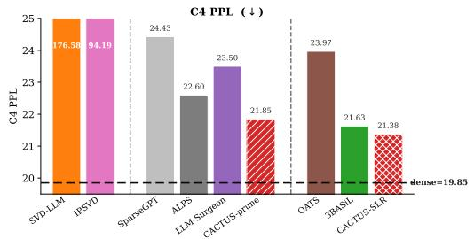  
Figure 2: Qwen3-4B at matched 50% compression.

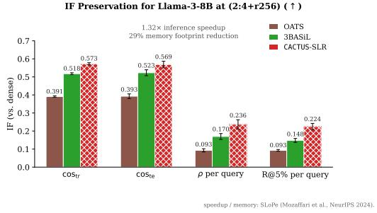  
Figure 3: Llama-3-8B at (2:4+r256).

and random selection as references. Each scoring model uses the same LESS procedure, with optimizer-aware gradients and TRAK projections, to select 5% of the 270, 679 example LESS instruction-tuning mixture comprising FLAN-v2, CoT, Dolly, and OpenAssistant.

We then fine-tune a fresh dense model on each subset using the same training recipe as LESS and evaluate exact match (EM) on 1080 heldout examples across 27 BBH tasks with 3-shot chain-of-thought (CoT) prompting. Additional setup details are deferred to Section C. CACTUS achieves the highest score-rank correlation 0.638 against the closest competitor 0.594 and selectedset overlap with dense-selection at 47.20% compared with 44.07% for the better competitor. It also achieves the best BBH EM on Llama-3.2-3B 49.44 compared with 47.22 for ALPS.

<table><tr><td></td><td colspan="3">Llama-2-7B</td><td colspan="3">Llama-3.2-3B</td></tr><tr><td>Selector</td><td>ρsel ↑</td><td>Overlap ↑</td><td>EM↑</td><td> $\rho _ { \mathrm { s e l } } \ \uparrow$ </td><td>Overlap ↑</td><td>EM↑</td></tr><tr><td>Dense LESS</td><td>1.000</td><td>100.00</td><td>42.59</td><td>1.000</td><td>100.00</td><td>49.54</td></tr><tr><td>CACTUS-prune</td><td>0.638</td><td>47.20</td><td>41.57</td><td>0.678</td><td>54.13</td><td>49.44</td></tr><tr><td>ALPS</td><td>0.594</td><td>44.07</td><td>40.46</td><td>0.621</td><td>52.24</td><td>47.22</td></tr><tr><td>SparseGPT</td><td>0.587</td><td>39.70</td><td>41.67</td><td>0.598</td><td>49.60</td><td>46.02</td></tr><tr><td>Random 5%</td><td></td><td>4.45</td><td>39.81</td><td></td><td>4.94</td><td>48.89</td></tr></table>

Table 3: LESS selection. $\rho _ { \mathrm { s e l } } \colon$ Spearman correlation of aggregate scores. Overlap: selected examples shared with dense selected data. EM: BBH acc (%).

## 3.4 LOGRA INTEGRATION

In the previous subsections, we examined the performance of CACTUS using TRAK to sketch full per-sample gradients to $d = 8 1 9 2$ dimensions. We now examine its compatibility with another gradient projection strategy: Low-rank Gradient Approximation (LoGRA) (Choe et al., 2025). Lo-GRA projects layerwise activations and backpropagated gradients without materializing the full per-sample gradient. It attaches a random rank-r probe $( \bar { \mathbf { P } } _ { o } , \mathbf { P } _ { i } )$ to each tracked linear layer and records a projected per-sample gradient $\pmb { \Phi } _ { \ell } ( \pmb { x } ) = ( \hat { \mathbf { P } } _ { o } ^ { \top } g _ { x , \ell } ) ( \mathbf { P } _ { i } x _ { \ell } ) ^ { \top } \in \mathbb { R } ^ { r \times r }$ , where $x _ { \ell }$ and $g _ { x , \ell }$ are the layer input and backpropagated gradient for sample $x ,$ and $\mathbf { P } _ { i }$ and ${ \bf P } _ { o }$ are the fixed input and output projection matrices. Recall that the full per-sample gradient of the layer is given by $g _ { x , \ell } x _ { \ell } ^ { \top }$

We treat Dense+LoGRA influence scores as the oracle and compare compressed models (also using the same LoGRA projection probes) against this reference. All rows use the same rank-64 random LoGRA factors on the MLP linears (default LoGRA setting). The (middle) panel shows the 2:4 pruning-only case, where the layer is compressed and then we append the same rank-r probe as the dense version of the (left) panel. For sparse-plus-low-rank models, we incorporate the low-rank correction into the LoGRA adapter while preserving exactly the same gradient projection used for the dense and pruned models. This allows a direct comparison under identical projection settings.

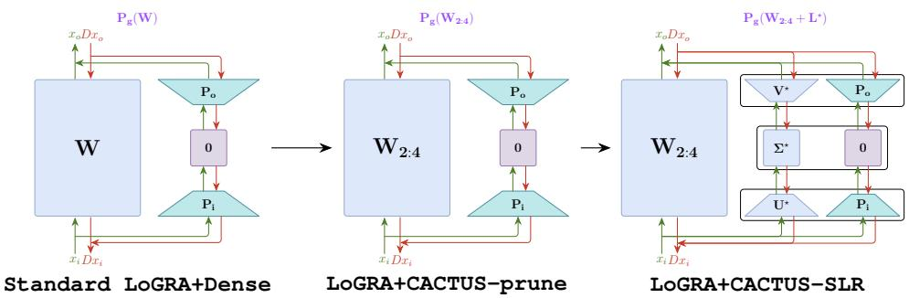  
The (right) panel illustrates this construction for CACTUS-SLR, whose deployed weight is $\mathbf { S ^ { \star } } + \mathbf { L ^ { \star } }$ We decompose $\mathbf { L } ^ { \star }$ using SVD and concatenate its factors with the random LoGRA probes, widening the adapter to rank 2r. The augmented branch contributes exactly $\mathbf { L } ^ { \star }$ to the forward pass, so the complete layer still computes with $\mathbf { S ^ { \star } } + \mathbf { L ^ { \star } }$ ; the random probe contributes zero to the output. After backpropagation, we obtain the per-sample gradient with respect to the adapter’s central $2 r \times 2 r$ matrix and retain only the $r \times r$ block associated with the original random LoGRA probe.

This block is exactly the standard rankr LoGRA gradient evaluated on the deployed $\mathbf { \delta } ( \mathbf { S } \mathbf { \delta } + \mathbf { \delta } \mathbf { L } )$ model. On Qwen3- 4B, CACTUS-SLR improves all LoGRAprojected IF preservation metrics over pruning procedures, reaching a per-query 0.804 Spearman and 0.597 recall at 5%. CACTUS-prune is competitive and uses a single L40 GPU against 2 A100 GPUs for LLM-Surgeon† while running roughly 5× and 25× faster than the 1-shot and 5-shot variants, respectively.

<table><tr><td>Method MLP-Layers</td><td> $\scriptstyle { \mathrm { c o s } } _ { \mathrm { t r } }$ </td><td> $\mathrm { c o s } _ { \mathrm { t e } }$ </td><td> $\rho _ { \mathrm { q r y } }$ </td><td> $R _ { \mathrm { q r y @ 5 \% } }$ </td><td>Compression</td></tr><tr><td>LoGRA + Dense (oracle)</td><td>1.000</td><td>1.000</td><td>1.000</td><td>1.000</td><td></td></tr><tr><td>LoGRA + SparseGPT</td><td>0.593</td><td>0.489</td><td>0.628</td><td>0.398</td><td>19m 47s</td></tr><tr><td>LoGRA +LLM-Surgeon(1sh)</td><td>0.630</td><td>0.557</td><td>0.708</td><td>0.445</td><td>4h02m†</td></tr><tr><td>LoGRA +LLM-Surgeon(5sh)</td><td>0.635</td><td>0.570</td><td>0.706</td><td>0.499</td><td>19h55m†</td></tr><tr><td>LoGRA + CACTUS-prune</td><td>0.645</td><td>0.584</td><td>0.730</td><td>0.583</td><td>49m 36s</td></tr><tr><td>LoGRA + CACTUS-SLR</td><td>0.711</td><td>0.639</td><td>0.804</td><td>0.597</td><td>1h33m</td></tr></table>

Figure 4: Influence Function preservation metrics for Qwen3-4B with MLP layers pruned using 2:4 sparsity. † denotes runtimes that use 2 A100 GPUs; other reported compression runtimes use a single L40 GPU.

## 4 RELATED WORK

One-shot pruning and low-rank decompositions for LLMs. Post-training one-shot compression is a training-free paradigm popularized by SparseGPT (Frantar and Alistarh, 2023), which compresses a pretrained LLM layer-by-layer on a small calibration set by minimizing the layerwise reconstruction error $\| \mathbf { X } \mathbf { W } - \mathbf { X } { \widehat { \mathbf { W } } } \| _ { F } ^ { 2 }$ subject to a structural constraint on ${ \widehat { \mathbf { W } } } ;$ methods differ along two axes: the constraint family and the per-layer solver. Pure sparsity: SparseGPT (Frantar and Alistarh, 2023) uses a sequential column-based sparsification scheme: after sparsifying one column, the remaining weights are updated to compensate for the incurred error, while ALPS (Meng et al., 2024) formulates the same problem as a constrained quadratic problem solved by the Alternating Direction

Method of Multipliers (ADMM) (Boyd et al., 2011). Pure low-rank: SVD-LLM(W) (Wang et al., 2025) uses a whitened Singular Value Decomposition (SVD) to minimize layerwise reconstruction error; ASVD (Yuan et al., 2025) instead scales input channels using activation statistics before SVD. Sparse + low-rank (S + L): OATS (Zhang and Papyan, 2025) and Hassle-free (Makni et al., 2025) alternate a sparse fitting step with a low-rank projection step; OATS scores weights using a per-row activation-norm criterion whereas Hassle-free uses the full input correlation matrix. 3BASiL (Makn et al., 2026) runs a multi-block ADMM that jointly minimizes the sparse and low-rank components simultaneously. Our method CACTUS differs from all these layerwise reconstruction algorithms by incorporating downstream gradients in its objective, making it curvature-aware rather than gradientblind. This is best illustrated in Figure 1.

Curvature-Aware Compression. A complementary thread incorporates downstream sensitivity into model compression. LLM-Surgeon (van der Ouderaa et al., 2024) and IProX (Chen et al., 2026) arrive at the curvature-aware objective $\| \mathbf { X } ( \mathbf { W } - \widehat { \mathbf { W } } ) \mathbf { A } ^ { \top } \| _ { F } ^ { 2 }$ from different motivations: LLM-Surgeon approximates the change in model loss, whereas IProX seeks to preserve gradient information for influence estimation (Section A and Figure 5). LLM-Surgeon targets pure pruning through curvature-based weight selection and correlated corrections over multiple rounds; IProX constructs a pure low-rank proxy through a weighted SVD followed by gradient-alignment finetuning. YAQA (Tseng et al., 2026) is a related approach which applies downstream curvature to weight-only quantization. Its curvature-based error feedback is conceptually closer to LLM-Surgeon’s error compensation than to our ADMM splitting procedure. CACTUS differs from these prior methods as it optimizes the curvature-aware loss for pruning and (S + L) using multi-block ADMM with efficient subroutines: a closed-form Sylvester solve in cached eigenbases, sparsity projections, and a randomized-SVD-based low-rank approximation (Section 2.2). On Qwen3-4B at 50% compression, CACTUS-prune is over 28× faster than five-shot LLM-Surgeon†, using one L40 rather than two A100 GPUs (Table 9 and Section C). Our pruning and $( \mathbf { S } + \mathbf { L } )$ representations also achieve substantially lower perplexity than IProX’s aligned low-rank proxy (Table 7).

Efficient Influence Function Estimation. Influence functions, rooted in robust statistics (Hampel, 1974) and introduced to deep learning by Koh and Liang (2017), estimate a training example’s effect via $\mathcal { T } ( z , z ^ { \prime } ) = \nabla \ell ( z ^ { \prime } ) ^ { \top } \mathbf { H } ^ { \div 1 } \nabla \ell ( z )$ , supporting data valuation, instruction tuning, and attribution (Pruthi et al., 2020; Xia et al., 2024; Choe et al., 2025; Grosse et al., 2023; Chen et al., 2026). At LLM scale, both the per-sample gradient $\nabla \ell ( z )$ and the inverse-Hessian-vector product $\mathbf { H } ^ { - 1 } \nabla \ell ( z )$ are prohibitively expensive to compute and store exactly. We focus on two broadly complementary directions that make influence estimation tractable. (i) Compressed-model proxies compute influ ence on smaller surrogates designed to preserve the target model’s gradients. IProX (Chen et al., 2026) uses an influence-preserving SVD followed by gradient-alignment fine-tuning. CACTUS extends compressed-model proxies to pruning and $( \mathbf { S } + \mathbf { L } )$ through the same curvature-aware objective. (ii) Gradient projection maps per-sample gradients to compact vectors for efficient similarity computation. TRAK (Park et al., 2023) uses a data-free Johnson Lindenstrauss (JL) sketch, while Arnoldi-IF (Schioppa et al., 2022) uses a data-dependent approximation to the leading Hessian eigenspace. Low-rank Gradient Approximation (LoGRA) (Choe et al., 2025) exploits the per-layer gradient structure vec $\begin{array} { r } { ( \mathcal { D } \mathbf { W } ) = \bar { \sum _ { t } } x _ { i , t } \otimes \mathcal { D } x _ { o , t } } \end{array}$ through a matching projection $\mathbf { \bar { \it P } } = \mathop { \cal P } _ { i } \ \bar { \otimes } \ \bar { \it P } _ { o }$ , implemented as small low-rank adaptation (LoRA) add-on layers. Our work primarily contributes to direction (i): where IProX is restricted to pure low-rank, CACTUS delivers pruning and (S+L) proxies with improved utility-compression tradeoffs. We also evaluate compatibility with both TRAK’s random projections and LoGRA’s architecture-aware projections from direction (ii).

## 5 CONCLUSION AND LIMITATIONS

In this paper, we first highlight the connection between downstream utility and influence preservation through the curvature-aware objective introduced in Equation (1). Our new algorithm CACTUS makes optimizing this objective practical for modern LLM pruning as well as $( \bar { \mathbf { S } } + \mathbf { L } )$ decomposition tasks. It runs at a substantially lower cost compared to prior state-of-the-art curvature-aware pruning methods. Across various compression settings, model architectures, and gradient projection strategies, CACTUS consistently improves downstream utility while retaining gradient fidelity.

Limitations. In this paper, we focus on pruning and sparse-plus-low-rank $( \mathbf { S } + \mathbf { L } )$ compression. Extending our ADMM framework to quantization and mixed quantization-sparsity settings are directions for future work, especially when reparameterizations (e.g., rotations) change gradient geometry. We also only consider uniform compression budgets; it would be interesting to design specialized methods that can allocate sparsity and rank non-uniformly across the entire LLM layers. Additionally, we do not study post-compression refinements like full-model or LoRA-style finetuning. These may trade off deployment quality and gradient alignment fidelity in different ways. We leave these interesting follow-up research directions for future work.

## AI USE STATEMENT

Generative AI assisted with code development, manuscript revision and polishing, and figure plotting and formatting. The authors are responsible for the final content and verification of the reported results.

## REFERENCES

Josh Achiam, Steven Adler, Sandhini Agarwal, Lama Ahmad, Ilge Akkaya, Florencia Leoni Aleman, Diogo Almeida, Janko Altenschmidt, Sam Altman, Shyamal Anadkat, et al. Gpt-4 technical report. arXiv preprint arXiv:2303.08774, 2023.

Stephen Boyd, Neal Parikh, Eric Chu, Borja Peleato, Jonathan Eckstein, et al. Distributed optimization and statistical learning via the alternating direction method of multipliers. Foundations and Trends® in Machine learning, 3(1):1–122, 2011.

Sirui Chen, Yunzhe Qi, Mengting Ai, Yifan Sun, Ruizhong Qiu, Jiaru Zou, and Jingrui He. Influence-preserving proxies for gradient-based data selection in LLM finetuning. In The Fourteenth International Conference on Learning Representations, 2026. URL https:// openreview.net/forum?id=PDNpRLxDlI.

Sang Keun Choe, Hwijeen Ahn, Juhan Bae, Kewen Zhao, Youngseog Chung, Adithya Pratapa, Willie Neiswanger, Emma Strubell, Teruko Mitamura, Jeff Schneider, Eduard Hovy, Roger Baker Grosse, and Eric P. Xing. What is your data worth to GPT? LLM-scale data valuation with influence functions. In The Thirty-ninth Annual Conference on Neural Information Processing Systems, 2025. URL https://openreview.net/forum?id=zPKeJAEo27.

Abhimanyu Dubey, Abhinav Jauhri, Abhinav Pandey, Abhishek Kadian, Ahmad Al-Dahle, Aiesha Letman, Akhil Mathur, Alan Schelten, Amy Yang, Angela Fan, et al. The Llama 3 herd of models. arXiv preprint arXiv:2407.21783, 2024.

Elias Frantar and Dan Alistarh. SparseGPT: Massive language models can be accurately pruned in one-shot. In International Conference on Machine Learning, pages 10323–10337. PMLR, 2023.

Gemini Team Google. Gemini: a family of highly capable multimodal models. arXiv preprint arXiv:2312.11805, 2023.

Roger Grosse, Juhan Bae, Cem Anil, Nelson Elhage, Alex Tamkin, Amirhossein Tajdini, Benoit Steiner, Dustin Li, Esin Durmus, Ethan Perez, Evan Hubinger, Kamile Lukoši˙ ut¯ e, Karina Nguyen,˙ Nicholas Joseph, Sam McCandlish, Jared Kaplan, and Samuel R. Bowman. Studying large language model generalization with influence functions. arXiv preprint arXiv:2308.03296, 2023.

Frank R Hampel. The influence curve and its role in robust estimation. Journal of the american statistical association, 69(346):383–393, 1974.

Pang Wei Koh and Percy Liang. Understanding black-box predictions via influence functions. In International Conference on Machine Learning, pages 1885–1894. PMLR, 2017.

Mehdi Makni, Kayhan Behdin, Zheng Xu, Natalia Ponomareva, and Rahul Mazumder. A unified framework for sparse plus low-rank matrix decomposition for LLMs. In The Second Conference on Parsimony and Learning (Proceedings Track), 2025. URL https://openreview.net/ forum?id=hyN75SAJTI.

Mehdi Makni, Xiang Meng, and Rahul Mazumder. 3BASiL: An algorithmic framework for sparse plus low-rank compression of LLMs. arXiv preprint arXiv:2603.01376v2, 2026. URL https: //arxiv.org/abs/2603.01376v2.

Mitchell Marcus, Grace Kim, Mary Ann Marcinkiewicz, Robert MacIntyre, Ann Bies, Mark Ferguson, Karen Katz, and Britta Schasberger. The penn treebank: Annotating predicate argument structure. In Proceedings of the Workshop on Human Language Technology, HLT ’94, page 114–119, USA, 1994. Association for Computational Linguistics. ISBN 1558603573. doi: 10.3115/1075812.1075835. URL https://doi.org/10.3115/1075812.1075835.

James Martens and Roger Grosse. Optimizing neural networks with kronecker-factored approximate curvature. In Proceedings of the 32nd International Conference on Machine Learning, pages 2408–2417. PMLR, 2015. URL https://proceedings.mlr.press/v37/ martens15.html.

Xiang Meng, Kayhan Behdin, Haoyue Wang, and Rahul Mazumder. Alps: Improved optimization for highly sparse one-shot pruning for large language models. In Annual Conference on Neural Information Processing Systems, NeurIPS, 2024.

Stephen Merity, Caiming Xiong, James Bradbury, and Richard Socher. Pointer sentinel mixture models. In International Conference on Learning Representations, 2017. URL https: //openreview.net/forum?id=Byj72udxe.

Bruno Mlodozeniec, Runa Eschenhagen, Juhan Bae, Alexander Immer, David Krueger, and Richard Turner. Influence functions for scalable data attribution in diffusion models. arXiv preprint arXiv:2410.13850, 2024.

Mohammad Mozaffari, Amir Yazdanbakhsh, Zhao Zhang, and Maryam Mehri Dehnavi. Slope: Double-pruned sparse plus lazy low-rank adapter pretraining of llms. arXiv preprint arXiv:2405.16325, 2024.

Sung Min Park, Kristian Georgiev, Andrew Ilyas, Guillaume Leclerc, and Aleksander Madry. Trak: Attributing model behavior at scale. In International Conference on Machine Learning, pages 27074–27113. PMLR, 2023.

Garima Pruthi, Frederick Liu, Satyen Kale, and Mukund Sundararajan. Estimating training data influence by tracing gradient descent. In H. Larochelle, M. Ranzato, R. Hadsell, M.F. Balcan, and H. Lin, editors, Advances in Neural Information Processing Systems, volume 33, pages 19920–19930. Curran Associates, Inc., 2020. URL https://proceedings.neurips.cc/paper\_files/paper/2020/ file/e6385d39ec9394f2f3a354d9d2b88eec-Paper.pdf.

Colin Raffel, Noam Shazeer, Adam Roberts, Katherine Lee, Sharan Narang, Michael Matena, Yanqi Zhou, Wei Li, and Peter J. Liu. Exploring the limits of transfer learning with a unified text-totext transformer. Journal of Machine Learning Research, 21(140):1–67, 2020. URL http: //jmlr.org/papers/v21/20-074.html.

Andrea Schioppa, Polina Zablotskaia, David Vilar, and Artem Sokolov. Scaling up influence functions. In Proceedings of the AAAI Conference on Artificial Intelligence, volume 36, pages 8179– 8186, 2022.

Mingjie Sun, Zhuang Liu, Anna Bair, and J Zico Kolter. A simple and effective pruning approach for large language models. In The Twelfth International Conference on Learning Representations, 2024. URL https://openreview.net/forum?id=PxoFut3dWW.

Mirac Suzgun, Nathan Scales, Nathanael Schärli, Sebastian Gehrmann, Yi Tay, Hyung Won Chung, Aakanksha Chowdhery, Quoc Le, Ed Chi, Denny Zhou, et al. Challenging BIG-bench tasks and whether chain-of-thought can solve them. In Findings of the Association for Computational Linguistics: ACL 2023, pages 13003–13051, 2023.

James Joseph Sylvester. The Collected Mathematical Papers of James Joseph Sylvester..., volume 3. University Press, 1909.

Albert Tseng, Zhaofeng Sun, and Christopher De Sa. Model-preserving adaptive rounding. In Fortythird International Conference on Machine Learning, 2026. URL https://openreview. net/forum?id=PKFilPWjMI.

Tycho F. A. van der Ouderaa, Markus Nagel, Mart Van Baalen, and Tijmen Blankevoort. The LLM surgeon. In The Twelfth International Conference on Learning Representations, 2024. URL https://openreview.net/forum?id=DYIIRgwg2i.

Xin Wang, Yu Zheng, Zhongwei Wan, and Mi Zhang. SVD-LLM: Truncation-aware singular value decomposition for large language model compression. In The Thirteenth International Conference on Learning Representations, 2025. URL https://openreview.net/forum?id= LNYIUouhdt.

Mengzhou Xia, Sadhika Malladi, Suchin Gururangan, Sanjeev Arora, and Danqi Chen. LESS: Selecting influential data for targeted instruction tuning. In International Conference on Machine Learning, 2024.

An Yang, Anfeng Li, Baosong Yang, Beichen Zhang, Binyuan Hui, Bo Zheng, Bowen Yu, Chang Gao, Chengen Huang, Chenxu Lv, et al. Qwen3 technical report. arXiv preprint arXiv:2505.09388, 2025.

Zhihang Yuan, Yuzhang Shang, Yue Song, Dawei Yang, Qiang Wu, Yan Yan, and Guangyu Sun. ASVD: Activation-aware singular value decomposition for compressing large language models, 2025. URL https://openreview.net/forum?id=HyPofygOCT.

Stephen Zhang and Vardan Papyan. OATS: Outlier-aware pruning through sparse and low rank decomposition. In The Thirteenth International Conference on Learning Representations, 2025. URL https://openreview.net/forum?id=DLDuVbxORA.

Aojun Zhou, Yukun Ma, Junnan Zhu, Jianbo Liu, Zhijie Zhang, Kun Yuan, Wenxiu Sun, and Hongsheng Li. Learning n:m fine-grained structured sparse neural networks from scratch. In International Conference on Learning Representations, 2021. URL https://openreview.net/ forum?id=K9bw7vqp\_s.

## A THE LLM-SURGEON AND IPROX DERIVATIONS

Figure 5 connects the two motivations for Equation (1). For a layer $y = W ^ { \top } x$ , let $\Delta W = \widehat { \mathbf { W } } - \mathbf { W }$ and $\boldsymbol { g } = \nabla _ { y } \ell ( z )$ , where z is a sample and ℓ its loss. The input x and gradient g are evaluated at the dense model; $\dot { \mathcal { L } } = \mathbb { E } _ { z } [ \ell ( z ) ]$

One objective, two derivations  
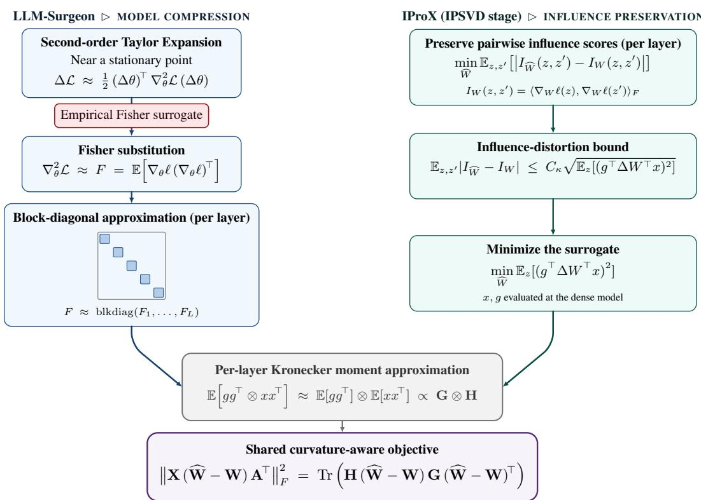  
Figure 5: One objective, two derivations. LLM-Surgeon (van der Ouderaa et al., 2024) and IProX’s IPSVD stage (Chen et al., 2026) lead to Equation (1). The influence-distortion bound uses the assumptions of IProX, Proposition 4.1 and Appendix D; $C _ { \kappa }$ is the resulting finite constant. Here, $\mathbf { H } = \bar { \mathbf { X } } ^ { \top } \mathbf { X }$ , and $\mathbf { G } = \mathbf { A } ^ { \top } \dot { \mathbf { A } }$

## B CONVERGENCE OF CACTUS

ProofofTheorem 1. We follow 3BASiL (Makni et al., 2026, Appendix A), identifying the variables used there $\widehat { \mathbf { W } } , \mathbf { D } ^ { ( t ) } , \mathbf { V } ^ { ( t ) }$ with our W, $\Delta _ { t } , \mathbf { Y } _ { t } = \rho _ { t } \mathbf { V } _ { t }$ , respectively. The rescaled dual update gives $\mathbf { Y } _ { t + 1 } = \mathbf { Y } _ { t } + \rho _ { t } ( \mathbf { S } _ { t + 1 } - \Delta _ { t + 1 } )$ , exactly as in 3BASiL. Only the following two bounds change.

Low-rank bound (Lemma A.1). Replace 3BASiL’s selection of the constant $C _ { F }$ in Eq. (9) as follows

$$
\begin{array} { r } { \operatorname* { m a x } \left\{ 1 , \| { \bf W } \| _ { F } , 2 \| { \bf H } \| _ { 2 } \| { \bf G } \| _ { 2 } , 2 \| { \bf H } { \bf W } { \bf G } \| _ { F } , \| { \bf H } ^ { - 1 / 2 } \| _ { 2 } \| { \bf G } ^ { - 1 / 2 } \| _ { 2 } , \| { \bf H } ^ { 1 / 2 } \| _ { 2 } \| { \bf G } ^ { 1 / 2 } \| _ { 2 } \right\} \leq C _ { F } . } \end{array}
$$

For an accepted candidate, Equation (7) and $\| \mathrm { S V D } _ { r } ( \mathbf { M } ) \| _ { F } \leq \| \mathbf { M } \| _ { F }$ give

$$
\begin{array} { r l } & { \| \mathbf { L } _ { t } \| _ { F } \leq \| \mathbf { H } ^ { - 1 / 2 } \| _ { 2 } \| \mathbf { G } ^ { - 1 / 2 } \| _ { 2 } \| \mathbf { H } ^ { 1 / 2 } ( \mathbf { W } - \mathbf { S } _ { t } ) \mathbf { G } ^ { 1 / 2 } \| _ { F } } \\ & { \qquad \leq C _ { F } ^ { 2 } ( \| \mathbf { W } \| _ { F } + \| \mathbf { S } _ { t } \| _ { F } ) \leq C _ { F } ^ { 3 } ( 1 + a _ { t } ) , } \end{array}
$$

where, as in 3BASiL, we define

$$
a _ { t } = \| \mathbf { A } _ { t } \| _ { F } + \frac { \| \mathbf { Y } _ { t } \| _ { F } + \| \mathbf { Y } _ { t - 1 } \| _ { F } } { \rho _ { t - 1 } } , \qquad b _ { t } = \operatorname* { m a x } \left\{ a _ { t } , \frac { \| \mathbf { L } _ { t } \| _ { F } } { C _ { F } ^ { 3 } } - 1 \right\} .
$$

The last inequality follows from $\mathbf S _ { t } = \Delta _ { t } + ( \mathbf Y _ { t } - \mathbf Y _ { t - 1 } ) / \rho _ { t - 1 }$ . If the candidate is rejected, $\mathbf { L } _ { t } = \mathbf { L } _ { t - 1 }$ , as in Lemma A.1.

Smooth-step bound (Lemma A.2). Set $\mathbf { R } _ { t } = \mathbf { S } _ { t + 1 } - \Delta _ { t } + \mathbf { Y } _ { t } / \rho _ { t }$ . The calculation preceding Eq. (23) is replaced by the Sylvester equation from Equation (5):

$$
2 { \mathbf { H } } \mathbf { R } _ { t } { \mathbf { G } } + \rho _ { t } { \mathbf { R } } _ { t } = 2 { \mathbf { H } } ( { \mathbf { W } } - \mathbf { L } _ { t } - \Delta _ { t } + { \mathbf { Y } } _ { t } / \rho _ { t } ) { \mathbf { G } } .
$$

In the two orthonormal eigenbases, each entry is divided by $2 \lambda _ { H , i } \lambda _ { G , j } + \rho _ { t } \geq \rho _ { t }$ . Thus Eqs. (23) and (27) become

$$
\begin{array} { r l r } {  { \| { \mathbf { R } } _ { t } \| _ { F } \leq \frac { 2 } { \rho _ { t } } \| { \mathbf { H } } ( { \mathbf { W } } - { \mathbf { L } } _ { t } - \Delta _ { t } + { \mathbf { Y } } _ { t } / \rho _ { t } ) { \mathbf { G } } \| _ { F } } } \\ & { } & { \leq \frac { C _ { F } ( 1 + \| \Delta _ { t } \| _ { F } + \| { \mathbf { Y } } _ { t } \| _ { F } / \rho _ { t } ) + C _ { F } \| { \mathbf { L } } _ { t } \| _ { F } } { \rho _ { t } } \leq \frac { ( C _ { F } + C _ { F } ^ { 4 } ) ( 1 + b _ { t } ) } { \rho _ { t } } . } \end{array}
$$

The projection inequality in Eq. (24) then gives the bounds of Lemma A.2:

$$
\| \mathbf { Y } _ { t + 1 } \| _ { F } \leq ( C _ { F } + C _ { F } ^ { 4 } ) ( 1 + b _ { t } ) , \qquad \| \mathbf { \Delta } \mathbf { { A } } _ { t + 1 } - \mathbf { \Delta } \mathbf { { A } } _ { t } \| _ { F } \leq \frac { 2 ( C _ { F } + C _ { F } ^ { 4 } ) ( 1 + b _ { t } ) } { \rho _ { t } } .
$$

The proof of Lemma A.3 now gives the same recurrence:

$$
b _ { t + 1 } \leq \operatorname* { m a x } \{ a _ { t + 1 } , b _ { t } \} \leq \left( 1 + { \frac { 3 ( C _ { F } + C _ { F } ^ { 4 } ) } { \rho _ { t - 1 } } } \right) b _ { t } + { \frac { 3 ( C _ { F } + C _ { F } ^ { 4 } ) } { \rho _ { t - 1 } } } .
$$

The remainder of the 3BASiL argument is unchanged: Equation (8) gives the same movement bound, and closedness of the constraint sets gives feasibility of the limits. □

## C ADDITIONAL EXPERIMENTAL PROTOCOL DETAILS

CACTUS implementation. Before eigendecomposition, we apply separate ridge damping to the activation and gradient factors:

$$
\begin{array} { r } { \mathbf { H }  \mathbf { H } + \lambda _ { H } \mathrm { m e a n } ( \mathrm { d i a g } ( \mathbf { H } ) ) \mathbf { I } , } \\ { \mathbf { G }  \mathbf { G } + \lambda _ { G } \mathrm { m e a n } ( \mathrm { d i a g } ( \mathbf { G } ) ) \mathbf { I } . } \end{array}
$$

Here $\lambda _ { H }$ and $\lambda _ { G }$ are damping parameters. The algorithm minimizes the two-sided objective in Equation (1) using these damped factors. We present the ppl results using different ridge parameters in Table 4. Compression seems to be robust to the ridge values used. For large layers/model architectures, 0.005 can cause decomposition issues (poor conditioning). Except in the ridge-damping ablation, we use $\lambda _ { H } = 0 . 0 1$ (same as SparseGPT) and $\lambda _ { G } = 0 . 1$

<table><tr><td rowspan="2"> $\lambda _ { H }$ </td><td colspan="3"> $\lambda _ { G }$ </td></tr><tr><td>0.005</td><td>0.01 0.1</td><td>0.25</td></tr><tr><td></td><td colspan="3">C4 perplexity (↓)</td></tr><tr><td rowspan="3">0.005 0.01 0.1</td><td>19.729 19.647</td><td>19.448</td><td>19.449</td></tr><tr><td>19.719 19.596 19.626</td><td>19.432</td><td>19.392</td></tr><tr><td>19.601 19.681 19.780</td><td>19.536 19.548</td><td>19.395 19.509</td></tr><tr><td></td><td colspan="3">0.25 WT-2 perplexity (↓)</td></tr><tr><td>0.005</td><td colspan="3">14.308</td></tr><tr><td>0.01</td><td>14.351 14.346</td><td>14.447 14.302 14.168</td><td>14.186 14.070</td></tr><tr><td>0.1</td><td colspan="3">14.150</td></tr><tr><td></td><td colspan="3">14.207</td></tr><tr><td>0.25</td><td colspan="3">14.218 14.195</td></tr></table>

Table 4: Ridge-damping ablation for H and G using next-token cross-entropy on Llama-3.2-1B at 50% unstructured sparsity. Bold denotes the lowest perplexity within each dataset’s grid.

By default, our ADMM-based algorithm CACTUS-slr uses $C _ { L } = 1 0$ for the low-rank movement condition in Algorithm 1.
<table><tr><td> $C _ { L }$ </td><td>Accept (%)</td><td>Reject (%)</td><td> $\operatorname { A v g } .$  iterations</td><td>C4↓</td><td>WT-2↓</td></tr><tr><td>∞</td><td>100.00</td><td>0.00</td><td>430</td><td>18.256</td><td>13.061</td></tr><tr><td>10 (default)</td><td>100.00</td><td>0.00</td><td>431</td><td>18.307</td><td>12.952</td></tr><tr><td>3</td><td>100.00</td><td>0.00</td><td>429</td><td>18.290</td><td>13.021</td></tr><tr><td>1</td><td>100.00</td><td>0.00</td><td>431</td><td>18.337</td><td>13.023</td></tr><tr><td>0.9</td><td>99.99</td><td>0.01</td><td>430</td><td>18.293</td><td>12.909</td></tr><tr><td>0.8</td><td>99.62</td><td>0.38</td><td>430</td><td>18.276</td><td>13.028</td></tr><tr><td>0.7</td><td>97.47</td><td>2.53</td><td>429</td><td>18.320</td><td>13.014</td></tr><tr><td>0.6</td><td>61.58</td><td>38.42</td><td>417</td><td>19.428</td><td>14.122</td></tr><tr><td>0.5</td><td>22.03</td><td>77.97</td><td>407</td><td>24.511</td><td>18.527</td></tr><tr><td>0.4</td><td>1.16</td><td>98.84</td><td>403</td><td>35.538</td><td>26.500</td></tr><tr><td>0.3</td><td>0.00</td><td>100.00</td><td>403</td><td>36.723</td><td>27.272</td></tr><tr><td>0.1</td><td>0.00</td><td>100.00</td><td>403</td><td>36.590</td><td>27.079</td></tr></table>

Table 5: Low-rank movement-threshold ablation: CACTUS-(S + L) on Llama-3.2-1B at 50% total compression with rank-budget allocation $\eta = 0 . 3$ . Rejection rates and iteration counts are averaged over all 112 compressed sublayers.

We use an initial penalty $\rho _ { 0 } = 0 . 1$ and update the ADMM penalty using the support-change rule from ALPS/3BASiL. Let $s _ { t } ~ = ~ | \operatorname { S u p p } ( \Delta ^ { ( t ) } ) \triangle \operatorname { S u p p } ( \Delta ^ { ( t - m ) } ) |$ be the symmetric difference in sparse support at the update period m, and let k be the number of retained nonzeros. The finiterun support-change schedules are summarized in Table 6. For the non-decreasing schedule analyzed in Theorem 1, a multiplier of at least $\eta _ { \mathrm { m i n } } = 1 . 0 2$ at every fixed-period update gives $\rho _ { t } \geq \rho _ { 0 } \eta _ { \mathrm { m i n } } ^ { \lfloor t / m \rfloor }$ so $\begin{array} { r } { \sum _ { t = 0 } ^ { \infty } 1 / \rho _ { t } \le m \dot { \eta _ { \mathrm { m i n } } } / [ \rho _ { 0 } ( \eta _ { \mathrm { m i n } } - \mathrm { \dot { 1 } } ) ] < \infty } \end{array}$

<table><tr><td>Setting</td><td>Max iter.</td><td>Support-change condition</td><td>ρ multipliers</td></tr><tr><td>Pure pruning</td><td>100</td><td> $s _ { t } / k > 0 . 1 , ~ s _ { t } / k > 0 . 0 0 5 , ~ s _ { t } > 0 . 5$ </td><td> $1 . 3 , \ 1 . 2 , \ 1 . 1$ </td></tr><tr><td> $( \mathbf { S } + \mathbf { L } )$ </td><td>2000</td><td> $s _ { t } / k > 0 . 1 , ~ s _ { t } / k > 0 . 0 0 5 , ~ s _ { t } > 0 . 5$ </td><td> $1 . 1 , \ 1 . 0 5 , \ 1 . 0 2$ </td></tr></table>

Table 6: Support-change penalty multipliers for compression. At the update period m, the multiplier is selected according to which support-change condition holds: the first matching threshold sets the multiplier $\rho ^ { ( t + 1 ) } / \rho ^ { ( \bar { t } ) }$ . The (S + L) schedule is intentionally less aggressive as (S + L) decompositions seem to be more sensitive in our experiments.

Baselines. All one-shot baselines are run in the same layerwise compression framework and with the same calibration samples, except when a method explicitly includes a post-compression stage. SparseGPT, ALPS, SVD-LLM(W) (simple activation-aware low-rank fitting without sequential factor refinement or post-compression fine-tuning), OATS, and 3BASiL use activation-only objectives using H, whereas IPSVD, IProX, LLM-Surgeon, and CACTUS use G as well. For (S + L) baselines at target compression ratio c, we match total parameter budget using the same layerwise rank allocation $r _ { \ell } = \lfloor \eta ( 1 - c ) m _ { \ell } n _ { \ell } / ( m _ { \ell } + n _ { \ell } ) \rfloor$ with $\eta = 0 . 3 $ ; for named structured settings such as (2:4+r256), the sparsity pattern and rank are fixed exactly as specified.

For LLM-Surgeon, we use row-wise correlated weight updates (max\_correlate=-1), jointly accounting for the pruned weights within each row when computing weight compensation, for both unstructured and 2:4 pruning. We also employ the five-shot setting described in Section 3.1, since the one-shot unstructured pruning on Llama3.2-1B produced weak results. For Qwen3-4B model under 2:4 sparsity on MLP layers, one-shot results are competitive, so we report both one-shot and five-shot results.

Compression Protocol. We estimate activation and gradient covariance factors from 128 C4 calibration sequences at sequence length 2048 (see effect of number of calibration data points at Table 15). This is a standard calibration set introduced by SparseGPT (Frantar and Alistarh, 2023) and adopted by most layerwise reconstruction algorithms like ALPS (Meng et al., 2024). We evaluate language model utility with C4 and WikiText-2 perplexity at sequence length 2048. Influencepreservation metrics use projected per-example gradients (via TRAK’s fast\_jl) with the same seeded projection. Thus, TracIn entries are computed as $\langle \Pi g _ { i } , \Pi g _ { j } \rangle$ under a fixed JL sketch Π, which preserves inner products and ensures dense and compressed gradients are compared in the same projected space. The per-sample gradients are sampled from $n _ { \mathrm { t r } } ~ = ~ 1 0 0 0$ C4 training sequences (different from calibration samples) and $n _ { \mathrm { t e } } = 1 0 0 \ \mathrm { W i k i T e x t { - } } 2$ test sequences, both at sequence length 512.

Data Selection Protocol. We follow the LESS (Xia et al., 2024) data-selection procedure on its released FLAN-v2, CoT, Dolly, and OpenAssistant mixture (270,679 candidates), comparing dense and compressed scoring models. Scorers share a 5% warm-up sample and train LoRA adapters on attention $q / k / v / o$ projections for four epochs. Warm-up and target training use learning rate $2 \times 1 0 ^ { - 5 }$ , effective batch size 128, sequence length 2048, cosine decay, and 3% learning-rate warmup. Similar to the LESS framework, we apply a shared 8192-dimensional TRAK projection to Adam-aware candidate updates and ordinary query gradients in the LoRA parameter space.

In Table 3, Spearman compares aggregate scores on common valid candidates; overlap measures intersection with dense LESS divided by 13,533 (this corresponds to 5% of the entire dataset size). Figure 6 plots 3B scores in dense-ranked order. Training on the authors’ released 7B LESS subset yields 41.30% BBH-EM.

LoGRA Integration Protocol. The setup in LoGRA Integration subsection reuses the standard one-shot calibration setup (128 C4 sequences at sequence length 2048, H and G collected with the same damping values as the one-shot compression subsection) and compresses Qwen3-4B with each method restricted to MLP linears (gate\_proj, up\_proj, down\_proj). Hence, the attention $q / k / v / o \mathrm { r e m a i n }$ dense. Sparsity is set to 2:4; the (S+ L) experiment additionally adds rank-64 low rank corrections using CACTUS-SLR on the same MLP layers. For LLM-Surgeon, we report both the 1-shot and 5-shot variants. The LoGRA influence-evaluation pipeline is identical for every row. We attach rank-64 LoGRA adapters to every tracked MLP linear (gate\_proj, up\_proj, and down\_proj) of the deployed compressed model with $\mathbf { P } _ { o } \in \mathbb { R } ^ { d _ { \mathrm { o u t } } \times \bar { r } }$ and $\mathbf { P } _ { i } \in \mathbb { R } ^ { r \times d _ { \operatorname { i n } } }$ drawn from a single shared seed (so all methods share the same random subspaces and IF entries are pairwise comparable).

Concat-LoGRA construction. For CACTUS-SLR, we widen each tracked MLP-linear adapter to rank 2r by concatenating the SVD basis of that linear layer’s low-rank correction denoted by $\mathbf { L } _ { \ell } ^ { \star } = \mathbf { U } _ { \ell } ^ { \star } \dot { \mathbf { \Sigma } } _ { \ell } ^ { \star } ( \mathbf { V } _ { \ell } ^ { \star } ) ^ { \top } \colon \mathbf { A } _ { \mathrm { c a t } , \ell } ^ { \sim } = [ \mathbf { P } _ { o } | \mathbf { V } _ { \ell } ^ { \star } ] , \ \mathbf { B } _ { \mathrm { c a t } , \ell } = [ \mathbf { P } _ { i } ^ { \top } | \mathbf { U } _ { \ell } ^ { \star } ] ^ { \top }$ . Forward and backward use the full rank-2r adapter with $\mathbf { E } _ { \mathrm { c a t } , \ell } { = } \mathrm { b l k d i a g } ( \mathbf { 0 } , \Sigma _ { \ell } ^ { \star } ) ; \mathbf { A } _ { \mathrm { c a t } , \ell } \mathbf { E } _ { \mathrm { c a t } , \ell } \mathbf { B } _ { \mathrm { c a t } , \ell } = ( \mathbf { L } _ { \ell } ^ { \star } ) ^ { \top }$ , so this is forwardequivalent to the deployed weight $\mathbf { S } _ { \ell } { + } \mathbf { L } _ { \ell }$ since the random block contributes zero to the forward. We capture the $2 r \times 2 r$ per-sample gradient and slice the $t o p \ – l e f t \ r \times r \ b l o c k$ as the IF statistic, corresponding to a standard rank-r LoGRA gradient (of size $r \times r )$ , so all downstream IF analysis is identical.

## D ADDITIONAL EXPERIMENTAL RESULTS

This appendix reports the four influence-preservation metrics introduced in Section 3.1 $( \mathrm { c o s _ { t r } } , \mathrm { c o s _ { t e } } , \rho _ { \mathrm { q r y } } , R _ { \mathrm { q r y } @ 5 \% } )$ for all nine compression methods at three compression levels $( 3 0 \% , 5 0 \% , 7 0 \% )$ . Each cell is annotated as mean ± SEM[ : the sample standard deviation divided by the square root of the number of evaluation examples. bold denotes the best within a constraint family; underline denotes the best overall at a given compression rate. Emphasis applies only to the mean, with ties at the reported precision marked equally. Emphasis applies only to the mean, with ties at the reported precision marked equally. Runtime entries marked with † use two NVIDIA A100 GPUs; other one-shot compression runtimes use a single L40 GPU unless stated otherwise.

<table><tr><td>Method</td><td>C4 PPL (↓)</td><td>WT-2 PPL (4)</td><td colspan="4">TracIn (↑)</td><td>|Compress Runtime</td></tr><tr><td></td><td></td><td></td><td> $\mathrm { c o s } _ { \mathrm { u } }$ </td><td> $\mathrm { c o s } _ { \mathrm { t e } }$ </td><td>ρqry</td><td> $R _ { \mathrm { q r y } @ 5 \% }$ </td><td></td></tr><tr><td>Dense</td><td>14.01</td><td>9.75</td><td>1.000</td><td>1.000</td><td>1.000</td><td>1.000</td><td></td></tr><tr><td colspan="8">30% compression</td></tr><tr><td colspan="8">Pure pruning</td></tr><tr><td>SparseGPT</td><td>15.94</td><td>10.92</td><td> $0 . 7 3 7 \pm 0 . 0 0 5$ </td><td> $0 . 7 3 0 \pm 0 . 0 1 8$ </td><td> $0 . 5 2 4 \pm 0 . 0 1 4$ </td><td> $0 . 2 9 3 \pm 0 . 0 0 7$ </td><td>10m 24s 14m 48s</td></tr><tr><td>ALPS</td><td>15.53</td><td>10.71</td><td> $0 . 7 7 3 \pm 0 . 0 0 5$ </td><td> $0 . 7 6 4 \pm 0 . 0 1 7$ </td><td> $0 . 5 8 0 \pm 0 . 0 1 4$ </td><td> $0 . 3 4 7 \pm 0 . 0 0 7$ </td><td>4h 57m</td></tr><tr><td>LLM-Surgeon(5sh) CACTUS-prune</td><td>15.18 15.03</td><td>10.48 10.49</td><td> $0 . 8 1 7 \pm 0 . 0 0 5$   ${ \bf 0 . 8 4 0 \pm 0 . 0 0 5 }$ </td><td> $0 . 8 0 2 \pm 0 . 0 1 7$   ${ \bf 0 . 8 2 4 \pm 0 . 0 1 7 }$ </td><td> $0 . 6 4 4 \pm 0 . 0 1 5$   ${ \bf 0 . 6 8 5 \pm 0 . 0 1 5 }$ </td><td> $0 . 3 9 1 \pm 0 . 0 0 8$   ${ \bf 0 . 4 2 8 \pm 0 . 0 0 9 }$ </td><td>15m 22s</td></tr><tr><td colspan="8"></td></tr><tr><td>Pure low-rank</td><td></td><td></td><td> $0 . 0 2 9 \pm 0 . 0 0 1$ </td><td> $0 . 0 2 9 \pm 0 . 0 0 3$ </td><td></td><td> $0 . 0 4 7 \pm 0 . 0 0 3$ </td><td>18m 15s</td></tr><tr><td>SVD-LLM(W) IPSVD</td><td>72.01</td><td>135.87 184.95 91.87</td><td> $0 . 0 9 8 \pm 0 . 0 0 2$ </td><td> $0 . 0 9 6 \pm 0 . 0 0 4$ </td><td> $0 . 0 1 3 \pm 0 . 0 0 4$   $0 . 0 2 8 \pm 0 . 0 0 5$ </td><td> $0 . 0 5 0 \pm 0 . 0 0 3$ </td><td>18m 54s</td></tr><tr><td>IProX</td><td>53.05</td><td>81.46</td><td> ${ \bf 0 . 1 7 3 \pm 0 . 0 0 2 }$ </td><td> ${ \bf 0 . 1 7 1 \pm 0 . 0 0 5 }$ </td><td> $\mathbf { 0 . 0 6 7 \pm 0 . 0 0 4 }$ </td><td> $\mathbf { 0 . 0 9 4 \pm 0 . 0 0 4 }$ </td><td>36m 41s</td></tr><tr><td colspan="8"></td></tr><tr><td>(S + L) OATS</td><td>15.77</td><td>10.78</td><td> $0 . 7 5 4 \pm 0 . 0 0 5$ </td><td> $0 . 7 4 0 \pm 0 . 0 1 7$ </td><td> $0 . 5 4 2 \pm 0 . 0 1 4$ </td><td> $0 . 3 1 5 \pm 0 . 0 0 7$ </td><td>36m 46s</td></tr><tr><td>3BASiL</td><td>14.92</td><td>10.27</td><td> $0 . 8 4 5 \pm 0 . 0 0 4$ </td><td> $0 . 8 3 5 \pm 0 . 0 1 5$ </td><td> $0 . 6 7 8 \pm 0 . 0 1 5$ </td><td> $0 . 4 2 8 \pm 0 . 0 0 8$ </td><td>50m 07s 59m 31s</td></tr><tr><td>CACTUS-slr</td><td>14.64</td><td>10.12</td><td> $\underline { { \mathbf { 0 . 8 9 2 } } } \pm 0 . 0 0 4$ </td><td> $\underline { { \mathbf { 0 . 8 7 5 } } } \pm 0 . 0 1 5$ </td><td> $\underline { { \mathbf { 0 . 7 6 6 } } } \pm 0 . 0 1 4$ </td><td> $\underline { { \mathbf { 0 . 5 2 5 } } } \pm 0 . 0 1 0$ </td><td></td></tr><tr><td colspan="8">50% compression</td></tr><tr><td colspan="8"></td></tr><tr><td>Pure pruning SparseGPT</td><td>26.54</td><td>19.61</td><td> $0 . 2 6 6 \pm 0 . 0 0 3$ </td><td> $0 . 2 6 7 \pm 0 . 0 1 1$ </td><td> $0 . 0 3 6 \pm 0 . 0 0 5$ </td><td> $0 . 0 8 3 \pm 0 . 0 0 5$ </td><td>10m 54s</td></tr><tr><td>ALPS</td><td>22.20</td><td>16.44</td><td> $0 . 3 9 5 \pm 0 . 0 0 4$ </td><td> $0 . 3 9 4 \pm 0 . 0 1 2$ </td><td> $0 . 1 3 0 \pm 0 . 0 0 7$ </td><td> $0 . 1 1 7 \pm 0 . 0 0 5$ </td><td>14m 51s</td></tr><tr><td>LLM-Surgeon(5sh)</td><td>21.39</td><td>15.04</td><td> $0 . 4 5 1 \pm 0 . 0 0 4$ </td><td> $0 . 4 4 5 \pm 0 . 0 1 4$ </td><td> $0 . 1 8 4 \pm 0 . 0 0 8$ </td><td> $0 . 1 3 0 \pm 0 . 0 0 6$ </td><td>5h 18m</td></tr><tr><td>CACTUS-prune</td><td>19.43</td><td>14.17</td><td> ${ \bf 0 . 5 2 4 \pm 0 . 0 0 5 }$ </td><td> $\mathbf { 0 . 5 1 2 \pm 0 . 0 1 6 }$ </td><td> $\pm 0 . 2 5 2 \pm 0 . 0 1 0$ </td><td> $\mathbf { 0 . 1 5 2 \pm 0 . 0 0 6 }$ </td><td>16m 26s</td></tr><tr><td colspan="8">Pure low-rank</td></tr><tr><td>SVD-LLM(W)</td><td></td><td>403.18 632.93</td><td> $0 . 0 1 6 \pm 0 . 0 0 1$ </td><td> $0 . 0 1 5 \pm 0 . 0 0 2$ </td><td> $0 . 0 1 8 \pm 0 . 0 0 4$ </td><td> $0 . 0 7 2 \pm 0 . 0 0 4$ </td><td>18m 03s</td></tr><tr><td>IPSVD</td><td>198.39</td><td>322.80</td><td> $0 . 0 4 2 \pm 0 . 0 0 1$ </td><td> $0 . 0 4 0 \pm 0 . 0 0 3$ </td><td> $0 . 0 1 9 \pm 0 . 0 0 4$ </td><td> $0 . 0 6 0 \pm 0 . 0 0 4$ </td><td>18m 52s</td></tr><tr><td>IProX</td><td>68.82</td><td>102.61</td><td> $\mathbf { 0 . 1 5 1 \pm 0 . 0 0 2 }$ </td><td> ${ \bf 0 . 1 4 5 \pm 0 . 0 0 5 }$ </td><td> $\mathbf { 0 . 0 7 5 \pm 0 . 0 0 4 }$ </td><td> ${ \bf 0 . 0 9 0 \pm 0 . 0 0 5 }$ </td><td>34m 28s</td></tr><tr><td colspan="8">(S + L)</td></tr><tr><td>OATS</td><td>29.29</td><td>20.47</td><td> $0 . 2 0 9 \pm 0 . 0 0 3$ </td><td> $0 . 2 1 4 \pm 0 . 0 0 7$ </td><td> $0 . 0 3 6 \pm 0 . 0 0 4$ </td><td> $0 . 0 7 0 \pm 0 . 0 0 5$ </td><td>35m 44s</td></tr><tr><td>3BASiL</td><td>19.98</td><td>14.46</td><td> $0 . 4 7 5 \pm 0 . 0 0 4$ </td><td> $0 . 4 5 8 \pm 0 . 0 1 6$ </td><td> $0 . 2 2 7 \pm 0 . 0 1 0$ </td><td> $0 . 1 5 4 \pm 0 . 0 0 5$ </td><td>43m 06s</td></tr><tr><td>CACTUS-slr</td><td>18.27</td><td>13.02</td><td> $\underline { { \mathbf { 0 . 5 8 5 } } } \pm 0 . 0 0 5$ </td><td> $\underline { { \mathbf { 0 . 5 6 9 } } } \pm 0 . 0 1 7$ </td><td> $\underline { { \mathbf { 0 . 3 2 7 } } } \pm 0 . 0 1 1$ </td><td> $\underline { { \mathbf { 0 . 1 9 9 } } } \pm 0 . 0 0 6$ </td><td>46m 51s</td></tr><tr><td colspan="8">70% compression</td></tr><tr><td colspan="8">Pure pruning</td></tr><tr><td>SparseGPT</td><td></td><td>156.90139.13</td><td> $0 . 0 3 0 \pm 0 . 0 0 1$   $0 . 0 6 5 \pm 0 . 0 0 1$ </td><td> $0 . 0 3 0 \pm 0 . 0 0 3$   $0 . 0 7 1 \pm 0 . 0 0 3$ </td><td> $0 . 0 2 1 \pm 0 . 0 0 4$ </td><td> $0 . 0 4 9 \pm 0 . 0 0 3$   $0 . 0 4 9 \pm 0 . 0 0 3$ </td><td>10m 25s 10m 45s</td></tr><tr><td>ALPS LLM-Surgeon(5sh)</td><td>68.21</td><td>63.47</td><td> $0 . 1 0 4 \pm 0 . 0 0 2$ </td><td> $0 . 1 0 7 \pm 0 . 0 0 5$ </td><td> $0 . 0 2 1 \pm 0 . 0 0 4$   $0 . 0 1 5 \pm 0 . 0 0 6$ </td><td> $0 . 0 5 5 \pm 0 . 0 0 4$ </td><td> $5 \mathrm { h } 3 3 \mathrm { m } ^ { \dagger }$ </td></tr><tr><td>CACTUS-prune</td><td>64.56 52.19</td><td>52.02 41.08</td><td> ${ \bf 0 . 1 2 2 \pm 0 . 0 0 2 }$ </td><td> $\underline { { \mathbf { 0 . 1 2 4 } } } \pm 0 . 0 0 4$ </td><td> ${ \bf 0 . 0 4 3 \pm 0 . 0 0 5 }$ </td><td> $\mathbf { 0 . 0 6 8 \pm 0 . 0 0 4 }$ </td><td>17m 09s</td></tr><tr><td></td><td></td><td></td><td></td><td></td><td></td><td></td><td></td></tr><tr><td colspan="8">Pure low-rank</td></tr><tr><td>SVD-LLM(W)</td><td>1081</td><td>2106</td><td> $0 . 0 1 0 \pm 0 . 0 0 1$ </td><td> $0 . 0 0 8 \pm 0 . 0 0 2$ </td><td> $0 . 0 1 6 \pm 0 . 0 0 4$ </td><td> $0 . 0 7 5 \pm 0 . 0 0 4$ </td><td>18m 59s 18m 13s</td></tr><tr><td>IPSVD</td><td>1095</td><td>1896</td><td> $0 . 0 0 6 \pm 0 . 0 0 1$ </td><td> $0 . 0 0 6 \pm 0 . 0 0 2$ </td><td> $0 . 0 0 9 \pm 0 . 0 0 4$ </td><td> $0 . 0 5 1 \pm 0 . 0 0 4$ </td><td>28m 18s</td></tr><tr><td>IProX</td><td></td><td>156.30 293.62</td><td> ${ \bf 0 . 0 7 5 \pm 0 . 0 0 1 }$ </td><td> ${ \bf 0 . 0 7 3 \pm 0 . 0 0 3 }$ </td><td> $\underline { { \mathbf { 0 . 0 5 1 } } } \pm 0 . 0 0 4$ </td><td> ${ \underline { { \mathbf { 0 . 1 0 4 } } } } \pm 0 . 0 0 5$ </td><td></td></tr><tr><td colspan="8"> $( \mathbf { S } + \mathbf { L } )$ </td></tr><tr><td>OATS</td><td></td><td>389.61 355.95</td><td> $0 . 0 1 9 \pm 0 . 0 0 1$ </td><td> $0 . 0 2 3 \pm 0 . 0 0 2$ </td><td> $0 . 0 2 8 \pm 0 . 0 0 4$ </td><td> $0 . 0 6 2 \pm 0 . 0 0 4$ </td><td>35m 20s</td></tr><tr><td>3BASiL</td><td></td><td>79.98 68.06</td><td> $0 . 0 4 5 \pm 0 . 0 0 1$ </td><td> $0 . 0 4 7 \pm 0 . 0 0 3$ </td><td> $0 . 0 2 1 \pm 0 . 0 0 4$ </td><td> $0 . 0 4 8 \pm 0 . 0 0 3$ </td><td>38m 01s</td></tr><tr><td> $\mathbb { C } \mathbb { A } \mathbb { C } \mathbb { T } \mathbb { U } S - s \mathbb { 1 } \mathbb { r }$ </td><td></td><td>54.58 41.74</td><td> $\underline { { \mathbf { 0 . 1 2 6 } } } \pm 0 . 0 0 2$ </td><td> $\underline { { \mathbf { 0 . 1 2 4 } } } \pm 0 . 0 0 5$ </td><td> $\mathbf { 0 . 0 4 5 \pm 0 . 0 0 6 }$ </td><td> ${ \bf 0 . 0 7 0 \pm 0 . 0 0 4 }$ </td><td>37m 12s</td></tr><tr><td>Method</td><td>C4 PPL (↓)</td><td>WT-2 PPL (↓)</td><td colspan="4">KFAC (↑)</td><td>Compress Runtime</td></tr><tr><td></td><td></td><td></td><td>COStr</td><td> $\mathrm { c o s } _ { \mathrm { t e } }$ </td><td> $\rho _ { \mathrm { q r y } }$ </td><td> $R _ { \mathrm { q r y } @ 5 \% }$ </td><td></td></tr><tr><td>Dense</td><td>14.01</td><td>9.75</td><td>1.000</td><td>1.000</td><td>1.000</td><td>1.000</td><td></td></tr><tr><td colspan="8">30% compression</td></tr><tr><td colspan="8">Pure pruning</td></tr><tr><td>SparseGPT</td><td>15.94</td><td>10.92</td><td> $0 . 6 8 9 \pm 0 . 0 0 5$ </td><td> $0 . 6 9 0 \pm 0 . 0 1 6$ </td><td> $0 . 4 2 9 \pm 0 . 0 1 1$ </td><td> $0 . 2 7 7 \pm 0 . 0 0 7$ </td><td>10m 24s</td></tr><tr><td>ALPS</td><td>15.53</td><td>10.71</td><td> $0 . 7 2 9 \pm 0 . 0 0 5$ </td><td> $0 . 7 2 4 \pm 0 . 0 1 6$ </td><td> $0 . 4 8 2 \pm 0 . 0 1 1$ </td><td> $0 . 2 9 7 \pm 0 . 0 0 8$ </td><td>14m 48s</td></tr><tr><td>LLM-Surgeon(5sh)</td><td>15.18</td><td>10.48</td><td> $0 . 7 7 2 \pm 0 . 0 0 5$ </td><td> $0 . 7 6 2 \pm 0 . 0 1 6$ </td><td> $0 . 5 4 0 \pm 0 . 0 1 2$ </td><td> $0 . 3 1 9 \pm 0 . 0 0 8$ </td><td>4h 57m</td></tr><tr><td>CACTUS-prune</td><td>15.03</td><td>10.49</td><td> ${ \bf 0 . 7 9 4 \pm 0 . 0 0 5 }$ </td><td> ${ \bf 0 . 7 8 4 \pm 0 . 0 1 7 }$ </td><td> ${ \bf 0 . 5 7 0 \pm 0 . 0 1 3 }$ </td><td> ${ \bf 0 . 3 3 7 \pm 0 . 0 0 8 }$ </td><td>15m 22s</td></tr><tr><td colspan="8">Pure low-rank</td></tr><tr><td>SVD-LLM(W)</td><td>135.87 184.95</td><td></td><td> $0 . 0 1 2 \pm 0 . 0 0 1$ </td><td> $0 . 0 1 0 \pm 0 . 0 0 1$ </td><td> $0 . 0 0 4 \pm 0 . 0 0 3$ </td><td> $0 . 0 4 6 \pm 0 . 0 0 3$ </td><td>18m 15s</td></tr><tr><td>IPSVD</td><td>72.01</td><td>91.87</td><td> $0 . 0 5 0 \pm 0 . 0 0 1$ </td><td> $0 . 0 5 1 \pm 0 . 0 0 3$ </td><td> $0 . 0 0 5 \pm 0 . 0 0 4$ </td><td> $0 . 0 5 1 \pm 0 . 0 0 4$ </td><td>18m 54s</td></tr><tr><td>IProX</td><td>53.05</td><td>81.46</td><td> $\mathbf { 0 . 0 9 7 \pm 0 . 0 0 1 }$ </td><td> $\mathbf { 0 . 0 9 5 \pm 0 . 0 0 4 }$ </td><td> $\mathbf { 0 . 0 1 5 \pm 0 . 0 0 3 }$ </td><td> $\mathbf { 0 . 0 8 1 \pm 0 . 0 0 4 }$ </td><td>36m 41s</td></tr><tr><td colspan="8">(S + L)</td></tr><tr><td>OATS</td><td>15.77</td><td>10.78</td><td> $0 . 7 1 3 \pm 0 . 0 0 4$ </td><td> $0 . 7 0 3 \pm 0 . 0 1 6$ </td><td> $0 . 4 5 8 \pm 0 . 0 1 1$ </td><td> $0 . 2 7 5 \pm 0 . 0 0 6$ </td><td>36m 46s</td></tr><tr><td>3BASiL</td><td>14.92</td><td>10.27</td><td> $0 . 8 1 4 \pm 0 . 0 0 4$ </td><td> $0 . 8 1 0 \pm 0 . 0 1 5$ </td><td> $0 . 6 0 9 \pm 0 . 0 1 2$ </td><td> $0 . 3 8 8 \pm 0 . 0 0 9$ </td><td>50m 07s</td></tr><tr><td> $\mathbb { C } \mathbb { A } \mathbb { C } \mathbb { T } \mathbb { U } S - s \mathbb { 1 } \mathbb { r }$ </td><td>14.64</td><td>10.12</td><td> $\underline { { \mathbf { 0 . 8 6 2 } } } \pm 0 . 0 0 4$ </td><td> $\underline { { \mathbf { 0 . 8 4 9 } } } \pm 0 . 0 1 4$ </td><td> $\underline { { \mathbf { 0 . 6 8 7 } } } \pm 0 . 0 1 2$ </td><td> $\underline { { \mathbf { 0 . 4 4 7 } } } \pm 0 . 0 1 0$ </td><td>59m 31s</td></tr><tr><td colspan="8">50% compression</td></tr><tr><td colspan="8"></td></tr><tr><td>Pure pruning SparseGPT</td><td>26.54</td><td>19.61</td><td> $0 . 2 3 5 \pm 0 . 0 0 3$ </td><td> $0 . 2 3 5 \pm 0 . 0 0 9$ </td><td> $0 . 0 2 8 \pm 0 . 0 0 4$ </td><td> $0 . 0 8 3 \pm 0 . 0 0 4$ </td><td>10m 54s</td></tr><tr><td>ALPS</td><td>22.20</td><td>16.44</td><td> $0 . 3 3 6 \pm 0 . 0 0 3$ </td><td> $0 . 3 3 3 \pm 0 . 0 1 0$ </td><td> $0 . 0 9 0 \pm 0 . 0 0 4$ </td><td> $0 . 1 2 0 \pm 0 . 0 0 5$ </td><td>14m 51s</td></tr><tr><td>LLM-Surgeon(5sh)</td><td>21.39</td><td>15.04</td><td> $0 . 3 7 5 \pm 0 . 0 0 4$ </td><td> $0 . 3 7 1 \pm 0 . 0 1 2$ </td><td> $0 . 1 1 8 \pm 0 . 0 0 5$ </td><td> $0 . 1 2 6 \pm 0 . 0 0 5$ </td><td>5h 18m</td></tr><tr><td>CACTUS-prune</td><td>19.43</td><td>14.17</td><td> $\mathbf { 0 . 4 4 4 \pm 0 . 0 0 4 }$ </td><td> $\mathbf { 0 . 4 3 4 \pm 0 . 0 1 4 }$ </td><td> $\mathbf { 0 . 1 7 1 \pm 0 . 0 0 7 }$ </td><td> ${ \bf 0 . 1 3 6 \pm 0 . 0 0 5 }$ </td><td>16m 26s</td></tr><tr><td colspan="8">Pure low-rank</td></tr><tr><td>SVD-LLM(W)</td><td></td><td>403.18 632.93</td><td> $0 . 0 0 4 \pm 0 . 0 0 1$ </td><td> $0 . 0 0 5 \pm 0 . 0 0 1$ </td><td> $0 . 0 0 1 \pm 0 . 0 0 4$ </td><td> $0 . 0 6 0 \pm 0 . 0 0 4$ </td><td>18m 03s</td></tr><tr><td>IPSVD</td><td></td><td>198.39 322.80</td><td> $0 . 0 1 2 \pm 0 . 0 0 1$ </td><td> $0 . 0 1 2 \pm 0 . 0 0 1$ </td><td> $0 . 0 0 4 \pm 0 . 0 0 4$ </td><td> $0 . 0 4 8 \pm 0 . 0 0 3$ </td><td>18m 52s</td></tr><tr><td>IProX</td><td></td><td>68.82 102.61</td><td> ${ \bf 0 . 0 6 0 \pm 0 . 0 0 1 }$ </td><td> $\mathbf { 0 . 0 6 0 \pm 0 . 0 0 2 }$ </td><td> ${ \bf 0 . 0 0 9 \pm 0 . 0 0 3 }$ </td><td> ${ \bf 0 . 0 7 8 \pm 0 . 0 0 4 }$ </td><td>34m 28s</td></tr><tr><td colspan="8">(S + L)</td></tr><tr><td>OATS</td><td>29.29</td><td>20.47</td><td> $0 . 1 7 9 \pm 0 . 0 0 2$ </td><td> $0 . 1 8 5 \pm 0 . 0 0 6$ </td><td> $0 . 0 1 7 \pm 0 . 0 0 4$ </td><td> $0 . 0 5 7 \pm 0 . 0 0 4$ </td><td>35m 44s</td></tr><tr><td>3BASiL</td><td>19.98</td><td>14.46</td><td> $0 . 4 0 9 \pm 0 . 0 0 4$ </td><td> $0 . 3 9 6 \pm 0 . 0 1 4$ </td><td> $0 . 1 4 0 \pm 0 . 0 0 6$ </td><td> $0 . 1 3 7 \pm 0 . 0 0 5$ </td><td>43m 06s</td></tr><tr><td>CACTUS-slr</td><td>18.27</td><td>13.02</td><td> $\underline { { \mathbf { 0 . 5 0 5 } } } \pm 0 . 0 0 5$ </td><td> $\underline { { \mathbf { 0 . 4 9 3 } } } \pm 0 . 0 1 6$ </td><td> ${ \underline { { \mathbf { 0 . 2 1 9 } } } } \pm 0 . 0 0 8$ </td><td> $\underline { { \mathbf { 0 . 1 6 3 } } } \pm 0 . 0 0 5$ </td><td>46m 51s</td></tr><tr><td colspan="8">70% compression</td></tr><tr><td colspan="8">Pure pruning</td></tr><tr><td>SparseGPT</td><td></td><td>156.90139.13</td><td> $0 . 0 1 2 \pm 0 . 0 0 1$ </td><td> $0 . 0 1 1 \pm 0 . 0 0 1$ </td><td> $0 . 0 0 2 \pm 0 . 0 0 4$ </td><td> $0 . 0 3 3 \pm 0 . 0 0 3$ </td><td>10m 25s</td></tr><tr><td>ALPS</td><td>68.21</td><td>63.47</td><td> $0 . 0 3 7 \pm 0 . 0 0 1$ </td><td> $0 . 0 4 0 \pm 0 . 0 0 2$ </td><td> $0 . 0 0 4 \pm 0 . 0 0 3$ </td><td> $0 . 0 4 1 \pm 0 . 0 0 3$ </td><td>10m 45s</td></tr><tr><td>LLM-Surgeon(5sh)</td><td>64.56</td><td>52.02</td><td> $0 . 0 6 3 \pm 0 . 0 0 1$ </td><td> $0 . 0 6 4 \pm 0 . 0 0 3$ </td><td> $0 . 0 0 3 \pm 0 . 0 0 4$ </td><td> $0 . 0 3 9 \pm 0 . 0 0 4$ </td><td>5h 33m 17m 09s</td></tr><tr><td>CACTUS-prune</td><td>52.19</td><td>41.08</td><td> $\underline { { \mathbf { 0 . 0 7 1 } } } \pm 0 . 0 0 1$ </td><td> $\underline { { \mathbf { 0 . 0 7 2 } } } \pm 0 . 0 0 3$ </td><td> ${ \bf 0 . 0 0 9 \pm 0 . 0 0 3 }$ </td><td> $\mathbf { 0 . 0 5 5 \pm 0 . 0 0 4 }$ </td><td></td></tr><tr><td colspan="8">Pure low-rank</td></tr><tr><td>SVD-LLM(W)</td><td>1081</td><td>2106</td><td> $0 . 0 0 2 \pm 0 . 0 0 1$ </td><td> $0 . 0 0 1 \pm 0 . 0 0 1$ </td><td> $0 . 0 0 2 \pm 0 . 0 0 3$ </td><td> $0 . 0 6 7 \pm 0 . 0 0 4$ </td><td>18m 59s</td></tr><tr><td>IPSVD</td><td>1095</td><td>1896</td><td> $0 . 0 0 1 \pm 0 . 0 0 1$ </td><td> $0 . 0 0 3 \pm 0 . 0 0 1$ </td><td> $0 . 0 0 2 \pm 0 . 0 0 4$ </td><td> $0 . 0 4 6 \pm 0 . 0 0 4$ </td><td>18m 13s</td></tr><tr><td>IProX</td><td></td><td>156.30 293.62</td><td> ${ \bf 0 . 0 2 0 } \pm 0 . 0 0 1$ </td><td> ${ \bf 0 . 0 1 9 \pm 0 . 0 0 2 }$ </td><td> $\underline { { \mathbf { 0 . 0 1 0 } } } \pm 0 . 0 0 3$ </td><td> $\underline { { \mathbf { 0 . 0 9 4 } } } \pm 0 . 0 0 4$ </td><td>28m 18s</td></tr><tr><td colspan="8">(S + L)</td></tr><tr><td>OATS</td><td></td><td>389.61 355.95</td><td> $0 . 0 0 6 \pm 0 . 0 0 1$ </td><td> $0 . 0 0 6 \pm 0 . 0 0 2$ </td><td> $- 0 . 0 0 2 \pm 0 . 0 0 3$ </td><td> $0 . 0 4 4 \pm 0 . 0 0 3$ </td><td>35m 20s</td></tr><tr><td>3BASiL</td><td></td><td>79.98 68.06</td><td> $0 . 0 2 4 \pm 0 . 0 0 1$ </td><td> $0 . 0 2 6 \pm 0 . 0 0 2$ </td><td> $0 . 0 0 2 \pm 0 . 0 0 3$ </td><td> $0 . 0 3 7 \pm 0 . 0 0 3$ </td><td>38m 01s</td></tr><tr><td>CACTUS-slr</td><td></td><td>54.58 41.74</td><td> $\underline { { \mathbf { 0 . 0 7 1 } } } \pm 0 . 0 0 1$ </td><td> $\underline { { \mathbf { 0 . 0 7 2 } } } \pm 0 . 0 0 3$ </td><td> ${ \bf 0 . 0 0 9 \pm 0 . 0 0 3 }$ </td><td> $\mathbf { 0 . 0 5 8 \pm 0 . 0 0 4 }$ </td><td>37m 12s</td></tr></table>

Table 7: Llama-3.2-1B. Influence-preservation results in the TracIn (unweighted) representation.

Table 8: Llama-3.2-1B. Influence-preservation results in the KFAC representation.

Qwen3-4B compression results. Tables 9–10 report the same comparison of nine methods on Qwen3-4B at the three compression levels (30%, 50%, 70%), under the identical evaluation protocol of Section 3.1 $( n _ { \mathrm { t r } } = 1 0 0 0 { \mathrm { C } } 4$ $n _ { \mathrm { t e } } = 1 0 0 \ \mathrm { W T } { - 2 } .$ projection dim $d = 8 1 9 2 )$ . Each cell is annotated with ± SEM[ following the same conventions as Tables 7.
<table><tr><td>Method</td><td>C4 PPL (↓)</td><td>WT-2 PPL (↓)</td><td colspan="4">TracIn (↑)</td><td>Compress Runtime</td></tr><tr><td></td><td></td><td></td><td>COStr</td><td>COSte</td><td> $\rho _ { \mathrm { q r y } }$ </td><td> $R _ { \mathrm { q r y } @ 5 \% }$ </td><td></td></tr><tr><td>Dense</td><td>19.85</td><td>13.66</td><td>1.000</td><td>1.000</td><td>1.000</td><td>1.000</td><td></td></tr><tr><td colspan="8"></td></tr><tr><td colspan="8">Pure pruning</td></tr><tr><td>SparseGPT</td><td>21.05</td><td>14.53</td><td> $0 . 8 5 2 \pm 0 . 0 0 4$ </td><td> $0 . 8 6 2 \pm 0 . 0 0 8$ </td><td> $0 . 9 5 9 \pm 0 . 0 0 2$ </td><td> $0 . 7 4 6 \pm 0 . 0 0 6$ </td><td>24m 53s</td></tr><tr><td>ALPS</td><td>20.44</td><td>13.84</td><td> $0 . 8 9 2 \pm 0 . 0 0 3$ </td><td> $0 . 9 0 3 \pm 0 . 0 0 6$ </td><td> $0 . 9 7 7 \pm 0 . 0 0 1$ </td><td> $0 . 8 2 0 \pm 0 . 0 0 4$ </td><td>43m 07s</td></tr><tr><td>LLM-Surgeon(5sh)</td><td>20.44</td><td>14.33</td><td> $0 . 9 1 0 \pm 0 . 0 0 4$ </td><td> $0 . 9 1 5 \pm 0 . 0 0 8$ </td><td> $0 . 9 7 1 \pm 0 . 0 0 3$ </td><td> $0 . 8 2 9 \pm 0 . 0 0 9$ </td><td> $1 8 \mathrm { h } 4 1 \mathrm { m } ^ { \dag }$ </td></tr><tr><td>CACTUS-prune</td><td>20.21</td><td>13.87</td><td> ${ \bf 0 . 9 2 0 \pm 0 . 0 0 3 }$ </td><td> ${ \bf 0 . 9 2 3 \pm 0 . 0 0 5 }$ </td><td> ${ \bf 0 . 9 8 4 \pm 0 . 0 0 1 }$ </td><td> $\mathbf { 0 . 8 3 7 \pm 0 . 0 0 3 }$ </td><td>45m 59s</td></tr><tr><td colspan="8">Pure low-rank</td></tr><tr><td>SVD-LLM(W)</td><td>47.31 70.50</td><td></td><td> $0 . 1 7 8 \pm 0 . 0 0 2$ </td><td> $0 . 1 8 3 \pm 0 . 0 0 7$ </td><td> $0 . 3 0 9 \pm 0 . 0 0 7$ </td><td> $0 . 1 0 3 \pm 0 . 0 0 4$ </td><td>54m 43s</td></tr><tr><td>IPSVD</td><td>37.79</td><td>60.98</td><td> ${ \bf 0 . 3 7 8 \pm 0 . 0 0 4 }$ </td><td> ${ \bf 0 . 3 8 3 \pm 0 . 0 1 3 }$ </td><td> $\mathbf { 0 . 5 4 5 \pm 0 . 0 1 1 }$ </td><td> ${ \bf 0 . 2 3 0 \pm 0 . 0 0 8 }$ </td><td>51m 00s</td></tr><tr><td colspan="8"></td></tr><tr><td>(S + L)</td><td>20.13</td><td></td><td> $0 . 8 9 2 \pm 0 . 0 0 3$ </td><td> $0 . 8 8 9 \pm 0 . 0 0 7$ </td><td> $0 . 9 6 9 \pm 0 . 0 0 1$ </td><td> $0 . 7 4 8 \pm 0 . 0 0 4$ </td><td>2h 13m</td></tr><tr><td>OATS 3BASiL</td><td>20.15</td><td>13.96 13.72</td><td> $0 . 9 2 2 \pm 0 . 0 0 3$ </td><td> $0 . 9 2 8 \pm 0 . 0 0 5$ </td><td> $0 . 9 8 0 \pm 0 . 0 0 1$ </td><td> $0 . 8 1 9 \pm 0 . 0 0 3$ </td><td>3h 03m</td></tr><tr><td> $\mathbb { C } \mathbb { A } \mathbb { C } \mathbb { T } \mathbb { U } S - s \mathbb { 1 } \mathbb { r }$ </td><td>20.06</td><td>13.73</td><td> $\underline { { \mathbf { 0 . 9 3 7 } } } \pm 0 . 0 0 3$ </td><td> $\underline { { \mathbf { 0 . 9 4 5 } } } \pm 0 . 0 0 4$ </td><td> $\underline { { \mathbf { 0 . 9 8 7 } } } \pm 0 . 0 0 1$ </td><td> $\underline { { \mathbf { 0 . 8 5 9 } } } \pm 0 . 0 0 4$ </td><td>3h 50m</td></tr><tr><td colspan="8">50% compression</td></tr><tr><td colspan="8"></td></tr><tr><td>Pure pruning SparseGPT</td><td>24.43</td><td>18.04</td><td> $0 . 6 5 6 \pm 0 . 0 0 4$ </td><td> $0 . 6 6 0 \pm 0 . 0 0 8$ </td><td> $0 . 8 7 4 \pm 0 . 0 0 2$ </td><td> $0 . 5 5 1 \pm 0 . 0 0 5$ </td><td>24m 07s</td></tr><tr><td>ALPS</td><td>22.60</td><td>16.40</td><td> $0 . 7 0 9 \pm 0 . 0 0 4$ </td><td> $0 . 7 1 0 \pm 0 . 0 0 8$ </td><td> $0 . 8 9 5 \pm 0 . 0 0 2$ </td><td> $0 . 5 8 5 \pm 0 . 0 0 5$ </td><td>43m 24s</td></tr><tr><td>LLM-Surgeon(5sh)</td><td>23.50</td><td>19.80</td><td> $0 . 6 8 0 \pm 0 . 0 0 5$ </td><td> $0 . 6 7 0 \pm 0 . 0 1 5$ </td><td> $0 . 8 6 4 \pm 0 . 0 0 6$ </td><td> $0 . 5 6 1 \pm 0 . 0 0 7$ </td><td> $2 0 \mathrm { h } 1 3 \mathrm { m } ^ { \dag }$ </td></tr><tr><td>CACTUS-prune</td><td>21.85</td><td>16.27</td><td> $\mathbf { 0 . 7 6 2 \pm 0 . 0 0 4 }$ </td><td> $\mathbf { 0 . 7 5 5 \pm 0 . 0 1 0 }$ </td><td> $\mathbf { 0 . 9 2 7 \pm 0 . 0 0 2 }$ </td><td> $\mathbf { 0 . 6 9 7 \pm 0 . 0 0 5 }$ </td><td>42m 18s</td></tr><tr><td colspan="8"></td></tr><tr><td>Pure low-rank</td><td></td><td></td><td> $0 . 1 1 3 \pm 0 . 0 0 2$ </td><td> $0 . 1 1 8 \pm 0 . 0 0 5$ </td><td> $0 . 1 9 3 \pm 0 . 0 0 4$ </td><td> $0 . 0 5 2 \pm 0 . 0 0 3$ </td><td>53m 15s</td></tr><tr><td>SVD-LLM(W) IPSVD</td><td></td><td>176.58 213.73 94.19 167.49</td><td> ${ \bf 0 . 1 4 6 \pm 0 . 0 0 3 }$ </td><td> $\mathbf { 0 . 1 5 1 \pm 0 . 0 0 7 }$ </td><td> $\pm 0 . 3 5 4 \pm 0 . 0 0 8$ </td><td> ${ \bf 0 . 1 4 3 \pm 0 . 0 0 4 }$ </td><td>53m 27s</td></tr><tr><td colspan="8"></td></tr><tr><td>(S + L)</td><td></td><td></td><td> $0 . 6 5 2 \pm 0 . 0 0 3$ </td><td> $0 . 6 5 3 \pm 0 . 0 0 9$ </td><td> $0 . 8 0 4 \pm 0 . 0 0 2$ </td><td> $0 . 5 0 8 \pm 0 . 0 0 4$ </td><td>2h 05m</td></tr><tr><td>OATS 3BASiL</td><td>23.97 21.63</td><td>16.73 15.34</td><td> $0 . 7 4 3 \pm 0 . 0 0 4$ </td><td> $0 . 7 4 7 \pm 0 . 0 0 8$ </td><td> $0 . 9 1 9 \pm 0 . 0 0 1$ </td><td> $0 . 6 9 5 \pm 0 . 0 0 4$ </td><td>2h 37m</td></tr><tr><td>CACTUS-slr</td><td>21.38</td><td>15.59</td><td> $\underline { { \mathbf { 0 . 7 8 2 } } } \pm 0 . 0 0 4$ </td><td> $\underline { { \mathbf { 0 . 7 9 0 } } } \pm 0 . 0 0 9$ </td><td> $\underline { { \mathbf { 0 . 9 3 7 } } } \pm 0 . 0 0 1$ </td><td> $\underline { { \mathbf { 0 . 6 9 8 } } } \pm 0 . 0 0 5$ </td><td>2h 54m</td></tr><tr><td colspan="8"></td></tr><tr><td colspan="8">70% compression</td></tr><tr><td>SparseGPT</td><td>47.88</td><td>48.97</td><td> $0 . 3 0 3 \pm 0 . 0 0 3$ </td><td> $0 . 2 9 8 \pm 0 . 0 1 1$ </td><td> $0 . 4 2 4 \pm 0 . 0 0 9$ </td><td> $0 . 1 2 8 \pm 0 . 0 0 4$ </td><td>24m 01s</td></tr><tr><td>ALPS</td><td>34.95</td><td>32.32</td><td> $0 . 4 0 6 \pm 0 . 0 0 4$ </td><td> $0 . 3 9 7 \pm 0 . 0 1 1$ </td><td> $0 . 5 3 4 \pm 0 . 0 0 8$   $0 . 5 2 4 \pm 0 . 0 2 5$ </td><td> $0 . 0 7 0 \pm 0 . 0 0 3$ </td><td>44m 15s 22h 01m†</td></tr><tr><td>LLM-Surgeon(5sh) CACTUS-prune</td><td>49.54</td><td>62.56</td><td> $0 . 3 2 5 \pm 0 . 0 0 4$ </td><td> $0 . 3 2 3 \pm 0 . 0 1 2$   $\underline { { \mathbf { 0 . 4 6 8 } } } \pm 0 . 0 1 4$ </td><td> $\mathbf { 0 . 6 6 6 \pm 0 . 0 1 5 }$ </td><td> $0 . 2 2 5 \pm 0 . 0 0 8$   $\underline { { \mathbf { 0 . 3 0 3 } } } \pm 0 . 0 0 8$ </td><td>47m 59s</td></tr><tr><td></td><td>30.73</td><td>29.19</td><td> $\mathbf { 0 . 4 7 5 \pm 0 . 0 0 4 }$ </td><td></td><td></td><td></td><td></td></tr><tr><td colspan="8">Pure low-rank</td></tr><tr><td>SVD-LLM(W)</td><td></td><td>316.85 521.24</td><td> $0 . 1 0 1 \pm 0 . 0 0 2$ </td><td> $0 . 1 1 2 \pm 0 . 0 0 5$ </td><td> $0 . 1 6 1 \pm 0 . 0 0 4$ </td><td> ${ \bf 0 . 0 6 2 \pm 0 . 0 0 3 }$ </td><td>52m 20s</td></tr><tr><td>IPSVD</td><td></td><td>328.27489.76</td><td> ${ \bf 0 . 1 4 7 \pm 0 . 0 0 2 }$ </td><td> $\mathbf { 0 . 1 5 4 \pm 0 . 0 0 6 }$ </td><td> ${ \bf 0 . 1 8 3 \pm 0 . 0 0 5 }$ </td><td> $0 . 0 6 1 \pm 0 . 0 0 3$ </td><td>49m 25s</td></tr><tr><td colspan="8">(S + L)</td></tr><tr><td>OATS</td><td>89.01</td><td>68.15</td><td> $0 . 0 6 4 \pm 0 . 0 0 2$ </td><td> $0 . 0 5 9 \pm 0 . 0 0 5$ </td><td> $0 . 3 2 8 \pm 0 . 0 0 9$ </td><td> $0 . 1 1 3 \pm 0 . 0 0 5$ </td><td>2h 07m</td></tr><tr><td>3BASiL</td><td>34.32</td><td>31.28</td><td> $0 . 4 0 8 \pm 0 . 0 0 4$ </td><td> $0 . 4 0 0 \pm 0 . 0 1 2$ </td><td> $0 . 5 5 0 \pm 0 . 0 1 0$ </td><td> $0 . 1 8 6 \pm 0 . 0 0 5$ </td><td>2h 11m</td></tr><tr><td>CACTUS-slr</td><td>30.21</td><td>27.83</td><td> $\underline { { \mathbf { 0 . 4 7 7 } } } \pm 0 . 0 0 4$ </td><td> $\underline { { \mathbf { 0 . 4 6 8 } } } \pm 0 . 0 1 3$ </td><td> $\underline { { \mathbf { 0 . 6 7 4 } } } \pm 0 . 0 1 2$ </td><td> ${ \bf 0 . 2 7 5 \pm 0 . 0 0 8 }$ </td><td>2h 14m</td></tr><tr><td>Method</td><td>C4 PPL (↓)</td><td>WT-2 PPL (↓)</td><td colspan="4">KFAC (↑)</td><td>Compress Runtime</td></tr><tr><td></td><td></td><td></td><td>COStr</td><td> $\mathrm { c o s } _ { \mathrm { t e } }$ </td><td> $\rho _ { \mathrm { q r y } }$ </td><td> $R _ { \mathrm { q r y } @ 5 \% }$ </td><td></td></tr><tr><td>Dense</td><td>19.85</td><td>13.66</td><td>1.000</td><td>1.000</td><td>1.000</td><td>1.000</td><td></td></tr><tr><td colspan="8"></td></tr><tr><td colspan="8">Pure pruning</td></tr><tr><td>SparseGPT</td><td>21.05</td><td>14.53</td><td> $0 . 7 3 9 \pm 0 . 0 0 4$ </td><td> $0 . 7 5 0 \pm 0 . 0 1 0$ </td><td> $0 . 4 9 8 \pm 0 . 0 0 8$ </td><td> $0 . 2 9 2 \pm 0 . 0 0 8$ </td><td>24m 53s</td></tr><tr><td>ALPS</td><td>20.44</td><td>13.84</td><td> $0 . 7 9 4 \pm 0 . 0 0 4$ </td><td> $0 . 8 0 5 \pm 0 . 0 0 9$ </td><td> $0 . 5 9 5 \pm 0 . 0 0 7$ </td><td> $0 . 3 7 5 \pm 0 . 0 0 6$ </td><td>43m 07s</td></tr><tr><td>LLM-Surgeon(5sh)</td><td>20.44</td><td>14.33</td><td> ${ \bf 0 . 8 2 5 \pm 0 . 0 0 4 }$ </td><td> ${ \bf 0 . 8 3 6 \pm 0 . 0 0 9 }$ </td><td> $\mathbf { 0 . 6 3 0 \pm 0 . 0 1 0 }$ </td><td> $0 . 3 7 3 \pm 0 . 0 1 2$ </td><td> $1 8 \mathrm { h } 4 1 \mathrm { m } ^ { \dag }$ </td></tr><tr><td>CACTUS-prune</td><td>20.21</td><td>13.87</td><td> $0 . 8 1 6 \pm 0 . 0 0 4$ </td><td> $0 . 8 1 6 \pm 0 . 0 0 9$ </td><td> $0 . 6 2 4 \pm 0 . 0 0 8$ </td><td> ${ \bf 0 . 3 8 8 \pm 0 . 0 0 7 }$ </td><td>45m 59s</td></tr><tr><td colspan="8">Pure low-rank</td></tr><tr><td>SVD-LLM(W)</td><td>47.31</td><td>70.50</td><td> $0 . 0 7 5 \pm 0 . 0 0 1$ </td><td> $0 . 0 7 9 \pm 0 . 0 0 4$ </td><td> $0 . 0 1 8 \pm 0 . 0 0 4$ </td><td> $0 . 0 7 5 \pm 0 . 0 0 4$ </td><td> $5 4 \mathrm { m } 4 3 \mathrm { s }$ </td></tr><tr><td>IPSVD</td><td>37.79</td><td>60.98</td><td> ${ \bf 0 . 1 4 1 \pm 0 . 0 0 2 }$ </td><td> ${ \bf 0 . 1 4 0 \pm 0 . 0 0 5 }$ </td><td> ${ \bf 0 . 0 3 6 \pm 0 . 0 0 4 }$ </td><td> $\mathbf { 0 . 0 8 1 \pm 0 . 0 0 4 }$ </td><td>51m 00s</td></tr><tr><td colspan="8">(S + L)</td></tr><tr><td>OATS</td><td>20.13</td><td>13.96</td><td> $0 . 7 9 0 \pm 0 . 0 0 3$ </td><td> $0 . 7 8 8 \pm 0 . 0 0 9$ </td><td> $0 . 5 8 8 \pm 0 . 0 0 7$ </td><td> $0 . 3 6 0 \pm 0 . 0 0 7$ </td><td>2h 13m</td></tr><tr><td>3BASiL</td><td>20.15</td><td>13.72</td><td> $0 . 8 5 7 \pm 0 . 0 0 4$ </td><td> $0 . 8 5 8 \pm 0 . 0 1 0$ </td><td> $0 . 6 9 8 \pm 0 . 0 0 8$ </td><td> $0 . 4 4 1 \pm 0 . 0 0 8$ </td><td>3h 03m</td></tr><tr><td>CACTUS-slr</td><td>20.06</td><td>13.73</td><td> $\underline { { \mathbf { 0 . 8 6 6 } } } \pm 0 . 0 0 4$ </td><td> $\underline { { \mathbf { 0 . 8 7 1 } } } \pm 0 . 0 0 8$ </td><td> $\underline { { \mathbf { 0 . 7 1 5 } } } \pm 0 . 0 0 7$ </td><td> $\underline { { \mathbf { 0 . 4 6 0 } } } \pm 0 . 0 0 8$ </td><td>3h 50m</td></tr><tr><td colspan="8">50% compression</td></tr><tr><td colspan="8"></td></tr><tr><td>Pure pruning SparseGPT</td><td>24.43</td><td>18.04</td><td> $0 . 3 8 7 \pm 0 . 0 0 3$ </td><td> $0 . 3 8 8 \pm 0 . 0 0 8$ </td><td> $0 . 1 3 8 \pm 0 . 0 0 4$ </td><td> $0 . 1 2 8 \pm 0 . 0 0 5$ </td><td>24m 07s</td></tr><tr><td>ALPS</td><td>22.60</td><td>16.40</td><td> $0 . 4 5 8 \pm 0 . 0 0 4$ </td><td> $0 . 4 5 5 \pm 0 . 0 1 0$ </td><td> $0 . 1 9 0 \pm 0 . 0 0 5$ </td><td> $\mathbf { 0 . 1 5 0 \pm 0 . 0 0 6 }$ </td><td>43m 24s</td></tr><tr><td>LLM-Surgeon(5sh)</td><td>23.50</td><td>19.80</td><td> $0 . 3 9 7 \pm 0 . 0 0 4$ </td><td> $0 . 3 8 3 \pm 0 . 0 1 3$ </td><td> $0 . 1 4 0 \pm 0 . 0 0 5$ </td><td> $0 . 1 2 5 \pm 0 . 0 0 5$ </td><td>20h 13m†</td></tr><tr><td>CACTUS-prune</td><td>21.85</td><td>16.27</td><td> ${ \bf 0 . 4 9 3 \pm 0 . 0 0 5 }$ </td><td> ${ \bf 0 . 4 7 4 \pm 0 . 0 1 3 }$ </td><td> $\mathbf { 0 . 2 1 1 \pm 0 . 0 0 6 }$ </td><td> $0 . 1 4 9 \pm 0 . 0 0 6$ </td><td>42m 18s</td></tr><tr><td colspan="8">Pure low-rank</td></tr><tr><td>SVD-LLM(W)</td><td></td><td>176.58 213.73</td><td> $0 . 0 0 7 \pm 0 . 0 0 1$ </td><td> $0 . 0 0 9 \pm 0 . 0 0 1$ </td><td> $0 . 0 1 3 \pm 0 . 0 0 4$ </td><td> $0 . 0 4 7 \pm 0 . 0 0 4$ </td><td>53m 15s</td></tr><tr><td>IPSVD</td><td></td><td>94.19 167.49</td><td> ${ \bf 0 . 0 3 0 \pm 0 . 0 0 1 }$ </td><td> $\mathbf { 0 . 0 3 2 \pm 0 . 0 0 2 }$ </td><td> $\mathbf { 0 . 0 2 1 } \pm 0 . 0 0 4$ </td><td> $\mathbf { 0 . 0 6 2 \pm 0 . 0 0 4 }$ </td><td>53m 27s</td></tr><tr><td colspan="8">(S + L)</td></tr><tr><td>OATS</td><td>23.97</td><td>16.73</td><td> $0 . 3 8 0 \pm 0 . 0 0 3$ </td><td> $0 . 3 8 3 \pm 0 . 0 0 9$ </td><td> $0 . 1 4 0 \pm 0 . 0 0 4$ </td><td> $0 . 1 3 0 \pm 0 . 0 0 5$ </td><td>2h 05m</td></tr><tr><td>3BASiL</td><td>21.63</td><td>15.34</td><td> $0 . 5 2 1 \pm 0 . 0 0 4$ </td><td> $0 . 5 2 1 \pm 0 . 0 1 1$ </td><td> $0 . 2 5 2 \pm 0 . 0 0 5$ </td><td> $\underline { { \mathbf { 0 . 1 8 7 } } } \pm 0 . 0 0 6$ </td><td>2h 37m</td></tr><tr><td>CACTUS-slr</td><td>21.38</td><td>15.59</td><td> $\underline { { \mathbf { 0 . 5 3 9 } } } \pm 0 . 0 0 5$ </td><td> $\underline { { \mathbf { 0 . 5 3 8 } } } \pm 0 . 0 1 3$ </td><td> $\pm 0 . 2 5 9 \pm 0 . 0 0 7$ </td><td> $0 . 1 7 3 \pm 0 . 0 0 6$ </td><td>2h 54m</td></tr><tr><td colspan="8">70% compression</td></tr><tr><td colspan="8"></td></tr><tr><td>SparseGPT ALPS</td><td>47.88</td><td>48.97</td><td> $0 . 0 7 9 \pm 0 . 0 0 1$ </td><td> $0 . 0 8 2 \pm 0 . 0 0 4$   $0 . 1 4 5 \pm 0 . 0 0 5$ </td><td> $0 . 0 2 4 \pm 0 . 0 0 4$   $0 . 0 4 2 \pm 0 . 0 0 4$ </td><td> $0 . 0 6 3 \pm 0 . 0 0 3$   $0 . 0 7 4 \pm 0 . 0 0 4$ </td><td>24m 01s 44m 15s</td></tr><tr><td>LLM-Surgeon(5sh)</td><td>34.95</td><td>32.32</td><td> $0 . 1 4 7 \pm 0 . 0 0 2$   $0 . 0 8 5 \pm 0 . 0 0 1$ </td><td> $0 . 0 8 5 \pm 0 . 0 0 3$ </td><td> $0 . 0 2 5 \pm 0 . 0 0 4$ </td><td> $\pm 0 . 0 9 4 \pm 0 . 0 0 5$ </td><td>22h 01m†</td></tr><tr><td>CACTUS-prune</td><td>49.54 30.73</td><td>62.56 29.19</td><td> $\underline { { \mathbf { 0 . 1 7 4 } } } \pm 0 . 0 0 3$ </td><td> $\underline { { \mathbf { 0 . 1 7 2 } } } \pm 0 . 0 0 7$ </td><td> $\underline { { \mathbf { 0 . 0 4 4 } } } \pm 0 . 0 0 4$ </td><td> $0 . 0 8 7 \pm 0 . 0 0 4$ </td><td>47m 59s</td></tr><tr><td></td><td></td><td></td><td></td><td></td><td></td><td></td><td></td></tr><tr><td colspan="8">Pure low-rank</td></tr><tr><td>SVD-LLM(W)</td><td></td><td>316.85 521.24</td><td> $0 . 0 0 2 \pm 0 . 0 0 1$ </td><td> $0 . 0 0 3 \pm 0 . 0 0 1$ </td><td> $\mathbf { 0 . 0 0 8 \pm 0 . 0 0 4 }$ </td><td> ${ \bf 0 . 0 5 0 \pm 0 . 0 0 3 }$ </td><td>52m 20s</td></tr><tr><td>IPSVD</td><td></td><td>328.27 489.76</td><td> $\mathbf { 0 . 0 0 3 \pm 0 . 0 0 1 }$ </td><td> $\mathbf { 0 . 0 0 6 \pm 0 . 0 0 1 }$ </td><td> $0 . 0 0 0 \pm 0 . 0 0 4$ </td><td> ${ \bf 0 . 0 5 0 \pm 0 . 0 0 3 }$ </td><td>49m 25s</td></tr><tr><td colspan="8"> $( \mathbf { S } + \mathbf { L } )$ </td></tr><tr><td>OATS</td><td>89.01</td><td>68.15</td><td> $0 . 0 2 4 \pm 0 . 0 0 1$ </td><td> $0 . 0 2 6 \pm 0 . 0 0 2$ </td><td> $0 . 0 2 6 \pm 0 . 0 0 4$ </td><td> $0 . 0 6 0 \pm 0 . 0 0 4$ </td><td>2h 07m</td></tr><tr><td>3BASiL</td><td>34.32</td><td>31.28</td><td> $0 . 1 5 0 \pm 0 . 0 0 2$ </td><td> $0 . 1 4 6 \pm 0 . 0 0 6$ </td><td> $0 . 0 3 2 \pm 0 . 0 0 4$ </td><td> $0 . 0 7 1 \pm 0 . 0 0 4$ </td><td>2h 11m</td></tr><tr><td> $\mathbb { C } \mathbb { A } \mathbb { C } \mathbb { T } \mathbb { U } S - s \mathbb { 1 } \mathbb { r }$ </td><td>30.21</td><td>27.83</td><td> ${ \bf 0 . 1 7 3 \pm 0 . 0 0 2 }$ </td><td> ${ \bf 0 . 1 6 7 \pm 0 . 0 0 6 }$ </td><td> ${ \bf 0 . 0 3 8 \pm 0 . 0 0 4 }$ </td><td> $\mathbf { 0 . 0 8 2 \pm 0 . 0 0 4 }$ </td><td>2h 14m</td></tr></table>

Table 9: Qwen3-4B influence-preservation results in the TracIn representation.

Table 10: Qwen3-4B. Influence-preservation results in the KFAC representation.

Llama-3-8B at (2:4+r256). Table 11 reports the four influence-preservation metrics for the Llama-3-8B (S + L) configuration $( 2 { : } 4 { + } r 2 5 6 )$ alongside C4 and WikiText-2 perplexities. Evaluation protocol matches Section 3.1: $n _ { \mathrm { t r } } = 1 0 0 0$ C4 training samples and $n _ { \mathrm { t e } } = 1 0 0$ WikiText-2 test samples at sequence length 512, projection dim $d = 8 1 9 2$ . Bold: best across the three reported (S + L) methods.
<table><tr><td>Method</td><td>C4 PPL (↓)</td><td>WT-2 PPL (↓)</td><td colspan="4">TracIn (↑)</td><td>Compress Runtime</td></tr><tr><td></td><td></td><td></td><td>COStr</td><td>COSte</td><td> $\underline { { \rho _ { \mathrm { q r y } } } }$ </td><td> $R _ { \mathrm { q r y } @ 5 \% }$ </td><td></td></tr><tr><td>Dense</td><td colspan="3">6.14 1.000</td><td>1.000</td><td>1.000</td><td>1.000</td><td></td></tr><tr><td colspan="7">2:4 + r256 compression</td><td></td></tr><tr><td>(S + L)</td><td colspan="3"></td><td colspan="3"></td><td></td></tr><tr><td>OATS</td><td>13.85</td><td>9.02</td><td> $0 . 3 9 1 \pm 0 . 0 0 4$ </td><td> $0 . 3 9 3 \pm 0 . 0 1 3$ </td><td> $0 . 0 9 3 \pm 0 . 0 0 9$ </td><td> $0 . 0 9 3 \pm 0 . 0 0 5$ </td><td>5h 28m</td></tr><tr><td>3BASiL</td><td>12.27</td><td>8.06</td><td> $0 . 5 1 8 \pm 0 . 0 0 5$ </td><td> $0 . 5 2 3 \pm 0 . 0 1 6$ </td><td> $0 . 1 7 0 \pm 0 . 0 1 6$ </td><td> $0 . 1 4 8 \pm 0 . 0 1 1$ </td><td>2h 42m</td></tr><tr><td>CACTUS-SLR</td><td>12.21</td><td>8.04</td><td> $\mathbf { 0 . 5 7 3 \pm 0 . 0 0 6 }$ </td><td> $\mathbf { 0 . 5 6 9 \pm 0 . 0 1 9 }$ </td><td> ${ \bf 0 . 2 3 6 \pm 0 . 0 2 6 }$ </td><td> ${ \bf 0 . 2 2 4 \pm 0 . 0 1 8 }$ </td><td>4h 07m</td></tr></table>

Table 11: Llama-3-8B. Influence-preservation results at the (2:4+r256) (S + L) configuration in the TracIn (unweighted) representation. Each cell is annotated with ± SEM[ following the same convention as Tables 7–8. Compression runtime is measured on a single A100 GPU.

Llama-3-8B perplexity results across 2:4 and $2 { : 4 + r } \left( \mathbf { S } + \mathbf { L } \right)$ configurations. Table 12 reports C4, WikiText-2, and PTB (Marcus et al., 1994) perplexities (↓) across three compression budgets: 2:4 pure pruning, and the (S + L) settings (2:4+r64) and $( 2 { : } 4 { + } r 2 5 6 )$ . For each budget, three methods are reported in order: activation-only: SparseGPT and ALPS for pure pruning, followed by OATS and 3BASiL for (S + L), and curvature-aware: CACTUS.
<table><tr><td>Dense</td><td colspan="9"> $\mathbf { C } 4 = 9 . 4 5$   $\mathrm { W T } { - } 2 = 6 . 1 4$   $\mathrm { P T B } = 1 1 . 1 8$ </td></tr><tr><td rowspan="2">Method</td><td colspan="3">2:4 pruning</td><td colspan="3">(2:4+r64)</td><td colspan="3">(2:4+r256)</td></tr><tr><td>C4</td><td>WT-2 PTB</td><td></td><td>C4</td><td>WT-2</td><td>PTB</td><td>C4</td><td>WT-2</td><td>PTB</td></tr><tr><td>SparseGPT</td><td>22.27</td><td>15.98 24.30</td><td>OATS</td><td>22.28</td><td>15.36</td><td>23.33</td><td>13.85</td><td>9.02</td><td>14.47</td></tr><tr><td>ALPS</td><td>20.08 14.44</td><td>20.62</td><td>3BASiL</td><td>15.84</td><td>11.20</td><td>16.10</td><td>12.27</td><td>8.06</td><td>12.73</td></tr><tr><td>CACTUS-prune</td><td></td><td>19.74 14.3720.12</td><td>CACTUS-SLR</td><td>15.46 10.75 15.73</td><td></td><td></td><td>12.21</td><td>8.04</td><td>12.80</td></tr></table>

Table 12: Llama-3-8B perplexity (↓) for one-shot 2:4 pruning, and (2:4+r) (S + L) compression. Bold: best across the three reported methods within each compression budget.

Llama-3.2-3B unstructured pruning. Table 13 reports C4 and WikiText-2 perplexities (↓) for unstructured one-shot pruning on Llama-3.2-3B across nine sparsity levels.
<table><tr><td>Dense</td><td colspan="10"> ${ \mathrm { C } } 4 = 1 1 . 3 3 $   $\mathrm { W T } { - } 2 = 7 . 8 1 $ </td><td colspan="9"></td></tr><tr><td rowspan="2">Method</td><td colspan="2">10%</td><td colspan="2">20%</td><td colspan="2">30%</td><td colspan="2">40%</td><td colspan="2">50%</td><td colspan="2"></td><td colspan="2">60%</td><td colspan="2">70% 80%</td><td colspan="2">90%</td></tr><tr><td>C4</td><td></td><td>WT-2</td><td>C4</td><td>WT-2</td><td>C4</td><td>WT-2</td><td>C4</td><td>WT-2</td><td>C4</td><td>WT-2</td><td>C4</td><td>WT-2</td><td>C4</td><td>WT-2</td><td>C4</td><td>WT-2</td><td>C4</td><td>WT-2</td></tr><tr><td>SparseGPT</td><td>11.42</td><td>7.86</td><td>11.68</td><td>8.01</td><td>12.34</td><td>8.42</td><td>13.80</td><td>9.37</td><td>17.31</td><td>12.24</td><td>29.38</td><td>21.73</td><td></td><td>77.82 69.13</td><td>212.5</td><td>261.5</td><td>999.1</td><td></td><td>1510.6</td></tr><tr><td>ALPS</td><td>11.39</td><td>7.85</td><td>11.61</td><td>7.98</td><td>12.18</td><td>8.33</td><td></td><td>13.40 9.14</td><td></td><td>15.85 11.30</td><td></td><td>22.92</td><td>18.19</td><td>45.57</td><td>42.39</td><td>106.5</td><td>132.9</td><td>365.7</td><td>563.6</td></tr><tr><td>CACTUS-prune</td><td>11.38</td><td>7.84</td><td></td><td>11.56 7.94</td><td></td><td>12.07 8.27</td><td></td><td>13.17 9.01</td><td></td><td>15.3611.12</td><td></td><td>21.49</td><td>17.37</td><td>41.92 35.58</td><td></td><td>101.2</td><td>125.2</td><td>354.7</td><td>482.7</td></tr></table>

Table 13: Llama-3.2-3B perplexity (↓) for one-shot unstructured pruning across nine sparsity levels. Bold: best across the three reported methods within each sparsity level.

<table><tr><td>Method</td><td>C4</td><td>WT-2</td><td>PIQA</td><td>ARC-E</td><td>ARC-C</td><td>HellaSwag</td><td>WinoGrande</td><td>OBQA</td><td>RTE</td><td>Avg.</td><td>Time</td></tr><tr><td>Dense</td><td>11.27</td><td>7.05</td><td>81.72</td><td>73.06</td><td>58.96</td><td>82.91</td><td>75.85</td><td>46.40</td><td>82.31</td><td>71.60</td><td></td></tr><tr><td>SparseGPT</td><td>14.17</td><td>9.47</td><td>78.62</td><td>80.13</td><td>56.91</td><td>74.18</td><td>72.85</td><td>40.40</td><td>75.45</td><td>68.36</td><td>58m 15s</td></tr><tr><td>CACTUS-prune</td><td>13.42</td><td>8.88</td><td>79.27</td><td>82.07</td><td>58.11</td><td>75.51</td><td>72.77</td><td>41.80</td><td>78.34</td><td>69.70</td><td>9h 28m</td></tr></table>

Table 14: Qwen3.8-27B at 2:4 sparsity across all 496 decoder linear matrices: C4/WT-2 perplexity (↓), seven zero-shot accuracies (↑). Bold: better compressed method. Total time (↓) uses using 2 NVIDIA L40S GPUs for Qwen3.8-27B model.

## D.1 LESS SELECTION SCORES DISTRIBUTION

Llama-3.2-3B: full LESS mixture  
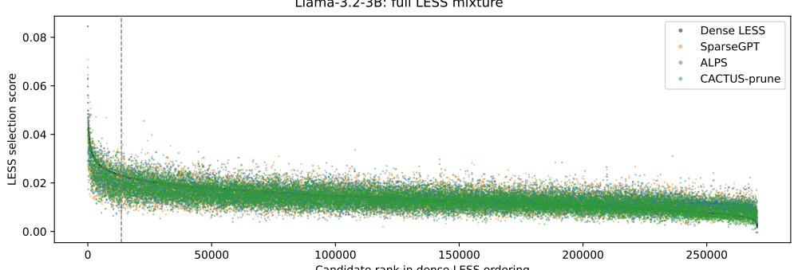

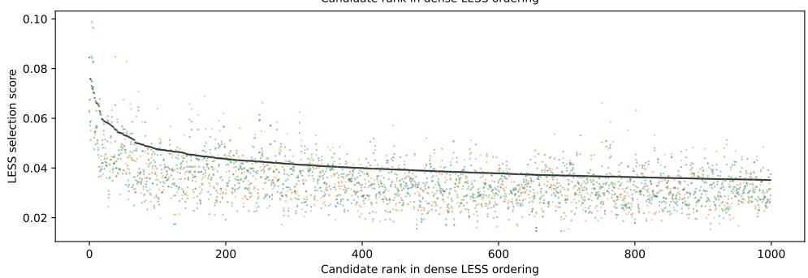  
Figure 6: LESS selection scores for dense Llama-3.2-3B and its SparseGPT, ALPS, and CACTUSprune sparse proxies, with candidates ordered by the dense model’s aggregate score. The top panel spans the full instruction mixture; the bottom panel shows the first 1000 candidates. The dashed line marks the top-5% cutoff.

Llama-3.2-3B: full LESS mixture  
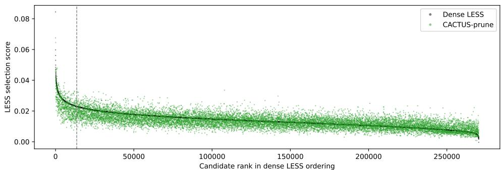

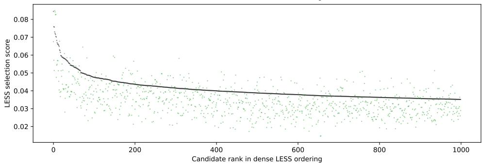  
Figure 7: Dense LESS and CACTUS-prune scores from Figure 6, shown separately.

## D.2 PER-LAYER LOSS DECREASE

We examine how the layerwise KFAC objective evolves over CACTUS’s ADMM iterations. Figure 8 compares representative loss trajectories for pure pruning and (S+L) compression, illustrating their initial non-monotonic behavior and subsequent stabilization as the penalty increases.

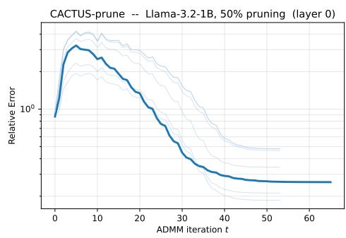

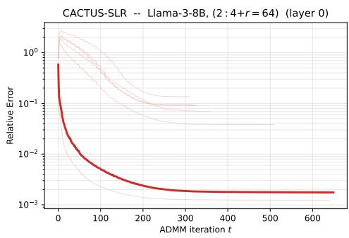  
Figure 8: CACTUS relative-error trajectory for a representative layer. The KFAC objective can increase during the first ADMM iterations because the method is exploring feasible sparse candidates while the penalty schedule is still loose. As the penalty grows, primal feasibility tightens and the iterates settle, yielding the expected decrease and convergence of the objective.

## D.3 EFFECT OF CALIBRATION-SET SIZE

We vary the number of C4 calibration sequences from 32 to 256 for CACTUS-prune at 50% unstructured sparsity on Llama-3.2-1B and Qwen3-4B (Table 15). All runs use sequence length 2048 and same calibration data and ridge coefficients $\lambda _ { H } = 0 . 0 1$ and $\lambda _ { G } = 0 . 1$ . Perplexity improves with more calibration data on all three datasets. Doubling the sample count from 128 to 256 yields modest improvements, supporting 128 sequences as a practical calibration budget.

<table><tr><td></td><td colspan="3">Llama-3.2-1B</td><td colspan="3">Qwen3-4B</td></tr><tr><td>Sequences</td><td>C4</td><td>WT-2</td><td>PTB</td><td>C4</td><td>WT-2</td><td>PTB</td></tr><tr><td>32</td><td>21.113</td><td>15.455</td><td>24.121</td><td>22.429</td><td>17.235</td><td>28.703</td></tr><tr><td>64</td><td>20.105</td><td>14.566</td><td>23.181</td><td>21.952</td><td>16.811</td><td>28.576</td></tr><tr><td>128</td><td>19.465</td><td>14.211</td><td>22.613</td><td>21.743</td><td>16.102</td><td>27.924</td></tr><tr><td>256</td><td>19.132</td><td>13.842</td><td>22.399</td><td>21.663</td><td>16.057</td><td>27.660</td></tr></table>

Table 15: Effect of calibration-set size on perplexity (↓) for CACTUS-prune at 50% unstructured sparsity. All other settings are held fixed for each model.