# Weighting-Based Strategies for Classification: Analysis and Local Peak Dynamics with CART Trees

Abdoulaye Sakho Artefact Research Center   
Sorbonne Université, Université   
Paris Cité, CNRS, LPSM, France

Emmanuel Malherbe Artefact Research Center France

Erwan Scornet Sorbonne Université, Université Paris Cité, CNRS, LPSM, France

## Abstract

Tabular learning tasks often suffer from class imbalance, which is often addressed via weighting-based strategies. In this work, we compare the naive approach (unweighted) with the weighting-based rebalancing strategies. Somewhat surprisingly, we demonstrate that, asymptotically, as the predictor complexity increases with sample size, weighting strategies yield predictive performance identical to unweighted approaches across all evaluation metrics, up to a shift in the final threshold. To go beyond, we theoretically study the estimation of a linear regression function through weighted and unweighted CART trees with limited depths. In this setting, we prove that the points in the PR space for both strategies are distributed along the same curve, thus illustrating the similar nonasymptotic performance of the two strategies. Then, we numerically identify more complex synthetic settings where performance gaps, evaluated via fixed classifier complexity, favor weighting strategies. Thus, to guide practitioners, we introduce an indicator that aims at signaling whether a data set may benefit from weighting.

## 1 INTRODUCTION

Decision trees are the elementary brick of more powerful classifiers such as random forests (Breiman 2001), first-order boosted trees (Friedman, 2001), XGboost(Chen and Guestrin, 2016), LightGBM (Ke et al., 2017) and Catboost (Prokhorenkova et al., 2018). When dealing with tabular data, tree-based classifiers are relevant classifiers for solving learning tasks, as suggested by Grinsztajn et al. (2022);

Shwartz-Ziv and Armon (2022) in their empirical comparison between tree-based and deep learning-based procedures. Although the recent emergence of tabular foundation models (Hollmann et al., 2022; Grinsztajn et al., 2025; Qu et al., 2025) has led to impressive predictive performance on benchmarks such as TabArena (Erickson et al., 2026), tree-based methods remain widely used, due notably to their minimal computational and hardware requirements.

In machine learning, a data set is considered imbalanced when target classes are unevenly distributed (Sun et al., 2009; Spelmen and Porkodi, 2018). Class imbalance (Sun et al., 2009; Spelmen and Porkodi, 2018) has been extensively studied in the literature due to its prevalence across diverse domain applications. For instance, class imbalance frequently arise in banking credit scoring (Sakho et al., 2025), customer churn prediction (Nguyen and Duong, 2021), and medical diagnosis (Khalilia et al., 2011).

Standard learning algorithms typically assume balanced class priors, thus, their performances degrade significantly on imbalanced data as optimization favors the majority class. To mitigate this behavior, several rebalancing strategies have been proposed in the literature. Among techniques that synthesize new minority samples, the Synthetic Minority Over-sampling Technique (SMOTE) (Chawla et al., 2002) is widely used, generating synthetic minority instances via linear interpolation between neighboring observations. Numerous variants of SMOTE have been proposed in the literature. Techniques such as Borderline-SMOTE and ADASYN focus specifically on samples near class decision boundaries (Han et al., 2005; He et al., 2008). Other extensions, including SVM-SMOTE and DBSMOTE, incorporate SVM classification (Nguyen et al., 2011) or DBSCAN clustering (Bunkhumpornpat et al., 2012) prior to the interpolation phase. Finally, hybrid methods like SMOTEBoost (Chawla et al., 2003) integrate SMOTE directly into the model training process by resampling data within

each boosting iteration.

On the other hand, a widespread approach to mitigate this bias is the use of weighting-based rebalancing strategies. We define weighting-based rebalancing strategies as procedures that do not introduce synthetic data, but instead modify the relative importance of existing observations by assigning samplelevel weights. This category include Random Oversampling (ROS), Random Undersampling (RUS), and class weighting. Specifically, ROS effectively assigns integer weights to duplicated samples, whereas RUS assigns binary weights $w _ { i } ~ \in ~ \{ 0 , 1 \}$ , where 0 corresponds to discarded instances and 1 to retained ones.

Under class imbalance, standard evaluation metrics such as accuracy become uninformative, making the Area Under the Precision-Recall Curve (PR AUC) the recommended benchmark (see Saito and Rehmsmeier, 2015). Because the choice of metric dictates whether a rebalancing strategy provides genuine utility, this work aims to identify the precise settings in which weighting-based rebalancing strategies are effective.

Our main contributions are detailed below:

• With a linear univariate regression function, we prove that the points in the PR space for both strategies are distributed along the same curve, thus illustrating the similar non-asymptotic performance of the two strategies.

• However, under fixed model complexity, we highlight more complex synthetic settings where the presence of an isolated peak induces discrepancies in performance between both strategies.

• To diagnose performance gaps, we propose an indicator that aims at determining whether a given data set will benefit from weighting, with promising results on real-world data sets.

## 2 RELATED WORK

Several studies have focused on oversampling strategies that generate synthetic samples to augment the minority class. For example, Elreedy et al. (2023) derived the theoretical density of samples generated by the Synthetic Minority Over-sampling Technique (SMOTE). Subsequently, Sakho et al. (2026) demonstrated that SMOTE yields a distribution that closely replicates original minority instances and tends to vanish near the boundaries of the minority class support. Furthermore, Ahmad et al. (2026) established excess risk bounds when SMOTE is used in conjunction with a downstream classifier.

Complementingthesegenerativeapproaches, weighting-based strategies have also been extensively investigated from a theoretical standpoint. Scott (2012) theoretically studies surrogate losses within asymmetric of imbalance data. The authors demonstrate that employing calibrated losses under these conditions yields higher excess risk bounds. Koyejo et al. (2014) theoretically analyze several performance metrics for binary classification and derive optimal classifiers associated to these metrics. The optimal classifiers turn out to be metric-dependent. Xu et al. (2020) derive the convergence rates of the expected excess weighted risk when the weighting for the plug-in classifier and the risk is different. They prove that in such a setting there is an irreducible term for the convergence of risk to the weighted Bayes risk. Then they define two robust risk that have the specificity to minimize the risk with respect to a set of weightings. Aghbalou et al. (2024), following the results from Xu et al. (2020), propose sharper error bounds in a special setting: when the absolute number of samples within the minority class is low. Esposito et al. (2021) introduce two different automated procedures to adjust the decision threshold of classifiers post-training to improve performance on minority classes, rather than modifying the original data set. Mayala et al. (2024) study infinite random forests (IRF) and undersampling IRF theoretically and establish their asymptotic normality.

A field closely related to our work is long-tailed learning (Zhang et al., 2023), which addresses multi-class learning under severe imbalance by aiming to improve predictive performance on infrequent tail classes. This line of research primarily targets computer vision benchmarks such as ImageNet-LT (Liu et al., 2019) and iNaturalist (Van Horn et al., 2018). For instance, Focal Loss (Lin et al., 2017) dynamically downweights well-classified easy examples to force the model to focus on difficult minority instances. To improve generalization, the Label-Distribution-Aware Margin (LDAM) loss (Cao et al., 2019) enforces larger classification margins specifically for minority classes. Alternatively, from a meta-learning perspective, Learning to Reweight (L2RW) (Ren et al., 2018) utilizes an unbiased validation set to adaptively optimize instancewise weights during training rather than relying on static heuristics. While long-tailed learning techniques often rely on instance weighting and could thus gain some intuition from our study, long-tailed settings fall outside the scope of this study. Indeed, our work specifically focuses on tabular data with few classes.

## 3 WEIGHTING STRATEGIES

In this section, we investigate weighting-based strategies through a focus on class weighting, its most com-

mon variant.

## 3.1 Framework and Strategies

We consider a binary classification setting defined by the pair of random variables (X, Y), where the target $Y \in \{ 0 , 1 \}$ is predicted from covariates $X \in \mathcal { X } \subset \mathbb { R } ^ { d }$ Let $f _ { X }$ denote the probability density function of X. In the following, we use the superscript \* to denote quantities associated with the weighted distribution.

Definition 3.1 (Mayala et al. (2024)). We denote by $( X ^ { \star } , Y ^ { \star } )$ the pair of random variables under the weighted joint distribution, defined as

$$
\mathbb { P } ( Y ^ { \star } = 1 ) = p ^ { \star } \ge \mathbb { P } ( Y = 1 ) = p\tag{1}
$$

$$
f _ { X ^ { \star } | Y ^ { \star } } ( x | 0 ) = f _ { X | Y } ( x | 0 ) ,\tag{2}
$$

$$
f _ { X ^ { \star } | Y ^ { \star } } ( x | 1 ) = f _ { X | Y } ( x | 1 ) .\tag{3}
$$

The previous equations illustrate that weighting strategies do not modify the conditional distribution of $X | \bar { Y }$ while altering the joint distribution, such that $( X ^ { \star } , Y ^ { \star } ) \neq ( X , Y )$

In general, the objective of weighting is to train a model on $( X ^ { \star } , Y ^ { \star } )$ and obtain better predictive performances. We insist on the fact that the unweighted (None) and weighting methodologies are both evaluated under the original (X, Y) distribution, which is mandatory as evaluation must always be performed on the original data distribution. In the following, we use class-weighting (CW) as weighting strategy. We also denote the regression functions under the original and weighted distributions as $\mu ( x ) = \mathbb { P } ( Y = 1 \mid X = x )$ and $\mu ^ { \star } ( x ) = \mathbb { P } ( Y ^ { \star } = 1 \mid X ^ { \star } = x )$ , respectively.

## 3.2 A Related Result

In their analysis in their analysis of tree-based methods under class imbalance, Mayala et al. (2024) also derive the following result to move from $\mu ^ { \star }$ to $\mu .$

Lemma 3.2 (Mayala et al. (2024)). We have

$$
\mu ^ { \star } ( x ) = \frac { \omega _ { 1 } \mu ( x ) } { \omega _ { 0 } ( 1 - \mu ( x ) ) + \omega _ { 1 } \mu ( x ) } ,\tag{4}
$$

$$
w i t h \omega _ { 0 } = p ( 1 - p ^ { \star } ) a n d \omega _ { 1 } = p ^ { * } ( 1 - p ) .
$$

An alternative proof of Theorem 3.2 is provided in Section C.1. Specifically, we define the mapping $g \ : \ [ 0 , 1 ] \  \ [ 0 , 1 ]$ such that $\mu ^ { \star } ~ = ~ g ( \mu )$ and $\mu ~ =$ $g ^ { - 1 } ( \mu ^ { \star } )$ , where for $x \ \in \ [ 0 , 1 ] \colon \ g ( x ) \ = \ \omega _ { 1 } x / ( \omega _ { 0 } ( 1 -$ $x ) + \omega _ { 1 } x )$ and $g ^ { - 1 } ( x ) = \omega _ { 0 } x / ( \omega _ { 0 } x + \omega _ { 1 } ( 1 - x ) )$ Theorem 3.2 demonstrates that $\mu ^ { \star }$ is a strictly increasing function of $\mu ,$ meaning that $\mu ^ { \star }$ preserves the rank ordering of the conditional probabilities. Consequently, the unweighted and class-weighted strategies yield identical probability orderings. Therefore, the total Area Under the PR Curve (PR AUC) and ROC Curve (ROC AUC) for both strategies are identical. Furthermore, threshold-dependent metrics such as precision are identical across approaches, up to a shift in the probability decision threshold. This is a highly notable observation, as practitioners may expect weighting to structurally alter metrics by shifting the training distribution to $( X ^ { \star } , Y ^ { \star } )$

All in all, Theorem 3.2 implies that any universally consistent classifier achieves identical asymptotic performance whether trained on (X, Y) or $( X ^ { \star } , Y ^ { \star } )$ across PR AUC and other metrics, up to a shift on the decision threshold. Thus, we aim to investigate how these metrics behave in an infinite-sample regime under non-asymptotic model complexity.

## 4 SPLITTING PROCEDURE

In the following, we examine whether theoretical performance discrepancies emerge when estimating the regression function via a CART decision tree with and without weighting.

Definition 4.1. Let n denote the number of training samples. The theoretical classifier $\hat { m } _ { k }$ is defined as the limit of finite-sample estimator:

$$
\hat { m } _ { k } = \operatorname* { l i m } _ { n \to \infty } \hat { m } _ { k , n } .\tag{5}
$$

Assumption 4.2. We operate in the infinite-sample regime for both training and testing, employing either the unweighted classifier $\hat { m } _ { k }$ or its weighted counterpart $\hat { m } _ { k } ^ { \star }$

In this section, we place ourselves in the univariate setting $( d = 1 )$ . Thus, let $s \in \mathbb { R }$ be the split position of our tree $\hat { m } _ { k }$ , thus producing two child nodes:

$$
\begin{array} { l } { { A _ { L } ( s ) = A _ { L } = \{ x \in \mathcal { X } \mid x < s \} } } \\ { { A _ { R } ( s ) = A _ { R } = \{ x \in \mathcal { X } \mid x \geq s \} . } } \end{array}
$$

Lemma 4.3. Under Theorem $4 . 2 ,$ the impurity gain $L _ { 0 }$ of the first split in the univariate for unweighted tree setting is

$$
L _ { 0 } ( s ) = I _ { L } I _ { R } \left[ \frac { J _ { L } } { I _ { L } } - \frac { J _ { R } } { I _ { R } } \right] ^ { 2 } ,\tag{6}
$$

where

$$
\begin{array} { l l } { \displaystyle I _ { L } = \int _ { x \in A _ { L } } f _ { X } ( x ) \mathrm { d } x , } & { I _ { R } = \int _ { x \in A _ { R } } f _ { X } ( x ) \mathrm { d } x , } \\ { \displaystyle J _ { L } = \int _ { x \in A _ { L } } f _ { X } ( x ) \mu ( x ) \mathrm { d } x , } & { \displaystyle J _ { R } = \int _ { x \in A _ { R } } f _ { X } ( x ) \mu ( x ) \mathrm { d } x . } \end{array}
$$

The proof of Theorem 4.3 is provided in Section D.1. Note that this derivation holds for arbitrary regression functions as soon as $I _ { L } , I _ { R } \neq 0$ Leveraging Theorem 4.3, we establish analogous results for weighted decision trees.

Theorem 4.4. Under Theorem $4 . 2 ,$ let $\varepsilon > 0$ such that $p ^ { \star } = p + \varepsilon$ . For ε small enough, the split gain $L ( s )$ of a weighted tree in the univariate setting can be approximated $a s ,$

$$
L ( s ) \approx L _ { 0 } ( s ) + \varepsilon L _ { 1 } ( s ) + \mathcal { O } ( \varepsilon ^ { 2 } ) ,\tag{7}
$$

where,

$$
\begin{array} { r } { L _ { 1 } ( s ) = 2 L _ { 0 } ( s ) \left( \frac { G _ { 1 } ( s ) } { G _ { 0 } ( s ) } - \frac { 1 } { 1 - p } \right) } \\ { + \displaystyle \frac { G _ { 0 } ^ { 2 } ( s ) } { p ( 1 - p ) } ( I _ { R } J _ { L } + I _ { L } J _ { R } ) , } \end{array}\tag{8}
$$

with $\begin{array} { r } { G _ { 0 } = \frac { J _ { L } } { I _ { L } } - \frac { J _ { R } } { I _ { R } } } \end{array}$ and

$$
G _ { 1 } = - \left[ \frac { J _ { L } } { I _ { L } } \frac { J _ { L } - p I _ { L } } { I _ { L } p ( 1 - p ) } + \frac { J _ { R } } { I _ { R } } \frac { J _ { R } - p I _ { R } } { I _ { R } p ( 1 - p ) } \right] .
$$

The proof of Theorem 4.4 can be found in Section D.2. Theorem 4.4 establishes an approximation of the impurity gain for a weighted tree under the assumption that ε is sufficiently small. This simplified expression facilitates the analytical control of the gain terms. Furthermore, this result is general: it holds for arbitrary regression functions (as soon as $I _ { L } , I _ { R } \neq 0 )$ and provides a foundation for approximating the split values of weighted decision trees. Finally, the validity of this approximation for small ε can be seen as a constraint on a limited weighting strength.

Below, we conduct an analysis of the decision tree splits with a linear regression function.

## 5 LINEAR APPROACH

In this section, to derive explicit expressions for split values, tree models, and performance metrics, we focus our analysis on a univariate linear setting defined as follows.

Assumption 5.1. Let $d = 1 , X \sim \mathcal { U } ( [ 0 , 1 ] )$ and assume that $\mu ( x ) = \mathbb { P } ( Y = 1 | X = x ) = \alpha x + \beta$ with $\alpha , \beta \in \mathbb { R } ^ { + }$ such that $\alpha + \beta \leq 1$

## 5.1 Impurity Gain

We denote by $s _ { p } ,$ the initial split of a tree at depth $1 \ ( k = 1 )$ . We have from Ishwaran (2015) that $L _ { 0 } ( s )$ is maximized for $s _ { p } = 0 . 5$ . We remark that this split position does not depend on the parameters α and $\beta .$ Lemma 5.2. Under Theorem $4 . 2$ and Theorem $5 . 1 ,$ we have for the weighted impurity gain denoted $L ( s )$

$$
L ( s ) = C \cdot \frac { s ( 1 - s ) } { [ 1 - \kappa ( 1 - s ) ] [ 1 + \kappa s ] } ,\tag{9}
$$

where $\begin{array} { r } { \kappa \mathrm { ~  ~ \psi ~ } = \mathrm { ~  ~ \psi ~ } \alpha ( p ^ { \star } \mathrm { ~  ~ - ~ } p ) / ( 2 p ( 1 \mathrm { ~  ~ - ~ } p ) ) } \end{array}$ and $\begin{array} { r l } { C } & { { } = } \end{array}$ $\begin{array} { r } { \alpha ^ { 2 } \left[ \frac { \omega _ { 1 } } { p ( 1 - p ) } \left( \frac { 1 } { 2 } - \frac { p ^ { * } - p } { 2 ( 1 - p ) } \right) \right] ^ { 2 } } \end{array}$ . The optimal split $s _ { p } ^ { \star }$ that maximizes $\dot { L } ( s )$ is given by the unique valid solution of equation: $2 \kappa s ^ { 2 } + 2 ( 1 - \kappa ) s - ( 1 - \kappa ) = 0$ , which is:

$$
s _ { p } ^ { \star } = \frac { 1 } { 2 } - \frac { \kappa } { 2 \left( \sqrt { 1 - \kappa ^ { 2 } } + 1 \right) } .\tag{10}
$$

The proof of Theorem 5.2 can be found in Section E.2. Theorem 5.2 allows us to compare the effect of weighting on tree splitting. This result establishes how sample weighting alters tree split selection relative to the unweighted baseline $s _ { p } ~ = ~ 1 / 2$ Note that $\kappa \in [ - 1 , 1 ]$ ensures that the expression for $s _ { p } ^ { \star }$ remains valid. Specifically, for our primary regime of interest $\left( p ^ { \star } > p \right)$ implying $\kappa \in [ 0 , 1 ] )$ , the optimal split value $s _ { p } ^ { \star }$ drops below $1 / 2$ This downward shift enables the tree to form more homogeneous leaves by allocating greater spatial volume to regions where the regression function takes larger values. In the special case where $\begin{array} { r } { c _ { 1 } , c _ { 2 } \in \mathbb { R } ^ { + } , \alpha = \frac { c _ { 1 } p } { 2 } , \beta = c _ { 2 } p } \end{array}$ , assuming $p \ll p ^ { \star }$ and $p \ll 1$ yields the approximation $\begin{array} { r } { \kappa \approx \frac { c _ { 1 } p ^ { \star } } { 2 } } \end{array}$ Consequently, κ increases monotonically with the target prevalence $p ^ { \star }$ . Because $s _ { p } ^ { \star }$ is a strictly decreasing function of $\kappa ,$ higher values of $p ^ { \star }$ induce a more pronounced downward shift in the optimal split value $s _ { p } ^ { \star }$ relative to $1 / 2$

Hereafter, we denote $s _ { p }$ and $s _ { p } ^ { \star }$ as the split values for weighted and unweighted depth-1 trees.

## 5.2 Maximum Depth Equal to k

Let $t \in [ 0 , 1 ]$ denote the decision threshold used to predict $\hat { Y } = 1$ within each leaf cell of the CART tree. To avoid ambiguity, we consistently use the term threshold for classification rules on predicted probabilities, whereas split value refers to feature separations. Formally, for a given leaf $A ,$ the decision rule is

$$
\mathbb { E } [ Y \mid X \in A ] \geq t \Longrightarrow { \hat { Y } } = 1 .\tag{11}
$$

In the subsequent analysis, we focus on Precision-Recall curves and their Area Under the Curve (AUC), as they provide robust, threshold-free metrics for class imbalance.

Let $\{ s _ { p } ^ { h } \} _ { h = 1 } ^ { 2 ^ { k } - 1 }$ and $\{ s _ { p } ^ { \star h } \} _ { h = 1 } ^ { 2 ^ { k } - 1 }$ denote the internal split values for a depth-k unweighted and weighted tree, respectively. We sort these splits monotonically via permutations σ and $\boldsymbol { \sigma } ^ { \star } ,$ yielding $s _ { p } ^ { \sigma ( 1 ) } \leq \cdots \leq s _ { p } ^ { \sigma ( 2 ^ { k } - 1 ) }$ and $s _ { p } ^ { \sigma ^ { \star } ( 1 ) } \leq \dots \leq s _ { p } ^ { \sigma ^ { \star } ( 2 ^ { k } - 1 ) }$

In Section B, we provide simplified algebric expressions of the trained decision trees, along with their corresponding performance metrics.

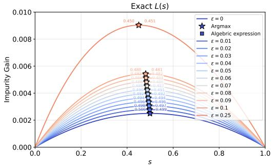

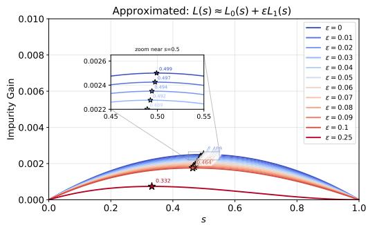  
Figure 1: Impurity gain function of first split for linear regression function with $\alpha = 0 . 2$ and $\beta = 0 . 0 5$

Theorem 5.3. Under Theorem $4 . 2$ and Theorem 5.1, both the unweighted decision tree $\hat { m } _ { k }$ and weigthing tree $\hat { m } _ { k } ^ { \star }$ satisfy the exact same Precision-Recall relationship across all output probabilities. Expressed for $\hat { m } _ { k }$ , this relationship is given by:

$$
\begin{array} { l } { { \displaystyle P r e c i s i o n _ { \hat { m } _ { k } , t } \left( R e c a l l _ { \hat { m } _ { k } , t } \right) = \frac { \alpha } { 2 } + \beta } } \\ { { \displaystyle + \frac { \alpha } { 2 } \frac { - \beta + \sqrt { \beta ^ { 2 } + 2 \alpha \left( \frac { \alpha } { 2 } + \beta \right) \left( 1 - R e c a l l _ { \hat { m } _ { k } , t } \right) } } { \alpha } , } } \end{array}\tag{12}
$$

where Precision $\hat { m } _ { k } , t$ denotes the precision of decision tree $\hat { m } _ { k }$ at probability threshold s.

The proof of Theorem 5.3 can be found in Section G.2. Theorem 5.3 provides an explicit expression of Precision as a function of Recall that is fundamentally independent of the chosen split sequence. Thus, in the Precision-Recall space, the operating points are strictly constrained to a curve that does not depend on the specific partition values. In other words, the underlying Precision-Recall curves of the unweighted and weighted strategy are identical. However, the discrete positioning of their empirical operating points differs, leading to distinct Riemann sum configurations when approximating the AUC.

## 6 PR CURVES: GENERALIZATION

In this section, we extend our analysis of performance metrics from linear models to broader classes of regression functions.

Theorem 6.1. Under Theorem 4.2, both the unweighted decision tree $\hat { m } _ { k }$ and weighting tree mk operating at an output probability threshold s, satisfy the PR relationship. Expressed for îk, this relationship is given by:

$$
P r e c i s i o n _ { \hat { m } _ { k } , t } = \frac { R e c a l l _ { \hat { m } _ { k } , t } \times \mathbb { P } \left( Y = 1 \right) } { \mathbb { P } \left( \hat { m } _ { k } ( X ) = 1 \right) } .\tag{13}
$$

The proof of Theorem 6.1 can be found in Section G.1. Theorem 6.1 is available for all regression functions, univariate or not, and without assumptions on the distribution of X. The key insight of this theorem is that the predicted positive probability P $( \hat { m } _ { k } ( X ) = 1 )$ is the sole term carrying explicit dependence on tree split locations. Consequently, whenever this term can be reparametrized purely through the underlying regression parameters, precision decouples from split values, yielding analytical PR curves for both weighted and unweighted decision trees. Next, we subsequently establish assumptions that extend this decoupling property to a broader class of regression functions than considered in Theorem 5.3.

Assumption 6.2. $X \in [ a , b ]$ with $a , b \in \mathbb { R }$ and $b >$ a. $t \to \mu ( t ) f _ { X } ( t )$ has a primitive that we denote $F _ { Y }$ Furthermore $F _ { Y } ^ { - 1 }$ exists and $\mu$ is increasing.

Theorem 6.3. Under Theorem $4 . 2$ and Theorem $6 . 2 ,$ both the unweighted decision tree $\hat { m } _ { k }$ and weigthing tree $\hat { m } _ { k } ^ { \star }$ satisfy the exact same Precision-Recall relationship across all output probabilities. Expressed for $\hat { m } _ { k }$ , this relationship is given by:

$$
\begin{array} { r l r } {  { P r e c i s i o n _ { \hat { m } _ { k } , t } } } \\ & { = \frac { R e c a l l _ { \hat { m } _ { k } , t } \mathbb { P } ( Y = 1 ) } { \mathbb { P } ( X \geq F _ { Y } ^ { - 1 } [ F _ { Y } ( b ) - R e c a l l _ { \hat { m } _ { k } , t } \mathbb { P } ( Y = 1 ) ] ) } . } \end{array}\tag{14}
$$

The proof of Theorem 6.3 can be found in Section G.3. Theorem 6.3 generalizes Theorem 5.3. This result demonstrates that regardless of the weighting strategy, the PR curves are the same for both settings and depend solely on the true regression parameters. Derived as a special case of Theorem 6.1, this formulation imposes specific assumptions that allow P $( \hat { m } _ { k } ( X ) = 1 )$ to be reparametrized purely through the underlying regression parameters, yielding identical analytical PR curves for both weighted and unweighted decision trees.

## 7 NUMERICAL ILLUSTRATIONS

Within the linear setting, we conduct numerical experiments to validate our theoretical derivations.

Figure 1 illustrates the impurity gain function, comparing the original formulation with the approximation derived in Theorem 4.4 under the assumption that ε is sufficiently small (where $p ^ { \star } = p + \varepsilon )$ The curve profiles of the exact criterion and its approximation (established for small ε) are similar for ε ranging from 0 to 0.1. For these values, while the exact shape differs, the positions of maxima are aligned, thus vlidating our Theorem 4.4. Furthermore, Figure 1 demonstrates that our weighted tree split formulation from Theorem 5.2 closely aligns with the empirically computed argmax, thereby validating our derivation.

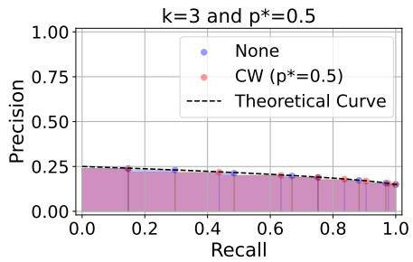  
Figure 2: PR curves of None and CW for a linear regression function with $\alpha = 0 . 2$ and $\beta = 0 . 0 5$

Figure 2 illustrates the PR curves for both the standard decision tree, unweighted shown in blue $( p \ =$ 0.15) and class-weighted in red, for $p ^ { \star } = 0 . 5$ and maximum depth equal to 3. Each classifier is trained on 500.000 samples and evaluated on 500.000. We also display the theoretical curve derived from Theorem 5.3. We observe that although the empirical points for the unweighted and weighted models are distinct, they all align precisely with our derived theoretical curve. Furthermore, in Section A, we illustrate on Figure 9 settings with distinct value of $p ^ { \star } \in$ {0.2, 0.5, 0.7}, and maximum depth within $\{ 2 , 3 , 4 , 5 \}$

## 8 EMPIRICAL COUNTERPART

Although practitioners often observe empirical performance gains from weighting, our theoretical analysis demonstrates that under well-estimated regression functions or suitable structural assumptions, we can show that both methodologies yield identical metrics such as PR AUC. This section investigates the source of the empirical advantages of weighting when the regression function is not well-estimated.

## 8.1 ExpSetting

We consider a regression function, denoted as ExpSetting, defined by the following expression:

$$
\mu ( x ) = \exp ( - 3 5 x ) + \exp ( - 3 5 ( 1 - x ) ) .
$$

For our experimental analysis, we augment this base function with an isolated Gaussian peak ν, given by:

$$
\nu ( x ) = a \exp \left( - \frac { 1 } { 2 } \left( \frac { x - b } { c } \right) ^ { 2 } \right) ,
$$

where $a , b , c ~ \in ~ \mathbb { R }$ represent respectively the peak height, localisation and width. Figure 3 illustrates the ExpSetting function with several peak parameters.

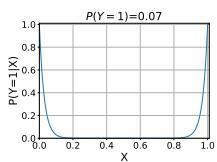

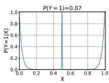

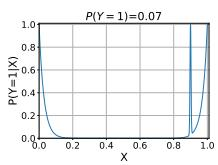  
Figure 3: ExpSetting with a peak across localisations.

As a first illustration, Figure 4 presents the PR-AUC performance gaps for the ExpSetting configuration, comparing scenarios with and without a localized peak at $b = 0 . 5$ (evaluated at $p ^ { \star } = 0 . 5$ and depth $k = 4 )$ 1 We observe that the weighting strategy yields better predictive performance in the presence of the peak. Figure 14 and Figure 15 in Section A extend these results across diverse maximum depths and $p ^ { \star }$ values, alongside the estimated regression functions and PR curves. These detailed appendix evaluations show that the performance gain arises because weighting enables the tree to successfully capture the localized peak, whereas unweighted models fail to detect it.

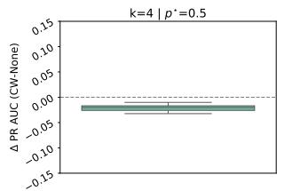

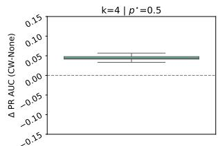  
(a) Without peak.  
(b) With peak.  
Figure 4: PR-AUC performance gap between classweighted (CW) and unweighted models under the ExpSetting data distribution.

In what follows, we conduct a numerical analysis to investigate the mechanisms governing peak detection. In Figure 5, the left panel displays the difference between the unweighted classifier's probability predictions and the true peak probability. The middle and the right panels illustrate the same difference for the class-weighted classifier for respectively $p ^ { \star } = 0 . 5$ and $p ^ { \star } = 0 . 9$ We fix the peak location at $b = 0 . 5$ and vary its height a and width c. We observe that the unweighted model fails to detect the peak under most configurations; its heatmap is predominantly red, indicating poor detection except in the regime of large widths and high heights. More precisely, the baseline strategy introduces a negative bias, underestimating the true peak probability. In contrast, the weighted approach captures nearly all peaks when $p ^ { \star } ~ = ~ 0 . 5$ When shifting to $p ^ { \star } = 0 . 9$ , the model's sensitivity improves further, allowing it to detect even subtle peaks with low height and small width. Consequently, by altering split selection, class weighting may enhance peak detection and boost performance for a fixed tree depth. We observe a similar phenomenon when increasing the dimensionality of the input features to $d = 5$ in the presence of an isotropic peak (see Figure 12 in Section A).

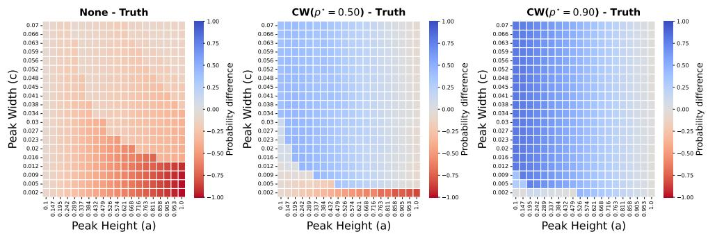  
Figure 5: ExpSetting: CART tree difference between predicted and ground-truth peak probability across peak widths and heights (b = 0.5), for the unweighted (None) alongside weighting with $p ^ { \star } = 0 . 5$ and $p ^ { \star } = 0 . 9 \ ( k = 4 )$  
Table 1: Data sets.

## 8.2 SinSetting

To assess the generality of our previous findings, we extend our analysis to a sinusoidal regression function, denoted SinSetting, for which complete experimental details are provided in Section A.3. The SinSetting regression function is defined as:

$$
\mu ( x ) = 0 . 1 5 s i n \ : ( 2 \pi x + 1 . 2 ) + 0 . 1 6 .
$$

As before, this base function is augmented with the same peak $\nu$ (illustrated in Figure 6) Replicating the experimental setup used for ExpSetting yields consistent findings: when model capacity cannot fully resolve the underlying regression function, sharp peaks can induce performance gaps in favor of weighting.

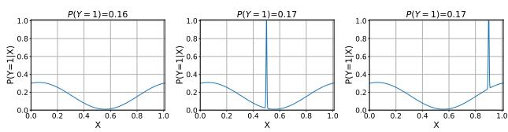  
Figure 6: SinSetting with a peak across localisations.

To assist practitioners in determining whether to incorporate weighting into their pipelines, we introduce a diagnostic indicator.

<table><tr><td rowspan="2"></td><td rowspan="2">#Samples</td><td rowspan="2">#Positive</td><td rowspan="2">d</td></tr><tr><td>#Samples</td></tr><tr><td>Haberman</td><td>306</td><td>26%</td><td>3</td></tr><tr><td>Yeast</td><td>1462</td><td>11%</td><td>8</td></tr><tr><td>Phoneme</td><td>5404</td><td>29%</td><td>5</td></tr><tr><td>Credit Card</td><td>284315</td><td>0.2%</td><td>29</td></tr></table>

## 8.3 Peak Indicator

To diagnose the hidden structures introduced in the previous sections, we propose an indicator. For each positive sample $( Y = 1 )$ , we have:

$$
\tilde { \bf C } = \frac { D ^ { - } - D ^ { + } } { D ^ { - } + D ^ { + } } ,\tag{15}
$$

where $D ^ { + }$ represents the mean distance from the positive instance to its B nearest neighbors within the same class $( Y ~ = ~ 1 )$ , and $D ^ { - }$ represents its mean distance to its nearest neighbors within the opposite class $( Y ~ = ~ 0 )$ While instance complexity metrics such as the Silhouette coefficient (Rousseeuw, 1987) or the overlap measure (Lorena et al., 2019) rely on $D ^ { + }$ and $D ^ { - }$ , Č introduces a different ratio that restricts distance evaluations to a local neighborhood. Furthermore, our formulation differs from established distance-based metrics in the literature, such as those used in NearMiss undersampling strategies (Mani and Zhang, 2003). Specifically, NearMiss-1 measures the mean distance from majority class samples to their nearest minority class neighbors, whereas NearMiss-2 evaluates the distance to the farthest minority class neighbors. Neither metric accounts for the ratio of intra-class to inter-class distances like our indicator.

The distribution of $\tilde { \mathbf { C } }$ across all positive samples is subsequently visualized using a histogram. A high concentration of samples near 1 in the peak indicator histogram signifies that a large portion of the minority class instances are highly clustered together yet spatially isolated from the majority class, indicating the presence of localized peaks. Thus, such data sets are highly likely to require a weighting procedure to achieve better performance if the downstream model cannot perfectly estimate the regression function.

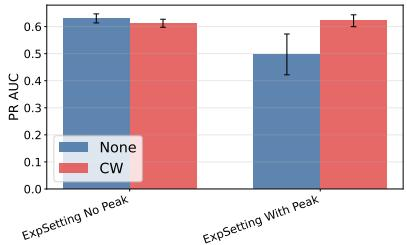

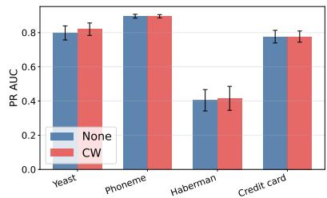

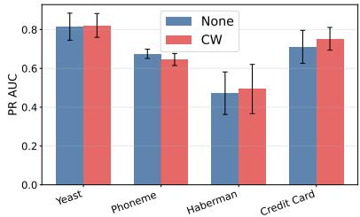  
Figure 7: PR AUC comparison across model configurations with $p ^ { \star } = 0 . 5 \colon$ (left) decision tree with maximum depth 4 evaluated on ExpSetting, (center) unconstrained random forest evaluated on real-world data sets, and (right) 2-depth-constrained random forest evaluated on real-world data sets.

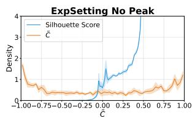  
(a) ExpSetting

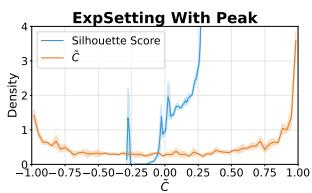  
(b) ExpSetting with peak

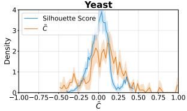  
(c) Yeast

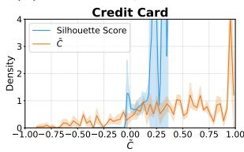  
(d) CreditCard  
Figure 8: Peak indicator (B = 1) and Silouhette samples scores for the ExpSetting, Yeast and CreditCard.

Figure 8 (alongside Figure 10 in the Appendix) illustrates the peak indicator distributions for the $E x p S e t -$ ting data set under both peaked $\left( b = 0 . 5 \right)$ and nonpeaked configurations, while Figure 7 details the corresponding predictive performances. We observe that introducing a sharp peak alters the distribution profile, shifting probability mass toward $\tilde { \mathbf { C } } \approx 1$ across both $B = 1$ and $B = 1 0$ . For the peaked ExpSetting regime, the weighting strategy yields predictive gains. This distributional shift underscores the capacity of Č to effectively identify problem regimes that stand to benefit from a weighting-based strategy. In contrast standard Silhouette sample scores fail to detect the presence or absence of a localized peak.

Then, we employ 4 tabular data sets from Dua and Graff (2017), Alinat (1993) (Phoneme) and Dal Pozzolo et al. (2015) (Credit Card). The characteristics of the data sets are summarized in Table 1. Their corresponding peak indicator histograms are displayed in Figure 8 and Figure 11 (see Section A), while their downstream predictive performances are detailed in Figure 7. Consistent with our previous findings, we observe a strong empirical alignment: the data sets where class-weighting successfully improves the PR AUC are precisely those whose peak indicator histograms exhibit a concentration of samples near 1, such as Credit Card data set. Notably, for unconstrained (fully developed) random forests (Figure 7 center), predictive performance with or without weighting becomes negligible. This behavior aligns with Theorem 3.2, as fully grown trees may accurately approximate the true regression function. Conversely, for Credit Card data set, when maximum depth is constrained, we observe that the weighting-based strategy yields better predictive performance, while our peak indicator indicates that the data set may contain localized peaks. Besides, increasing to $B = 1 0$ effectively filters out noise. Indeed, the Haberman data set displays a minor peak near $\tilde { C } = 1$ under $B = 1$ that disappears at $B = 1 0$ explaining the absence of gains from weighting.

## 9 CONCLUSION

In this paper, we provide insights for weighting-based rebalancing strategies. First, we theoretically study the estimation of a linear regression function through weighted and unweighted CART trees with limited depths. In this setting, we prove that the points in the PR space for both strategies are distributed along the same curve, thus illustrating the similar nonasymptotic performance of the two strategies. Beyond the linear case, under fixed model complexity constraints, standard unweighted classifiers suffer from a negative behavior that may underestimate sharp minority peaks. Conversely, weighting strategies capture these structures, improving their predictive performance. Then, we introduce a peak indicator C that aims to determine whether a given data set benefits from a weighting strategy if the regression function is not well estimated.

## AI use statement

In this work, we used generative AI tools for rephrasing and text formatting. Generative AI tools were used solely to assist with the algebraic factorization of $f _ { X ^ { \star } }$ in Theorem 5.2, and were not employed for any other theoretical derivations. Additionally, we used generative AI tools for the preparation of supporting materials through Python code. We have reviewed line by line all AI-assisted work, including the formatting code. We take responsibility for the final content of this work, including text, claims, or artifacts produced with the aid of generative AI.

## References

Anass Aghbalou, Anne Sabourin, and François Portier. Sharp error bounds for imbalanced classification: how many examples in the minority class? In International Conference on Artificial Intelligence and Statistics, pages 838–846. PMLR, 2024.

Touqeer Ahmad, Mohammadreza Mousavi Kalan, François Portier, and Gilles Stupfler. Concentration and excess risk bounds for imbalanced classification with synthetic oversampling. Advances in Neural Information Processing Systems, 38:157456–157497, 2026.

Pierre Alinat. Periodic progress report 4, roars project esprit ii-number 5516. Technical Thomson Report TS ASM 93/S/EGS/NC, 79, 1993.

Leo Breiman. Random forests. Machine learning, 45: 5–32, 2001.

Chumphol Bunkhumpornpat, Krung Sinapiromsaran, and Chidchanok Lursinsap. Dbsmote: density-based synthetic minority over-sampling technique. Applied Intelligence, 36:664–684, 2012.

Kaidi Cao, Colin Wei, Adrien Gaidon, Nikos Arechiga, and Tengyu Ma. Learning imbalanced datasets with label-distribution-aware margin loss. Advances in neural information processing systems, 32, 2019.

Nitesh V Chawla, Kevin W Bowyer, Lawrence O Hall, and W Philip Kegelmeyer. Smote: synthetic minority over-sampling technique. Journal of artificial intelligence research, 16:321–357, 2002.

Nitesh V Chawla, Aleksandar Lazarevic, Lawrence O Hall, and Kevin W Bowyer. Smoteboost: Improving prediction of the minority class in boosting. In Knowledge Discovery in Databases: PKDD 2003: 7th European Conference on Principles and Practice of Knowledge Discovery in Databases, Cavtat-Dubrovnik, Croatia, September 22-26, 2003. Proceedings 7, pages 107–119. Springer, 2003.

Tianqi Chen and Carlos Guestrin. Xgboost: A scalable tree boosting system. In Proceedings of the 22nd

acm sigkdd international conference on knowledge discovery and data mining, pages 785–794, 2016.

Andrea Dal Pozzolo, Olivier Caelen, Reid A Johnson, and Gianluca Bontempi. Calibrating probability with undersampling for unbalanced classification. In 2015 IEEE symposium series on computational intelligence, pages 159–166. IEEE, 2015.

Dheeru Dua and Casey Graff. Uci machine learning repository, 2017. URL http://archive.ics.uci. edu/ml.

Dina Elreedy, Amir F. Atiya, and Firuz Kamalov. A theoretical distribution analysis of synthetic minority oversampling technique (SMOTE) for imbalanced learning. Machine Learning, January 2023. ISSN 1573-0565. doi: 10.1007/ s10994-022-06296-4. URL https://doi.org/10. 1007/s10994-022-06296-4.

Nick Erickson, Lennart Purucker, Andrej Tschalzev, David Holzmüller, Prateek Desai, David Salinas, and Frank Hutter. Tabarena: A living benchmark for machine learning on tabular data. Advances in Neural Information Processing Systems, 38, 2026.

Carmen Esposito, Gregory A Landrum, Nadine Schneider, Nikolaus Stiefl, and Sereina Riniker. Ghost: adjusting the decision threshold to handle imbalanced data in machine learning. Journal of Chemical Information and Modeling, 61(6):2623– 2640, 2021.

Jerome H Friedman. Greedy function approximation: a gradient boosting machine. Annals of statistics, pages 1189–1232, 2001.

Léo Grinsztajn, Edouard Oyallon, and Gaël Varoquaux. Why do tree-based models still outperform deep learning on tabular data? arxiv. arXiv preprint arXiv:2207.08815, 2022.

Leo Grinsztajn, Klemens Floge, Oscar Key, Felix Birkel, Philipp Jund, Brendan Roof, Benjamin Jäger, Dominik Safaric, Simone Alessi, Adrian Hayler, et al. Tabpfn-2.5: Advancing the state of the art in tabular foundation models. arXiv preprint arXiv:2511.08667, 2025.

Hui Han, Wen-Yuan Wang, and Bing-Huan Mao. Borderline-smote: a new over-sampling method in imbalanced data sets learning. In International conference on intelligent computing, pages 878–887. Springer, 2005.

Haibo He, Yang Bai, Edwardo A Garcia, and Shutao Li. Adasyn: Adaptive synthetic sampling approach for imbalanced learning. In 2008 IEEE international joint conference on neural networks (IEEE world congress on computational intelligence), pages 1322– 1328. Ieee, 2008.

Noah Hollmann,Samuel Müller,Katharina Eggensperger, and Frank Hutter. Tabpfn: A transformer that solves small tabular classification problems in a second. arXiv preprint arXiv:2207.01848, 2022.

Hemant Ishwaran. The effect of splitting on random forests. Machine learning, 99(1):75–118, 2015.

Guolin Ke, Qi Meng, Thomas Finley, Taifeng Wang, Wei Chen, Weidong Ma, Qiwei Ye, and Tie-Yan Liu. Lightgbm: A highly efficient gradient boosting decision tree. Advances in neural information processing systems, 30, 2017.

Mohammed Khalilia, Sounak Chakraborty, and Mihail Popescu. Predicting disease risks from highly imbalanced data using random forest. BMC medical informatics and decision making, 11:1–13, 2011.

Oluwasanmi O Koyejo, Nagarajan Natarajan, Pradeep K Ravikumar, and Inderjit S Dhillon. Consistent binary classification with generalized performance metrics. Advances in neural information processing systems, 27, 2014.

Tsung-Yi Lin, Priya Goyal, Ross Girshick, Kaiming He, and Piotr Dollár. Focal loss for dense object detection. In Proceedings of the IEEE international conference on computer vision, pages 2980–2988, 2017.

Ziwei Liu, Zhongqi Miao, Xiaohang Zhan, Jiayun Wang, Boqing Gong, and Stella X Yu. Large-scale long-tailed recognition in an open world. In Proceedings of the IEEE/CVF conference on computer vision and pattern recognition, pages 2537–2546, 2019.

Ana C Lorena, Luís PF Garcia, Jens Lehmann, Marcilio CP Souto, and Tin Kam Ho. How complex is your classification problem? a survey on measuring classification complexity. ACM Computing Surveys (CSUR), 52(5):1–34, 2019.

Inderjeet Mani and I Zhang. knn approach to unbalanced data distributions: a case study involving information extraction. In Proceedings of workshop on learning from imbalanced datasets, volume 126, pages 1–7. ICML, 2003.

Moria Mayala, Olivier Wintenberger, Charles Tillier, and Clément Dombry. Infinite random forests for imbalanced classification tasks. arXiv preprint arXiv:2408.01777, 2024.

Hien M Nguyen, Eric W Cooper, and Katsuari Kamei. Borderline over-sampling for imbalanced data classification. International Journal of Knowledge Engineering and Soft Data Paradigms, 3(1):4–21, 2011.

Nam N Nguyen and Anh T Duong. Comparison of two main approaches for handling imbalanced data in churn prediction problem. Journal of advances in information technology, 12(1), 2021.

Liudmila Prokhorenkova, Gleb Gusev, Aleksandr Vorobev, Anna Veronika Dorogush, and Andrey Gulin. Catboost: unbiased boosting with categorical features. Advances in neural information processing systems, 31, 2018.

Jingang Qu, David Holzmuller, Gael Varoquaux, and Marine Le Morvan. Tabicl: A tabular foundation model for in-context learning on large data. arXiv preprint arXiv:2502.05564, 2025.

Mengye Ren, Wenyuan Zeng, Bin Yang, and Raquel Urtasun. Learning to reweight examples for robust deep learning. In International conference on machine learning, pages 4334–4343. PMLR, 2018.

Peter J Rousseeuw. Silhouettes: a graphical aid to the interpretation and validation of cluster analysis. Journal of computational and applied mathematics, 20:53–65, 1987.

Takaya Saito and Marc Rehmsmeier. The precisionrecall plot is more informative than the roc plot when evaluating binary classifiers on imbalanced datasets. PloS one, 10(3):e0118432, 2015.

Abdoulaye Sakho, Emmanuel Malherbe, Carl-Erik Gauthier, and Erwan Scornet. Harnessing mixed features for imbalance data oversampling: Application to bank customers scoring. In Joint European Conference on Machine Learning and Knowledge Discovery in Databases, pages 247–264. Springer, 2025.

Abdoulaye Sakho, Emmanuel Malherbe, and Erwan Scornet. Do we need rebalancing strategies? a theoretical and empirical study around smote and its variants. In The 29th International Conference on Artificial Intelligence and Statistics. PMLR, 2026.

Clayton Scott.Calibrated asymmetric surrogate losses. 2012.

Ravid Shwartz-Ziv and Amitai Armon. Tabular data: Deep learning is not all you need. Information fusion, 81:84–90, 2022.

V. S. Spelmen and R. Porkodi. A review on handling imbalanced data. In 2018 International Conference on Current Trends towards Converging Technologies, 2018.

Yanmin Sun, Andrew KC Wong, and Mohamed S Kamel. Classification of imbalanced data: A review. International journal of pattern recognition and artificial intelligence, 23(04):687–719, 2009.

Grant Van Horn, Oisin Mac Aodha, Yang Song, Yin Cui, Chen Sun, Alex Shepard, Hartwig Adam, Pietro Perona, and Serge Belongie. The inaturalist species classification and detection dataset. In Proceedings of the IEEE conference on computer vision and pattern recognition, pages 8769–8778, 2018.

Ziyu Xu, Chen Dan, Justin Khim, and Pradeep Ravikumar. Class-weighted classification: Tradeoffs and robust approaches. In International conference on machine learning, pages 10544–10554. PMLR, 2020.

Yifan Zhang, Bingyi Kang, Bryan Hooi, Shuicheng Yan, and Jiashi Feng. Deep long-tailed learning: A survey. IEEE Transactions on Pattern Analysis and Machine Intelligence, 2023.

## Supplementary Materials

## Table of Contents

A Supplementary numerical experiments 13   
A.1 General additional numerical experiments 13   
A.2 ExpSetting: additional results 13   
A.3 SinSetting 17   
B Supplementary Theoretical Results 18   
B.1 Tree Expression 18   
B.2 Metrics 18   
C Technical Lemmas 20   
C.1 Related results Theorem 3.2 . 20   
C.2 Weighted and unweighted distributions under Theorem 5.1 and Theorem 4.2 21   
D Impurity Gain: General Case 24   
D.1 Default stumps split 24   
D.2 Ponderate stumps split . 24   
Linear Regression Function: Impurity Gain 28   
E.1 Default stump 28   
E.2 Ponderate stump 30   
F Univariate Linear Regression Function: Proofs of Derivation Metrics 32   
F.1 Default stump 32   
F.2 Default metrics 33   
F.3 Derivations of metrics: ponderate case 39   
F.4 Optimizations of metrics 43   
G Probabilities Ordering 47   
G.1 Precision-Recall: general expression. 47   
G.2 Univariate with linear regression function: depth=k 48   
G.3 Results within univariate increasing regression function setting 51

## A Supplementary numerical experiments

## A.1 General additional numerical experiments

For all experiments, we use an AMD Ryzen Threadripper PRO 5955WX (16 cores, 4GHz) with 256GB RAM.

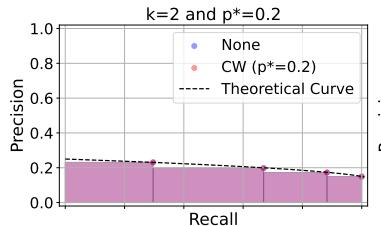

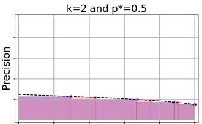

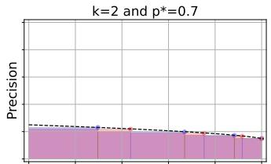

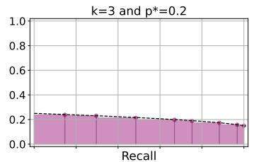

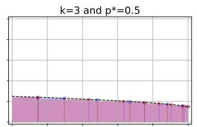

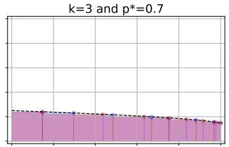

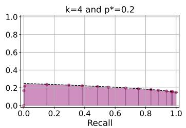

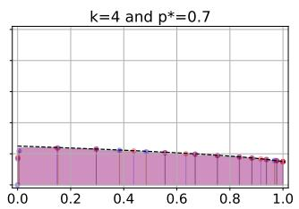  
Figure 9: PR curves of None and CW for a linear regression function with $\alpha = 0 . 2$ and $\beta = 0 . 0 5$

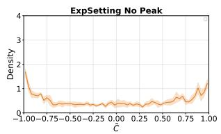  
(a) No peak (B = 1)

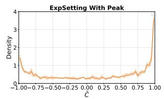  
(b) With peak (B = 1)

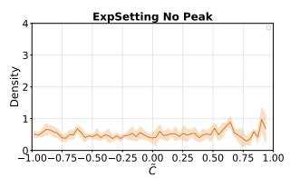  
(c) No peak (B = 10)

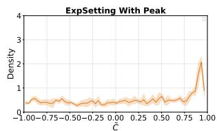  
(d) With peak (B = 10)  
Figure 10: Peak indicator for the ExpSetting configuration under varying peak settings and K parameters.

## A.2 ExpSetting: additional results

Figure 13 evaluates a regression setup where a sharp peak (height a = 1.0 and width $c = 0 . 0 0 3 )$ is introduced at various positions for both settings. The panel illustrates the output probabilities of both models as a function of the peak position. We observe that the weighted model consistently detects the peak regardless of its location within [0, 1]. Conversely, the unweighted model only manages to detect two peaks located at the boundaries of the support.

In the following, we focus on the ExpSetting regression function, evaluating both predictive performance and the estimated probabilities produced by a CART decision tree. Each row corresponds to a maximum tree depth from 1 to 4, while each column represents a target class prevalence $p ^ { \star } \in \{ 0 . 1 , 0 . 2 , \ldots , 0 . 9 \}$

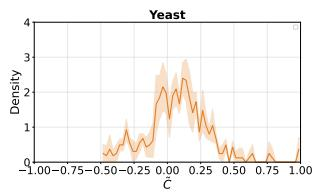

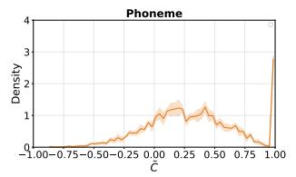

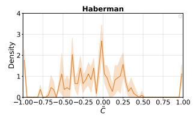  
(a) B = 1.

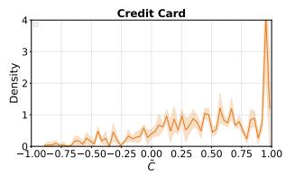

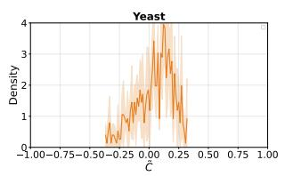

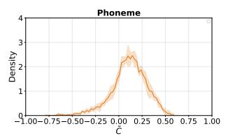  
(b) B = 10.

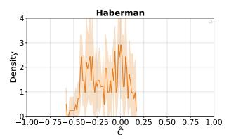

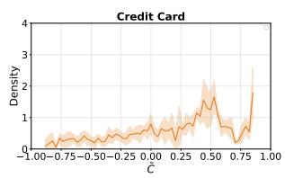  
Figure 11: Peak indicator on real-world data sets for B = 1 (top) and B = 10 (bottom).

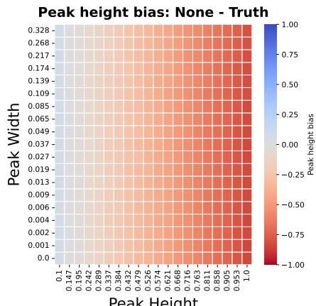  
Peak Height

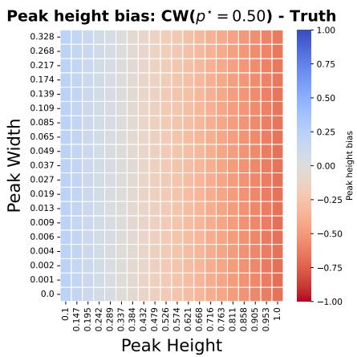

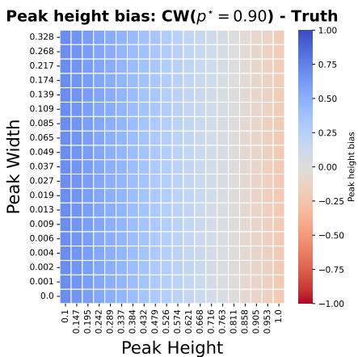  
Figure 12: ExpSetting: CART tree difference between predicted and ground-truth peak probability for input dimension of 5 (k = 4).

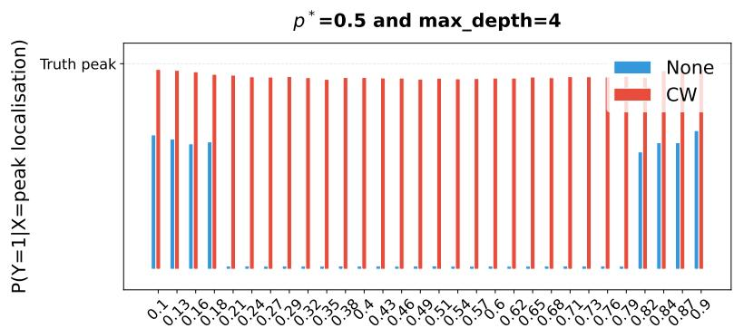  
Peak localisation  
Figure 13: CART tree probability of a ExpSetting regression function with respect to peak localisation.

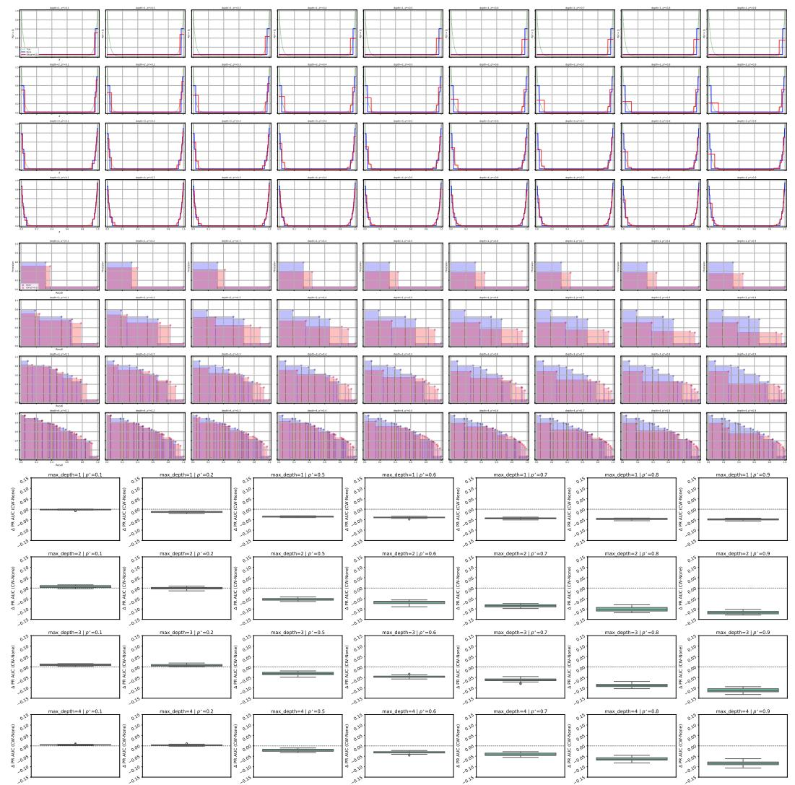  
Figure 14: Estimated regression curves, PR curves, and PR AUC boxplots for ExpSetting in the absence of a peak. For the regression plots, the inverse transformation from Theorem 3.2 is applied to the class-weighted strategy's predictions to ensure direct comparability with the unweighted baseline.

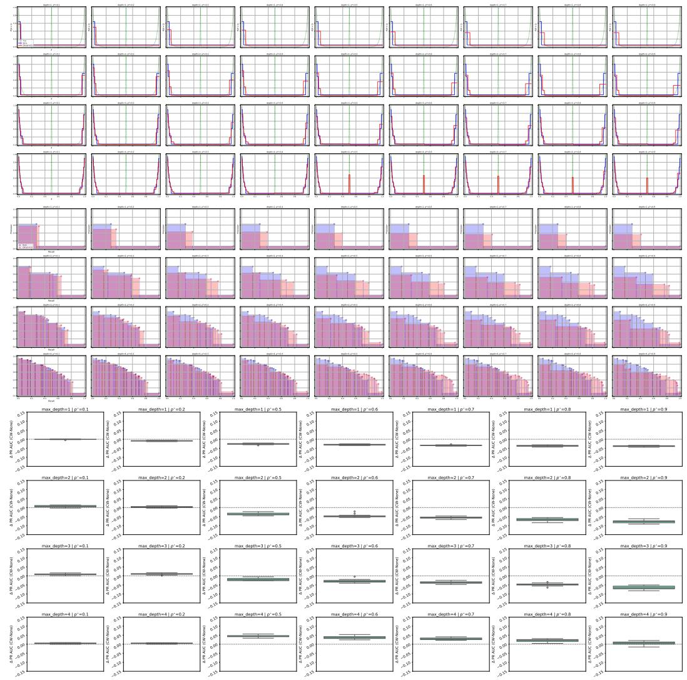  
Figure 15: Estimated regression curves, PR curves, and PR AUC boxplots for ExpSetting with peak at x = 0.5. For the regression plots, the inverse transformation from Theorem 3.2 is applied to the class-weighted strategy's predictions to ensure direct comparability with the unweighted baseline.

## A.3 SinSetting

In the following, we look at another specific regression function named SinSetting and defined as follows:

$$
\mu ( x ) = 0 . 1 5 s i n \ : ( 2 \pi x + 1 . 2 ) + 0 . 1 6 .
$$

Figure 6 illustrates the SinSetting function, demonstrating the presence and absence of a peak across various localisations.

Consistent with the findings in the previous section, the SinSetting configuration yields an improved PR AUC under the weighting strategy for specific peak locations.

Figure 16 illustrates the empirical probability of peak detection for both the unweighted and weighted (with $p ^ { \star } = 0 . 9 )$ models as a function of the peak localization. We observe that both methodologies successfully detect the peak across most locations, except when it resides in a zero-signal region for $b \in [ 0 . 5 1 , 0 . 6 5 ]$ . In this specific scenario, only the weighted classifier is capable of estimating the peak, thereby reinforcing our previous observations from Figure 13 under the ExpSetting.

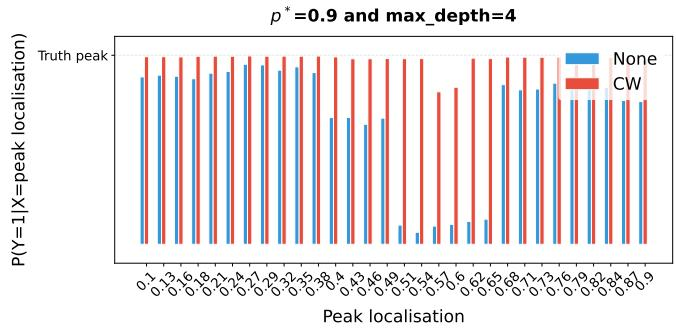  
Figure 16: CART tree probability of a SinSetting regression function with respect to peak localisation.

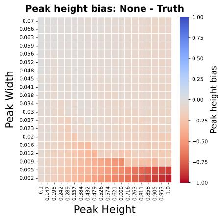

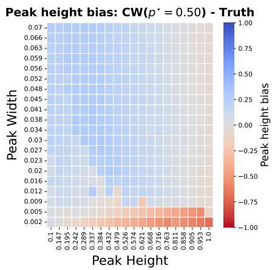

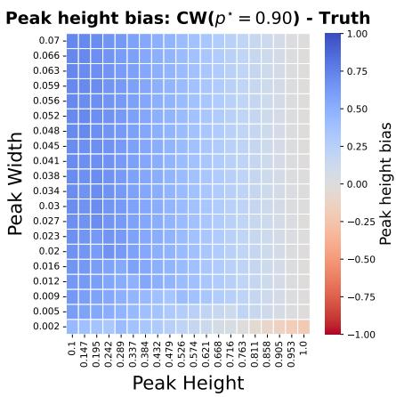  
Figure 17: SinSetting regression function: CART tree peak probability minus Truth probability with respect to peak width and height (maximum depth = 4)

## B Supplementary Theoretical Results

## B.1 Tree Expression

Let $t \in [ 0 , 1 ]$ denote the decision threshold used by a CART tree to predict $\hat { Y } = 1$ within each leaf cell. Formally, for a given leaf A, the decision rule is

$$
\mathbb { E } [ Y \mid X \in A ] \geq t \Longrightarrow { \hat { Y } } = 1 .\tag{16}
$$

Below, we derive explicit analytical expressions for both unweighted and weighted decision stumps.

Lemma B.1 (Default stump). Under Theorem $4 . 2$ and Theorem $5 . 1 ,$ we have for a default stump (tree of depth 1),

$$
\begin{array} { r } { \hat { m } _ { k } ( x ) = \left\{ \begin{array} { l l } { 1 } & { i f t \in [ 0 , \frac { \alpha s _ { p } } { 2 } + \beta ] } \\ { \mathbb { 1 } _ { \{ x \geq s _ { p } \} } } & { i f t \in [ \frac { \alpha s _ { p } } { 2 } + \beta , \frac { \alpha ( s _ { p } + 1 ) } { 2 } + \beta ] } \\ { 0 } & { i f t \in [ \frac { \alpha ( s _ { p } + 1 ) } { 2 } + \beta , 1 ] . } \end{array} \right. } \end{array}\tag{17}
$$

The proof of Theorem B.1 can be found in Section F.1. We remark that our tree stump is constant piecewise with respect to s.

Lemma B.2 (Weighted stump). Under Theorem $4 . 2$ and Theorem $5 . 1 ,$ we have for a reweighted stump (tree of depth 1),

$$
\hat { m } _ { k } ^ { \star } ( x ) = \{ \begin{array} { l l } { 1 } & { i f t \in [ 0 , \frac { \omega _ { 1 } ( \frac { \alpha } { 2 } s ^ { \star } + 2 \beta s ^ { \star } ) } { \omega _ { 0 } ( s _ { p } ^ { \star } - \frac { \alpha } { 2 } s ^ { \star } + 2 \beta s _ { p } ^ { \star } ) + \omega _ { 1 } ( \frac { \alpha } { 2 } s _ { p } ^ { \star } + 2 \beta s _ { p } ^ { \star } ) } ] } \\ { 1 _ { \{ x \geq s _ { p } ^ { \star } \} } } & { i f t \in [ \frac { \omega _ { 1 } ( \frac { \alpha } { 2 } s _ { p } ^ { \star } + 2 \beta s _ { p } ^ { \star } ) } { \omega _ { 0 } ( s _ { p } ^ { \star } - \frac { \alpha } { 2 } s _ { p } ^ { \star } ) ^ { 2 } + \omega _ { 2 } s _ { p } ^ { \star } ) + \omega _ { 1 } ( \frac { \alpha } { 2 } s _ { p } ^ { \star } + 2 \beta s _ { p } ^ { \star } ) } , \frac { \omega _ { 1 } ( \frac { \alpha } { 2 } ( 1 - s _ { p } ^ { \star } ) + \beta ( 1 - s _ { p } ^ { \star } ) ) } { p ( 1 - p ) - \omega _ { 0 } ( s _ { p } ^ { \star } - \frac { \alpha } { 2 } s _ { p } ^ { \star } ) ^ { 2 } - \beta s _ { p } ^ { \star } ) - \omega _ { 1 } ( \frac { \alpha } { 2 } s _ { p } ^ { \star } ) ^ { 2 } + \beta s _ { p } ^ { \star } ) } ] } \\ { 0 } &  i f t \in [ \frac { \omega _ { 1 } ( \frac { \alpha } { 2 } s _ { p } ^ { \star } - \frac { \alpha } { 2 } s _ { p } ^ { \star } ) }  p ( 1 - p ) - \omega _ { 0 } ( s _ { p } ^ { \star } - \frac { \alpha } { 2 } s _ { p } ^ { \star } ) ^ { 2 } - \beta s _ { p } ^ { \star } ) - \omega _ { 1 } ( \end{array}\tag{18}
$$

The proof of Theorem B.2 is provided in Section F.3.1. While previous results demonstrate that weighted trees assign greater volume to regions with higher regression function values, Theorem B.2 establishes that class reweighting systematically shifts the decision stump's leaf-level probability estimates

Below, we analyze the performance metrics of both trees to evaluate how these structural differences influence predictive performance.

## B.2 Metrics

Based on Theorem 3.2, one might theoretically expect the predictive performance of a decision stump to remain identical with or without sample weighting.

Proposition B.3. We denote by $( { \tilde { X } } , { \tilde { Y } } )$ the distribution of data used for the training of a stump. Under Theorem $4 . 2$ and Theorem 5.1, we have for any stump (tree of depth 1) cutting at s,

$$
P r e c i s i o n = \left\{ \begin{array} { l l } { \alpha / 2 + \beta } & { i f t \in [ 0 , B _ { A _ { L } } ] } \\ { \frac { \alpha } { 2 } ( 1 + s ) + \beta } & { i f t \in [ B _ { A _ { L } } , B _ { A _ { R } } ] } \\ { \bar { U } n d e f i n e d } & { i f t \in [ B _ { A _ { R } } , 1 ] , } \end{array} \right. R e c a l l = \left\{ \begin{array} { l l } { 1 } & { i f t \in [ 0 , B _ { A _ { L } } ] } \\ { \frac { \alpha } { 2 } ( 1 - s ^ { 2 } ) + \beta ( 1 - s ) } & { i f t \in [ B _ { A _ { L } } , B _ { A _ { R } } ] } \\ { 0 } & { i f t \in [ B _ { A _ { R } } , 1 ] . } \end{array} \right.\tag{19}
$$

$$
\begin{array} { r } { F P R = \left\{ \begin{array} { l l } { 1 } & { i f t \in [ 0 , B _ { A _ { L } } ] } \\ { \frac { - \frac { \alpha } { 2 } s ^ { 2 } + s ( 1 - \beta ) } { 1 - \beta - \frac { \alpha } { 2 } } } & { i f t \in [ B _ { A _ { L } } , B _ { A _ { R } } ] } \\ { 0 } & { i f t \in [ B _ { A _ { R } } , 1 ] . } \end{array} \right. F I = \left\{ \begin{array} { l l } { \frac { \alpha / 2 + \beta } { 1 + \alpha / 2 + \beta } } & { i f t \in [ 0 , B _ { A _ { L } } ] } \\ { \frac { \left( \frac { \alpha } { 2 } \left( 1 + s \right) + \beta \right) \left( 1 - t \right) } { \left( \frac { \alpha } { 2 } + \beta \right) + \left( 1 - s \right) } } & { i f t \in [ B _ { A _ { L } } , B _ { A _ { R } } ] } \\ { U n d e f i n e d } & { i f t \in [ B _ { A _ { R } } , 1 ] . } \end{array} \right. } \end{array}\tag{20}
$$

$$
P R ~ A U C = \frac { \left( \frac { \alpha } { 2 } ( 1 - s ^ { 2 } ) + \beta ( 1 - s ) \right) \left( \frac { \alpha } { 2 } s \right) } { \frac { \alpha } { 2 } + \beta } + \frac { \alpha } { 2 } + \beta , ~ R O C A U C = 1 - \frac { s ^ { 2 } \left( 1 - \frac { \alpha } { 2 } s - \beta \right) \left( \frac { \alpha } { 2 } s + \beta \right) } { \left( 1 - \beta - \frac { \alpha } { 2 } \right) \left( \frac { \alpha } { 2 } + \beta \right) } .\tag{21}
$$

When $( \tilde { X } , \tilde { Y } ) \sim ( X , Y )$ , we have,

$$
B _ { A _ { L } } = \operatorname { \mathbb { E } } [ Y | X \in A _ { L } ] = { \frac { \alpha t } { 2 } } + \beta , \qquad B _ { A _ { R } } = \operatorname { \mathbb { E } } [ Y | X \in A _ { R } ] = { \frac { \alpha ( t + 1 ) } { 2 } } + \beta .\tag{22}
$$

On the other hand, when $( \tilde { X } , \tilde { Y } ) \sim ( X ^ { \star } , Y ^ { \star } )$ , we have,

$$
B _ { A _ { L } } = \mathbb { E } [ Y ^ { \star } | X ^ { \star } \in A _ { L } ] = \frac { \omega _ { 1 } ( \frac { \alpha } { 2 } s ^ { 2 } + \beta t ) } { \omega _ { 0 } ( s - \frac { \alpha } { 2 } s ^ { 2 } - \beta s ) + \omega _ { 1 } ( \frac { \alpha } { 2 } s ^ { 2 } + \beta s ) }\tag{23}
$$

$$
B _ { A _ { R } } = \mathbb { E } [ Y ^ { \star } | X ^ { \star } \in A _ { R } ] = \frac { \omega _ { 1 } ( \frac { \alpha } { 2 } ( 1 - s ^ { 2 } ) + \beta ( 1 - t ) ) } { p ( 1 - p ) - \omega _ { 0 } ( s - \frac { \alpha } { 2 } s ^ { 2 } - \beta s ) - \omega _ { 1 } ( \frac { \alpha } { 2 } s ^ { 2 } + \beta s ) } .\tag{24}
$$

The proof of Theorem B.3 can be found in Section F.2 and Section F.3. Theorem B.3 demonstrates that while performance metrics for both unweighted and weighted models depend on the initial split value s, their mathematical expressions are identical with respect to s. By applying Theorem 5.2 and the result from Ishwaran (2015) to determine the respective split points, we observe that the weighted tree achieves lower precision but higher recall than the unweighted tree under adapted probability thresholds s. While practitioners widely acknowledge that class weighting improves recall at the expense of precision for a fixed probability threshold $s ,$ we establish that for depth-1 trees, this trade-off persists even when both probability thresholds are adapted (due to different tree split values). Furthermore, for weighted trees, the predicted probabilities $\left( \mathbb { E } [ Y ^ { \star } | X ^ { \star } \in A _ { L } ] \right.$ and $\mathbb { E } [ Y ^ { \star } | X ^ { \star } \in A _ { R } ] )$ depend on both the split threshold s and the degree of weighting governed by $\omega _ { 0 }$ and $\omega _ { 1 }$ As demonstrated in Theorem B.2, these estimates undergo a systematic shift.

Lemma B.4 (Optimization of metrics under $^ { s , s ) }$ . Let $t \in [ 0 , 1 ]$ denote the decision threshold used by $a ~ C A R T$ classifier to predict $\hat { Y } = 1$ within each leaf cell. Under Theorem 4.2 and Theorem $5 . 1 ,$ for a tree of maximum depth 1, we have:

• The $F _ { 1 }$ -score is maximized for decision thresholds $t \in \Bigl \lceil \mathbb { E } [ \tilde { Y } \mid \tilde { X } \in A _ { L } ] , \mathbb { E } [ \tilde { Y } \mid \tilde { X } \in A _ { R } ] \Bigr \rceil$ , with optimal split point s:

$$
s = \left\{ \begin{array} { l l } { \frac { \alpha \left( 1 + \frac { \alpha } { 2 } + \beta \right) - \sqrt { \alpha ^ { 2 } \left( 1 + \frac { \alpha } { 2 } + \beta \right) ^ { 2 } + \alpha \left[ \alpha \left( \beta - 1 \right) + 2 \beta ^ { 2 } \right] } } { \alpha } , } & { i f \alpha \geq \frac { 2 \beta ^ { 2 } } { 1 - \beta } , } \\ { 0 , } & { o t h e r w i s e . } \end{array} \right.
$$

• The Area Under the Precision-Recall Curve (PR AUC) is maximized $b y \colon$

$$
s = \left\{ \begin{array} { l l } { \frac { 2 \sqrt { \beta ^ { 2 } + \frac { 3 } { 4 } \alpha \left( \alpha + 2 \beta \right) } - 2 \beta } { 3 \alpha } , } & { i f \alpha > 0 , } \\ { a n y s \in [ 0 , 1 ] , } & { o t h e r w i s e . } \end{array} \right.
$$

• The Area Under the Receiver Operating Characteristic Curve (ROC AUC) is maximized $b y \colon$

$$
s = \left\{ \begin{array} { l l } { \frac { 3 - 6 \beta \pm \sqrt { 9 - 4 \beta + 4 \beta ^ { 2 } } } { 4 \alpha } , } & { i f \alpha \left( 2 4 - 1 6 \alpha \right) > \beta \left( 4 8 \alpha - 3 2 + 3 2 \beta \right) , } \\ { 0 , } & { o t h e r w i s e . } \end{array} \right.
$$

The proof of Theorem B.4 is postponed in Section F.4.

Remark Precision, Recall and FPR are optimized for pathologic cases.

Theorem B.5. We assume that trees are grown to a maximum depth $k \in \mathbb N$ , containing $2 ^ { k } - 1$ internal split nodes. Let $\{ s _ { p } ^ { h } \} _ { h = 1 } ^ { 2 ^ { k } - 1 }$ and $\{ s _ { p } ^ { \star h } \} _ { h = 1 } ^ { 2 ^ { k } - 1 }$ denote the collections of split thresholds for the standard and weighted trees, respectively, indexed level-by-level from left to right. We reorder these thresholds monotonically via permutations σ and $\sigma ^ { \star }$ such that $s _ { p } ^ { \sigma ( 1 ) } \leq s _ { p } ^ { \sigma ( 2 ) } \leq \cdots \leq s _ { p } ^ { \sigma ( 2 ^ { k } - 1 ) } \in [ 0 , 1 ]$ for the standard tree, and $s _ { p } ^ { \sigma ^ { \star } ( 1 ) } \leq \dots \leq s _ { p } ^ { \sigma ^ { \star } ( 2 ^ { k } - 1 ) } \in [ 0 , 1 ]$ for the weighted tree. Let $t \in [ 0 , 1 ]$ denote the decision threshold used by a CART tree to predict $\hat { Y } = 1$ within each leaf cell.

For simplicity, let $s ^ { 1 } \leq s ^ { 2 } \leq \ldots \leq s ^ { 2 ^ { k } - 1 }$ denote the ordered split thresholds of a given tree (weighted or unweighted). Under Theorem $4 . 2$ and Theorem $5 . 1 ,$ for any tree of maximum depth $H \in \mathbb { N }$ , we have:

$$
\begin{array} { r } { P r e c i s i o n = \left\{ \begin{array} { l l } { \alpha / 2 + \beta } & { i f t \in \left[ 0 , \mathbb { E } [ \tilde { Y } | \tilde { X } \in A _ { 1 } ] \right] } \\ { \frac { \alpha } { 2 } ( 1 + s ^ { 1 } ) + \beta } & { i f t \in \left[ \mathbb { E } [ \tilde { Y } | \tilde { X } \in A _ { 1 } ] , \mathbb { E } [ \tilde { Y } | \tilde { X } \in A _ { 2 } ] \right] } \\ { \frac { \alpha } { 2 } ( 1 + s ^ { 2 } ) + \beta } & { i f t \in \left[ \mathbb { E } [ \tilde { Y } | \tilde { X } \in A _ { 2 } ] , \mathbb { E } [ \tilde { Y } | \tilde { X } \in A _ { 3 } ] \right] } \\ { \vdots } & { \vdots } \\ { \frac { \alpha } { 2 } ( 1 + s ^ { h } ) + \beta } & { i f t \in \left[ \mathbb { E } [ \tilde { Y } | \tilde { X } \in A _ { h } ] , \mathbb { E } [ \tilde { Y } | \tilde { X } \in A _ { h + 1 } ] \right] } \\ { \vdots } & { \vdots } \\ { \frac { \alpha } { 2 } ( 1 + s ^ { 2 ^ { k } - 1 } ) + \beta } & { i f t \in \left[ \mathbb { E } [ \tilde { Y } | \tilde { X } \in A _ { 2 ^ { k - 1 } } ] , \mathbb { E } [ \tilde { Y } | \tilde { X } \in A _ { 2 ^ { k } } ] \right] } \\ { \frac { \alpha } { 2 } ( 1 + s ^ { 2 ^ { k } - 1 } ) + \beta } & { i f t \in \left[ \mathbb { E } [ \tilde { Y } | \tilde { X } \in A _ { 2 ^ { k - 1 } } ] , \mathbb { E } [ \tilde { Y } | \tilde { X } \in A _ { 2 ^ { k } } ] \right] } \\ { N A } & { i f t \in \left[ \mathbb { E } [ \tilde { Y } | \tilde { X } \in A _ { 2 ^ { k } } ] , 1 \right] . } \end{array} \right. } \end{array}\tag{25}
$$

$$
\begin{array} { r } { R e c a l l l }  \equiv \{ \begin{array} { l l } { 1 } & { i f t \in [ 0 , \mathbb { E } [ \bar { Y } | \bar { X } \in A _ { 1 } ] ] } \\ { \frac { \omega } { 2 } ( 1 - \frac { \varepsilon ^ { 2 } } { 8 } ) ^ { 2 } + \delta ( 1 - \varepsilon ^ { 1 } ) } & { i f t \in [ \mathbb { E } [ \bar { Y } | \bar { X } \in A _ { 1 } ] , \mathbb { E } [ \bar { Y } | \bar { X } \in A _ { 2 } ] ] } \\ { \frac { \omega } { 2 } ( 1 - ( \delta ^ { 2 } ) ^ { 2 } ) + \delta ( 1 - \varepsilon ^ { 2 } ) } & { i f t \in [ \mathbb { E } [ \bar { Y } | \bar { X } \in A _ { 2 } ] , \mathbb { E } [ \bar { Y } | \bar { X } \in A _ { 3 } ] ] } \\ { \vdots } & { \vdots } \\ { \frac { \omega } { 2 } ( 1 - ( \delta ^ { 3 } ) ^ { 2 } ) + \beta ( 1 - t _ { h } ) } & { i f t \in [ \mathbb { E } [ \bar { Y } | \bar { X } \in A _ { h } ] , \mathbb { E } [ \bar { Y } | \bar { X } \in A _ { h + 1 } ] ] } \\ { \vdots } & { \vdots } \\ { \frac { \omega } { 2 } ( 1 - ( \delta ^ { 2 } ) ^ { 2 } ) + \delta ( 1 - \varepsilon ^ { 2 ( h - 1 ) } ) } & { i f t \in [ \mathbb { E } [ \bar { Y } | \bar { X } \in A _ { h } ] , \mathbb { E } [ \bar { Y } | \bar { X } \in A _ { h + 1 } ] ] } \\ { \vdots } & { \vdots } \\ { \frac { \omega } { 2 } ( 1 - ( \delta ^ { 2 } ) ^ { 2 } ) + \delta ( 1 - \varepsilon ^ { 2 ( h - 1 ) } ) } & { i f t \in [ \mathbb { E } [ \bar { Y } | \bar { X } \in A _ { 2 h - 1 } ] , \mathbb { E } [ \bar { Y } | \bar { X } \in A _ { 2 h - 1 } ] ] } \\ { 0 } &  i \end{array} \end{array}\tag{26}
$$

The proof of Theorem B.5 can be found in Section G.2.

## C Technical Lemmas

## C.1 Related results Theorem 3.2

Lemma C.1. We have for all (X, Y),

$$
f _ { X ^ { \star } } ( x ) = \frac { f _ { X } ( x ) \left[ \omega _ { 0 } ( 1 - \mu ( x ) ) + \omega _ { 1 } \mu ( x ) \right] } { p ( 1 - p ) }\tag{27}
$$

Proof of Theorem C.1. We have,

$$
f _ { X ^ { \star } } ( x )\tag{28}
$$

$$
= f _ { X ^ { \star } , Y ^ { \star } } ( x , 0 ) + f _ { X ^ { \star } , Y ^ { \star } } ( x , 1 ) = f _ { X ^ { \star } | Y ^ { \star } } ( x | 0 ) f _ { Y ^ { \star } } ( 0 ) + f _ { X ^ { \star } | Y ^ { \star } } ( x | 1 ) f _ { Y ^ { \star } } ( 1 )\tag{29}
$$

$$
= f _ { X | Y } ( x | 0 ) ( 1 - p ^ { \star } ) + f _ { X | Y } ( x | 1 ) p ^ { \star } \ : \ : \left( f _ { X ^ { \star } | Y ^ { \star } } ( x | y ) = f _ { X | Y } ( x | y ) \right)\tag{30}
$$

$$
= \left[ { \frac { f _ { X , Y } ( x , 0 ) } { f _ { X } ( 0 ) } } \right] ( 1 - p ^ { \star } ) + \left[ { \frac { f _ { X , Y } ( x , 1 ) } { f _ { X } ( 1 ) } } \right] p ^ { \star }\tag{31}
$$

$$
= \left[ { \frac { f _ { Y | X } ( 0 | x ) f _ { X } ( \ O ) } { f _ { Y } ( 0 ) } } \right] ( 1 - p ^ { \star } ) + \left[ { \frac { f _ { Y | X } ( 1 | x ) f _ { X } ( \ O ) } { f _ { Y } ( 1 ) } } f _ { Y } ( 1 ) \right] p ^ { \star }\tag{32}
$$

$$
= \left\lceil { \frac { \left( 1 - f _ { Y \mid X } ( 1 \mid x ) \right) f _ { X } ( x ) } { f _ { Y } ( 0 ) } } \right\rceil ( 1 - p ^ { \star } ) + \left\lceil { \frac { f _ { Y \mid X } ( 1 \mid x ) f _ { X } ( x ) } { f _ { Y } ( 1 ) } } f _ { Y } ( 1 ) \right\rceil p ^ { \star }\tag{33}
$$

$$
= \left[ { \frac { ( 1 - \mu ( x ) ) f _ { X } ( x ) } { ( 1 - p ) } } \right] ( 1 - p ^ { \star } ) + \left[ { \frac { \mu ( x ) f _ { X } ( x ) } { p } } \right] p ^ { \star }\tag{34}
$$

$$
= \frac { p ( 1 - p ^ { \star } ) ( 1 - \mu ( x ) ) f _ { X } ( x ) + p ^ { \star } ( 1 - p ) \mu ( x ) f _ { X } ( x ) } { p ( 1 - p ) }\tag{35}
$$

$$
= \frac { f _ { X } ( x ) \left[ p ( 1 - p ^ { \star } ) ( 1 - \mu ( x ) ) + p ^ { \star } ( 1 - p ) \mu ( x ) \right] } { p ( 1 - p ) }\tag{36}
$$

$$
= \frac { f _ { X } ( x ) \left[ \omega _ { 0 } ( 1 - \mu ( x ) ) + \omega _ { 1 } \mu ( x ) \right] } { p ( 1 - p ) } .\tag{37}
$$

Proof of Theorem 3.2. Then we have,

$$
\mathbb { P } ( Y ^ { \star } = 1 | X ^ { \star } = x ) = \frac { \mathbb { P } ( Y ^ { \star } = 1 \cap X ^ { \star } ) } { f _ { X ^ { \star } } ( x ) } = \frac { \mathbb { P } ( X ^ { \star } | Y ^ { \star } = 1 ) \mathbb { P } ( Y ^ { \star } = 1 ) } { f _ { X ^ { \star } } ( x ) }\tag{38}
$$

$$
= { \frac { \mathbb { P } ( X = x \vert Y = 1 ) p ^ { \star } } { f _ { X ^ { \star } } ( x ) } } = { \frac { \frac { \mathbb { P } ( Y = 1 \vert X = x ) f _ { X } ( x ) } { \mathbb { P } ( Y = 1 ) } p ^ { \star } } { f _ { X ^ { \star } } ( x ) } }\tag{39}
$$

$$
= { \frac { \mu ( x ) f _ { X } ( x ) } { p } } p ^ { \star }  = { \frac { \mu ( x ) p ^ { \star } f _ { X } ( x ) } { p f _ { X ^ { \star } } ( x ) } }\tag{40}
$$

$$
= \frac { \mu ( x ) p ^ { \star } f _ { X } ( x ) } { p } \ast \frac { p ( 1 - p ) } { f _ { X } ( x ) \left[ p ( 1 - p ^ { \star } ) ( 1 - \mu ( x ) ) + p ^ { \star } ( 1 - p ) \mu ( x ) \right] }\tag{41}
$$

$$
= \frac { \mu ( x ) p ^ { \star } ( 1 - p ) } { p ( 1 - p ^ { \star } ) ( 1 - \mu ( x ) ) + p ^ { \star } ( 1 - p ) \mu ( x ) }\tag{42}
$$

$$
= \frac { \omega _ { 1 } \mu ( x ) } { \omega _ { 0 } ( 1 - \mu ( x ) ) + \omega _ { 1 } \mu ( x ) } = \mu ^ { \star } ( x ) ,\tag{43}
$$

with,

$$
\omega _ { 0 } = p ( 1 - p ^ { \star } ) , \omega _ { 1 } = p ^ { \star } ( 1 - p ) .\tag{44}
$$

## C.2 Weighted and unweighted distributions under Theorem 5.1 and Theorem 4.2

In this subsection, under Theorem 4.2 and Theorem 5.1, several results are derived and used to prove the main results.

Lemma C.2. Under Theorem 4.2 and Theorem 5.1, we have

$$
\mathbb { P } ( Y = 1 ) = \frac { \alpha } { 2 } + \beta\tag{45}
$$

$$
\mathbb { P } _ { A _ { L } } ( Y = 1 ) = { \frac { \alpha } { 2 } } s + \beta\tag{46}
$$

$$
\mathbb { P } _ { A _ { R } } ( Y = 1 ) = \frac { \alpha } { 2 } \left( 1 + s \right) + \beta .\tag{47}
$$

The proof of Theorem C.2 can be found in Section C.2.

Lemma C.3. Under Theorem $4 . 2$ and Theorem 5.1, we have

$$
\mathbb { P } _ { A _ { L } } ( Y ^ { \star } = 1 ) = \frac { \omega _ { 1 } ( \alpha s ^ { 2 } / 2 + \beta s ) } { \omega _ { 0 } ( s - \alpha s ^ { 2 } / 2 - \beta s ) + \omega _ { 1 } ( \alpha s ^ { 2 } / 2 + \beta s ) }\tag{48}
$$

$$
\mathbb { P } _ { A _ { R } } ( Y ^ { \star } = 1 ) = \frac { \omega _ { 1 } \left( { \alpha } / { 2 } + \beta - \alpha s ^ { 2 } / 2 - \beta s \right) } { p ( 1 - p ) - \omega _ { 0 } ( s - \alpha s ^ { 2 } / 2 - \beta s ) - \omega _ { 1 } \left( { \alpha s ^ { 2 } } / { 2 } + \beta s \right) } .\tag{49}
$$

The proof of Theorem C.3 can be found in Section C.2.

Proof of Theorem C.2. Derivation of $\mathbb { P } ( Y = 1 )$ , We have,

$$
\mathbb { P } ( Y = 1 ) = \int _ { 0 } ^ { 1 } f _ { Y | X } ( 1 | x ) \mathrm { d } x = \int _ { 0 } ^ { 1 } ( \alpha x + \beta ) * 1 \mathrm { d } x = \int _ { 0 } ^ { 1 } ( \alpha x + \beta ) \mathrm { d } x = \left[ { \frac { \alpha } { 2 } } x ^ { 2 } + \beta x \right] _ { 0 } ^ { 1 / 2 } .\tag{50}
$$

(51)

On hand we have,

$$
\mathbb { P } _ { A _ { L } } ( Y = 1 ) = \int _ { \mathbb { R } } f _ { Y | X } ( 1 | x ) f _ { X } ^ { A _ { L } } ( x ) \mathrm { d } x = \int _ { 0 } ^ { s } ( \alpha x + \beta ) \frac { 1 } { s } \quad ( X \mathrm { t r u n c a t e d ~ o n } [ 0 , s ] \sim \mathcal { U } ( [ 0 , t ] ) ) \mathrm { d } x ,\tag{52}
$$

$$
= \frac { 1 } { s } \left[ \frac { \alpha } { 2 } x ^ { 2 } + \beta x \right] _ { 0 } ^ { s } = \frac { 1 } { s } \left[ \frac { \alpha } { 2 } t ^ { 2 } + \beta s \right] = \frac { \alpha } { 2 } s + \beta .\tag{53}
$$

On the other hand, we have,

$$
\mathbb { P } _ { A _ { R } } \big ( Y = 1 \big ) = \int _ { \mathbb { R } } f _ { Y | X } ( 1 | x ) f _ { X } ^ { A _ { R } } ( x ) \mathrm { d } x = \int _ { s } ^ { 1 } ( \alpha x + \beta ) \frac { 1 } { 1 - s } \big ( X \mathrm { t r u n c a t e d } \mathrm { o n } [ s , 1 ] \sim \mathcal { U } ( [ s , 1 ] ) \big )\tag{54}
$$

$$
= \frac { 1 } { 1 - s } \left[ \frac { \alpha } { 2 } + \beta - \frac { \alpha } { 2 } s ^ { 2 } - \beta s \right] = \frac { 1 } { 1 - s } \left[ \frac { \alpha } { 2 } \left( 1 - s ^ { 2 } \right) + \beta ( 1 - s ) \right]\tag{55}
$$

$$
= { \frac { { \frac { \alpha } { 2 } } \left( 1 - s ^ { 2 } \right) } { 1 - s } } + \beta = { \frac { \alpha } { 2 } } \left( 1 + s \right) + \beta .\tag{56}
$$

Proof of Theorem C.3. We have for $s \in [ 0 , 1 ]$

$$
\mathbb { P } ( X ^ { \star } \leq s ) = \int _ { 0 } ^ { s } f _ { X ^ { \star } } \mathrm { d } x = \int _ { 0 } ^ { s } f _ { X } \frac { \omega _ { 0 } ( 1 - \mu ( x ) ) + \omega _ { 1 } \mu ( x ) } { p ( 1 - p ) } \mathrm { d } x ~ ( T h e o r e m ~ C . 1 )\tag{57}
$$

$$
= \frac { 1 } { p ( 1 - p ) } \int _ { 0 } ^ { s } 1 \ast \omega _ { 0 } ( 1 - \mu ( x ) ) + \omega _ { 1 } \mu ( x ) \mathrm { d } x\tag{58}
$$

$$
= \frac { 1 } { p ( 1 - p ) } \left( \omega _ { 0 } [ x - \alpha x ^ { 2 } / 2 - \beta x ] _ { 0 } ^ { s } + \omega _ { 1 } [ \alpha x ^ { 2 } / 2 + \beta x ] _ { 0 } ^ { s } \right)\tag{59}
$$

$$
= \frac { 1 } { p ( 1 - p ) } \left( \omega _ { 0 } \big ( s - \alpha s ^ { 2 } / 2 - \beta s \big ) + \omega _ { 1 } \big ( \alpha s ^ { 2 } / 2 + \beta s \big ) \right) .\tag{60}
$$

$$
\mathbb { P } ( 0 < X ^ { \star } \le s )\tag{61}
$$

(62)

$$
= \frac { f _ { X } \left( x \right) \frac { \omega _ { 0 } \left( 1 - \mu \left( x \right) \right) + \omega _ { 1 } \mu \left( x \right) } { p \left( 1 - p \right) } \mathbb { 1 } _ { \left\{ 0 < x \leq s \right\} } } { \frac { 1 } { p \left( 1 - p \right) } \left( \omega _ { 0 } \left( s - \alpha s ^ { 2 } / 2 - \beta t \right) + \omega _ { 1 } \left( \alpha s ^ { 2 } / 2 + \beta t \right) \right) - 0 } \left( T h e o r e m \ C . 1 \right)\tag{63}
$$

$$
= \frac { \omega _ { 0 } ( 1 - \mu ( x ) ) + \omega _ { 1 } \mu ( x ) } { p ( 1 - p ) } \ast \frac { p ( 1 - p ) } { \omega _ { 0 } ( s - \alpha s ^ { 2 } / 2 - \beta s ) + \omega _ { 1 } ( \alpha t ^ { 2 } / 2 + \beta t ) } \ast \mathbb { 1 } _ { \{ 0 < x \leq s \} }\tag{64}
$$

$$
= \frac { \left[ \omega _ { 0 } ( 1 - \mu ( x ) ) + \omega _ { 1 } \mu ( x ) \right] \mathbb { 1 } _ { \{ 0 < x \leq s \} } } { \omega _ { 0 } ( s - \alpha s ^ { 2 } / 2 - \beta s ) + \omega _ { 1 } ( \alpha s ^ { 2 } / 2 + \beta s ) } .\tag{65}
$$

Finally,

$$
\mathbb { P } _ { A _ { L } } ( Y ^ { \star } = 1 ) = \int _ { 0 } ^ { 1 } \mathbb { P } f _ { Y ^ { \star } | X ^ { \star } } ( 1 | x ) f _ { X ^ { \star } } ^ { A _ { L } } ( x ) \mathrm { d } x\tag{66}
$$

$$
= \int _ { 0 } ^ { 1 } \frac { \omega _ { 1 } \mu ( x ) } { \omega _ { 0 } ( 1 - \mu ( x ) ) + \omega _ { 1 } \mu ( x ) } * \frac { \left[ \omega _ { 0 } ( 1 - \mu ( x ) ) + \omega _ { 1 } \mu ( x ) \right] \mathbb { 1 } _ { \{ 0 < x \leq s \} } } { \omega _ { 0 } ( t - \alpha t ^ { 2 } / 2 - \beta s ) + \omega _ { 1 } ( \alpha t ^ { 2 } / 2 + \beta s ) } \mathrm { d } x \mathrm { ~ ( } T h e o r e m \mathrm { ~ 3 . 2 ) }\tag{67}
$$

$$
\begin{array} { l } { \displaystyle = \frac { \omega _ { 1 } } { \omega _ { 0 } \left( t - \alpha t ^ { 2 } / 2 - \beta s \right) + \omega _ { 1 } \left( \alpha t ^ { 2 } / 2 + \beta t \right) } \int _ { 0 } ^ { 1 } \mu ( x ) \mathbb { 1 } _ { \{ 0 < x \leq s \} } \mathrm { d } x } \\ { \displaystyle = \frac { \omega _ { 1 } \left( \alpha s ^ { 2 } / 2 + \beta s \right) } { \omega _ { 0 } \left( s - \alpha s ^ { 2 } / 2 - \beta s \right) + \omega _ { 1 } \left( \alpha s ^ { 2 } / 2 + \beta s \right) } . } \end{array}\tag{68}
$$

(69)

Derivation of $\mathbb { P } _ { A _ { R } } ( Y ^ { \star } = 1 )$

We have for $s \in [ 0 , 1 ]$

$$
\mathbb { P } ( s < X ^ { \star } \leq 1 ) = \frac { f _ { X ^ { \star } } ( x ) \mathbb { 1 } _ { \{ s < x \leq 1 \} } } { \mathbb { P } ( X ^ { \star } \leq 1 ) - \mathbb { P } ( X ^ { \star } \leq s ) }\tag{70}
$$

$$
= \frac { f _ { X } \left( x \right) \frac { \omega _ { 0 } \left( 1 - \mu \left( x \right) \right) + \omega _ { 1 } \mu \left( x \right) } { p \left( 1 - p \right) } \mathbb { 1 } _ { \left\{ s < x \leq 1 \right\} } } { 1 - \frac { 1 } { p \left( 1 - p \right) } \left( \omega _ { 0 } \left( s - \alpha s ^ { 2 } / 2 - \beta s \right) + \omega _ { 1 } \left( \alpha s ^ { 2 } / 2 + \beta s \right) \right) } \left( T h e o r e m \ C . 1 \right)\tag{71}
$$

$$
= \frac { \omega _ { 0 } ( 1 - \mu ( x ) ) + \omega _ { 1 } \mu ( x ) } { p ( 1 - p ) } \frac { p ( 1 - p ) } { p ( 1 - p ) - \omega _ { 0 } ( s - \alpha t ^ { 2 } / 2 - \beta s ) - \omega _ { 1 } ( \alpha t ^ { 2 } / 2 + \beta s ) } \mathbb { 1 } _ { \{ s < x \leq 1 \} }\tag{72}
$$

$$
= \frac { \left[ \omega _ { 0 } ( 1 - \mu ( x ) ) + \omega _ { 1 } \mu ( x ) \right] \mathbb { 1 } _ { \{ s < x \leq 1 \} } } { p ( 1 - p ) - \omega _ { 0 } ( s - \alpha s ^ { 2 } / 2 - \beta s ) - \omega _ { 1 } ( \alpha s ^ { 2 } / 2 + \beta s ) } .\tag{73}
$$

Then,

$$
\mathbb { P } _ { A _ { R } } ( Y ^ { \star } = 1 ) = \int _ { 0 } ^ { 1 } \mathbb { P } f _ { Y ^ { \star } | X ^ { \star } } ( 1 | x ) f _ { X ^ { \star } } ^ { A _ { R } } ( x ) \mathrm { d } x\tag{74}
$$

$$
= \int _ { 0 } ^ { 1 } \frac { \omega _ { 1 } \mu ( x ) } { \omega _ { 0 } ( 1 - \mu ( x ) ) + \omega _ { 1 } \mu ( x ) } \ast \frac { \left[ \omega _ { 0 } ( 1 - \mu ( x ) ) + \omega _ { 1 } \mu ( x ) \right] \mathbb { 1 } _ { \{ s < x \leq 1 \} } } { p ( 1 - p ) - \omega _ { 0 } ( s - \alpha s ^ { 2 } / 2 - \beta s ) - \omega _ { 1 } ( \alpha s ^ { 2 } / 2 + \beta s ) } \mathrm { d } x\tag{75}
$$

$$
= \frac { \omega _ { 1 } } { p ( 1 - p ) - \omega _ { 0 } ( t - \alpha s ^ { 2 } / 2 - \beta s ) - \omega _ { 1 } ( \alpha s ^ { 2 } / 2 + \beta s ) } \int _ { 0 } ^ { 1 } \mu ( x ) \mathbb { 1 } _ { \{ t < x \leq 1 \} } \mathrm { d } x\tag{76}
$$

$$
\omega _ { 1 } \left[ ( \alpha / 2 + \beta ) - ( \alpha t ^ { 2 } / 2 + \beta s ) \right]
$$

$$
= \frac { \ d } { \ d t } = \frac { \ d }  { \ d t } = \frac { \ d }  { \ d t } = \omega _ { 0 } ( t - \alpha s ^ { 2 } / 2 - \beta s ) - \omega _ { 1 } ( \alpha t ^ { 2 } / 2 + \beta s )\tag{77}
$$

$$
= \frac { \ d s } { \ d p } = \frac { \ d s } { \ d p } = \omega _ { 0 } ( s - \alpha s ^ { 2 } / 2 - \beta s ) - \omega _ { 1 } ( \alpha s ^ { 2 } / 2 + \beta s ) .\tag{78}
$$

## D Impurity Gain: General Case

## D.1 Default stumps split

Proof of Theorem 4.3. We denote by $L _ { 0 }$ the impurity gain the decision tree without applying a rebalancing strategy (none).

We have,

$$
G I = \mathbb { P } \left( X \in A _ { L } \right) \mathbb { P } \left( X \in A _ { R } \right) \left[ \mathbb { E } \left[ Y | X \in A _ { L } \right] - \mathbb { E } \left[ Y | X \in A _ { R } \right] \right] ^ { 2 }\tag{79}
$$

, thus $L _ { 0 }$ can also be expressed without any asumtions on (X, Y) as,

$$
L _ { 0 } ( s )
$$

$$
= I _ { L } I _ { R } \left[ { \frac { J _ { L } } { I _ { L } } } - { \frac { J _ { R } } { I _ { R } } } \right] ^ { 2 }\tag{80}
$$

(81)

## D.2 Ponderate stumps split

Proof of Theorem $4 . 4$ . We have,

(82)

$$
= f _ { X ^ { \star } , Y ^ { \star } } ( x , 0 ) + f _ { X ^ { \star } , Y ^ { \star } } ( x , 1 )\tag{83}
$$

$$
= f _ { X ^ { \star } | Y ^ { \star } } ( x | 0 ) f _ { Y ^ { \star } } ( 0 ) + f _ { X ^ { \star } | Y ^ { \star } } ( x | 1 ) f _ { Y ^ { \star } } ( 1 )\tag{84}
$$

$$
= f _ { X | Y } ( x | 0 ) ( 1 - p ^ { \star } ) + f _ { X | Y } ( x | 1 ) p ^ { \star } \ : \ : \left( f _ { X ^ { \star } | Y ^ { \star } } ( x | y ) = f _ { X | Y } ( x | y ) \right)\tag{85}
$$

$$
= \left[ { \frac { f _ { X , Y } ( x , 0 ) } { f _ { X } ( 0 ) } } \right] ( 1 - p ^ { \star } ) + \left[ { \frac { f _ { X , Y } ( x , 1 ) } { f _ { X } ( 1 ) } } \right] p ^ { \star }\tag{86}
$$

$$
= \left[ { \frac { f _ { Y | X } ( 0 | x ) f _ { X } ( x ) } { f _ { Y } ( 0 ) } } \right] ( 1 - p ^ { \star } ) + \left[ { \frac { f _ { Y | X } ( 1 | x ) f _ { X } ( x ) } { f _ { Y } ( 1 ) } } f _ { Y } ( 1 ) \right] p ^ { \star }\tag{87}
$$

$$
= \left\lceil { \frac { \left( 1 - f _ { Y \mid X } ( 1 \mid x ) \right) f _ { X } ( x ) } { f _ { Y } ( 0 ) } } \right\rceil ( 1 - p ^ { \star } ) + \left\lceil { \frac { f _ { Y \mid X } ( 1 \mid x ) f _ { X } ( x ) } { f _ { Y } ( 1 ) } } f _ { Y } ( 1 ) \right\rceil p ^ { \star }\tag{88}
$$

$$
= \left[ { \frac { ( 1 - \mu ( x ) ) f _ { X } ( x ) } { ( 1 - p ) } } \right] ( 1 - p ^ { \star } ) + \left[ { \frac { \mu ( x ) f _ { X } ( x ) } { p } } \right] p ^ { \star }\tag{89}
$$

$$
= \frac { p ( 1 - p ^ { \star } ) ( 1 - \mu ( x ) ) f _ { X } ( x ) + p ^ { \star } ( 1 - p ) \mu ( x ) f _ { X } ( x ) } { 1 - p ^ { \star } ( 1 - p ) }
$$

$$
p ( 1 - p )\tag{90}
$$

$$
= \frac { f _ { X } ( x ) \left[ p ( 1 - p ^ { \star } ) ( 1 - \mu ( x ) ) + p ^ { \star } ( 1 - p ) \mu ( x ) \right] } { p ( 1 - p ) }\tag{91}
$$

$$
= \frac { f _ { X } ( x ) \left[ \omega _ { 0 } ( 1 - \mu ( x ) ) + \omega _ { 1 } \mu ( x ) \right] } { p ( 1 - p ) } .\tag{92}
$$

Thus,

$$
\int _ { \mathcal { X } } f _ { X ^ { \star } } ( x ) \mathrm { d } x\tag{93}
$$

$$
= \int _ { \mathcal { X } } \frac { \omega _ { 1 } - \omega _ { 0 } } { p ( 1 - p ) } f _ { X } ( x ) \mu ( x ) + \frac { \omega _ { 0 } } { p ( 1 - p ) } f _ { X } ( x ) \mathrm { d } x\tag{94}
$$

$$
= \frac { \omega _ { 0 } } { p ( 1 - p ) } + \frac { \omega _ { 1 } - \omega _ { 0 } } { p ( 1 - p ) } \int _ { \mathcal { X } } f _ { X } ( x ) \mu ( x ) \mathrm { d } x .\tag{95}
$$

Finally, we obtain the following property:

$$
\int _ { \mathcal { X } } f _ { X } ( x ) \mu ( x ) \mathrm { d } x = \left( 1 - \frac { \omega _ { 0 } } { p ( 1 - p ) } \right) \frac { p ( 1 - p ) } { \omega _ { 1 } - \omega _ { 0 } }
$$

$$
( p \neq p ^ { \star } ) ,\tag{96}
$$

which is also equivalent to:

$$
p = \left( 1 - \frac { \omega _ { 0 } } { p ( 1 - p ) } \right) \frac { p ( 1 - p ) } { \omega _ { 1 } - \omega _ { 0 } }
$$

$$
( p \neq p ^ { \star } ) .\tag{97}
$$

Let's derive $f _ { X ^ { \star } } ^ { A _ { L } } ( x )$

$$
f _ { X ^ { \star } } ^ { A _ { L } } ( x )\tag{98}
$$

$$
= \frac { f _ { X } ( x ) \frac { [ \omega _ { 0 } ( 1 - \mu ( x ) ) + \omega _ { 1 } \mu ( x ) ] } { p ( 1 - p ) } \mathbb { 1 } _ { \{ x \in A _ { L } \} } } { \int _ { A _ { L } } f _ { X } ( z ) \frac { [ \omega _ { 0 } ( 1 - \mu ( z ) ) + \omega _ { 1 } \mu ( z ) ] } { p ( 1 - p ) } \mathbb { d } z }\tag{99}
$$

Then,

$$
\begin{array} { l } { { \displaystyle f _ { Y ^ { \star } } ^ { A _ { L } } ( 1 ) } } \\ { { \displaystyle \ = \int _ { x \in \mathcal { X } } f _ { Y ^ { \star } | X ^ { \star } } ( 1 | x ) f _ { X ^ { \star } } ^ { A _ { L } } ( x ) } } \end{array}\tag{100}
$$

(101)

$$
= \int _ { x \in \mathcal { X } } \frac { \omega _ { 1 } \mu ( x ) } { \omega _ { 0 } ( 1 - \mu ( x ) ) + \omega _ { 1 } \mu ( x ) } \frac { f _ { X } ( x ) \frac { [ \omega _ { 0 } ( 1 - \mu ( x ) ) + \omega _ { 1 } \mu ( x ) ] } { p ( 1 - p ) } \mathbb { 1 } _ { \{ x \in A _ { L } \} } } { \int _ { A _ { L } } f _ { X } ( z ) \frac { [ \omega _ { 0 } ( 1 - \mu ( z ) ) + \omega _ { 1 } \mu ( z ) ] } { p ( 1 - p ) } \mathbb { d } z } \mathrm { d } x\tag{102}
$$

$$
= \frac { \omega _ { 1 } } { \int _ { A _ { L } } f _ { X } ( z ) \left[ \omega _ { 0 } ( 1 - \mu ( z ) ) + \omega _ { 1 } \mu ( z ) \right] \mathrm { d } z } \int _ { x \in \mathcal { X } } f _ { X } ( x ) \mu ( x ) \mathbb { 1 } _ { \{ x \in A _ { L } \} }\tag{103}
$$

Let's derive the Gini impurity gain for the ponderate tree:

$$
L ( s ) = \mathbb { P } \left( X ^ { \star } \in A _ { L } \right) \mathbb { P } \left( X ^ { \star } \in A _ { R } \right) \left[ \mathbb { E } \left[ Y ^ { \star } | X ^ { \star } \in A _ { L } \right] - \mathbb { E } \left[ Y ^ { \star } | X ^ { \star } \in A _ { R } \right] \right] ^ { 2 }\tag{104}
$$

$$
= \left( \int _ { x \in A _ { L } } f _ { X ^ { \star } } ( x ) \mathrm { d } x \right) \left( \int _ { x \in A _ { R } } f _ { X ^ { \star } } ( x ) \mathrm { d } x \right) \left[ \int _ { x \in A _ { L } } f _ { X ^ { \star } } ( x ) \mu ^ { \star } ( x ) \mathrm { d } x - \int _ { x \in A _ { R } } f _ { X ^ { \star } } ( x ) \mu ^ { \star } ( x ) \mathrm { d } x \right] ^ { 2 }\tag{105}
$$

$$
= \left( \left[ { \frac { \omega _ { 1 } - \omega _ { 0 } } { p ( 1 - p ) } } \int _ { x \in A _ { L } } f _ { X } ( x ) \mu ( x ) \mathrm { d } x \right] + \left[ { \frac { \omega _ { 0 } } { p ( 1 - p ) } } \int _ { x \in A _ { L } } f _ { X } ( x ) \mathrm { d } x \right] \right)\tag{106}
$$

$$
\times \left( \left[ \frac { \omega _ { 1 } - \omega _ { 0 } } { p ( 1 - p ) } \int _ { x \in A _ { R } } f _ { X } ( x ) \mu ( x ) \mathrm { d } x \right] + \left[ \frac { \omega _ { 0 } } { p ( 1 - p ) } \int _ { x \in A _ { R } } f _ { X } ( x ) \mathrm { d } x \right] \right)\tag{107}
$$

$$
\times [ \frac { \omega _ { 1 } } { \int _ { A _ { L } } f _ { X } ( z ) [ \omega _ { 0 } ( 1 - \mu ( z ) ) + \omega _ { 1 } \mu ( z ) ] \mathrm { d } z } \int _ { x \in A _ { L } } f _ { X } ( x ) \mu ( x ) \mathrm { d } x\tag{108}
$$

$$
- \left. \frac { \omega _ { 1 } } { \int _ { A _ { R } } f _ { X } ( z ) \left[ \omega _ { 0 } ( 1 - \mu ( z ) ) + \omega _ { 1 } \mu ( z ) \right] \mathrm { d } z } \int _ { x \in A _ { R } } f _ { X } ( x ) \mu ( x ) \mathrm { d } x \right] ^ { 2 }\tag{109}
$$

$$
= \left( \left[ { \frac { \omega _ { 1 } - \omega _ { 0 } } { p ( 1 - p ) } } \int _ { x \in A _ { L } } f _ { X } ( x ) \mu ( x ) \mathrm { d } x \right] + \left[ { \frac { \omega _ { 0 } } { p ( 1 - p ) } } \int _ { x \in A _ { L } } f _ { X } ( x ) \mathrm { d } x \right] \right)\tag{110}
$$

$$
\times \left( \left[ \frac { \omega _ { 1 } - \omega _ { 0 } } { p ( 1 - p ) } \int _ { x \in A _ { R } } f _ { X } ( x ) \mu ( x ) \mathrm { d } x \right] + \left[ \frac { \omega _ { 0 } } { p ( 1 - p ) } \int _ { x \in A _ { R } } f _ { X } ( x ) \mathrm { d } x \right] \right)\tag{111}
$$

$$
\times \left[ \frac { \omega _ { 1 } } { \omega _ { 0 } \int _ { z \in A _ { L } } f _ { X } ( z ) \mathrm { d } z + ( \omega _ { 1 } - \omega _ { 0 } ) \int _ { z \in A _ { L } } f _ { X } ( z ) \mu ( z ) \mathrm { d } z } \int _ { x \in A _ { L } } f _ { X } ( x ) \mu ( x ) \mathrm { d } x \right] .\tag{112}
$$

$$
- \frac { \omega _ { 1 } } { \omega _ { 0 } \int _ { z \in A _ { R } } f _ { X } ( z ) \mathrm { d } z + ( \omega _ { 1 } - \omega _ { 0 } ) \int _ { z \in A _ { R } } f _ { X } ( z ) \mu ( z ) \mathrm { d } z } \int _ { x \in A _ { R } } f _ { X } ( x ) \mu ( x ) \mathrm { d } x \Bigg ] ^ { 2 } .\tag{113}
$$

Let,

$$
I _ { L } = \int _ { x \in A _ { L } } f _ { X } ( x ) \mathrm { d } x
$$

$$
I _ { R } = \int _ { x \in A _ { R } } f _ { X } ( x ) \mathrm { d } x\tag{114}
$$

$$
J _ { L } = \int _ { x \in A _ { L } } f _ { X } ( x ) \mu ( x ) \mathrm { d } x
$$

$$
J _ { R } = \int _ { x \in A _ { R } } f _ { X } ( x ) \mu ( x ) \mathrm { d } x .\tag{115}
$$

If we suppose $p ^ { \star } = p + \varepsilon$ , then we have

L(s)

(116)

$$
= \left( \left[ { \frac { \varepsilon } { p ( 1 - p ) } } \int _ { x \in A _ { L } } f _ { X } ( x ) \mu ( x ) \mathrm { d } x \right] + \left[ { \frac { p ( 1 - p - \varepsilon ) } { p ( 1 - p ) } } \int _ { x \in A _ { L } } f _ { X } ( x ) \mathrm { d } x \right] \right)\tag{117}
$$

$$
\times \left( \left[ { \frac { \varepsilon } { p ( 1 - p ) } } \int _ { x \in A _ { R } } f _ { X } ( x ) \mu ( x ) \mathrm { d } x \right] + \left[ { \frac { p ( 1 - p - \varepsilon ) } { p ( 1 - p ) } } \int _ { x \in A _ { R } } f _ { X } ( x ) \mathrm { d } x \right] \right)\tag{118}
$$

$$
\times \left[ \frac { ( p + \varepsilon ) ( 1 - p ) } { p ( 1 - p - \varepsilon ) \int _ { z \in A _ { L } } f _ { X } ( z ) \mathrm { d } z + \varepsilon \int _ { z \in A _ { L } } f _ { X } ( z ) \mu ( z ) \mathrm { d } z } \int _ { x \in A _ { L } } f _ { X } ( x ) \mu ( x ) \mathrm { d } x \right]\tag{119}
$$

$$
- \frac { ( p + \varepsilon ) ( 1 - p ) } { p ( 1 - p - \varepsilon ) \int _ { z \in A _ { R } } f _ { X } ( z ) \mathrm { d } z + \varepsilon \int _ { z \in A _ { R } } f _ { X } ( z ) \mu ( z ) \mathrm { d } z } \int _ { x \in A _ { R } } f _ { X } ( x ) \mu ( x ) \mathrm { d } x \Bigg ] ^ { 2 }\tag{120}
$$

$$
= \left( { \frac { \varepsilon } { p ( 1 - p ) } } J _ { L } + { \frac { p ( 1 - p - \varepsilon ) } { p ( 1 - p ) } } I _ { L } \right) \left( { \frac { \varepsilon } { p ( 1 - p ) } } J _ { R } + { \frac { p ( 1 - p - \varepsilon ) } { p ( 1 - p ) } } I _ { R } \right)\tag{121}
$$

$$
\times \left[ ( p + \varepsilon ) ( 1 - p ) \left( \frac { 1 } { p ( 1 - p - \varepsilon ) I _ { L } + \varepsilon J _ { L } } J _ { L } - \frac { 1 } { p ( 1 - p - \varepsilon ) I _ { R } + \varepsilon J _ { R } } J _ { R } \right) \right] ^ { 2 }\tag{122}
$$

$$
= \left( \frac { \varepsilon } { p ( 1 - p ) } J _ { L } + \left( 1 - \frac { \varepsilon } { ( 1 - p ) } \right) I _ { L } \right) \left( \frac { \varepsilon } { p ( 1 - p ) } J _ { R } + \left( 1 - \frac { \varepsilon } { ( 1 - p ) } \right) I _ { R } \right)\tag{123}
$$

$$
\times \left[ ( p + \varepsilon ) ( 1 - p ) \left( \frac { J _ { L } } { p ( 1 - p - \varepsilon ) I _ { L } + \varepsilon J _ { L } } - \frac { J _ { R } } { p ( 1 - p - \varepsilon ) I _ { R } + \varepsilon J _ { R } } \right) \right] ^ { 2 }\tag{124}
$$

$$
= \left( I _ { L } + \frac { \varepsilon } { p ( 1 - p ) } \left( J _ { L } - I _ { L } \right) \right) \left( I _ { R } + \frac { \varepsilon } { p ( 1 - p ) } \left( J _ { R } - I _ { R } \right) \right)\tag{125}
$$

$$
\times \left[ ( p + \varepsilon ) ( 1 - p ) \left( \frac { J _ { L } } { p ( 1 - p ) I _ { L } + \varepsilon ( J _ { L } - p I _ { L } ) } - \frac { J _ { R } } { p ( 1 - p ) I _ { R } + \varepsilon ( J _ { R } - p I _ { R } ) } \right) \right] ^ { 2 }\tag{126}
$$

$$
= \left( I _ { L } I _ { R } + { \frac { \varepsilon } { p ( 1 - p ) } } \left( I _ { R } { \big ( } J _ { L } - I _ { L } { \big ) } + I _ { L } { \big ( } J _ { R } - I _ { R } { \big ) } + { \frac { \varepsilon } { p ( 1 - p ) } } { \big ( } J _ { L } - I _ { L } { \big ) } { \big ( } J _ { R } - I _ { R } { \big ) } \right) \right) { \bmod { \varepsilon } } \quad p \to - 1 ,\tag{127}
$$

$$
\times \left[ \frac { ( p + \varepsilon ) ( 1 - p ) } { p ( 1 - p ) } \left( \frac { J _ { L } } { I _ { L } + \varepsilon \frac { ( J _ { L } - p I _ { L } ) } { p ( 1 - p ) } } - \frac { J _ { R } } { I _ { R } + \varepsilon \frac { ( J _ { R } - p I _ { R } ) } { p ( 1 - p ) } } \right) \right] ^ { 2 }\tag{128}
$$

$$
= \left( I _ { L } I _ { R } + { \frac { \varepsilon } { p ( 1 - p ) } } \left( I _ { R } { \big ( } J _ { L } - I _ { L } { \big ) } + I _ { L } { \big ( } J _ { R } - I _ { R } { \big ) } + { \frac { \varepsilon } { p ( 1 - p ) } } { \big ( } J _ { L } - I _ { L } { \big ) } { \big ( } J _ { R } - I _ { R } { \big ) } \right) \right) { \bmod { \varepsilon } } \quad p \to - 1 ,
$$

$$
\times \left[ \left( 1 + \frac { \varepsilon } { p } \right) \left( \frac { J _ { L } } { I _ { L } } \frac { 1 } { 1 + \varepsilon \frac { ( J _ { L } - p I _ { L } ) } { I _ { L } p ( 1 - p ) } } - \frac { J _ { R } } { I _ { R } } \frac { 1 } { 1 + \varepsilon \frac { ( J _ { R } - p I _ { R } ) } { I _ { R } p ( 1 - p ) } } \right) \right] ^ { 2 } .\tag{129}
$$

(130)

Finally:

$$
L ( s )\tag{131}
$$

$$
= I _ { L } I _ { R } G\tag{132}
$$

$$
+ \varepsilon \left[ { \frac { 1 } { p ( 1 - p ) } } \left( I _ { R } { \left( J _ { L } - I _ { L } \right) } + I _ { L } { \left( J _ { R } - I _ { R } \right) } \right) + I _ { L } { I _ { R } } { \frac { 2 } { p } } \right] G\tag{133}
$$

$$
+ \varepsilon ^ { 2 } \Biggl [ { \frac { 1 } { p ^ { 2 } ( 1 - p ) ^ { 2 } } } ( J _ { L } - I _ { L } ) ( J _ { R } - I _ { R } ) \left( 1 + { \frac { 2 \varepsilon } { p } } + { \frac { \varepsilon ^ { 2 } } { p ^ { 2 } } } \right)\tag{134}
$$

$$
+ \frac { 1 } { p ( 1 - p ) } ( I _ { R } ( J _ { L } - I _ { L } ) + I _ { L } ( J _ { R } - I _ { R } ) ( \frac { 2 } { p } + \frac { \varepsilon } { p ^ { 2 } } ) ) + I _ { L } I _ { R } \frac { 1 } { p ^ { 2 } } ] G ,\tag{135}
$$

where,

$$
G = \left( \frac { J _ { L } } { I _ { L } } \frac { 1 } { 1 + \varepsilon \frac { ( J _ { L } - p I _ { L } ) } { I _ { L } p ( 1 - p ) } } - \frac { J _ { R } } { I _ { R } } \frac { 1 } { 1 + \varepsilon \frac { ( J _ { R } - p I _ { R } ) } { I _ { R } p ( 1 - p ) } } \right) ^ { 2 }\tag{136}
$$

For ε small enough we have,

$$
\frac { 1 } { 1 + \varepsilon \frac { J _ { L } - p I _ { L } } { I _ { L } p ( 1 - p ) } } \approx 1 - \varepsilon \frac { J _ { L } - p I _ { L } } { I _ { L } p ( 1 - p ) } + \mathcal { O } ( \varepsilon ^ { 2 } ) ,\tag{137}
$$

$$
\frac { 1 } { 1 + \varepsilon \frac { J _ { R } - p I _ { R } } { I _ { R } p ( 1 - p ) } } \approx 1 - \varepsilon \frac { J _ { R } - p I _ { R } } { I _ { R } p ( 1 - p ) } + \mathcal { O } ( \varepsilon ^ { 2 } ) .\tag{138}
$$

Thus,

$$
\frac { J _ { L } } { I _ { L } } \frac { 1 } { 1 + \varepsilon \frac { J _ { L } - p I _ { L } } { I _ { L } p ( 1 - p ) } } - \frac { J _ { R } } { I _ { R } } \frac { 1 } { 1 + \varepsilon \frac { J _ { R } - p I _ { R } } { I _ { R } p ( 1 - p ) } }\tag{139}
$$

$$
\approx \frac { J _ { L } } { I _ { L } } \left( 1 - \varepsilon \frac { J _ { L } - p I _ { L } } { I _ { L } p ( 1 - p ) } \right) - \frac { J _ { R } } { I _ { R } } \left( 1 - \varepsilon \frac { J _ { R } - p I _ { R } } { I _ { R } p ( 1 - p ) } \right) + \mathcal { O } ( \varepsilon ^ { 2 } )\tag{140}
$$

$$
\begin{array} { l } { { = \displaystyle \frac { J _ { L } } { I _ { L } } - \displaystyle \frac { J _ { R } } { I _ { R } } - \varepsilon \left[ \displaystyle \frac { J _ { L } } { I _ { L } } \displaystyle \frac { J _ { L } - p I _ { L } } { I _ { L } p \left( 1 - p \right) } + \displaystyle \frac { J _ { R } } { I _ { R } } \displaystyle \frac { J _ { R } - p I _ { R } } { I _ { R } p \left( 1 - p \right) } \right] + \mathcal { O } ( \varepsilon ^ { 2 } ) } } \\ { { = G _ { 0 } + \varepsilon G _ { 1 } . } } \end{array}\tag{141}
$$

(142)

Thus,

L(s)

$$
\approx I _ { L } I _ { R } \left( G _ { 0 } + \varepsilon G _ { 1 } \right) ^ { 2 }\tag{143}
$$

(144)

$$
+ \varepsilon \left[ { \frac { 1 } { p ( 1 - p ) } } \left( I _ { R } ( J _ { L } - I _ { L } ) + I _ { L } ( J _ { R } - I _ { R } ) \right) + I _ { L } I _ { R } { \frac { 2 } { p } } \right] \left( G _ { 0 } + \varepsilon G _ { 1 } \right) ^ { 2 }\tag{145}
$$

$$
+ \varepsilon ^ { 2 } \Biggl [ { \frac { 1 } { p ^ { 2 } ( 1 - p ) ^ { 2 } } } ( J _ { L } - I _ { L } ) ( J _ { R } - I _ { R } ) \left( 1 + { \frac { 2 \varepsilon } { p } } + { \frac { \varepsilon ^ { 2 } } { p ^ { 2 } } } \right)\tag{146}
$$

$$
+ \frac { 1 } { p ( 1 - p ) } ( I _ { R } { \big ( J _ { L } } - I _ { L } \big ) + I _ { L } { \big ( J _ { R } - I _ { R } \big ) } ( \frac { 2 } { p } + \frac { \varepsilon } { p ^ { 2 } } ) ) + I _ { L } I _ { R } \frac { 1 } { p ^ { 2 } } ) ( G _ { 0 } + \varepsilon G _ { 1 } ) ^ { 2 }\tag{147}
$$

$$
+ \mathcal { O } ( \varepsilon ^ { 2 } )\tag{148}
$$

$$
= I _ { L } I _ { R } G _ { 0 } ^ { 2 }\tag{149}
$$

$$
+ \varepsilon 2 G _ { 0 } G _ { 1 } I _ { L } I _ { R } + \varepsilon \left[ \frac { 1 } { p ( 1 - p ) } \left( I _ { R } ( J _ { L } - I _ { L } ) + I _ { L } ( J _ { R } - I _ { R } ) \right) + I _ { L } I _ { R } \frac { 2 } { p } \right] \left( G _ { 0 } + \varepsilon G _ { 1 } \right) ^ { 2 }\tag{150}
$$

$$
+ \varepsilon ^ { 2 } G _ { 1 } ^ { 2 } I _ { L } I _ { R } + \varepsilon ^ { 2 } \Bigg [ \frac { 1 } { p ^ { 2 } ( 1 - p ) ^ { 2 } } ( J _ { L } - I _ { L } ) ( J _ { R } - I _ { R } ) \left( 1 + \frac { 2 \varepsilon } { p } + \frac { \varepsilon ^ { 2 } } { p ^ { 2 } } \right)\tag{151}
$$

$$
+ \frac { 1 } { p ( 1 - p ) } ( I _ { R } { ( J _ { L } - I _ { L } ) } + I _ { L } { ( J _ { R } - I _ { R } ) } ( \frac { 2 } { p } + \frac { \varepsilon } { p ^ { 2 } } ) ) + I _ { L } I _ { R } \frac { 1 } { p ^ { 2 } } ) ( G _ { 0 } + \varepsilon G _ { 1 } ) ^ { 2 }\tag{152}
$$

$$
+ \mathcal { O } ( \varepsilon ^ { 2 } )\tag{153}
$$

$$
= L _ { 0 } ( s )\tag{154}
$$

$$
+ \varepsilon \left[ 2 G _ { 0 } G _ { 1 } I _ { L } I _ { R } + G _ { 0 } ^ { 2 } \left( { \frac { 1 } { p ( 1 - p ) } } \left( I _ { R } ( J _ { L } - I _ { L } ) + I _ { L } ( J _ { R } - I _ { R } ) \right) + I _ { L } I _ { R } { \frac { 2 } { p } } \right) \right]\tag{155}
$$

(156)

$$
+ \left( \frac { 1 } { p ( 1 - p ) } \left( I _ { R } ( J _ { L } - I _ { L } ) + I _ { L } ( J _ { R } - I _ { R } ) \right) + I _ { L } I _ { R } \frac { 2 } { p } \right) \left( 2 \varepsilon G _ { 0 } G _ { 1 } + \varepsilon ^ { 2 } G _ { 1 } ^ { 2 } \right)\tag{157}
$$

$$
+ \left( \frac { 1 } { p ^ { 2 } ( 1 - p ) ^ { 2 } } ( J _ { L } - I _ { L } ) ( J _ { R } - I _ { R } ) \left( 1 + \frac { 2 \varepsilon } { p } + \frac { \varepsilon ^ { 2 } } { p ^ { 2 } } \right) \right.\tag{158}
$$

$$
+ \frac { 1 } { p ( 1 - p ) } ( I _ { R } { ( J _ { L } - I _ { L } ) } + I _ { L } { ( J _ { R } - I _ { R } ) } ( \frac { 2 } { p } + \frac { \varepsilon } { p ^ { 2 } } ) ) + I _ { L } I _ { R } \frac { 1 } { p ^ { 2 } } ) ( G _ { 0 } + \varepsilon G _ { 1 } ) ^ { 2 } \Biggr ] .
$$

$$
+ \mathcal { O } . ( \varepsilon ^ { 2 } ) .\tag{159}
$$

(160)

Then,

$$
2 G _ { 0 } G _ { 1 } I _ { L } I _ { R } + G _ { 0 } ^ { 2 } \left( \frac { 1 } { p ( 1 - p ) } \left( I _ { R } ( J _ { L } - I _ { L } ) + I _ { L } ( J _ { R } - I _ { R } ) \right) + I _ { L } I _ { R } \frac { 2 } { p } \right)\tag{161}
$$

$$
= \frac { 2 G _ { 1 } } { G _ { 0 } } L _ { 0 } ( s ) + G _ { 0 } ^ { 2 } \left( \frac { 1 } { p ( 1 - p ) } \left( I _ { R } J _ { L } - I _ { R } I _ { L } + I _ { L } J _ { R } - I _ { L } I _ { R } \right) + I _ { L } I _ { R } \frac { 2 } { p } \right)
$$

$$
( \mathrm { s u p p o s e } G _ { 0 } \ne 0 )\tag{162}
$$

$$
= \frac { 2 G _ { 1 } } { G _ { 0 } } L _ { 0 } ( s ) + L _ { 0 } \left( \frac { 2 } { p } - \frac { 2 } { p ( 1 - p ) } \right) + \frac { G _ { 0 } 2 } { p ( 1 - p ) } ( I _ { R } J _ { L } + I _ { L } J _ { R } )\tag{163}
$$

$$
= 2 L _ { 0 } \left( \frac { G _ { 1 } } { G _ { 0 } } - \frac { 1 } { 1 - p } \right) + \frac { G _ { 0 } ^ { 2 } } { p ( 1 - p ) } ( I _ { R } J _ { L } + I _ { L } J _ { R } )\tag{164}
$$

$$
\begin{array} { r } { \mathbf { \Sigma } = L _ { 1 } ( s ) . } \end{array}\tag{165}
$$

Thus, we have,

$$
L ( s ) \approx L _ { 0 } ( s ) + \varepsilon L _ { 1 } ( s ) + \varepsilon ^ { 2 } L _ { 2 } ( t ) + \mathcal { O } ( \varepsilon ^ { 2 } ) .\tag{166}
$$

□

## E Linear Regression Function: Impurity Gain

## E.1 Default stump

Another Proof of result from Ishwaran (2015) . We denote by $L _ { 0 } ( s )$ the impurity gain the decision tree without applying weighting (None). We want to maximize this impurity gain and derive the optimal split value of our stump with respect to s.

$$
L ( s )
$$

$$
= \mathbb { P } ( Y = 1 ) ( 1 - \mathbb { P } ( Y = 1 ) )\tag{167}
$$

(168)

$$
- s \mathbb { P } _ { A _ { L } } ( Y = 1 ) ( 1 - \mathbb { P } _ { A _ { L } } ( Y = 1 ) ) - ( 1 - s ) \mathbb { P } _ { A _ { R } } ( Y = 1 ) ( 1 - \mathbb { P } _ { A _ { R } } ( Y = 1 ) )\tag{169}
$$

$$
= \left( \frac { \alpha } { 2 } + \beta \right) \left( 1 - \frac { \alpha } { 2 } - \beta \right) - s \left[ \frac { \alpha } { 2 } t + \beta \right] \left[ 1 - \frac { \alpha } { 2 } t - \beta \right]\tag{170}
$$

$$
- \left( 1 - s \right) \left[ \frac { \alpha } { 2 } ( 1 + s ) + \beta \right] \left[ 1 - \frac { \alpha } { 2 } ( 1 + s ) - \beta \right]
$$

$$
= { \frac { \alpha } { 2 } } - { \frac { \alpha ^ { 2 } } { 4 } } - { \frac { \alpha \beta } { 2 } } + \beta - { \frac { \alpha \beta } { 2 } } - \beta ^ { 2 } - s \left[ { \frac { \alpha } { 2 } } s - { \frac { \alpha ^ { 2 } } { 4 } } s ^ { 2 } - { \frac { \alpha \beta } { 2 } } s + \beta - { \frac { \alpha \beta } { 2 } } s - \beta ^ { 2 } \right]\tag{171}
$$

$$
- \left( 1 - s \right) \left[ \frac { \alpha } { 2 } ( 1 + s ) - \left[ \frac { \alpha } { 2 } ( 1 + s ) \right] ^ { 2 } - \frac { \alpha \beta } { 2 } ( 1 + s ) + \beta - \frac { \alpha \beta } { 2 } ( 1 + s ) - \beta ^ { 2 } \right]
$$

$$
= { \frac { \alpha } { 2 } } - { \frac { \alpha ^ { 2 } } { 4 } } - { \frac { \alpha \beta } { 2 } } + \beta - { \frac { \alpha \beta } { 2 } } - \beta ^ { 2 } - { \frac { \alpha } { 2 } } t ^ { 2 } + { \frac { \alpha ^ { 2 } } { 4 } } s ^ { 3 } + { \frac { \alpha \beta } { 2 } } s ^ { 2 } - \beta s + { \frac { \alpha \beta } { 2 } } t ^ { 2 } + \beta ^ { 2 } s\tag{172}
$$

$$
- \frac { \alpha } { 2 } ( 1 + s ) + \left[ \frac { \alpha } { 2 } ( 1 + s ) \right] ^ { 2 } + \frac { \alpha \beta } { 2 } ( 1 + s ) - \beta + \frac { \alpha \beta } { 2 } ( 1 + s ) + \beta ^ { 2 }
$$

$$
\frac { \alpha } { 2 } ( 1 + s ) s - \left[ \frac { \alpha } { 2 } ( 1 + s ) \right] ^ { 2 } s - \frac { \alpha \beta } { 2 } ( 1 + s ) s + \beta s - \frac { \alpha \beta } { 2 } ( 1 + s ) s - \beta ^ { 2 } s
$$

$$
= - \frac { \alpha ^ { 2 } } { 4 } + \frac { \alpha ^ { 2 } } { 4 } s ^ { 3 } + \left[ \frac { \alpha } { 2 } ( 1 + t ) \right] ^ { 2 } + \frac { \alpha \beta } { 2 } s + \frac { \alpha \beta } { 2 } t - \left[ \frac { \alpha } { 2 } ( 1 + s ) \right] ^ { 2 } s - \frac { \alpha \beta } { 2 } t - \frac { \alpha \beta } { 2 } s\tag{173}
$$

$$
= - \frac { \alpha ^ { 2 } } { 4 } + \frac { \alpha ^ { 2 } } { 4 } s ^ { 3 } + \left[ \frac { \alpha } { 2 } ( 1 + t ) \right] ^ { 2 } - \left[ \frac { \alpha } { 2 } ( 1 + s ) \right] ^ { 2 } s\tag{174}
$$

$$
= - { \frac { \alpha ^ { 2 } } { 4 } } + { \frac { \alpha ^ { 2 } } { 4 } } s ^ { 3 } + { \frac { \alpha ^ { 2 } } { 4 } } + { \frac { \alpha ^ { 2 } } { 2 } } s + { \frac { \alpha ^ { 2 } } { 4 } } s ^ { 2 } - { \frac { \alpha ^ { 2 } } { 4 } } s - { \frac { \alpha ^ { 2 } } { 2 } } s ^ { 2 } - { \frac { \alpha ^ { 2 } } { 4 } } s ^ { 3 }\tag{175}
$$

$$
= { \frac { \alpha ^ { 2 } } { 2 } } s + { \frac { \alpha ^ { 2 } } { 4 } } s ^ { 2 } - { \frac { \alpha ^ { 2 } } { 4 } } s - { \frac { \alpha ^ { 2 } } { 2 } } s ^ { 2 }\tag{176}
$$

$$
= s ^ { 2 } \frac { \alpha ^ { 2 } - 2 \alpha ^ { 2 } } { 4 } + s \frac { 2 \alpha ^ { 2 } - \alpha ^ { 2 } } { 4 }\tag{177}
$$

$$
= - s ^ { 2 } \frac { \alpha ^ { 2 } } { 4 } + s \frac { \alpha ^ { 2 } } { 4 } .\tag{178}
$$

## E.2 Ponderate stump

Proof of Theorem 5.2. We evaluate how CART optimizes its root split under theorem 5.1. We have:

$$
f _ { X ^ { * } } ( x ) = \frac { f _ { X } ( x ) [ \omega _ { 0 } ( 1 - \mu ( x ) ) + \omega _ { 1 } \mu ( x ) ] } { p ( 1 - p ) }\tag{179}
$$

$$
= \frac { \mathbb { 1 } _ { x \in [ 0 , 1 ] } [ \omega _ { 0 } ( 1 - \mu ( x ) ) + \omega _ { 1 } \mu ( x ) ] } { p ( 1 - p ) }\tag{180}
$$

$$
= \frac { \mathbb { 1 } _ { x \in [ 0 , 1 ] } [ \omega _ { 0 } + \mu ( x ) ( \omega _ { 1 } - \omega _ { 0 } ) ] } { p ( 1 - p ) }\tag{181}
$$

$$
= \frac { \mathbb { 1 } _ { x \in [ 0 , 1 ] } [ p ( 1 - p ^ { \star } ) + \mu ( x ) ( p ^ { \star } - p ) ] } { p ( 1 - p ) }\tag{182}
$$

$$
= \mathbb { 1 } _ { x \in [ 0 , 1 ] } \left( { \frac { p ( 1 - p ^ { \star } ) } { p ( 1 - p ) } } + { \frac { \mu ( x ) ( p ^ { \star } - p ) } { p ( 1 - p ) } } \right)\tag{183}
$$

$$
= \mathbb { 1 } _ { { \boldsymbol { x } } \in [ 0 , 1 ] } \left( { \frac { p ( 1 - p ^ { \star } ) + p ^ { 2 } - p ^ { 2 } } { p ( 1 - p ) } } + { \frac { \mu ( { \boldsymbol { x } } ) ( p ^ { \star } - p ) } { p ( 1 - p ) } } \right)\tag{184}
$$

$$
= \mathbb { 1 } _ { x \in [ 0 , 1 ] } \left( { \frac { p ( 1 - p ) - p ( p ^ { \star } - p ) } { p ( 1 - p ) } } + { \frac { \mu ( x ) ( p ^ { \star } - p ) } { p ( 1 - p ) } } \right)\tag{185}
$$

$$
= \mathbb { 1 } _ { { \boldsymbol { x } } \in [ 0 , 1 ] } \left( 1 + { \frac { p ^ { \star } - p } { p ( 1 - p ) } } ( { \boldsymbol { \mu } } ( { \boldsymbol { x } } ) - { \boldsymbol { p } } ) \right)\tag{186}
$$

$$
= \mathbb { 1 } _ { { \boldsymbol x } \in [ 0 , 1 ] } \left( 1 + 2 \lambda \left( \mu ( { \boldsymbol x } ) - p \right) \right) , \quad \mathrm { w h e r e ~ } \lambda = \frac { p ^ { * } - p } { 2 p ( 1 - p ) } .\tag{187}
$$

Let $A _ { L } = \{ X _ { j } < s \}$ and $A _ { R } = \{ X _ { j } \geq s \}$ . Integrating $f _ { X ^ { * } } ( x )$ over these partitions yields the weighted mass components:

$$
\mathbb { P } ( X ^ { * } \in A _ { L } ) = s \left[ 1 - \lambda \alpha ( 1 - s ) \right] , \qquad \mathbb { P } ( X ^ { * } \in A _ { R } ) = ( 1 - s ) \left[ 1 + \lambda \alpha s \right] .\tag{188}
$$

The unweighted partition expectations are $\bar { \mu } ( A _ { L } ) ~ = ~ p - { \textstyle { \frac { \alpha ( 1 - s ) } { 2 } } }$ and $\textstyle { \bar { \mu } } ( A _ { R } ) = p + { \frac { \alpha s } { 2 } }$ . Theorem 3.2 gives $\hat { \mu } ^ { * } ( A _ { L } ) = g ( \bar { \mu } ( A _ { L } ) )$ and $\hat { \mu } ^ { * } ( A _ { R } ) = g ( \bar { \mu } ( A _ { R } ) )$ (for fixed leaf $A _ { L }$ and $A _ { R } )$ , yielding the leaf score gap:

$$
\hat { \mu } ^ { * } ( { \cal A } _ { R } ) - \hat { \mu } ^ { * } ( { \cal A } _ { L } ) = \frac { \omega _ { 1 } \left( \frac { 1 } { 2 } - \lambda p \right) \alpha } { p ( 1 - p ) \left[ 1 - \lambda \alpha ( 1 - s ) \right] \left[ 1 + \lambda \alpha s \right] } .\tag{189}
$$

Substituting $\mathbb { P } ( X ^ { * } \in A _ { L } ) , \mathbb { P } ( X ^ { * } \in A _ { R } )$ , and $[ \hat { \mu } ^ { * } ( A _ { R } ) - \hat { \mu } ^ { * } ( A _ { L } ) ] ^ { 2 }$ into the Gini impurity gain equation $L ( s ) =$ $\mathbb { P } ( X ^ { * } \in A _ { L } ) \mathbb { P } ( X ^ { * } \in A _ { R } ) [ \hat { \mu } ^ { * } ( A _ { R } ) - \hat { \mu } ^ { * } ( A _ { L } ) ] ^ { 2 }$ , we obtain for feature $j$ over the full unit domain:

$$
L ( s ) = C \cdot \frac { t ( 1 - s ) } { [ 1 - \lambda \alpha ( 1 - s ) ] \cdot [ 1 + \lambda \alpha s ] } ,\tag{190}
$$

where $\begin{array} { r } { C = \alpha ^ { 2 } \left[ { \frac { \omega _ { 1 } } { p ( 1 - p ) } } \left( { \frac { 1 } { 2 } } - \lambda p \right) \right] ^ { 2 } . { \mathrm { ~ L e t ~ } } \kappa = { \frac { p ^ { * } - p } { 2 p ( 1 - p ) } } \alpha } \end{array}$

Next, we differentiate $L ( s )$ directly with respect to s using the quotient rule.

Let $\begin{array} { r } { L ( s ) = C \frac { N ( s ) } { D ( s ) } } \end{array}$ , where:

$$
N ( t ) = s ( 1 - s ) = s - s ^ { 2 } ,\tag{191}
$$

$$
D ( t ) = \left[ 1 - \kappa ( 1 - s ) \right] \left[ 1 + \kappa s \right] = ( 1 - \kappa + \kappa s ) ( 1 + \kappa s ) .\tag{192}
$$

Expanding $D ( s )$ explicitly:

$$
D ( s ) = 1 - \kappa + \kappa s + \kappa t - \kappa ^ { 2 } s + \kappa ^ { 2 } s ^ { 2 } = ( 1 - \kappa ) + \kappa ( 2 - \kappa ) s + \kappa ^ { 2 } t ^ { 2 } .\tag{193}
$$

Differentiating $N ( s )$ and $D ( s )$ directly with respect to t:

$$
\begin{array} { r } { N ^ { \prime } ( s ) = 1 - 2 s , } \end{array}\tag{194}
$$

$$
D ^ { \prime } ( t ) = \kappa ( 2 - \kappa ) + 2 \kappa ^ { 2 } s = \kappa ( 2 - \kappa + 2 \kappa s ) .\tag{195}
$$

By the quotient rule, setting $\begin{array} { r } { \frac { d L ^ { * } ( s ) } { d s } = 0 } \end{array}$ requires setting the numerator of the derivative to zero:

$$
N ^ { \prime } ( s ) D ( s ) - N ( s ) D ^ { \prime } ( s ) = 0 .\tag{196}
$$

We evaluate $N ^ { \prime } ( s ) D ( s )$ and $N ( s ) D ^ { \prime } ( s )$ independently:

We have,

$$
\begin{array} { l } { { N ^ { \prime } ( s ) D ( s ) = ( 1 - 2 s ) \left[ ( 1 - \kappa ) + \kappa ( 2 - \kappa ) s + \kappa ^ { 2 } s ^ { 2 } \right] } } \\ { { \ = ( 1 - \kappa ) + \kappa ( 2 - \kappa ) s + \kappa ^ { 2 } s ^ { 2 } - 2 s ( 1 - \kappa ) - 2 \kappa ( 2 - \kappa ) s ^ { 2 } - 2 \kappa ^ { 2 } s ^ { 3 } } } \\ { { \ = ( 1 - \kappa ) + [ \kappa ( 2 - \kappa ) - 2 ( 1 - \kappa ) ] s + \left[ \kappa ^ { 2 } - 2 \kappa ( 2 - \kappa ) \right] s ^ { 2 } - 2 \kappa ^ { 2 } s ^ { 3 } } } \\ { { \ = ( 1 - \kappa ) + ( 4 \kappa - \kappa ^ { 2 } - 2 ) s + ( 3 \kappa ^ { 2 } - 4 \kappa ) s ^ { 2 } - 2 \kappa ^ { 2 } s ^ { 3 } . } } \end{array}\tag{197}
$$

Then we have,

$$
\begin{array} { c } { { N ( s ) D ^ { \prime } ( s ) = ( s - s ^ { 2 } ) \kappa ( 2 - \kappa + 2 \kappa s ) = ( s - s ^ { 2 } ) ( 2 \kappa - \kappa ^ { 2 } ) + ( s - s ^ { 2 } ) ( 2 \kappa ^ { 2 } s ) } } \\ { { { } } } \\ { { = ( 2 \kappa - \kappa ^ { 2 } ) s - ( 2 \kappa - \kappa ^ { 2 } ) s ^ { 2 } + 2 \kappa ^ { 2 } s ^ { 2 } - 2 \kappa ^ { 2 } s ^ { 3 } } } \\ { { { } } } \\ { { { } = ( 2 \kappa - \kappa ^ { 2 } ) s + ( 3 \kappa ^ { 2 } - 2 \kappa ) s ^ { 2 } - 2 \kappa ^ { 2 } s ^ { 3 } . } } \end{array}\tag{198}
$$

Subtracting Equation (198) from Equation (197):

$$
\begin{array} { r l } & { N ^ { \prime } ( s ) D ( s ) - N ( s ) D ^ { \prime } ( s ) = ( 1 - \kappa ) + \left[ \left( 4 \kappa - \kappa ^ { 2 } - 2 \right) - \left( 2 \kappa - \kappa ^ { 2 } \right) \right] s } \\ & { \qquad + \left[ \left( 3 \kappa ^ { 2 } - 4 \kappa \right) - \left( 3 \kappa ^ { 2 } - 2 \kappa \right) \right] s ^ { 2 } + \left[ - 2 \kappa ^ { 2 } - ( - 2 \kappa ^ { 2 } ) \right] s ^ { 3 } } \\ & { \qquad = ( 1 - \kappa ) + ( 2 \kappa - 2 ) s - 2 \kappa s ^ { 2 } . } \end{array}\tag{199}
$$

Notice that the cubic $s ^ { 3 }$ terms cancel out completely! Setting Equation (199) to zero and multiplying by -1:

$$
2 \kappa s ^ { 2 } + 2 ( 1 - \kappa ) s - ( 1 - \kappa ) = 0 .\tag{200}
$$

Applying the standard quadratic formula $A s ^ { 2 } + B s + C = 0$ with coefficients $A = 2 \kappa , B = 2 ( 1 - \kappa )$ , and $C = - ( 1 - \kappa )$

$$
s = \frac { - B \pm \sqrt { B ^ { 2 } - 4 A C } } { 2 A } .\tag{201}
$$

Evaluating the discriminant $\Delta = B ^ { 2 } - 4 A C$

$$
\begin{array} { r l } & { \Delta = [ 2 ( 1 - \kappa ) ] ^ { 2 } - 4 ( 2 \kappa ) [ - ( 1 - \kappa ) ] } \\ & { \quad = 4 ( 1 - \kappa ) ^ { 2 } + 8 \kappa ( 1 - \kappa ) } \\ & { \quad = 4 ( 1 - \kappa ) \left[ ( 1 - \kappa ) + 2 \kappa \right] = 4 ( 1 - \kappa ) ( 1 + \kappa ) = 4 ( 1 - \kappa ^ { 2 } ) . } \end{array}\tag{202}
$$

Substituting $\sqrt { \Delta } = 2 \sqrt { 1 - \kappa ^ { 2 } }$ back into the quadratic formula:

$$
t = { \frac { - 2 ( 1 - \kappa ) \pm 2 { \sqrt { 1 - \kappa ^ { 2 } } } } { 2 ( 2 \kappa ) } } = { \frac { \kappa - 1 \pm { \sqrt { 1 - \kappa ^ { 2 } } } } { 2 \kappa } } .\tag{203}
$$

To determine the root belonging to $s _ { p } ^ { \star } \in ( 0 , 1 )$ , we evaluate the limit as $\kappa  0$ (unweighted baseline):

• Selecting the positive root $+ { \sqrt { 1 - \kappa ^ { 2 } } }$

$$
\operatorname* { l i m } _ { \kappa \to 0 } { \frac { \kappa - 1 + { \sqrt { 1 - \kappa ^ { 2 } } } } { 2 \kappa } } = \operatorname* { l i m } _ { \kappa \to 0 } \left( { \frac { 1 } { 2 } } + { \frac { { \sqrt { 1 - \kappa ^ { 2 } } } - 1 } { 2 \kappa } } \right)\tag{204}
$$

which correctly recovers the unweighted midpoint split $\begin{array} { r } { t _ { p } ^ { \star } = \frac { 1 } { 2 } } \end{array}$

• Selecting the negative root $- { \sqrt { 1 - \kappa ^ { 2 } } }$

$$
\operatorname* { l i m } _ { \kappa \to 0 } \frac { \kappa - 1 - \sqrt { 1 - \kappa ^ { 2 } } } { 2 \kappa } = \operatorname* { l i m } _ { \kappa \to 0 } \frac { - 2 } { 2 \kappa } = \pm \infty ,\tag{205}
$$

which diverges outside the domain (0, 1).

Therefore, the unique plausible split value is:

$$
s _ { p } ^ { \star } = \frac { \kappa - 1 + \sqrt { 1 - \kappa ^ { 2 } } } { 2 \kappa } = \frac { 1 } { 2 } + \frac { \sqrt { 1 - \kappa ^ { 2 } } - 1 } { 2 \kappa } .\tag{206}
$$

## F Univariate Linear Regression Function: Proofs of Derivation Metrics

## F.1 Default stump

Proof of Theorem B.1. Grant Theorem 4.2 and Theorem 5.1. Let s be the split value of our stump $\hat { m } _ { k }$ . Let $t \in [ 0 , 1 ]$ , be the threshold for our stump to predict $\hat { Y } = 1$ for each cell. More precisely,

$$
\mathbb { E } [ Y | X \in A _ { R } ] \geq t \Longrightarrow { \hat { Y } } = 1\tag{207}
$$

$$
\mathbb { E } [ Y | X \in A _ { L } ] \geq t \Longrightarrow { \hat { Y } } = 1\tag{208}
$$

We have,

$$
\mathbb { E } [ Y | X \in A _ { R } ]
$$

$$
= \mathbb { E } [ \mathbb { E } [ Y | X ] | X \in A _ { R } ]\tag{209}
$$

$$
( \mathrm { T o w e r \ p r o p e r t y } )\tag{210}
$$

$$
= \mathbb { E } [ P ( Y = 1 | X ) | X \in A _ { R } ]\tag{211}
$$

$$
= \mathbb { E } [ \alpha X + \beta | X \in A _ { R } ]\tag{212}
$$

$$
= \alpha \mathbb { E } [ X | X \in A _ { R } ] + \beta\tag{213}
$$

$$
= \alpha \left( \frac { 1 + s } { 2 } \right) + \beta .
$$

$$
( \sim \mathcal { U } ( [ s , 1 ] ) )\tag{214}
$$

Similarly,

$$
\mathbb { E } [ Y | X \in A _ { L } ]
$$

$$
= \mathbb { E } [ \mathbb { E } [ Y | X ] | X \in A _ { L } ]\tag{215}
$$

$$
( \mathrm { T o w e r \ p r o p e r t y } )\tag{216}
$$

$$
= \mathbb { E } [ P ( Y = 1 | X ) | X \in A _ { L } ]\tag{217}
$$

$$
= \mathbb { E } [ \alpha X + \beta | X \in A _ { L } ]\tag{218}
$$

$$
= \alpha \mathbb { E } [ X | X \in A _ { L } ] + \beta\tag{219}
$$

$$
= { \frac { \alpha s } { 2 } } + \beta .
$$

$$
( \sim \mathcal { U } ( [ 0 , s ] ) )\tag{220}
$$

Then,

$$
x \leq s \Longrightarrow x \in A _ { L } \Longrightarrow \hat { m } _ { k } ( x ) = 1 \mathrm { i f } \frac { \alpha s } { 2 } + \beta \geq t .\tag{221}
$$

On the other hand,

$$
x > s \Longrightarrow x \in A _ { R } \Longrightarrow \hat { m } _ { k } ( x ) = 1 \mathrm { i f } \alpha \left( \frac { 1 + s } { 2 } \right) + \beta \geq t .\tag{222}
$$

Thus,

$$
\begin{array} { r } { \hat { m } _ { k } ( x ) = \left\{ \begin{array} { l l } { 1 } & { \mathrm { i f } x \leq s \mathrm { a n d } \frac { \alpha s } { 2 } + \beta \geq t } \\ { 1 } & { \mathrm { i f } x > s \mathrm { a n d } \alpha \left( \frac { 1 + s } { 2 } \right) + \beta \geq t } \\ { 0 } & { \mathrm { o t h e r w i s e . } } \end{array} \right. } \end{array}\tag{223}
$$

## F.2 Default metrics

Proof of Theorem B.3. Similarly to Section F.1 we have,

$$
\begin{array} { r } { { \hat { m } } _ { k } ( x ) = \left\{ \begin{array} { l l } { 1 } & { { \mathrm { i f ~ } } t \in [ 0 , \frac { \alpha s } { 2 } + \beta ] } \\ { \mathbb { 1 } _ { \{ x \geq s \} } } & { { \mathrm { i f ~ } } t \in [ \frac { \alpha s } { 2 } + \beta , \frac { \alpha ( s + 1 ) } { 2 } + \beta ] } \\ { 0 } & { { \mathrm { i f ~ } } t \in [ \frac { \alpha ( s + 1 ) } { 2 } + \beta , 1 ] . } \end{array} \right. } \end{array}\tag{224}
$$

## F.2.1 Precision

Definition F.1. We define the precision as below,

$$
P r e c i s i o n = \frac { T P } { T P + F P } .\tag{225}
$$

We aim at computing the precision in our framework. We have,

$$
P r e c i s i o n = \frac { \mathbb { P } ( Y = 1 , \hat { Y } = 1 ) } { \mathbb { P } ( Y = 1 , \hat { Y } = 1 ) + \mathbb { P } ( Y = 0 , \hat { Y } = 1 ) } .\tag{226}
$$

We have,

$$
\mathbb { P } ( Y = 1 , \hat { Y } = 1 ) = \mathbb { E } \left[ \mathbb { 1 } _ { \{ Y = 1 \} } \mathbb { 1 } _ { \{ \hat { m } _ { k } ( X ) = 1 \} } \right]\tag{227}
$$

$$
= \mathbb { E } \left[ \mathbb { E } \left[ \mathbb { 1 } _ { \{ Y = 1 \} } \mathbb { 1 } _ { \{ \hat { m } _ { k } ( X ) = 1 \} } | X \right] \right]
$$

$$
( \mathrm { T o w e r \ p r o p e r t y } )\tag{228}
$$

$$
= \mathbb { E } \left[ \mathbb { 1 } _ { \{ \hat { m } _ { k } ( X ) = 1 \} } \mathbb { E } \left[ \mathbb { 1 } _ { \{ Y = 1 \} } | X \right] \right]\tag{229}
$$

$$
= \mathbb { E } \left[ \mathbb { 1 } _ { \left\{ \hat { m } _ { k } ( X ) = 1 \right\} } \mathbb { P } \left( Y = 1 | X \right) \right]\tag{230}
$$

$$
= \mathbb { E } \left[ \mathbb { 1 } _ { \left\{ \hat { m } _ { k } ( X ) = 1 \right\} } \left( \alpha X + \beta \right) \right]\tag{231}
$$

$$
= \alpha \mathbb { E } \left[ \mathbb { 1 } _ { \{ \hat { m } _ { k } ( X ) = 1 \} } X \right] + \beta \mathbb { P } ( \hat { m } _ { k } ( x ) = 1 ) .\tag{232}
$$

Similarly,

$$
\mathbb { P } ( Y = 0 , \hat { Y } = 1 ) = \mathbb { E } \left[ \mathbb { 1 } _ { \{ Y = 0 \} } \mathbb { 1 } _ { \{ \hat { m } _ { k } ( X ) = 1 \} } \right]
$$

$$
= \mathbb { E } \left[ \mathbb { E } \left[ \mathbb { 1 } _ { \{ Y = 0 \} } \mathbb { 1 } _ { \{ \hat { m } _ { k } ( X ) = 1 \} } | X \right] \right]\tag{233}
$$

$$
( \mathrm { T o w e r \ p r o p e r t y } )\tag{234}
$$

$$
= \mathbb { E } \left[ \mathbb { 1 } _ { \{ \hat { m } _ { k } ( X ) = 1 \} } \mathbb { E } \left[ \mathbb { 1 } _ { \{ Y = 0 \} } | X \right] \right]\tag{235}
$$

$$
= \mathbb { E } \left[ \mathbb { 1 } _ { \left\{ \hat { m } _ { k } ( X ) = 1 \right\} } \mathbb { P } \left( Y = 0 | X \right) \right]\tag{236}
$$

$$
= \mathbb { E } \left[ \mathbb { 1 } _ { \left\{ \hat { m } _ { k } ( X ) = 1 \right\} } \left( 1 - \mathbb { P } \left( Y = 1 | X \right) \right) \right]\tag{237}
$$

$$
= \mathbb { E } \left[ \mathbb { 1 } _ { \left\{ \hat { m } _ { k } \left( X \right) = 1 \right\} } \left( 1 - \alpha X - \beta \right) \right]\tag{238}
$$

$$
= \mathbb { P } \big ( \hat { m } _ { k } ( X ) = 1 \big ) - \alpha \mathbb { E } \left[ \mathbb { 1 } _ { \{ \hat { m } _ { k } ( X ) = 1 \} } X \right] - \beta \mathbb { P } \big ( \hat { m } _ { k } ( X ) = 1 \big ) .\tag{239}
$$

Case : $\begin{array} { r } { t \in [ 0 , \frac { \alpha s } { 2 } + \beta ] } \end{array}$

Then, $\hat { m } _ { k } ( X ) = 1$ for all $x \in [ 0 , 1 ]$ . Thus,

$$
\mathbb { P } ( Y = 1 , \hat { Y } = 1 ) = { \alpha } / { 2 } + \beta\tag{240}
$$

$$
\mathbb { P } ( Y = 0 , \hat { Y } = 1 ) = 1 - \alpha / 2 - \beta .\tag{241}
$$

Therefore,

$$
P r e c i s i o n = \frac { \alpha / 2 + \beta } { \alpha / 2 + \beta + 1 - \alpha / 2 - \beta } = \alpha / 2 + \beta .\tag{242}
$$

Case : $\begin{array} { r } { t \in [ \frac { \alpha s } { 2 } + \beta , \frac { \alpha ( s + 1 ) } { 2 } + \beta ] } \end{array}$

Then, $\hat { m } _ { k } ( X ) = \mathbb { 1 } _ { \{ X \geq t \} }$ for all $x \in [ 0 , 1 ]$ . Thus,

(243)

$$
= \alpha \mathbb { E } \left[ \mathbb { 1 } _ { \{ X \geq s \} } X \right] + \beta \mathbb { P } ( X \geq s )\tag{244}
$$

$$
= { \frac { \alpha } { 2 } } ( 1 - s ^ { 2 } ) + \beta ( 1 - s ) . \ \left( \operatorname { E } \left[ \mathbb { 1 } _ { \{ X \geq t \} } X \right] = \int _ { s } ^ { 1 } x \mathrm { d } x = { \frac { 1 } { 2 } } ( 1 - s ^ { 2 } ) \right)\tag{245}
$$

Besides,

$$
\mathbb { P } ( Y = 0 , \hat { Y } = 1 )\tag{246}
$$

$$
= \mathbb { P } ( \hat { m } _ { k } ( X ) = 1 ) - \alpha \mathbb { E } \left[ \mathbb { 1 } _ { \{ \hat { m } _ { k } ( X ) = 1 \} } X \right] - \beta \mathbb { P } ( \hat { m } _ { k } ( X ) = 1 )\tag{247}
$$

$$
= \mathbb { P } ( X \geq t ) - \alpha \mathbb { E } \left[ \mathbb { 1 } _ { \{ X \geq s \} } X \right] - \beta \mathbb { P } ( X \geq s )\tag{248}
$$

$$
= ( 1 - s ) - \alpha { \frac { 1 } { 2 } } ( 1 - s ^ { 2 } ) - \beta ( 1 - s ) \quad { \Bigg ( } \mathbb { E } \left[ \mathbb { 1 } _ { \{ X \leq s \} } X \right] = \int _ { s } ^ { 1 } x \mathrm { d } x = { \frac { 1 } { 2 } } ( 1 - s ^ { 2 } ) { \Bigg ) }\tag{249}
$$

$$
= { \frac { \alpha } { 2 } } s ^ { 2 } + \beta s + 1 - s - \beta - { \frac { \alpha } { 2 } } .\tag{250}
$$

Therefore,

$$
\begin{array} { l } { P r e c i s i o n = \displaystyle \frac { \frac { \alpha } { 2 } ( 1 - s ^ { 2 } ) + \beta ( 1 - s ) } { \frac { \alpha } { 2 } ( 1 - s ^ { 2 } ) + \beta ( 1 - s ) + \frac { \alpha } { 2 } s ^ { 2 } + \beta s + 1 - s - \beta - \frac { \alpha } { 2 } } } \\ { = \displaystyle \frac { \frac { \alpha } { 2 } ( 1 - t ^ { 2 } ) + \beta ( 1 - s ) } { 1 - s } } \\ { = \displaystyle \frac { \alpha } { 2 } ( 1 + s ) + \beta . } \end{array}\tag{251}
$$

(252)

(253)

Case : $\begin{array} { r } { t \in [ \frac { \alpha ( s + 1 ) } { 2 } + \beta , 1 ] } \end{array}$ Then, $\hat { m } _ { k } ( X ) = 0$ for all $x \in [ 0 , 1 ]$ . Thus,

$$
\mathbb { P } ( Y = 1 , \hat { Y } = 1 ) = 0\tag{254}
$$

$$
\mathbb { P } ( Y = 0 , \hat { Y } = 1 ) = 0 .\tag{255}
$$

Therefore,

$$
P r e c i s i o n = \frac { 0 } { 0 } = ? .\tag{256}
$$

Finally,

$$
P r e c i s i o n = \left\{ \begin{array} { l l } { \alpha / 2 + \beta } & { \mathrm { i f ~ } t \in [ 0 , \frac { \alpha s } { 2 } + \beta ] } \\ { \frac { \alpha } { 2 } ( 1 + s ) + \beta } & { \mathrm { i f ~ } t \in [ \frac { \alpha s } { 2 } + \beta , \frac { \alpha ( s + 1 ) } { 2 } + \beta ] } \\ { U n d e f i n e d } & { \mathrm { i f ~ } t \in [ \frac { \alpha ( s + 1 ) } { 2 } + \beta , 1 ] . } \end{array} \right.\tag{257}
$$

## F.2.2 Recall

Definition F.2. We define the Recall as below,

$$
R e c a l l = \frac { T P } { T P + F N } .\tag{258}
$$

We aim at computing the precision in our framework. We have,

$$
R e c a l l = \frac { \mathbb { P } ( Y = 1 , \hat { Y } = 1 ) } { \mathbb { P } ( Y = 1 , \hat { Y } = 1 ) + \mathbb { P } ( Y = 1 , \hat { Y } = 0 ) } .\tag{259}
$$

We have,

$$
\mathbb { P } ( Y = 1 , \hat { Y } = 0 ) = \mathbb { E } \left[ \mathbb { 1 } _ { \{ Y = 1 \} } \mathbb { 1 } _ { \{ \hat { m } _ { k } ( X ) = 0 \} } \right]
$$

$$
= \mathbb { E } \left[ \mathbb { E } \left[ \mathbb { 1 } _ { \{ Y = 1 \} } \mathbb { 1 } _ { \{ \hat { m } _ { k } ( X ) = 0 \} } | X \right] \right]\tag{260}
$$

$$
( \mathrm { T o w e r \ p r o p e r t y } )\tag{261}
$$

$$
= \mathbb { E } \left[ \mathbb { 1 } _ { \{ \hat { m } _ { k } ( X ) = 0 \} } \mathbb { E } \left[ \mathbb { 1 } _ { \{ Y = 1 \} } | X \right] \right]\tag{262}
$$

$$
= \mathbb { E } \left[ \mathbb { 1 } _ { \left\{ \hat { m } _ { k } ( X ) = 0 \right\} } \mathbb { P } \left( Y = 1 | X \right) \right]\tag{263}
$$

$$
= \mathbb { E } \left[ \mathbb { 1 } _ { \{ \hat { m } _ { k } ( X ) = 0 \} } \left( \alpha X + \beta \right) \right]\tag{264}
$$

$$
= \alpha \mathbb { E } \left[ \mathbb { 1 } _ { \{ \hat { m } _ { k } ( X ) = 0 \} } X \right] + \beta \mathbb { P } ( \hat { m } _ { k } ( X ) = 0 ) .\tag{265}
$$

Case : $\textstyle t \in [ 0 , { \frac { \alpha s } { 2 } } + \beta ]$ Then, $\hat { m } _ { k } ( X ) = 1$ for all $X \in [ 0 , 1 ]$ . Thus,

$$
\mathbb { P } ( Y = 1 , \hat { Y } = 1 ) = { \alpha } / { 2 } + \beta\tag{266}
$$

$$
\mathbb { P } ( Y = 1 , \hat { Y } = 0 ) = \alpha \mathbb { E } \left[ 0 * X \right] + \beta * 0 = 0 .\tag{267}
$$

Therefore,

$$
R e c a l l = \frac { \alpha / 2 + \beta } { \alpha / 2 + \beta } = 1 .\tag{268}
$$

Case : $\begin{array} { r } { t \in [ \frac { \alpha s } { 2 } + \beta , \frac { \alpha ( s + 1 ) } { 2 } + \beta ] } \end{array}$

Then, ${ \hat { m } } _ { k } ( X ) = \mathbb { 1 } _ { \{ X \geq s \} }$ for all $X \in [ 0 , 1 ]$

$$
\mathbb { P } ( Y = 1 , \hat { Y } = 1 ) = \alpha \mathbb { E } \left[ \mathbb { 1 } _ { \{ X \geq s \} } X \right] + \beta \mathbb { P } ( \hat { m } _ { k } ( X ) = 1 ) = \frac { \alpha } { 2 } ( 1 - s ^ { 2 } ) + \beta ( 1 - s )\tag{269}
$$

$$
\mathbb { P } ( Y = 1 , \hat { Y } = 0 ) = \alpha \mathbb { E } \left[ \mathbb { 1 } _ { \{ X < s \} } X \right] + \beta \mathbb { P } ( \hat { m } _ { k } ( X ) = 0 ) = \frac { \alpha } { 2 } s ^ { 2 } + \beta t .\tag{270}
$$

Therefore,

$$
\begin{array} { c l l c } { R e c a l l = \displaystyle \frac { \frac { \alpha } { 2 } ( 1 - s ^ { 2 } ) + \beta ( 1 - s ) } { \frac { \alpha } { 2 } ( 1 - s ^ { 2 } ) + \beta ( 1 - s ) + \frac { \alpha } { 2 } s ^ { 2 } + \beta s } } \\ { = \displaystyle \frac { \frac { \alpha } { 2 } ( 1 - s ^ { 2 } ) + \beta ( 1 - s ) } { \frac { \alpha } { 2 } + \beta } . } \end{array}\tag{271}
$$

(272)

Case : $\begin{array} { r } { t \in [ \frac { \alpha ( s + 1 ) } { 2 } + \beta , 1 ] } \end{array}$ Then, $\hat { m } _ { k } ( X ) = 0$ for all $X \in [ 0 , 1 ]$ . Thus,

$$
\mathbb { P } ( Y = 1 , \hat { Y } = 1 ) = 0\tag{273}
$$

$$
\operatorname { \mathbb { P } } ( Y = 1 , \hat { Y } = 0 ) = \alpha \mathbb { E } \left[ X \right] + \beta = \alpha / 2 + \beta .\tag{274}
$$

Therefore,

$$
R e c a l l = \frac { 0 } { 0 + \alpha / 2 + \beta } = 0 .\tag{275}
$$

Finally,

$$
R e c a l l = \left\{ \begin{array} { l l } { 1 } & { \mathrm { i f ~ } t \in [ 0 , \frac { \alpha s } { 2 } + \beta ] } \\ { \frac { \frac { \alpha } { 2 } ( 1 - s ^ { 2 } ) + \beta ( 1 - s ) } { \frac { \alpha } { 2 } + \beta } } & { \mathrm { i f ~ } t \in [ \frac { \alpha s } { 2 } + \beta , \frac { \alpha ( s + 1 ) } { 2 } + \beta ] } \\ { 0 } & { \mathrm { i f ~ } t \in [ \frac { \alpha ( s + 1 ) } { 2 } + \beta , 1 ] . } \end{array} \right.\tag{276}
$$

## F.2.3 False Positive Rate (FPR)

Definition F.3. We define the Recall as below,

$$
F P R = \frac { F P } { F P + T N } .\tag{277}
$$

We aim at computing the precision in our framework. We have,

$$
F P R = \frac { \mathbb { P } ( Y = 0 , \hat { Y } = 1 ) } { \mathbb { P } ( Y = 0 , \hat { Y } = 1 ) + \mathbb { P } ( Y = 0 , \hat { Y } = 0 ) } .\tag{278}
$$

We have,

$$
\mathbb { P } ( Y = 0 , \hat { Y } = 0 ) = \mathbb { E } \left[ \mathbb { 1 } _ { \{ Y = 0 \} } \mathbb { 1 } _ { \{ \hat { m } _ { k } ( X ) = 0 \} } \right]
$$

$$
= \mathbb { E } \left[ \mathbb { E } \left[ \mathbb { 1 } _ { \{ Y = 0 \} } \mathbb { 1 } _ { \{ \hat { m } _ { k } ( X ) = 0 \} } | X \right] \right]\tag{279}
$$

$$
( \mathrm { T o w e r \ p r o p e r t y } )\tag{280}
$$

$$
= \mathbb { E } \left[ \mathbb { 1 } _ { \{ \hat { m } _ { k } ( X ) = 0 \} } \mathbb { E } \left[ \mathbb { 1 } _ { \{ Y = 0 \} } | X \right] \right]\tag{281}
$$

$$
= \mathbb { E } \left[ \mathbb { 1 } _ { \left\{ \hat { m } _ { k } ( X ) = 0 \right\} } \mathbb { P } \left( Y = 0 | X \right) \right]\tag{282}
$$

$$
= \mathbb { E } \left[ \mathbb { 1 } _ { \left\{ \hat { m } _ { k } \left( X \right) = 0 \right\} } \left( 1 - \alpha X - \beta \right) \right]\tag{283}
$$

$$
= \mathbb { P } ( \hat { m } _ { k } ( X ) = 0 ) - \alpha \mathbb { E } \left[ \mathbb { 1 } _ { \{ \hat { m } _ { k } ( X ) = 0 \} } X \right] + \beta \mathbb { P } ( \hat { m } _ { k } ( X ) = 0 ) .\tag{284}
$$

Case : $\textstyle t \in [ 0 , { \frac { \alpha s } { 2 } } + \beta ]$ Then, $\hat { m } _ { k } ( X ) = 1$ for all $X \in [ 0 , 1 ]$ . Thus,

$$
\mathbb { P } ( Y = 0 , \hat { Y } = 1 ) = 1 - \alpha / 2 - \beta .\tag{285}
$$

Besides,

$$
\mathbb { P } ( Y = 0 , \hat { Y } = 0 ) = 0 .\tag{286}
$$

Then,

$$
F P R = \frac { 1 - \alpha / 2 - \beta } { 1 - \alpha / 2 - \beta + 0 } = 1\tag{287}
$$

Case : $\begin{array} { r } { t \in [ \frac { \alpha s } { 2 } + \beta , \frac { \alpha ( s + 1 ) } { 2 } + \beta ] } \end{array}$ Then, ${ \hat { m } } _ { k } ( X ) = \mathbb { 1 } _ { \{ X \geq s \} }$ for all $X \in [ 0 , 1 ]$ . Thus,

$$
\mathbb { P } ( Y = 0 , \hat { Y } = 1 ) = \frac { \alpha } { 2 } t ^ { 2 } + \beta t + 1 - s - \beta - \frac { \alpha } { 2 } .\tag{288}
$$

Furthermore,

$$
\mathbb { P } ( Y = 0 , \hat { Y } = 0 )\tag{289}
$$

$$
= \mathbb { P } ( \hat { m } _ { k } ( X ) = 0 ) - \alpha \mathbb { E } \left[ \mathbb { 1 } _ { \{ \hat { m } _ { k } ( X ) = 0 \} } X \right] + \beta \mathbb { P } ( \hat { m } _ { k } ( X ) = 0 )\tag{290}
$$

$$
= \mathbb { P } ( X < s ) - \alpha \mathbb { E } \left[ \mathbb { 1 } _ { \{ X < t \} } X \right] + \beta \mathbb { P } ( X < s )\tag{291}
$$

$$
= s - \alpha \mathbb { E } \left[ \mathbb { 1 } _ { \{ X < s \} } X \right] + \beta t\tag{292}
$$

$$
= s - \alpha \frac { 1 } { 2 } s ^ { 2 } - \beta s
$$

$$
\left( \mathbb { E } \left[ \mathbb { 1 } _ { \{ X < s \} } X \right] = \int _ { 0 } ^ { t } x \mathrm { d } x = \frac { 1 } { 2 } s ^ { 2 } \right)\tag{293}
$$

$$
= - { \frac { \alpha } { 2 } } s ^ { 2 } + s ( 1 - \beta ) .\tag{294}
$$

Then,

$$
\begin{array} { c l } { F P R = \frac { - \frac \alpha 2 s ^ { 2 } + s ( 1 - \beta ) } { - \frac \alpha 2 t ^ { 2 } + s ( 1 - \beta ) + \frac \alpha 2 s ^ { 2 } + \beta s + 1 - s - \beta - \frac \alpha 2 } } \\ { = \frac { - \frac \alpha 2 s ^ { 2 } + s ( 1 - \beta ) } { 1 - \beta - \frac \alpha 2 } . } \end{array}\tag{295}
$$

(296)

Case : $\begin{array} { r } { t \in [ \frac { \alpha ( s + 1 ) } { 2 } + \beta , 1 ] } \end{array}$ Then, $\hat { m } _ { k } ( X ) = 0$ for all $X \in [ 0 , 1 ]$ . Thus,

$$
\mathbb { P } ( Y = 0 , \hat { Y } = 1 ) = 0\tag{297}
$$

Furthermore,

$$
\mathbb { P } ( Y = 0 , \hat { Y } = 0 ) = 1 - \frac { \alpha } { 2 } + \beta\tag{298}
$$

Then,

$$
F P R = \frac { 0 } { 0 + 1 - \frac { \alpha } { 2 } + \beta } = 0\tag{299}
$$

Finally,

$$
F P R = \left\{ \begin{array} { l l } { 1 } & { \mathrm { i f ~ } t \in [ 0 , \frac { \alpha s } { 2 } + \beta ] } \\ { \frac { - \frac { \alpha } { 2 } s ^ { 2 } + s ( 1 - \beta ) } { 1 - \beta - \frac { \alpha } { 2 } } } & { \mathrm { i f ~ } t \in [ \frac { \alpha s } { 2 } + \beta , \frac { \alpha ( s + 1 ) } { 2 } + \beta ] } \\ { 0 } & { \mathrm { i f ~ } t \in [ \frac { \alpha ( s + 1 ) } { 2 } + \beta , 1 ] . } \end{array} \right.\tag{300}
$$

## F.2.4 F1-score

We have,

$$
{ \mathrm { F 1 - s c o r e } } = { \frac { P r e c i s i o n \times R e c a l l } { P r e c i s i o n + R e c a l l } }\tag{301}
$$

Case : $\begin{array} { r } { t \in [ \frac { \alpha s } { 2 } + \beta , \frac { \alpha ( s + 1 ) } { 2 } + \beta ] } \end{array}$

(302)

$$
\begin{array} { r l } & { \mathrm { F l - s c o r r e } = \frac { \left( \frac { \alpha } { 2 } ( 1 + s ) \right) + \beta } { 2 } \left( \frac { \frac { \alpha } { 2 } ( 1 - s ^ { 2 } ) + \beta \left( 1 - s \right) } { \frac { \beta } { 2 } + \frac { \beta } { 2 } } \right) } \\ & { \qquad - \frac { \left( \frac { \alpha } { 2 } ( 1 + s ) \right) + \beta } { 2 } \frac { \left( 1 - s ^ { 2 } \right) + \beta ( 1 - s ) } { \frac { \beta } { 2 } + \frac { \beta } { 2 } } } \\ & { \qquad = \frac { \left( \frac { \alpha } { 2 } ( 1 + s ) + \beta \right) } { \frac { \left( \frac { \alpha } { 2 } + \beta \right) ( \frac { \beta } { 2 } + \frac { \beta } { 2 } ) + \beta ( 1 - s ) } { \frac { \beta } { 2 } + \frac { \beta } { 2 } } + \frac { \beta } { 2 } } } \\ & { \qquad = \frac { \left( \frac { \alpha } { 2 } ( 1 + s ) \right) + \beta \left( \frac { \alpha } { 2 } ( 1 - s ^ { 2 } ) + \beta ( 1 - s ) \right) } { \left( \frac { \alpha } { 2 } + \beta \right) \left( \frac { \beta } { 2 } + \frac { \beta } { 2 } \right) + \frac { \beta } { 2 } } } \\ & { \qquad = \frac { \left( \frac { \alpha } { 2 } ( 1 + s ) \right) + \beta \left( \frac { \alpha } { 2 } ( 1 - s ^ { 2 } ) \right) + \beta \left( 1 - s \right) } { \left( \frac { \alpha } { 2 } + \beta \right) \left( \frac { \beta } { 2 } + \frac { \beta } { 2 } \right) + \frac { \beta } { 2 } \left( 1 - s ^ { 2 } \right) + \beta \left( 1 - s \right) } } \\ &  \qquad = \frac { \left( \frac { \alpha } { 2 } ( 1 + t ) + \beta \right) }  \left( \frac { \alpha } { 2 } + \beta \right) \left( \frac { \alpha } { 2 } + \frac { \beta } { 2 } \right) + \left( \frac { \alpha } { 2 } \right) + \beta \end{array}\tag{303}
$$

(304)

(305)

(306)

Finally,

$$
{ \mathrm { F 1 - s c o r e } } = { \left\{ \begin{array} { l l } { { \frac { \alpha / 2 + \beta } { 1 + \alpha / 2 + \beta } } } & { { \mathrm { i f ~ } } t \in [ 0 , { \frac { \alpha s } { 2 } } + \beta ] } \\ { { \frac { \left( { \frac { \alpha } { 2 } } \left( 1 + s \right) + \beta \right) ( 1 - s ) } { ( { \frac { \alpha } { 2 } } + \beta ) + ( 1 - s ) } } } & { { \mathrm { i f ~ } } t \in [ { \frac { \alpha s } { 2 } } + \beta , { \frac { \alpha ( s + 1 ) } { 2 } } + \beta ] } \\ { U n d e f i n e d } & { { \mathrm { i f ~ } } t \in [ { \frac { \alpha ( s + 1 ) } { 2 } } + \beta , 1 ] . } \end{array} \right. }\tag{307}
$$

## F.2.5 PR AUC

We have

PR AUC

$$
= P r e c i s i o n _ { 1 } ( R e c a l l _ { 1 } - R e c a l l _ { 0 } ) + P r e c i s i o n _ { 2 } ( R e c a l l _ { 2 } - R e c a l l _ { 1 } )\tag{308}
$$

(309)

$$
= \left( \frac { \alpha } { 2 } ( 1 + s ) + \beta \right) \left( \frac { \frac { \alpha } { 2 } ( 1 - s ^ { 2 } ) + \beta ( 1 - s ) } { \frac { \alpha } { 2 } + \beta } \right) + ( \alpha / 2 + \beta ) \left( 1 - \left( \frac { \frac { \alpha } { 2 } ( 1 - s ^ { 2 } ) + \beta ( 1 - s ) } { \frac { \alpha } { 2 } + \beta } \right) \right)\tag{310}
$$

$$
= \frac { \left( \frac { \alpha } { 2 } ( 1 + s ) + \beta \right) \left( \frac { \alpha } { 2 } ( 1 - s ^ { 2 } ) + \beta ( 1 - s ) \right) } { \frac { \alpha } { 2 } + \beta } + \frac { \left( \alpha / 2 + \beta \right) ^ { 2 } - \left( \alpha / 2 + \beta \right) \left( \frac { \alpha } { 2 } ( 1 - s ^ { 2 } ) + \beta ( 1 - t ) \right) } { \frac { \alpha } { 2 } + \beta }\tag{311}
$$

$$
= \frac { \left( \frac { \alpha } { 2 } ( 1 - s ^ { 2 } ) + \beta ( 1 - s ) \right) \left( \left( \frac { \alpha } { 2 } ( 1 + s ) + \beta \right) - \left( \frac { \alpha } { 2 } + \beta \right) \right) } { \frac { \alpha } { 2 } + \beta } + \left( \alpha / 2 + \beta \right)\tag{312}
$$

$$
= \frac { \left( \frac { \alpha } { 2 } ( 1 - s ^ { 2 } ) + \beta ( 1 - s ) \right) \left( \frac { \alpha } { 2 } s \right) } { \frac { \alpha } { 2 } + \beta } + ( \alpha / 2 + \beta )\tag{313}
$$

$$
= \frac { \left( \frac { \alpha ^ { 2 } } { 4 } t \right) - \left( \frac { \alpha ^ { 2 } } { 4 } s ^ { 3 } \right) + \left( \frac { \alpha \beta } { 2 } s \right) - \left( \frac { \alpha \beta } { 2 } s ^ { 2 } \right) } { \frac { \alpha } { 2 } + \beta } + \alpha / 2 + \beta .\tag{314}
$$

## F.2.6 ROC AUC

We have,

$$
R O C A U C = R e c a l l _ { 1 } ( F P R _ { 1 } - F P R _ { 0 } ) + R e c a l l _ { 2 } ( F P R _ { 2 } - F P R _ { 1 } )\tag{315}
$$

$$
= \frac { \frac { \alpha } { 2 } ( 1 - s ^ { 2 } ) + \beta ( 1 - s ) } { \frac { \alpha } { 2 } + \beta } \left( \frac { - \frac { \alpha } { 2 } s ^ { 2 } + s ( 1 - \beta ) } { 1 - \beta - \frac { \alpha } { 2 } } \right) + \left( 1 - \frac { - \frac { \alpha } { 2 } s ^ { 2 } + s ( 1 - \beta ) } { 1 - \beta - \frac { \alpha } { 2 } } \right)\tag{316}
$$

$$
= \left( \frac { - \frac { \alpha } { 2 } s ^ { 2 } + t ( 1 - \beta ) } { 1 - \beta - \frac { \alpha } { 2 } } \right) \left( \frac { \frac { \alpha } { 2 } ( 1 - s ^ { 2 } ) + \beta ( 1 - t ) } { \frac { \alpha } { 2 } + \beta } - 1 \right) + 1\tag{317}
$$

$$
= \left( \frac { - \frac { \alpha } { 2 } s ^ { 2 } + t ( 1 - \beta ) } { 1 - \beta - \frac { \alpha } { 2 } } \right) \left( \frac { \frac { \alpha } { 2 } ( 1 - s ^ { 2 } ) + \beta ( 1 - t ) - \frac { \alpha } { 2 } - \beta } { \frac { \alpha } { 2 } + \beta } \right) + 1\tag{318}
$$

$$
= \left( \frac { - \frac { \alpha } { 2 } s ^ { 2 } + s - \beta s } { 1 - \beta - \frac { \alpha } { 2 } } \right) \left( \frac { \frac { - \alpha } { 2 } s ^ { 2 } - \beta t } { \frac { \alpha } { 2 } + \beta } \right) + 1\tag{319}
$$

$$
= \frac { \left( - \frac { \alpha } { 2 } s ^ { 2 } + s - \beta s \right) \left( \frac { - \alpha } { 2 } s ^ { 2 } - \beta s \right) } { \left( 1 - \beta - \frac { \alpha } { 2 } \right) \left( \frac { \alpha } { 2 } + \beta \right) } + 1\tag{320}
$$

$$
= \frac { s \left( - \frac { \alpha } { 2 } s + 1 - \beta \right) s \left( \frac { - \alpha } { 2 } s - \beta \right) } { \left( 1 - \beta - \frac { \alpha } { 2 } \right) \left( \frac { \alpha } { 2 } + \beta \right) } + 1\tag{321}
$$

$$
= \frac { s ^ { 2 } \left( 1 - \frac { \alpha } { 2 } s - \beta \right) \left( - 1 \right) \left( \frac { \alpha } { 2 } s + \beta \right) } { \left( 1 - \beta - \frac { \alpha } { 2 } \right) \left( \frac { \alpha } { 2 } + \beta \right) } + 1\tag{322}
$$

$$
= 1 - \frac { s ^ { 2 } \left( 1 - \frac { \alpha } { 2 } s - \beta \right) \left( \frac { \alpha } { 2 } s + \beta \right) } { \left( 1 - \beta - \frac { \alpha } { 2 } \right) \left( \frac { \alpha } { 2 } + \beta \right) } .\tag{323}
$$

## F.3 Derivations of metrics: ponderate case

## F.3.1 Ponderate stump

Proof of Theorem B.3. We have,

$$
\mathbb { P } ( X ^ { \star } \leq y ) = \int _ { \mathbb { R } } \mathbb { P } ( X ^ { \star } = x ) \mathrm { d } x\tag{324}
$$

$$
= \int _ { 0 } ^ { y } { \frac { \omega _ { 0 } ( 1 - \alpha x - \beta ) + \omega _ { 1 } ( \alpha x + \beta ) } { p ( 1 - p ) } } \mathrm { d } x\tag{325}
$$

$$
= \frac { 1 } { p ( 1 - p ) } \omega _ { 0 } [ x - \frac { \alpha } { 2 } x ^ { 2 } - \beta x ] _ { 0 } ^ { y } + \omega _ { 1 } [ \frac { \alpha } { 2 } x ^ { 2 } + \beta x ] _ { 0 } ^ { y }\tag{326}
$$

$$
= \frac { 1 } { p ( 1 - p ) } \omega _ { 0 } ( y - \frac { \alpha } { 2 } y ^ { 2 } - \beta y ) + \omega _ { 1 } ( \frac { \alpha } { 2 } y ^ { 2 } + \beta y ) .\tag{327}
$$

Then,

$$
f ^ { \star } ( x | 0 < X ^ { \star } \leq s ) = { \frac { \mathbb { 1 } _ { \{ 0 < X ^ { \star } \leq s \} } f ^ { \star } ( x ) } { \mathbb { P } ( X ^ { \star } \leq s ) - \mathbb { P } ( X ^ { \star } \leq 0 ) } }\tag{328}
$$

$$
= \frac { \mathbb { 1 } _ { \{ 0 < X ^ { \star } \leq s \} } \frac { \omega _ { 0 } ( 1 - \alpha x - \beta ) + \omega _ { 1 } ( \alpha x + \beta ) } { p ( 1 - p ) } } { \frac { 1 } { p ( 1 - p ) } \omega _ { 0 } ( s - \frac { \alpha } { 2 } s ^ { 2 } - \beta t ) + \omega _ { 1 } ( \frac { \alpha } { 2 } s ^ { 2 } + \beta s ) - 0 }\tag{329}
$$

$$
= \mathbb { 1 } _ { \{ 0 < X ^ { \star } \leq s \} } \frac { \omega _ { 0 } ( 1 - \alpha x - \beta ) + \omega _ { 1 } ( \alpha x + \beta ) } { \omega _ { 0 } ( s - \frac { \alpha } { 2 } s ^ { 2 } - \beta s ) + \omega _ { 1 } ( \frac { \alpha } { 2 } s ^ { 2 } + \beta s ) }\tag{330}
$$

Similarly,

$$
f ^ { \star } ( x | s < X ^ { \star } \leq 1 ) = { \frac { \mathbb { 1 } _ { \{ s < X ^ { \star } \leq 1 \} } f ^ { \star } ( x ) } { \mathbb { P } ( X ^ { \star } \leq 1 ) - \mathbb { P } ( X ^ { \star } \leq s ) } }\tag{331}
$$

$$
\mathbb { 1 } _ { \{ s < X ^ { \star } \leq 1 \} } \frac { \omega _ { 0 } ( 1 - \alpha x - \beta ) + \omega _ { 1 } ( \alpha x + \beta ) } { p ( 1 - p ) }\tag{332}
$$

$$
\begin{array} { r l } { 1 - \frac { 1 } { p ( 1 - p ) } \left[ \omega _ { 0 } \big ( s - \frac { \alpha } { 2 } s ^ { 2 } - \beta s \big ) + \omega _ { 1 } \big ( \frac { \alpha } { 2 } s ^ { 2 } + \beta s \big ) \right] } & { { } } \end{array}
$$

$$
= \mathbb { 1 } _ { \{ s < X ^ { \star } \leq 1 \} } \frac { \omega _ { 0 } ( 1 - \alpha x - \beta ) + \omega _ { 1 } ( \alpha x + \beta ) } { p ( 1 - p ) - \omega _ { 0 } ( s - \frac { \alpha } { 2 } s ^ { 2 } - \beta s ) - \omega _ { 1 } ( \frac { \alpha } { 2 } s ^ { 2 } + \beta s ) }\tag{333}
$$

Let s be the split value of our reweighted stump $\hat { m } _ { k } ^ { \star }$ . Let s, be the threshold of for our stump to predict $Y = 1$ for each cell. More precisely,

$$
\mathbb { E } [ Y ^ { \star } | X ^ { \star } \in A _ { R } ] \mathbb { 1 } _ { \{ X ^ { \star } \in A _ { R } \} } \geq t \Longrightarrow \hat { Y } = 1\tag{334}
$$

$$
\mathbb { E } [ Y ^ { \star } | X ^ { \star } \in A _ { L } ] \mathbb { 1 } _ { \{ X ^ { \star } \in A _ { L } \} } \geq t \Longrightarrow \hat { Y } = 1\tag{335}
$$

We have,

$$
\begin{array} { r l } & { \mathbb { E } [ Y ^ { \star } | X ^ { \star } \in A _ { L } ] } \\ & { = \mathbb { E } [ \mathbb { E } [ Y ^ { \star } | X ^ { \star } ] | X ^ { \star } \in A _ { L } ] } \\ & { = \mathbb { E } [ P ( Y ^ { \star } = 1 | X ^ { \star } ) | X ^ { \star } \in A _ { L } ] } \end{array}\tag{336}
$$

(Tower property)

(337)

(338)

$$
= \mathbb { E } \left[ { \frac { \omega _ { 1 } \mu ( X ^ { \star } ) } { \omega _ { 0 } ( 1 - \mu ( X ^ { \star } ) ) + \omega _ { 1 } \mu ( X ^ { \star } ) } } | X ^ { \star } \in A _ { L } \right]\tag{339}
$$

$$
= \int _ { \mathbb { R } } \frac { \omega _ { 1 } \mu ( x ) } { \omega _ { 0 } ( 1 - \mu ( x ) ) + \omega _ { 1 } \mu ( x ) } \mathbb { 1 } _ { \{ 0 < x \leq t \} } \frac { \omega _ { 0 } ( 1 - \alpha x - \beta ) + \omega _ { 1 } ( \alpha x + \beta ) } { \omega _ { 0 } ( s - \frac { \alpha } { 2 } s ^ { 2 } - \beta s ) + \omega _ { 1 } ( \frac { \alpha } { 2 } s ^ { 2 } + \beta t ) } \mathrm { d } x\tag{340}
$$

$$
= \int _ { 0 } ^ { s } \frac { \omega _ { 1 } \mu ( x ) } { \omega _ { 0 } ( s - \frac { \alpha } { 2 } s ^ { 2 } - \beta s ) + \omega _ { 1 } ( \frac { \alpha } { 2 } s ^ { 2 } + \beta s ) } \mathrm { d } x\tag{341}
$$

$$
= { \frac { 1 } { \omega _ { 0 } ( s - { \frac { \alpha } { 2 } } s ^ { 2 } - \beta s ) + \omega _ { 1 } ( { \frac { \alpha } { 2 } } s ^ { 2 } + \beta s ) } } \int _ { 0 } ^ { s } \omega _ { 1 } ( \alpha x + \beta ) \mathrm { d } x\tag{342}
$$

$$
= \frac { \omega _ { 1 } ( \frac { \alpha } { 2 } s ^ { 2 } + \beta s ) } { \omega _ { 0 } ( s - \frac { \alpha } { 2 } s ^ { 2 } - \beta s ) + \omega _ { 1 } ( \frac { \alpha } { 2 } s ^ { 2 } + \beta s ) } .\tag{343}
$$

Similarly,

$$
\mathbb { E } [ Y ^ { \star } | X ^ { \star } \in A _ { R } ]\tag{344}
$$

$$
= \mathbb { E } [ \mathbb { E } [ Y ^ { \star } | X ^ { \star } ] | X ^ { \star } \in A _ { R } ] ~ ( \mathrm { T o w e r ~ p r o p e r t y } )\tag{345}
$$

$$
= \mathbb { E } [ P ( Y ^ { \star } = 1 | X ^ { \star } ) | X ^ { \star } \in A _ { R } ]\tag{346}
$$

$$
= \mathbb { E } \left[ { \frac { \omega _ { 1 } \mu ( X ^ { \star } ) } { \omega _ { 0 } ( 1 - \mu ( X ^ { \star } ) ) + \omega _ { 1 } \mu ( X ^ { \star } ) } } | X ^ { \star } \in A _ { R } \right]\tag{347}
$$

$$
= \int _ { \mathbb { R } } \frac { \omega _ { 1 } \mu ( x ) } { \omega _ { 0 } ( 1 - \mu ( x ) ) + \omega _ { 1 } \mu ( x ) } \mathbb { 1 } _ { \{ s < x \leq 1 \} } \frac { \omega _ { 0 } ( 1 - \alpha x - \beta ) + \omega _ { 1 } ( \alpha x + \beta ) } { p ( 1 - p ) - \omega _ { 0 } ( s - \frac { \alpha } { 2 } s ^ { 2 } - \beta s ) - \omega _ { 1 } ( \frac { \alpha } { 2 } s ^ { 2 } + \beta s ) } \mathrm { d } x\tag{348}
$$

$$
= \int _ { s } ^ { 1 } { \frac { \omega _ { 1 } \mu ( x ) } { p ( 1 - p ) - \omega _ { 0 } ( s - { \frac { \alpha } { 2 } } s ^ { 2 } - \beta s ) - \omega _ { 1 } ( { \frac { \alpha } { 2 } } s ^ { 2 } + \beta s ) } } \mathrm { d } x\tag{349}
$$

$$
= \frac { 1 } { p ( 1 - p ) - \omega _ { 0 } ( s - \frac { \alpha } { 2 } s ^ { 2 } - \beta s ) - \omega _ { 1 } ( \frac { \alpha } { 2 } s ^ { 2 } + \beta s ) } \int _ { s } ^ { 1 } \omega _ { 1 } ( \alpha x + \beta ) \mathrm { d } x\tag{350}
$$

$$
= \frac { \omega _ { 1 } \big ( \frac { \alpha } { 2 } \big ( 1 - s ^ { 2 } \big ) + \beta \big ( 1 - s \big ) \big ) } { p \big ( 1 - p \big ) - \omega _ { 0 } \big ( s - \frac { \alpha } { 2 } s ^ { 2 } - \beta s \big ) - \omega _ { 1 } \big ( \frac { \alpha } { 2 } s ^ { 2 } + \beta s \big ) } .\tag{351}
$$

Then,

$$
x \leq t \Longrightarrow x \in A _ { L } \Longrightarrow \hat { m } _ { k } ^ { \star } ( x ) = 1 \mathrm { ~ i f ~ } \frac { \omega _ { 1 } ( \frac { \alpha } { 2 } s ^ { 2 } + \beta t ) } { \omega _ { 0 } ( s - \frac { \alpha } { 2 } s ^ { 2 } - \beta s ) + \omega _ { 1 } ( \frac { \alpha } { 2 } s ^ { 2 } + \beta s ) } \geq t .\tag{352}
$$

On the other hand,

$$
x > s \implies x \in A _ { R , t } \implies \hat { m } _ { k } ^ { \star } ( x ) = 1 \mathrm { ~ i f ~ } \frac { \omega _ { 1 } ( \frac { \alpha } { 2 } ( 1 - s ^ { 2 } ) + \beta ( 1 - s ) ) } { p ( 1 - p ) - \omega _ { 0 } ( s - \frac { \alpha } { 2 } s ^ { 2 } - \beta s ) - \omega _ { 1 } ( \frac { \alpha } { 2 } s ^ { 2 } + \beta s ) } \geq t .\tag{353}
$$

Thus,

$$
\begin{array} { r } { \hat { m } _ { k } ^ { \star } ( x ) = \left\{ \begin{array} { l l } { 1 } & { \mathrm { i f ~ } x \leq s \mathrm { ~ a n d ~ } \frac { \omega _ { 1 } ( \frac { \alpha } { 2 } t ^ { 2 } + \beta s ) } { \omega _ { 0 } ( s - \frac { \alpha } { 2 } s ^ { 2 } - \beta s ) + \omega _ { 1 } ( \frac { \alpha } { 2 } t ^ { 2 } + \beta s ) } \geq t } \\ { 1 } & { \mathrm { i f ~ } x > s \mathrm { ~ a n d ~ } \frac { \omega _ { 1 } ( \frac { \alpha } { 2 } ( 1 - s ^ { 2 } ) + \beta ( 1 - s ) ) } { p ( 1 - p ) - \omega _ { 0 } ( s - \frac { \alpha } { 2 } s ^ { 2 } - \beta s ) - \omega _ { 1 } ( \frac { \alpha } { 2 } s ^ { 2 } + \beta s ) } \geq t } \\ { 0 } & { \mathrm { o t h e r w i s e . } } \end{array} \right. } \end{array}\tag{354}
$$

Thus,

$$
\begin{array} { r } { \hat { m } _ { k } ^ { \star } ( x ) = \left\{ \begin{array} { l l } { 1 } & { \mathrm { i f ~ } t \in [ 0 , \frac { \omega _ { 1 } ( \frac { \alpha } { 2 } s ^ { 2 } + \beta s ) } { \omega _ { 0 } ( s - \frac { \alpha } { 2 } s ^ { 2 } - \beta s ) + \omega _ { 1 } ( \frac { \alpha } { 2 } s ^ { 2 } + \beta t ) } ] } \\ { 1 _ { \{ x \geq s \} } } & { \mathrm { i f ~ } t \in [ \frac { \omega _ { 1 } ( \frac { \alpha } { 2 } s ^ { 2 } + \beta s ) } { \omega _ { 0 } ( s - \frac { \alpha } { 2 } s ^ { 2 } - \beta s ) + \omega _ { 1 } ( \frac { \alpha } { 2 } s ^ { 2 } + \beta s ) } , \frac { \omega _ { 1 } ( \frac { \alpha } { 2 } ( 1 - s ^ { 2 } ) + \beta ( 1 - s ) ) } { p ( 1 - p ) - \omega _ { 0 } ( s - \frac { \alpha } { 2 } s ^ { 2 } - \beta s ) - \omega _ { 1 } ( \frac { \alpha } { 2 } s ^ { 2 } + \beta s ) } ] } \\ { 0 } & { \mathrm { i f ~ } t \in [ \frac { \omega _ { 1 } ( \frac { \alpha } { 2 } ( 1 - s ^ { 2 } ) + \beta ( 1 - s ) ) } { p ( 1 - p ) - \omega _ { 0 } ( s - \frac { \alpha } { 2 } s ^ { 2 } - \beta s ) - \omega _ { 1 } ( \frac { \alpha } { 2 } s ^ { 2 } + \beta s ) } , 1 ] . } \end{array} \right. } \end{array}\tag{355}
$$

## F.3.2 Precision

We recall that,

$$
P r e c i s i o n = \frac { \mathbb { P } ( Y = 1 , \hat { m } _ { k } ^ { \star } ( X ) = 1 ) } { \mathbb { P } ( Y = 1 , \hat { m } _ { k } ^ { \star } ( X ) = 1 ) + \mathbb { P } ( Y = 0 , \hat { m } _ { k } ^ { \star } ( X ) = 1 ) } .\tag{356}
$$

We have,

$$
\mathbb { P } ( Y = 1 , \hat { m } _ { k } ^ { \star } ( X ) = 1 ) = \mathbb { E } \left[ \mathbb { 1 } _ { \{ Y = 1 \} } \mathbb { 1 } _ { \{ \hat { m } _ { k } ^ { \star } ( X ^ { \star } ) = 1 \} } \right]\tag{357}
$$

$$
= \mathbb { E } \left[ \mathbb { E } \left[ \mathbb { 1 } _ { \{ Y = 1 \} } \mathbb { 1 } _ { \{ \hat { m } _ { k } ^ { \star } ( X ) = 1 \} } | X \right] \right]
$$

$$
( \mathrm { T o w e r \ p r o p e r t y } )\tag{358}
$$

$$
= \mathbb { E } \left[ \mathbb { 1 } _ { \{ \hat { m } _ { k } ^ { \star } ( X ) = 1 \} } \mathbb { E } \left[ \mathbb { 1 } _ { \{ Y = 1 \} } | X \right] \right]\tag{359}
$$

$$
= \mathbb { E } \left[ \mathbb { 1 } _ { \{ \hat { m } _ { k } ^ { \star } ( X ) = 1 \} } \mathbb { P } \left( Y = 1 | X \right) \right]\tag{360}
$$

$$
= \mathbb { E } \left[ \mathbb { 1 } _ { \{ \hat { m } _ { k } ^ { \star } ( X ) = 1 \} } ( \alpha X + \beta ) \right]\tag{361}
$$

$$
= \alpha \mathbb { E } \left[ \mathbb { 1 } _ { \{ \hat { m } _ { k } ^ { \star } ( X ) = 1 \} } X \right] + \beta \mathbb { P } ( \hat { m } _ { k } ^ { \star } ( X ) = 1 ) .\tag{362}
$$

Similarly,

$$
\mathbb { P } ( Y = 0 , \hat { m } _ { k } ^ { \star } ( X ) = 1 ) = \mathbb { E } \left[ \mathbb { 1 } _ { \{ Y = 1 \} } \mathbb { 1 } _ { \{ \hat { m } _ { k } ^ { \star } ( X ) = 1 \} } \right]\tag{363}
$$

$$
= \operatorname { \mathbb { E } } \left[ \operatorname { \mathbb { E } } \left[ \mathbb { 1 } _ { \{ Y = 0 \} } \mathbb { 1 } _ { \{ \hat { m } _ { k } ^ { \star } ( X ) = 1 \} } | X \right] \right] \quad ( { \mathrm { T o w e r ~ p r o p e r t y } } )\tag{364}
$$

$$
= \mathbb { E } \left[ \mathbb { 1 } _ { \{ \hat { m } _ { k } ^ { \star } ( X ) = 1 \} } \mathbb { E } \left[ \mathbb { 1 } _ { \{ Y = 0 \} } | X \right] \right]\tag{365}
$$

$$
= \mathbb { E } \left[ \mathbb { 1 } _ { \{ \hat { m } _ { k } ^ { \star } ( X ) = 1 \} } \mathbb { P } \left( Y = 0 | X \right) \right]\tag{366}
$$

$$
= \mathbb { E } \left[ \mathbb { 1 } _ { \{ \hat { m } _ { k } ^ { \star } ( X ) = 1 \} } { \left( 1 - \mathbb { P } \left( Y = 1 | X \right) \right) } \right]\tag{367}
$$

$$
= \mathbb { E } \left[ \mathbb { 1 } _ { \{ \hat { m } _ { k } ^ { \star } ( X ) = 1 \} } ( 1 - \alpha x - \beta ) \right]\tag{368}
$$

$$
= \mathbb { P } \big ( \hat { m } _ { k } ^ { \star } ( X ) = 1 \big ) - \alpha \mathbb { E } \Big [ \mathbb { 1 } _ { \{ \hat { m } _ { k } ^ { \star } ( X ) = 1 \} } X \Big ] - \beta \mathbb { P } \big ( \hat { m } _ { k } ^ { \star } ( X ) = 1 \big ) .\tag{369}
$$

Case : $\begin{array} { r } { t \in [ 0 , \frac { \omega _ { 1 } ( \frac { \alpha } { 2 } s ^ { 2 } + \beta s ) } { \omega _ { 0 } ( s - \frac { \alpha } { 2 } s ^ { 2 } - \beta s ) + \omega _ { 1 } ( \frac { \alpha } { 2 } s ^ { 2 } + \beta s ) } ] } \end{array}$

Then, $\hat { m } _ { k } ( X ) = 1$ for all $x \in [ 0 , 1 ]$ . Thus,

$$
\mathbb { P } ( Y = 1 , \hat { Y } ^ { \star } = 1 ) = \alpha \mathbb { E } \left[ \mathbb { 1 } _ { \{ \hat { m } _ { k } ^ { \star } ( X ) = 1 \} } X \right] + \beta \mathbb { P } ( \hat { m } _ { k } ^ { \star } ( X ) = 1 )\tag{370}
$$

$$
= { \frac { \alpha } { 2 } } + \beta .\tag{371}
$$

Furthermore,

$$
\mathbb { P } ( Y = 0 , \hat { Y } ^ { \star } = 1 ) = \mathbb { P } ( \hat { m } _ { k } ^ { \star } ( X ) = 1 ) - \alpha \mathbb { E } \left[ \mathbb { 1 } _ { \{ \hat { m } _ { k } ^ { \star } ( X ) = 1 \} } X \right] - \beta \mathbb { P } ( \hat { m } _ { k } ^ { \star } ( X ) = 1 )\tag{372}
$$

$$
= 1 - { \frac { \alpha } { 2 } } - \beta .\tag{373}
$$

Therefore,

$$
P r e c i s i o n = \frac { \frac { \alpha } { 2 } + \beta } { \frac { \alpha } { 2 } + \beta + 1 - \frac { \alpha } { 2 } - \beta } = \frac { \alpha } { 2 } + \beta .\tag{374}
$$

Case : $\begin{array} { r } { t \in [ \frac { \omega _ { 1 } \left( \frac { \alpha } { 2 } s ^ { 2 } + \beta s \right) } { \omega _ { 0 } \left( s - \frac { \alpha } { 2 } s ^ { 2 } - \beta s \right) + \omega _ { 1 } \left( \frac { \alpha } { 2 } s ^ { 2 } + \beta s \right) } , \frac { \omega _ { 1 } \left( \frac { \alpha } { 2 } \left( 1 - s ^ { 2 } \right) + \beta \left( 1 - s \right) \right) } { p \left( 1 - p \right) - \omega _ { 0 } \left( s - \frac { \alpha } { 2 } s ^ { 2 } - \beta s \right) - \omega _ { 1 } \left( \frac { \alpha } { 2 } s ^ { 2 } + \beta s \right) } ] } \end{array}$

Then, $D _ { s } ^ { \star } ( X ) = \mathbb { 1 } _ { \{ X \geq s \} }$ for all $x \in [ 0 , 1 ]$ . Thus,

$$
\mathbb { P } ( Y = 1 , \hat { m } _ { k } ^ { \star } ( X ) = 1 ) = \alpha \mathbb { E } \left[ \mathbb { 1 } _ { \{ \hat { m } _ { k } ^ { \star } ( X ) = 1 \} } X \right] + \beta \mathbb { P } ( \hat { m } _ { k } ^ { \star } ( X ) = 1 )\tag{375}
$$

$$
= \alpha \mathbb { E } \left[ \mathbb { 1 } _ { \{ X \geq t \} } X \right] + \beta \mathbb { P } ( X \geq s )\tag{376}
$$

$$
= { \frac { \alpha } { 2 } } ( 1 - s ^ { 2 } ) + \beta \mathbb { P } ( X \geq s )\tag{377}
$$

$$
= \frac { \alpha } { 2 } ( 1 - s ^ { 2 } ) + \beta ( 1 - s ) .\tag{378}
$$

Besides,

$$
\mathbb { P } ( Y = 0 , \hat { Y } ^ { \star } = 1 )\tag{379}
$$

$$
= \mathbb { P } \big ( \hat { m } _ { k } ^ { \star } ( X ^ { \star } ) = 1 \big ) - \alpha \mathbb { E } \Big [ \mathbb { 1 } _ { \{ \hat { m } _ { k } ^ { \star } ( X ) = 1 \} } X \Big ] - \beta \mathbb { P } \big ( \hat { m } _ { k } ^ { \star } ( X ) = 1 \big )\tag{380}
$$

$$
= \mathbb { P } ( X \geq s ) - \alpha \mathbb { E } \left[ \mathbb { 1 } _ { \{ X ^ { \star } \geq s \} } X \right] - \beta \mathbb { P } ( X ^ { \star } \geq s )\tag{381}
$$

$$
= ( 1 - s ) - \alpha { \frac { 1 } { 2 } } ( 1 - s ^ { 2 } ) - \beta ( 1 - s ) \quad { \Bigg ( } \mathbb { E } \left[ \mathbb { 1 } _ { \{ X \leq s \} } X \right] = \int _ { s } ^ { 1 } x \mathrm { d } x = { \frac { 1 } { 2 } } ( 1 - s ^ { 2 } ) { \Bigg ) }\tag{382}
$$

$$
= { \frac { \alpha } { 2 } } s ^ { 2 } + \beta s + 1 - s - \beta - { \frac { \alpha } { 2 } } .\tag{383}
$$

Therefore,

$$
\begin{array} { l } { P r e c i s i o n = \displaystyle \frac { \frac { \alpha } { 2 } ( 1 - t ^ { 2 } ) + \beta ( 1 - s ) } { \frac { \alpha } { 2 } ( 1 - s ^ { 2 } ) + \beta ( 1 - s ) + \frac { \alpha } { 2 } s ^ { 2 } + \beta s + 1 - s - \beta - \frac { \alpha } { 2 } } } \\ { = \displaystyle \frac { \frac { \alpha } { 2 } ( 1 - s ^ { 2 } ) + \beta ( 1 - s ) } { 1 - s } } \\ { = \displaystyle \frac { \alpha } { 2 } ( 1 + s ) + \beta . } \end{array}\tag{384}
$$

(385)

(386)

Case : $\begin{array} { r } { t \in [ \frac { \omega _ { 1 } ( \frac { \alpha } { 2 } ( 1 - s ^ { 2 } ) + \beta ( 1 - s ) ) } { p ( 1 - p ) - \omega _ { 0 } ( s - \frac { \alpha } { 2 } s ^ { 2 } - \beta s ) - \omega _ { 1 } ( \frac { \alpha } { 2 } s ^ { 2 } + \beta s ) } , 1 ] } \end{array}$ Then, $\hat { m } _ { k } ^ { \star } ( X ) = 0$ for all $x \in [ 0 , 1 ]$ . Thus,

$$
\mathbb { P } ( Y = 1 , \hat { Y } = 1 ) = 0\tag{387}
$$

$$
\mathbb { P } ( Y = 0 , \hat { Y } = 1 ) = 0 .\tag{388}
$$

Therefore,

$$
P r e c i s i o n = \frac { 0 } { 0 } = U n d e f i n e d .\tag{389}
$$

Finally,

Precision

(390)

$$
= \left\{ \begin{array} { l l } { \alpha / 2 + \beta } & { \mathrm { i f ~ } t \in [ 0 , \frac { \omega _ { 1 } ( \frac { \alpha } { 2 } s ^ { 2 } + \beta s ) } { \omega _ { 0 } ( s - \frac { \alpha } { 2 } s ^ { 2 } - \beta s ) + \omega _ { 1 } ( \frac { \alpha } { 2 } s ^ { 2 } + \beta s ) } ] } \\ { \frac { \alpha } { 2 } ( 1 + s ) + \beta } & { \mathrm { i f ~ } t \in [ \frac { \omega _ { 1 } ( \frac { \alpha } { 2 } s ^ { 2 } + \beta s ) } { \omega _ { 0 } ( s - \frac { \alpha } { 2 } s ^ { 2 } - \beta s ) + \omega _ { 1 } ( \frac { \alpha } { 2 } s ^ { 2 } + \beta s ) } , \frac { \omega _ { 1 } ( \frac { \alpha } { 2 } ( 1 - s ^ { 2 } ) + \beta ( 1 - s ) ) } { p ( 1 - p ) - \omega _ { 0 } ( s - \frac { \alpha } { 2 } s ^ { 2 } - \beta s ) - \omega _ { 1 } ( \frac { \alpha } { 2 } s ^ { 2 } + \beta s ) } ] } \\ { U n d e f i n e d ~ } & { \mathrm { i f ~ } t \in [ \frac { \omega _ { 1 } ( \frac { \alpha } { 2 } ( 1 - s ^ { 2 } ) + \beta ( 1 - s ) ) } { p ( 1 - p ) - \omega _ { 0 } ( s - \frac { \alpha } { 2 } s ^ { 2 } - \beta s ) - \omega _ { 1 } ( \frac { \alpha } { 2 } s ^ { 2 } + \beta s ) } , 1 ] . } \end{array} \right.\tag{391}
$$

## F.3.3 Recall, F1-score, PR AUC, and ROC AUC

For Recall, $F _ { \mathrm { 1 ^ { - S C O r e } } }$ , PR AUC, and ROC AUC, the functional dependence of each metric on the split value s is identical for both weighted and unweighted trees. Consequently, any metric discrepancy between the two approaches arises solely from differences in their optimal split value s. □

## F.4 Optimizations of metrics

Proof of Theorem $B . 4 .$ Optimization of F1-score, on $s , s :$

We have the maximal F1-score when $\begin{array} { r } { t \in [ \frac { \alpha s } { 2 } + \beta , \frac { \alpha ( s + 1 ) } { 2 } + \beta ] } \end{array}$ . In such case:

$$
{ \mathrm { F 1 - s c o r e } } = { \frac { \left( { \frac { \alpha } { 2 } } ( 1 + s ) + \beta \right) ( 1 - s ) } { \left( { \frac { \alpha } { 2 } } + \beta \right) + ( 1 - s ) } }\tag{392}
$$

$$
\begin{array} { r } { \frac { \alpha } { 2 } + \frac { \alpha } { 2 } s + \beta - \frac { \alpha } { 2 } s - \frac { \alpha } { 2 } s ^ { 2 } - \beta s } \end{array}\tag{393}
$$

$$
= \frac { - \frac { \alpha } { 2 } s ^ { 2 } - \beta s + \frac { \alpha } { 2 } + \beta } { - s + 1 + \frac { \alpha } { 2 } + \beta } .\tag{394}
$$

Then,

$$
\left( \frac { - \frac { \alpha } { 2 } s ^ { 2 } - \beta s + \frac { \alpha } { 2 } + \beta } { - s + 1 + \frac { \alpha } { 2 } + \beta } \right) ^ { \prime }\tag{395}
$$

$$
= \frac { ( - \alpha s - \beta ) \left( - s + 1 + \frac { \alpha } { 2 } + \beta \right) - \left( - \frac { \alpha } { 2 } s ^ { 2 } - \beta s + \frac { \alpha } { 2 } + \beta \right) ( - 1 ) } { ( - s + 1 + \frac { \alpha } { 2 } + \beta ) ^ { 2 } }\tag{396}
$$

$$
= { \frac { ( - \alpha s - \beta ) \left( - s + 1 + { \frac { \alpha } { 2 } } + \beta \right) + \left( - { \frac { \alpha } { 2 } } s ^ { 2 } - \beta s + { \frac { \alpha } { 2 } } + \beta \right) } { ( - s + 1 + { \frac { \alpha } { 2 } } + \beta ) ^ { 2 } } }\tag{397}
$$

$$
= \frac { \alpha s ^ { 2 } - \alpha s ( 1 + \frac { \alpha } { 2 } + \beta ) + \beta s - \beta \left( 1 + \frac { \alpha } { 2 } + \beta \right) - \frac { \alpha } { 2 } s ^ { 2 } - \beta s + \frac { \alpha } { 2 } + \beta } { ( - s + 1 + \frac { \alpha } { 2 } + \beta ) ^ { 2 } }\tag{398}
$$

$$
= \frac { \frac { \alpha } { 2 } s ^ { 2 } - \alpha s ( 1 + \frac { \alpha } { 2 } + \beta ) - \beta \left( 1 + \frac { \alpha } { 2 } + \beta \right) + \frac { \alpha } { 2 } + \beta } { ( - s + 1 + \frac { \alpha } { 2 } + \beta ) ^ { 2 } }\tag{399}
$$

$$
= \frac { \frac { \alpha } { 2 } s ^ { 2 } - \alpha s ( 1 + \frac { \alpha } { 2 } + \beta ) - \beta \left( \frac { \alpha } { 2 } + \beta \right) + \frac { \alpha } { 2 } } { ( - s + 1 + \frac { \alpha } { 2 } + \beta ) ^ { 2 } } .\tag{400}
$$

We have,

$$
\alpha ^ { 2 } ( 1 + \frac { \alpha } { 2 } + \beta ) ^ { 2 } - 4 \frac { \alpha } { 2 } \left[ \frac { \alpha } { 2 } - \beta \left( \frac { \alpha } { 2 } + \beta \right) \right]\tag{401}
$$

$$
= \alpha ^ { 2 } ( 1 + \frac { \alpha } { 2 } + \beta ) ^ { 2 } - 2 \alpha \left[ \frac { \alpha } { 2 } - \frac { \alpha \beta } { 2 } - \beta ^ { 2 } \right]\tag{402}
$$

$$
= \alpha ^ { 2 } ( \frac { \alpha } { 2 } + \beta ) ^ { 2 } - 2 \alpha \left[ - \frac { \alpha \beta } { 2 } - \beta ^ { 2 } \right]\tag{403}
$$

$$
= \alpha ^ { 2 } ( \frac { \alpha } { 2 } + \beta ) ^ { 2 } + \alpha ^ { 2 } \beta + 2 \alpha \beta ^ { 2 } > 0 .\tag{404}
$$

Then we have two solution to the equation $\begin{array} { r } { \frac { \alpha } { 2 } s ^ { 2 } - \alpha s ( 1 + \frac { \alpha } { 2 } + \beta ) - \beta \left( \frac { \alpha } { 2 } + \beta \right) + \frac { \alpha } { 2 } = 0 } \end{array}$ , which are :

$$
\frac { \alpha ( 1 + \frac { \alpha } { 2 } + \beta ) - \sqrt { \alpha ^ { 2 } ( 1 + \frac { \alpha } { 2 } + \beta ) ^ { 2 } - 4 \frac { \alpha } { 2 } \left[ \frac { \alpha } { 2 } - \beta \left( \frac { \alpha } { 2 } + \beta \right) \right] } } { \alpha }\tag{405}
$$

$$
= \frac { \alpha ( 1 + \frac { \alpha } { 2 } + \beta ) - \sqrt { \alpha ^ { 2 } ( 1 + \frac { \alpha } { 2 } + \beta ) ^ { 2 } - \alpha ^ { 2 } + 2 \alpha \beta \left( \frac { \alpha } { 2 } + \beta \right) } } { \beta }\tag{406}
$$

$$
\alpha ( 1 + { \textstyle \frac { \alpha } { 2 } } + \beta ) - \sqrt { \alpha ^ { 2 } ( 1 + { \textstyle \frac { \alpha } { 2 } } + \beta ) ^ { 2 } + \alpha \left[ \alpha ( \beta - 1 ) + 2 \beta ^ { 2 } \right] }\tag{407}
$$

We have,

$$
\alpha ( \beta - 1 ) + 2 \beta ^ { 2 } > 0 \Longrightarrow \alpha < \frac { 2 \beta ^ { 2 } } { 1 - \beta } ,
$$

thus,

$$
\frac { \alpha ( 1 + \frac { \alpha } { 2 } + \beta ) - \sqrt { \alpha ^ { 2 } ( 1 + \frac { \alpha } { 2 } + \beta ) ^ { 2 } + \alpha \left[ \alpha ( \beta - 1 ) + 2 \beta ^ { 2 } \right] } } { \alpha } < 0
$$

Furthermore,

$$
\begin{array} { r } { \alpha ( 1 + \frac { \alpha } { 2 } + \beta ) + \sqrt { \alpha ^ { 2 } ( 1 + \frac { \alpha } { 2 } + \beta ) ^ { 2 } - 4 \frac { \alpha } { 2 } \left[ \frac { \alpha } { 2 } - \beta \left( \frac { \alpha } { 2 } + \beta \right) \right] } } \end{array}\tag{408}
$$

$$
\begin{array} { l } { \displaystyle = 1 + \frac { \alpha } { 2 } + \beta + \sqrt { \alpha ( 1 + \frac { \alpha } { 2 } + \beta ) ^ { 2 } - \frac { 4 } { 2 } \left[ \frac { \alpha } { 2 } - \beta \left( \frac { \alpha } { 2 } + \beta \right) \right] } } \\ { \displaystyle > 1 } \end{array}\tag{409}
$$

(410)

Then, if $\alpha ( \beta - 1 ) + 2 \beta ^ { 2 } > 0$ ,the derivate of the F1-score with respect to s is negative on [0, 1],thus the F1-score is maximized for $s = 0$

$$
\begin{array} { r l } { \mathrm { E l s e , ~ t h e } \quad \mathrm { ~ d e r i v a t e } \quad \mathrm { ~ i s } \quad \mathrm { p o s i t i v e } \quad \mathrm { ~ o n } } & { \left[ 0 , \frac { \alpha ( 1 + \frac { \alpha } { 2 } + \beta ) - \sqrt { \alpha ^ { 2 } ( 1 + \frac { \alpha } { 2 } + \beta ) ^ { 2 } + \alpha [ \alpha ( \beta - 1 ) + 2 \beta ^ { 2 } ] } } { \alpha } \right] \quad \mathrm { ~ a n d ~ \quad n e g a t i v e } \quad \mathrm { ~ i n ~ } } \\ { \left[ \frac { \alpha ( 1 + \frac { \alpha } { 2 } + \beta ) - \sqrt { \alpha ^ { 2 } ( 1 + \frac { \alpha } { 2 } + \beta ) ^ { 2 } + \alpha [ \alpha ( \beta - 1 ) + 2 \beta ^ { 2 } ] } } { \alpha } , 1 \right] , \mathrm { ~ t h u s ~ F 1 - s c o r e ~ i s ~ m a x i m i z e d ~ f o r ~ } } \\ { \quad \quad \quad \quad \quad \quad \quad \quad \quad \quad \quad \quad \quad \quad \quad \quad \quad \quad \quad \quad \quad \quad \quad \quad \quad \quad \quad \quad } \\ { \quad \quad \quad \quad \quad \quad \quad \quad \quad \quad \quad \quad \quad \quad \quad \quad \quad \quad \quad \quad \quad \quad \quad \quad \quad \quad \quad \quad \quad \quad \alpha \left( 1 + \frac { \alpha } { 2 } + \beta \right) - \sqrt { \alpha ^ { 2 } ( 1 + \frac { \alpha } { 2 } + \beta ) ^ { 2 } + \alpha [ \alpha ( \beta - 1 ) + 2 \beta ^ { 2 } ] } } \\ { \quad \quad \quad \quad \quad \quad \quad \quad \quad \quad \quad \quad \quad \quad \quad \quad \quad \quad \alpha - \frac { \alpha \left( 1 + \frac { \alpha } { 2 } + \beta \right) - \left( \alpha + 1 \right) } { \alpha } \left( \frac { 1 } { \alpha } + \beta \right) } \end{array}
$$

Optimization of PR AUC We have,

$$
\left( \left( \frac { \alpha ^ { 2 } } { 4 } t \right) - \left( \frac { \alpha ^ { 2 } } { 4 } t ^ { 3 } \right) + \left( \frac { \alpha \beta } { 2 } t \right) - \left( \frac { \alpha \beta } { 2 } t ^ { 2 } \right) \right) ^ { \prime }\tag{411}
$$

$$
= - { \frac { \alpha ^ { 2 } } { 4 } } 3 t ^ { 2 } - { \frac { \alpha \beta } { 2 } } 2 t + { \frac { \alpha ^ { 2 } } { 4 } } + { \frac { \alpha \beta } { 2 } }\tag{412}
$$

$$
= - \frac { 3 { \alpha } ^ { 2 } } { 4 } t ^ { 2 } - { \alpha } { \beta } t + \frac { { \alpha } ^ { 2 } + 2 { \alpha } { \beta } } { 4 }\tag{413}
$$

$$
= - \frac { 3 { \alpha } ^ { 2 } } { 4 } t ^ { 2 } - \alpha \beta t + \frac { \alpha ( \alpha + 2 \beta ) } { 4 } .\tag{414}
$$

We have,

$$
( - \alpha \beta ) ^ { 2 } - 4 \left( - \frac { 3 \alpha ^ { 2 } } { 4 } \right) \frac { \alpha ( \alpha + 2 \beta ) } { 4 }\tag{415}
$$

$$
= ( \alpha \beta ) ^ { 2 } + \frac { 3 \alpha ^ { 3 } ( \alpha + 2 \beta ) } { 4 }\tag{416}
$$

$$
= ( \alpha \beta ) ^ { 2 } + \frac { 3 } { 4 } \alpha ^ { 3 } ( \alpha + 2 \beta )\tag{417}
$$

$$
= \alpha ^ { 2 } \left( \beta ^ { 2 } + \frac { 3 } { 4 } \alpha ( \alpha + 2 \beta ) \right) > 0 .\tag{418}
$$

The solution to the equation $\begin{array} { r } { - \frac { 3 \alpha ^ { 2 } } { 4 } t ^ { 2 } - \alpha t + \frac { \alpha ( \alpha + 2 \beta ) } { 4 } = 0 \mathrm { ~ a r e } } \end{array}$

$$
\frac { \alpha \beta + \sqrt { \alpha ^ { 2 } \left( \beta ^ { 2 } + \frac { 3 } { 4 } \alpha ( \alpha + 2 \beta ) \right) } } { - \frac { 3 \alpha ^ { 2 } } { 2 } } < 0 .\tag{419}
$$

And,

$$
\alpha \beta - \sqrt { \alpha ^ { 2 } \left( \beta ^ { 2 } + \textstyle { \frac { 3 } { 4 } } \alpha ( \alpha + 2 \beta ) \right) }\tag{420}
$$

$$
= \frac { 2 \sqrt { \alpha ^ { 2 } \left( \beta ^ { 2 } + \frac { 3 } { 4 } \alpha ( \alpha + 2 \beta ) \right) } - 2 \alpha \beta } { 3 \alpha ^ { 2 } }\tag{421}
$$

$$
= \frac { 2 \alpha \sqrt { \beta ^ { 2 } + \frac { 3 } { 4 } \alpha ( \alpha + 2 \beta ) } - 2 \alpha \beta } { 3 \alpha ^ { 2 } }\tag{422}
$$

$$
= \frac { 2 \sqrt { \beta ^ { 2 } + \frac { 3 } { 4 } \alpha ( \alpha + 2 \beta ) } - 2 \beta } { 3 \alpha } .\tag{423}
$$

We have, if $\alpha > 0$

$$
\frac { 2 \sqrt { \beta ^ { 2 } + \frac { 3 } { 4 } \alpha ( \alpha + 2 \beta ) } - 2 \beta } { 3 \alpha } < 1\tag{424}
$$

$$
2 \sqrt { \beta ^ { 2 } + \frac { 3 } { 4 } \alpha ( \alpha + 2 \beta ) } < 3 \alpha + 2 \beta\tag{425}
$$

$$
\sqrt { \beta ^ { 2 } + \frac { 3 } { 4 } \alpha ( \alpha + 2 \beta ) } < \frac { 3 \alpha + 2 \beta } { 2 }\tag{426}
$$

$$
\beta ^ { 2 } + \frac { 3 } { 4 } \alpha ( \alpha + 2 \beta ) < { \biggl ( } \frac { 3 \alpha + 2 \beta } { 2 } { \biggr ) } ^ { 2 }\tag{427}
$$

$$
\beta ^ { 2 } + \frac { 3 } { 4 } \alpha ( \alpha + 2 \beta ) < \frac { 9 } { 4 } \alpha ^ { 2 } + \frac { 1 2 } { 4 } \alpha \beta + \beta ^ { 2 }\tag{428}
$$

$$
\frac { 3 } { 4 } \alpha ^ { 2 } + \frac { 6 } { 4 } \alpha \beta < \frac { 9 } { 4 } \alpha ^ { 2 } + \frac { 1 2 } { 4 } \alpha \beta\tag{429}
$$

$$
\frac { - 6 } { 4 } \alpha ^ { 2 } < \frac { 6 } { 4 } \alpha \beta\tag{430}
$$

$$
- \alpha < \beta .\tag{431}
$$

(432)

We recall that, $\alpha , \beta \in \mathbb { R } ^ { + }$ , thus $- \alpha < \beta$ for all $\alpha , \beta .$

Finally the derivate of the PR AUC,with respect to t, is positive on $\left\lceil 0 , { \frac { 2 { \sqrt { \beta ^ { 2 } + { \frac { 3 } { 4 } } \alpha ( \alpha + 2 \beta ) } } - 2 \beta } { 3 \alpha } } \right\rceil$ , then negative in $\big [ \frac { 2 \sqrt { \beta ^ { 2 } + \frac { 3 } { 4 } \alpha ( \alpha + 2 \beta ) } - 2 \beta } { 3 \alpha } , 1 \big ]$ . The PR AUC is then maximized for $\begin{array} { r } { t = \frac { 2 \sqrt { \beta ^ { 2 } + \frac { 3 } { 4 } \alpha ( \alpha + 2 \beta ) } - 2 \beta } { 3 \alpha } } \end{array}$ if $\alpha > 0$ and for $t \in [ 0 , 1 ]$ otherwise (derivate null).

Optimization of ROC The ROC AUC,

$$
R O C A U C = 1 - \frac { s ^ { 2 } \left( 1 - \frac { \alpha } { 2 } s - \beta \right) \left( \frac { \alpha } { 2 } t + \beta \right) } { \left( 1 - \beta - \frac { \alpha } { 2 } \right) \left( \frac { \alpha } { 2 } + \beta \right) } ,\tag{433}
$$

is maximized when the quantity,

$$
- \frac { s ^ { 2 } \left( 1 - \frac { \alpha } { 2 } s - \beta \right) \left( \frac { \alpha } { 2 } s + \beta \right) } { \left( 1 - \beta - \frac { \alpha } { 2 } \right) \left( \frac { \alpha } { 2 } + \beta \right) } < 0 ,\tag{434}
$$

is minimized.

We minimize,

$$
g ( s ) = - s ^ { 2 } \left( 1 - \frac { \alpha } { 2 } s - \beta \right) \left( \frac { \alpha } { 2 } s + \beta \right) .\tag{435}
$$

We have,

$$
g ^ { \prime } ( s ) = - 2 s \left( 1 - \frac { \alpha } { 2 } s - \beta \right) \left( \frac { \alpha } { 2 } s + \beta \right) + ( - s ^ { 2 } ) \left[ \frac { \alpha } { 2 } \left( \frac { \alpha } { 2 } s + \beta \right) + \frac { \alpha } { 2 } ( 1 - \frac { \alpha } { 2 } s - \beta ) \right] ,\tag{436}
$$

$$
= - 2 s \left( 1 - \frac { \alpha } { 2 } s - \beta \right) \left( \frac { \alpha } { 2 } s + \beta \right) - s ^ { 2 } \frac { \alpha } { 2 } \left[ \left( 1 - \frac { \alpha } { 2 } s - \beta \right) - \left( \frac { \alpha } { 2 } s + \beta \right) \right]\tag{437}
$$

$$
= - 2 s \left( 1 - \frac { \alpha } { 2 } s - \beta \right) \left( \frac { \alpha } { 2 } s + \beta \right) - s ^ { 2 } \frac { \alpha } { 2 } \left[ \left( 1 - 2 \frac { \alpha } { 2 } s - 2 \beta \right) \right]\tag{438}
$$

$$
= - 2 s \left( 1 - \frac { \alpha } { 2 } s - \beta \right) \left( \frac { \alpha } { 2 } s + \beta \right) - s ^ { 2 } \frac { \alpha } { 2 } \left[ 2 \left( 1 - \frac { \alpha } { 2 } s - \beta \right) \right] + s ^ { 2 } \frac { \alpha } { 2 }\tag{439}
$$

$$
= - 2 s \left( 1 - \frac { \alpha } { 2 } s - \beta \right) \left( \frac { \alpha } { 2 } s + \beta \right) - s ^ { 2 } \alpha \left( 1 - \frac { \alpha } { 2 } s - \beta \right) + s ^ { 2 } \frac { \alpha } { 2 }\tag{440}
$$

$$
= \left( 1 - { \frac { \alpha } { 2 } } s - \beta \right) \left[ - 2 s \left( { \frac { \alpha } { 2 } } s + \beta \right) - s ^ { 2 } \alpha \right] + s ^ { 2 } { \frac { \alpha } { 2 } }\tag{441}
$$

$$
= \left( 1 - { \frac { \alpha } { 2 } } s - \beta \right) \left[ - \alpha s ^ { 2 } - 2 \beta s - s ^ { 2 } \alpha \right] + s ^ { 2 } { \frac { \alpha } { 2 } }\tag{442}
$$

$$
= \left( 1 - { \frac { \alpha } { 2 } } s - \beta \right) \left[ - 2 \alpha s ^ { 2 } - 2 \beta s \right] + s ^ { 2 } { \frac { \alpha } { 2 } }\tag{443}
$$

$$
= \left[ - 2 \alpha s ^ { 2 } + \alpha ^ { 2 } s ^ { 3 } + 2 \alpha \beta s ^ { 2 } - 2 \beta s + \alpha \beta s ^ { 2 } + 2 \beta ^ { 2 } s \right] + s ^ { 2 } { \frac { \alpha } { 2 } }\tag{444}
$$

$$
= s ^ { 3 } \alpha ^ { 2 } + s ^ { 2 } \left( - 2 \alpha + 2 \alpha \beta + \alpha \beta + { \frac { \alpha } { 2 } } \right) + s \left( - 2 \beta + 2 \beta ^ { 2 } \right)\tag{445}
$$

$$
= s ^ { 3 } \alpha ^ { 2 } + s ^ { 2 } \left( - \frac { 3 \alpha } { 2 } + 3 \alpha \beta \right) + s \left( - 2 \beta + 2 \beta ^ { 2 } \right)\tag{446}
$$

$$
= s \left[ s ^ { 2 } \alpha ^ { 2 } + s \left( - \frac { 3 \alpha } { 2 } + 3 \alpha \beta \right) + \left( - 2 \beta + 2 \beta ^ { 2 } \right) \right] .\tag{447}
$$

The polynome $s ^ { 2 } \alpha ^ { 2 } + s \left( - \textstyle { \frac { 3 \alpha } { 2 } } + 3 \alpha \beta \right) + \left( - 2 \beta + 2 \beta ^ { 2 } \right)$ admits as discriminant:

$$
\left( - \frac { 3 } { 2 } \alpha + 3 \alpha \beta \right) ^ { 2 } - 4 \alpha ^ { 2 } \left( - 2 \beta + 2 \beta ^ { 2 } \right)\tag{448}
$$

$$
\left( - \frac 3 2 \alpha + 3 \alpha \beta \right) ^ { 2 } + 4 \alpha ^ { 2 } 2 \left( \beta - \beta ^ { 2 } \right) > 0
$$

$$
( \beta \leq 1 \ \mathrm { a n d } \ x  x - x ^ { 2 } \ \mathrm { i s \ i n \ p o s i t i v e \ o n } \ [ 0 , 1 ] , )\tag{449}
$$

$$
\frac { 9 } { 4 } \alpha ^ { 2 } - 9 \alpha ^ { 2 } \beta + 9 \alpha ^ { 2 } \beta ^ { 2 } + 8 \alpha ^ { 2 } \beta - 8 \alpha ^ { 2 } \beta ^ { 2 }\tag{450}
$$

$$
{ \frac { 9 } { 4 } } \alpha ^ { 2 } - \alpha ^ { 2 } \beta + \alpha ^ { 2 } \beta ^ { 2 }\tag{451}
$$

Thus, there is the equation $\begin{array} { r } { s ^ { 2 } \alpha ^ { 2 } + s \left( - \frac { 3 \alpha } { 2 } + 3 \alpha \beta \right) + \left( - 2 \beta + 2 \beta ^ { 2 } \right) = 0 } \end{array}$ admits two solutions which are:

$$
\frac { { \frac { 3 } { 2 } } \alpha - 3 \alpha \beta \pm \alpha { \sqrt { \frac { 9 } { 4 } - \beta + \beta ^ { 2 } } } } { 2 \alpha ^ { 2 } }\tag{452}
$$

$$
\frac { { \frac { 3 } { 2 } } - 3 \beta \pm { \sqrt { { \frac { 9 } { 4 } } - \beta + \beta ^ { 2 } } } } { 2 \alpha }\tag{453}
$$

$$
{ \frac { 3 - 6 \beta \pm { \sqrt { 9 - 4 \beta + 4 \beta ^ { 2 } } } } { 4 \alpha } } .\tag{454}
$$

We remark that,

$$
3 - 6 \beta + \sqrt { 9 - 4 \beta + 4 \beta ^ { 2 } } \ge 3 - 6 \beta + \sqrt { 9 } = 6 ( 1 - \beta ) \ge 0 ,\tag{455}
$$

and

$$
3 - 6 \beta - { \sqrt { 9 - 4 \beta + 4 \beta ^ { 2 } } } \leq 3 - 6 \beta - { \sqrt { 9 } } = 6 ( \beta - 1 ) \leq 0 .\tag{456}
$$

Finally, we have,

$$
\frac { 3 - 6 \beta - \sqrt { 9 - 4 \beta + 4 \beta ^ { 2 } } } { 4 \alpha }
$$

$$
\frac { 3 - 6 \beta + \sqrt { 9 - 4 \beta + 4 \beta ^ { 2 } } } { 4 \alpha }
$$

$$
+ \infty
$$

$$
g ^ { \prime }
$$

$$
^ +
$$

Besides, if we suppose $\alpha > 0$

$$
{ \frac { 3 - 6 \beta + { \sqrt { 9 - 4 \beta + 4 \beta ^ { 2 } } } } { 4 \alpha } } > 1\tag{457}
$$

$$
3 - 6 \beta + \sqrt { 9 - 4 \beta + 4 \beta ^ { 2 } } > 4 \alpha
$$

$$
( 4 \alpha > 0 )\tag{458}
$$

$$
\sqrt { 9 - 4 \beta + 4 \beta ^ { 2 } } > 4 \alpha - 3 + 6 \beta\tag{459}
$$

$$
9 - 4 \beta + 4 \beta ^ { 2 } > { ( 4 \alpha - 3 + 6 \beta ) } ^ { 2 }\tag{460}
$$

$$
9 - 4 \beta + 4 \beta ^ { 2 } > \left( 4 \alpha - 3 \right) ^ { 2 } + 2 \left( 4 \alpha - 3 \right) 6 \beta + 3 6 \beta ^ { 2 }\tag{461}
$$

$$
9 - 4 \beta + 4 \beta ^ { 2 } > 1 6 \alpha ^ { 2 } - 2 4 \alpha + 9 + 4 8 \alpha \beta - 3 6 \beta + 3 6 \beta ^ { 2 }\tag{462}
$$

$$
0 > 1 6 \alpha ^ { 2 } - 2 4 \alpha + 4 8 \alpha \beta - 3 2 \beta + 3 2 \beta ^ { 2 }\tag{463}
$$

$$
0 > \alpha \left( 1 6 \alpha - 2 4 \right) + \beta \left( 4 8 \alpha - 3 2 + 3 2 \beta \right)\tag{464}
$$

$$
\alpha \left( 2 4 - 1 6 \alpha \right) > \beta \left( 4 8 \alpha - 3 2 + 3 2 \beta \right) .\tag{465}
$$

(466)

## G Probabilities Ordering

## G.1 Precision-Recall: general expression.

Proof of Theorem 6.1. Under Theorem 4.2, we suppose we have a trained decision tree (weighted or not) $\hat { m } _ { k }$ operating at an output probability threshold t.

We have,

$$
\mathbb { P } \left( Y = 1 , \hat { Y } = 1 \right) = \mathbb { E } \left[ \mathbb { 1 } _ { \{ Y = 1 \} } \mathbb { 1 } _ { \{ \hat { Y } = 1 \} } \right]\tag{467}
$$

$$
= \operatorname {mathbb { E } } \left[ \mathbb { 1 } _ { \{ Y = 1 \} } \mathbb { 1 } _ { \{ \hat { m } _ { k } ( X ) = 1 \} } \right]\tag{468}
$$

$$
= \mathbb { E } \left[ \mathbb { E } \left[ \mathbb { 1 } _ { \{ Y = 1 \} } \mathbb { 1 } _ { \{ \hat { m } _ { k } ( X ) = 1 \} } | X \right] \right]\tag{469}
$$

$$
= \mathbb { E } \left[ \mu \left( X \right) \mathbb { 1 } _ { \left\{ \hat { m } _ { k } \left( X \right) = 1 \right\} } \right] .\tag{470}
$$

$$
\mathbb { P } \left( Y = 0 , \hat { Y } = 1 \right) = \mathbb { E } \left[ ( 1 - \mu \left( X \right) ) \mathbb { 1 } _ { \{ \hat { m } _ { k } \left( X \right) = 1 \} } \right]\tag{471}
$$

$$
= \mathbb { E } \left[ \mathbb { 1 } _ { \left\{ \hat { m } _ { k } ( X ) = 1 \right\} } \right] - \mathbb { E } \left[ \mu \left( X \right) \mathbb { 1 } _ { \left\{ \hat { m } _ { k } ( X ) = 1 \right\} } \right] .\tag{472}
$$

$$
\mathbb { P } \left( Y = 1 , \hat { Y } = 0 \right) = \mathbb { E } \left[ \mu \left( X \right) \mathbb { 1 } _ { \left\{ \hat { m } _ { k } \left( X \right) = 0 \right\} } \right]\tag{473}
$$

$$
= \operatorname { \mathbb { E } } \left[ \mu \left( X \right) \left( 1 - \mathbb { 1 } _ { \left\{ { \hat { m } } _ { k } \left( X \right) = 1 \right\} } \right) \right]\tag{474}
$$

$$
= \mathbb { E } \left[ \mu \left( X \right) \right] - \mathbb { E } \left[ \mu \left( X \right) \mathbb { 1 } _ { \left\{ \hat { m } _ { k } \left( X \right) = 1 \right\} } \right] .\tag{475}
$$

Thus we have,

$$
\begin{array} { l } { P r e c i s i o n _ { s } = \displaystyle \frac { { \mathbb { E } } \left[ \mu \left( X \right) { \mathbb { 1 } } _ { \{ \hat { m } _ { k } \left( X \right) = 1 \} } \right] } { { \mathbb { E } } \left[ \mu \left( X \right) { \mathbb { 1 } } _ { \{ \hat { m } _ { k } \left( X \right) = 1 \} } \right] + { \mathbb { E } } \left[ { \mathbb { 1 } } _ { \{ \hat { m } _ { k } \left( X \right) = 1 \} } \right] - { \mathbb { E } } \left[ \mu \left( X \right) { \mathbb { 1 } } _ { \{ \hat { m } _ { k } \left( X \right) = 1 \} } \right] } } \\ { \displaystyle = \frac { { \mathbb { E } } \left[ \mu \left( X \right) { \mathbb { 1 } } _ { \{ \hat { m } _ { k } \left( X \right) = 1 \} } \right] } { { \mathbb { E } } \left[ { \mathbb { 1 } } _ { \{ \hat { m } _ { k } \left( X \right) = 1 \} } \right] } . } \end{array}\tag{476}
$$

(477)

(478)

$$
\begin{array} { r l } & { = \frac { \mathbb { E } \left[ \mu \left( X \right) \mathbb { 1 } _ { \{ \hat { m } _ { k } \left( X \right) = 1 \} } \right] } { \mathbb { E } \left[ \mu \left( X \right) \mathbb { 1 } _ { \{ \hat { m } _ { k } \left( X \right) = 1 \} } \right] + \mathbb { E } \left[ \mu \left( X \right) \right] - \mathbb { E } \left[ \mu \left( X \right) \mathbb { 1 } _ { \{ \hat { m } _ { k } \left( X \right) = 1 \} } \right] } } \\ & { = \frac { \mathbb { E } \left[ \mu \left( X \right) \mathbb { 1 } _ { \{ \hat { m } _ { k } \left( X \right) = 1 \} } \right] } { \mathbb { E } \left[ \mu \left( X \right) \right] } \left( \mathbb { E } \left[ \mu \left( X \right) \right] = \mathbb { P } ( Y = 1 ) > 0 \right) . } \end{array}\tag{479}
$$

(480)

Finally we have,

$$
P r e c i s i o n _ { \hat { m } _ { k } , t } = R e c a l l _ { \hat { m } _ { k } , t } \times \frac { \mathbb { E } \left[ \mu \left( X \right) \right] } { \mathbb { E } \left[ \mathbb { 1 } _ { \left\{ \hat { m } _ { k } \left( X \right) = 1 \right\} } \right] } .\tag{481}
$$

$$
P r e c i s i o n _ { \hat { m } _ { k } , t } = \frac { R e c a l l _ { \hat { m } _ { k } , t } \times \mathbb { P } \left( Y = 1 \right) } { \mathbb { P } \left( \hat { m } _ { k } ( X ) = 1 \right) } .\tag{482}
$$

## G.2 Univariate with linear regression function: depth=k

Proof of Theorem B.5. We assume that trees are grown to a maximum depth $k \in \mathbb N$ containing $2 ^ { k } - 1$ internal split nodes. Let $\{ s _ { p } ^ { h } \} _ { h = 1 } ^ { 2 ^ { k } - 1 }$ and $\{ s _ { p } ^ { \star h } \} _ { h = 1 } ^ { 2 ^ { H } - 1 }$ denote the collections of split values for the standard and weighted trees, respectively, indexed level-by-level from left to right. We reorder these split values monotonically via permutations σ and $\sigma ^ { \star }$ such that $s _ { p } ^ { \sigma ( 1 ) } \leq s _ { p } ^ { \sigma ( 2 ) } \leq \cdots \leq s _ { p } ^ { \sigma ( 2 ^ { k } - 1 ) } \in [ 0 , 1 ]$ for the standard tree, and $s _ { p } ^ { \sigma ^ { \star } ( 1 ) } \leq \cdots \leq$ $s _ { p } ^ { \sigma ^ { \star } ( 2 ^ { k } - 1 ) } \in [ 0 , 1 ]$ for the weighted tree. Let $t \in [ 0 , 1 ]$ denote the decision threshold used by a CART tree to predict $\hat { Y } = 1$ within each leaf cell.

For simplicity, let $s _ { 1 } \leq s _ { 2 } \leq \cdot \cdot \cdot \leq s _ { 2 ^ { k } - 1 }$ denote the ordered split values of a given tree (weighted or unweighted) and $A _ { 1 } , A _ { 2 } \ldots A _ { 2 ^ { k } }$ their associated ordered leaves. Under Theorem 4.2 and Theorem 5.1, for any tree of maximum depth $H \in \mathbb { N }$ , we have:

$$
\begin{array} { r } { \hat { m } _ { k } ( x ) = \left\{ \begin{array} { l l } { 1 } & { \mathrm { i f ~ } t \in \left[ 0 , \mathbb { E } [ \tilde { Y } | \tilde { X } \in A _ { 1 } ] \right] } \\ { 1 _ { \{ x \geq s _ { 1 } \} } } & { \mathrm { i f ~ } t \in \left[ \mathbb { E } [ \tilde { Y } | \tilde { X } \in A _ { 1 } ] , \mathbb { E } [ \tilde { Y } | \tilde { X } \in A _ { 2 } ] \right] } \\ { 1 _ { \{ x \geq s _ { 2 } \} } } & { \mathrm { i f ~ } t \in \left[ \mathbb { E } [ \tilde { Y } | \tilde { X } \in A _ { 2 } ] , \mathbb { E } [ \tilde { Y } | \tilde { X } \in A _ { 3 } ] \right] } \\ { \vdots } & { \vdots } \\ { 1 _ { \{ x \geq s _ { 2 } k _ { - 1 } \} } } & { \mathrm { i f ~ } t \in \left[ \mathbb { E } [ \tilde { Y } | \tilde { X } \in A _ { 2 ^ { k } - 1 } ] , \mathbb { E } [ \tilde { Y } | \tilde { X } \in A _ { 2 ^ { k } } ] \right] } \\ { 0 } & { \mathrm { i f ~ } t \in \left[ \mathbb { E } [ \tilde { Y } | \tilde { X } \in A _ { 2 ^ { k } } ] , 1 \right] . } \end{array} \right. } \end{array}\tag{483}
$$

None tree : We have,

$$
\mathbb { E } [ Y | X \in A _ { i } ]
$$

$$
= \mathbb { E } [ \mathbb { E } [ Y | X ] | X \in A _ { i } ]\tag{484}
$$

$$
( \mathrm { T o w e r \ p r o p e r t y } )\tag{485}
$$

$$
= \mathbb { E } [ P ( Y = 1 | X ) | X \in A _ { i } ]\tag{486}
$$

$$
= \mathbb { E } [ \alpha X + \beta | X \in A _ { i } ]\tag{487}
$$

$$
= \alpha \mathbb { E } [ X | X \in A _ { i } ] + \beta\tag{488}
$$

$$
= \alpha \left( \frac { s _ { i - 1 } + s _ { i } } { 2 } \right) + \beta .
$$

$$
( \sim \mathcal { U } ( [ s _ { i - 1 } , s _ { i } ] ) )\tag{489}
$$

and we know that the None tree iteratively cuts in the middle of the sub-segments. Thus,

$$
\begin{array} { r } { \hat { m } _ { k } ( x ) = \left\{ \begin{array} { l l } { 1 } & { \mathrm { i f ~ } t \in \left[ 0 , \frac { 1 } { 2 ^ { k + 1 } } \alpha + \beta \right] } \\ { 1 _ { \{ x \geq \frac { 1 } { 2 ^ { k } } \} } } & { \mathrm { i f ~ } t \in \left[ \frac { 1 } { 2 ^ { k + 1 } } \alpha + \beta , \frac { 3 } { 2 ^ { k + 1 } } \alpha + \beta \right] } \\ { 1 _ { \{ x \geq \frac { 2 } { 2 ^ { k } } \} } } & { \mathrm { i f ~ } t \in \left[ 2 ^ { k + 1 } \alpha + \beta , \frac { 5 + \alpha } { 2 ^ { k + 1 } } \alpha + \beta \right] } \\ { \vdots } & { \vdots } \\ { 1 _ { \{ x \geq \frac { 2 ^ { k - 1 } } { 2 ^ { k } } \} } } & { \mathrm { i f ~ } t \in \left[ \frac { 2 \times ( \ell - 1 ) + 1 } { 2 ^ { k + 1 } } \alpha + \beta , \frac { 2 \times ( \ell ) + 1 } { 2 ^ { k + 1 } } \alpha + \beta \right] } \\ { \vdots } & { \vdots } \\ { 1 _ { \{ x \geq \frac { 2 ^ { k - 1 } } { 2 ^ { k } } \} } } & { \mathrm { i f ~ } t \in \left[ \frac { 2 \times ( \ell - 1 ) + 1 } { 2 ^ { k + 1 } } \alpha + \beta , \frac { 2 \times ( \ell - 1 ) + 1 } { 2 ^ { k + 1 } } \alpha + \beta \right] } \\ { 1 _ { \{ x \geq \frac { 2 ^ { k - 1 } } { 2 ^ { k } } \} } } & { \mathrm { i f ~ } t \in \left[ \frac { 2 \times ( \ell - 1 - 1 ) + 1 } { 2 ^ { k + 1 } } \alpha + \beta , \frac { 2 \times ( k - 1 ) + 1 } { 2 ^ { k + 1 } } \alpha + \beta \right] } \\ { 0 } & { \mathrm { i f ~ } t \in \left[ \mathbb { E } [ \frac { 2 \times ( k - 1 ) + 1 } { 2 ^ { k + 1 } } \alpha + \beta , 1 \right] . } \end{array} \right. } \end{array}\tag{490}
$$

Metrics When evaluated on (X, Y) distribution, we have for all trees $\hat { m } _ { k } ( x )$

$$
\mathbb { P } ( Y = 1 , \hat { Y } = 1 ) = \alpha \mathbb { E } \left[ \mathbb { 1 } _ { \{ \hat { m } _ { k } ( X ) = 1 \} } X \right] + \beta \mathbb { P } ( \hat { m } _ { k } ( x ) = 1 ) ,\tag{491}
$$

$$
\mathbb { P } ( Y = 0 , \hat { Y } = 1 ) = \mathbb { P } ( \hat { m } _ { k } ( X ) = 1 ) - \alpha \mathbb { E } \left[ \mathbb { 1 } _ { \{ \hat { m } _ { k } ( X ) = 1 \} } X \right] - \beta \mathbb { P } ( \hat { m } _ { k } ( X ) = 1 )\tag{492}
$$

$$
\mathbb { P } ( Y = 1 , \hat { Y } = 0 ) , = \alpha \mathbb { E } \left[ \mathbb { 1 } _ { \{ \hat { m } _ { k } ( X ) = 0 \} } X \right] + \beta \mathbb { P } ( \hat { m } _ { k } ( X ) = 0 ) .\tag{493}
$$

Thus, the metric expressions in function of the split value s is the same for unweighted and weighted trees. Besides, under our main assumptions, we have

$$
\operatorname { E } \left[ \mathbb { 1 } _ { \{ x \geq t \} } X \right] = \int _ { s } ^ { 1 } x \mathrm { d } x = { \frac { 1 } { 2 } } ( 1 - s ^ { 2 } ) ,\tag{494}
$$

$$
\mathbb { E } \left[ \mathbb { 1 } _ { \{ x < s \} } X \right] = \int _ { 0 } ^ { s } x \mathrm { d } x = \frac { 1 } { 2 } s ^ { 2 } ,\tag{495}
$$

$$
\mathbb { P } ( x \geq s ) = 1 - s ,\tag{496}
$$

$$
\mathbb { P } ( x < s ) = s .\tag{497}
$$

Thus,

$$
\begin{array} { r }  P r e c i s i o n = \{ \begin{array} { l l } { \alpha / 2 + \beta } & { \mathrm { i f ~ } t \in [ 0 , \mathbb { F } [ \tilde { Y } | \tilde { X } \in A _ { 1 } ] ] } \\ { \frac { \alpha } { 2 } ( 1 + s _ { 1 } ) + \beta } & { \mathrm { i f ~ } t \in [ \mathbb { E } [ \tilde { Y } | \tilde { X } \in A _ { 1 } ] , \mathbb { E } [ \tilde { Y } | \tilde { X } \in A _ { 2 } ] ] } \\ { \frac { \alpha } { 2 } ( 1 + s _ { 2 } ) + \beta } & { \mathrm { i f ~ } t \in [ \mathbb { E } [ \tilde { Y } | \tilde { X } \in A _ { 2 } ] , \mathbb { E } [ \tilde { Y } | \tilde { X } \in A _ { 3 } ] ] } \\ { \vdots } & { \vdots } \\ { \frac { \alpha } { 2 } ( 1 + s _ { h } ) + \beta } & { \mathrm { i f ~ } t \in [ \mathbb { E } [ \tilde { Y } | \tilde { X } \in A _ { h } ] , \mathbb { E } [ \tilde { Y } | \tilde { X } \in A _ { h + 1 } ] ] } \\ { \vdots } & { \vdots } \\ { \frac { \alpha } { 2 } ( 1 + s _ { 2 } \mu _ { - 1 } ) + \beta } & { \mathrm { i f ~ } t \in [ \mathbb { E } [ \tilde { Y } | \tilde { X } \in A _ { 2 ^ { H } - 1 } ] , \mathbb { E } [ \tilde { Y } | \tilde { X } \in A _ { 2 ^ { H } } ] ] } \\ { \frac { \alpha } { 2 } ( 1 + s _ { 2 ^ { H } - 1 } ) + \beta } & { \mathrm { i f ~ } t \in [ \mathbb { E } [ \tilde { Y } | \tilde { X } \in A _ { 2 ^ { H } - 1 } ] , \mathbb { E } [ \tilde { Y } | \tilde { X } \in A _ { 2 ^ { H } } ] ] } \\ { N A } &  \mathrm { i f ~ } t \in [ \mathbb { E } [ \tilde { Y } | \tilde { X } \in A _ { 2 ^ { H } } ] \end{array} \end{array}\tag{498}
$$

$$
\begin{array} { r }  R e c a l l = \{ \begin{array} { l l } { 1 } & { \mathrm { i f ~ t \in [ 0 , R | \tilde { Y } | \tilde { X } \in A _ { 1 } ] ] } } \\ { \frac { \alpha ( 1 - \varepsilon _ { 1 } ^ { 2 } ) + \beta ( 1 - s _ { 1 } ) } { 2 } } &  \mathrm { i f ~ t \in [ \mathbb { E } | \tilde { Y } | \tilde { X } \in A _ { 1 } ] , \mathbb { E } | \tilde { Y } | \tilde { X } \in A _ { 2 } ] \} } \\ { \frac { \alpha ( 1 - s _ { 2 } ^ { 2 } ) + \beta ( 1 - s _ { 2 } ) } { 2 } } & { \mathrm { i f ~ t \in [ \mathbb { E } | \tilde { Y } | \tilde { X } \in A _ { 2 } ] , \mathbb { E } | \tilde { Y } | \tilde { X } \in A _ { 3 } ] ] } } \\ { \sum _ { i } } & { \mathrm { i f ~ t \in [ \mathbb { E } | \tilde { Y } | \tilde { X } \in A _ { 2 } ] , \mathbb { E } | \tilde { Y } | \tilde { X } \in A _ { 3 } ] ] } } \\  R e c a l l = \{ \begin{array} { l l } { 1 } & { \mathrm { i f ~ t \in [ \mathbb { E } | \tilde { Y } | \tilde { X } \in A _ { h } ] , \mathbb { E } | \tilde { Y } | \tilde { X } \in A _ { h + 1 } ] ] } } \\ { \frac { \alpha ( 1 - s _ { 2 } ^ { 2 } ) + \beta ( 1 - t _ { h } ) } { 2 } } & { \mathrm { i f ~ t \in [ \mathbb { E } | \tilde { Y } | \tilde { X } \in A _ { h } ] , \mathbb { E } | \tilde { Y } | \tilde { X } \in A _ { h + 1 } ] ] ~ } } \\ { \vdots } &  \mathrm { i f ~ t \in [ \mathbb { E } | \tilde { Y } | \tilde { X } \in A _ { 2 } \pi _ { - 1 } ] , \mathbb { E } | \tilde { Y } | \tilde { X } \in A _ { 2 } n ] \} } \\  \frac  \alpha ( 1 - s _ { 2 } ^ { 2 } \pi _  - 1 \end{array} \end{array} \end{array}\tag{499}
$$

Proof of Theorem 5.3. Here we place ourselves under Theorem 4.2 and Theorem 5.1, using the previous result and notations of Theorem B.5 demonstrated in Section G.2. Let $t \in \mathbb { R }$ be a threshold on output probabilities.

We assume to be given an ordered split position $s _ { i } ,$ such that $\mathbb { E } [ Y \mid s _ { i - 1 } \leq X \leq s _ { i } ] \leq s \leq \mathbb { E } [ Y \mid s _ { i } \leq X \leq s _ { i + 1 } ] .$ Thus, we denote $P r e c i s i o n _ { \hat { m } _ { k } , t }$ denotes the precision of decision tree $\hat { m } _ { k }$ at probability threshold t. We have, from Theorem B.5, that:

$$
R e c a l l _ { \hat { m } _ { k } , t } = \frac { \frac { \alpha } { 2 } ( 1 - s _ { i } ^ { 2 } ) + \beta ( 1 - s _ { i } ) } { \frac { \alpha } { 2 } + \beta }\tag{500}
$$

$$
s _ { i } ( \frac { \alpha } { 2 } s _ { i } + \beta ) + ( \frac { \alpha } { 2 } + \beta ) ( R e c a l l _ { \hat { m } _ { k } , t } - 1 ) = 0 .\tag{501}
$$

The only positive solution to this equation is : $\begin{array} { r } { s _ { i } = \frac { - \beta + \sqrt { \beta ^ { 2 } + 2 \alpha ( \frac { \alpha } { 2 } + \beta ) ( 1 - R e c a l l _ { \hat { m } _ { k } , t } ( s _ { i } ) ) } } { \alpha } } \end{array}$

Besides, from Theorem B.5, we also know that,

$$
P r e c i s i o n _ { \hat { m } _ { k } , t } = \frac { \alpha } { 2 } \left( 1 + s _ { i } \right) + \beta .\tag{502}
$$

Thus, we obtain:

$$
P r e c i s i o n _ { \hat { m } _ { k } , t } ( R _ { i } ) = \frac { \alpha } { 2 } \left( 1 + \frac { - \beta + \sqrt { \beta ^ { 2 } + 2 \alpha ( \frac { \alpha } { 2 } + \beta ) ( 1 - R e c a l l _ { \hat { m } _ { k } , t } ) } } { \alpha } \right) + \beta .\tag{503}
$$

## G.3 Results within univariate increasing regression function setting

Proof of Theorem 6.3. Let A be the set of leaves/cells associated to the tree $\hat { m } _ { k }$ . Let $\boldsymbol { A } _ { t }$ be the set of cells that are associated to an expectation higher than the threshold t.

We have,

$$
\mathbb { E } \left[ \mathbb { 1 } _ { \{ \hat { m } _ { k } ( X ) = 1 \} } \right] = \mathbb { P } \left( \hat { m } _ { k } ( X ) = 1 \right) = \sum _ { A _ { t } \in \mathcal { A } _ { t } } \int _ { A _ { t } } f _ { X } ( x ) \mathrm { d } x = \sum _ { A _ { t } \in \mathcal { A } _ { t } } \mathbb { P } \left( X \in A _ { t } \right) .\tag{504}
$$

$$
\mathbb { E } \left[ \mu ( X ) \mathbb { 1 } _ { \{ \hat { m } _ { k } ( X ) = 1 \} } \right] = \sum _ { A _ { t } \in \mathcal { A } _ { t } } \int _ { A _ { t } } \mu ( x ) f _ { X } ( x ) d x .\tag{505}
$$

Thus,

$$
P r e c i s i o n = \frac { \sum _ { A _ { t } \in \mathcal { A } _ { t } } \int _ { A _ { t } } \mu ( x ) f _ { X } ( x ) d x } { \sum _ { A _ { t } \in \mathcal { A } _ { t } } \mathbb { P } \left( X \in \mathcal { A } _ { t } \right) } ,\tag{506}
$$

and,

$$
R e c a l l = \frac { \sum _ { A _ { t } \in \mathcal { A } _ { t } } \int _ { A _ { t } } \mu ( x ) f _ { X } ( x ) d x } { \sum _ { A _ { t } \in \mathcal { A } } \int _ { A _ { t } } \mu ( x ) f _ { X } ( x ) d x } .\tag{507}
$$

Grant Theorem 4.2 and Theorem 6.2. We assume that trees are grown to a maximum depth $k \in \mathbb N$ containing $2 ^ { k } - 1$ internal split nodes. Let $\{ s _ { p } ^ { h } \} _ { h = 1 } ^ { 2 ^ { k } - 1 }$ and $\{ s _ { p } ^ { \star h } \} _ { h = 1 } ^ { 2 ^ { k } - 1 }$ denote the collections of split values for the standard and weighted trees, respectively, indexed level-by-level from left to right. We reorder these split values monotonically via permutations σ and $\sigma ^ { \star }$ such that $s _ { p } ^ { \sigma ( 1 ) } \leq s _ { p } ^ { \sigma ( 2 ) } \leq \cdots \leq s _ { p } ^ { \sigma ( 2 ^ { k } - 1 ) } \in [ 0 , 1 ]$ for the standard tree, and $s _ { p } ^ { \sigma ^ { \star } ( 1 ) } \leq$ $\cdot \cdot \cdot \leq s _ { p } ^ { \sigma ^ { \star } ( 2 ^ { k } - 1 ) } \in [ 0 , 1 ]$ for the weighted tree. Let $t \in [ 0 , 1 ]$ denote the decision threshold used by a CART tree to predict $\hat { Y } = 1$ within each leaf cell.

Theorem 6.2 leads to the fact that given a threshold $t \in \mathbb { R }$ on output probabilities, the tree prediction takes the following form:

$$
\hat { m } _ { k } ( x ) = \mathbb { 1 } _ { \{ x \geq g ^ { + } ( \hat { m } _ { k } , t ) \} } ,\tag{508}
$$

where $g ^ { + } ( \hat { m } _ { k } , t )$ yields the smallest split point $s _ { p } ^ { i }$ such that $\mathbb { E } [ Y \mid s _ { p } ^ { \sigma ( i - 1 ) } \leq X \leq s _ { p } ^ { \sigma ( i ) } ] \leq s \leq \mathbb { E } [ Y \mid s _ { p } ^ { \sigma ( i ) } \leq X \leq$ $s _ { p } ^ { \sigma ( i + 1 ) } ]$ . In the following, we denote by $( \hat { m } _ { k } , t )$ , a tree associated to a threshold t on output probabilities.

We assume that the threshold t is fixed such that we are not in a pathological case, i.e. the tree does not systematically predict $Y = 1 \mathrm { o r } Y = 0$

We have,

$$
\begin{array} { r } { \mathbb { E } \left[ \mathbb { 1 } _ { \{ D _ { \mathbf { t } } ( X ) = 1 \} } \right] = \mathbb { E } \left[ \mathbb { 1 } _ { \{ X \geq g ^ { + } ( \hat { m } _ { k } , t ) \} } \right] = \mathbb { P } ( X \geq g ^ { + } ( \hat { m } _ { k } , t ) ) . } \end{array}\tag{509}
$$

We also have,

$$
R e c a l l _ { \hat { m } _ { k } , t } = \frac { \mathbb { E } \left[ \mathbb { 1 } _ { \{ X \geq g ^ { + } ( \hat { m } _ { k } , t ) \} } \mu ( X ) \right] } { \mathbb { P } ( Y = 1 ) }\tag{510}
$$

$$
= \frac { \int _ { g ^ { + } ( \hat { m } _ { k } , t ) } ^ { b } \mu ( X ) f _ { X } ( x ) \mathrm { d } x } { \mathbb { P } ( Y = 1 ) }\tag{511}
$$

$$
= \frac { F _ { Y } ( b ) - F _ { Y } ( g ^ { + } ( \hat { m } _ { k } , t ) ) } { \mathbb { P } ( Y = 1 ) } .\tag{512}
$$

Thus,

$$
\begin{array} { r } { g ^ { + } ( \hat { m } _ { k } , t ) = F _ { Y } ^ { - 1 } \left[ F _ { Y } ( b ) - R e c a l l _ { \hat { m } _ { k } , t } \mathbb { P } ( Y = 1 ) \right] . } \end{array}\tag{513}
$$

On the other hand,

$$
\begin{array} { r } { P r e c i s i o n _ { \hat { m } _ { k } , t } = \frac { \mathbb { E } \left[ \mathbb { 1 } _ { \{ X \geq g ^ { + } ( \hat { m } _ { k } , t ) \} } \mu ( X ) \right] } { \mathbb { E } \left[ \mathbb { 1 } _ { \{ D _ { g ^ { + } ( \hat { m } _ { k } , t ) } ( X ) = 1 \} } \right] } } \\ { = \frac { \int _ { g ^ { + } ( \hat { m } _ { k } , t ) } ^ { b } \mu ( X ) f _ { X } ( x ) \mathrm { d } x } { \mathbb { P } ( X \geq g ^ { + } ( \hat { m } _ { k } , t ) ) } . } \end{array}\tag{514}
$$

(515)

Finally,

$$
P r e c i s i o n _ { \hat { m } _ { k } , t } = \frac { \int _ { F _ { Y } ^ { - 1 } \left[ F _ { Y } \left( b \right) - R e c a l l _ { \hat { m } _ { k } , t } \mathrm { P ( Y = 1 ) } \right] } ^ { b } \mu ( X ) f _ { X } \left( x \right) \mathrm { d } x } { \mathrm { P } ( X \geq F ^ { - 1 } \left[ F _ { Y } \left( b \right) - R e c a l l _ { \hat { m } _ { k } , t } \mathrm { P ( Y = 1 ) } \right] ) }\tag{516}
$$

$$
= \frac { F _ { Y } ( b ) - F _ { Y } \left( F _ { Y } ^ { - 1 } \left[ F _ { Y } ( b ) - R e c a l l _ { \hat { m } _ { k } , t } \mathbb { P } ( Y = 1 ) \right] \right) } { \texttt { i n d } }
$$

$$
\mathbb { P } ( X \ge F _ { Y } ^ { - 1 } \left[ F _ { Y } ( b ) - R e c a l l _ { \hat { m } _ { k } , t } \mathbb { P } ( Y = 1 ) \right] )\tag{517}
$$

$$
R e c a l l _ { \hat { m } _ { k } , t } \mathrm { { P } } ( Y = 1 )
$$

$$
^ - \overline { { \mathbb { P } ( X \geq F _ { Y } ^ { - 1 } \left[ F _ { Y } ( b ) - R e c a l l _ { \hat { m } _ { k } , t } \mathbb { P } ( Y = 1 ) \right] ) } } .\tag{518}
$$