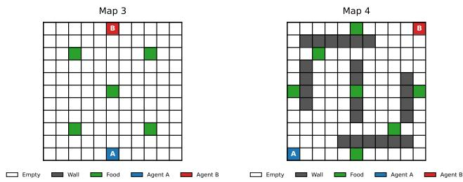
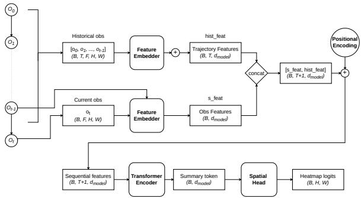
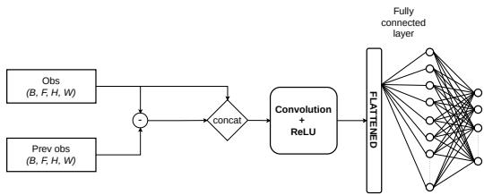
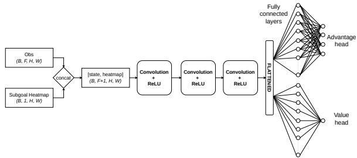
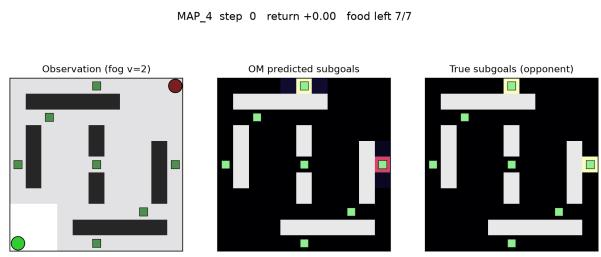
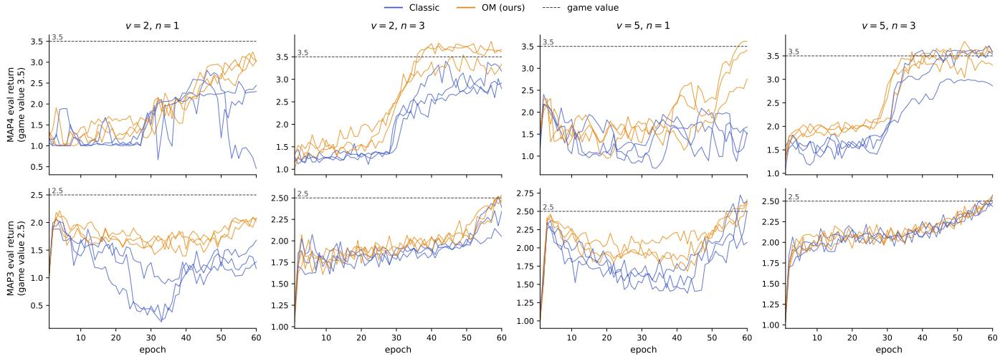
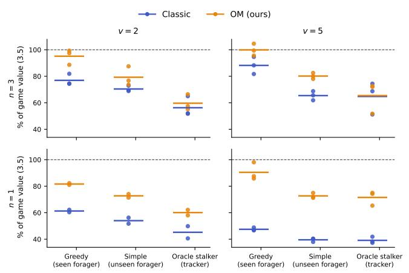
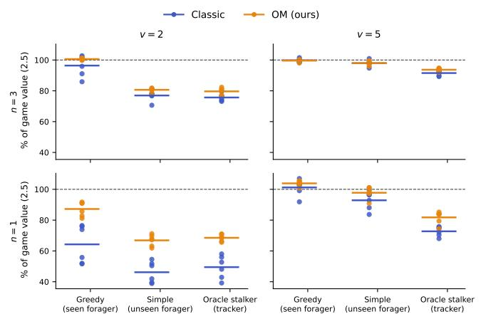

# When Does Opponent Modeling Pay Of? Spatial Inference Stabilises Reinforcement Learning under Partial Observability

Marcel Petran

Faculty of Mathematics and Physics, Charles University Prague, Czech Republic

## Abstract

Deep reinforcement learning agents in partially observable com-petitive games must act on beliefs about an unseen opponent’s intent. We study a spatial opponent model: a transformer trained with hindsight-relabelled opponent goals that outputs a subgoal heatmap from the opponent’s observed trajectory, fused early into a dueling double DQN. In symmetric constant-sum foraging games with partial observability, the module stabilises training. Plain TD(0) DQN sufers degenerate seeds in three of four one-step configu rations, whereas the opponent-model agent never collapses and, wherever training succeeds, recovers the majority of the symmetric game value. Transfers zero-shot to a foraging opponent unseen by the learner, with a positive goal advantage over the baseline, and loses this edge exactly where an information argument predicts: against a full-information tracking adversary whose intent is the learner itself, and on resource-dense maps where both agents sat urate. A blindfold ablation, zeroing the heatmap at deployment, decomposes the advantage into two mechanisms: training-time stabilisation, which dominates where the credit assignment is hard and survives blinding on the dense map, and deployment-time in- ference, whose reliance shrinks as fog thins on the sparse map. We conclude that opponent-goal inference is a stability-and-transfer mechanism whose value is governed by measurable boundary con- ditions: visibility (fog thickness), opponent intent, and resource density.

## Keywords

opponent modeling, partial observability, multi-agent reinforcement learning, goal recognition

## ACM Reference Format:

Marcel Petran and Stefan Edelkamp. 2027. When Does Opponent Modeling Pay Of? Spatial Inference Stabilises Reinforcement Learning under Partial Observability. In Proc. ofthe 26th International Conference on Autonomous Agents and Multiagent Systems (AAMAS 2027), Hanoi, Vietnam, 3–7 May 2027, IFAAMAS, 9 pages.

## 1 Introduction

Competitive foraging [6] under fog (Figure 1) is a Partially Observable Stochastic Game (POSG) in which the pivotal latent is not where the opponent is, but where it is going. Classic DQN-style learners are hard to train in this regime: delayed sparse rewards com bined with one-step temporal-diference learning (TD(0)) destabilise

Stefan Edelkamp Faculty of Mathematics and Physics, Charles University Prague, Czech Republic

  
Figure 1: The two foraging maps (11×11). map3 (left): five densely placed central goals; map4 (right): seven goals dis-persed behind sectioned walls. Agents and foods spawn at fixed positions and compete for the resources.

training. The ability to reason about others’ behaviour can often be a defining factor between success and failure [1, 8, 14, 15, 18, 19, 23]. Relying solely on reactive policies is often insuficient. Instead, a prominent approach is to model the adversary directly, actively inferring their underlying strategies, intentions, or goals to antici-pate future states. This approach is generally known as Opponent Modeling (OM). OM is usually evaluated only as “beats the baseline,” so we ask when it helps. The spatial opponent model and its ESS formalism were introduced in prior work [16] for Fully Observable Stochastic Games (FOSG) [12]. Here we adapt it to partial observability, replacing privileged inputs with the fogged observation history and its first-order motion encodings, and fusing the inferred heatmap alongside learned belief channels. Using this adapted module, we contribute a boundary-condition analysis of when and why opponent-goal inference pays of.

Our contributions are: POSG instantiation ofthe spatial OM: The opponent model of prior work [16] re-instantiated for fogged ob-servation histories, with motion-diference channels, hindsight su- pervision, and early spatial fusion in physical coordinates.

Stability: Across all training runs on two maps, the opponentmodel agent never collapses, whereas plain DQN has degenerate seeds in three of four one-step configurations (every one-step configuration of the sparse map, and thick fog on the dense map).

In-distribution advantage: Where training succeeds, the oppo-nent model recovers 95–99.9% of the symmetric game value against the training opponent (occasionally exceeding it by exploiting the suboptimal heuristic), versus 77–88% for the baseline on map4 and 52–107% per seed on map3, with degenerate TD(0) training runs finishing as low as 47%.

Generalisation across forager types: The paired advantage transfers to a foraging opponent unseen by the learner (+0.31–0.52) and, in well-trained scenarios, vanishes against a tracking adversary.

Boundary conditions: The advantage disappears against oppo-nents whose intent is the learner itselfand saturates when resources are dense.

Mechanism: A blindfold ablation decomposes the advantage into training-time stabilisation and deployment-time inference, and shows inference reliance scales with fog.

## 2 Related Work

Opponent modeling has a long history, from theory-of-mind-style agent modeling [2, 17, 18] to game-specific predictors [4, 8]. Nashed and Zilberstein survey opponent-modeling methods and their de- sign axes [14]. Closest to us, Yu et al. infer opponent subgoals and integrate them into policy learning [23]; their subgoal inference conditions on the full state, whereas we infer a spatial intent dis- tribution from partial observations, and ask when the inference channel pays of rather than whether it improves a benchmark. Goal and plan recognition share our prediction target [5]; our hindsight relabelled transformer (Section 4) is a lightweight online variant of such methods, using realised opponent outcomes as supervision in the spirit of HER [3]. Under partial observability, agent modeling has been tackled with recurrent opponent embeddings [15], Bayesadaptive meta-learners [24], and policy-inference networks [10]; these predict opponent policies or types, not their spatial intent. Our games are partially observable stochastic games [7], and our contributions are orthogonal to MARL algorithmics: we modify the observation pipeline of a standard dueling DDQN [13, 21, 22] and measure the efect on training stability and transfer.

## 3 Problem Formulation

Definition 3.1 (Partially Observable Stochastic Game). A Partially Observable Stochastic Game (POSG) is a tuple

$$
\Gamma = \langle N , S , \mathcal { A } , \mathcal { T } , R _ { i } , O , Z _ { i } , \gamma \rangle
$$

where:

• N is the set of � agents.

• S is the global state space.

$\mathcal { A } = \mathcal { A } _ { 1 } \times \cdot \cdot \cdot \times \mathcal { A } _ { N }$ is the joint action space.

$\mathcal T : S \times \mathcal A  \Delta ( S )$ is the state transition function conditioned on joint actions, where $\Delta ( S )$ denotes the probability simplex over the state space.

$R _ { i } : S \times \mathcal { A } \to \mathbb { R } , i \in N$ , are the per-agent reward functions.

• $o$ is the set of observation spaces $O = O _ { 1 } \times \cdots \times O _ { N }$

$Z _ { i } : S \to O _ { i } , i \in N$ , are the per-agent observation functions mapping the global state to agent �’s observation space.

$\gamma \in \left[ 0 , 1 \right)$ is the discount factor.

Foraging as a POSG. We model competitive foraging under partial observability as a two-player constant-sum $\mathrm { P O S G } \Gamma = \langle N , S ,$ $\mathcal { A } , \mathcal { T } , R _ { i } , O , Z _ { i } , \gamma \rangle$ with agents $N = \{ 1 , 2 \}$ , S that represents the global state configurations that describe the positions of all agents, walls, foods, and the food’s state (present or eaten). The agents share the movement action set A = {North, South, East, West}. T is deterministic, meaning that the movement actions update the agent’s coordinates to the adjacent cell, agents automatically collect items upon entering a cell containing food and if agent $i \in N$ takes an action that would result in a collision with a wall or stepping outside the boundaries of the map, agent � stays at its current position. Each episode places both agents and a finite set of food goals on a grid. Agent � receives a reward $r ^ { i } = 1 \mathrm { i f }$ and only if it moves onto a cell containing food while the opponent is not present on that exact cell. If both agents enter the same cell containing food simultaneously, the food is split, yielding a reward of $r ^ { i } = 0 . 5$ for each agent. In all other scenarios, including empty movements and wall collisions, the step reward is $r ^ { i } = 0 .$ Agent � does not observe the true state $s _ { t } \in S ;$ : it receives a local observation $o _ { t } ^ { ( i ) } = Z _ { i } ( s _ { t } )$ restricted to a vision radius � around its position, with cells outside the radius masked. Agents are also unable to see through walls. All agents additionally maintain belief channels $b _ { t }$ (estimated food and opponent positions, updated on sightings), initialised from the environment’s opening state. The game is a partially observable multi-agent variant of the travelling-salesman problem, making the grids minimal instances of the problem class we ultimately target.

Explicit Sequential Subgoal Games. The ESS formalism and the spatial opponent model below were introduced in prior work [16]; we summarise them for completeness and describe our partial- observability adaptation. We now characterise the class ofgames for which inferring a spatial subgoal is the right prediction target. Many tasks are hierarchical: before winning, an agent must complete a sequence of intermediate objectives, or subgoals. Predicting the opponent’s full future state is unnecessarily noisy: the state carries contextual information that constrains movement but does not define the objective. We therefore decompose the state space as a Cartesian product $S = \mathcal { P } \times Q$ where $\mathcal { P }$ is the subgoal feature space, the state variables whose values complete the atomic objective (e.g. an agent’s coordinates), and Q is the context feature space, variables that constrain behaviour but do not define the objective (walls, free space). Let $\rho : S  \mathcal { P } , \rho ( s ) = p$ for $\boldsymbol { s } = ( p , q )$ , be the projection onto $\mathcal { P }$

Let $S ^ { + } = \{ s \in S \mid R ( s ) > 0 \}$ be the rewarding states. We define the set of explicit subgoals $\mathcal { G } = \rho [ S ^ { + } ] \subseteq \mathcal { P }$ . In the foraging POSG, $\mathcal { P }$ is the pair of agent coordinates, Q collects walls and remaining food, and $\mathcal { G }$ is the finite set of food coordinates.

Definition 3.2 (ESS game). A POSG is classified as an ESS game if and only if there exists a non-trivial decomposition of the state space such that $S = \mathcal { P } { \times } Q$ , and the resulting set of distinct subgoals $\mathcal { G }$ is finite.

## 4 The Spatial Opponent Model under Partial Observability

The Spatial Opponent Model (Spatial OM) was introduced for fully observable games in prior work [16]. Relative to that instantiation, partial observability requires three changes: (i) inference over a sliding window of fogged observations rather than the full state, (ii) motion-diference channels as the primary sighting signal, and (iii) ofline pre-training; in preliminary runs without it, the fusion channel is ignored by the Q-network and does not recover. The prediction target is unchanged: the adversary’s physical destination as a dense heatmap over the grid, with the ESS formalism restricting predictions to meaningful destinations.

  
Figure 2: Overview of the Transformer-based S atial $\mathbf { O p - }$ ponent Model. The Transformer Encoder processes the se- quence of past observations, attending to the current obser- vation to output a 2D heatmap representing the inferred opponent subgoals. The Feature Embedder is detailed in Fig- ure 3. The diagram also shows expected tensor shapes where: � is the batch dimension, � is the trajectory dimension, � is the environment Feature dimension, � and � are the en- vironment Height and Width dimensions, and $d _ { m o d e l }$ is the embedding output dimension.

Inference Model. The core of our module is the inference model �, parameterised by � (visualised in Figure 2). It approximates the opponent’s intended spatial destination at timestep �, given the learner’s observation history and current observation, as a raw logit map $\hat { G } _ { l o q i t s , t } \in \mathbb { R } ^ { H \times W }$ over the grid.

Let $\tau _ { t } ~ = ~ ( o _ { t - T } , \dots , o _ { t - 1 } )$ be the learner’s observation history over a fixed-length sliding window of maximum length � (zero-padded for $t \ < \ T )$ . The architecture processes this sequence as follows:

(1) Feature Embedding: Each observation in $\tau _ { t }$ and the current observation $o _ { t }$ are processed through a shared feature embed- ding. As depicted in Figure 3, the spatial tensor $\left( 2 F \times H \times W \right)$ formed by concatenating the observation with its first-order motion encoding $o - o _ { \mathrm { p r e v } } ,$ passes through a Convolutional layer with ReLU activation to extract local spatial features. The resulting feature map is downsampled, flattened and projected via a fully connected layer into a continuous vector of dimension $d _ { m o d e l }$ . The motion channels are the key partial-observability signal: a negative diference marks a cell that just disappeared underfog or the opponent leaving the vision radius.

(2) Transformer Encoder: A multi-layer Transformer Encoder with standard positional encodings processes the sequence; a boolean key-padding mask prevents self-attention from attending to unobserved history.

(3) Spatial Head: To generate the prediction, the model extracts the “summary token” (the first output token, corresponding to the current observation $o _ { t } )$ and passes it through a shallow MLP that projects the $d _ { m o d e l }$ vector back into the spatial dimensions $( H \times W )$ , yielding the heatmap logits $\hat { G } _ { l o g i t s , t }$ ∈ $\mathbb { R } ^ { H \times W }$

  
Figure 3: Feature embedding process inside the Spatial Oppo-nent Model.

We define the probability of the opponent targeting a specific coordinate $( i , j ) \in H \times W$ as the output of the inference model $\hbar \phi$ The Spatial Head produces a raw logit map, $\hat { G } _ { l o g i t s , t } \in \mathbb { R } ^ { H \times W }$ . To ensure the final output represents a valid spatial probability distri- bution, we apply a Softmax activation function. This produces the predicted spatial intent heatmap $\hat { G } _ { t } \in [ 0 , 1 ] ^ { H \times W }$ , where each ele- ment represents the probability of the opponent targeting a specific coordinate $( i , j )$ conditioned on the learner’s current observation $o _ { t }$ and observation history $\tau _ { t } { : }$

$$
\hat { G } _ { t } ^ { ( i , j ) } = p _ { \phi } ( g _ { t } = ( i , j ) \mid o _ { t } , \tau _ { t } ) = \frac { \exp ( \hat { G } _ { l o g i t s , t } ^ { ( i , j ) } ) } { \sum _ { x = 1 } ^ { H } \sum _ { y = 1 } ^ { W } \exp ( \hat { G } _ { l o g i t s , t } ^ { ( x , y ) } ) }\tag{1}
$$

where the resulting heatmap $\hat { G } _ { t }$ is constrained such that the total probability mass sums up to 1:

$$
\sum _ { i = 1 } ^ { H } \sum _ { j = 1 } ^ { W } \hat { G } _ { t } ^ { ( i , j ) } = 1\tag{2}
$$

By treating the opponent’s observable past as a sequence of tokens, the Transformer leverages self-attention to capture long- range temporal dependencies between historical movements and current intent. Training the model, however, requires ground-truth labels that are not directly observable in a decentralised multi-agent setting.

Hindsight Target Generation. To optimise the Spatial OM, the net-work requires spatial ground-truth labels. Because the opponent’s internal decision-making is not always accessible to the learner during an episode, we generate labels post-hoc with Hindsight Tar-get Generation (strongly related to Hindsight Experience Replay [3]).

At the conclusion of an episode, the trajectory is analysed back- wards to determine the opponent’s achieved subgoals. If the op- ponent successfully reaches a food at timestep $t + k ,$ that coordi- nate $( x , y )$ becomes the ground-truth subgoal for the preceding sequence; if the opponent fails to reach a definitive objective before the episode ends, their final occupied position becomes the fallback target. To account for spatial uncertainty and avoid overly sparse gradients, we transform this single coordinate into a continuous tar-get intent heatmap $G _ { t a r g e t , t } \in [ 0 , 1 ] ^ { H \times W }$ by applying a 2D Gaussian smoothing kernel with variance $\sigma ^ { 2 }$ centred at the target coordinate:

$$
G _ { t a r g e t , t } ^ { ( i , j ) } = \exp \left( - \frac { ( i - x ) ^ { 2 } + ( j - y ) ^ { 2 } } { 2 \sigma ^ { 2 } } \right)\tag{3}
$$

Algorithm 1 Hindsight Subgoal Labelling with Gaussian Smooth   
ing   
Require:   
Logged episode $\boldsymbol { E } = \left[ \left( o _ { t } , r _ { t } ^ { \mathrm { o p p } } , s _ { t } ^ { g } , s _ { t + 1 } ^ { g } \right) \right] _ { t = 1 } ^ { T _ { e p } } .$ : the learner’s   
observations $o _ { t } ,$ the o onent’s rewards $r _ { t } ^ { \mathrm { { \mathrm { { o p p } } } } }$ , and the   
pre-step and post-step privileged global states $s _ { t } ^ { g }$ and   
$s _ { t + 1 } ^ { g }$ (used for labelling only)   
Grid dimensions $H \times W ,$ , Smoothing variance $\sigma ^ { 2 }$   
1: $g _ { t r u e }$ ← None ⊲ Current true goal coordinate $( x , y )$   
2: $G _ { n e x t } \gets \mathbf { 0 } _ { H \times W }$ ⊲ Target map for the next state   
⊲ Fallback goal for unsuccessful or truncated episodes   
3: if � is not empty then   
4: $( o _ { T _ { e p } } , r _ { T _ { e p } } ^ { \mathrm { o p p } } , s _ { T _ { e p } } ^ { g } , s _ { T _ { e p } + 1 } ^ { g } ) \gets E [ T _ { e p } ]$   
5: $\mathbf { i f } ~ r _ { T } ^ { \mathrm { { o p p } } } = 0$ then   
6: ����� ← ExtractOpponentPosition $( s _ { T } ^ { g } )$   
⊲ Backwards Relabelling Trajectory   
7: for $t = T _ { e p }$ downto 1 do   
8: $( o _ { t } , r _ { t } ^ { \mathrm { o p p } } , s _ { t } ^ { g } , s _ { t + 1 } ^ { g } ) \gets E [ t ]$   
9: if $r _ { t } ^ { \mathrm { { o p p } } } > 0$ then ⊲ Opponent achieved an objective $( e . g . \mathrm { , }$   
reached food)   
10: �� ← ExtractOpponentPosition $( s _ { t + 1 } ^ { g } )$   
11: $G _ { t a r g e t , t } \gets \mathbf { 0 } _ { H \times W }$   
12: if $g _ { t r u e } \neq$ None then   
13: $G _ { t a r g e t , t } [ g _ { t r u e } ] \gets 1 . 0$ ⊲ Assign one-hot target   
14: $G _ { t a r g e t , t } \gets$ GaussianFilter $( G _ { t a r g e t , t } , \sigma ^ { 2 } ) \circ G e n e r a t e$   
dense soft-target map   
15: Label $G _ { t a r g e t , t }$ to transition � as true\_goal\_map   
16: Label $G _ { n e x t }$ to transition � as true\_goal\_map\_next   
17: $G _ { n e x t }  G _ { t a r g e t , t }$ ⊲ Carry target map backward   
18: return Labelled episode �

This smoothing provides a dense learning signal, penalising “near-misses” less severely than spatially distant errors. The sys- tematic process for extracting these labels from raw trajectories is detailed in Algorithm 1.

Training Objective. Because $G _ { t a r g e t , t }$ is a continuous Gaussian density, we normalise it to a valid probability distribution (summing to 1 across the grid) and optimise the network against it with the KL Divergence objective:

$$
\begin{array} { r l } & { \mathcal { L } _ { \mathrm { O M } } ( \phi ) = \mathcal { D } _ { K L } ( G _ { t a r g e t , t } \parallel \hat { G } _ { t } ) } \\ & { \quad \quad \quad = \displaystyle \sum _ { i = 1 } ^ { H } \sum _ { j = 1 } ^ { W } G _ { t a r g e t , t } ^ { ( i , j ) } \left( \log G _ { t a r g e t , t } ^ { ( i , j ) } - \log \hat { G } _ { t } ^ { ( i , j ) } \right) } \end{array}\tag{4}
$$

This encourages the Transformer to capture the regional spatial intent rather than memorising discrete coordinate points.

Feature fusion. The Q-function is conditioned on the inferred intent: $Q ( o _ { t } , a , \hat { G } _ { t } )$ .

  
Figure 4: OM Dueling Q-Network. The observation and belief channels are concatenated with the inferred heatmap and processed by the CNN; Advantage and Value heads compute the final Q-values by Equation 6.

A low-dimensional latent summary of the opponent’s intent is easily drowned out by the far larger flattened spatial embedding of the Q-network’s CNN, so the intent signal is kept in physical coordinates: in an ESS game the opponent’s intent is tied to the grid’s physical layout. The Spatial Head therefore projects intent back into a heatmap, and the resulting $\hat { G } _ { t } \left( \operatorname { E q . } 1 \right)$ is concatenated as an additional channel of the network input (early spatial fusion) as depicted in Figure 4. The Q-network’s CNN thus sees the oppo-nent’s likely destination as a heatmap overlaid on walls, food, and the agent’s own position, and learns their geometric relationships directly.

Let $\mathbf { \sigma } _ { O _ { t } } \in \mathbb { R } ^ { F \times H \times W }$ be the learner’s observation with � feature channels, and $b _ { t } \in \mathbb { R } ^ { M \times H \times W }$ with � belief feature channels. This belief map is shared by all compared architectures. The inferred heatmap is concatenated with both along the feature dimension:

$$
\begin{array} { r l } { x _ { t } = \left[ o _ { t } ; b _ { t } ; \hat { G } _ { t } \right] } & { { } \in \mathbb { R } ^ { ( F + M + 1 ) \times H \times W } } \end{array}\tag{5}
$$

The embedding $\mathbf { h } _ { c n n } = f _ { \mathrm { C N N } } ( x _ { t } )$ is processed by the dueling heads [22], which separate state value $( V ( \cdot ) )$ from per-action advantages $( A ( \cdot , \cdot ) )$ . The final Q-value is computed as:

$$
Q ( o _ { t } , a , \hat { G } _ { t } ) = V ( { \bf h } _ { c n n } ) + A ( { \bf h } _ { c n n } , a ) - \frac { 1 } { \vert \mathcal { R } \vert } \sum _ { a ^ { \prime } } A ( { \bf h } _ { c n n } , a ^ { \prime } )\tag{6}
$$

The Q-network is optimised with the double-DQN update [21]: the online network selects the greedy next action and the Polyak- averaged target network $Q _ { \theta } .$ − evaluates it, with target

$$
y _ { t } = r _ { t } + \gamma Q _ { \theta ^ { - } } \left( o _ { t + 1 } , \underset { a ^ { \prime } } { \operatorname { a r g m a x } } Q _ { \theta } \big ( o _ { t + 1 } , a ^ { \prime } , \hat { G } _ { t + 1 } \big ) , \hat { G } _ { t + 1 } \right)\tag{7}
$$

and loss Huber $( y _ { t } - Q _ { \theta } ( o _ { t } , a _ { t } , \hat { G } _ { t } ) )$ [11] (Algorithm 2).

Pre-training the opponent model. If the Spatial OM and the $Q ^ { - }$ network are trained concurrently from random initialisation, the early heatmaps are indistinguishable from uniform noise; the Qnetwork’s CNN quickly learns to assign near-zero weights to the heatmap channel, and once ignored the channel rarely recovers. We therefore pre-train $\hbar \phi$ ofline before joint RL training. A supervised dataset of trajectories is collected by simulating games between heuristic agents (various pairings of the simple and greedy profiles, Section 5) and labelled via hindsight labelling (Algorithm 1). This grants the Spatial OM a foundational understanding of the grid’s topology, agent movement, and the environment’s rules, so that when joint OM-DDQN training begins (Algorithm 2) the Q-network receives structurally meaningful intent predictions from the first episode and integrates the heatmap channel during value estimation from the outset.

Algorithm 2 DDQN with the Spatial OM (OM-DDQN) using HER   
Initialise:   
1: Re la Bufer $\mathcal { D } _ { R L }$   
2: Agent Network $Q _ { \theta } ,$ , Target Network $Q _ { \theta ^ { - } }$   
3: Spatial Opponent Model $\hbar \phi$   
Pre-train:   
4: Train $\hbar \phi$ on ofline heuristic dataset labelled via HER.   
Collect data:   
5: for episode $= 1$ to $N _ { \mathrm { e p } }$ do   
6: Initialise environment, observe $^ { O } 0 ,$ set history $\tau _ { 0 } = 0 ,$ , and   
local episode bufer   
7: for step � = 0 to $T _ { e p }$ do   
8: Inference:   
9: Predict subgoal heatmap: $\hat { G } _ { t } = p _ { \phi } ( o _ { t } , \tau _ { t } )$   
10: Action:   
11: Select � using Boltzmann exploration on   
$Q _ { \theta } ( o _ { t } , \cdot , \hat { G } _ { t } )$   
12: Step:   
13: Execute $\displaystyle a _ { t } ,$ observe reward $r _ { t }$ and next observation   
$o _ { t + 1 }$   
14: Update history: � 1 ← append $\left( \tau _ { t } , o _ { t } \right)$ ⊲ slide win  
dow $o f l e n g t h ~ T$   
15: Store step data $( o _ { t } , a _ { t } , r _ { t } , o _ { t + 1 } , \tau _ { t } , \hat { G } _ { t } )$ in local episode   
bufer   
16: Hindsight Labelling:   
17: Label the logged episode as described in Algorithm 1   
18: Transfer local bufer to global Replay Bufer $\mathcal { D } _ { R L }$   
19: Training Phase:   
20: Sample batch of transitions and sequences from $\mathcal { D } _ { R L }$   
⊲ Train OM Dueling Q-Network   
21: Generate next step heatmaps $\hat { G } _ { t + 1 }$ using the Spatial OM   
inference $p _ { \phi } ( o _ { t + 1 } , \tau _ { t + 1 } )$   
22: Select next actions $\begin{array} { r } { a _ { m a x } ^ { \prime } = \arg \operatorname* { m a x } _ { a ^ { \prime } } Q _ { \theta } ( o _ { t + 1 } , a ^ { \prime } , \hat { G } _ { t + 1 } ) } \end{array}$   
23: Calculate target $y = r _ { t } + \gamma Q _ { \theta ^ { - } } \left( o _ { t + 1 } , a _ { m a x } ^ { \prime } , \hat { G } _ { t + 1 } \right)$   
24: Compute Loss $\mathcal { L } _ { D D Q N } = \mathrm { H u b e r } ( y - \boldsymbol { Q } _ { \theta } ( o _ { t } , a _ { t } , \hat { G } _ { t } ) )$   
25: Update � via gradient descent   
26: Update target network (Polyak): $\theta ^ { - }  \beta \theta + ( 1 - \beta ) \theta ^ { - }$   
⊲ Train the Spatial OM   
27: Compute ${ \mathcal { L } } _ { O M } ( \phi )$ using KL Divergence against normalised   
soft targets �������,�   
28: Update � via gradient descent

## 5 Experimental Setup

Environment. Foraging under partial observability (Section 3) played on two symmetric 11×11 grids (Figure 1): map3 (dense central food, 5 goals) and map4 (sectioned walls, dispersed food, 7 goals), with fixed spawn and goal positions and vision radius $v \in \{ 2 , 5 \}$ (fog thickness). The symmetry and game rules ensure that each agent’s game value is half of the total food. Greedy vs greedy play shows this empirically (map3: 2.50/2.50; map4: 3.42/3.42).

  
Figure 5: Example of Spatial OM predictions on map4 (vision radius 2). Left: the learner’s observation under fog; the learner (green dot) sees only its surroundings, while the opponent’s true position (dark red when obscured by fog) and the food (green squares) are shown for reference. Middle: the OM’s predicted subgoal distribution fed to the Q-network. Right: the opponent’s true subgoal distribution, that is not accessible during match. The OM concentrates mass on the opponent’s actual target even when the opponent is outside the learner’s vision radius.

Table 1: Shared training hyperparameters and network sizes (both learning agents).  
Learning rate Adam; $3 { \cdot } 1 0 ^ { - 4 } \ \mathrm { ( Q ) } , 1 { \cdot } 1 0 ^ { - 4 } \ \mathrm { ( O M ) }$   
Discount � / soft update � � 0.985 / 0.001   
Batch size / train frequency 128 / every 4 steps   
Replay capacity 450,000   
Episodes 30,000 (60 epochs×500 episodes), max 50   
steps   
Boltzmann � 1.5 → 0.05 over 650k steps   
Label smoothing $\sigma ^ { 2 }$ 2.0 → 0.5 over 150k steps   
OM pre-training 20 epochs heuristic self-play   
Q-net 3×Conv3×3 $( C _ { i n } {  } 3 2 { \stackrel { \bullet } {  } } 6 4 { \longrightarrow } 6 4 ) ,$ dueling   
heads 256   
OM transformer � � �=128, 2 layers, 4 heads, $d _ { f f } = 2 5 6 ,$   
dropout 0.05, history length 50

Opponents. All opponents share the learner’s action space and movement rules and act on their own partial observations (same vision radius). simple commits to a random believed food and re-plans when it is consumed or seen as collected. greedy targets its nearest believed food and switches away whenever it believes the learner is closer. oracle-stalker (also denoted as “tracker”) sees the true state regardless of fog and races to the food nearest the learner that it can still reach first, loitering there to deny collection.

Training. Dueling DQN, �-step returns � ∈ {1, 3} [20], belief-map prior $p \in \{ 0 , 1 \}$ (belief map of/on), 60 epochs, 3 seeds per configuration, against the greedy opponent. Training used a single Tesla V100-SXM2-32GB GPU per run, taking about 7 hours plus perepoch evaluation (classic and om combined). Zero-shot evaluations ran on an Apple M3 Pro (12-core CPU, 18 GB RAM). Table 1 lists the shared hyperparameters.

Table 2: Paired zero-shot advantage Δ = om−classic (mean ± std over seeds) by opponent, fog, and �-step horizon on map4 (prior of). �=3: well-trained cells; �=1: cells where classic training is unstable. Seen forager means that the learner has trained against the opponent; unseen forager means that the opponent is not in the learner’s training set. Dense-map (map3) deltas are reported in the text and Table 3.
<table><tr><td>Opponent</td><td> $\mathrm { F o g }$ </td><td>n=3</td><td>n=1</td></tr><tr><td>GREEDY (seen, forager)</td><td>v=2</td><td> $+ 0 . 6 4 \pm 0 . 2 0$ </td><td> $+ 0 . 7 1 \pm 0 . 0 8 ^ { \dagger }$ </td></tr><tr><td>GREEDY (seen, forager)</td><td>v=5</td><td> $+ 0 . 4 1 \pm 0 . 0 7$ </td><td> $+ 1 . 5 0 \pm 0 . 2 6$ </td></tr><tr><td>SIMPLE (unseen, forager)</td><td>v=2</td><td> $+ 0 . 3 1 \pm 0 . 3 1$ </td><td> $+ 0 . 6 6 \pm 0 . 0 5 ^ { \dagger }$ </td></tr><tr><td>SIMPLE (unseen, forager)</td><td>v=5</td><td> $+ 0 . 5 2 \pm 0 . 1 0$ </td><td> $+ 1 . 1 6 \pm 0 . 0 5$ </td></tr><tr><td>ORACLE-STALKER (tracker)</td><td>v=2</td><td> $+ 0 . 1 2 \pm 0 . 3 9$ </td><td> $+ 0 . 5 2 \pm 0 . 1 3 ^ { \dagger }$ </td></tr><tr><td>ORACLE-STALKER (tracker)</td><td>v=5</td><td> $+ 0 . 0 2 \pm 0 . 0 9$ </td><td> $+ 1 . 1 3 \pm 0 . 2 7$ </td></tr></table>

†Excluding one collapsed classic seed (see Limitations); the collapse is reported as a finding.

Zero-shot evaluation. Checkpoints are evaluated against greedy (the training opponent), simple, and oracle-stalker, with seatswap probability 0.5 and 1000 episodes per seed. We report diferences paired by training seed (Δ = om − classic; the same seed index for both agents), split by �-step configuration (pooled only where stated, as in the belief-prior comparison), mean ± std over seeds.

## 6 Results

Training stability. Plain DQN is unstable at �=1 (Figure 6). On map4 one classic seed collapses outright in �=2 and all three �=5 seeds finish at 37–46% of game value (1.3–1.6 of 3.5); on map3 at thick fog all �=1 seeds finish at 47–68% of game value (1.17–1.71 of 2.5). om never collapses and never finishes below 80% of game value on map3 (floor 2.03 of 2.5). Across all zero-shot batches on both maps, seed-level standard deviation is 1.4–3.6× smaller for om (map4: 0.16–0.31 vs. 0.50–0.79).

In-distribution performance. Against the training opponent (Fig ure 7), om recovers 95% (map4, �=2) to 99.9% (�=5) ofthe game value in well-trained (�=3) cells; classic reaches 77–88%. On map3 both agents reach 96–101% at �=3, since the game is saturated. Under thin fog both even exceed the game value on average (104% for om, 101% for classic; individual seeds up to 107%): a best response to the suboptimal training heuristic. Thick fog separates them: in the hard cell (�=2, �=1) classic degenerates to 52–76% per seed (64% on average), because exploiting an opponent you rarely see requires predicting it.

Opponentspectrum. The advantage transfers across forager types, seen or unseen, and in well-trained scenarios disappears against the tracker (Table 2). simple is unseen by the learner, but its profile appears in the OM’s ofline pre-training corpus (Section 4), so this tests the learned policy’s transfer, not the OM’s. This fits an infor- mation argument. A forager’s intent is a fact about the environment: its trajectory reveals it, and the learner’s fogged observations do not contain it. A tracker’s intent is the learner itself, so predicting it is redundant with self-knowledge. Tracking is also costly for the tracker: total extraction drops from ∼7 goals (against foragers) to ∼3.5, as the tracker spends roughly 2.2 goals of its own foraging to remove about 1 from the learner.

Table 3: Blindfold ablation: heatmap zeroed at deployment. Mean om return over seeds; Δ = om − classic paired by training seed, zero-shot. map4: prior of, �-split; map3: �=1, prior on/of pooled, 6 seeds; vs. the opponent shown.
<table><tr><td>Map / opponent</td><td>Cell</td><td>OM</td><td>Om blind</td><td>Δ</td><td>∆ blind</td></tr><tr><td>MAP4, GREEDY</td><td>v=2, n=3</td><td>3.33</td><td>2.23</td><td> $+ 0 . 6 4$ </td><td> $- 0 . 4 7$ </td></tr><tr><td>MAP4, GREEDY</td><td>v=2, n=1</td><td>2.86</td><td>2.43</td><td> $+ 0 . 7 1 ^ { \dagger }$ </td><td> $+ 0 . 2 8 ^ { \dagger }$ </td></tr><tr><td>MAP4, SIMPLE</td><td>v=2, n=3</td><td>2.77</td><td>2.10</td><td>+0.31</td><td> $- 0 . 3 7$ </td></tr><tr><td>MAP4, SIMPLE</td><td>v=2, n=1</td><td>2.55</td><td>2.31</td><td>+0.66†</td><td>+0.42†</td></tr><tr><td>MAP4, ORACLE-STALKER</td><td>v=2, n=3</td><td>2.09</td><td>1.71</td><td>+0.12</td><td>-0.26</td></tr><tr><td>MAP4, ORACLE-STALKER</td><td>v=2, n=1</td><td>2.10</td><td>2.10</td><td> $+ 0 . 5 2 ^ { \dagger }$ </td><td> $+ 0 . 5 2 ^ { \dagger }$ </td></tr><tr><td>MAP4, GREEDY</td><td>v=5,n=3</td><td>3.50</td><td>3.02</td><td>+0.41</td><td>-0.07</td></tr><tr><td>MAP4, GREEDY</td><td>v=5, n=1</td><td>3.17</td><td>2.50</td><td>+1.50</td><td>+0.84</td></tr><tr><td>MAP4, SIMPLE</td><td>v=5,n=3</td><td>2.81</td><td>2.57</td><td>+0.52</td><td>+0.28</td></tr><tr><td>MAP4, SIMPLE</td><td>v=5, n=1</td><td>2.54</td><td>2.31</td><td>+1.16</td><td>+0.92</td></tr><tr><td>MAP4, ORACLE-STALKER</td><td>v=5,n=3</td><td>2.29</td><td>2.17</td><td>+0.02</td><td>-0.10</td></tr><tr><td>MAP4, ORACLE-STALKER</td><td>v=5, n=1</td><td>2.50</td><td>2.24</td><td>+1.13</td><td>+0.87</td></tr><tr><td>MAP3, GREEDY</td><td>v=2</td><td>2.18</td><td>2.13</td><td>+0.57</td><td>+0.53</td></tr><tr><td>MAP3, SIMPLE</td><td>v=2</td><td>1.67</td><td>1.64</td><td>+0.52</td><td>+0.48</td></tr><tr><td>MAP3, ORACLE-STALKER</td><td>v=2</td><td>1.71</td><td>1.68</td><td>+0.48</td><td>+0.44</td></tr><tr><td>MAP3, GREEDY</td><td>v=5</td><td>2.60</td><td>2.44</td><td>+0.07</td><td>-0.09</td></tr><tr><td>MAP3, SIMPLE</td><td>v=5</td><td>2.44</td><td>2.29</td><td>+0.12</td><td>-0.03</td></tr><tr><td>MAP3, ORACLE-STALKER</td><td>v=5</td><td>2.04</td><td>2.03</td><td>+0.23</td><td>+0.21</td></tr></table>

†Row excludes one collapsed classic seed (see Limitations); the collapse is reported as a finding.

On the dense map, pooling prior on and of, the paired advantage concentrates in one hard cell (�=2, �=1): +0.57 vs. greedy, +0.52 vs. simple, +0.48 vs. the tracker. Wherever classic trains, the map saturates and the advantage falls to at most +0.13 against foragers and +0.23 against the tracker. The tracker at the hard cell is our mechanism probe: the advantage survives (+0.48), and blinding the heatmap leaves it nearly intact (+0.44, Table 3). Against a tracker, the gap is training-time stabilisation, not inference.

Ablating the inference channel. Table 3 completes the grid: all three opponents, both fog levels, and both returns configurations, with the paired advantage computed within the same runs. The picture splits along training dificulty. In the well-trained cells (�=3), blinding erases the entire advantage in five of six cells: against the training opponent at thick fog +0.64 → −0.47, against the unseen forager +0.31 → −0.37. The one exception keeps just over half (+0.52 → +0.28, unseen forager, thin fog). Where training succeeds, the advantage is inference. In the unstable cells (�=1), an edge survives blinding against every opponent (+0.28 to +0.92 over classic, excluding the collapsed seed at thick fog): stabilisation that does not require the heatmap at deployment.

Reliance on the channel is strongest in distribution and in fog. The largest drop is against the training opponent at thick fog (3.33 → 2.23, leaving om half a goal below classic), with a worst per-seed drop of 1.81. Across the well-trained cells the drop shrinks as fog thins (1.10 → 0.48 goals against the training opponent): the policy consults the heatmap in proportion to how much its own observations leave unknown. The unstable cells show no consistent fog scaling, so their stabilisation is fog-independent even where their inference is not. Blinding never collapses an om seed (perseed returns stay above 1.5), so the drop mixes information loss with input corruption (see Limitations). Where training is hard, the opponent model contributes stabilisation; where training is easy, it contributes inference.

  
Figure 6: Per-epoch evaluation return against the training opponent, per seed: classic (blue) vs. om (orange), belief prior of. Top row map4, bottom row map3. classic degenerates at �=1: on map4 one �=2 seed collapses outright, all three �=5 seeds finish below 1.7 of 3.5, and on map3 all seeds in the �=2 cell finish below 2.0 of 2.5 (thin fog recovers). om never collapses on either map.

  
Figure 7: Zero-shot return as a share of the symmetric game value, by opponent and cell (dots: seeds; bar: mean; dashed: game value). Left: map4 (prior of; collapsed classic seed excluded). Right: map3 (prior on/of pooled, 6 seeds per cell). Both agents exceed 100% under thin fog (best-response exploitation of the suboptimal heuristic) and both saturate on the dense map wherever training succeeds.

The tracker rows tell the same story on the sparse map. In the unstable cells the gap survives blinding almost fully (+0.52 → +0.52 at thick fog, +0.87 of +1.13 at thin fog): stabilisation. In the well trained cells the advantage is small, but its blindfold response still tracks fog: near zero either way at thin fog (+0.02 → −0.10), yet at thick fog the channel is still consulted (+0.12 → −0.26, a 0.37-goal drop for om itself); the heatmap there carries not the target (the learner knows its own position) but the tracker’s approach under fog. An opponent whose intent is about the learner rather than the environment yields stabilisation, not inference.

On the dense map, blinding is nearly neutral at thick fog (at most 0.05 goals in every �=2 cell), so the whole +0.5 advantage there is stabilisation. The largest drops come at thin fog (−0.16 against the training opponent at �=5) and flip the paired advantage slightly negative (−0.09). With the game saturated there is little for inference to add. The fog scaling of inference therefore needs a cell that is not saturated, which the dense map lacks: itself a density efect.

Resource density. Table 4 completes the picture. Wherever classic trains successfully (≥ 90% of value), om also sits at the ceiling and the advantage is at most 0.23 goals. On a dense map a lost contest costs little because another goal is nearby, so predicting the opponent’s target is worth little: the advantage vanishes by satu ration, not by failure. The stability efect replicates and depends on fog. At thick fog all six classic �=1 seeds fall below 2.0 of 2.5 (minimum 1.17) while om never drops below 2.03; at thin fog even classic �=1 recovers (minimum 2.08). Across both maps, the ad-vantage shrinks with the dificulty reducers that stabilise classic training (denser map, longer �-step horizon), from +0.5–1.5 goals in the sparse map’s unstable cells to +0.04 on the dense map under thin fog. Fog is the exception on the sparse map: at �=1 the gap widens as fog thins (+0.71 → +1.50 vs. the training opponent), because om improves with visibility (2.84 → 3.17) while classic does not (2.1 → 1.7 goals excluding the collapsed seed).

Table 4: Dense map3 (game value 2.5 by symmetry): epoch-60 eval return vs. the training opponent as % of game value, mean over 3 seeds per cell. Δ: paired om−classic in goals.
<table><tr><td>Fog</td><td>n</td><td>Prior</td><td>CLASSIC</td><td>OM</td><td>Δ</td></tr><tr><td>v=2</td><td>1</td><td>off</td><td>55.1</td><td>82.3</td><td>+0.68</td></tr><tr><td>v=2</td><td>1</td><td>on</td><td>65.8</td><td>89.4</td><td>+0.59</td></tr><tr><td>v=2</td><td>3</td><td>off</td><td>90.5</td><td>99.5</td><td>+0.23</td></tr><tr><td>v=2</td><td>3</td><td>on</td><td>98.4</td><td>99.8</td><td>+0.04</td></tr><tr><td>v=5</td><td>1</td><td>off</td><td>96.2</td><td>105.3</td><td>+0.23</td></tr><tr><td>v=5</td><td>1</td><td>on</td><td>104.0</td><td>106.9</td><td>+0.07</td></tr><tr><td>v=5</td><td>3</td><td>off</td><td>99.9</td><td>101.5</td><td>+0.04</td></tr><tr><td>v=5</td><td>3</td><td>on</td><td>97.8</td><td>99.6</td><td>+0.05</td></tr></table>

Belief-map prior. On map3 the prior is neutral for om: the largest cell-level return diference between �=1 and �=0 is 0.18 goals, and its efect on inference quality is small and inconsistent in sign (−0.28 to +0.26). It partially rescues classic where TD(0) fails: at the hard cell (�=2, �=1; zero-shot vs. greedy), classic rises from 53% to 75% of game value with the prior, while om remains highest (91%). Table 4 shows the same direction with smaller gaps (55.1% → 65.8%, om 82.3–89.4%).

The map4 replication turns this into a boundary condition. At thin fog the prior lifts the baseline (classic vs. the training opponent: 68% → 84% of game value) while om gives up 0.3–0.6 goals. The paired advantage, pooled over the �-split for this comparison, thus shrinks from +0.90/+0.96 to +0.60/+0.04 goals (thick/thin fog) and nearly vanishes against the tracker (from +0.51/+0.58 to +0.01/+0.24). Part of the prior-free edge was an information-starved baseline: a positional belief substitutes for subgoal inference at thin fog, but not at thick fog, where inference keeps a +0.6 goal edge over the baseline with the prior. The prior is a safe default for the baseline; the opponent model buys the thick-fog remainder.

## 7 Limitations

Three seeds per configuration. We report per-seed strip plots and never pool across �-step configurations (except where stated, as in the belief-prior comparison), and several cells have seed-level standard deviations comparable to their means and should be read as non-significant. One classic seed on map4 collapsed during training and is excluded from paired statistics there, with the training curve cited as justification. Collapse frequency is itself reported. All results are best responses to a heuristic. In preliminary experiments, NFSP-style self-play [9] did not converge in the FOSG domain, so we make no MARL equilibrium claims. Published opponent-modeling methods assume diferent observation spaces (full state, action histories, or population priors). None infers spatial opponent subgoals from partial observations in this setting, so we compare against classic, whose Q-network matches the om Q-network on obser-vation and belief channels and on capacity, difering only in the heatmap input, although that heatmap summarises an observation history classic does not see (see Conclusion). We fix the learner to value-based DQN methods because the claim concerns TD(0) stability under partial observability. Policy-gradient learners would change the failure mode rather than test it. Zeroing the heatmap is an input distribution shift. The drop measures information loss plus input corruption, not information loss alone. And lastly, this work focuses on grid foraging only, scale is future work.

## 8 Conclusion and Future Work

Opponent-goal inference under partial observability is not a uniform advantage: its value is set by visibility (fog thickness), by whether the opponent’s intent is about the environment or about the learner, and by resource density. Its most robust benefit is mak- ing DQN training stable where plain TD(0) fails. We attribute the stabilisation to the module as a whole. Whether it stems from subgoal inference or from history-derived structured input is not isolated here. The blindfold ablation ofers partial evidence: zeroing the heatmap, the only input beyond the channels shared with clas- sic, costs the most deployment performance in the cells where the information argument says inference matters most (in distribution and at thick fog on the sparse map), consistent with the inference carrying information rather than acting as generic structured in-put. Future work scales these mechanisms to roadmap graphs of real-world maps, where foraging under fog becomes a multi-agent travelling-salesman problem under partial observability, in both competitive and cooperative settings, and replaces self-play with policy-space or population methods for equilibrium approximation.

## 9 Acknowledgements

I would like to thank my supervisor, Ing. Rostislav Horčík, Ph.D., for his invaluable guidance and support throughout this research. The authors acknowledge the support of the OP VVV “Research Center for Informatics”. The access to the computational infrastructure of the OP VVV “Research Center for Informatics” is also gratefully acknowledged.

## References

[1] Maruan Al-Shedivat, Trapit Bansal, Yura Burda, Ilya Sutskever, Igor Mordatch, and Pieter Abbeel. 2018. Continuous Adaptation via Meta-Learning in Non stationary and Competitive Environments. In 6th International Conference on Learning Representations, ICLR 2018, Vancouver, BC, Canada, April 30 - May 3, 2018, Conference Track Proceedings. OpenReview.net. https://openreview.net/ forum?id=Sk2u1g-0-

[2] Stefano V. Albrecht and Peter Stone. 2018. Autonomous agents modelling other agents: A comprehensive survey and open problems. Artif. Intell. 258 (2018), 66–95. doi:10.1016/J.ARTINT.2018.01.002

[3] Marcin Andrychowicz, Dwight Crow, Alex Ray, Jonas Schneider, Rachel Fong, Peter Welinder, Bob McGrew, Josh Tobin, Pieter Abbeel, and Wojciech Zaremba. 2017. Hindsight Experience Replay. In Advances in Neural Information Processing Systems 30: Annual Conference on Neural Information Processing Systems 2017, December 4-9, 2017, Long Beach, CA, USA, Isabelle Guyon, Ulrike von Luxburg, Sam Ben io, Hanna M. Wallach, Rob Fer us, S. V. N. Vishwanathan, and Roman Garnett (Eds.). 5048–5058. https://proceedings.neurips.cc/paper/2017/hash 453fadbd8a1a3af50a9df4df899537b5-Abstract.html

[4] Sander C. J. Bakkes, Pieter H. M. Spronck, and H. Jaap van den Herik. 2009. Opponent modelling for case-based adaptive game AI. Entertain. Comput. 1, 1 (2009), 27–37. doi:10.1016/J.ENTCOM.2009.09.001

[5] Eugene Charniak and Robert P. Goldman. 1993. A Bayesian Model of Plan Recognition. Artif. Intell. 64, 1 (1993), 53–79. doi:10.1016/0004-3702(93)90060-O

[6] Filippos Christianos, Lukas Schäfer, and Stefano V. Albrecht. 2020. Shared Experience Actor-Critic for Multi-Agent Reinforcement Learning. In Advances in Neural Information Processing Systems 33: Annual Conference on Neural Information Processing Systems 2020, NeurIPS 2020, December 6-12, 2020, virtual, Hugo Larochelle, Marc’Aurelio Ranzato, Raia Hadsell, Maria-Florina Balcan, and Hsuan-Tien Lin (Eds.). https://proceedings.neurips.cc/paper/2020/hash 7967cc8e3ab559e68cc944c44b1cf3e8-Abstract.html

[7] Eric A. Hansen, Daniel S. Bernstein, and Shlomo Zilberstein. 2004. Dynamic Programming for Partially Observable Stochastic Games. In Proceedings ofthe Nineteenth National Conference on Artificial Intelligence, Sixteenth Conference on Innovative Applications of Artificial Intelligence, July 25-29, 2004, San Jose, California, USA, Deborah L. McGuinness and George Ferguson (Eds.). AAAI Press / The MIT Press, 709–715. http://www.aaai.org/Library/AAAI/2004/aaai04- 112.php

[8] He He and Jordan L. Boyd-Graber. 2016. Opponent Modeling in Deep Reinforce ment Learning. In Proceedings ofthe 33nd International Conference on Machine Learning, ICML 2016, New York City, NY, USA, June 19-24, 2016 (JMLR Workshop and Conference Proceedings, Vol. 48), Maria-Florina Balcan and Kilian Q. Wein berger (Eds.). JMLR.org, 1804–1813. http://proceedings.mlr.press/v48/he16.html

[9] Johannes Heinrich and David Silver. 2016. Deep Reinforcement Learning from Self-Play in Imperfect-Information Games. CoRR abs/1603.01121 (2016). arXiv:1603.01121 http://arxiv.org/abs/1603.01121

[10] Zhang-Wei Hong, Shih-Yang Su, Tzu-Yun Shann, Yi-Hsiang Chang, and Chun-Yi Lee. 2017. A Deep Policy Inference Q-Network for Multi-Agent Systems. CoRR abs/1712.07893 (2017). arXiv:1712.07893 htt ://arxiv.or /abs/1712.07893

[11] Peter J. Huber. 1964. Robust Estimation of a Location Parameter. The Annals of Mathematical Statistics 35, 1 (1964), 73 – 101. doi:10.1214/aoms/1177703732

[12] Michael L. Littman. 1994. Markov Games as a Framework for Multi-Agent Reinforcement Learning. In Machine Learning, Proceedings ofthe Eleventh International Conference, Rutgers University, New Brunswick, NJ, USA, July 10-13, 1994, William W. Cohen and Ha m Hirsh (Eds.). Mor an Kaufmann, 157–163. doi:10.1016/B978-1-55860-335-6.50027-1

[13] Volodymyr Mnih, Koray Kavukcuoglu, David Silver, Andrei A. Rusu, Joel Veness, Marc G. Bellemare, Alex Graves, Martin A. Riedmiller, Andreas Fidjeland, Georg Ostrovski, Stig Petersen, Charles Beattie, Amir Sadik, Ioannis Antonoglou, Helen King, Dharshan Kumaran, Daan Wierstra, Shane Legg, and Demis Hassabis. 2015. Human-level control through deep reinforcement learning. Nat. 518, 7540 (2015), 529–533. doi:10.1038/NATURE14236

[14] Samer B. Nashed and Shlomo Zilberstein. 2022. A Survey of Opponent Modeling in Adversarial Domains. J. Artif. Intell. Res. 73 (2022), 277–327. doi:10.1613/JAIR. 1.12889

[15] Georgios Papoudakis, Filippos Christianos, and Stefano V. Albrecht. 2021. Agent Modelling under Partial Observability for Deep Reinforcement Learning. In Advances in Neural Information Processing Systems 34: Annual Conference on Neural Information Processing Systems 2021, NeurIPS 2021, December 6-14, 2021, virtual, Marc’Aurelio Ranzato, Alina Beygelzimer, Yann N. Dauphin, Percy Liang, and Jennifer Wortman Vaughan (Eds.). 19210–19222. https://proceedings.neurips. cc/paper/2021/hash/a03caec56cd82478bf197475b48c05f9-Abstract.html

[16] Marcel Petran. 2026. Opponent Modeling in Zero-Sum Games. Master’s thesis. Faculty of Electrical Engineering, Czech Technical University in Prague, Prague, Czech Republic.

[17] David Premack and Guy Woodruf. 1978. Does the chimpanzee have a theory of mind? Behavioral and Brain Sciences 1, 4 (1978), 515–526. doi:10.1017/ S0140525X00076512

[18] Neil C. Rabinowitz, Frank Perbet, H. Francis Song, Chiyuan Zhang, S. M. Ali Eslami, and Matthew M. Botvinick. 2018. Machine Theory of Mind. In Proceedings ofthe 35th International Conference on Machine Learning, ICML 2018, Stockholmsmässan, Stockholm, Sweden, July 10-15, 2018 (Proceedings ofMachine Learning Research, Vol. 80), Jennifer G. Dy and Andreas Krause (Eds.). PMLR, 4215–4224. http://proceedings.mlr.press/v80/rabinowitz18a.htm

[19] Roberta Raileanu, Emily Denton, Arthur Szlam, and Rob Fergus. 2018. Modeling Others using Oneself in Multi-Agent Reinforcement Learning. CoRR abs/1802.09640 (2018). arXiv:1802.09640 http://arxiv.org/abs/1802.09640

[20] Richard S. Sutton and Andrew G. Barto. 2018. Reinforcement learning - an introduction, 2nd Edition. MIT Press. http://www.incompleteideas.net/book/thebook-2nd.html

[21] Hado van Hasselt, Arthur Guez, and David Silver. 2016. Deep Reinforcement Learning with Double Q-Learning. In Proceedings ofthe Thirtieth AAAI Conference on Artificial Intelligence, February 12-17, 2016, Phoenix, Arizona, USA, Dale Schuurmans and Michael P. Wellman (Eds.). AAAI Press, 2094–2100. doi:10.1609/AAAI.V30I1.10295

[22] Ziyu Wang, Tom Schaul, Matteo Hessel, Hado van Hasselt, Marc Lanctot, and Nando de Freitas. 2016. Dueling Network Architectures for Deep Reinforcement Learning. In Proceedings ofthe 33nd International Conference on Machine Learning, ICML 2016, New York City, NY, USA, June 19-24, 2016 (JMLR Workshop and Conference Proceedings, Vol. 48), Maria-Florina Balcan and Kilian Q. Weinberger (Eds.). JMLR.org, 1995–2003. http://proceedings.mlr.press/v48/wangf16.html

[23] Xiaopeng Yu, Jiechuan Jiang, and Zongqing Lu. 2024. Opponent Modeling based on Subgoal Inference. In Advances in Neural Information Processing Systems 38: Annual Conference on Neural Information Processing Systems 2024, NeurIPS 2024, Vancouver, BC, Canada, December 10 - 15, 2024, Amir Globersons, Lester Macke , Danielle Bel rave, An ela Fan, Ulrich Pa uet, Jakub M. Tomczak, and Cheng Zhang (Eds.). http://papers.nips.cc/paper\_files/paper/2024/hash/ 6fb9ea5197c0b8ece8a64220fb82cdfe-Abstract-Conference.html

[24] Luisa M. Zintgraf, Kyriacos Shiarlis, Maximilian Igl, Sebastian Schulze, Yarin Gal, Katja Hofmann, and Shimon Whiteson. 2020. VariBAD: A Very Good Method for Bayes-Adaptive Deep RL via Meta-Learning. In 8th International Conference on Learning Representations, ICLR 2020, Addis Ababa, Ethiopia, April 26-30, 2020. OpenReview.net. https://openreview.net/forum?id=Hkl9JlBYvr