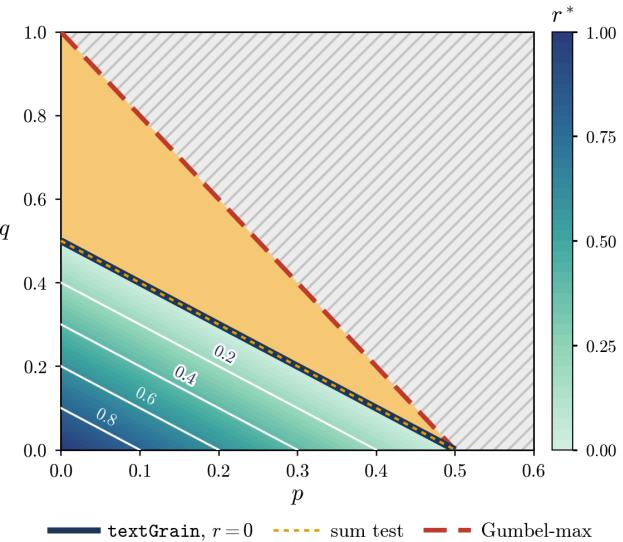
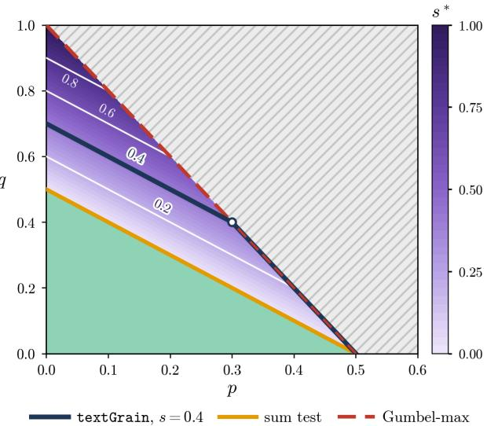

# textGrain watermarking is harder to detect: can sum-tests still do it optimally?

Swapnaneel Bhattacharyya Soham Bonnerjee

University of Pennsylvania

{swap, sohamb}@wharton.upenn.edu

## Abstract

Watermarking embeds a signal in text generated by large language models that is imperceptible to readers but statistically detectable with a secret key. The recently proposed textGrain watermark calibrates this signal against the model’s sampling entropy through an explicit entropy budget, combining the stochasticity of Red-Green watermarks with the unbiasedness of Gumbelmax watermarks. The accompanying report Li et al. (2026b) proposes a detector that sums pivotal statistics. We study when, and how eficiently, textGrain can be detected after human edits, which we model as a sparse mixture in which a fraction $\varepsilon _ { n } \asymp n ^ { - p }$ of positions retain the watermark and token uncertainty decays as n−q. First, we show that entropy calibration comes at a cost: the minimax detection boundary of textGrain is p + q = 1/2, so its detectable region is strictly smaller than that of Gumbel-max and maximal-coupling watermarks, whose boundary is $2 p + q = 1$ . This cost stems from the construction of textGrain via finitely many columns rather than from entropy calibration itself: we exhibit an unbiased scheme with the same entropy loss that remains detectable where textGrain is not. Second, and perhaps surprisingly, this loss makes the simple sum detector optimal at the boundary when the number of transport columns is fixed, unlike for Gumbel-max. When the number of columns grows and the entropy budget does not vanish, detection becomes easier, and the detectable region expands while that of the sum detector does not. Third, for a fixed edit fraction, we characterize the optimal exponential rate at which the type II error can decay, and show that the sum detector falls strictly short of it at every fixed alternative. Finally, we propose a weighted multiscale binomial scan that is valid in finite samples and requires no knowledge of the next-token distributions, the entropy budget, or the edit fraction; it attains every detection boundary above, as well as the optimal exponent.

## 1 Introduction

To preserve content authenticity and curb misuse of AI, an LLM-generated text is often watermarked, which imbues it with a signal that is statistically verifiable, thus aiding detection, but otherwise remains imperceptible. textGrain (Li et al., 2026b) represents the latest in a series of developments (Kirchenbauer et al., 2023; Aaronson, 2023; Christ et al., 2024; Kuditipudi et al., 2024; Hu et al., 2024; Wu et al., 2024; Dathathri et al., 2024; Zhao et al., 2025) to enhance the quality of such watermarked texts while allowing for statistical detection via a suitable test statistic. Introduced in compliance with the EU content provenance rules (European Parliament and Council of the European Union, 2024; European Commission, 2026), textGrain marries the stochasticity of the Red-Green watermark (Kirchenbauer et al., 2023) with the unbiasedness of the Gumbel-max watermark (Aaronson, 2023) to conjure watermarks that respect the NTP inherent to the large language model, while reducing repetitive generation. Thematically, the textGrain mechanism speaks to several recent threads in the literature. For example, the tendency of the Gumbel-max watermark to yield identical outputs for identical prompts has motivated diversity-preserving variants (Fu et al., 2024); the observation that low-entropy tokens carry little watermark signal has led to entropy-thresholded watermarking (Lee et al., 2024) and entropy-weighted detection (Lu et al., 2024). The apparent trade-of between detection ability and model distortion has been analyzed as a constrained optimization problem by Cai et al. (2026). textGrain mollifies each of these concerns by calibrating the trade-of between watermark signal and sampling entropy through an explicit entropy budget. The technical report Li et al. (2026b) builds on prior work on optimal-transport based watermarks for low entropy distributions Tsur et al. (2026), as well as debiasing Red-Green watermarking via maximal coupling (Xie et al., 2025), and discusses the detailed mechanism behind textGrain. Along the way, it also touches upon a detection strategy based on sums of pivot statistics; however, the optimality of such detection strategies under human edits is yet unaddressed. We complement Li et al. (2026b) on this front by providing a characterization of optimal detection for textGrain-generated texts. Our work builds on recent research on optimal watermark detection (Li et al., 2025a, 2026a; Cai et al., 2025; Blanchet et al., 2026), and unearths the following simple insights:

• textGrain makes watermark detection harder.

• The sum test, proposed as textGrain detector in Li et al. (2026b), is optimal if number of columns in the cost matrix is fixed.

• The sum test is not optimal if number of columns in the cost matrix grow.

Before proceeding further, it is prudent to briefly introduce the set-up and mechanism of textGrain. Let W be a finite vocabulary with $V = | \boldsymbol { \mathcal { W } } | \geq 2$ . For a probability vector $P = ( P _ { w } ) _ { w \in \mathcal { W } }$ write $\begin{array} { r } { H ( P ) = - \sum _ { w } P _ { w } } \end{array}$ log $P _ { w }$ and $\Delta ( P ) = 1 - \operatorname* { m a x } _ { w } P _ { w }$ . Fix some $B \geq 2$ . At each watermarked position, let $g : \mathcal { W } \to [ B ]$ is a partition, such that for each $w \in \mathcal { W } , g ( w )$ belongs to one of the B blocks. Further denote the block b probability as $\begin{array} { r } { P _ { b } ^ { \mathrm { b l k } } = \sum _ { w : g ( w ) = b } \dot { P } _ { w } } \end{array}$ , where we unburden the notation by suppressing the dependence on g when it is clear from the context. For some $m \geq 1$ suppose

$$
\Pi ( P ^ { \mathrm { b l k } } , m ^ { - 1 } \mathbf { 1 } ) : = \{ A \in \mathbb { R } ^ { b \times m } : A \mathbf { 1 } = ( P _ { b } ^ { \mathrm { b l k } } ) _ { b \in [ B ] } , A ^ { \top } \mathbf { 1 } = m ^ { - 1 } \mathbf { 1 } \} ,
$$

be the set of couplings over $[ B ] \times [ m ]$ with marginals $P ^ { \mathrm { b l k } }$ and $\mathrm { U n i f } ( [ m ] )$ . Here $\mathbf { 1 } = ( 1 , \ldots , 1 ) ^ { \top }$ Consider $\mathbf { Z } = ( Z _ { b j } ) _ { b \in [ B ] , j \in [ m ] } \stackrel { \mathrm { i . i . d } } { \sim } \Xi : =$ standard Gumbel variables. These are also called pseudorandom variables, since, given tokens $w _ { 1 } \ldots . w _ { t - 1 }$ and the NTP $P _ { t } .$ , both the partition $g$ and the Gumbel random variables can be deterministically constructed via a Key and a hash function A. Nevertheless, we invoke the cryptographic properties of A (Barak, 2021; Schneier, 1996; Wu et al., 2024; Zhao et al., 2025) to treat Z as random. The deterministic construction comes handy since a detector employs Key and A to make g and $( Z _ { b j } ) _ { b \in [ B ] , j \in [ m ] }$ available to it.

Write $G _ { b j } = ( Z _ { b j } - \gamma ) / ( \pi / \sqrt { 6 } )$ , where $\gamma = \mathbb { E } Z _ { 1 1 }$ is the mean of a standard Gumbel variable. For $\beta \in [ 0 , 1 ]$ , consider the entropic OT coupling

$$
\pi _ { P , \beta } \in \underset { \pi \in \Pi ( P ^ { \mathrm { b l k } } , m ^ { - 1 } \mathbf { 1 } ) } { \arg \operatorname* { m a x } } \sum _ { b = 1 } ^ { B } \sum _ { j = 1 } ^ { m } \pi ( b , j ) G _ { b j } .\tag{1}
$$

Then, given $J \sim \mathrm { U n i f } ( [ m ] )$ , textGrain samples a token $W$ according to

$$
Q ( w \mid J = j , g , G ) = m \pi _ { P , \beta } ( g ( w ) , j ) \frac { P _ { w } } { P _ { g ( w ) } ^ { \mathrm { b l k } } } , \ P _ { w } > 0 .
$$

As for detection, Li et al. (2026b) proposes the test statistic

$$
T _ { n } ^ { \mathrm { t e x t G r a i n } } : = - \sum _ { t = 1 } ^ { n } \log ( 1 - Y _ { t } ) , { \mathrm { ~ w h e r e , ~ } } Y _ { t } : = F _ { G } ( Z _ { t , g ( W _ { t } ) , J _ { t } } ) .\tag{2}
$$

This leads to the following natural questions:

• Does the entropy-calibration of textGrain make watermark detection harder compared to a Gumbel-max or the maximal coupling based debiased Red-Green watermarking schemes(Xie et al., 2025) ? In particular, the Gumbel-max lets the keyed randomness completely determine the next token, whereas textGrain preserves additional sampling randomness even after the key is fixed by allowing for $\beta > 0$ in (1). Since watermark detection looks for dependence between tokens and keyed randomness, limiting the key’s influence may weaken statistical evidence, thereby making detection harder.

• The second question is more straightforward: is $T _ { n } ^ { \tt t e x t G r a i n }$ able to detect textGrain-watermarked text whenever such a detection is possible?

• Finally, detecting a watermark eventually is not the same as detecting it eficiently. Following Li et al. (2026a), we ask how fast the type II error of a level-α detector can decay when a fixed fraction of the text remains watermarked, and whether $T _ { n } ^ { \mathrm { t } }$ extGrain attains this optimal exponential rate. Where it does not, either at the detection boundary or in eficiency, can a single detector that requires no knowledge of the NTPs, the entropy budget, or the edit fraction attain both optimality criteria?

To properly address these questions, we quickly get some notational niceties out of the way. For a fixed $P , \beta , g ,$ , let $f _ { 1 , P , \beta , g }$ denote the density of $Y$ , and define the corresponding time-indexed version ${ { f } _ { 1 , t } } = \mathbb { E } [ { { f } _ { 1 , { { P } _ { t } } , { { \beta } _ { t } } , { { g } _ { t } } } } \mid { { \mathcal { F } } _ { t - 1 } } ]$ . Following Li et al. (2026a, 2025a), we answer the aforementioned questions by formulating the watermark detection as a hypothesis testing problem:

$$
\begin{array} { r l } & { H _ { 0 } : Y _ { t } \mid \mathcal { F } _ { t - 1 } \sim \mathrm { U n i f } ( 0 , 1 ) , \quad 1 \le t \le n , } \\ & { H _ { 1 } ^ { \mathrm { t e x t G r a i n } } : Y _ { t } \mid \mathcal { F } _ { t - 1 } \mathrm { ~ h a s ~ d e n s i t y ~ } ( 1 - \varepsilon _ { n } ) + \varepsilon _ { n } f _ { 1 , t } , \ 1 \le t \le n . } \end{array}\tag{3}
$$

Human edits, paraphrasing, or mixing with human-written text replace an unknown fraction of watermarked tokens with tokens that are independent of the key. Each scored position is therefore watermarked with probability $\varepsilon _ { n }$ and otherwise carries a uniform pivot, which yields the mixture density in $H _ { 1 } ^ { \tt t e x t G r a i n }$ . Here $\varepsilon _ { n }$ measures surviving text–key dependence, and $\varepsilon _ { n } \to 0$ models heavily edited text. This is known as the sparse watermark regime (Li et al., 2025b; Xie et al., 2025; Li et al., 2026a), and is motivated strongly by the sparse detection problem (Donoho and Jin, 2004, 2015). More concretely, we consider sparse watermark signal $\varepsilon _ { n } \asymp n ^ { - p }$ and $\begin{array} { r } { \operatorname* { m i n } _ { t \in [ n ] } \Delta ( P _ { t } ) \asymp \operatorname* { m a x } _ { t \in [ n ] } \Delta ( P _ { t } ) \asymp n ^ { - q } } \end{array}$ with $\Delta ( P ) : = 1 - \operatorname* { m a x } _ { w } P _ { w }$ . In this setting, we have the following sharp characterization for the detection of textGrainwatermarking.

Informal Theorem 1.1. (i) Without suficient watermark signals, i.e. when $p + q > 1 / 2$ , no test can asymptotically separate $H _ { 0 }$ and $H _ { 1 } ^ { t e x t G r a i n }$ with non-trivial power.

(ii) When $p { + } q < 1 / 2$ , i.e. watermark signal is suficient, $H _ { 0 }$ and $H _ { 1 } ^ { t e x t G r a i n }$ separate asymptotically. Moreover, $H _ { 1 } ^ { t e x t G r a i n }$ can be detected using $T _ { n } ^ { t }$ extGrain

Theorem 1.1, stated for a fixed number of columns and an entropy fraction bounded away from zero, already answers our first two questions in this basic setting. Since both Gumbel-max (Li et al.,

  
Figure 1: Phase diagram for textGrain with a fixed number of columns m, where $\varepsilon _ { n } \asymp n ^ { - p }$ and $\Delta _ { n } \asymp n ^ { - q }$ . The navy line $p + q = 1 / 2$ is the minimax boundary of textGrain for $\beta _ { n } \asymp 1$ , that is, $r = 0$ (Corollary 2.5); it coincides with the boundary of $T _ { n } ^ { \mathrm { { r } } }$ textGrain (gold, dotted; Theorem 3.1). The red dashed line $2 p + q = 1$ is the boundary of Gumbelmax (Li et al., 2026a) and maximal coupling (Xie et al., 2025). Below the navy line, the shading from $\mathrm { l i g h t }$ green to dark blue shows $r ^ { * } = 1 - 2 p - 2 q$ the fastest decay of $\beta _ { n } ~ \asymp ~ n ^ { - r }$ that still permits detection. The thin contour lines are the textGrain boundaries $2 p + 2 q + r = 1$ for the labeled values of $r > 0 ; T _ { n } ^ { \mathrm { t } }$ textGrainn attains each of them, and each is itself detectable when $q , r > 0$ . The yellow region is detectable for Gumbel-max and maximal coupling but not for textGrain, for any $r \geq 0$ The grey hatched region is undetectable for all three schemes.

  
Figure 2: Phase diagram for textGrain with $m _ { n } \asymp$ $n ^ { s }$ columns and $\beta _ { t } \geq \beta _ { 0 }$ . In the green region below the gold line $p + q = 1 / 2$ , both $T _ { n } ^ { \tt t e x t G r a i n }$ and Algorithm 1 are consistent. Between the gold line and the red dashed line $2 p + q = 1$ , the shading from lavender to dark purple shows $s ^ { * } = 2 p + 2 q - 1$ . Consistent tests exist if and only if $s > s ^ { * }$ (Theorem $2 . 8 )$ , Algorithm 1 attains them (Theorem 4.8), and $T _ { n } ^ { \mathrm { t } }$ extGrain is powerless there (Proposition 3.4). Each contour line, continued along the red line below $q = s ,$ , is the textGrain boundary $2 p + 2 q - \operatorname* { m i n } ( s , q ) = 1$ for its labeled value of s. The navy line draws one such boundary in full, for the illustrative value $s = 0 . 4$ with the circle marking its kink at $q = s .$ . The grey hatched region is undetectable for every s. Under a weak entropy budget (Theorem 2.10), the boundary does not depend on s, Figure 1 applies, and $T _ { n } ^ { \mathrm { t } }$ extGrain remains optimal (Theorem 3.3).

2026a, Theorem 2) and maximal-coupling watermarks (Xie et al., 2025, Theorem 3.5) are detectable throughout $2 p + q < 1$ , the detectable region of textGrain is strictly smaller whenever $q > 0$ , so textGrain is indeed harder to detect. This shrinkage has a perhaps unexpected consequence: the textGrain boundary $p + q = 1 / 2$ coincides with the boundary of sum tests for those schemes (Li et al., 2026a; Xie et al., 2025), which is why the report’s $T _ { n } ^ { \mathrm { t } }$ extGrain sufices here. Our contributions below examine how far these conclusions extend beyond this setting, and address the third question.

Our Contributions. Our contributions are summarized as follows.

• textGrain makes detection harder: We establish that, with a fixed number of columns and entropy fractions $\beta _ { n } \asymp n ^ { - r }$ , the minimax detection boundary of textGrain is $2 p + 2 q + r = 1$ which reduces to $p { + } q = 1 / 2$ when the entropy fraction is bounded away from zero (Theorem 2.4 and Corollary 2.5). The detection boundary for both the Gumbel-max watermarking (Li et al., 2026a, Theorem 2) and the maximal coupling watermarking (Xie et al., 2025, Theorem 3.5) is given by $2 p + q = 1$ . Therefore, the detectable region for the minimax optimal detector of the textGrain watermark is strictly contained inside the detectable region of Gumbel-max or maximal coupling-based watermarks; hence, textGrain watermarks are strictly harder to detect. A richer phase transition beyond merely Theorem 1.1, with $\beta _ { n } \asymp n ^ { - r }$ , is presented in Figure 1 or Table 1, as well as in Theorem 2.4.

• Sum test is consistent throughout the detectable regime when the number of columns is fixed. We show that, when the number of columns is fixed, the report’s statistic TtextGrainn attains this minimax boundary for the testing problem (3), and is therefore consistent whenever detection is possible. This is mostly an artifact of textGrain making watermark detection harder: for the maximal-coupling watermark, the sum test of Xie et al. (2025) also has boundary $p + q = 1 / 2$ , which there renders it suboptimal. This optimality, however, does not extend to a growing number of columns, where $T _ { n } ^ { \tt t e x t G r a i n }$ can miss detectable alternatives. A detailed exposition can be found in §3.1.

• Sum test is suboptimal when number of columns grows. In Proposition 3.4, we show that when we allow a large entropy budget as well as growing $m _ { n } , T _ { n } ^ { \mathrm { t } }$ textGrain fails to achieve the optimal detection boundary; see Figure 2 for the corresponding phase-diagram with $m _ { n } \asymp n ^ { s }$ $\varepsilon _ { n } \asymp n ^ { - p }$ , and $\Delta _ { n } \asymp n ^ { - q }$ . Moreover, even where $T _ { n } ^ { \tt t e x t G r a i n }$ attains the detection boundary, it is never exponentially eficient. Following the eficiency criterion of Li et al. (2026a), we identify the optimal exponential rate at which the type II error of any level-α detector can decay under textGrain (Theorem 4.2). We then show that, at every fixed textGrain alternative, the type II error of $T _ { n } ^ { \tt t e x t G r a i n }$ decays at a strictly slower rate (Proposition 4.4).

• An adaptive test that is optimal in both senses. To remedy these shortcomings, we propose a weighted multiscale binomial test (Algorithm 1) that uses the same token scores as $T _ { n } ^ { \tt t e x t G r a i n }$ and requires no knowledge of the NTPs, the entropy budget, or the edit fraction. It attains every detection boundary established in this paper, including those missed by $T _ { n } ^ { \tt t e x t G r a i n }$ (Theorems 4.6 and 4.8), as well as the optimal exponential rate (Theorem 4.9).

Table 1: Detection boundaries in the $( p , q )$ plane, where $\varepsilon _ { n } \asymp n ^ { - p } , \Delta _ { n } \asymp n ^ { - q }$ and, for growing m, $m _ { n } \asymp n ^ { s }$ Both textGrain rows assume entropy fractions $\beta _ { n } \gtrsim 1 $ ; no test separates the hypotheses above the boundary, and consistent tests exist below it.
<table><tr><td>Watermark</td><td>Detection boundary</td></tr><tr><td>textGrain, fixed m</td><td> $2 p + 2 q = 1$ </td></tr><tr><td>textGrain, growing m</td><td> $2 p + 2 q - \operatorname* { m i n } ( s , q ) = 1$ </td></tr><tr><td>Gumbel-max</td><td> $2 p + q = 1$ </td></tr><tr><td>Maximal coupling†</td><td> $2 p + q = 1$ </td></tr></table>

†Xie et al. (2025) define $\Delta ( P _ { t } ) = 1 - P _ { t , G _ { t } }$ rather than $\begin{array} { r } { 1 - \operatorname* { m a x } _ { w } P _ { t , w } ; } \end{array}$ see Remark 2.6.

We end this section with an interesting observation. In contrast to our intuition, the shrinking detection boundary in Theorem 1.1 seems to be not merely an artifact of retaining randomness- in fact, maintaining entropy-calibration in an watermark scheme need not lead to harder watermark detection. In particular, in Example 1, we construct a toy unbiased and entropy-preserving watermarking scheme RG such that $H _ { 0 }$ and the corresponding alternative $H _ { 1 } ^ { \mathrm { R G } }$ separates in a regime where $H _ { 0 }$ and $H _ { 1 } ^ { \tt t e x t G r a i n }$ asymptotically merges into one another. Consider the following example.

Example 1. In this example, we construct a toy watermarking scheme RG (Randomized Gumbelmax) which itself is unbiased and entropy-calibrated, and show that there exists a regime where the hypotheses corresponding to RG asymptotically separates, whereas those corresponding to textGrain do not. Set $B = m = 2$ . For $0 < \delta < 1 / 4$ , put $P _ { \delta , w _ { 0 } } = 1 - \delta$ and $P _ { \delta , w _ { i } } = \delta / | \mathcal { W } - 1 |$ $i \geq 1$ . Consider a fixed partition $g ( w _ { 0 } ) = 1$ and $g ( w _ { i } ) = 2$ for $i \geq 1$ . Thus $P _ { \delta }$ has full token support and $P _ { \delta } ^ { \mathrm { b l k } } = \left( 1 - \delta , \delta \right)$ . Fix $c \in ( 0 , \log 2 )$ and set $\beta _ { \delta } = c \delta / H ( P _ { \delta } )$ . Define

$$
b ^ { * } ( Z , J ) = \underset { b \in [ 2 ] } { \operatorname { a r g m a x } } \{ \log P _ { \delta , b } ^ { \mathrm { b l k } } + Z _ { b J } \} .
$$

For each $u \in ( 0 , 1 )$ , let $\mathbb { P } _ { u }$ select block $b = 2$ with probability u. Let $\mathbb { H } ( u ) = H ( \mathbb { P } _ { u } )$ and, let $a _ { \delta } \in ( 0 , 1 )$ satisfy

$$
c \delta = \mathbb { H } ( \delta ) - ( 1 - \delta ) \mathbb { H } ( ( 1 - a ) \delta ) - \delta \mathbb { H } ( a + ( 1 - a ) \delta ) .
$$

Define the randomized Gumbel-max conditional token distribution by

$$
Q _ { \delta } ^ { \mathrm { R G } } ( w \mid Z , J ) = \left[ ( 1 - a _ { \delta } ) P _ { \delta , g ( w ) } ^ { \mathrm { b l k } } + a _ { \delta } { \bf 1 } \{ b ^ { * } ( Z , J ) = g ( w ) \} \right] \frac { P _ { \delta , w } } { P _ { \delta , g ( w ) } ^ { \mathrm { b l k } } } .\tag{4}
$$

It is easy to verify that for all sificiently small $\delta > 0 , ( 4 )$ defines an unbiased watermark scheme satisfying $H ( P _ { \delta } ) - \mathbb { E } _ { Z , J } H \{ Q _ { \delta } ^ { k } ( \cdot \mid Z , J ) \} = c \delta$ . Consider as $H _ { 1 } ^ { \mathrm { R G } }$ the hypothesis corresponding to $H _ { 1 } ^ { \mathrm { t } }$ textGrain in (3). Then, taking $\Delta _ { n } = n ^ { - 2 / 3 }$ and $\varepsilon _ { n } = 1$ leads to a detectable separation between $H _ { 0 }$ and $H _ { 1 } ^ { \mathrm { R G } }$

$$
\operatorname* { i n f } _ { \phi _ { n } } \bigl \{ \mathbb { E } _ { 0 } \phi _ { n } + \mathbb { E } _ { \mathrm { R G } , n } \bigl ( 1 - \phi _ { n } \bigr ) \bigr \} \to 0 ,
$$

In contrast, for textGrain watermarking, it is impossible to separate $H _ { 0 }$ and $H _ { 1 } ^ { \tt t e x t G r a i n }$ asymptotically under the same setting.

$$
\operatorname* { i n f } _ { \phi _ { n } } \{ \mathbb { E } _ { 0 } \phi _ { n } + \mathbb { E } _ { \mathrm { t e x t G r a i n } , n } ( 1 - \phi _ { n } ) \} \to 1 .
$$

See Proposition B.1 for a detailed statement and the proof. This example shows that the stricter detectable regime is not an immediate consequence of fusing entropy-calibration into unbiased watermarking; the detection boundary arises purely out of construction of textGrain.

## 1.1 Notations

In this paper, we denote the set $\{ 1 , \ldots , n \}$ by $[ n ]$ , and the d-dimensional Euclidean space by $\mathbb { R } ^ { d }$ We write $\mathbb { P } _ { 0 }$ and $\mathbb { E } _ { 0 }$ for probability and expectation under the null hypothesis, and $\mathbb { P } _ { 1 }$ and $\mathbb { E } _ { 1 }$ for probability and expectation under the alternative; the latter are often augmented with subscripts, as in (3), to indicate their dependence on the relevant quantities. For a distribution P with density (or probability mass function) p, we denote its entropy by $H ( P ) = - \mathbb { E } _ { X \sim P } \{ \log p ( X ) \}$ . Specifically, for $x \in [ 0 , 1 ]$ , let

$$
\mathbb H ( x ) = - ( 1 - x ) \log ( 1 - x ) - x \log x\tag{5}
$$

denote the entropy of the two-point probability vector $( 1 - x , x )$ , with the convention 0 log $0 = 0$ For non-negative sequences $( a _ { n } ) _ { n \geq 1 }$ and $( b _ { n } ) _ { n \geq 1 } .$ , we write $a _ { n } \lesssim b _ { n }$ if $a _ { n } \leq C b _ { n }$ for all $n \geq 1$ and some constant $C > 0$ , and $a _ { n } \asymp b _ { n }$ if $C _ { 1 } b _ { n } \leq a _ { n } \leq C _ { 2 } b _ { n }$ for all $n \geq 1$ and some constants $C _ { 1 } , C _ { 2 } > 0$ We also write $a _ { n } = O ( b _ { n } )$ to mean $a _ { n } \lesssim b _ { n }$ , and $a _ { n } = o ( b _ { n } )$ if $a _ { n } / b _ { n } \to 0$ . For densities $f , g$ on $( 0 , 1 )$ let $\chi ^ { 2 } ( f \mid \mid g )$ and $\operatorname { D } _ { \mathrm { K L } } ( f \mid \mid g )$ denote the chi-squared and Kullback–Leibler divergences, respectively, defined as

$$
\chi ^ { 2 } ( f \mid | g ) = \int _ { 0 } ^ { 1 } { \frac { \{ f ( y ) - g ( y ) \} ^ { 2 } } { g ( y ) } } \mathrm { d } y , \qquad \operatorname { D } _ { \mathrm { K L } } ( f \mid | g ) = \int _ { 0 } ^ { 1 } f ( y ) \log { \frac { f ( y ) } { g ( y ) } } \mathrm { d } y ,
$$

with the convention $0 / 0 = 0$ , and with both divergences set equal to +∞ if $f > 0 = g$ on a set of positive Lebesgue measure. The maximum of an empty set $\mathrm { i s \mathrm { ~ - \infty } }$

## 2 Detection boundary for textGrain

This section devotes itself to a thorough treatment of the optimal detection boundary for any potential textGrain-detector. In particular, §2.1 introduces the key assumptions that enables a systematic treatment of the alternative hypothesis $H _ { 1 } ^ { \tt t e x t G r a i n }$ , following which, we address the questions of detection boundary, and the optimality of the sum-test $T _ { n } ^ { \tt t e x t G r a i n }$ , in the subsequent sections.

## 2.1 Preliminaries: assumptions on textGrainand watermark detection

At any position, the textGrain watermark has five key components: NTP $P ,$ the partitions $g _ { \colon }$ the pseudo-random variables $Z _ { b j }$ , the random draw $J \sim \mathrm { U n i f } ( [ m ] )$ , and the entropy regularizer $\beta$ (Li et al., 2026b). Assumption 1 rules out pathological schemes by explicitly specifying the inter-dependence of all these components. Precisely, if $\mathcal { F } _ { t }$ is the filtration containing the generation and key history through position t, then we presume the following.

Assumption 1. At position t, $P _ { t }$ and $\beta _ { t } \in [ 0 , 1 ]$ are $\mathcal { F } _ { t - 1 } { \mathrm { - m e a s u r a b l e } }$ . The partition $g _ { t } .$ , column $J _ { t }$ and pseudo-random variables Z are drawn independently at every step t.

Assumption 1 retains the conditional mixture structure of Li et al. (2026a, Assumption 1). In particular, under the null of no watermarking, the random draws used for the partition $g _ { \colon }$ pseudo-randomness $\mathbf { Z } ,$ , and selected column $J ,$ , are independent at a fixed context. This, in turn, makes the NTP $P _ { t }$ and the pivot statistics $Y _ { t } : = Z _ { t , g ( W _ { t } ) , J _ { t } } \sim \Xi$ independent. In contrast, under watermarking, they are obviously not independent; the parameter $\beta$ dictates the strength of textGrain watermarking, i.e. how far the joint distribution $( P _ { t } , Y _ { t } )$ can venture out to from $P _ { t } \otimes \Xi$

Note that in textGrain’s oficial implementation Li et al. (2026b), only the first occurrence of each context window is scored. A fixed Key and a fixed finite window allow only finitely many distinct contexts, which doesn’t facilitate asymptotic analysis. There are a few ways to circumvent this: for example, Cai et al. (2025); Blanchet et al. (2026) considers a growing vocabulary size; on the other hand, one may also consider a growing context space or a fresh $\mathsf { K e y }$ to ensure randomness. As a convention, we presume the latter: each scored position uses a fresh keyed randomness conditional on the past. Accordingly, all asymptotics are taken as $n \to \infty$ , where n is a deterministic number of fresh scored positions.

We also need to take care of the stochasticity arising out of the partition g. Assumption 2 specifies when token uncertainty remains visible after partitioning.

Assumption 2. There is a constant $\vartheta > 0$ such that, at every position and for every pair of distinct tokens $w , v \in \mathcal { W } , \mathbb { P } \{ g _ { t } ( w ) \neq g _ { t } ( v ) \ | \ \mathcal { F } _ { t - 1 } \} \ge \vartheta$ almost surely.

In particular, independent uniform assignments to B blocks satisfy Assumption 2 with $\vartheta = 1 - 1 / B$ Nevertheless, we emphasize that Assumption 2 allows for more general choices of partitions. Before moving on to the detection boundary, we round of this discussion by specifying what we mean as a watermark detector.

How would a generic textGrain detector work? A textGrain detector would primarily consist of a score test $\phi _ { n } : [ 0 , 1 ] ^ { n } \to [ 0 , 1 ]$ , which may employ the scored tokens $\{ w _ { t } \} _ { t \in [ n ] }$ , partitions $\{ g _ { t } \}$ , the corresponding variables $Y _ { t } .$ , and selected columns $J _ { t }$ . In general, the pivot distributions $( P _ { t } )$ is not available to the detector. For the analysis of an arbitrary detector (we also use the phrase "score test" interchangeably), we characterize the general class of alternatives for the test (3).

Definition 2.1 (Token alternative class and minimax total error). Let $\mathcal { H } _ { 1 , n } ( \Delta _ { n } , \beta _ { n } )$ be the nonempty class of alternative laws satisfying Assumptions 1 and 2. In particular, the distributions $P$ in $\mathcal { H } _ { 1 , n } ( \Delta _ { n } , \beta _ { n } )$ satisfies

$$
\Delta _ { n } \leq \Delta ( P _ { t } ) \leq 2 \Delta _ { n } , \ \beta _ { n } \leq \beta _ { t } \leq 2 \beta _ { n } .
$$

Define the corresponding minimax risk on this class over the score tests as,

$$
R _ { n } ^ { Y } = \operatorname* { i n f } _ { \phi _ { n } : [ 0 , 1 ] ^ { n } \to [ 0 , 1 ] } \left\{ \mathbb { E } _ { 0 } \phi _ { n } + \operatorname* { s u p } _ { \mathbb { P } _ { 1 } \in \mathcal { H } _ { 1 , n } ( \Delta _ { n } , \beta _ { n } ) } \mathbb { E } _ { 1 } ( 1 - \phi _ { n } ) \right\} .\tag{6}
$$

In the following section, we proceed towards identifying the optimal detection boundary for textGrain via a minimax analysis of $R _ { n } ^ { Y }$

## 2.2 Theoretical guarantees: detectability

Before embarking on an analysis of the detector, we formalize the intuition that textGrain works by providing a signal analysis. To that end, recall $f _ { 1 , P , \beta , g } ;$ let $\mathbb { P } _ { 1 , P , \beta , g }$ denote the corresponding alternative law, so that $Y = F _ { G } ( Z _ { g ( W ) , J } ) \sim \mathbb { P } _ { 1 , P , \beta , g }$ . Note that

$$
f _ { 1 , P , \beta , g } ( y ) = \sum _ { b = 1 } ^ { B } \sum _ { j = 1 } ^ { m } \mathbb { E } [ \pi _ { P , \beta } ( b , j ) \mid Z _ { b j } = - \log ( - \log y ) ] , \ 0 < y < 1 .\tag{7}
$$

Theorem 2.2 characterizes the signal strength for any natural score function h, applied on the pivot statistics $Y _ { t }$ from (2).

Theorem 2.2 (Token-level signal strength). Grant Assumption 1. Let $m \geq 2$ , and let g satisfy Assumption 2. Set $f _ { 1 , P , \beta } = \mathbb { E } _ { g } f _ { 1 , P , \beta , g } ,$ and $l e t \mathbb { E } _ { 1 , P , \beta }$ denote expectations under $Y \sim f _ { 1 , P , \beta }$ . Then $\chi ^ { 2 } ( f _ { 1 , P , \beta } \mid$ | Unif $[ 0 , 1 ] ) \asymp _ { m , \vartheta } \Delta ( P )$ min $\{ \Delta ( P ) , \beta H ( P ) \}$ . In particular, for every fixed nondecreasing $h \in L ^ { 2 } ( 0 , 1 )$ with $\operatorname { V a r } _ { 0 } \{ h ( Y ) \} > 0$ 2

$$
\begin{array} { r } { \mathbb { E } _ { 1 , P , \beta } h ( Y ) - \mathbb { E } _ { 0 } h ( Y ) \asymp _ { m , \vartheta , h } \sqrt { \Delta ( P ) \operatorname* { m i n } \{ \Delta ( P ) , \beta H ( P ) \} } . } \end{array}
$$

Consequently, this holds almost surely conditional on $\mathcal { F } _ { t - 1 }$

Note that Li et al. (2026b) suggests $h ( y ) = - \log ( 1 - y )$ ; the same conclusion holds for this choice as well.

Remark 2.3. Theorem 2.2 hints at an interesting interplay between hardness of a detection problem, and the entropy calibrated by textGrain. Moreover, observing that

$$
H ( P ) \geq - ( 1 - \Delta ( P ) ) \log ( 1 - \Delta ( P ) ) - \Delta ( P ) \log \Delta ( P ) \geq \Delta ( P ) \log ( 1 / \Delta ( P ) ) ,
$$

it follows that if $\beta \asymp 1 , H ( P ) / \Delta ( P ) \geq \beta \log ( 1 / \Delta ( P ) ) \to \infty \ \mathrm { a s } \ \Delta ( P ) \downarrow 0$ . Thus, from Theorem 2.2,

$$
\mathbb { E } _ { 1 , P , \beta } h ( Y ) - \mathbb { E } _ { 0 } h ( Y ) \asymp _ { m , \vartheta , h } \Delta ( P )
$$

for all suficiently small $\Delta ( P )$ . For comparison, consider the Gumbel-max watermark and write $\mathbb { E } _ { 1 , P } ^ { \mathrm { G M } }$ for expectation under its watermarked pivot distribution. For the same score $h ( y ) = - \log ( 1 - y )$ , Li et al. (2026a, Proposition A.1 in the supplementary material) show that $\mathbb { E } _ { 1 , P } ^ { \mathrm { G M } } h ( Y ) - \mathbb { E } _ { 0 } h ( Y ) \asymp \bar { H } ( P )$ Combining these bounds with Theorem 2.2 gives

$$
\frac { \mathbb { E } _ { 1 , P , \beta } h ( Y ) - \mathbb { E } _ { 0 } h ( Y ) } { \mathbb { E } _ { 1 , P } ^ { \mathrm { G M } } h ( Y ) - \mathbb { E } _ { 0 } h ( Y ) } \asymp _ { m , \vartheta } \frac { \Delta ( P ) } { H ( P ) } \longrightarrow 0 , \mathrm { ~ a s ~ } \Delta ( P ) \to 0 .
$$

For a fixed vocabulary, $H ( P ) \asymp \Delta ( P ) \log ( 1 / \Delta ( P ) )$ . Hence, relative to Gumbel-max, textGrain loses a logarithmic factor in the signal strength of the corresponding detectors.

Under $H _ { 1 } ^ { \tt t e x t G r a i n }$ in (3), the score at position t has conditional density $1 - \varepsilon _ { n } + \varepsilon _ { n } f _ { 1 , t }$ given $\mathcal { F } _ { t - 1 }$ whose $\chi ^ { 2 } \mathrm { - d i v e r g e n c e }$ from Unif(0, 1) equals $\varepsilon _ { n } ^ { 2 } \chi ^ { 2 } ( f _ { 1 , t } \parallel \mathrm { U n i f } [ 0 , 1 ] )$ . By Theorem 2.2, each position therefore contributes information of order $\varepsilon _ { n } ^ { 2 } \Delta ( P _ { t } ) \operatorname* { m i n } \{ \Delta ( P _ { t } ) , \beta _ { t } H ( P _ { t } ) \}$ , and summing over the n positions suggests that in light of $H ( P _ { t } ) \asymp \mathbb { H } ( \Delta _ { n } )$ , detection is governed by

$$
I _ { n } : = n \varepsilon _ { n } ^ { 2 } \Delta _ { n } \operatorname* { m i n } \{ \Delta _ { n } , \beta _ { n } \mathbb { H } ( \Delta _ { n } ) \} .
$$

Theorem 2.4 formalizes the above intuition.

Theorem 2.4 (Detection boundary). Recall $R _ { n } ^ { Y }$ from Definition 2.1. Let $m \geq 2$ be fixed, and suppose Assumptions 1 and 2 hold.

$I f \operatorname* { s u p } _ { n } n \varepsilon _ { n } ^ { 2 } \Delta _ { n }$ min $\{ \Delta _ { n } , \beta _ { n } \mathbb { H } ( \Delta _ { n } ) \} < \infty ,$ , then lim $\mathrm { i n f } _ { n  \infty } R _ { n } ^ { Y } > 0$

$I f n \varepsilon _ { n } ^ { 2 } \Delta _ { n }$ min $\{ \Delta _ { n } , \beta _ { n } \mathbb { H } ( \Delta _ { n } ) \}  0$ , then sup $\mathfrak { d } _ { 1 } \in \mathcal { H } _ { 1 , n } ( \Delta _ { n } , \beta _ { n } ) \mathrm { T V } ( \mathbb { P } _ { 0 } , \mathbb { P } _ { 1 } ^ { Y } )  0$ and $R _ { n } ^ { Y }  1$

• Finally $R _ { n } ^ { Y } \to 0$ if and only if $n \varepsilon _ { n } ^ { 2 } \Delta _ { n }$ min $\{ \Delta _ { n } , \beta _ { n } \mathbb { H } ( \Delta _ { n } ) \}  \infty$

The polynomial specialization gives an explicit boundary in the sparsity, token uncertainty, and entropy-fraction exponents.

Corollary 2.5 (Phase diagram). Grant the conditions and notations of Theorem ${ 2 . 4 } .$ . Suppose $\varepsilon _ { n } \asymp n ^ { - p } , ~ \Delta _ { n } \asymp n ^ { - q }$ , and $\beta _ { n } \asymp n ^ { - r }$ for fixed $p , q , r \geq 0$

$I f 2 p + 2 q + r < 1$ , or $i f 2 p + 2 q + r = 1$ with $q , r > 0$ , then $R _ { n } ^ { Y } \to 0$

$I f 2 p + 2 q + r > 1$ , then $\begin{array} { r } { \operatorname* { s u p } _ { \mathbb { P } _ { 1 } \in \mathcal { H } _ { 1 , n } ( \Delta _ { n } , \beta _ { n } ) } \operatorname { T V } ( \mathbb { P } _ { 0 } , \mathbb { P } _ { 1 } ^ { Y } ) \to 0 } \end{array}$ and $R _ { n } ^ { Y }  1$

$I f 2 p + 2 q + r = 1$ and min $( q , r ) = 0$ , then lim $\mathrm { i n f } _ { n  \infty } R _ { n } ^ { Y } > 0$ . In particular, $i f \beta _ { n } \asymp 1$ , then the detection boundary is given by $p + q = 1 / 2 \quad$ , and ${ R _ { n } ^ { Y } } \nrightarrow 0$ on it.

Remark 2.6 (Comparison of the finite-column boundaries). If $\beta _ { n } \asymp 1$ , Corollary 2.5 gives the textGrain boundary $p + q = 1 / 2$ . In contrast, the Gumbel-max boundary in Li et al. (2026a, Theorems $2 \mathrm { - 3 ) }$ and the weak-signal maximal-coupling boundary in Xie et al. (2025, Theorems 3.5 and 3.7) are $2 p + q = 1$ . For comparison, we must note that for Xie et al. (2025), $\Delta ( P _ { t } )$ is defined as $1 - P _ { t , G _ { t } }$ instead of $1 - \operatorname* { m a x } _ { w } P _ { t , w }$ for Gumbel-max or textGrain. Finally, the dependence on a vanishing $\beta _ { n }$ in Corollary 2.5 also reflects textGrainś fractional conditional-entropy constraint, which is absent from those two weak-signal parametrizations.

As mentioned before, the optimal detection boundary for textGrain thus coincides numerically with the sum-test boundary in Li et al. (2026a) or Xie et al. (2025). We will formally establish the analogous result for $T _ { n } ^ { \tt t e x t G r a i n }$ in $\ S 3$ . Moving forward, we investigate the detection boundaries when the number of columns m, is allowed to diverge.

## 2.3 Detection boundary with growing columns

This section devotes itself to optimal boundary detection when the number of columns, m, is allowed to diverge with n. Analogous to Definition 2.1, we consider the following class of alternatives.

Definition 2.7. Let $\mathcal { H } _ { 1 , n } ^ { \mathrm { h i g h } }$ be the nonempty class of alternatives, such that at every position t

$$
\Delta _ { n } \leq \Delta ( P _ { t } ) \leq \operatorname* { m i n } ( 2 \Delta _ { n } , 1 / 4 ) , \mathrm { a n d } \beta _ { t } \geq \beta _ { 0 }
$$

. The corresponding minimax risk is given by

$$
R _ { n } ^ { \mathrm { h i g h } } : = \operatorname* { i n f } _ { \phi } \Big \{ \mathbb { E } _ { 0 } \phi + \operatorname* { s u p } _ { \mathbb { P } _ { 1 } \in \mathcal { H } _ { 1 , n } ^ { \mathrm { h i g h } } } \mathbb { E } _ { 1 } ( 1 - \phi ) \Big \} ,
$$

When the absolute entropy budget is large compared with the rare-block mass, the next theorem preserves the nonbinding detection exponent. It does not assert a constant-factor equivalence of the information in the two budget regimes.

Theorem 2.8 (strong entropy budget). Suppose Assumptions 1 and ${ \mathrm { ~ \mathcal { 2 } ~ } } h o l d ,$ , and assume that $\Delta _ { n } \asymp n ^ { - q }$ and $m _ { n } \asymp n ^ { s }$ with $q , s > 0$ . Let $f _ { 1 , P _ { t } , \beta _ { t } } : = \mathbb { E } [ f _ { 1 , P _ { t } , \beta _ { t } , g _ { t } } \mid \mathcal { F } _ { t - 1 } ]$

(a) Uniformly over $\mathbb { P } _ { 1 } ~ \in ~ \mathcal { H } _ { 1 , n } ^ { \mathrm { h i g h } }$ and $1 \ \leq \ t \ \leq \ n$ , it follows that $\chi ^ { 2 } ( f _ { 1 , P _ { t } , \beta _ { t } } \ | | \ \mathrm { U n i f } [ 0 , 1 ] ) \ =$ $n ^ { - 2 q + \operatorname* { m i n } ( s , q ) + o ( 1 ) }$

(b) Suppose $\varepsilon _ { n } \asymp n ^ { - p }$ with $p \geq 0$ , and consider the minimax risk $R _ { n } ^ { \mathrm { h i g h } }$ from Definition 2.7.

• If 2p + 2q − min $( s , q ) < 1 , R _ { n } ^ { \mathrm { h i g h } }  0 .$

$I f 2 p + 2 q - \operatorname* { m i n } ( s , q ) = 1$ , then lim in $\dot { \bar { \mathbf { \rho } } } _ { n  \infty } R _ { n } ^ { \mathrm { h i g h } } > 0$

• Finally, $i f 2 p + 2 q - \operatorname* { m i n } ( s , q ) > 1$ , then every score test $\psi _ { n } : [ 0 , 1 ] ^ { n }  [ 0 , 1 ]$ satisfies

$$
\operatorname* { s u p } _ { \mathbb { P } _ { 1 } \in \mathcal { H } _ { 1 , n } ^ { \mathrm { h i g h } } } \bigl | \mathbb { E } _ { 0 } \psi _ { n } + \mathbb { E } _ { 1 } \bigl ( 1 - \psi _ { n } \bigr ) - 1 \bigr | \to 0 .
$$

Theorem 2.8 highlights a computation-accuracy trade-of. With a strong entropy budget, the per-position information grows like $\Delta \operatorname* { m i n } \{ m \Delta , 1 \}$ , so additional columns improve detectability only until $m \asymp 1 / \Delta$ . On the other hand, generating a textGrain token requires sampling a $B \times m$ Gumbel table and solving (1) over it, at a cost of at least $O ( B m )$

Remark 2.9 (The role of the entropy budget). The entropy fraction $\beta$ interpolates between unwatermarked and fully key-dependent generation. When $\beta \ : = \ : 0$ , the constraint in (1) forces $\pi _ { P , 0 } = P ^ { \mathrm { b l k } } \otimes m ^ { - 1 } \mathbf { 1 }$ , so that the token is drawn from $P$ independently of the key, i.e. under the null. As the budget $\beta$ increases, the key exerts more influence on the token and the detectable region expands. This gain, however, saturates. Once the absolute budget dominates the rare-block mass, Theorem 2.8 shows that the boundary $2 p + 2 q - \operatorname* { m i n } ( s , q ) = 1$ no longer depends on the budget and coincides with that of the maximal fraction $\beta = 1$ . Beyond this point, detectability is limited by the token uncertainty and the number of columns rather than by $\beta .$ In terms of our first question, the entropy budget therefore trades preserved sampling randomness for detectability only up to the scale of the rare-block mass.

The next theorem treats entropy budgets that are small relative to block uncertainty. Fix $B \geq 2$ and let $\Delta _ { n } , \kappa _ { n } > 0$ . Let $\mathcal { H } _ { 1 , n } ^ { \mathrm { l o w } }$ be the nonempty class of alternative laws satisfying Assumptions 1 and 2, such that, at every position $t ,$ almost surely,

$$
\begin{array} { r } { \Delta _ { n } \leq \Delta ( P _ { t } ^ { \mathrm { b l k } } ) \leq \operatorname* { m i n } ( 2 \Delta _ { n } , 1 / 4 ) , \kappa _ { n } \leq \beta _ { t } H ( P _ { t } ) \leq 2 \kappa _ { n } . } \end{array}
$$

The corresponding minimax risk is defined by

$$
R _ { n } ^ { \mathrm { l o w } } : = \operatorname* { i n f } _ { \phi } \Big \{ \mathbb { E } _ { 0 } \phi + \operatorname* { s u p } _ { \mathbb { P } _ { 1 } \in \mathcal { H } _ { 1 , n } ^ { \mathrm { l o w } } } \mathbb { E } _ { 1 } ( 1 - \phi ) \Big \} .
$$

Theorem 2.10 (Growing columns with a weak entropy budget). Consider the class $\mathcal { H } _ { 1 , n } ^ { \mathrm { l o w } }$ defined above, and suppose $\kappa _ { n } / \Delta _ { n }  0$ and $e ^ { - m _ { n } / 6 4 } = o ( \kappa _ { n } )$

(a) It follows that $\chi ^ { 2 } ( f _ { 1 , P _ { t } , \beta _ { t } , g _ { t } } \mid \mid \mathrm { U n i f } [ 0 , 1 ] ) \asymp _ { B } \Delta _ { n } \kappa _ { n }$

(b) For every fixed nondecreasing $h \in L ^ { 2 } ( 0 , 1 )$ with $\operatorname { V a r } _ { 0 } \{ h ( Y ) \} > 0$

$$
\int _ { 0 } ^ { 1 } h ( y ) \{ f _ { 1 , P _ { t } , \beta _ { t } , g _ { t } } ( y ) - 1 \} \mathrm { d } y \asymp _ { B , h } \sqrt { \Delta _ { n } \kappa _ { n } } .
$$

(c) $R _ { n } ^ { \mathrm { l o w } }  0 ~ i f$ and only if $n \varepsilon _ { n } ^ { 2 } \Delta _ { n } \kappa _ { n }  \infty$ . Moreover, if $n \varepsilon _ { n } ^ { 2 } \Delta _ { n } \kappa _ { n }  0$ , then every measurable score test $0 \leq \psi _ { n } \leq 1$ satisfies

$$
\operatorname* { s u p } _ { \mathbb { P } _ { 1 } \in \mathcal { H } _ { 1 , n } ^ { \mathrm { l o w } } }  \mathbb { E } _ { 0 } \psi _ { n } + \mathbb { E } _ { 1 } ( 1 - \psi _ { n } ) - 1   0 .
$$

Remark 2.11 (What the entropy-budget results determine). Theorem 2.8 treats fixed positive entropy fractions and gives the strict growing-column boundary $2 p + 2 q - \operatorname* { m i n } ( s , q ) = 1$ . In contrast, under the block-uncertainty conditions of Theorem 2.10, a weak entropy budget gives information of order $\Delta _ { n } \kappa _ { n }$ and a mean shift of order $\sqrt { \Delta _ { n } \kappa _ { n } }$ for every fixed nonconstant nondecreasing square-integrable score. Interestingly, this does not depend on the column growth rate, subject to $e ^ { - m _ { n } / 6 4 } = o ( \kappa _ { n } )$

## 3 Optimality of test based on sum statistic $T _ { n } ^ { \mathbf { t } }$ extGrain

Having characterized when detection of textGrain is possible at all, we now turn to the second question raised in Section 1: does the sum statistic $T _ { n } ^ { \tt t e x t G r a i n }$ proposed by Li et al. (2026b) detect the watermark whenever the information-theoretic limits of Section 2 permit? We answer this question in two stages, first for a fixed number of columns $m ,$ , where the answer is afirmative, and then for a growing number of columns, where the $T _ { n } ^ { \tt t e x t G r a i n }$ can miss alternatives that nevertheless remain detectable.

## 3.1 Fixed-column sum statistics

We begin with the fixed-column regime of Section 2.2, which corresponds to the default configuration of textGrain. In this regime, Theorem 2.2 already suggests that $T _ { n } ^ { \tt t e x t G r a i n }$ is consistent. To elaborate, every fixed nondecreasing score shifts its mean by an amount of order $\sqrt { \Delta ( P ) \operatorname* { m i n } \{ \Delta ( P ) , \beta H ( P ) \} }$ , which we refer to as information, since this is precisely the square root of the per-token information driving the lower bound in Theorem 2.4. Summing n such scores, of which a fraction $\varepsilon _ { n }$ carry the signal, should therefore separate the two hypotheses as soon as $n \varepsilon _ { n } ^ { 2 } \Delta _ { n }$ min $\{ \Delta _ { n } , \beta _ { n } \mathbb { H } ( \Delta _ { n } ) \}$ } diverges. The following theorem makes this heuristic rigorous in two forms: first for a generic monotone score with a Chebyshev-type threshold, and then for the report’s statistic $T _ { n } ^ { \tt t e x t G r a i n }$ calibrated by its exact Gamma(n, 1) null distribution.

Theorem 3.1. (a) Let $h \in L ^ { 2 } ( 0 , 1 )$ be fixed and nondecreasing, with $0 < \sigma _ { h } ^ { 2 } = \operatorname { V a r } _ { 0 } \{ h ( Y ) \} < \infty$ and $\mathcal { H } _ { 1 , n } ( \Delta _ { n } , \beta _ { n } )$ be the class in Definition 2.1. Following (5), $i f a _ { n } = o \Big ( \sqrt { n \varepsilon _ { n } ^ { 2 } \Delta _ { n } \operatorname* { m i n } \{ \Delta _ { n } , \beta _ { n } \mathbb { H } ( \Delta _ { n } ) \} } \Big )$ and $a _ { n } \to \infty$ , then under Assumptions 1, and, ${ \mathcal { Q } } ,$ the test

$$
\phi _ { n , h } = 1 \bigg \{ \sum _ { t = 1 } ^ { n } h ( Y _ { t } ) > n \int _ { 0 } ^ { 1 } h ( y ) \mathrm { d } y + \sigma _ { h } \sqrt { n } a _ { n } \bigg \}
$$

has total error satisfying

$$
\mathbb { P } _ { 0 } ( \phi _ { n , h } = 1 ) + \operatorname* { s u p } _ { \mathbb { P } _ { 1 } \in \mathcal { H } _ { 1 , n } ( \Delta _ { n } , \beta _ { n } ) } \mathbb { P } _ { 1 } ( \phi _ { n , h } = 0 ) = O _ { m , \vartheta , V , h } \Big ( a _ { n } ^ { - 2 } + \frac { 1 } { n \varepsilon _ { n } ^ { 2 } \Delta _ { n } \operatorname* { m i n } \big \{ \Delta _ { n } , \beta _ { n } \mathbb { H } ( \Delta _ { n } ) \big \} } \Big ) \to 0 .
$$

(b) For $T _ { n } ^ { t }$ extGrain in (2), let $c _ { n , \alpha }$ denote the $( 1 - \alpha )$ -quantile of the ${ \mathrm { G a m m a } } ( n , 1 )$ law. Fix $\alpha _ { 0 } \in ( 0 , 1 )$ and let $\alpha _ { n } = \alpha _ { 0 } / \log ( n + e )$ $I f n \varepsilon _ { n } ^ { 2 } \Delta _ { n }$ min $\{ \Delta _ { n } , \beta _ { n } \mathbb { H } ( \Delta _ { n } ) \} / \log \log ( n + e ) \to \infty .$ then

$$
\mathbb P _ { 0 } ( T _ { n } ^ { t e x t G r a i n } > c _ { n , \alpha _ { n } } ) + \operatorname* { s u p } _ { \mathbb P _ { 1 } \in \mathcal H _ { 1 , n } ( \Delta _ { n } , \beta _ { n } ) } \mathbb P _ { 1 } ( T _ { n } ^ { t e x t G r a i n } \le c _ { n , \alpha _ { n } } ) \to 0 .
$$

Remark 3.2 (Fisher’s statistic and the meaning of sum-test optimality). Since $p _ { t } = 1 - Y _ { t }$ , the Li et al. $( \mathrm { 2 0 2 6 b ) \mathrm { \Omega s } }$ detector $\begin{array} { r } { { 2 } T _ { n } ^ { \mathrm { t e x t G r a i n } } = - 2 \sum _ { t } \log p _ { t } } \end{array}$ is Fisher’s combination statistic. Fisher’s method is known to fail in very sparse Gaussian mixtures (Donoho and Jin, 2004, Theorem 1.5), where the signal sits in an extreme tail that a sum dilutes. Interestingly, Theorem 3.1 shows that this failure does not occur for textGrain with a fixed number of columns, since, Theorem 2.2 instructs that the mean shift of every monotone score is already of the order of the square root of the information. When the number of columns grows, the signal can concentrate in a small upper tail, and Proposition 3.4 shows that the $T _ { n } ^ { \tt t e x t G r a i n }$ then loses detectable alternatives.

We pause to ponder over the implications of Theorem 3.1.

• (a) shows that a sum test built from any fixed monotone score is consistent under exactly the condition $n \varepsilon _ { n } ^ { 2 } \Delta _ { n } \operatorname* { m i n } \{ \Delta _ { n } , \beta _ { n } \mathbb { H } ( \Delta _ { n } ) \} \to \infty$ , which Theorem 2.4 identifies as necessary for every score test.

• (b) shows that the report’s $T _ { n } ^ { \tt t e x t G r a i n }$ , with its exact Gamma calibration and a slowly vanishing level, inherits this guarantee at the cost of only an additional log log n factor, and therefore attains every consistency region of Corollary 2.5.

To summarize, Theorem 3.1 thus answers our second question in the afirmative whenever the number of columns is fixed. This stands in sharp contrast with Gumbel-max, for which sum tests are strictly suboptimal (Li et al., 2026a, Theorem 4). The contrast is a direct consequence of our first finding: by making detection harder, textGrain shrinks its minimax boundary from $2 p + q = 1$ down to the sum-test boundary $p + q = 1 / 2$ , leaving no room for a more sophisticated detector to improve on the statistic $T _ { n } ^ { \tt t e x t G r a i n }$ from Li et al. (2026b).

## 3.2 A detection-boundary loss for $T _ { n } ^ { \mathbf { t } }$ extGrain

We next ask whether the optimality of the $T _ { n } ^ { \tt t e x t G r a i n }$ survives once the number of columns grows. A weak entropy budget, with $\kappa _ { n } / \Delta _ { n }  0$ , is the natural first case. Recall that the weak entropy result in $\ S 2 .$ , Theorem 2.10(b), shows that the mean shift of every monotone score retains the order of the square root of the information. The budget therefore keeps the signal from concentrating in a small tail, and $T _ { n } ^ { \tt t e x t G r a i n }$ attains the weak-budget boundary under the column-growth condition of Theorem 2.10. We formalize this in Theorem 3.3.

Theorem 3.3. Consider the setup of Theorem 2.10. Fix $\alpha _ { 0 } \in ( 0 , 1 )$ and put $\alpha _ { n } = \alpha _ { 0 } / \log ( n + e )$ Let $c _ { n , \alpha _ { n } }$ be the $1 - \alpha _ { n }$ quantile of Gamma $( n , 1 )$ . $I f n \varepsilon _ { n } ^ { 2 } \Delta _ { n } \kappa _ { n } / \log \log ( n + e ) \to \infty$ , then

$$
\begin{array} { r } { \mathbb { P } _ { 0 } \big ( T _ { n } ^ { t e x t G r a i n } > c _ { n , \alpha _ { n } } \big ) + \operatorname* { s u p } _ { \mathbb { P } _ { 1 } \in \mathcal { H } _ { 1 , n } ^ { \mathrm { l o w } } } \mathbb { P } _ { 1 } \big ( T _ { n } ^ { t e x t G r a i n } \leq c _ { n , \alpha _ { n } } \big ) \to 0 . } \end{array}
$$

In the above result, the condition $n \varepsilon _ { n } ^ { 2 } \Delta _ { n } \kappa _ { n } / \log \log ( n + e ) \to \infty$ matches the minimax characterization of Theorem $2 . 1 0 ( \mathrm { c } )$ up to a log log n factor, and it does not depend on how fast $m _ { n }$ grows. Thus, with respect to our second question, a growing number of columns does not by itself make the $T _ { n } ^ { \tt t e x t G r a i n }$ suboptimal. As we show next, the loss arises only when the entropy budget is large enough to let the signal concentrate in a small upper tail.

When the entropy budget is large compared with the rare-block mass, Theorem 2.8 shows that a growing number of columns enlarges the detectable region to $2 p + 2 q - \operatorname* { m i n } ( s , q ) < 1$ . The next proposition shows that the $T _ { n } ^ { \tt t e x t G r a i n }$ cannot exploit this gain: its sensitivity is governed by $\varepsilon _ { n } \Delta _ { n } \log ( e / \Delta _ { n } )$ regardless of the number of columns, so every threshold fails once $p + q > 1 / 2$

Proposition 3.4 (Suboptimality of thresholds for the $T _ { n } ^ { \mathrm { t e x t G r a i n } } )$ . Suppose Assumption 1 holds, and $\Delta _ { n } \in ( 0 , 1 / 4 ]$ . Consider (3), with $Y _ { 1 } , \dots , Y _ { n }$ independent under each alternative law. Suppose that, at every position t, $\Delta ( P _ { t } ^ { \mathrm { b l k } } ) \leq 2 \Delta _ { n }$ , where $\begin{array} { r } { P _ { t } ^ { \mathrm { b l k } } = \sum _ { w \in g ( w _ { t } ) } P _ { w } } \end{array}$

$I f \sqrt { n } \varepsilon _ { n } \Delta _ { n } \log ( e / \Delta _ { n } ) \to 0$ , then every deterministic sequence $c _ { n } \in \mathbb { R }$ satisfies

$$
\operatorname* { s u p } _ { \mathbb { P } _ { 1 } } \bigl | \mathbb { P } _ { 0 } ( T _ { n } ^ { t e x t G r a i n } > c _ { n } ) + \mathbb { P } _ { 1 } ( T _ { n } ^ { t e x t G r a i n } \leq c _ { n } ) - 1 \bigr | \to 0 .
$$

• Suppose that $\varepsilon _ { n } \asymp n ^ { - p } , ~ \Delta _ { n } \asymp n ^ { - q } .$ , and $m _ { n } \asymp n ^ { s }$ , with $p \ge 0 , q , s > 0 , p + q > 1 / 2$ , and $2 p + 2 q - \operatorname* { m i n } ( s , q ) < 1$ . Then the preceding conclusion holds uniformly over the nonempty subclass of $\mathcal { H } _ { 1 , n } ^ { \mathrm { h i g h } }$ with deterministic parameter sequences and prescribed partition laws, for which the pivots are independent. In contrast, Theorem 2.8 implies that the minimax total error over this subclass tends to zero.

Proposition 3.4 dictates that $T _ { n } ^ { \tt t e x t G r a i n }$ is asymptotically powerless for every choice of threshold whenever $p + q > 1 / 2$ , although Theorem 2.8 guarantees consistent tests throughout $2 p + 2 q -$ min $( s , q ) < 1$ . With growing columns and a large entropy budget, the answer to our second question is therefore negative: the region $\{ p + q > 1 / 2 , \ 2 p + 2 q - \operatorname* { m i n } ( s , q ) < 1 \}$ , which is nonempty whenever $q , s > 0$ , is detectable but missed by $T _ { n } ^ { \tt t e x t G r a i n }$ . Together with Theorems 3.1 and 3.3, this completely delineates when the report’s statistic is optimal and when it’s not. Additionally, it motivates the requirement of an adaptive test which attains the full detectable region. We construct such a test in Section 4.2.

## 4 Optimal exponential eficiency and eficient adaptive tests

The detection boundary describes when the errors of a test vanish, but not how fast. We now address our third question: following the eficiency criterion of Li et al. (2026a), we identify the optimal exponential rate at which the type II error of a level-α test can decay under textGrain, ask whether the $T _ { n } ^ { \tt t e x t G r a i n }$ attains it, and construct an adaptive test that does.

## 4.1 A class-dependent result for nonstationary alternatives

Since the generation parameters $( P _ { t } , \beta _ { t } )$ may vary arbitrarily across positions, the relevant rate is determined by the worst case over a class of edited score densities. We begin by specifying this class.

Definition 4.1 (Convex family for the eficiency comparison). Fix a finite vocabulary W, positive integers $B , m , { \mathrm { a } }$ prescribed partition law, and $\varepsilon \in ( 0 , 1 ]$ . For a nonempty collection $\Theta$ of pairs $( P , \beta )$ with $\beta \in [ 0 , 1 ]$ , define

$$
\mathcal { Q } _ { \Theta } = \overline { { \mathrm { c o n v } } } ^ { L ^ { 1 } ( 0 , 1 ) } \{ 1 - \varepsilon + \varepsilon f _ { 1 , P , \beta } : ( P , \beta ) \in \Theta \} .
$$

The densities $f _ { 1 , P , \beta }$ are averaged over the prescribed partition law. The bar denotes the closure in $L ^ { 1 } ( 0 , 1 )$ of all finite convex combinations of the displayed densities.

The closed convex hull is needed because the parameters may change from position to position in ways the detector cannot observe. Averaging over such variation produces mixtures of the individual score densities, and the least-favourable alternative may be one of these mixtures rather than a density generated by a single pair $( P , \beta )$ . The following assumption formalizes this setting: it plays the role of Definition 2.1 for the eficiency analysis, allowing $( P _ { t } , \beta _ { t } )$ to be chosen adaptively from Θ at every position.

Assumption 3 (Parameter class for exponential eficiency). Assumptions 1 hold with a fixed $\varepsilon \in ( 0 , 1 ]$ , a fixed finite vocabulary $\mathcal { W } _ { : }$ , fixed $B , m ,$ , and the same prescribed partition law at every fresh position. For every t, the $\mathcal { F } _ { t - 1 } { \mathrm { - m e a s u r a b l e } }$ pair $( P _ { t } , \beta _ { t } )$ belongs to the nonempty class Θ in Definition 4.1. Write $\mathcal { H } _ { 1 , n } ( \Theta )$ for the class of all resulting alternative laws. This class includes every deterministic sequence of n pairs in Θ.

Unlike the sparse regime of Sections 2 and 3, the edit fraction ε is now held fixed, so that the errors of a good test decay exponentially in n. Following Li et al. (2026a, Definition 1 and Theorem 5), we measure eficiency by the exponential rate of the worst-case type II error at a prescribed significance level. The next theorem identifies the optimal rate over $\mathcal { H } _ { 1 , n } ( \Theta )$ and shows that it is attainable.

Theorem 4.2 (Optimal class-dependent exponential eficiency). Under Assumption ${ \mathcal { B } } ,$ every sequence of score tests $\psi _ { n }$ satisfying lim $\operatorname* { s u p } _ { n } \mathbb { E } _ { 0 } \psi _ { n } < 1$ obeys

$$
\operatorname* { l i m } _ { n \to \infty } \operatorname* { s u p } _ { 0 } - \frac { 1 } { n } \log \operatorname* { s u p } _ { \mathbb P _ { 1 } \in \mathcal H _ { 1 , n } ( \Theta ) } \mathbb E _ { 1 } ( 1 - \psi _ { n } ) \stackrel { ( a ) } { \leq } \operatorname* { i n f } _ { q \in \mathcal Q _ { \Theta } } \left\{ - \int _ { 0 } ^ { 1 } \log q ( y ) \mathrm { d } y \right\} < \infty .
$$

Under Assumption ${ \mathcal { Q } } ,$ the infimum is strictly positive if $m \geq 2$ , and if there exist $\Delta _ { 0 } , \beta _ { 0 } > 0$ such that $\Delta ( P ) \ge \Delta _ { 0 }$ and $\beta \geq \beta _ { 0 }$ for every $( P , \beta ) \in \Theta$ . Finally, under these additional conditions, $i f$ $\alpha _ { n }  0$ with log $( 1 / \alpha _ { n } ) = o ( n )$ , then there exists level- ${ \boldsymbol { \mathbf { \mathit { \Sigma } } } } \displaystyle { \mathcal { \mathbf { \Sigma } } } \displaystyle { \alpha } _ { n }$ valid tests $\left\{ \psi _ { n } ^ { \star } \right\}$ such that the equality in (a) holds. Furthermore, these tests $\psi _ { n } ^ { * }$ above satisfy

$$
\mathbb { E } _ { 0 } \psi _ { n } ^ { * } + \operatorname* { s u p } _ { \mathbb { P } _ { 1 } \in \mathcal { H } _ { 1 , n } ( \Theta ) } \mathbb { E } _ { 1 } \big ( 1 - \psi _ { n } ^ { * } \big )  0 .
$$

Remark 4.3 (Proof strategy, and comparison with the literature). We include a brief window into our proof strategy; detailed proofs would be included in a forthcoming extended draft. Li et al. (2025a, Theorem 3.2) identify an optimal Gumbel-max score and least-favourable NTP vector through a scheme-specific convexity argument. On the other hand, Li et al. (2026a, Theorem 5) prove that Tr-GoF attains the corresponding mixture exponent without knowing the edit fraction or regularity. That theorem uses a divergence index in (0, 1) and no stability truncation. In contrast, for textGrain, Theorem 4.2 takes the least-favourable comparison over the closed convex family $\mathcal { Q } _ { \Theta }$ of exact edited score laws in Definition 4.1; it does not assume that one NTP distribution generates the minimizing density.

In Theorem 4.2, the optimal exponent $\begin{array} { r } { \operatorname* { i n f } _ { q \in \mathcal { Q } _ { \Theta } } \lbrace - \int _ { 0 } ^ { 1 } \log q ( y ) \mathrm { d } y \rbrace = \operatorname* { i n f } _ { q \in \mathcal { Q } _ { \Theta } } \operatorname { D } _ { \mathrm { K L } } ( \mathrm { U n i f } ( 0 , 1 ) \mid \mid q ) } \end{array}$ is the Chernof–Stein exponent against the least-favourable edited score law, and the converse shows that no score test, whatever its construction, can exceed it. The positivity statement ensures that, under nondegenerate token uncertainty and entropy fractions, textGrain remains exponentially detectable at every fixed edit fraction. With respect to our third question, Theorem 4.2 supplies the benchmark against which any textGrain detector should be judged. We next show that the TtextGrain falls strictly short of it.

Proposition 4.4 (Strict eficiency loss of the exponential-score sum). Let q be a probability density on $( 0 , 1 )$ with a nondecreasing version, such that $\eta \leq q \leq M$ almost everywhere for constants $0 < \eta \le M < \infty$ and $q \neq 1$ on a set of positive Lebesgue measure. Let $\mathbb { P } _ { 0 }$ be as in Theorem ${ 2 . 4 } ,$ and let $\mathbb { P } _ { q }$ be the law under which $Y _ { 1 } , \dots , Y _ { n }$ are iid with density q. Fix $\alpha \in ( 0 , 1 )$ , let $c _ { n , \alpha }$ be the (1 − α)-quantile of ${ \mathrm { G a m m a } } ( n , 1 )$ , and let $T _ { n } ^ { t e x t G r a i n }$ be as in (2), so that $\mathbb { P } _ { 0 } ( T _ { n } ^ { t e x t G r a i n } > c _ { n , \alpha } ) = \alpha$

(a) (Exponent of the sum test.) The type II error of $\mathbf { 1 } \{ T _ { n } ^ { t e x t G r a i n } > c _ { n , \alpha } \}$ satisfies

$$
\operatorname* { l i m } _ { n \to \infty } - \frac { 1 } { n } \log \mathbb { P } _ { q } ( T _ { n } ^ { t e x t G r a i n } \leq c _ { n , \alpha } ) = \operatorname* { s u p } _ { \lambda \geq 0 } \Bigl \{ - \lambda - \log \int _ { 0 } ^ { 1 } ( 1 - y ) ^ { \lambda } q ( y ) \mathrm { d } y \Bigr \} ,
$$

and

$$
0 < \operatorname* { s u p } _ { \lambda \geq 0 } \Bigl \{ - \lambda - \log \int _ { 0 } ^ { 1 } ( 1 - y ) ^ { \lambda } q ( y ) \mathrm { d } y \Bigr \} < - \int _ { 0 } ^ { 1 } \log q ( y ) \mathrm { d } y < \infty .
$$

(b) (Optimal exponent.) There exist score tests $\psi _ { n } ^ { * }$ with $\mathbb { E } _ { 0 } \psi _ { n } ^ { * } \le \alpha$ for every n such that

$$
\operatorname* { l i m } _ { n \to \infty } - \frac { 1 } { n } \log \mathbb { E } _ { q } ( 1 - \psi _ { n } ^ { * } ) = - \int _ { 0 } ^ { 1 } \log q ( y ) \mathrm { d } y .
$$

Conversely, every sequence of possibly randomized score tests $\psi _ { n }$ with lim sup ${ } _ { n } \mathbb { E } _ { 0 } \psi _ { n } \ < \ 1$ satisfies

$$
\operatorname* { l i m } _ { n \to \infty } \operatorname* { s u p } _ { 0 } - \frac { 1 } { n } \log \mathbb { E } _ { q } ( 1 - \psi _ { n } ) \leq - \int _ { 0 } ^ { 1 } \log q ( y ) \mathrm { d } y .
$$

In the above result, part (a) gives the exact exponent of the report’s level-α test, and part (b), which specializes Theorem 4.2 to a single alternative, shows that this exponent is strictly smaller than the optimal one at every non-uniform alternative. Since each $f _ { 1 , P , \beta }$ is nondecreasing and bounded by min $( B , m )$ , the proposition applies to every textGrain mixture $q = 1 - \varepsilon + \varepsilon f _ { 1 , P , \beta }$ with $0 < \varepsilon < 1$ and $f _ { 1 , P , \beta } \neq 1$ , with $\eta = 1 - \varepsilon$ and $M = 1 - \varepsilon + \varepsilon \operatorname* { m i n } ( B , m )$ . Thus, with respect to our third question, the report’s statistic, although optimal at the detection boundary when m is fixed (Theorem 3.1), is never exponentially eficient: at every fixed alternative, its type II error decays strictly more slowly than is attainable. This gap is invisible at the level of detection boundaries, and it motivates the adaptive test of Section 4.2, which attains the optimal exponent.

## 4.2 A weighted multiscale binomial test

Propositions 3.4 and 4.4 expose two distinct shortcomings of the $T _ { n } ^ { \tt t e x t G r a i n }$ : it misses detectable alternatives whose signal concentrates in a small upper tail, and it loses the optimal exponential rate even when the signal is spread out. Both stem from committing to a single fixed score. We therefore propose a test that instead compares the empirical tail probabilities of the $p \textmd { - }$ values with their null values over a grid of levels: the small dyadic levels capture concentrated signals, while a progressively finer mesh allows the test to approximate the optimal exponent without knowing the alternative.

For $n \geq 1$ , let $L _ { n } = \operatorname* { m a x } \{ 2 , \lceil \log ( n + 1 ) \rceil \}$ and define the grid

$$
\mathcal { U } _ { n } = \{ 2 ^ { - j } : 1 \leq j \leq \lceil \log _ { 2 } ( n \vee 2 ) \rceil \} \cup \{ k / L _ { n } : 1 \leq k < L _ { n } \} .\tag{8}
$$

The dyadic levels reach down to tail probabilities of order $n ^ { - 1 }$ , while the ordinary mesh becomes dense in (0, 1) as n grows. We attach to these levels the weights

$$
w _ { n } ( u ) = \frac { 1 } { 2 | \mathcal { U } _ { n } | } + \frac { 1 } { 2 } \mathbf { 1 } \{ u = 1 / 2 \} , ~ u \in \mathcal { U } _ { n } ,\tag{9}
$$

which sum to one and reserve half of the total mass for the median, where spread-out signals are most visible. Let $\operatorname { k l } ( a , u ) = a \log ( a / u ) + ( 1 - a ) \log \{ ( 1 - a ) / ( 1 - u ) \}$ , for $a \in [ 0 , 1 ]$ and $u \in ( 0 , 1 )$ , denote the Bernoulli Kullback–Leibler divergence. With $p _ { t } = 1 - Y _ { t }$ as in (2), let $\begin{array} { r } { \widehat { F } _ { n } ^ { p } ( u ) = n ^ { - 1 } \sum _ { t = 1 } ^ { n } \mathbf { 1 } \{ p _ { t } \leq u \} } \end{array}$ and define

$$
T _ { n } = \operatorname* { m a x } _ { u \in \mathcal { U } _ { n } } \ \left\{ n \operatorname { k l } \bigl ( \widehat { F } _ { n } ^ { p } ( u ) , u \bigr ) + \log w _ { n } ( u ) \right\} , \ \phi _ { n , \alpha } = \mathbf { 1 } \{ T _ { n } > \log ( 1 / \alpha ) \} .\tag{10}
$$

Each term in (10) is the log-likelihood ratio statistic for an excess of small p-values at level $u ,$ penalized by its weight. The restriction to $\widehat { F } _ { n } ^ { p } ( u ) > u$ reflects the fact that watermarking can only inflate the lower tail of the p-values. The resulting statistic is a weighted, one-sided version of the Berk–Jones statistic (Jager and Wellner, 2007, Section 2), and its scan over several tail levels follows the higher-criticism principle of Donoho and Jin (2004).

With these ingredients in place, we can now describe the complete detection procedure, summarized in Algorithm 1. Given a text and the secret key, the detector first reconstructs, at each retained position, the partition, the Gumbel table, and the selected column, exactly as is required for $T _ { n } ^ { \mathrm { t } }$ extGrain. From these, it computes the pivots $Y _ { t }$ and the p-values $p _ { t } = 1 - Y _ { t }$ . It then evaluates the empirical tail proportions $\widehat { F } _ { n } ^ { p } ( u )$ on the grid $\mathcal { U } _ { n }$ , forms $T _ { n }$ as in (10), and declares the text watermarked when $T _ { n }$ exceeds $\log ( 1 / \alpha )$ . The procedure therefore uses the same inputs as the report’s detector, and in particular requires no knowledge of the NTPs $P _ { t }$ , the entropy fractions $\beta _ { t }$ the edit fraction $\varepsilon _ { n } ,$ , or the transport coupling.

Algorithm 1: Adaptive detection of textGrain by a weighted binomial scan   
Input: Text, tokenizer, secret key, shared partition and column configuration, context rule,   
and significance level $\alpha \in ( 0 , 1 )$   
Output: Detection or no detection.   
1 Tokenize the text and retain the first scored occurrence of each context window prescribed   
by the shared context rule;   
2 Let n be the number of retained positions;   
3 if $n = 0$ then   
4 return no detection;   
5 for $t = 1 , \ldots , n$ do   
6 Reconstruct the partition ${ \mathit { g } } _ { t } ,$ cost table $( Z _ { t , b j } ) _ { b , j }$ , and column $J _ { t }$ from the key and   
observed context;   
7 Set $Y _ { t } = F _ { G } ( Z _ { t , g _ { t } ( W _ { t } ) , J _ { t } } )$ and $p _ { t } = 1 - Y _ { t }$ as in (2);   
8 Construct $\boldsymbol { \mathcal { U } } _ { n }$ and $w _ { n }$ from $( 8 ) \substack { - ( 9 ) } ;$   
9 Sort $p _ { 1 } , \ldots , p _ { n }$ and compute $\widehat { F } _ { n } ^ { p } ( u ) = n ^ { - 1 } \# \{ t : p _ { t } \leq u \}$ for each $u \in \mathcal { U } _ { n }$   
10 Compute $T _ { n }$ from (10);   
11 if $T _ { n } > \log ( 1 / \alpha )$ then   
12 return detection;   
13 else   
14 return no detection;

After score reconstruction, the procedure requires only a sort of the p-values, and hence $O ( n$ log n) operations. The next theorem establishes its finite-sample validity and a general suficient condition for power.

Theorem 4.5 (Size and conditional power). Let $n \geq 1$ be a deterministic integer, and suppose that the conditional score laws satisfy (3), with a deterministic $\varepsilon _ { n } \in ( 0 , 1 ]$ , with respect to a filtration to which the scores are adapted. For every $\alpha \in ( 0 , 1 )$ , the test $\phi _ { n , \alpha }$ in Algorithm 1, defined by (8), (9), and (10), satisfies $\mathbb { P } _ { 0 } ( \phi _ { n , \alpha } = 1 ) \leq \alpha$ . For the power statement, suppose the conditional signal densities satisfy $0 \leq f _ { 1 , t } \leq M$ almost surely, where $1 \leq M < \infty$ is deterministic and may depend on n. Suppose also that there are deterministic $u \in \mathcal { U } _ { n }$ and $d > 0$ such that $\begin{array} { r } { \int _ { 1 - u } ^ { 1 } f _ { 1 , t } ( y ) \mathrm { d } y \geq u + d } \end{array}$ almost surely for every $1 \leq t \leq n$ . If

$$
\frac { n \varepsilon _ { n } ^ { 2 } d ^ { 2 } } { 8 M u } > \log \frac { 1 } { \alpha w _ { n } ( u ) } ,
$$

then its type II error satisfies

$$
\mathbb { P } _ { 1 } ( \phi _ { n , \alpha } = 0 ) \le \operatorname* { m i n } \left\{ 1 , \frac { 4 M u } { n \varepsilon _ { n } ^ { 2 } d ^ { 2 } } \right\} ,
$$

with both bounds being uniform over all conditional laws satisfying the stated assumptions.

In Theorem 4.5, the size guarantee is exact at every sample size and holds under arbitrary dependence across positions, since the weights act as a weighted Bonferroni correction over the grid. Power reduces to finding a single level $u \in \mathcal { U } _ { n }$ at which the signal places excess tail mass d. The factor u in the condition favours signals concentrated in small tails, which are exactly those that TtextGrainn dilutes, and the price of not knowing u is only log $( 1 / w _ { n } ( u ) ) = O ( \log \log n )$ . The remaining results verify this condition in each regime, showing that the test recovers every detection boundary of Section 2,

We begin with the fixed-column regime of Theorem 2.4, where the report’s sum is already optimal. Applying Theorem 2.2 to the nondecreasing score $h ( y ) = 1 \{ y > 1 / 2 \}$ shows that the signal places excess mass of the order of the square root of the information above the median. The weight reserved for $u = 1 / 2$ in (9) therefore sufices, and the following theorem shows that the proposed test attains the boundary of Theorem 2.4 without knowledge of $\varepsilon _ { n } , \Delta _ { n }$ , or $\beta _ { n }$

Theorem 4.6 (Adaptive optimality at the detection boundary). Consider the token-class setup of Theorem 2.4. For every fixed $\alpha \in ( 0 , 1 )$ , Algorithm 1 satisfies $\mathbb { P } _ { 0 } ( \phi _ { n , \alpha } = 1 ) \leq \alpha$ for every n and

$$
\begin{array} { c } { \displaystyle \operatorname* { s u p } _ { \mathbb { P } _ { 1 } \in \mathcal { H } _ { 1 , n } ( \Delta _ { n } , \beta _ { n } ) } \mathbb { P } _ { 1 } ( \phi _ { n , \alpha } = 0 )  0 } \end{array}
$$

whenever $n \varepsilon _ { n } ^ { 2 } \Delta _ { n }$ min $\{ \Delta _ { n } , \beta _ { n } \mathbb { H } ( \Delta _ { n } ) \}  \infty$ . Fix $\alpha _ { 0 } \in ( 0 , 1 )$ and let $\alpha _ { n } = \alpha _ { 0 } / \log ( n + e )$ . If

$$
\frac { n \varepsilon _ { n } ^ { 2 } \Delta _ { n } \operatorname* { m i n } \{ \Delta _ { n } , \beta _ { n } \mathbb { H } ( \Delta _ { n } ) \} } { \log \log ( n + e ) }  \infty ,
$$

then its sum of type I and worst-case type II errors satisfies

$$
\mathbb { P } _ { 0 } ( \phi _ { n , \alpha _ { n } } = 1 ) + \operatorname* { s u p } _ { \mathbb { P } _ { 1 } \in \mathcal { H } _ { 1 , n } ( \Delta _ { n } , \beta _ { n } ) } \mathbb { P } _ { 1 } ( \phi _ { n , \alpha _ { n } } = 0 ) \to 0 .
$$

Theorem 4.6 shows that adaptivity comes for free at the fixed-column boundary: the fixed-level test is consistent under exactly the necessary and suficient condition of Theorem 2.4, because the median weight keeps the penalty $\log \{ 1 / ( \alpha w _ { n } ( 1 / 2 ) ) \}$ bounded. Driving the type I error to zero as well costs only a log log n factor, as for the report’s sum in Theorem 3.1. Hence, adopting the proposed test in place of $T _ { n } ^ { \tt t e x t G r a i n }$ entails no loss in the regime where the report’s statistic is optimal. Specializing to the polynomial scalings of Corollary 2.5, a single vanishing-level test attains the entire consistency region of the phase diagram.

Corollary 4.7 (Adaptive attainment of the phase diagram). Under the token-class assumptions of Corollary 2.5, fix $\alpha _ { 0 } \in ( 0 , 1 )$ and let $\alpha _ { n } = \alpha _ { 0 } / \log ( n + e )$ $I f 2 p + 2 q + r < 1$ , or $i f 2 p + 2 q + r = 1$ with $q > 0$ and $r > 0$ , then Algorithm 1 has vanishing sum of type I and worst-case type II errors:

$$
\mathbb { P } _ { 0 } ( \phi _ { n , \alpha _ { n } } = 1 ) + \operatorname* { s u p } _ { \mathbb { P } _ { 1 } \in \mathcal { H } _ { 1 , n } ( \Delta _ { n } , \beta _ { n } ) } \mathbb { P } _ { 1 } ( \phi _ { n , \alpha _ { n } } = 0 ) \to 0 .
$$

The region in Corollary 4.7 coincides with that of Corollary 2.5. It includes the part of the boundary surface $2 p + 2 q + r = 1$ with $q , r > 0$ , where the information diverges only logarithmically, and on the rest of that surface no test is consistent. We now turn to the growing-column regimes, where the report’s sum is no longer optimal. When the number of columns grows, the entropy budget determines where the signal lies. A large budget allows it to concentrate in a small upper tail, while a weak budget keeps it visible at the median. Since the grid contains both the dyadic levels and the median, a single test covers both cases.

Theorem 4.8 (Adaptive attainment with growing columns). For a fixed $\alpha _ { 0 } \in ( 0 , 1 )$ and $\alpha _ { n } =$ $\alpha _ { 0 } / \log ( n + e )$ , the test of Algorithm 1 satisfies

$$
\mathbb { P } _ { 0 } ( \phi _ { n , \alpha _ { n } } = 1 ) + \operatorname* { s u p } _ { \mathbb { P } _ { 1 } \in \mathcal { H } } \mathbb { P } _ { 1 } ( \phi _ { n , \alpha _ { n } } = 0 )  0
$$

in each of the following cases.

(a) (Large budget.) $\mathcal { H } = \mathcal { H } _ { 1 , n } ^ { \mathrm { h i g h } }$ , under the setup of Theorem 2.8 with $\varepsilon _ { n } \asymp n ^ { - p } , ~ p \geq 0$ , and $2 p + 2 q - \operatorname* { m i n } ( s , q ) < 1$

(b) (Weak budget.) $\mathcal { H } = \mathcal { H } _ { 1 , n } ^ { \mathrm { l o w } }$ , under the setup of Theorem 2.10 with $n \varepsilon _ { n } ^ { 2 } \Delta _ { n } \kappa _ { n } / \log \log ( n + e ) \to$ ∞.

Theorem 4.8 completes the answer to our second question. Part (a) attains the full detectable region of Theorem 2.8, including the region $\{ p + q > 1 / 2 , \ 2 p + 2 q - \operatorname* { m i n } ( s , q ) < 1 \}$ where, by Proposition 3.4, every threshold for $T _ { n } ^ { \tt t e x t G r a i n }$ fails. Part (b) matches the weak-budget boundary of Theorem 2.10, as the report’s sum does by Theorem 3.3. The proposed test therefore remains optimal in every regime considered, including those where $T _ { n } ^ { \tt t e x t G r a i n }$ is not.

The tests $\psi _ { n } ^ { * }$ in Theorem 4.2 are built from the least-favourable density in $\mathcal { Q } _ { \Theta }$ , and therefore require knowledge of Θ, which is unavailable in practice. The proposed test avoids this requirement. Since the edited score laws are nondecreasing, their tail probabilities on the increasingly fine mesh in (8) determine them asymptotically, and the next theorem shows that this sufices to attain the optimal exponent.

Theorem 4.9 (Adaptive attainment of the optimal exponential eficiency). Under the setup of Theorem 4.2, for every $\alpha _ { n } \in ( 0 , 1 )$ satisfying lim $\textstyle \operatorname* { s u p } _ { n } \alpha _ { n } < 1$ and $\log ( 1 / \alpha _ { n } ) = o ( n )$ , the test $\phi _ { n , \alpha _ { n } }$ of Algorithm 1 satisfies

$$
\operatorname* { l i m } _ { n \to \infty } - \frac { 1 } { n } \log \operatorname* { s u p } _ { \mathbb { P } _ { 1 } \in \mathcal { H } _ { 1 , n } ( \Theta ) } \mathbb { P } _ { 1 } ( \phi _ { n , \alpha _ { n } } = 0 ) = \operatorname* { i n f } _ { q \in \mathcal { Q } _ { \Theta } } \left\{ - \int _ { 0 } ^ { 1 } \log q ( y ) \mathrm { d } y \right\} .
$$

Consequently, under the positivity conditions of Theorem $4 . 2$ and $\alpha _ { n } ~  ~ 0 , \mathbb { P } _ { 0 } ( \phi _ { n , \alpha _ { n } } ~ = ~ 1 ) ~ +$ $\mathrm { s u p } _ { \mathbb { P } _ { 1 } \in \mathcal { H } _ { 1 , n } ( \Theta ) } \mathbb { P } _ { 1 } ( \phi _ { n , \alpha _ { n } } = 0 ) \to 0$

Theorem 4.9 settles our third question: the proposed test attains the optimal exponent of Theorem 4.2 uniformly over $\mathcal { H } _ { 1 , n } ( \Theta )$ , without knowledge of Θ or of the least-favourable density. In particular, at every fixed textGrain alternative of Proposition 4.4, it attains the exponent that the report’s sum misses. Combined with Theorems 4.6 and 4.8, a single parameter-free test is therefore optimal both at the detection boundary and in exponential eficiency, in every regime considered.

## 5 Discussion

This paper set out to understand what the entropy calibration of textGrain costs at detection time, and whether the sum statistic proposed by Li et al. (2026b) remains an adequate detector once the text has been edited. We found that textGrain is strictly harder to detect than Gumbel-max and maximal-coupling watermarks (Corollary 2.5), a cost that stems from its construction rather than from preserving entropy itself (Example 1), and that this very loss makes the sum statistic optimal at the detection boundary when the number of columns is fixed (Theorem 3.1). However, this optimality is not the whole picture. Indeed, the sum statistic misses detectable alternatives when the number of columns grows under a large entropy budget (Proposition 3.4), and it is never exponentially eficient at a fixed edit fraction (Proposition 4.4). The weighted multiscale binomial scan of Algorithm 1 closes both gaps, attaining every detection boundary and the optimal exponential rate without knowledge of the next-token distributions, the entropy budget, or the edit fraction (Theorems 4.6, 4.8 and 4.9), although extending these guarantees to the repeated contexts of the oficial implementation in Li et al. (2026b) remains open.

## AI usage statement1

The authors conceived the ideas and the research questions, and formulated the results. They acknowledge the use of ChatGPT-Pro 6.1 Astra and Claude Opus 5.5 for sharpening theorem statements and general exposition. The authors retain full responsibility for the veracity of the content.

## References

Scott Aaronson. Watermarking of large language models. Talk at the Simons Institute for the Theory of Computing. https://simons.berkeley.edu/talks/scott-aaronson-ut-austin-openai-2023-08-17, August 2023.

Boaz Barak. An intensive introduction to cryptography. Lecture notes for Harvard CS 127. https: //intensecrypto.org/public/index.html, 2021. Fall 2021.

Jose H Blanchet, T Tony Cai, Xiang Li, Hao Liu, Qi Long, and Weijie J Su. Optimal watermark localization in mixed-source large language model texts. arXiv preprint arXiv:2608.14906, 2026.

T Tony Cai, Xiang Li, Qi Long, Weijie J Su, and Garrett G Wen. Optimal detection for language watermarks with pseudorandom collision. arXiv preprint arXiv:2510.22007, 2025.

Zhongze Cai, Shang Liu, Hanzhao Wang, Huaiyang Zhong, and Xiaocheng Li. Towards better statistical understanding of watermarking LLMs. Journal of the American Statistical Association, 121(553):247–258, 2026. doi: 10.1080/01621459.2026.2618290.

Miranda Christ, Sam Gunn, and Or Zamir. Undetectable watermarks for language models. In Proceedings of the Thirty Seventh Conference on Learning Theory, volume 247 of Proceedings of Machine Learning Research, pages 1125–1139. PMLR, 2024.

Sumanth Dathathri, Abigail See, Sumedh Ghaisas, Po-Sen Huang, Rob McAdam, Johannes Welbl, et al. Scalable watermarking for identifying large language model outputs. Nature, 634(8035):818–823, 2024. doi: 10.1038/s41586-024-08025-4.

Marc Ditzhaus. Signal detection via Phi-divergences for general mixtures. Bernoulli, 25(4A):3041 – 3068, 2019. doi: 10.3150/18-BEJ1079. URL https://doi.org/10.3150/18-BEJ1079.

David Donoho and Jiashun Jin. Higher criticism for detecting sparse heterogeneous mixtures. The Annals of Statistics, 32(3):962–994, 2004. ISSN 00905364. URL http://www.jstor.org/stable/3448581.

David Donoho and Jiashun Jin. Special invited paper: Higher criticism for large-scale inference, especially for rare and weak efects. Statistical science, pages 1–25, 2015.

European Commission. Code of Practice on Transparency of AI-Generated Content. https://digital-str ategy.ec.europa.eu/en/policies/code-practice-ai-generated-content, June 2026. Final version published 10 June 2026.

European Parliament and Council of the European Union. Regulation (EU) 2024/1689 of 13 June 2024 laying down harmonised rules on artificial intelligence (Artificial Intelligence Act). Oficial Journal of the European Union, L series, 12 July 2024. http://data.europa.eu/eli/reg/2024/1689/oj, 2024. See Article 50 (transparency obligations).

Jiayi Fu, Xuandong Zhao, Ruihan Yang, Yuansen Zhang, Jiangjie Chen, and Yanghua Xiao. GumbelSoft: Diversified language model watermarking via the GumbelMax-trick. In Proceedings of the 62nd Annual Meeting of the Association for Computational Linguistics (Volume 1: Long Papers), pages 5791–5808, Bangkok, Thailand, 2024. Association for Computational Linguistics. doi: 10.18653/v1/2024.acl-long.315.

Zhengmian Hu, Lichang Chen, Xidong Wu, Yihan Wu, Hongyang Zhang, and Heng Huang. Unbiased watermark for large language models. In The Twelfth International Conference on Learning Representations, 2024.

Leah Jager and Jon A. Wellner. Goodness-of-fit tests via phi-divergences. The Annals of Statistics, 35(5):2018 – 2053, 2007. doi: 10.1214/0009053607000000244. URL https://doi.org/10.1214/0009053607000000244.

John Kirchenbauer, Jonas Geiping, Yuxin Wen, Jonathan Katz, Ian Miers, and Tom Goldstein. A watermark for large language models. In Proceedings of the 40th International Conference on Machine Learning, volume 202 of Proceedings of Machine Learning Research, pages 17061–17084. PMLR, 2023.

Rohith Kuditipudi, John Thickstun, Tatsunori Hashimoto, and Percy Liang. Robust distortion-free watermarks for language models. Transactions on Machine Learning Research, 2024.

Martin Larsson, Aaditya Ramdas, and Johannes Ruf. The numeraire e-variable and reverse information projection. The Annals of Statistics, 53(3):1015–1043, 2025.

Taehyun Lee, Seokhee Hong, Jaewoo Ahn, Ilgee Hong, Hwaran Lee, Sangdoo Yun, Jamin Shin, and Gunhee Kim. Who wrote this code? Watermarking for code generation. In Proceedings of the 62nd Annual Meeting of the Association for Computational Linguistics (Volume 1: Long Papers), pages 4890–4911, Bangkok, Thailand, 2024. Association for Computational Linguistics. doi: 10.18653/v1/2024.acl-long.268.

Xiang Li, Feng Ruan, Huiyuan Wang, Qi Long, and Weijie J Su. A statistical framework of watermarks for large language models: Pivot, detection eficiency and optimal rules. Annals of statistics, 53(1):322, 2025a.

Xiang Li, Garrett Wen, Weiqing He, Jiayuan Wu, Qi Long, and Weijie J Su. Optimal estimation of watermark proportions in hybrid ai-human texts. arXiv preprint arXiv:2506.22343, 2025b.

Xiang Li, Feng Ruan, Huiyuan Wang, Qi Long, and Weijie J Su. Robust detection of watermarks for large language models under human edits. Journal of the Royal Statistical Society Series B: Statistical Methodology, 88(2):491–515, 2026a.

Xiang Li, Garrett Wen, Xiaohong Chen, Qi Long, Arzav Jain, Florent Joly, Mike Lam, Qingquan Song, and Weijie Su. textgrain: Entropy-calibrated watermarking for language model text. Technical report, 2026b.

Yijian Lu, Aiwei Liu, Dianzhi Yu, Jingjing Li, and Irwin King. An entropy-based text watermarking detection method. In Proceedings of the 62nd Annual Meeting of the Association for Computational Linguistics (Volume 1: Long Papers), pages 11724–11735, Bangkok, Thailand, 2024. Association for Computational Linguistics. doi: 10.18653/v1/2024.acl-long.630.

Bruce Schneier. Applied Cryptography: Protocols, Algorithms, and Source Code in C. John Wiley & Sons, New York, 2nd edition, 1996.

Dor Tsur, Carol Long, Claudio Mayrink Verdun, Sajani Vithana, Hsiang Hsu, Richard Chen, Flavio Calmon, et al. Heavywater and simplexwater: Distortion-free llm watermarks for low-entropy distributions. Advances in Neural Information Processing Systems, 38:107204–107256, 2026.

Yihan Wu, Zhengmian Hu, Junfeng Guo, Hongyang Zhang, and Heng Huang. A resilient and accessible distribution-preserving watermark for large language models. In Proceedings of the 41st International Conference on Machine Learning, volume 235 of Proceedings of Machine Learning Research. PMLR, 2024.

Yangxinyu Xie, Xiang Li, Tanwi Mallick, Weijie Su, and Ruixun Zhang. Debiasing watermarks for large language models via maximal coupling. Journal of the American Statistical Association, 120(551):1424–1436, 2025.

Xuandong Zhao, Lei Li, and Yu-Xiang Wang. Permute-and-flip: An optimally stable and watermarkable decoder for LLMs. In The Thirteenth International Conference on Learning Representations, 2025.

Lei Zhou, Min Gao, Zongwei Wang, Yibing Bai, and Wentao Li. Green-red watermarking for recommender systems. arXiv preprint arXiv:2604.23568, 2026.

## Appendix

This appendix contains a broad overview of literature related to our works, along with an auxiliary result validating Example 1. Detailed proofs of our results are available upon request, and will be included in the forthcoming extended version.

## A Related Literature

Our work sits at the confluence of two strands of research: the design of watermarking schemes for LLMs, and the statistical theory of their detection.

On the design front, there are two desiderata: fidelity to the language model, and stochasticity of generation. . For example, Red-Green watermarking (Kirchenbauer et al., 2023), since adapted well beyond text $( \mathrm { e . g . }$ , Zhou et al., 2026), injects additional stochasticity onto the sampled tokens under watermarking, which reduces repetition. While efective, implementing this method distorts the next token probability distribution (NTP), from which the tokens are sampled; in other words, Red-Green watermark is biased. On the other hand, Gumbel-max watermarking (Aaronson, 2023) is unbiased (i.e. a watermarked token has, marginally, the same $\mathrm { N T P }$ as an unwatermarked one), but remains deterministic given the pseudorandom variable implementing the watermark. Subsequent schemes preserve unbiasedness through a variety of constructions, including inverse-transform sampling (Kuditipudi et al., 2024), distribution-preserving reweighting (Hu et al., 2024; Wu et al., 2024), tournament sampling (Dathathri et al., 2024), cryptographically undetectable sampling (Christ et al., 2024), and permute-and-flip decoding (Zhao et al., 2025). Closest to textGrain is the scheme of Xie et al. (2025), which removes the bias of Red-Green watermarking through a maximal coupling while retaining its block structure. textGrain (Li et al., 2026b) replaces this coupling by the entropic OT coupling (1), in which the budget $\beta$ caps the dependence between the keyed table and the sampled block, measured by $\mathrm { D } _ { \mathrm { K L } } ( \pi \| P ^ { \mathrm { b l k } } \otimes m ^ { - 1 } { \bf 1 } )$ , as a fraction of $H ( P )$

On the detection front, Li et al. (2025a) cast watermark detection as a hypothesis test on pivotal statistics, and introduced a class-dependent eficiency criterion that yields optimal score functions for Gumbel-max. Li et al. (2026a) model human edits through the mixture alternative underlying (3), identify the Gumbel-max detection boundary $2 p + q = 1$ , show that sum-based tests are strictly suboptimal on it, and propose an adaptive truncated goodness-of-fit test that attains it. Xie et al. (2025) carry out the analogous program for maximal coupling, where the boundary is again $2 p + q = 1$ , whereas the sum test only reaches $p + q = 1 / 2$ . Related work addresses pseudorandom collisions under repeated contexts (Cai et al., 2025), localization of watermarked segments in mixed-source text (Blanchet et al., 2026), estimation of the watermarked proportion (L et al., 2025b), and the detection–distortion trade-of (Cai et al., 2026). We follow the template of L et al. (2025a, 2026a); however, the textGrain alternative carries two parameters absent from these works, namely the entropy budget $\beta$ and the number of columns $m$ . Both reshape the boundary itself (Corollary 2.5 and Theorem 2.8), and with m fixed they reverse the verdict on the sum test (Theorem 3.1) compared to previous literature.

Finally, the sparse regime $\varepsilon _ { n } \to 0$ ties our problem to the detection of sparse heterogeneous mixtures (Donoho and Jin, 2004, 2015). There, Fisher’s combination test, of which $2 T _ { n } ^ { \tt t e x t G r a i n }$ is an instance, fails in the very sparse regime, while higher criticism and $\phi -$ -divergence statistics attain the boundary adaptively (Jager and Wellner, 2007; Ditzhaus, 2019). The multiscale test of $\ S 4 . 2$ is a weighted, one-sided Berk–Jones statistic in this tradition. For a fixed edit fraction, the eficiency analysis of $\ S 4$ becomes a Chernof–Stein problem against a convexified composite alternative, in the spirit of the reverse information projection of Larsson et al. (2025).

## B Preserving entropy need not lead to harder detection

The following proposition gives the precise comparison used in Example 1.

Proposition B.1. Consider Example 1. Recall that $a _ { \delta }$ satisfies

$$
c \delta = \mathbb { H } ( \delta ) - ( 1 - \delta ) \mathbb { H } ( ( 1 - a ) \delta ) - \delta \mathbb { H } ( a + ( 1 - a ) \delta ) .\tag{11}
$$

Write $Q _ { \delta } ^ { t e x t G r a i n }$ for the textGrain watermarking employing the same NTP, regularization and partition, $( P _ { \delta } , \beta _ { \delta } , g )$ . For $\Delta _ { n } = n ^ { - 2 / 3 }$ and $\varepsilon _ { n } = 1$ , let $\{ F _ { G } ( Z _ { t , g ( W _ { t } ) , J _ { t } } ) \} _ { t = 1 } ^ { n } \sim \mathbb { P } _ { k , n }$ under decoder $k _ { i }$ and $\mathbb { P } _ { 0 } = \mathrm { U n i f } ( 0 , 1 ) ^ { \otimes n }$ . Then

$$
\operatorname* { i n f } _ { \phi _ { n } } \{ \mathbb { E } _ { 0 } \phi _ { n } + \mathbb { E } _ { t e x t G r a i n , n } ( 1 - \phi _ { n } ) \} \to 1 , \ a n d \ \operatorname* { i n f } _ { \phi _ { n } } \{ \mathbb { E } _ { 0 } \phi _ { n } + \mathbb { E } _ { \mathrm { R G } , n } ( 1 - \phi _ { n } ) \} \to 0 .
$$