# What Do Foundation Models for Market Microstructure Learn? A Controlled Study with Synthetic Limit Order Books

Fernando Acero

J.P. Morgan QTR AI Research

United Kingdom

## Abstract

Autoregressive transformers trained on limit order book (LOB) message streams are increasingly proposed as foundation models for market microstructure. Because the generative process of real markets is unknown, these models can be judged only by the realism of their output, leaving open what they actually learn. We make the question answerable by inverting the setup: we train GPT-style models on order flow from simulators whose latent parameters are known, so that the Bayes-optimal predictor, the generating state, and the exact data entropy serve as references. Measured against them, next-token pretraining on order flow implements amortized Bayesian inference over market regimes. The learned predictive matches the exact Bayes optimum to within a millinat per token and approaches the oracle floor even on a nonstationary family whose latent state drifts within an episode, a regime that requires filtering. The latent regime is linearly decodable from frozen activations, well above baselines, so a frozen-model read-out calibrates simulator parameters more accurately than windowed maximum likelihood at a fraction of the cost. In our experiments these capabilities are not produced by scale: capacity and token volume saturate early, and it is the diversity of training regimes, not the token count, that determines generalization to unseen markets. On real NASDAQ data, zero-shot transfer is set by how well the simulator prior covers real flow: an enriched mixture nearly closes the gap to an in-domain baseline, and pretraining beats from-scratch training at every budget across held-out tickers. Known ground truth turns average next-token loss, which is uninformative near the entropy floor, into an exact comparison against the Bayes-optimal and oracle predictors.

## CCS Concepts

• Computing methodologies → Machine learning; • Theory of computation → Bayesian analysis.

## Keywords

limit order books, foundation models, in-context learning, Bayesian inference, market simulation, scaling laws

## 1 Introduction

Sequence models developed for natural language are increasingly applied to the order flow of the limit order book (LOB). TradeFM trains a 524M parameter decoder-only transformer on billions of trade events across more than 9,000 equities [12], and MarS builds a market simulation engine around a generative order-flow model [13]. Since the mechanism that drives a real market is never observed, these systems can be assessed only through the realism of what they emit: reproduction of stylized facts and distributional agreement with held-out data, as systematized by LOB-Bench [16].

Realism evaluation, however, cannot answer three basic questions about what these models actually are:

RQ1 How close is the learned next-message distribution to the best distribution achievable from the observed history?

RQ2 Does the model internally represent the state of the process that generated the data, or only surface statistics of it?

RQ3 Which resources determine whether these capabilities emerge: model size, data volume, or properties of the data distribu- tion?

We answer these questions by reversing the usual procedure. Instead of training on real data and evaluating realism, we train GPT-style models on message streams produced by market simula- tors whose latent parameters � are known, so that every question above has an exact reference answer: the Bayes-optimal predictive distribution for RQ1, the true � for RQ2, and the exact entropy of the data for RQ3. The simulators produce complete messageby-message order flow (limit orders, market orders, cancellations, and inter-arrival times) through a single matching engine with price-time priority, and span four families of increasing complexity: independent Poisson flow (F1), self-exciting Hawkes flow (F2), a het-erogeneous agent-based market in which agents react to the book (F3), and a nonstationary heavy-tailed family (F4). Figure 1 summa-rizes the design. All models are trained on tokenized messages with a standard next-token objective, exactly as the large-scale systems above are trained on real data.

The controlled setting yields the following answers.

Answer to RQ1: the trained model is indistinguishable from the Bayes-optimal forecaster. On F1, where the Bayes-optimal nexttoken distribution can be computed exactly, the trained model matches it to $3 . 4 \times 1 0 ^ { - 4 }$ nats (natural-log units of information) per token at 512 messages of context (bootstrap 95% confidence inter-val $[ - 7 . 3 , + 0 . 2 ] \times 1 0 ^ { - 4 } )$ . On the three families without closed-form structure the model converges to exact oracle floors, including F4, where the latent state drifts within an episode, so matching the ora- cle demands online filtering, not inference over a fixed regime. This extends the in-context-learning-as-Bayes result [15, 24], shown so far for fixed latent parameters, to online filtering, and verifies it against an exact oracle at millinat precision rather than by asymp- totic argument.

Answer to RQ2: the latent regime is encoded in the hidden states. Linear regressions from frozen hidden states (probes [2]) recover the agent-mix composition of F3 with �2 of0.92–0.97, reliably above regressions on 22 hand-crafted summary statistics of the same win- dow (0.52–0.92) and probes on an untrained network of the same architecture (0.42–0.81). The advantage is largest at short contexts, where the defining statistics have not yet accumulated. Parameters that are recoverable from simple statistics are recovered equally well by all methods. The trained representation has an advantage only on the dynamical parameters. A practical consequence is calibration at negligible cost: a linear read-out of the frozen model recovers Hawkes parameters with 2.7–4.5× lower error than windowed maximum likelihood and also beats a supervised regressor trained specifically for the task.

Answer to RQ3: capacity and data volume saturate early; regime diversity is the limiting resource. Fitting Chinchilla-style scaling laws [8] to a grid of model sizes and token budgets recovers an irreducible constant within 2 millinats of the known floor, and, in these simulator families, the floor is reached by models with roughly 105 parameters. In contrast, holding tokens fixed and varying the number of distinct market regimes � in the training data changes generalization qualitatively: a model trained on one regime fails on fresh regimes (3.57 nats versus a 1.34 floor), and performance converges to the unlimited-diversity limit only near �=256. Since the entropy floor of real markets is unknown, these results caution against reading capability growth into scaling exponents fitted to real LOB data, and identify regime coverage rather than token count as the quantity to maximize.

Finally, we test what carries over to real markets. Generated flow maintains valid books over thousands of closed-loop steps. A single mixture-trained model matches every specialist within millinats. On one day of NASDAQ data from the LOBSTER reconstruction of the ITCH feed [10], zero-shot transfer depends on prior coverage: adding the heavy-tailed nonstationary family F4 nearly closes the size gap to real flow, and yields an initialization that beats from- scratch training at every budget across three held-out tickers.

To the best ofour knowledge, this is the first study to characterize what autoregressive foundation models for market microstructure learn against known simulator ground truth. Our contributions are: (i) a controlled experimental framework that couples message-level LOB simulators having known ground truth with a foundationmodel training pipeline, including exact Bayes predictives and or acle floors; (ii) exact verification that next-token pretraining on order flow implements amortized Bayesian inference and filtering in a market-microstructure setting; (iii) a probing study of what is encoded where, validated against falsification baselines, with parameter calibration as an application; (iv) controlled scaling and diversity results that reinterpret what scaling laws measure when the entropy floor is known; and (v) a per-field real-data transfer analysis showing that zero-shot transfer depends on the simulator prior’s coverage of distributional properties of real flow.

## 2 Related Work

Generative models of order flow. Deep generative models of LOB message streams have progressed from single-asset token-level models to large cross-asset systems. TradeFM trains a 524M param-eter decoder-onl transformer on more than 1010 tokens of trade events from over 9,000 US equities, using scale-invariant features and a unified tokenization, and reports 2–3× lower distributional error than compound Hawkes baselines together with zero-shot generalization to out-of-distribution markets [12]. MarS couples an order-level generative model to a simulation engine for down- stream what-if analysis [13]. Token-level autoregressive models of message flow were introduced at smaller scale by Nagy et al. [17]. Evaluation in this literature is distributional: LOB-Bench formalizes realism scoring of generated message streams against LOBSTER data [10, 16], and earlier work argued for universal, transferable structure in price formation across assets [21]. All of these evaluations compare model output to data whose generative process is unknown. Our study is complementary: by making the generator known, it converts questions about what such models learn into questions with exact answers.

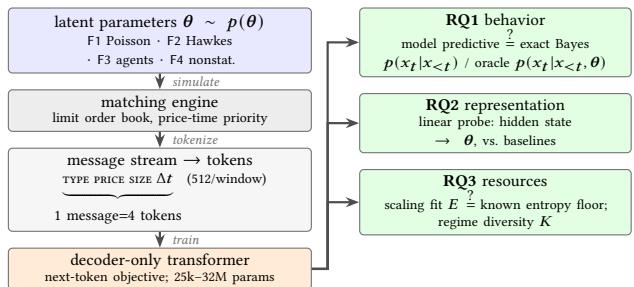  
Figure 1: Study design. Simulators with known � generate message streams through a matching engine. GPT-style models train on the tokens. Each question has an exact reference: the predictive vs. exact Bayes or oracle (RQ1), probes vs. the true � (RQ2), and scaling fits vs. the true entropy floor (RQ3).

In-context learning as Bayesian inference. The phenomenon we verify is anticipated by a substantial literature outside finance. Xie et al. [24] explain in-context learning as implicit Bayesian inference over a latent concept variable. Prior-data fitted networks train transformers on samples from a prior precisely so that they approximate the posterior predictive [15], with TabPFN as a practical instantiation [9]. Earlier work established that meta-trained sequential agents converge to Bayes-optimal behavior [14, 19]. A related line studies which algorithms transformers implement in context for function classes [1, 7, 23], and Raventós et al. [20] show that pretraining task diversity gates the emergence of in-context learning for regression. Relative to this literature our contribution is not the phenomenon but its exact, domain-relevant verification: a market setting with an engine in the loop, structured multi-field to- kens, closed-form conjugate floors at millinat precision rather than asymptotic arguments, an extension to filtering of a time-varying latent state, and consequences specific to finance (simulator calibration and diagnosis).

Classical microstructure models and simulation. Our simulator families are built from standard ingredients: zero-intelligence order flow in a continuous double auction [22], mutually exciting Hawkes processes, the standard model for event-level microstruc- ture econometrics [3], order-flow imbalance as a price predictor [6], and simulation by Ogata thinning [18]. Engine-based multi-agent market simulators such as ABIDES [5] pursue realism for downstream applications. Our engine is intentionally minimal so that exact references remain computable. Our probing methodology follows the linear-probe literature in interpretability [2, 4]. Deep learning on LOB data for prediction is well established [21, 25]. Scaling analyses follow the parametric form of Hofmann et al. [8], Kaplan et al. [11]. Our contribution there is the comparison of the fitted irreducible constant against a known floor, which is unavailable in any natural-data setting.

## 3 Experimental Setup

We describe the shared engine and tokens (Section 3.1), the simulator families (Section 3.2), and the models and training (Section 3.3).

## 3.1 Market engine, messages, and tokens

All simulator families share one matching engine, similar to multiagent market simulators such as ABIDES [5] but kept to the mini-mum needed for controlled analysis. The engine maintains a single- asset limit order book on an integer price grid (ticks): each price level holds a first-in-first-out queue of resting orders, and execu- tion follows price-time priority. A limit order priced at or through the best quote on the opposite side executes immediately for the crossing portion and rests otherwise, so the book can never cross; market orders execute against resting orders and never walk past available liquidity; cancellations remove a uniformly random rest- ing order from the chosen side. The engine is deterministic given the message sequence and the cancellation draws, which is what allows the oracle computations described below.

Every event in a simulation is a message with four fields: an event type, a price, a size, and the inter-arrival time Δ� since the previous message. There are six event types: buy and sell limit orders, buy and sell market orders, and cancellations on the bid and on the ask side. Prices of limit orders are recorded as the ofset $d \geq 0 ,$ in ticks, of the order relative to the best quote on the opposite side of the book. This makes the representation independent of the absolute price level. An episode of a family first draws its latent parameter vector � from the family’s prior (Table 1), seeds the book, runs 2,000 unrecorded burn-in messages, and then records 16,384 messages.

Messages are tokenized as four consecutive tokens in fixed order [type, price, size, Δ�]: 6 type tokens; 22 price tokens (ofsets $d =$ $0 , \ldots , 1 9 ,$ one token for $d \geq 2 0 ;$ , and one structural not-applicable token used by market orders and cancellations); 8 size tokens with bin edges {1, 2, 3, 5, 9, 17, 33, 65}; and 16 Δ� tokens log-spaced over $[ 1 0 ^ { - 4 } , 3 0 ]$ seconds with the end bins absorbing values outside the range. With a beginning-of-sequence token the vocabulary has 53 symbols. Training sequences are non-overlapping windows of $W =$ 512 consecutive messages (2,049 tokens). Bin edges are identical across families, and no bin dominates any field (the largest Δ� bin carries 15.9% of its field’s mass). Losses throughout are reported in nats per token.

## 3.2 Simulator families

The four families form a ladder of increasing complexity: indepen- dent flow, self-excitation, agent feedback through the book, and nonstationarity with heavy tails.

F1 (Poisson). Conditional on $\theta ,$ every field of every message is drawn independently. The event type is categorical with probabil ity vector � over the six types; the limit-order ofset is geometric, $d \sim \mathrm { G e o m } ( p _ { \mathrm { g e o } } ) ;$ sizes are 1 + Pois(�¯) with mean parameter �¯ (market orders use mean ${ \bar { s } } / 8 ) ;$ and inter-arrival times are exponential with rate $\Lambda , \Delta t \sim \mathrm { E x p } ( \Lambda )$ . The prior on � is hierarchical: the total limit-order probability � ∼ Beta(137, 103) is split between buy and sell by a Dir(4, 4) draw, and the remaining mass is split among market orders and cancellations by a Dir(2, 2, 3, 3) draw. This con struction keeps the posterior over � in closed form and, together with two structural rules described below, produces stable books over essentially the entire prior. As a result the exact Bayes-optimal next-token distribution, that is, the predictive obtained by integrating over the posterior of � given the observed tokens, is computable: the type field by closed-form posterior updates, and the remaining scalar parameters $( \Lambda , p _ { \mathrm { g e o } } , \bar { s } )$ by 512-point numerical integration over their priors.

F2 (Hawkes). Event types follow a six-dimensional Hawkes process, a point process in which each event raises the arrival intensity of future events. The excitation decays exponentially at rate $\beta$ and its overall strength is the branching ratio �, the expected number of direct descendants of one event. The cross-excitation pattern between the six types is a fixed matrix, and � equals the spectral radius of the branching matrix, so $a \sim U ( 0 . 1 , 0 . 8 5 )$ guarantees sta- bility. Simulation uses the exact thinning algorithm of Ogata [18], verified by Kolmogorov–Smirnov tests on time-rescaled residuals. Ofsets and sizes follow the F1 laws. For this family the exact Bayes predictive is not available in closed form, so we evaluate against the oracle: the conditional distribution of the next token given the history and the true $\theta ,$ computed by replaying the intensity recursion. The oracle is the entropy floor of the family, which no predictor can beat on average.

F3 (agent-based). Messages are emitted by a population of four agent types: noise traders (F1-like flow), momentum traders that trade in the direction of the mid-price change over the last 50 messages, mean reverters that trade against it, and a market maker that keeps 5–12 resting orders, at least five per side. The mix is $w \sim \operatorname { D i r } ( 1 , 1 , 1 , 1 )$ , and agents observe and react to the book, so the flow feeds back on itself. Only the public message stream is tokenized. Agent identities are hidden. The oracle is the exact next-message distribution given the full simulator state, computed analytically (no Monte Carlo) by summing the four agent branches over their next actions.

F4 (nonstationary, heavy-tailed). F2 dynamics with three additions: sizes concentrate on a single lot with probability ${ \mathit { p } } _ { \mathrm { l o t } }$ and otherwise follow a Pareto tail with index $\alpha _ { s } ;$ the baseline intensity is modulated by a lognormal factor with volatility $\sigma _ { \mathrm { m o d } }$ , resampled every 800 messages; and rare intensity jumps decay geometrically. The latent state therefore moves within an episode, and the ora- cle (again exact, integrating the modulated Hawkes intensity over the inter-arrival grid) is a filtering reference: matching it requires tracking the current state, not just identifying fixed parameters.

Structural rules and disclosures. Two rules keep books stable for asymmetric parameter draws: cancellations become non- tokenized no-ops when a side holds ten or fewer orders, and market- order sizes are smaller than limit-order sizes in F1 and F2. The no-op rule is the single deviation from exact conditional independence in F1. It afects $0 . 7 – 1$ .4% of messages, and Section 4.1 bounds its efect on the Bayes comparison below a millinat. Episodes in which a book side empties more than 0.1% of the time are discarded and redrawn (0–2% of draws; 17% for F4). The behavioral constants of F3 were chosen once, so that the families show measurably distinct dynam- ics (Figure $2 ) ,$ , and then held fixed: momentum and mean-reversion agents send a market order with probability 0.4 and otherwise a limit order, one tick inside the best quote or at a Geom(0.4) ofset, respectively; the market maker cancel-replaces with probability 0.05; and noise traders use Geom(0.1) ofsets and mean size 8, with market orders twice as large.

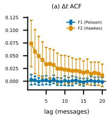

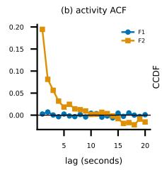

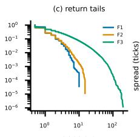

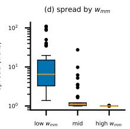

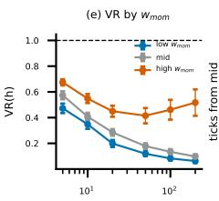

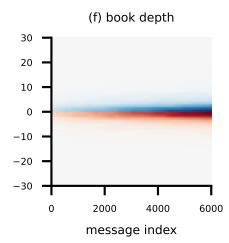  
Figure 2: Statistical properties of the families (40 episodes each; 150 for F3). (a) Inter-arrival and (b) one-second activity autocorrelation: F2 clusters, F1 does not. (c) F3 has heavy return tails. (d) Market-maker weight tightens spreads (1.0 vs. 17.4 ticks across terciles). (e) Momentum weight raises variance ratios (trend persistence; 1 = random walk). (f) Book depth in one episode.

horizon (messages)  
Table 1: Simulator families (latent parameters and priors) and model sizes. All families share the engine, tokenizer, and episode structure (2,000 burn-in + 16,384 recorded messages). LogU = log-uniform; Dir = Dirichlet.
<table><tr><td>family</td><td>parameter</td><td>prior</td><td>role</td></tr><tr><td>all</td><td> $\Lambda \left( \mathrm { r a t e } , s ^ { - 1 } \right)$ </td><td>LogU(0.5, 50)</td><td>activity</td></tr><tr><td>F1,F2</td><td>g (LO mass)</td><td>Beta(137, 103)</td><td>book stability</td></tr><tr><td></td><td>bid/ask split</td><td>Dir(4, 4)</td><td>side asymmetry</td></tr><tr><td></td><td>MO/CX split</td><td>Dir(2, 2, 3, 3)</td><td>flow mix</td></tr><tr><td></td><td> $\scriptstyle { \pmb { \mathscr { P } } } _ { \mathrm { g e o } }$  (offsets)</td><td>U(0.15, 0.6)</td><td>book depth</td></tr><tr><td></td><td>š (sizes)</td><td>LogU(1, 60)</td><td>order sizes</td></tr><tr><td>F2,F4</td><td>a (branching)</td><td>U(0.1, 0.85)</td><td>self-excitation</td></tr><tr><td></td><td>β(decay, s−1)</td><td>LogU(0.5, 20)</td><td>memory length</td></tr><tr><td>F3</td><td>w (agent mix)</td><td>Dir(1, 1, 1, 1)</td><td>composition</td></tr><tr><td>F4</td><td> $\scriptstyle { p _ { \mathrm { l o t } } }$ </td><td>U(0.3,0.9)</td><td>lot concentration</td></tr><tr><td></td><td> $\alpha _ { s }$  (size tail)</td><td>U (1.2, 2.5)</td><td>heavy tails</td></tr><tr><td></td><td> $\sigma _ { \mathrm { m o d } }$ </td><td>U(0.3,0.9)</td><td>nonstationarity</td></tr></table>

OOD priors: $\begin{array} { r } { \mathsf { F } 2 a \sim U ( 0 . 8 5 , 0 . 9 5 ) ; } \end{array}$ F3 � ∼Dir(1, 8, 1, 1) (momentum corner).

<table><tr><td colspan="6">Model sizes (non-embedding parameters)</td></tr><tr><td></td><td> $d _ { m o d e l }$ </td><td>layers</td><td>heads</td><td>params</td></tr><tr><td>m0 / m1  / m2</td><td>32 / 64 / 96</td><td> $2 / 3 / 3$ </td><td>2 /4/4</td><td>25k /  150k / 336k</td></tr><tr><td>S0 / S1</td><td>128 / 256</td><td>4/6</td><td>4/8</td><td>0.79M / 4.7M</td></tr><tr><td>S2 / S3</td><td>384 / 512</td><td>8 / 10</td><td>8/ 8</td><td>14.2M / 31.5M</td></tr></table>

## 3.3 Models, training, and evaluation splits

Models are GPT-2-style decoder-only transformers (pre-layer-norm, learned positional embeddings, weight-tied output head) in seven sizes, denoted m0–m2 and S0–S3 (Table 1, bottom), spanning 25k to 31.5M non-embedding parameters. The main models (size S2, 14.2M parameters) train for a single pass over 1.6B tokens per family with AdamW $( \beta = ( 0 . 9 , 0 . 9 5 )$ , weight decay 0.1 on matrices), a peak learning rate of $6 \times 1 0 ^ { - 4 } ( \mathrm { s i z e s ~ m } 0 - \mathrm { S } 1 ) \mathrm { o r } 3 \times 1 0 ^ { - 4 } ( \mathrm { S } 2 \mathrm { - } \mathrm { S } 3 )$ ) with a 300- step warmup and cosine decay to 10% of peak, gradient clipping at 1.0, a batch of 64 sequences, and bf16 precision, at 131k tokens per second on a single-GPU workstation. The complete study comprises roughly 100 runs and 55 GPU-hours. Training, in-distribution vali-dation, out-of-distribution validation, and probing sets use disjoint pools of �. The out-of-distribution priors shift the excitation range (F2) or concentrate the agent mix on a momentum-heavy corner (F3, Table 1). Seed robustness was checked by repeating the main runs with a second seed, and the largest seed-to-seed diference in any reported validation loss is 1.6 millinats.

## 4 Results

We present the results in the order of the research questions: the behavior of the learned predictive distribution against exact ref- erences (Section 4.1), the internal representation that supports it (Section 4.2), the training resources that produce it (Section 4.3), and the extent to which the findings extend to generation and to real data (Section 4.4).

## 4.1 RQ1: The learned predictive distribution matches the Bayes optimum

We first ask how close the trained model’s next-token distribution is to the best achievable one. Figure 3 shows, for each family, the mean prediction loss at each position � within a 512-message window, together with the exact reference for that family.

On F1 the reference is the exact sequential Bayes predictive,

$$
p ( x _ { n + 1 } \mid x _ { 1 : n } ) = \int _ { \Theta } p ( x _ { n + 1 } \mid x _ { 1 : n } , \theta ) p ( \theta \mid x _ { 1 : n } ) d \theta ,\tag{1}
$$

obtained by integrating the next-token law over the posterior $p ( \theta \mid$ $\begin{array} { r } { \boldsymbol { x } _ { 1 : n } ) \propto \boldsymbol { p } ( \boldsymbol { \theta } ) \prod _ { i = 1 } ^ { n } \boldsymbol { p } ( x _ { i } \mid \boldsymbol { x } _ { 1 : i - 1 } , \boldsymbol { \theta } ) } \end{array}$ , which is updated after every observed token. This is the best any predictor without knowledge of� can do on average. For F2–F4 the integral in $\operatorname { E q . } ( 1 )$ is intractable, so we compare instead against the oracle $p ( x _ { n + 1 } \mid x _ { 1 : n } , \theta ^ { \star } )$ at the true $\theta ^ { \star }$ (Section 3.2), the entropy floor no predictor can beat. The trained model’s loss curve coincides with the Bayes curve over the entire context range. The gap at $n = 5 1 2 \mathrm { i s } - 3 . 4 { \times } 1 0 ^ { - 4 }$ nats per token (episode-bootstrap 95% confidence interval $[ - 7 . 3 , + 0 . 2 ] \times 1 0 ^ { - 4 } )$ and mean validation loss is within 0.11% of the Bayes bound. The gap is statistically indistinguishable from zero or slightly negative. A negative gap is consistent with the one modeling efect that would produce it, namely that the closed-form predictive ignores the cancellation floor rule of Section 3.2 while the model learns its consequences from data. Either way, the comparison bounds the efect of that rule below a millinat.

The same convergence holds where no closed form exists: gaps to the exact oracles at �=512 are 0.0026 nats (F2), 0.0110 (F3), and 0.0085 (F4). Unlike the F1 Bayes reference, these oracles know the true state, so their gaps, an order larger than F1’s, are the unavoidable cost of inferring it, not model suboptimality. The F4 case extends the claim beyond fixed parameters: because the latent intensity state changes within an episode, staying near the oracle requires continuously re-estimating the current state from recent messages, and the model does so within 9 millinats.

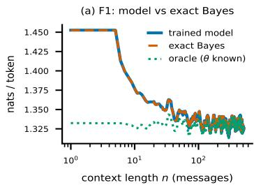

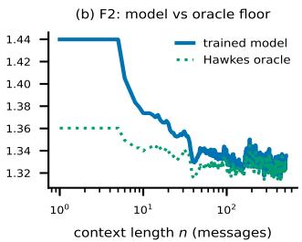

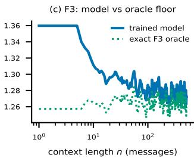

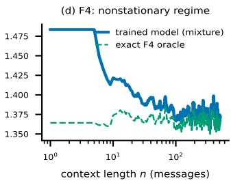  
Figure 3: Mean prediction loss vs. window position � for S2 models (400 held-out episodes per family; 9-point smoothing). Solid: trained model; dashed: exact Bayes (F1); dotted: oracle given �. The model matches exact Bayes on F1 (a) and reaches the oracle floors elsewhere, including the moving latent state of F4 (d), which requires filtering. The model in (d) is the four-family mixture.

Table 2: Validation loss (nats per token) of a backof 5-gram model over the token stream, the trained transformer (size S2, Table 1), and the exactly known irreducible floor of each family. The 5-gram captures short-range structure, and its gap to the transformer measures the value of long-context inference over the latent regime. F4 is omitted: its nonstationary floor is not a single per-token constant.
<table><tr><td>family</td><td>5-gram</td><td>transformer (S2)</td><td>irreducible floor</td></tr><tr><td>F1</td><td>1.575</td><td>1.3379</td><td>1.3365 (exact Bayes-window)</td></tr><tr><td>F2</td><td>1.568</td><td>1.3359</td><td>1.3271 (oracle)</td></tr><tr><td>F3</td><td>1.439</td><td>1.2718</td><td>1.2552 (oracle)</td></tr></table>

Table 2 places these results against classical sequence models on the same data. A backof 5-gram over the token stream captures short-range structure but sits 0.17–0.24 nats above the transformer, which reaches the floor. The gap reflects inference over the latent regime, which needs hundreds of messages of context that a short- context model lacks.

## 4.2 RQ2: The latent regime is encoded in the hidden states

The behavioral result of Section 4.1 implies that the model must carry information about the regime, and we now locate it. On its own, decodability shows only that the regime information is present, not that the model computes with it. That link comes from the Bayes-optimal behavior of Section 4.1, which is unattainable without using the regime, and a fully causal account via representational intervention remains future work. We fit ridge regressions (linear probes [2, 4]) from frozen residual-stream activations to each component of $\theta ,$ at every layer and at context lengths � ∈ {8, 32, 128, 512} messages, with train and test sets split at the episode level. Two falsification baselines control for trivial expla nations: identical probes on an untrained network of the same architecture (testing whether random features sufice), and ridge regression on 22 hand-crafted summary statistics of the same � messages (testing whether the information is available in surface statistics). For F2 we add the classical estimator, windowed maxi mum likelihood.

Table 3: Test $R ^ { 2 }$ of linear probes from the trained S2 model’s activations to latent generator parameters at $m { = } 5 1 2$ messages of context, against falsification baselines. Dynamical parameters: mean ± sd over 5 episode-grouped CV folds at the best layer. Static parameters (below the rule) are recovered by all methods and shown from a single split. MLE = windowed Hawkes maximum likelihood $( R ^ { 2 } ;$ negative = worse than predicting the mean).
<table><tr><td>target</td><td>trained</td><td>random-init</td><td>summary stats</td><td>MLE</td></tr><tr><td>a (F2)</td><td> ${ \bf 0 . 8 3 \pm . 0 2 }$ </td><td> $0 . 6 6 \pm . 0 2$ </td><td> $0 . 7 3 \pm . 0 2$ </td><td>-0.18</td></tr><tr><td>logβ(F2)</td><td> ${ \bf 0 . 7 0 \pm . 0 3 }$ </td><td> $0 . 0 7 \pm . 0 4$ </td><td> $0 . 4 2 \pm . 0 3$ </td><td>-4.89</td></tr><tr><td>Wmom (F3)</td><td> ${ \bf 0 . 9 2 \pm . 0 1 }$ </td><td> $0 . 4 2 \pm . 0 5$ </td><td> $0 . 5 2 \pm . 0 3$ </td><td>一</td></tr><tr><td>Wmm (F3)</td><td> ${ \bf 0 . 9 7 \pm . 0 1 }$ </td><td> $0 . 8 1 \pm . 0 6$ </td><td> $0 . 9 2 \pm . 0 1$ </td><td>一</td></tr><tr><td>log Λ (F2)</td><td>0.98</td><td>0.93</td><td>0.97</td><td>一</td></tr><tr><td> $p _ { g e o } \left( \mathsf { F } 2 \right)$ </td><td>0.95</td><td>0.95</td><td>0.87</td><td>一</td></tr></table>

Three regularities emerge (Table 3, Figure 4). First, the dynamical parameters separate the trained model from every baseline by several fold-level standard deviations: momentum weight $R ^ { 2 } =$ $0 . 9 2 \pm . 0 1$ against $0 . 5 2 \pm . 0 3$ (summary statistics) and $0 . 4 2 \pm . 0 5$ (untrained network); excitation � reaches $0 . 8 3 \pm . 0 2$ against $0 . 7 3 \pm . 0 2$ and $0 . 6 6 \pm . 0 2$ , and decay log � reaches $0 . 7 0 \pm . 0 3$ against $0 . 4 2 \pm . 0 3$ and $0 . 0 7 \pm . 0 4$ . The market-maker weight is the narrowest separa- tion $\left( 0 . 9 7 \pm . 0 1 \mathrm { v s . } 0 . 9 2 \pm . 0 1 \right)$ because its spread signature is easy to read from the window. Second, the advantage concentrates at short contexts (momentum weight at �=32: 0.59 vs. 0.26): the model extracts regime information faster than the defining statistics accumulate. Third, parameters that simple statistics recover (event rate, ofset decay) are recovered equally well by the untrained network. Decodability alone is therefore not evidence of learning, and we report those rows as controls. Composition weights peak at the deepest layer, and probes on intermediate checkpoints show that most decodability is in place after a quarter of training.

The representation has a direct use. Calibrating a Hawkes or agent-based simulator to a window is a standard task, usually done by maximum likelihood or method-of-moments fitting. Table 4 compares three estimators of (�, log �) on held-out 512-message windows: a linear read-out of the frozen pretrained model, win- dowed maximum likelihood, and a supervised multilayer percep- tron trained on the summary statistics for this exact task. The frozen

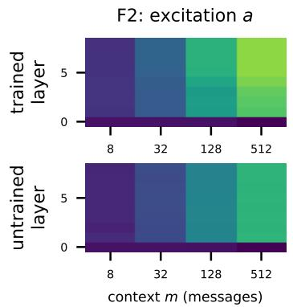

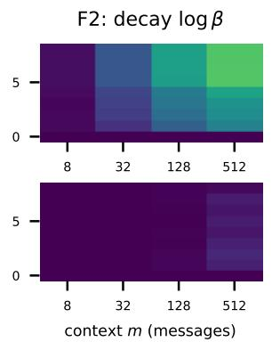

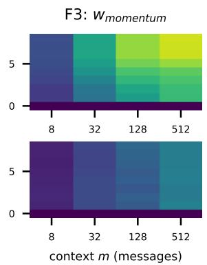

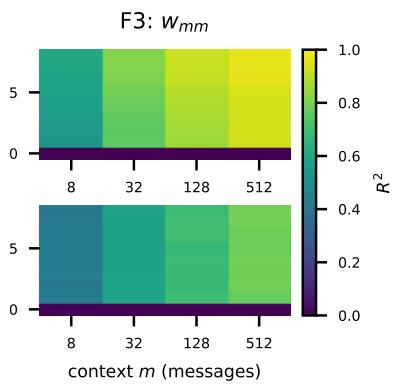  
Figure 4: Probe $R ^ { 2 }$ by layer (0 = embeddings) and context length �, for the trained S2 model (top) and an untrained network (bottom); yellow = accurate recovery. Composition weights peak at the deepest layer, and the advantage of training is largest at short contexts.

Table 4: Calibration of the F2 parameters (�, log �) from single 512-message windows: root-mean-square recovery error on held-out windows and wall-clock time per window (same GPU). FM probe: linear read-out of the frozen pretrained S2 model. NPE-MLP: a multilayer perceptron trained on the 22 summary statistics for this task. Hawkes MLE: windowed maximum likelihood.

<table><tr><td></td><td>FM probe</td><td>NPE-MLP</td><td>Hawkes MLE</td></tr><tr><td>RMSE a</td><td>0.087</td><td>0.114</td><td>0.236</td></tr><tr><td>RMSE logβ</td><td>0.556</td><td>0.727</td><td>2.490</td></tr><tr><td>sec / window</td><td>0.02</td><td>~0.02</td><td>5.5</td></tr></table>

read-out is the most accurate and the cheapest. The maximum- likelihood implementation is sound: on windows eight times longer it recovers both parameters nearly perfectly $\left( R ^ { 2 } 0 . 9 7 / 0 . 9 9 \right)$ . It fails at 512 messages, which carry little information, whereas the pre- trained model has amortized the prior over regimes into its weights.

## 4.3 RQ3: Diversity, not capacity or volume, is the limiting resource

Given that trained models reach the Bayes floor, we ask what it takes to get there. We train a grid of model sizes and token bud- gets on F2 (16 points, 25M–1.6B tokens) and F1 (a smaller grid), and fit a Chinchilla-style scaling law, the saturating power law $L ( N , D ) = E + A N ^ { - \alpha _ { N } } + B D ^ { - \alpha _ { D } }$ of Hofmann et al. [8], where � is the parameter count, � the number of training tokens, �, � coeficients, and � the fitted irreducible loss. In language modeling such fits extrapolate capability with scale. Here, by contrast, the fitted � can be compared to the true irreducible loss of the data.

Two conclusions follow (Figure 5). First, the fit recovers the true irreducible loss: for F1, $E = 1 . 3 3 8 4$ against an exactly computable floor of 1.3365. The floor that matters is not the conditional entropy given � (1.3282) but that entropy plus the unavoidable cost of inferring � within a 512-message window, approximately 8 millinats per token, and the fit recovers this larger number. Second, within these simulator families capacity and data volume saturate early: a model with $1 . 5 \times 1 0 ^ { 5 }$ parameters is within 4 millinats of the floor at 400M tokens, and all models from 0.8M to 31.5M parameters are statistically indistinguishable at every budget. As a consequence the exponents ��, �� are poorly identified $( R _ { \mathrm { l o g } } ^ { 2 } = 0 . 8 7 ) \colon$ the loss surface is a floor plus a fast transient rather than a broad power law. Because the entropy floor of real markets is unknown, this observation cautions against interpreting scaling exponents fitted to real LOB data as measures of capability growth.

What does not saturate is diversity. We fix the token budget at 400M and vary the number of distinct market regimes � in the training data by cycling episodes over � fixed draws of � (F2, two seeds). Loss on fresh regimes falls monotonically from 3.57 nats at �=1, where the model memorizes its single regime and fails on new ones, to 1.34 at �=256, indistinguishable from training with a fresh � every episode (Figure 6a). Probing separates two sources of decodability (Figure 6b): for the excitation �, probe accuracy at �≤16 equals the untrained-network level, and only diversity beyond that raises it. For the decay log �, accuracy climbs from 0.32 to 0.59 with � against an untrained-network level of 0.11. The capability documented under RQ1 and RQ2 is therefore created by regime diversity, consistent with the task-diversity threshold that Raventós et al. [20] report for in-context regression, here in a setting with a market mechanism in the loop.

## 4.4 External validity: generation, generalists, and real data

The preceding sections establish what the models learn in the con- trolled setting. We now test how far these findings extend to gener- ation and to real data.

Closed-loop generation. Sampling from the model and executing each sampled message in the engine for 2,048 steps, all 100 rollouts per family maintain a valid two-sided book throughout. Wasserstein-1 distances between generated and held-out episodes are small for F1/F2 (spread distributions difer by 0.011/0.025 ticks) but reveal a clear closed-loop gap for F3 (4.9 ticks), where feedback between the model and the book compounds small errors. We report this as a limitation of the learned agent-based model.

Generalists match specialists. A single model trained on the mixture of families matches each specialist on its home family within 0.7–6 millinats (Table 5), while specialists transfer asymmetrically (the F3 specialist scores 3.16 nats on F1). At this scale there is no cost to training one general model.

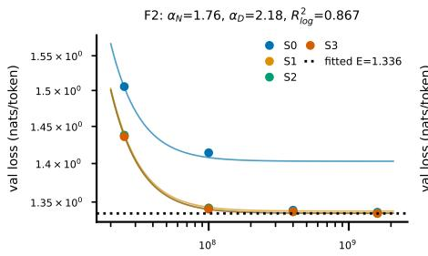  
training tokens D

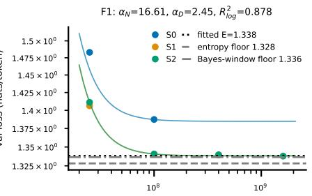  
training tokens D

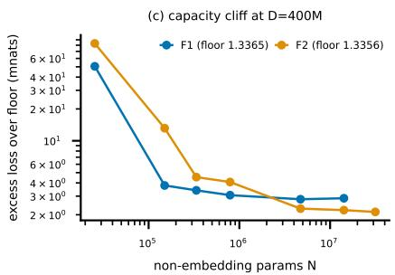

Figure 5: Scaling with a known floor. (a) F2, (b) F1: loss vs. training tokens for the S-series sizes S0–S3 (points) with the joint Chinchilla-style fit (curves); horizontal lines mark the fitted � and the known floors. (c) Excess loss over the floor at �=400M vs. parameter count, now including the micro sizes m0–m2 that expose the low-capacity regime: capacity binds only below roughly $1 0 ^ { 5 }$ parameters.  
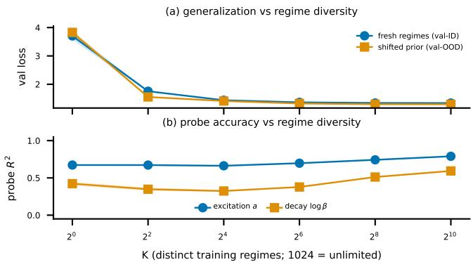  
Figure 6: Diversity ablation: S1 models, fixed 400M-token budget, � distinct regimes in training (two seeds; bands span seeds). (a) Loss on unseen regimes and under a shifted prior. (b) Best-layer probe $R ^ { 2 }$ at �=512: decodability of the harder parameter is created by diversity.

Table 5: Cross-family zero-shot val loss (nats/token): every model evaluated on every family. The mixture generalist matches each specialist on its home family within millinats.
<table><tr><td>model \ eval</td><td>F1</td><td>F2</td><td>F3</td></tr><tr><td>F1</td><td>1.337</td><td>1.367</td><td>2.086</td></tr><tr><td>F2</td><td>1.339</td><td>1.338</td><td>2.082</td></tr><tr><td>F3</td><td>3.164</td><td>3.271</td><td>1.272</td></tr><tr><td>MIX</td><td>1.337</td><td>1.339</td><td>1.277</td></tr></table>

Real data: transfer depends on prior coverage. We evaluate mixture models zero-shot on one day of NASDAQ LOBSTER message data (AMZN, MSFT, INTC, AAPL, GOOG; 2012-06-21) [10], mapping each NASDAQ event to the token schema (submissions to limit orders, deletions and partial cancellations to cancellations, ex- ecutions to market orders with same-timestamp executions merged; ofsets in ticks from the opposite best; sizes in round lots; Δ� in seconds). This is a demanding test: the models have never seen a real message. Table 6 compares the mixture over F1–F3 with the mixture that also includes F4, whose defining properties (lot-concentrated heavy-tailed sizes, intraday nonstationarity, bursts) are exactly the properties of real flow that the simpler families lack. The efect

Table 6: Real-data transfer (NASDAQ LOBSTER, 2012-06-21; nats/token). Top: zero-shot per-field loss averaged over five tickers for the original mixture, the F4-enriched mixture, and a unigram fit on the same day. Bold marks the better transfer model per field (the unigram is an in-domain reference, not a transfer model). Bottom: fine-tuning the enriched model on an AMZN+MSFT slice vs. from-scratch training on it, averaged over three fully held-out tickers (INTC, AAPL, GOOG).

<table><tr><td colspan="5">Zero-shot per field (mean over 5 tickers)</td></tr><tr><td></td><td>TYPE</td><td>PRICE</td><td>SIZE</td><td>∆t</td></tr><tr><td>mixture (F1–F3)</td><td>1.53</td><td>1.30</td><td>1.60</td><td>3.07</td></tr><tr><td>+ F4 enrichment</td><td>1.48</td><td>1.29</td><td>0.91</td><td>2.81</td></tr><tr><td>unigram (in-domain)</td><td>1.50</td><td>1.59</td><td>0.90</td><td>1.95</td></tr></table>

<table><tr><td colspan="5">Fine-tune vs. scratch, mean over 3 held-out tickers</td></tr><tr><td></td><td>5% slice</td><td>20%</td><td>80%</td><td>zero-shot</td></tr><tr><td>fine-tuned</td><td>1.140</td><td>1.092</td><td>1.062</td><td>1.585</td></tr><tr><td>scratch</td><td>1.275</td><td>1.188</td><td>1.115</td><td>一</td></tr><tr><td>advantage</td><td>+0.134</td><td>+0.096</td><td>+0.053</td><td></td></tr></table>

is large and field-specific: price placement transfers well from ei- ther mixture, while including F4 cuts the size loss almost to the in-domain unigram (1.60 to 0.91 nats, closing 98% of the gap) and lowers inter-arrival loss by up to 0.55 nats per ticker. Fine-tuning the enriched model on an AMZN+MSFT slice then beats from- scratch training at every budget, averaged over three fully held-out tickers (INTC, AAPL, GOOG), and the advantage grows as the slice shrinks (Table 6, bottom). Zero-shot transfer is therefore governed by whether the simulator prior covers the distributional properties of real flow, and pretraining on a suficiently rich synthetic prior is a useful initialization when real data are scarce.

As a qualitative illustration, Figure 7 applies the F3 agent-composition probe to the real streams: the inferred mix varies systematically over the trading day. The read-out is an interpretation of real flow through the simulator’s lens, not a validated measurement, but it illustrates the kind of instrument the framework provides.

## 5 Discussion and Conclusion

Summary. Next-token pretraining on order flow produces a Bayesoptimal forecaster of market regimes, including under a time-varying latent state (Section 4.1); the regime is linearly decodable from hidden states beyond all baselines (Section 4.2); and both capabilities are created by regime diversity, while capacity and token volume saturate early (Section 4.3). On real data, transfer depends on the simulator prior’s coverage of real flow (Section 4.4).

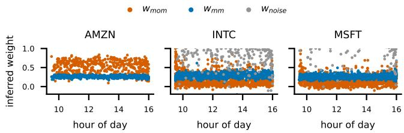  
Figure 7: Agent-composition probe read-outs on real NAS-DAQ streams. Each point estimates one agent weight on one 512-message window.

Implications for practice. Four consequences follow for the construction and evaluation of LOB foundation models. First, aver-age next-token loss is a poor measure of what a model has learned: it sits close to an entropy floor that small models already reach, so diferences between large models will not appear in this metric even when they exist elsewhere. Model comparison should instead exam- ine regime coverage, behavior out of distribution, and downstream read-outs. Second, when assembling training data, the number of distinct market regimes matters more than the number of tokens, and our diversity ablation gives a concrete example in which the same token budget spans the range from memorization to full gen- eralization. Third, a pretrained model is a calibration instrument at essentially no cost: a linear read-out of frozen activations estimated simulator parameters more accurately than both maximum likeli- hood and a supervised task-specific regressor. Finally, decomposing predictive loss by message field shows which distributional proper- ties a simulator lacks, making the framework useful for simulator development as well.

Limitations. (i) The simulators are simpler than real markets: we establish what next-token pretraining can recover when the gen- erator is known, not that real order flow has an identifiable regime of this kind. Real flow plausibly also has higher excess entropy, which would extend the scaling regime beyond the saturation we observe. (ii) One structural rule, the cancellation floor, breaks exact conditional independence in F1, with measured efect below a millinat and reported where relevant. (iii) The scaling-law exponents are poorly identified in our setting, a property of known-floor regimes, not an estimate for real LOB data. (iv) The real-data evaluation covers five tickers on one 2012 trading day, a controlled analysis of transfer, not evidence about current markets. (v) Closed-loop generation from the agent-based family shows a genuine spread mismatch, so the realism of learned agent dynamics under feedback remains open. Our rollouts span 2,048 steps without exogenous order injection, and longer horizons with an injected agent (e.g., to measure market impact) are future work. (vi) All results use one fixed tokenization. Bin edges were checked for balance, but sensitivity to the token schema is not studied systematically.

Future work. Natural extensions include richer simulator fami lies, systematic study of tokenization choices, transfer experiments at larger real-data scale, causal tests of whether the decoded regime information is used (via residual-stream interventions), and comparisons against task-specific models on downstream tasks, for which the framework provides exact optimal policies as references.

## References

[1] Ekin Akyürek, Dale Schuurmans, Jacob Andreas, Tengyu Ma, and Denny Zhou. 2023. What Learning Algorithm Is In-Context Learning? Investigations with Linear Models. In International Conference on Learning Representations (ICLR).

[2] Guillaume Alain and Yoshua Bengio. 2016. Understanding Intermediate Layers Using Linear Classifier Probes. arXiv preprint arXiv:1610.01644 (2016).

[3] Emmanuel Bacry, Iacopo Mastromatteo, and Jean-François Muzy. 2015. Hawkes Processes in Finance. Market Microstructure and Liquidity 1, 1 (2015), 1550005.

[4] Yonatan Belinkov. 2022. Probing Classifiers: Promises, Shortcomings, and Advances. Computational Linguistics 48, 1 (2022), 207–219.

[5] David Byrd, Maria Hybinette, and Tucker Hybinette Balch. 2020. ABIDES: Towards High-Fidelity Multi-Agent Market Simulation. Proceedings ofthe 2020 ACM SIGSIM Conference on Principles ofAdvanced Discrete Simulation (2020).

[6] Rama Cont, Arseniy Kukanov, and Sasha Stoikov. 2014. The Price Impact of Order Book Events. Journal ofFinancial Econometrics 12, 1 (2014), 47–88.

[7] Shivam Garg, Dimitris Tsipras, Percy Liang, and Gregory Valiant. 2022. What Can Transformers Learn In-Context? A Case Study of Simple Function Classes. In Advances in Neural Information Processing Systems.

[8] Jordan Hofmann, Sebastian Borgeaud, Arthur Mensch, et al. 2022. Training Compute-Optimal Large Language Models. In Advances in Neural Information Processing Systems.

[9] Noah Hollmann, Samuel Müller, Katharina Eggensperger, and Frank Hutter. 2023. TabPFN: A Transformer That Solves Small Tabular Classification Problems in a Second. In International Conference on Learning Representations (ICLR).

[10] Ruihong Huang and Tomas Polak. 2011. LOBSTER: Limit Order Book Reconstruction System. SSRN 1977207 (2011).

[11] Jared Kaplan, Sam McCandlish, Tom Henighan, et al. 2020. Scaling Laws for Neural Lan ua e Models. arXiv preprint arXiv:2001.08361 (2020).

[12] Maxime Kawawa-Beaudan, Srijan Sood, Kassiani Papasotiriou, Daniel Borrajo, and Manuela Veloso. 2026. TradeFM: A Generative Foundation Model for Trade flow and Market Microstructure. arXiv preprint arXiv:2602.23784 (2026).

[13] Junjie Li, Yang Liu, Weiqing Liu, Shikai Fang, Lewen Wang, Chang Xu, and Jiang Bian. 2025. MarS: A Financial Market Simulation Engine Powered by Genera- tive Foundation Model. In International Conference on Learning Representations (ICLR).

[14] Vladimir Mikulik, Grégoire Delétang, Tom McGrath, Tim Genewein, Miljan Martic, Shane Legg, and Pedro A. Ortega. 2020. Meta-trained Agents Implement Bayes-optimal Agents. In Advances in Neural Information Processing Systems.

[15] Samuel Müller, Noah Hollmann, Sebastian Pineda Arango, Josif Grabocka, and Frank Hutter. 2022. Transformers Can Do Bayesian Inference. In International Conference on Learning Representations (ICLR).

[16] Peer Nagy, Sascha Frey, Kang Li, Bidipta Sarkar, Svitlana Vyetrenko, Stefan Zohren, Anisoara Calinescu, and Jakob Foerster. 2025. LOB-Bench: Benchmarking Generative AI for Finance – an Application to Limit Order Book Data. In International Conference on Machine Learning (ICML).

[17] Peer Nagy, Sascha Frey, Silvia Sapora, et al. 2023. Generative AI for End-to-End Limit Order Book Modelling: A Token-Level Autoregressive Generative Model of Message Flow Using a Deep State Space Network. In Proceedings of the 4th ACM International Conference on AI in Finance (ICAIF).

[18] Yosihiko Ogata. 1981. On Lewis’ Simulation Method for Point Processes. IEEE Transactions on Information Theory 27, 1 (1981), 23–31.

[19] Pedro A. Ortega, Jane X. Wang, Mark Rowland, Tim Genewein, et al. 2019. Meta-learning of Sequential Strategies. arXiv preprint arXiv:1905.03030 (2019).

[20] Allan Raventós, Mansheej Paul, Feng Chen, and Surya Ganguli. 2023. Pretraining Task Diversity and the Emergence of Non-Bayesian In-Context Learning for Regression. In Advances in Neural Information Processing Systems.

[21] Justin Sirignano and Rama Cont. 2019. Universal Features of Price Formation in Financial Markets: Pers ectives from Dee Learnin . Quantitative Finance 19, 9 (2019), 1449–1459.

[22] Eric Smith, J. Doyne Farmer, László Gillemot, and Supriya Krishnamurthy. 2003. Statistical Theor of the Continuous Double Auction. Quantitative Finance 3, 6 (2003), 481–514.

[23] Johannes von Oswald, Eyvind Niklasson, Ettore Randazzo, João Sacramento, Alexander Mordvintsev, Andrey Zhmoginov, and Max Vladymyrov. 2023. Trans- formers Learn In-Context by Gradient Descent. In International Conference on Machine Learning (ICML).

[24] Sang Michael Xie, Aditi Raghunathan, Percy Liang, and Tengyu Ma. 2022. An Explanation of In-context Learning as Implicit Bayesian Inference. In International Conference on Learning Representations (ICLR).

[25] Zihao Zhang, Stefan Zohren, and Stephen Roberts. 2019. DeepLOB: Deep Convolutional Neural Networks for Limit Order Books. IEEE Transactions on Signal Processing 67, 11 (2019), 3001–3012.