# What Does Disagreement Mean? A Semantic Identifiability Frontier for Pairwise Preference Learning

Manoj Saravanan 1 Rohit Kumar Salla 1 Shrikar Reddy Kota 1

## Abstract

Pairwise comparison data are a standard supervision signal in preference learning, but disagreement in such data can reflect stable latent heterogeneity, ephemeral stochasticity, or non-binary responses hidden by a forced-choice interface. We study which of these semantic distinctions are identifiable from the feedback channel itself. We introduce a nonparametric latent semantic model with three querywise quantities: aggregate directional preference $\mu _ { q } ,$ persistent disagreement $\tau _ { q } ,$ and non-binary mass $\alpha _ { q }$ . Under the anonymous binary channel, we prove an exact semantic fiber theorem: $\mu _ { q }$ is point-identified, whereas $( \tau _ { q } , \alpha _ { q } )$ vary over an explicit feasible region compatible with the same binary law. Same-annotator repeats identify $\tau _ { q }$ through a covariance identity, abstention-enabled feedback identifies $\alpha _ { q }$ directly, and together they point-identify the full semantic triple. We also derive finite-sample estimators, nonasymptotic concentration bounds, and semantics-aware action-recovery guarantees, and validate the theory on theorem-matched synthetic data.

## 1. Introduction

Pairwise comparison data are a central supervision signal in modern preference learning, from reinforcement learning from human feedback to direct preference optimization and related alignment pipelines (Christiano et al., 2017; Ouyang et al., 2022; Rafailov et al., 2023). In practice, disagreement is often collapsed into a single aggregate label or treated as simple noise. That simplification is increasingly questionable. Empirical analyses show that disagreement in preference datasets often reflects task underspecification, response style, or refusals rather than mere annotation error (Zhang et al., 2025), while recent theory shows that hidden context and heterogeneous user types can systematically alter the semantics of the induced preference objective (Siththaranjan et al., 2023; Shirali et al., 2025).

This leaves an epistemic question that is orthogonal to parametric modeling. Existing work clarifies what pairwise data recover at the aggregate level: in particular, Pukdee et al. (2026) identify the conditional pairwise preference distribution as the preference object encoded by pairwise comparison data, independent of any particular Bradley– Terry parameterization. Complementary work shows that latent heterogeneity is generally not identified from binary feedback alone without richer elicitation (Chidambaram et al., 2025). But a simpler question remains open: what does observed disagreement mean, and which semantic distinctions are identifiablefrom thefeedback channel itself? In particular, can anonymous forced-choice data distinguish persistent latent disagreement from ephemeral stochasticity, or from non-binary responses hidden by the elicitation interface?

We answer this question with a channel-theoretic analysis of preference learning. At the latent level, a query may admit a strict preference, a strict preference in the opposite direction, or a non-binary response such as abstention, tie, refusal, or incomparability. Standard pairwise pipelines, however, often expose only a forced binary choice. For each query $q ,$ we define three nonparametric semantic quantities: aggregate directional preference $\mu _ { q } ,$ persistent disagreement $\tau _ { q } .$ , and non-binary mass $\alpha _ { q } .$ . Under anonymous binary feedback, only $\mu _ { q }$ is identified: the same binary law is compatible with an explicit two-dimensional feasible region of $( \tau _ { q } , \alpha _ { q } )$ Same-annotator repeats identify $\tau _ { q }$ via a covariance identity, abstention-enabled feedback identifies $\alpha _ { q }$ directly, and only their combination point-identifies the full semantic triple.

We also derive finite-sample estimators, concentration bounds, and semantics-aware action-recovery guarantees. Our contributions are fourfold: first, we formalize a nonparametric latent semantic model that separates aggregate preference, persistent disagreement, and non-binary mass; second, we prove an exact semantic fiber theorem for anonymous binary feedback; third, we prove a precise channelrefinement frontier showing that repeats identify $\tau _ { q } ,$ abstention identifies $\alpha _ { q } .$ , and the combined refinement identifies the full semantic triple; and fourth, we derive nonasymptotic recovery guarantees for simple semantics-aware decision rules. Synthetic experiments constructed directly from the proofs confirm both the fiber geometry and the downstream action-recovery consequences.

The perspective of the paper is deliberately foundational. We do not claim that every instance of persistent disagreement is normatively meaningful pluralism, nor that every non-binary response should be interpreted as incomparability. Rather, we ask what distinctions are availablefrom the data alone. The resulting decision-theoretic lesson is sharp: from anonymous binary data alone, one cannot in general determine whether disagreement should be denoised away, preserved via personalization, or treated as a signal to query more or abstain. Richer elicitation is therefore not merely a modeling choice; in this setting it is an identification requirement.

## 2. Model and Feedback Channels

We separate latent preference semantics from the observation channel. All statements are querywise. Let Q be a finite set of ordered pairwise queries. For each $q \in \mathcal { Q } ,$ , a sampled annotator has a stable latent type $Z \sim \pi$ on a standard Borel space $( \mathcal { Z } , \mathcal { F } , \pi )$ . Conditional on $( Z = z , q )$ , the latent response is ternary,

$$
\widetilde Y \in \{ + 1 , 0 , - 1 \} ,
$$

where 0 denotes a protocol-agnostic non-binary response (e.g., abstention, tie, refusal, or incomparability). We parameterize the ternary kernel by measurable functions

$$
a _ { q } : \mathcal { Z }  [ 0 , 1 ] ,\tag{1}
$$

$$
m _ { q } : \mathcal { Z }  [ - 1 , 1 ] ,\tag{2}
$$

$$
| m _ { q } ( z ) | \leq 1 - a _ { q } ( z ) ,\tag{3}
$$

and set

$$
p _ { q } ^ { 0 } ( z ) : = a _ { q } ( z ) , \qquad p _ { q } ^ { \pm } ( z ) : = \frac { 1 - a _ { q } ( z ) \pm m _ { q } ( z ) } { 2 } .
$$

Thus $a _ { q } ( z ) = \mathbb { P } ( \widetilde { Y } = 0 \ | \ Z = z , q )$ is the conditional non-binary mass, and

$$
m _ { q } ( z ) = \mathbb { E } [ \widetilde { Y } \mid Z = z , q ]
$$

is the conditional directional preference mean.

The querywise semantic parameters are

$$
\mu _ { q } : = \mathbb { E } [ m _ { q } ( Z ) ] ,\tag{4}
$$

$$
\nu _ { q } : = \mathbb { E } [ m _ { q } ( Z ) ^ { 2 } ] ,\tag{5}
$$

$$
\tau _ { q } : = \mathrm { V a r } ( m _ { q } ( Z ) ) = \nu _ { q } - \mu _ { q } ^ { 2 } ,\tag{6}
$$

$$
\begin{array} { r } { \alpha _ { q } : = \mathbb { E } [ a _ { q } ( Z ) ] . } \end{array}\tag{7}
$$

We interpret $\mu _ { q }$ as the aggregate directional preference, $\tau _ { q }$ as persistent disagreement, and $\alpha _ { q }$ as non-binary mass. The key point is that $\tau _ { q }$ is not the variance of the observed label; it is the between-type variance of the conditional mean $m _ { q } ( Z )$

We study three primitive feedback channels. Under the anonymous binary channel B, the latent zero state is forced into a strict choice by an independent fair completion coin. Under the same-annotator repeat channel R, the same latent type Z is reused and two conditionally independent repeated labels are elicited, each with independent completion. Under the abstention channel A, the ternary response $\widetilde { Y }$ is observed directly. Combined channels such as BR or BRA provide independent samples from each constituent primitive channel.

The fair-completion rule in channel B is deliberate. It makes forced completion informationally neutral on latent nonbinary responses and therefore gives anonymous binary feedback its strongest possible chance to preserve semantics. If completion were asymmetric or unknown, the binary channel would conflate $\mu _ { q }$ and $\alpha _ { q }$ even more severely. The negative results below should therefore be read as upper bounds on what anonymous forced choice can identify.

Lemma 2.1 (Observable laws). For every query $q \in \mathcal { Q } ,$ , the primitive channels satisfy

$$
\begin{array} { c } { { \mathbb { P } _ { \mathsf { B } } ( Y = + 1 \mid q ) = \displaystyle \frac { 1 + \mu _ { q } } { 2 } , } } \\ { { \mathbb { E } _ { \mathsf { R } } [ Y ^ { ( 1 ) } Y ^ { ( 2 ) } \mid q ] = \nu _ { q } = \mu _ { q } ^ { 2 } + \tau _ { q } , } } \end{array}
$$

and

$$
\mathbb { P } _ { \mathsf { A } } ( \widetilde { Y } = 0 \mid q ) = \alpha _ { q } ,
$$

$$
\mathbb { P } _ { \mathsf { A } } ( \widetilde { Y } = \pm 1 \mid q ) = \frac { 1 - \alpha _ { q } \pm \mu _ { q } } { 2 } .
$$

For a model M and channel C, let Law $^ { \mathsf { C } } _ { M , q }$ denote the induced observable law on query q. We write

$$
M \equiv _ { \mathsf { C } } M ^ { \prime }
$$

if Law $\mathsf { \Pi } _ { M ^ { \prime } , q } ^ { \mathsf { C } } = \mathrm { L a w } _ { M , q } ^ { \mathsf { C } }$ for every $q \in \mathcal { Q }$ . Section 3 characterizes the exact semantic fiber under B, while Section 4 studies how R and A refine the corresponding equivalence classes. The proof of Lemma 2.1 and the full formal setup are deferred to Appendix B.

## 3. Semantic Collapse under Anonymous Binary Feedback

Under anonymous forced choice, the observable law depends on the latent model only through $\mu _ { q }$ , consistent with the aggregate-comparison viewpoint of Pukdee et al. (2026). The sharper question is: for a fixed binary mean $\mu _ { q } .$ , which values of $( \tau _ { q } , \alpha _ { q } )$ remain compatible with the same observable binary law? The next theorem answers this exactly.

For $\mu \in [ - 1 , 1 ]$ , define the feasible set

$$
\mathcal { F } ( \mu ) : = \left\{ ( \alpha , \tau ) \in \mathbb { R } _ { \geq 0 } ^ { 2 } : \tau \leq 1 - \vert \mu \vert , \right\} .\tag{8}
$$

Theorem 3.1 (Exact semantic fiber under anonymous binary feedback). Fix a query $q \in \mathcal { Q }$ and a model M. Let $S _ { q } ^ { \mathsf { B } } ( M )$ denote the set of all triples $\left( \mu _ { q } ( M ^ { \prime } ) , \tau _ { q } ( M ^ { \prime } ) , \alpha _ { q } ( M ^ { \prime } ) \right)$ generated by models M′ that are observationally equivalent to M under the anonymous binary channel B. Then

$$
\begin{array} { r } { S _ { q } ^ { \mathsf { B } } ( M ) = \left\{ \left( \mu _ { q } ( M ) , \tau , \alpha \right) : ( \alpha , \tau ) \in \mathcal { F } \big ( \mu _ { q } ( M ) \big ) \right\} . } \end{array}\tag{9}
$$

Equivalently, every model satisfies

$$
\left( \alpha _ { q } , \tau _ { q } \right) \in \mathcal { F } ( \mu _ { q } ) ,
$$

and for every $\mu \in [ - 1 , 1 ]$ and every $( \alpha , \tau ) \in \mathcal { F } ( \mu )$ there exists a latent semantic preference model with semantic triple $( \mu , \tau , \alpha )$ and binary law

$$
\mathbb { P } ( Y = + 1 \mid q ) = \frac { 1 + \mu } { 2 } .
$$

Proof sketch. Necessity follows from the pointwise constraint $| m _ { q } ( z ) | \leq 1 - a _ { q } ( z )$ , which implies

$$
\begin{array} { r } { | \mu _ { q } | = \left| \mathbb { E } [ m _ { q } ( Z ) ] \right| \le 1 - \alpha _ { q } , } \end{array}\tag{10}
$$

$$
\tau _ { q } + \mu _ { q } ^ { 2 } = \mathbb { E } [ m _ { q } ( Z ) ^ { 2 } ] \leq 1 - \alpha _ { q } .\tag{11}
$$

Hence $( \alpha _ { q } , \tau _ { q } ) \in \mathcal { F } ( \mu _ { q } )$ . For sharpness, fix $( \mu , \alpha )$ . A homogeneous one-type model realizes $\tau = 0 ,$ , while a threetype extremal model with $m \in \{ + 1 , 0 , - 1 \}$ and masses

$$
{ \frac { 1 - \alpha + \mu } { 2 } } , \qquad \alpha , \qquad { \frac { 1 - \alpha - \mu } { 2 } }
$$

realizes $\tau = 1 - \alpha - \mu ^ { 2 }$ . Mixing these two constructions interpolates every intermediate value of τ. The full proof, including embedding into an ambient multi-query model, is given in Appendix C.

Theorem 3.1 says that anonymous binary feedback collapses a two-dimensional semantic region to the single scalar $\mu _ { q } .$ . In particular, the same fair-coin binary law at $\mu _ { q } ~ = ~ 0$ is compatible with (i) a homogeneous noisy world $( \tau _ { q } , \alpha _ { q } ) = ( 0 , 0 )$ , (ii) a purely persistent split world $( \tau _ { q } , \alpha _ { q } ) = ( 1 , 0 )$ , and (iii) a pure non-binary-completion world $( \tau _ { q } , \alpha _ { q } ) = ( 0 , 1 )$ ). Binary marginals alone therefore do not reveal what disagreement means. This sharpened failure mode is distinct from ordinary model misspecification: the observable binary law is fully pinned down by $\mu _ { q } ,$ but the latent semantic preimage beneath that law remains two-dimensional. Aggregate recovery of the pairwise comparison law therefore does not by itself resolve whether disagreement is persistent, non-binary, or both.

Corollary 3.2 (Identification under the anonymous binary channel). Under B, the aggregate directional preference $\mu _ { q }$ is point-identified. $I f | \mu _ { q } | < 1$ , neither persistent disagreement $\tau _ { q }$ nor non-binary mass $\alpha _ { q }$ is point-identified.

Corollary 3.3 (Binary-only testing impossibility). Let $M _ { 0 }$ and $M _ { 1 }$ be two models such that $M _ { 0 } \equiv _ { \mathsf { B } } M _ { 1 }$ . Thenfor any test T based only on anonymous binary observations,

$$
\operatorname* { m a x } _ { j \in \{ 0 , 1 \} } \mathbb { P } _ { M _ { j } } ( T \neq j ) \geq \frac { 1 } { 2 } .
$$

Consequently, ifthe correct downstream action differs between $M _ { 0 }$ and $M _ { 1 } ,$ , no binary-only procedure can reliably decide between those actions.

This is the operational form of semantic collapse: if observationally equivalent worlds prescribe different responses to disagreement—for example, denoise, personalize, or query/abstain—anonymous binary data alone cannot determine which response is warranted. Section 4 therefore asks for the minimal refinements that break this ambiguity.

## 4. Minimal Channel Refinements

Which minimal refinement recovers the missing dimensions? In our model, same-annotator repeats identify $\tau _ { q } ,$ abstention identifies $\alpha _ { q } ,$ and the two refinements are complementary (Siththaranjan et al., 2023; Shirali et al., 2025; Chidambaram et al., 2025). We state the first result for the combined channel BR, matching the intended design in which anonymous binary labels are the default supervision source and repeat data are collected on a smaller calibration subset.

Theorem 4.1 (Repeat covariance identifies persistent disagreement). Under the combined channel BR,

$$
\begin{array} { r l } & { \tau _ { q } = \operatorname { C o v } \bigl ( Y ^ { ( 1 ) } , Y ^ { ( 2 ) } \mid q \bigr ) } \\ & { \quad = \operatorname { \mathbb { E } } \Bigl [ Y ^ { ( 1 ) } Y ^ { ( 2 ) } \mid q \Bigr ] - \Bigl ( \operatorname { \mathbb { E } } [ Y \mid q ] \Bigr ) ^ { 2 } . } \end{array}
$$

Consequently, $\tau _ { q }$ is point-identified under BR.

Proof sketch. Conditional on the latent type $Z ,$ , repeated responses are independent and each has conditional mean $m _ { q } ( Z )$ . Hence

$$
\mathbb { E } \Big [ Y ^ { ( 1 ) } Y ^ { ( 2 ) } \mid Z , q \Big ] = m _ { q } ( Z ) ^ { 2 } .
$$

Taking expectations gives

$$
\mathbb { E } \Big [ Y ^ { ( 1 ) } Y ^ { ( 2 ) } \mid q \Big ] = \nu _ { q } , \qquad \mathbb { E } [ Y \mid q ] = \mu _ { q } ,
$$

and subtraction yields $\tau _ { q } = \nu _ { q } - \mu _ { q } ^ { 2 }$ . The full proof is given in Appendix E.

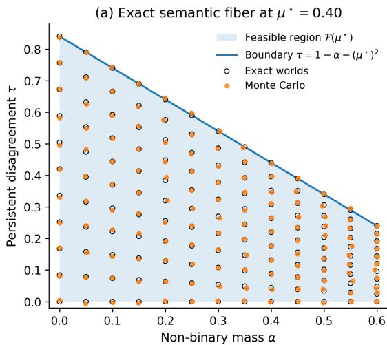

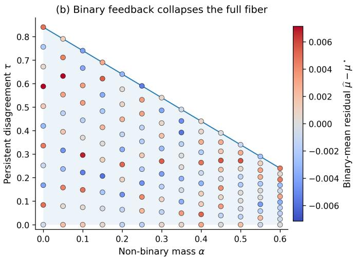  
Figure 1. Exact semantic fiber under anonymous binary feedback. For $\mu ^ { \star } = 0 . 4 0$ , panel (a) shows the feasible set $\mathcal { F } ( \mu ^ { \star } )$ and the constructive worlds from Theorem 3.1; panel (b) colors the same worlds by the residual $\widehat { \mu } - \mu ^ { \star }$ . Across the full feasible region, the induced anonymous binary law is essentially unchanged.

Corollary 4.2 (Same-annotator versus different-annotator disagreement gap). Let $D _ { q } ^ { \mathrm { d i f f } }$ denote the disagreement probability between two independent anonymous binary labels on query q, and let $D _ { q } ^ { \mathrm { s a m e } }$ denote the disagreement probability between two repeated labels from the same annotator. Then

$$
D _ { q } ^ { \mathrm { d i f f } } - D _ { q } ^ { \mathrm { s a m e } } = \frac { \tau _ { q } } { 2 } .
$$

Thus the gap between inter-annotator disagreement and intra-annotator disagreement is exactly the persistent component.

Theorem 4.3 (Abstention identifies non-binary mass). Under the abstention channel A,

$$
\alpha _ { q } = \mathbb { P } ( \widetilde { Y } = 0 \mid q ) ,\tag{12}
$$

$$
\mu _ { q } = \mathbb { P } ( \widetilde { Y } = + 1 \mid q ) - \mathbb { P } ( \widetilde { Y } = - 1 \mid q ) .\tag{13}
$$

Consequently, the pair $( \mu _ { q } , \alpha _ { q } )$ is point-identified under A.

The proof is immediate from Lemma 2.1: the abstention channel reveals the full trinomial law, and hence both the aggregate directional preference and the non-binary mass.

Theorem 4.4 (Channel-refinement frontier). For any two models $M , M ^ { \prime }$

$$
\begin{array} { r c l } { { } } & { { } } & { { M \equiv _ { \mathsf { B } } M ^ { \prime } \iff \mu ( M ) = \mu ( M ^ { \prime } ) , } } \\ { { } } & { { } } & { { M \equiv _ { \mathsf { B R } } M ^ { \prime } \iff ( \mu , \tau ) ( M ) = ( \mu , \tau ) ( M ^ { \prime } ) , } } \\ { { } } & { { } } & { { M \equiv _ { \mathsf { A } } M ^ { \prime } \iff ( \mu , \alpha ) ( M ) = ( \mu , \alpha ) ( M ^ { \prime } ) , } } \\ { { } } & { { } } & { { M \equiv _ { \mathsf { B R A } } M ^ { \prime } \iff ( \mu , \tau , \alpha ) ( M ) = ( \mu , \tau , \alpha ) ( M ^ { \prime } ) . } } \end{array}
$$

Moreover,

$$
\equiv _ { \mathsf { B R A } } \subsetneq \exists \mathsf { B R C } = \mathsf { \equiv B } , \qquad \equiv _ { \mathsf { B R A } } \subsetneq \equiv _ { \mathsf { A C } } \subsetneq \equiv _ { \mathsf { B } } .
$$

Proofsketch. Under B, the observable law depends only on $\mu _ { q }$ by Lemma 2.1. Under BR, the repeat law determines $( \mu _ { q } , \nu _ { q } )$ , hence $( \mu _ { q } , \tau _ { q } )$ since $\tau _ { q } = \nu _ { q } - \mu _ { q } ^ { 2 }$ . Under A, the trinomial law determines $( \mu _ { q } , \alpha _ { q } )$ . Under BRA, factorization of independent channel outputs combines these characterizations. Strictness follows from one-query witness models with matched binary means but different semantics; see Appendix E.

Thus repeats recover the between-type dimension $\tau _ { q } ,$ , abstention recovers $\alpha _ { q } ,$ and only the combined refinement BRA point-identifies the full semantic triple.

## 5. Finite-Sample Recovery and Testing

Assume the channel-separated product experiment of $\mathbf { A p } \mathbf { \cdot }$ pendix B: for each query $q \in \mathcal { Q }$ , we observe $n _ { B , q }$ anonymous binary labels, $n _ { R , q }$ same-annotator repeat pairs, and $n _ { A , q }$ abstention-enabled labels, with the three channel blocks independent. Define

$$
\begin{array} { r l r } {  { \widehat { \mu } _ { q } : = \frac { 1 } { n _ { B , q } } \sum _ { i = 1 } ^ { n _ { B , q } } Y _ { q , i } ^ { B } , } } \\ & { } & \\ & { \widehat { \nu } _ { q } : = \frac { 1 } { n _ { R , q } } \sum _ { i = 1 } ^ { n _ { R , q } } Y _ { q , i } ^ { R , ( 1 ) } Y _ { q , i } ^ { R , ( 2 ) } , } \\ & { } & \\ & { } & { \widehat { \alpha } _ { q } : = \frac { 1 } { n _ { A , q } } \sum _ { i = 1 } ^ { n _ { A , q } } { \mathbf { 1 } \{ \widetilde { Y } _ { q , i } ^ { A } = 0 \} } , } \\ & { } & \\ & { } & { \widehat { \tau } _ { q } : = \widehat { \nu } _ { q } - \widehat { \mu } _ { q } ^ { 2 } . } \end{array}
$$

Here $\widehat { \mu } _ { q }$ estimates the binary mean, $\widehat { \nu } _ { q }$ the repeat moment, $\widehat { \alpha } _ { q }$ the non-binary mass, and $\widehat { \tau } _ { q }$ the persistent disagreement. Proposition 5.1 (Exact finite-sample moments). For every

query $q \in \mathcal { Q } ,$

$$
\begin{array} { r } { \mathbb { E } [ \widehat { \mu } _ { q } ] = \mu _ { q } , \qquad \mathbb { E } [ \widehat { \nu } _ { q } ] = \nu _ { q } , \qquad \mathbb { E } [ \widehat { \alpha } _ { q } ] = \alpha _ { q } , } \end{array}
$$

and

$$
\mathbb { E } [ \widehat { \tau } _ { q } ] = \tau _ { q } - \frac { 1 - \mu _ { q } ^ { 2 } } { n _ { B , q } } .
$$

Hence the plug-in estimator is downward biased by exactly $( 1 - \mu _ { q } ^ { 2 } ) / n _ { B , q } . \ : A$ bias-corrected unbiased version is given in Appendix F.

Since all channel outputs are bounded, concentration follows directly from Hoeffding’s inequality (Hoeffding, 1963); see Appendix F.

Theorem 5.2 (Querywise concentration). For every query $q \in \mathcal { Q }$ and every $t , \varepsilon > 0 ,$

$$
\mathbb { P } ( | \widehat { \mu } _ { q } - \mu _ { q } | > t ) \le 2 \exp \left( - \frac { n _ { B , q } t ^ { 2 } } { 2 } \right) ,\tag{14}
$$

$$
\begin{array} { r } { \mathbb { P } ( | \widehat { \alpha } _ { q } - \alpha _ { q } | > t ) \le 2 \exp \left( - 2 n _ { A , q } t ^ { 2 } \right) , } \end{array}\tag{15}
$$

and

$$
\begin{array} { r l } & { \mathbb { P } ( | \widehat { \tau } _ { q } - \tau _ { q } | > \varepsilon ) \le 2 \exp \left( - \frac { n _ { R , q } \varepsilon ^ { 2 } } { 8 } \right) } \\ & { \qquad + 2 \exp \left( - \frac { n _ { B , q } \varepsilon ^ { 2 } } { 3 2 } \right) . } \end{array}
$$

Since Q isfinite, the corresponding uniform-over-Q bounds follow by a union bound.

Fix thresholds $t _ { \tau } , t _ { \alpha } .$ , and define the plug-in action

$$
\widehat { \boldsymbol { a } } _ { q } = \left\{ \begin{array} { l l } { \mathsf { q u e r y } , } & { \widehat { \boldsymbol { \alpha } } _ { q } > t _ { \alpha } , } \\ { \mathsf { p e r s o n a l i z e } , } & { \widehat { \boldsymbol { \alpha } } _ { q } \leq t _ { \alpha } \mathrm { a n d } \widehat { \boldsymbol { \tau } } _ { q } > t _ { \tau } , } \\ { \mathsf { d e n o i s e } , } & { \widehat { \boldsymbol { \alpha } } _ { q } \leq t _ { \alpha } \mathrm { a n d } \widehat { \boldsymbol { \tau } } _ { q } \leq t _ { \tau } . } \end{array} \right.
$$

Corollary 5.3 (Exact recovery of semantic actions). Let

$$
\Gamma : = \operatorname* { m i n } _ { \boldsymbol { q } \in \mathcal { Q } } \operatorname* { m i n } \{ | \boldsymbol { \tau } _ { \boldsymbol { q } } - \boldsymbol { t } _ { \ u { \tau } } | , | \alpha _ { \boldsymbol { q } } - \boldsymbol { t } _ { \alpha } | \} ,
$$

and suppose $\Gamma > 0 .$ . Under balanced allocations $n _ { B , q } \equiv$ nB, $n _ { R , q } \equiv n _ { R }$ , and $n _ { A , q } \equiv n _ { A }$ , the event $\widehat { a } _ { q } = a _ { q } ^ { \star }$ for all $q \in \mathcal { Q }$ holds with probability at least $1 - \delta$ whenever

$$
n _ { R } \geq \frac { 3 2 } { \Gamma ^ { 2 } } \log \left( \frac { 6 | \mathcal { Q } | } { \delta } \right) ,\tag{16}
$$

$$
n _ { B } \ge { \frac { 1 2 8 } { \Gamma ^ { 2 } } } \log \left( { \frac { 6 | { \cal Q } | } { \delta } } \right) ,\tag{17}
$$

$$
n _ { A } \geq \frac { 2 } { \Gamma ^ { 2 } } \log \left( \frac { 6 | \mathcal { Q } | } { \delta } \right) .\tag{18}
$$

Once the channel is minimally refined, the semantic distinction between denoising, personalization, and abstention becomes not only identified but estimable at the standard bounded-observation rate $O ( \Gamma ^ { - 2 } \log ( | \mathcal { Q } | / \delta ) )$ . The asymmetry between the constants is itself interpretable: $\alpha _ { q }$ is directly observable under abstention, whereas $\tau _ { q }$ is recovered through a covariance identity that depends on both repeat and binary samples.

## 6. Synthetic Validation

Our empirical goal is theorem-matched validation rather than benchmark optimization. Because the main claims are about channel-level identifiability and finite-sample recovery, all experiments are synthetic and are generated directly from the constructive proofs in Appendices C, E, and F. Figure 1 already validates the exact semantic fiber and the collapse of anonymous binary feedback. The appendix further validates the strict channel frontier via explicit witness worlds and the separate finite-sample recovery of $\tau _ { q }$ and $\alpha _ { q } .$ In the main text we emphasize the strongest downstream consequence: whether the refined channels suffice to recover the correct epistemic action.

For Figure 2, we define three semantic regimes around the thresholds $t _ { \tau } = t _ { \alpha } = 0 . 1 5 $ : DENOISE with $( \tau , \alpha ) =$ (0.02, 0.02), PERSONALIZE with (0.35, 0.02), and QUERY with (0.02, 0.35). To make binary underidentification sharp, the same set of querywise µ-values is reused across all three regimes, so the anonymous binary laws are matched while the semantics differ. With $n _ { B } = 5 1 2$ and calibration budgets $n _ { R } = n _ { A } = b \in \{ 2 , 4 , 8 , 1 6 , 3 2 , 6 4 \}$ , the resulting curves show exactly the predicted complementarity: a Bonly rule remains near chance, BR identifies the high-τ regime but confuses QUERY, and A identifies the high-α regime but collapses DENOISE and PERSONALIZE. Only the combined channel BRA reliably recovers all three actions, matching both the channel-refinement frontier of Theorem 4.4 and the finite-sample regime-selection guarantee of Corollary 5.3.

These experiments are not intended as benchmark claims. Their role is to instantiate the exact witness constructions behind the proofs and to show that the downstream action boundary inherits the same channel-level identifiability structure as the population theory.

## 7. Discussion

Our results separate two questions that are often conflated in pairwise preference learning: what aggregate comparison law is encoded by the data, and what semantic source of disagreement generated that law. In the anonymous binary setting, the data identify only the aggregate directional preference $\mu _ { q } .$ , but not whether disagreement arises from persistent latent variation, non-binary responses hidden by forced choice, or both. Theorems 3.1, 4.1, 4.3, and 4.4 show that same-annotator repeats and abstention are minimal complementary refinements: the former identifies $\tau _ { q } ,$ the latter identifies $\alpha _ { q } ,$ and only their combination point-identifies the full semantic triple. The consequence is operational rather than merely philosophical: semantics-aware choices such as denoising, personalization, and abstention cannot be justified from anonymous binary data alone.

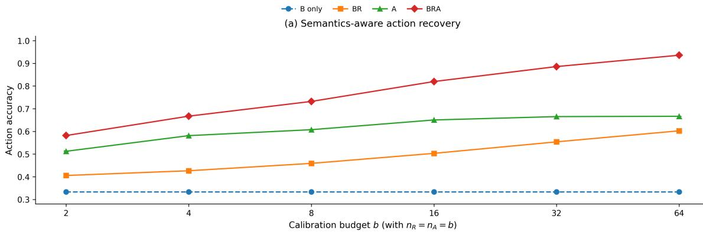

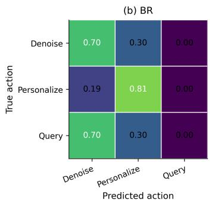

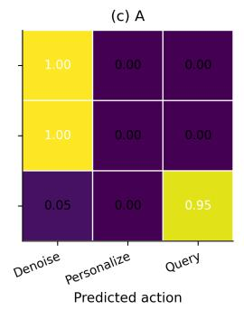

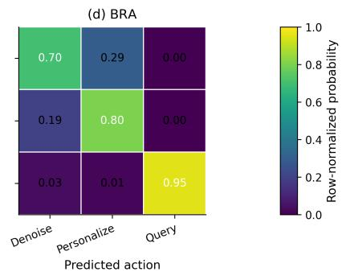  
Figure 2. Semantics-aware action recovery under channel refinement. The three regimes use threshold $t _ { \tau } = t _ { \alpha } = 0 . 1 5 \colon$ DENOISE (0.02, 0.02), PERSONALIZE (0.35, 0.02), and QUERY (0.02, 0.35). All three regimes are constructed to share the same empirica binary-law distribution by reusing the same set of µ-values across regimes. Panel (a) plots action accuracy versus calibration budget $b ,$ with $n _ { R } = n _ { A } = b$ and $n _ { B } = 5 1 2$ . Panels (b)–(d) show row-normalized confusion matrices at representative budget b = 16 for BR, A, and BRA. Repeats and abstention recover complementary action dimensions, while the combined channel recovers the ful semantics-aware policy.

Our scope is deliberately channel-theoretic. The parameter $\alpha _ { q }$ is defined as total non-binary mass, so interpreting it specifically as tie, refusal, or incomparability requires richer output alphabets or additional structural assumptions; similarly, $\tau _ { q }$ isolates stable between-type variation but does not by itself determine whether that variation is normatively meaningful pluralism or nuisance context. These are limitations of the available information rather than of a particular estimator. The practical implication is therefore methodological: if downstream systems are expected to distinguish noise from persistent disagreement, or to abstain on semantically underspecified comparisons, then richer elicitation protocols are not optional regularizers but identification requirements. A natural next step is to study which minimal refinements separate distinct forms of non-binary mass while preserving the same nonparametric identification viewpoint.

## References

Chidambaram, K., Seetharaman, K. V., and Syrgkanis, V. Direct preference optimization with unobserved preference heterogeneity: The necessity of ternary preferences. arXiv preprint arXiv:2510.15716, 2025.

Christiano, P. F., Leike, J., Brown, T. B., Martic, M., Legg, S., and Amodei, D. Deep reinforcement learning from human preferences. In Advances in Neural Information Processing Systems, 2017.

Hoeffding, W. Probability inequalities for sums of bounded random variables. Journal ofthe American Statistical Association, 58(301):13–30, 1963. doi: 10.1080/01621459. 1963.10500830.

Ouyang, L., Wu, J., Jiang, X., Almeida, D., Wainwright, C. L., Mishkin, P., Zhang, C., Agarwal, S., Slama, K., Ray, A., Schulman, J., Hilton, J., Kelton, F., Miller, L., Simens, M., Askell, A., Welinder, P., Christiano, P., Leike, J., and Lowe, R. Training language models to follow instructions with human feedback. arXiv preprint arXiv:2203.02155, 2022.

Pukdee, R., Balcan, M.-F., and Ravikumar, P. What does preference learning recover from pairwise comparison data? arXiv preprint arXiv:2602.10286, 2026.

Rafailov, R., Sharma, A., Mitchell, E., Ermon, S., Manning, C. D., and Finn, C. Direct preference optimization: Your language model is secretly a reward model. arXiv preprint arXiv:2305.18290, 2023.

Shirali, A., Nasr-Esfahany, A., Alomar, A., Mirtaheri, P., Abebe, R., and Procaccia, A. Direct alignment with heterogeneous preferences. arXiv preprint arXiv:2502.16320, 2025.

Siththaranjan, A., Laidlaw, C., and Hadfield-Menell, D. Distributional preference learning: Understanding and accounting for hidden context in rlhf. arXiv preprint arXiv:2312.08358, 2023.

Zhang, M. J., Wang, Z., Hwang, J. D., Dong, Y., Delalleau, O., Choi, Y., Choi, E., Ren, X., and Pyatkin, V. Diverging preferences: When do annotators disagree and do models know? In Proceedings ofthe 42nd International Conference on Machine Learning, volume 267 of Proceedings ofMachine Learning Research, pp. 76193–76212, 2025.

Table 1. Novelty map relative to the closest lines of work.
<table><tr><td rowspan=1 colspan=1>Line of work</td><td rowspan=1 colspan=1>Representative references</td><td rowspan=1 colspan=1>Primary object of analysis</td><td rowspan=1 colspan=1>How this paper differs</td></tr><tr><td rowspan=1 colspan=1>Aggregate recovery frompairwise data</td><td rowspan=1 colspan=1>Pukdee et al. (2026)</td><td rowspan=1 colspan=1>The conditional pairwise prefer-ence distribution (CPRD), i.e.,the aggregate preference objectencoded by pairwise data</td><td rowspan=1 colspan=1>We study the latent semantic preim-age of a fixed binary law. Theo-rem 3.1 characterizes the exact fiberover $\left( \mu _ { q } \right)$ , which is a different ques-tion from recovering or representingthe aggregate law itself.</td></tr><tr><td rowspan=1 colspan=1>Hidden context in RLHF/ distributional preferencelearning</td><td rowspan=1 colspan=1>Siththaranjan et al. (2023)</td><td rowspan=1 colspan=1>How hidden context induces ag-gregation effects (e.g. Borda-type aggregation) and how util-ity distributions can account forit</td><td rowspan=1 colspan=1>We abstract away from any particu-lar score-based learning rule and askwhat the feedback channel identifiesabout disagreement semantics beforeone chooses an aggregation mecha-nism.</td></tr><tr><td rowspan=1 colspan=1>Heterogeneous alignmentwith user types</td><td rowspan=1 colspan=1>Shirali et al. (2025)</td><td rowspan=1 colspan=1>Alignment when user types areheterogeneous and extra anno-tator information may be avail-able</td><td rowspan=1 colspan=1>We do not assume a target average-reward objective or a user-type model.Our results are upstream: they charac-terize when disagreement semanticsare identifiable from data at all.</td></tr><tr><td rowspan=1 colspan=1>Richer feedback for latentheterogeneity</td><td rowspan=1 colspan=1>Chidambaram et al. (2025)</td><td rowspan=1 colspan=1>Identifiability of latent prefer-ence heterogeneity under binaryversus ternary or ranking-basedfeedback</td><td rowspan=1 colspan=1>We study a more primitive question:whether observed disagreement re-flects persistent latent variation, non-binary mass hidden by forced choice,or both. Our refinements are repeatsand abstention rather than rankings.</td></tr><tr><td rowspan=1 colspan=1>Empirical taxonomies ofdisagreement</td><td rowspan=1 colspan=1>Zhang et al. (2025)</td><td rowspan=1 colspan=1>Empirical causes of disagree-ment in real preference datasets</td><td rowspan=1 colspan=1>These works motivate our latent de-composition, but do not provide exactnonparametric identifiability regionsor channel-refinement theorems.</td></tr></table>

## A. Positioning and Novelty Map

This appendix clarifies the precise gap filled by the paper relative to the closest theory and empirical literature. The centra novelty is not a new parametric preference model, a new reward objective, or a new alignment algorithm. Rather, the paper gives a channel-theoretic answer to a prior question: before choosing an aggregation objective or fitting a preference model, what semantic distinctions about disagreement are identifiable from the feedback channel itself? Our main theorems show that anonymous binary data identify only the aggregate directional preference $\mu _ { q } ,$ whereas same-annotator repeats and abstention are minimal complementary refinements that identify the missing semantic quantities $\tau _ { q }$ and $\alpha _ { q } .$

Aggregate preference recovery versus semantic identifiability. The closest theoretical paper is Pukdee et al. (2026), which formalizes the conditional pairwise preference distribution (CPRD) as the aggregate preference object encoded by pairwise comparison data. Their contribution is to clarify what pairwise data recover at the preference-law level. Our contribution begins where that analysis stops. Fix the anonymous binary law for a single query, or equivalently fix $\mu _ { q } .$ . We ask: which latent semantic worlds remain compatible with that law? The answer is Theorem 3.1, which gives the exact fiber

$$
\begin{array} { r } { S _ { q } ^ { \mathsf { B } } ( M ) = \left\{ ( \mu _ { q } ( M ) , \tau , \alpha ) : ( \alpha , \tau ) \in \mathcal { F } ( \mu _ { q } ( M ) ) \right\} . } \end{array}
$$

Thus the object of the paper is not the aggregate law itself, but the exact semantic multiplicity beneath that law. In particular, the paper proves a result that is orthogonal to CPRD recovery: anonymous binary data may determine the aggregate directional preference while leaving a full two-dimensional region of disagreement semantics unresolved.

Hidden context versus channel-level identifiability. The hidden-context literature, especially Siththaranjan et al. (2023), asks how unobserved context alters the behavior of preference learning procedures and can induce implicit social-choice aggregation. Our framework is compatible with that viewpoint—indeed, one can interpret the latent type Z as hidden context—but the question is different. Those works analyze what a learning rule does given hidden context. We ask what the observation channel alone reveals about the semantic source of disagreement. For this reason, our results do not depend on Bradley–Terry, Plackett–Luce, utility representability, or any particular scoring model. The identification frontier in Theorem 4.4 is therefore a channel-level statement, not an algorithm-level one.

Heterogeneous alignment versus semantic-source identification. Work on heterogeneous alignment, such as Shirali et al. (2025), starts from a population of user types and studies how one should align a single policy when preferences differ across types. That line of work is objective-first: it asks which social or average objective is learnable under which side-information assumptions. Our paper is prior to that choice. We do not assume a user-type space that is finite, discrete, or even normatively meaningful; we only assume a stable latent source of variation. The quantity

$$
\tau _ { q } = \mathrm { V a r } ( m _ { q } ( Z ) )
$$

therefore measures persistent latent disagreement without committing to whether it should ultimately be interpreted as pluralistic value disagreement or nuisance context. In this sense, our paper identifies a precondition for heterogeneous alignment: before optimizing a heterogeneous objective, one must first know whether the observed disagreement is evidence of stable heterogeneity at all.

Richer feedback for latent heterogeneity. The closest paper in spirit on richer elicitation is Chidambaram et al. (2025), which shows that binary comparisons are insufficient to identify latent heterogeneous preferences in their setting, while richer feedback such as ternary or ranking-based responses can restore identifiability. That result is complementary to ours, not redundant with it. Their question is: within a heterogeneous-preference model, can one identify the latent structure? Our question is earlier: does the data tell us that the disagreement is persistent latent heterogeneity rather than hidden non-binary mass or binary stochasticity? Accordingly, the two papers use different refinements for different goals. We use same-annotator repeats and abstention to separate semantic sources of disagreement; they use richer rankings to identify latent heterogeneity inside a heterogeneous-preference family. One can therefore view the two results as compositional: our results identify when a persistent component is present, while theirs can then be used to identify structure within that component.

Empirical disagreement taxonomies versus theoremic identification. Empirical work such as Zhang et al. (2025) documents that disagreement in real preference data often arises from underspecification, response style, or refusal rather than simple noise. This empirical observation is one of the main motivations for our semantic decomposition. But the role of our paper is different. We do not infer a taxonomy from real data; instead, we prove which distinctions are identifiable from each feedback channel. In particular, the paper gives exact characterization results—Theorem 3.1 for anonymous binary feedback and Theorem 4.4 for channel refinement—that are not provided by empirical disagreement audits alone.

What is new, precisely. To the best of our knowledge, the paper is the first to provide all three of the following within a single nonparametric framework:

1. an exact querywise semantic fiber over the anonymous binary law, not merely a statement that identifiability fails;

2. an exact channel-refinementfrontier

$$
\equiv _ { \mathsf { B R A } } \subsetneq \equiv _ { \mathsf { B R } } \subsetneq \equiv _ { \mathsf { B } } , \qquad \equiv _ { \mathsf { B R A } } \subsetneq \equiv _ { \mathsf { A } } \subsetneq \equiv _ { \mathsf { B } } ,
$$

showing which minimal refinements recover which semantic coordinates; and

3. finite-sample and decision-theoretic consequences of that frontier, namely nonasymptotic recovery guarantees for $( \widehat { \tau } _ { q } , \widehat { \alpha } _ { q } )$ and a binary-only impossibility result for semantics-aware actions.

This is the sense in which the contribution is foundational rather than incremental. The paper does not add another model to the existing preference learning pipeline; it identifies which semantic distinctions that pipeline can and cannot support.

Non-claims. The paper does not claim that every persistent component of disagreement is normatively meaningful pluralism, nor that every non-binary response is genuine incomparability. Those stronger semantic interpretations require richer output alphabets or additional structural assumptions, which is precisely why Appendix G studies tie/incomparability separation and repeated abstention. Our claim is narrower and more robust: under the standard anonymous binary channel, these distinctions are not identifiable from the data alone, and therefore cannot be justified merely by improving the estimator.

Table 2. Core notation for the formal setup.
<table><tr><td>Symbol</td><td>Meaning</td></tr><tr><td> $\mathcal { Q }$ </td><td>Finite set of ordered pairwise comparison queries.</td></tr><tr><td> $q \in \mathcal { Q }$ </td><td>A fixed query; labels ±1 are interpreted relative to the ordering encoded by</td></tr><tr><td> $( \mathcal { Z } , \mathcal { F } , \pi )$ </td><td>Latent type space and population distribution over stable hidden types.</td></tr><tr><td> $Z \sim \pi$ </td><td>Latent type of a sampled annotator.</td></tr><tr><td> $\widetilde { Y } \in \{ + 1 , 0 , - 1 \}$ </td><td>Latent ternary response: strict preference for the first alternative, non-binary response, or strict preference for the second alternative.</td></tr><tr><td> $Y \in \{ + 1 , - 1 \}$ </td><td>Observed binary response after forced completion of  ${ \widetilde { Y } } = 0 .$ </td></tr><tr><td> $a _ { q } ( z )$ </td><td>Conditional non-binary mass at query q for latent type  $z .$ </td></tr><tr><td> $m _ { q } ( z )$ </td><td>Conditional directional preference mean at query q for latent type z.</td></tr><tr><td> $\mu _ { q }$ </td><td>Aggregate directional preference.  $\mu _ { q } = \mathbb { E } [ m _ { q } ( Z ) ] .$ </td></tr><tr><td> $\nu _ { q }$ </td><td>Second moment of the directional mean,  $\begin{array} { r } { \dot { \nu _ { q } } = \mathbb { E } [ \dot { m } _ { q } ( Z ) ^ { 2 } ] . } \end{array}$ </td></tr><tr><td> $\tau _ { q }$ </td><td>Persistent disagreement,  $\tau _ { q } = \mathrm { V a r } ( m _ { q } ( Z ) ) _ { . } = \nu _ { q } - \mu _ { q } ^ { 2 } .$ </td></tr><tr><td> $\alpha _ { q }$ </td><td>Aggregate non-binary mass,  $\boldsymbol { \alpha } _ { q } = \mathbb { E } [ \boldsymbol { a } _ { q } ( Z ) ]$ </td></tr><tr><td> $\mathsf { B }$   $\mathsf { R }$ </td><td>Anonymous binary channel.</td></tr><tr><td> $\mathsf { A }$ </td><td>Same-annotator repeat channel.</td></tr><tr><td> $\mathrm { L a w } _ { M , q } ^ { \mathsf { C } }$ </td><td>Abstention-enabled ternary channel.</td></tr><tr><td> $M \equiv _ { \mathsf { C } } { \mathrm { \dot { M } } } ^ { \prime }$ </td><td>Observable law induced by model M on query  $q$  under channel  $\mathsf { C } .$  Observational equivalence of models M and _  $\bar { M ^ { \prime } }$  under channel C</td></tr><tr><td> $\mathcal { T } _ { q } ^ { \mathsf { C } } ( \theta ; M )$ </td><td>Identification region of parameter  $\theta _ { q }$  - at model M under channel C.</td></tr><tr><td> ${ \mathcal { S } } _ { q } ^ { \mathsf { { C } } } ( M )$ </td><td></td></tr><tr><td></td><td>Semantic fiber  $\mathcal { T } _ { q } ^ { \mathsf { C } } ( ( \mu _ { q } , \tau _ { q } , \alpha _ { q } ) ; M )$ </td></tr></table>

## B. Full Formal Setup

This appendix specifies the statistical experiment underlying the main theorems. Pairwise comparison data are the dominan supervision signal in preference learning, RLHF, and direct alignment pipelines (Christiano et al., 2017; Ouyang et al., 2022; Rafailov et al., 2023). Recent work clarifies that such data identify an aggregate comparison law—formalized as the conditional pairwise preference distribution (CPRD)—even when common parametric models are misspecified (Pukdee et al., 2026). Complementary work shows that hidden context and heterogeneous annotators can induce nontrivial aggregation effects and identifiability failures (Siththaranjan et al., 2023; Shirali et al., 2025; Chidambaram et al., 2025), while empirical analyses find that disagreement often reflects underspecification, response style, or refusals rather than simple annotation error (Zhang et al., 2025). We therefore adopt a deliberately nonparametric latent-type model whose purpose is to isolate what is identified by thefeedback channel itself.

## B.1. Model class

We work querywise over a finite set Q of ordered pairwise comparison queries. In the intended RLHF/alignment interpretation, each $q \in \mathcal { Q }$ is a prompt paired with two candidate responses, as in standard pairwise-feedback pipelines (Christiano et al., 2017; Ouyang et al., 2022; Rafailov et al., 2023). The order of the two alternatives is part of the query representation itself, so the sign of a preference label is always interpreted relative to a fixed orientation.

The latent type space is modeled as a standard Borel probability space $( \mathcal { Z } , \mathcal { F } , \pi )$ . A draw $Z \sim \pi$ should be interpreted broadly as a stable hidden source of semantic variation: enduring values, evaluation rubric, task interpretation, stylistic disposition, or any other persistent hidden context in the sense discussed by Siththaranjan et al. (2023). The shared type space allows the same latent type to induce arbitrarily correlated behavior across different queries, but we impose no structural restrictions on that dependence, and none of the identification arguments rely on such structure.

Definition B.1 (Latent semantic preference model). Fix a finite query set Q. A latent semantic preference model is a tuple

$$
M = \big ( ( { \mathcal { Z } } , { \mathcal { F } } , \pi ) , \{ ( a _ { q } , m _ { q } ) \} _ { q \in { \mathcal { Q } } } \big ) ,
$$

where, for each $q \in \mathcal { Q } .$

$$
a _ { q } : \mathcal { Z } \to [ 0 , 1 ] , \qquad m _ { q } : \mathcal { Z } \to [ - 1 , 1 ]
$$

are measurable and satisfy

$$
| m _ { q } ( z ) | \leq 1 - a _ { q } ( z ) \qquad \mathrm { f o r ~ e v e r y ~ } z \in \mathcal { Z } .
$$

Equivalently, for each $( q , z )$ the pair $( a _ { q } ( z ) , m _ { q } ( z ) )$ defines a probability distribution on $\{ + 1 , 0 , - 1 \}$ via

$$
p _ { q } ^ { 0 } ( z ) : = a _ { q } ( z ) ,
$$

$$
p _ { q } ^ { + } ( z ) : = \frac { 1 - a _ { q } ( z ) + m _ { q } ( z ) } { 2 } ,
$$

$$
p _ { q } ^ { - } ( z ) : = \frac { 1 - a _ { q } ( z ) - m _ { q } ( z ) } { 2 } .
$$

The nonnegativity of $p _ { q } ^ { + } , p _ { q } ^ { 0 } , p _ { q } ^ { - }$ and the identity $p _ { q } ^ { + } ( z ) + p _ { q } ^ { 0 } ( z ) + p _ { q } ^ { - } ( z ) = 1$ follow exactly from the constraint $| m _ { q } ( z ) | \leq$ $1 - a _ { q } ( z )$

Conditional on latent type $Z = z$ and query $q ,$ the latent response $\widetilde { Y } \in \{ + 1 , 0 , - 1 \}$ is distributed as

$$
\begin{array} { r } { \mathbb { P } ( \widetilde { Y } = + 1 \mid Z = z , q ) = p _ { q } ^ { + } ( z ) , \quad \mathbb { P } ( \widetilde { Y } = 0 \mid Z = z , q ) = p _ { q } ^ { 0 } ( z ) , \quad \mathbb { P } ( \widetilde { Y } = - 1 \mid Z = z , q ) = p _ { q } ^ { - } ( z ) . } \end{array}
$$

Thus

$$
a _ { q } ( z ) = { \mathbb { P } } ( \widetilde { Y } = 0 \mid Z = z , q ) , \qquad m _ { q } ( z ) = { \mathbb { E } } [ \widetilde { Y } \mid Z = z , q ] .
$$

Remark B.2 (Why $( a _ { q } , m _ { q } )$ are the primitive objects). The pair $( a _ { q } , m _ { q } )$ is the minimal parameterization of the ternary kernel needed for the theorems in the paper. The quantity $a _ { q } ( z )$ records how often type z does not express a strict comparison at query $q ,$ while $m _ { q } ( z )$ records the centered directional tendency among the two strict outcomes. This parameterization is intentionally agnostic to any reward-based, Bradley–Terry, Plackett–Luce, or random-utility representation. That nonparametric choice is deliberate: the object of study is channel-level identifiability, not the recovery properties of a particular parametric score model. This viewpoint is aligned with the CPRD-based, data-centric perspective of Pukdee et al. (2026).

Remark B.3 (Interpretation of the zero state). The symbol 0 is intentionally protocol-agnostic. Depending on the elicitation interface, it may represent abstention, tie, refusal, indecision, or genuine incomparability. Recent empirical work shows that disagreement in preference data often arises from underspecification, response style, or refusals rather than simple annotation error (Zhang et al., 2025). The main body of the paper therefore treats 0 as non-binary response mass. This is the strongest coarse-graining for the binary channel: any finer semantic subdivision of the zero state can only make anonymous binary observations less informative. Appendix G returns to this issue and explicitly separates tie mass from incomparability mass.

Definition B.4 (Semantic functionals). For a model M and query $q \in \mathcal { Q } ,$ define

$$
\mu _ { q } ( M ) : = \mathbb { E } _ { \pi } [ m _ { q } ( Z ) ] , \qquad \nu _ { q } ( M ) : = \mathbb { E } _ { \pi } [ m _ { q } ( Z ) ^ { 2 } ] ,
$$

$$
\tau _ { q } ( M ) : = \mathrm { V a r } _ { \pi } ( m _ { q } ( Z ) ) = \nu _ { q } ( M ) - \mu _ { q } ( M ) ^ { 2 } , \qquad \alpha _ { q } ( M ) : = \mathbb { E } _ { \pi } [ a _ { q } ( Z ) ] .
$$

When the ambient model M is clear from context, we write simply $\mu _ { q } , \nu _ { q } , \tau _ { q } , \alpha _ { q }$

We interpret

• $\mu _ { q }$ as the aggregate directional preference,

• $\tau _ { q }$ as the persistent disagreement,

• $\alpha _ { q }$ as the non-binary mass.

We also use the vector notation

$$
\mu ( M ) : = ( \mu _ { q } ( M ) ) _ { q \in \Theta } , \quad \nu ( M ) : = ( \nu _ { q } ( M ) ) _ { q \in \Theta } , \quad \tau ( M ) : = ( \tau _ { q } ( M ) ) _ { q \in \Theta } , \quad \alpha ( M ) : = ( \alpha _ { q } ( M ) ) _ { q \in \Theta } .
$$

Remark B.5 (Meaning of persistent disagreement). The quantity $\tau _ { q } = \mathrm { V a r } ( m _ { q } ( Z ) )$ is the between-type variance of the conditional directional mean. It is not the variance of the observed label. Hence $\tau _ { q }$ isolates stable latent variation across annotators and excludes within-type stochasticity. In particular, $\tau _ { q }$ may reflect enduring value pluralism, but it may also reflect stable nuisance factors such as different evaluation rubrics or hidden task interpretations. The theorems identify persistent latent variation as a statistical object; they do not by themselves resolve its normative interpretation.

## B.2. Primitive observation channels

We now formalize the observation channels. The essential distinction is between the latent semantic response $\widetilde { Y }$ and the actually observed feedback. Anonymous forced-choice interfaces convert the ternary latent response into a binary observation; repeated elicitation reuses the same latent type; abstention interfaces expose the zero state directly.

Definition B.6 (Primitive channels). Fix a model M and a query $q \in \mathcal { Q }$

Anonymous binary channel B. Draw $Z \sim \pi$ , then draw $\widetilde { Y } \in \{ + 1 , 0 , - 1 \}$ according to Definition B.1. If $\widetilde Y \in \{ + 1 , - 1 \}$ }, output $Y = { \widetilde { Y } } . { \mathrm { I f } } { \widetilde { Y } } = 0$ , draw an independent completion coin $C \in \{ + 1 , - 1 \}$ with

$$
\mathbb { P } ( C = + 1 ) = \mathbb { P } ( C = - 1 ) = { \frac { 1 } { 2 } }
$$

and output $Y = C$

Same-annotator repeat channel R. Draw a single latent type $Z \sim \pi$ . Conditional on $( Z , q )$ , draw two latent responses

$$
\widetilde { Y } ^ { ( 1 ) } , \widetilde { Y } ^ { ( 2 ) } \in \{ + 1 , 0 , - 1 \}
$$

independently from the same query-specific kernel. Independently complete each zero response using an independent fair completion coin exactly as in channel B. The observable is the pair

$$
\left( Y ^ { ( 1 ) } , Y ^ { ( 2 ) } \right) \in \{ + 1 , - 1 \} ^ { 2 } .
$$

Abstention channel A. Draw $Z \sim \pi$ , then draw $\widetilde { Y } \in \{ + 1 , 0 , - 1 \}$ from the latent kernel. The observable is $\widetilde { Y }$ itself.

Combined channels. When we write a combined channel such as BR, BA, or BRA, we mean that the analyst has access to independent samples from each constituent primitive channel.

Assumption B.7 (Conditional independence of repeated elicitation). Under channel R, conditional on $( Z , q )$ the latent responses $\widetilde { Y } ^ { ( 1 ) }$ and $\widetilde { Y } ^ { ( 2 ) }$ are independent draws from the same kernel. All completion coins are mutually independent and independent of all latent responses.

Remark B.8 (Why the completion rule is symmetric). The fair-coin completion rule is a deliberate modeling choice. It makes the binary channel informationally neutral on latent non-binary responses and therefore isolates the identifiability phenomenon in its cleanest form. This gives the binary interface the strongest possible chance. Appendix G shows that if the completion rule is asymmetric or unknown, identifiability can only deteriorate.

Remark B.9 (Population interpretation of the repeat channel). The repeat channel should be read as a minimal annotatorlinking intervention: the analyst learns that two labels came from the same stable latent source. Related “same-user” information has already appeared as a useful signal in heterogeneous-alignment analyses (Shirali et al., 2025). In our framework, however, repeats are used only to identify the between-type component of disagreement and are otherwise kept agnostic to any downstream alignment objective.

## B.3. Statistical experiment

The population-level identification results in the main text are statements about the observable laws induced by the primitive channels. For the finite-sample results, we adopt a product experiment with independent samples from each channel.

Let

$$
\mathcal { V } _ { \mathsf { B } } : = \{ + 1 , - 1 \} , \qquad \mathcal { V } _ { \mathsf { R } } : = \{ + 1 , - 1 \} ^ { 2 } , \qquad \mathcal { V } _ { \mathsf { A } } : = \{ + 1 , 0 , - 1 \} .
$$

For a sample-allocation vector

$$
\mathbf { n } : = \left( ( n _ { B , q } , n _ { R , q } , n _ { A , q } ) \right) _ { q \in \mathcal { Q } } \in ( \mathbb { N } _ { 0 } ^ { 3 } ) ^ { | \mathcal { Q } | } ,
$$

define the global sample space

$$
\Omega _ { \mathbf { n } } : = \prod _ { q \in \mathcal { Q } } \left( \mathcal { Y } _ { \mathsf { B } } ^ { n _ { B , q } } \times \mathcal { Y } _ { \mathsf { R } } ^ { n _ { R , q } } \times \mathcal { Y } _ { \mathsf { A } } ^ { n _ { A , q } } \right) ,
$$

with the convention $S ^ { 0 } = \{ \emptyset \}$ for any set S.

For each fixed model M and query q, let

$$
\begin{array} { r } { \begin{array} { r l r l r l r } { P _ { M , q } ^ { \mathtt { B } } : = \mathrm { L a w } _ { M , q } ^ { \mathtt { B } } , } & { } & & { P _ { M , q } ^ { \mathtt { R } } : = \mathrm { L a w } _ { M , q } ^ { \mathtt { R } } , } & & { } & & { P _ { M , q } ^ { \mathtt { A } } : = \mathrm { L a w } _ { M , q } ^ { \mathtt { A } } } \end{array} } \end{array}
$$

be the corresponding observable laws. The channel-separated product experiment is then

$$
\mathbb { P } _ { M } ^ { { \bf n } } : = \bigotimes _ { q \in \mathcal { Q } } \big ( ( P _ { M , q } ^ { { \bf B } } ) ^ { \otimes n _ { B , q } } \otimes ( P _ { M , q } ^ { { \bf R } } ) ^ { \otimes n _ { R , q } } \otimes ( P _ { M , q } ^ { { \bf A } } ) ^ { \otimes n _ { A , q } } \big ) .\tag{19}
$$

All concentration and minimax statements in the appendices are taken with respect to the experiment in (19), unless explicitly stated otherwise.

Remark B.10 (Querywise reduction). Every population identification statement proved in this paper is querywise. Since Q is finite, vector-valued statements over all queries follow coordinatewise. Likewise, uniform finite-sample guarantees are obtained from the corresponding pointwise bounds by a union bound over $q \in \mathcal { Q }$

Definition B.11 (Channel-measurable estimators and decision rules). Fix a parameter map $\theta _ { q } : \mathcal { M } ( \mathcal { Q } )  \Theta$ and an action space A.

A querywise estimator of $\theta _ { q }$ under sample allocation n is a measurable map

$$
\widehat { \theta } _ { q } : \Omega _ { \mathbf { n } } \to \Theta .
$$

A querywise decision rule is a measurable map

$$
\delta _ { q } : \Omega _ { \mathbf { n } }  { \mathcal { A } } .
$$

When we speak of a rule that uses only a specified channel, such as a B-measurable or A-measurable rule, we mean that the rule is measurable with respect to the sigma-field generated by the corresponding coordinate block of $\Omega _ { \mathbf { n } }$

## B.4. Explicit observable laws

The next proposition makes the dependence of each primitive channel on the latent model completely explicit. This proposition is the algebraic backbone of the later identification results.

Proposition B.12 (Observable laws under the primitive channels). Fix a model M and a query $q \in \mathcal { Q } .$

(i) Binary channel. Under B, the observable law on $\mathcal { V } _ { \mathsf { B } } = \{ + 1 , - 1 \}$ is

$$
P _ { M , q } ^ { \mathsf { B } } ( Y = y ) = \frac { 1 + y \mu _ { q } ( M ) } { 2 } , \qquad y \in \{ + 1 , - 1 \} .
$$

(ii) Repeat channel. Under R, the observable law on $\mathcal { V } _ { \mathsf { R } } = \{ + 1 , - 1 \} ^ { 2 }$ is

$$
P _ { M , q } ^ { \mathrm { R } } ( Y ^ { ( 1 ) } = y _ { 1 } , Y ^ { ( 2 ) } = y _ { 2 } ) = \frac { 1 + ( y _ { 1 } + y _ { 2 } ) \mu _ { q } ( M ) + y _ { 1 } y _ { 2 } \nu _ { q } ( M ) } { 4 } , \qquad y _ { 1 } , y _ { 2 } \in \{ + 1 , - 1 \} .
$$

(iii) Abstention channel. Under A, the observable law on ${ \mathcal { V } } _ { \mathsf { A } } = \{ + 1 , 0 , - 1 \}$ is

$$
P _ { M , q } ^ { \mathsf { A } } ( \widetilde { Y } = 0 ) = \alpha _ { q } ( M ) ,
$$

and for $y \in \{ + 1 , - 1 \}$

$$
P _ { M , q } ^ { \mathtt { A } } ( \widetilde { Y } = y ) = \frac { 1 - \alpha _ { q } ( M ) + y \mu _ { q } ( M ) } { 2 } .
$$

Proof. For channel B, conditional on $( Z = z , q )$ , symmetric completion contributes zero mean on the event $\{ \widetilde { Y } = 0 \}$ Hence

$$
\begin{array} { r } { \mathbb { E } [ Y \mid Z = z , q ] = \mathbb { P } ( \widetilde { Y } = + 1 \mid Z = z , q ) - \mathbb { P } ( \widetilde { Y } = - 1 \mid Z = z , q ) = m _ { q } ( z ) . } \end{array}
$$

Taking expectations over $Z \sim \pi$ yields

$$
\operatorname { \mathbb { E } } [ Y \mid q ] = \operatorname { \mathbb { E } } _ { \pi } [ m _ { q } ( Z ) ] = \mu _ { q } ( M ) .
$$

Since $Y \in \{ + 1 , - 1 \}$ , the binary law is uniquely determined by its mean:

$$
P _ { M , q } ^ { \mathsf { B } } ( Y = y ) = { \frac { 1 + y \mathbb { E } [ Y \mid q ] } { 2 } } = { \frac { 1 + y \mu _ { q } ( M ) } { 2 } } .
$$

For channel $\mathsf { R } ,$ conditional on $( Z = z , q )$ the repeated observations are independent and each has conditional mean $m _ { q } ( z )$ Therefore

$$
\begin{array} { r } { \mathbb { E } [ Y ^ { ( 1 ) } \mid Z = z , q ] = \mathbb { E } [ Y ^ { ( 2 ) } \mid Z = z , q ] = m _ { q } ( z ) , \qquad \mathbb { E } [ Y ^ { ( 1 ) } Y ^ { ( 2 ) } \mid Z = z , q ] = m _ { q } ( z ) ^ { 2 } . } \end{array}
$$

Taking expectations gives

$$
\mathbb { E } [ Y ^ { ( 1 ) } \mid q ] = \mathbb { E } [ Y ^ { ( 2 ) } \mid q ] = \mu _ { q } ( M ) , \qquad \mathbb { E } [ Y ^ { ( 1 ) } Y ^ { ( 2 ) } \mid q ] = \nu _ { q } ( M ) .
$$

Now use the identity

$$
{ \bf 1 } \{ Y ^ { ( 1 ) } = y _ { 1 } \} { \bf 1 } \{ Y ^ { ( 2 ) } = y _ { 2 } \} = \frac { 1 + y _ { 1 } Y ^ { ( 1 ) } } { 2 } \cdot \frac { 1 + y _ { 2 } Y ^ { ( 2 ) } } { 2 } , \qquad y _ { 1 } , y _ { 2 } \in \{ + 1 , - 1 \} ,
$$

and take expectations to obtain

$$
P _ { M , q } ^ { \mathrm { R } } ( y _ { 1 } , y _ { 2 } ) = \frac { 1 + y _ { 1 } \mu _ { q } ( M ) + y _ { 2 } \mu _ { q } ( M ) + y _ { 1 } y _ { 2 } \nu _ { q } ( M ) } { 4 } .
$$

For channel A, we have directly

$$
P _ { M , q } ^ { \mathsf { A } } ( \widetilde { Y } = 0 ) = \mathbb { E } _ { \pi } [ a _ { q } ( Z ) ] = \alpha _ { q } ( M ) .
$$

For $y = + 1$

$$
P _ { M , q } ^ { \mathrm { A } } ( \widetilde { Y } = + 1 ) = \mathbb { E } _ { \boldsymbol { \pi } } \bigg [ \frac { 1 - a _ { q } ( Z ) + m _ { q } ( Z ) } { 2 } \bigg ] = \frac { 1 - \alpha _ { q } ( M ) + \mu _ { q } ( M ) } { 2 } ,
$$

and the formula for $y = - 1$ follows analogously.

Corollary B.13 (Primitive-channel sufficient statistics). For each fixed query q, the observable law under

• channel B depends on the model M only through $\mu _ { q } ( M )$

• channel R depends on the model M only through $( \mu _ { q } ( M ) , \nu _ { q } ( M ) )$

• channel A depends on the model M only through $( \mu _ { q } ( M ) , \alpha _ { q } ( M ) )$ .

Consequently,for any two models $M , M ^ { \prime } \in \mathcal { M } ( \mathcal { Q } )$

$$
\begin{array} { c } { { M \equiv _ { \tt B } M ^ { \prime } \longleftrightarrow \mu ( M ) = \mu ( M ^ { \prime } ) , } } \\ { { { } } } \\ { { M \equiv _ { \tt R } M ^ { \prime } \longleftrightarrow ( \mu , \nu ) ( M ) = ( \mu , \nu ) ( M ^ { \prime } ) , } } \\ { { { } } } \\ { { M \equiv _ { \tt A } M ^ { \prime } \longleftrightarrow ( \mu , \alpha ) ( M ) = ( \mu , \alpha ) ( M ^ { \prime } ) . } } \end{array}
$$

Proof. The first claim follows immediately from Proposition B.12. The equivalences are obtained by applying the proposition coordinatewise for each $q \in \mathcal { Q }$ □

Remark B.14 (Relation to CPRD). Under the anonymous binary channel, the observable law is fully characterized by the pairwise choice probability

$$
\mathbb { P } ( Y = + 1 \mid q ) = \frac { 1 + \mu _ { q } } { 2 } .
$$

This is the channel-level object analogous to the aggregate comparison law studied by Pukdee et al. (2026). The conceptual distinction is important: CPRD captures what binary pairwise data say, whereas the latent semantic parameters $( \tau _ { q } , \alpha _ { q } )$ describe how the same aggregate law could have arisen. The paper’s central question is exactly whether those latent explanations are identifiable from the observable law induced by a given channel.

Remark B.15 (Why the main text uses BR). At the level of population identification, channel R alone already determines $( \mu _ { q } , \nu _ { q } )$ and hence $( \mu _ { q } , \tau _ { q } )$ . Nevertheless, the main text uses the notation BR to emphasize the intended experimental design: anonymous binary data are the default supervision source, while same-annotator repeats are collected only on a smaller calibration subset. This distinction matters for finite-sample allocation, even though it does not matter for the population characterization of the repeat law itself.

## B.5. Identification under a channel

We now formalize the identification language used throughout the paper.

Definition B.16 (Observational equivalence). Let C be any primitive or combined channel. Two models $M , M ^ { \prime } \in \mathcal { M } ( \mathcal { Q } )$ are observationally equivalent under C, written

$$
M \equiv _ { \bf C } M ^ { \prime } ,
$$

if

$$
\operatorname { L a w } _ { M , q } ^ { \mathsf { C } } = \operatorname { L a w } _ { M ^ { \prime } , q } ^ { \mathsf { C } } \qquad \mathrm { f o r } \mathrm { e v e r y } q \in { \mathcal { Q } } .
$$

Definition B.17 (Identification regions). Let $\theta _ { q } : \mathcal { M } ( \mathcal { Q } )  \Theta$ be any querywise parameter map and let C be any channel. The identification region of $\theta _ { q }$ at model M under channel C is

$$
\begin{array} { r } { \mathcal { T } _ { q } ^ { \mathtt { C } } ( \theta ; M ) : = \{ \theta _ { q } ( M ^ { \prime } ) : M ^ { \prime } \in \mathcal { M } ( \mathscr { Q } ) , M ^ { \prime } \equiv c M \} . } \end{array}
$$

We say that $\theta _ { q }$ is

• point-identified under channel $\mathsf { C i f } \ \mathscr { T } _ { q } ^ { \mathsf { C } } ( \theta ; M )$ is a singleton for every $M \in \mathcal { M } ( \mathcal { Q } )$

• partially identified under channel $\mathsf { C i f } \ \mathscr { T } _ { q } ^ { \mathsf { C } } ( \theta ; M )$ may contain more than one point.

Definition B.18 (Semantic fiber). For each model M, query q, and channel C, define the semantic fiber

$$
\mathcal { S } _ { q } ^ { \mathsf { C } } ( M ) : = \mathcal { Z } _ { q } ^ { \mathsf { C } } \big ( ( \mu _ { q } , \tau _ { q } , \alpha _ { q } ) ; M \big ) = \{ \big ( \mu _ { q } ( M ^ { \prime } ) , \tau _ { q } ( M ^ { \prime } ) , \alpha _ { q } ( M ^ { \prime } ) \big ) : M ^ { \prime } \equiv _ { \mathsf { C } } M \} .
$$

Thus ${ \mathcal { S } } _ { q } ^ { \mathsf { C } } ( M )$ is the set of all semantic triples compatible with the same observable law at query q under channel C.

Remark B.19 (Pointwise versus vector identification). Because the model class is unrestricted across queries, all nontrivial identification phenomena are already present at a single fixed query q. Accordingly, the main theorems are stated querywise. The corresponding vector statements over all $q \in \mathcal { Q }$ are obtained by applying the same argument coordinatewise.

Remark B.20 (Interpretive scope). The paper studies what the data-collection channel identifies about disagreement. It does not presuppose that persistent disagreement should always be interpreted as value pluralism, nor that non-binary mass should always be interpreted as incomparability. Those are downstream semantic judgments that require either stronger modeling assumptions or richer feedback protocols. The identification results show exactly which distinctions are and are not available from the data alone.

## C. Proof of Theorem 3.1

In the CPRD perspective of Pukdee et al. (2026), anonymous binary pairwise data identify an aggregate comparison law. Theorem 3.1 sharpens that viewpoint by characterizing the entire semantic fiber lying above a fixed binary law. Throughout this appendix, let $\mathcal { M } ( \mathcal { Q } )$ denote the class of all latent semantic preference models on the finite query set Q in the sense of Definition B.1.

## C.1. Restatement in fiber form

For $\mu \in [ - 1 , 1 ]$ , define the feasible set

$$
\mathcal F ( \mu ) : = \left\{ ( \alpha , \tau ) \in \mathbb { R } _ { \ge 0 } ^ { 2 } : \alpha \le 1 - | \mu | , \quad \tau \le 1 - \alpha - \mu ^ { 2 } \right\} .\tag{20}
$$

Since $\alpha \leq 1 - | \mu | \leq 1$ , the constraint $\alpha \in [ 0 , 1 ]$ is already implicit in (20).

We restate Theorem 3.1 in the fiber notation of Definition B.18.

Theorem C.1 (Exact semantic fiber under anonymous binary feedback). For every model $M \in \mathcal { M } ( \mathcal { Q } )$ and every query $q \in \mathcal { Q } ,$

$$
\begin{array} { r } { S _ { q } ^ { \mathtt { B } } ( M ) = \left\{ \left( \mu _ { q } ( M ) , \tau , \alpha \right) : ( \alpha , \tau ) \in \mathcal { F } \big ( \mu _ { q } ( M ) \big ) \right\} . } \end{array}\tag{21}
$$

Equivalently:

1. every model M satisfies

$$
\big ( \alpha _ { q } ( M ) , \tau _ { q } ( M ) \big ) \in \mathcal { F } \big ( \mu _ { q } ( M ) \big ) ;
$$

2. for every $\mu \in [ - 1 , 1 ]$ and every $( \alpha , \tau ) \in \mathcal { F } ( \mu )$ , there exists a model whose querywise semantic triple is $( \mu , \tau , \alpha )$ and whose anonymous binary law is

$$
\mathbb { P } ( Y = + 1 \mid q ) = \frac { 1 + \mu } { 2 } .
$$

Hence under channel B, the aggregate directional preference $\mu _ { q }$ is point-identified, while persistent disagreement $\tau _ { q }$ and non-binary mass $\alpha _ { q }$ are only partially identified through the exact region $\mathcal { F } ( \mu _ { q } )$

Proof strategy. The proof has four components. First, the pointwise constraint $| m _ { q } ( z ) | \leq 1 - a _ { q } ( z )$ yields necessary upper bounds on $( \alpha _ { q } , \tau _ { q } )$ at fixed $\mu _ { q }$ . Second, a homogeneous construction realizes the lower endpoint $\tau = 0$ at any feasible $( \mu , \alpha )$ . Third, an extremal three-type construction saturates the upper bound $\tau = 1 - \alpha - \mu ^ { 2 }$ . Fourth, a mixture argument interpolates every intermediate value of τ. A final embedding lemma then inserts the resulting one-query construction into an arbitrary ambient multi-query model without changing the anonymous binary law on any other query.

## C.2. Auxiliary lemmas

Lemma C.2 (Necessary feasibility constraints). For every model $M \in \mathcal { M } ( \mathcal { Q } )$ and every query $q \in \mathcal { Q } ,$

$$
0 \leq \alpha _ { q } ( M ) \leq 1 - | \mu _ { q } ( M ) | , \qquad 0 \leq \tau _ { q } ( M ) \leq 1 - \alpha _ { q } ( M ) - \mu _ { q } ( M ) ^ { 2 } .
$$

In particular,

$$
\big ( \alpha _ { q } ( M ) , \tau _ { q } ( M ) \big ) \in \mathcal { F } \big ( \mu _ { q } ( M ) \big ) .
$$

Proof. Fix M and q, and suppress the dependence on $( M , q )$ in the notation. Since $a _ { q } ( Z ) \in [ 0 , 1 ]$ almost surely,

$$
0 \leq \alpha _ { q } = \mathbb { E } [ a _ { q } ( Z ) ] \leq 1 .
$$

Also,

$$
\tau _ { q } = \mathrm { V a r } ( m _ { q } ( Z ) ) \geq 0 .
$$

By Definition B.1,

$$
| m _ { q } ( z ) | \leq 1 - a _ { q } ( z ) \qquad \mathrm { f o r ~ e v e r y ~ } z \in \mathcal { Z } .
$$

Hence

$$
| \mu _ { q } | = | \mathbb { E } [ m _ { q } ( Z ) ] | \leq \mathbb { E } [ | m _ { q } ( Z ) | ] \leq \mathbb { E } [ 1 - a _ { q } ( Z ) ] = 1 - \alpha _ { q } .
$$

This proves the upper bound $\alpha _ { q } \leq 1 - | \mu _ { q } |$

Next, because $| m _ { q } ( Z ) | \le 1 - a _ { q } ( Z ) \le 1$ almost surely, we have

$$
m _ { q } ( Z ) ^ { 2 } \leq | m _ { q } ( Z ) | \leq 1 - a _ { q } ( Z ) \qquad \mathrm { a l m o s t ~ s u r e l y } .
$$

Therefore

$$
\nu _ { q } = \mathbb { E } [ m _ { q } ( Z ) ^ { 2 } ] \leq \mathbb { E } [ 1 - a _ { q } ( Z ) ] = 1 - \alpha _ { q } .
$$

Recalling that $\tau _ { q } = \nu _ { q } - \mu _ { q } ^ { 2 } .$ , we obtain

$$
\tau _ { q } \le 1 - \alpha _ { q } - \mu _ { q } ^ { 2 } .
$$

This proves the claim.

Lemma C.3 (Homogeneous construction). Fix a query q and numbers $\mu \in [ - 1 , 1 ]$ and $\alpha \in [ 0 , 1 - | \mu | ]$ . Then there exists a one-query model

$$
\overline { { M } } _ { q ; \mu , \alpha } ^ { \mathrm { h o m } }
$$

on the singleton query set $\{ { q } \}$ such that

$$
\mu _ { q } \Bigl ( \overline { { { M } } } _ { q ; \mu , \alpha } ^ { \mathrm { h o m } } \Bigr ) = \mu , \qquad \alpha _ { q } \Bigl ( \overline { { { M } } } _ { q ; \mu , \alpha } ^ { \mathrm { h o m } } \Bigr ) = \alpha , \qquad \tau _ { q } \Bigl ( \overline { { { M } } } _ { q ; \mu , \alpha } ^ { \mathrm { h o m } } \Bigr ) = 0 .
$$

Proof. Let the latent space be the one-point standard Borel space

$$
\overline { { \mathcal { Z } } } ^ { \mathrm { h o m } } : = \{ z _ { \star } \} , \qquad \overline { { \pi } } ^ { \mathrm { h o m } } : = \delta _ { z _ { \star } } .
$$

Define

$$
\begin{array} { r } { \overline { { a } } _ { q } ^ { \mathrm { h o m } } ( z _ { \star } ) : = \alpha , \qquad \overline { { m } } _ { q } ^ { \mathrm { h o m } } ( z _ { \star } ) : = \mu . } \end{array}
$$

The constraint

$$
\left| \overline { { m } } _ { q } ^ { \mathrm { h o m } } ( z _ { \star } ) \right| = \left| \mu \right| \leq 1 - \alpha = 1 - \overline { { a } } _ { q } ^ { \mathrm { h o m } } ( z _ { \star } )
$$

holds by assumption, so this indeed defines a valid latent semantic preference model on the singleton query set $\{ { q } \}$ Since the latent type is deterministic,

$$
\mu _ { q } = \mathbb { E } [ \overline { { m } } _ { q } ^ { \mathrm { h o m } } ( Z ) ] = \mu , \qquad \alpha _ { q } = \mathbb { E } [ \overline { { a } } _ { q } ^ { \mathrm { h o m } } ( Z ) ] = \alpha ,
$$

and

$$
\tau _ { q } = \mathrm { V a r } \big ( \overline { { m } } _ { q } ^ { \mathrm { h o m } } ( Z ) \big ) = 0 .
$$

Lemma C.4 (Extremal construction). Fix a query q and numbers $\mu \in [ - 1 , 1 ]$ and $\alpha \in [ 0 , 1 - | \mu | ]$ . Then there exists a one-query model

$$
\overline { { { M } } } _ { q ; \mu , \alpha } ^ { \mathrm { e x t } }
$$

on the singleton query set {q} such that

$$
\mu _ { q } \left( \overline { { { M } } } _ { q ; \mu , \alpha } ^ { \mathrm { e x t } } \right) = \mu , \qquad \alpha _ { q } \left( \overline { { { M } } } _ { q ; \mu , \alpha } ^ { \mathrm { e x t } } \right) = \alpha , \qquad \tau _ { q } \left( \overline { { { M } } } _ { q ; \mu , \alpha } ^ { \mathrm { e x t } } \right) = 1 - \alpha - \mu ^ { 2 } .
$$

In particular, the upper boundfrom Lemma C.2 is sharp.

Proof. Consider the three-point latent space

$$
\overline { { \mathcal { Z } } } ^ { \mathrm { e x t } } : = \{ z _ { + } , z _ { 0 } , z _ { - } \} .
$$

Define a probability distribution on this space by

$$
\overline { { \pi } } ^ { \mathrm { e x t } } ( z _ { + } ) : = \frac { 1 - \alpha + \mu } { 2 } , \qquad \overline { { \pi } } ^ { \mathrm { e x t } } ( z _ { 0 } ) : = \alpha , \qquad \overline { { \pi } } ^ { \mathrm { e x t } } ( z _ { - } ) : = \frac { 1 - \alpha - \mu } { 2 } .\tag{22}
$$

These three numbers are nonnegative because $\alpha \leq 1 - | \mu |$ , and they sum to one. Define the querywise kernel by

$$
( \overline { { { a } } } _ { q } ^ { \mathrm { e x t } } , \overline { { { m } } } _ { q } ^ { \mathrm { e x t } } ) ( z _ { + } ) : = ( 0 , 1 ) , \qquad ( \overline { { { a } } } _ { q } ^ { \mathrm { e x t } } , \overline { { { m } } } _ { q } ^ { \mathrm { e x t } } ) ( z _ { 0 } ) : = ( 1 , 0 ) , \qquad ( \overline { { { a } } } _ { q } ^ { \mathrm { e x t } } , \overline { { { m } } } _ { q } ^ { \mathrm { e x t } } ) ( z _ { - } ) : = ( 0 , - 1 ) .
$$

The pointwise validity constraint

$$
{ \left| { \overline { { m } } } _ { q } ^ { \mathrm { e x t } } ( z ) \right| } \leq 1 - { \overline { { a } } } _ { q } ^ { \mathrm { e x t } } ( z )
$$

holds with equality at every latent type.

We now compute the semantic functionals. First,

$$
\begin{array} { r } { \alpha _ { q } = \mathbb { E } _ { \overline { { \pi } } ^ { \mathrm { e x t } } } \left[ \overline { { a } } _ { q } ^ { \mathrm { e x t } } ( Z ) \right] = \overline { { \pi } } ^ { \mathrm { e x t } } ( z _ { 0 } ) = \alpha . } \end{array}
$$

Second,

$$
\begin{array} { l } { \displaystyle \mu _ { q } = \mathbb { E } _ { \overline { { \pi } } ^ { \mathrm { e x t } } } \left[ \overline { { m } } _ { q } ^ { \mathrm { e x t } } ( Z ) \right] } \\ { \displaystyle \quad = \overline { { \pi } } ^ { \mathrm { e x t } } ( z _ { + } ) - \overline { { \pi } } ^ { \mathrm { e x t } } ( z _ { - } ) } \\ { \displaystyle \quad = \frac { 1 - \alpha + \mu } { 2 } - \frac { 1 - \alpha - \mu } { 2 } = \mu . } \end{array}
$$

Third,

$$
\begin{array} { l } { { \nu _ { q } = \mathbb { E } _ { \overline { { { \pi } } } ^ { \mathrm { e x t } } } \left[ \left( \overline { { { m } } } _ { q } ^ { \mathrm { e x t } } ( Z ) \right) ^ { 2 } \right] } } \\ { { \displaystyle ~ = \overline { { { \pi } } } ^ { \mathrm { e x t } } ( z _ { + } ) + \overline { { { \pi } } } ^ { \mathrm { e x t } } ( z _ { - } ) } } \\ { { \displaystyle ~ = \frac { 1 - \alpha + \mu } { 2 } + \frac { 1 - \alpha - \mu } { 2 } = 1 - \alpha . } } \end{array}
$$

Therefore

$$
\tau _ { q } = \nu _ { q } - \mu _ { q } ^ { 2 } = 1 - \alpha - \mu ^ { 2 } .
$$

This proves the claim.

□

Lemma C.5 (Mixtures preserve $\mu$ and α and interpolate $\tau )$ . Fix a query $q .$ Let

$$
\overline { { M } } _ { 0 } = \big ( ( \overline { { \mathcal { Z } } } _ { 0 } , \overline { { \mathcal { F } } } _ { 0 } , \overline { { \pi } } _ { 0 } ) , ( \overline { { a } } _ { 0 , q } , \overline { { m } } _ { 0 , q } ) \big )
$$

and

$$
\overline { { M } } _ { 1 } = \big ( ( \overline { { \mathcal { Z } } } _ { 1 } , \overline { { \mathcal { F } } } _ { 1 } , \overline { { \pi } } _ { 1 } ) , ( \overline { { a } } _ { 1 , q } , \overline { { m } } _ { 1 , q } ) \big )
$$

be one-query models on the singleton query set $\{ \boldsymbol { q } \}$ satisfying

$$
\mu _ { q } ( { \overline { { M } } } _ { 0 } ) = \mu _ { q } ( { \overline { { M } } } _ { 1 } ) = \mu , \qquad \alpha _ { q } ( { \overline { { M } } } _ { 0 } ) = \alpha _ { q } ( { \overline { { M } } } _ { 1 } ) = \alpha .
$$

Then for every $\lambda \in [ 0 , 1 ]$ there exists a one-query model

$$
{ \overline { { M } } } _ { \lambda }
$$

on $\{ \boldsymbol { q } \}$ such that

$$
\mu _ { q } ( \overline { { { M } } } _ { \lambda } ) = \mu , \qquad \alpha _ { q } ( \overline { { { M } } } _ { \lambda } ) = \alpha , \qquad \tau _ { q } ( \overline { { { M } } } _ { \lambda } ) = ( 1 - \lambda ) \tau _ { q } ( \overline { { { M } } } _ { 0 } ) + \lambda \tau _ { q } ( \overline { { { M } } } _ { 1 } ) .
$$

Proof. Define the disjoint-union latent space

$$
\overline { { \mathcal { Z } } } _ { \lambda } : = ( \{ 0 \} \times \overline { { \mathcal { Z } } } _ { 0 } ) \sqcup ( \{ 1 \} \times \overline { { \mathcal { Z } } } _ { 1 } ) ,
$$

with sigma-field inherited from the disjoint union and probability measure

$$
\begin{array} { r } { \overline { { \pi } } _ { \lambda } : = ( 1 - \lambda ) ( \delta _ { 0 } \otimes \overline { { \pi } } _ { 0 } ) + \lambda ( \delta _ { 1 } \otimes \overline { { \pi } } _ { 1 } ) . } \end{array}
$$

Define the querywise functions by

$$
\begin{array} { r } { \overline { { a } } _ { \lambda , q } ( j , z ) : = \overline { { a } } _ { j , q } ( z ) , \qquad \overline { { m } } _ { \lambda , q } ( j , z ) : = \overline { { m } } _ { j , q } ( z ) , \qquad j \in \{ 0 , 1 \} . } \end{array}
$$

Pointwise validity follows immediately because each component model is valid.

Now compute:

$$
\begin{array} { r l } & { \mu _ { q } ( \overline { { M } } _ { \lambda } ) = \mathbb { E } _ { \overline { { \pi } } _ { \lambda } } [ \overline { { m } } _ { \lambda , q } ( Z ) ] } \\ & { \quad \quad \quad = ( 1 - \lambda ) \mathbb { E } _ { \overline { { \pi } } _ { 0 } } [ \overline { { m } } _ { 0 , q } ( Z ) ] + \lambda \mathbb { E } _ { \overline { { \pi } } _ { 1 } } [ \overline { { m } } _ { 1 , q } ( Z ) ] } \\ & { \quad \quad \quad = ( 1 - \lambda ) \mu + \lambda \mu = \mu . } \end{array}
$$

Similarly,

$$
\begin{array} { r l } & { \alpha _ { q } ( \overline { { M } } _ { \lambda } ) = \mathbb { E } _ { \overline { { \pi } } _ { \lambda } } [ \overline { { a } } _ { \lambda , q } ( Z ) ] } \\ & { \quad \quad \quad = ( 1 - \lambda ) \mathbb { E } _ { \overline { { \pi } } _ { 0 } } [ \overline { { a } } _ { 0 , q } ( Z ) ] + \lambda \mathbb { E } _ { \overline { { \pi } } _ { 1 } } [ \overline { { a } } _ { 1 , q } ( Z ) ] } \\ & { \quad \quad \quad = ( 1 - \lambda ) \alpha + \lambda \alpha = \alpha . } \end{array}
$$

For the second moment,

$$
\begin{array} { r l } & { \nu _ { q } ( \overline { { M } } _ { \lambda } ) = \mathbb { E } _ { \overline { { \pi } } _ { \lambda } } \left[ \overline { { m } } _ { \lambda , q } ( Z ) ^ { 2 } \right] } \\ & { \quad \quad \quad = ( 1 - \lambda ) \mathbb { E } _ { \overline { { \pi } } _ { 0 } } \left[ \overline { { m } } _ { 0 , q } ( Z ) ^ { 2 } \right] + \lambda \mathbb { E } _ { \overline { { \pi } } _ { 1 } } \left[ \overline { { m } } _ { 1 , q } ( Z ) ^ { 2 } \right] } \\ & { \quad \quad \quad = ( 1 - \lambda ) \nu _ { q } ( \overline { { M } } _ { 0 } ) + \lambda \nu _ { q } ( \overline { { M } } _ { 1 } ) . } \end{array}
$$

Since $\nu _ { q } ( { \overline { { M } } } _ { j } ) = \mu ^ { 2 } + \tau _ { q } ( { \overline { { M } } } _ { j } )$ for $j \in \{ 0 , 1 \}$ , we get

$$
\begin{array} { c } { { \tau _ { q } ( \overline { { { M } } } _ { \lambda } ) = \nu _ { q } ( \overline { { { M } } } _ { \lambda } ) - \mu ^ { 2 } } } \\ { { { } } } \\ { { = ( 1 - \lambda ) \tau _ { q } ( \overline { { { M } } } _ { 0 } ) + \lambda \tau _ { q } ( \overline { { { M } } } _ { 1 } ) , } } \end{array}
$$

as claimed.

Lemma C.6 (Embedding a one-query construction into an ambient model). Let $M \in \mathcal { M } ( \mathcal { Q } )$ , fix a query $q \in \mathcal { Q } ,$ , and let

$$
\overline { { M } } = \big ( ( \overline { { \mathcal { Z } } } , \overline { { \mathcal { F } } } , \overline { { \pi } } ) , ( \overline { { a } } _ { q } , \overline { { m } } _ { q } ) \big )
$$

be a one-query model on the singleton query set $\{ \boldsymbol { q } \}$ satisfying

$$
\mu _ { q } ( { \overline { { M } } } ) = \mu _ { q } ( M ) .
$$

Then there exists a model $M ^ { \prime } \in \mathcal { M } ( \mathcal { Q } )$ such that

$$
\big ( \mu _ { q } ( M ^ { \prime } ) , \tau _ { q } ( M ^ { \prime } ) , \alpha _ { q } ( M ^ { \prime } ) \big ) = \big ( \mu _ { q } ( \overline { { M } } ) , \tau _ { q } ( \overline { { M } } ) , \alpha _ { q } ( \overline { { M } } ) \big ) ,
$$

and for every $r \in \mathcal { Q } \setminus \{ q \}$

$$
\big ( \mu _ { r } ( M ^ { \prime } ) , \tau _ { r } ( M ^ { \prime } ) , \alpha _ { r } ( M ^ { \prime } ) \big ) = \big ( \mu _ { r } ( M ) , \tau _ { r } ( M ) , \alpha _ { r } ( M ) \big ) .
$$

Consequently,

$$
M ^ { \prime } \equiv _ { \mathsf { B } } M .
$$

Proof. Write

$$
M = \left( ( { \mathcal { Z } } , { \mathcal { F } } , \pi ) , \{ ( a _ { r } , m _ { r } ) \} _ { r \in { \mathcal { Q } } } \right) .
$$

Define the product latent space

$$
\mathcal { Z } ^ { \prime } : = \mathcal { Z } \times \overline { { \mathcal { Z } } } , \qquad \mathcal { F } ^ { \prime } : = \mathcal { F } \otimes \overline { { \mathcal { F } } } , \qquad \pi ^ { \prime } : = \pi \otimes \overline { { \pi } } .
$$

For the target query $q ,$ define

$$
a _ { q } ^ { \prime } ( z , \overline { { { z } } } ) : = \overline { { { a } } } _ { q } ( \overline { { { z } } } ) , \qquad m _ { q } ^ { \prime } ( z , \overline { { { z } } } ) : = \overline { { { m } } } _ { q } ( \overline { { { z } } } ) .
$$

For every non-target query $r \neq q ,$ define

$$
a _ { r } ^ { \prime } ( z , \overline { { { z } } } ) : = a _ { r } ( z ) , \qquad m _ { r } ^ { \prime } ( z , \overline { { { z } } } ) : = m _ { r } ( z ) .
$$

Because both $M$ and $\overline { { M } }$ satisfy the pointwise validity constraint $| m | \leq 1 - a ,$ the resulting family $\{ ( a _ { r } ^ { \prime } , m _ { r } ^ { \prime } ) \} _ { r \in \mathcal { Q } }$ also defines a valid latent semantic preference model on $\mathcal { Q } .$

For the target query,

$$
\mu _ { q } ( M ^ { \prime } ) = \mathbb { E } _ { \pi ^ { \prime } } [ m _ { q } ^ { \prime } ( Z , \overline { { Z } } ) ] = \mathbb { E } _ { \overline { { \pi } } } [ \overline { { m } } _ { q } ( \overline { { Z } } ) ] = \mu _ { q } ( \overline { { M } } ) ,
$$

and similarly

$$
\alpha _ { q } ( M ^ { \prime } ) = \alpha _ { q } ( { \overline { { M } } } ) , \qquad \tau _ { q } ( M ^ { \prime } ) = \tau _ { q } ( { \overline { { M } } } ) .
$$

For any $r \neq q .$

$$
\mu _ { r } ( M ^ { \prime } ) = \mathbb { E } _ { \pi ^ { \prime } } [ m _ { r } ^ { \prime } ( Z , \overline { { Z } } ) ] = \mathbb { E } _ { \pi } [ m _ { r } ( Z ) ] = \mu _ { r } ( M ) ,
$$

and likewise

$$
\alpha _ { r } ( M ^ { \prime } ) = \alpha _ { r } ( M ) , \qquad \tau _ { r } ( M ^ { \prime } ) = \tau _ { r } ( M ) .
$$

Thus the two models agree on the full vector $\mu ( M ^ { \prime } ) = \mu ( M )$ . By Corollary B.13, anonymous binary equivalence is equivalent to equality of $\mu ,$ hence

$$
M ^ { \prime } \equiv _ { \mathsf { B } } M .
$$

## C.3. Proof of the theorem

ProofofTheorem C.1. Fix a model $M \in \mathcal { M } ( \mathcal { Q } )$ and a query $q \in \mathcal { Q } .$ . Write

$$
\begin{array} { r } { \mu ^ { \star } : = \mu _ { q } ( M ) . } \end{array}
$$

We first prove the inclusion

$$
S _ { q } ^ { \mathrm { B } } ( M ) \subseteq \{ ( \mu ^ { \star } , \tau , \alpha ) : ( \alpha , \tau ) \in \mathcal { F } ( \mu ^ { \star } ) \} .\tag{23}
$$

Take any

$$
( \mu ^ { \prime } , \tau ^ { \prime } , \alpha ^ { \prime } ) \in { \cal S } _ { q } ^ { \mathsf { B } } ( M ) .
$$

By Definition B.18, there exists a model $M ^ { \prime } \in \mathcal { M } ( \mathcal { Q } )$ such that

$$
M ^ { \prime } \equiv _ { \mathsf { B } } M
$$

and

$$
\begin{array} { r } { ( \mu _ { q } ( M ^ { \prime } ) , \tau _ { q } ( M ^ { \prime } ) , \alpha _ { q } ( M ^ { \prime } ) ) = ( \mu ^ { \prime } , \tau ^ { \prime } , \alpha ^ { \prime } ) . } \end{array}
$$

By Corollary B.13,

$$
M ^ { \prime } \equiv _ { \mathsf { B } } M \quad \Longrightarrow \quad \mu ( M ^ { \prime } ) = \mu ( M ) .
$$

In particular,

$$
\mu ^ { \prime } = \mu _ { q } ( M ^ { \prime } ) = \mu _ { q } ( M ) = \mu ^ { \star } .
$$

Applying Lemma C.2 to the model $M ^ { \prime }$ at query q yields

$$
( \alpha ^ { \prime } , \tau ^ { \prime } ) \in \mathcal { F } ( \mu ^ { \prime } ) .
$$

Since $\mu ^ { \prime } = \mu ^ { \star }$ , this proves (23).

We now prove the reverse inclusion

$$
\{ ( \mu ^ { \star } , \tau , \alpha ) : ( \alpha , \tau ) \in \mathcal { F } ( \mu ^ { \star } ) \} \subseteq S _ { q } ^ { \mathsf { B } } ( M ) .\tag{24}
$$

Fix any pair $( \alpha , \tau ) \in \mathcal { F } ( \mu ^ { \star } )$ . We must construct a model $M ^ { \prime } \in \mathcal { M } ( \mathcal { Q } )$ such that

$$
M ^ { \prime } \equiv _ { \mathsf { B } } M
$$

and

$$
\big ( \mu _ { q } ( M ^ { \prime } ) , \tau _ { q } ( M ^ { \prime } ) , \alpha _ { q } ( M ^ { \prime } ) \big ) = ( \mu ^ { \star } , \tau , \alpha ) .
$$

Set

$$
D : = 1 - \alpha - ( \mu ^ { \star } ) ^ { 2 } .
$$

Because $( \alpha , \tau ) \in \mathcal { F } ( \mu ^ { \star } )$ , we have $D \geq 0$ and $0 \le \tau \le D$

Case 1: $D = 0 .$ . Then necessarily $\tau = 0 .$ . By Lemma C.3, there exists a one-query model

$$
\overline { { { M } } } = \overline { { { M } } } _ { q ; \mu ^ { \star } , \alpha } ^ { \mathrm { h o m } }
$$

on the singleton query set $\{ { q } \}$ such that

$$
\mu _ { q } ( \overline { { M } } ) = \mu ^ { \star } , \qquad \alpha _ { q } ( \overline { { M } } ) = \alpha , \qquad \tau _ { q } ( \overline { { M } } ) = 0 = \tau .
$$

Applying Lemma C.6, we obtain a model $M ^ { \prime } \in \mathcal { M } ( \mathcal { Q } )$ satisfying

$$
M ^ { \prime } \equiv _ { \mathsf { B } } M
$$

and

$$
\big ( \mu _ { q } ( M ^ { \prime } ) , \tau _ { q } ( M ^ { \prime } ) , \alpha _ { q } ( M ^ { \prime } ) \big ) = ( \mu ^ { \star } , \tau , \alpha ) .
$$

Hence $( \mu ^ { \star } , \tau , \alpha ) \in { \cal S } _ { q } ^ { \mathsf { B } } ( M )$

Case 2: $D > 0 .$ . Let

$$
\lambda : = \frac { \tau } { D } \in [ 0 , 1 ] .
$$

By Lemma C.3, there exists a one-query model

$$
\overline { { { M } } } _ { 0 } = \overline { { { M } } } _ { q ; \mu ^ { \star } , \alpha } ^ { \mathrm { h o m } }
$$

with

$$
\mu _ { q } ( \overline { { { M } } } _ { 0 } ) = \mu ^ { \star } , \qquad \alpha _ { q } ( \overline { { { M } } } _ { 0 } ) = \alpha , \qquad \tau _ { q } ( \overline { { { M } } } _ { 0 } ) = 0 .
$$

By Lemma C.4, there exists a one-query model

$$
\overline { { { M } } } _ { 1 } = \overline { { { M } } } _ { q ; \mu ^ { \star } , \alpha } ^ { \mathrm { e x t } }
$$

with

$$
\mu _ { q } ( \overline { { M } } _ { 1 } ) = \mu ^ { \star } , \qquad \alpha _ { q } ( \overline { { M } } _ { 1 } ) = \alpha , \qquad \tau _ { q } ( \overline { { M } } _ { 1 } ) = D .
$$

Applying Lemma C.5 with this value of λ, we obtain a one-query model ${ \overline { { M } } } _ { \lambda }$ such that

$$
\mu _ { q } ( { \overline { { M } } } _ { \lambda } ) = \mu ^ { \star } , \qquad \alpha _ { q } ( { \overline { { M } } } _ { \lambda } ) = \alpha ,
$$

and

$$
\begin{array} { c } { { \tau _ { q } ( \overline { { { M } } } _ { \lambda } ) = ( 1 - \lambda ) \tau _ { q } ( \overline { { { M } } } _ { 0 } ) + \lambda \tau _ { q } ( \overline { { { M } } } _ { 1 } ) } } \\ { { { } } } \\ { { = ( 1 - \lambda ) \cdot 0 + \lambda D } } \\ { { { } } } \\ { { = \tau . } } \end{array}
$$

Now apply Lemma C.6 to embed ${ \overline { { M } } } _ { \lambda }$ into an ambient model $M ^ { \prime } \in \mathcal { M } ( \mathcal { Q } )$ . Then

$$
M ^ { \prime } \equiv _ { \mathsf { B } } M
$$

and

Thus $( \mu ^ { \star } , \tau , \alpha ) \in { \cal S } _ { q } ^ { \mathsf { B } } ( M )$

$$
\big ( \mu _ { q } ( M ^ { \prime } ) , \tau _ { q } ( M ^ { \prime } ) , \alpha _ { q } ( M ^ { \prime } ) \big ) = ( \mu ^ { \star } , \tau , \alpha ) .
$$

The two inclusions (23) and (24) prove (21). The equivalent formulation follows immediately from the definition of $S _ { q } ^ { \mathsf { B } } ( M )$ □

Corollary C.7 (Identification consequences under the anonymous binary channel). For every model $M \in \mathcal { M } ( \mathcal { Q } )$ and every query $q \in \mathcal { Q } ,$

$$
\begin{array} { r } { \mathcal { T } _ { q } ^ { \mathsf { B } } ( \mu _ { q } ; M ) = \{ \mu _ { q } ( M ) \} , } \end{array}
$$

and

$$
\begin{array} { r } { \mathcal { T } _ { q } ^ { \mathsf { B } } \big ( ( \alpha _ { q } , \tau _ { q } ) ; M \big ) = \mathcal { F } \big ( \mu _ { q } ( M ) \big ) . } \end{array}
$$

In particular, $\mu _ { q }$ is point-identified under B

Moreover, $i f \left| \mu _ { q } ( M ) \right| < 1$ , then neither $\alpha _ { q }$ nor $\tau _ { q }$ is point-identified under B.

Proof. The first two identities are immediate from Theorem C.1.

To prove the final statement, assume $| \mu _ { q } ( M ) | < 1$ and write

$$
\begin{array} { r } { \mu ^ { \star } : = \mu _ { q } ( M ) . } \end{array}
$$

Then the two pairs

$$
( \alpha , \tau ) = ( 0 , 0 ) \qquad \mathrm { a n d } \qquad ( \alpha , \tau ) = ( 1 - | \mu ^ { \star } | , 0 )
$$

both belong to $\mathcal { F } ( \mu ^ { \star } )$ , so $\alpha _ { q }$ is not point-identified. Likewise, the two pairs

$$
( \alpha , \tau ) = ( 0 , 0 ) \qquad \mathrm { a n d } \qquad ( \alpha , \tau ) = ( 0 , 1 - ( \mu ^ { \star } ) ^ { 2 } )
$$

both belong to $\mathcal { F } ( \mu ^ { \star } )$ , and the second has strictly positive τ because $| \mu ^ { \star } | < 1$ . Hence $\tau _ { q }$ is not point-identified either.

## C.4. Coordinatewise realization over finite query sets

Theorem C.1 is querywise. Because the model class is unrestricted across queries, there is no hidden cross-query compatibility constraint. The next proposition makes that fact explicit and is useful when constructing matched worlds for the synthetic experiments.

Proposition C.8 (Simultaneous coordinatewise realization). Fix afinite query set $\mathcal { Q } .$ Suppose thatfor each $q \in \mathcal { Q }$ we are given a triple $( \mu _ { q } , \tau _ { q } , \alpha _ { q } )$ satisfying

$$
( \alpha _ { q } , \tau _ { q } ) \in \mathcal { F } ( \mu _ { q } ) .
$$

Then there exists a model $M \in \mathcal { M } ( \mathcal { Q } )$ such that for every $q \in \mathcal { Q } ,$

$$
\left( \mu _ { q } ( M ) , \tau _ { q } ( M ) , \alpha _ { q } ( M ) \right) = ( \mu _ { q } , \tau _ { q } , \alpha _ { q } ) .
$$

Proof. For each fixed $q \in \mathcal { Q }$ , Theorem C.1 yields a one-query model

$$
\overline { { M } } _ { q } = \big ( ( \overline { { \mathcal { Z } } } _ { q } , \overline { { \mathcal { F } } } _ { q } , \overline { { \pi } } _ { q } ) , ( \overline { { a } } _ { q } , \overline { { m } } _ { q } ) \big )
$$

on the singleton query set $\{ { q } \}$ such that

$$
\mu _ { q } ( { \overline { { M } } } _ { q } ) = \mu _ { q } , \qquad \tau _ { q } ( { \overline { { M } } } _ { q } ) = \tau _ { q } , \qquad \alpha _ { q } ( { \overline { { M } } } _ { q } ) = \alpha _ { q } .
$$

Define the finite product latent space

$$
\mathcal { Z } : = \prod _ { q \in \mathcal { Q } } \overline { { \mathcal { Z } } } _ { q } , \qquad \mathcal { F } : = \bigotimes _ { q \in \mathcal { Q } } \overline { { \mathcal { F } } } _ { q } , \qquad \pi : = \bigotimes _ { q \in \mathcal { Q } } \overline { { \pi } } _ { q } .
$$

For a latent profile $z = ( z _ { r } ) _ { r \in \mathcal { Q } } \in \mathcal { Z }$ , define

$$
a _ { q } ( z ) : = \overline { { { a } } } _ { q } ( z _ { q } ) , \qquad m _ { q } ( z ) : = \overline { { { m } } } _ { q } ( z _ { q } ) .
$$

Because each coordinate model is valid, the pointwise constraint $| m _ { q } ( z ) | \leq 1 - a _ { q } ( z )$ holds for every query q and every profile z.

Now fix any query $q \in \mathcal { Q } .$ . By construction and the product structure,

$$
\mu _ { q } ( M ) = \mathbb { E } _ { \pi } [ m _ { q } ( Z ) ] = \mathbb { E } _ { \pi _ { q } } [ \overline { { m } } _ { q } ( Z _ { q } ) ] = \mu _ { q } ,
$$

and similarly

$$
\alpha _ { q } ( M ) = \alpha _ { q } , \qquad \nu _ { q } ( M ) = \nu _ { q } ( \overline { { { M } } } _ { q } ) .
$$

Therefore

$$
\tau _ { q } ( M ) = \nu _ { q } ( M ) - \mu _ { q } ( M ) ^ { 2 } = \nu _ { q } ( \overline { { M } } _ { q } ) - \mu _ { q } ^ { 2 } = \tau _ { q } .
$$

Since $q$ was arbitrary, the claim follows.

Remark C.9 (Interpretation of the theorem). Theorem C.1 says more than that anonymous binary data fail to identify semantic sources of disagreement. It characterizes the failure exactly. For a fixed binary mean $\mu ,$ the entire ambiguity about the latent semantics is summarized by the two-dimensional region $\mathcal { F } ( \mu )$ . This exact fiber characterization is what later makes it possible to quantify precisely how much same-annotator repeats and abstention shrink the observationa equivalence classes.

## D. Proof of the Binary-Only Testing Impossibility Result

This appendix proves the binary-only impossibility statement from Section 3. The core point is simple but foundational: if two latent semantic models induce the same anonymous binary law, then no amount of anonymous binary data can distinguish them, and therefore no semantics-aware decision rule based only on such data can reliably choose between disjoint actions that are optimal under the two models. The argument is completely nonparametric and depends only on observational equivalence under the binary channel.

## D.1. Binary-only experiment

Fix a query $q \in \mathcal { Q }$ and a sample size $n \in \mathbb { N }$ . For a model $M \in \mathcal { M } ( \mathcal { Q } )$ , let

$$
P _ { M , q } ^ { \mathsf { B } } : = \mathrm { L a w } _ { M , q } ^ { \mathsf { B } }
$$

denote the single-sample anonymous binary law at query $q ,$ and let

$$
\begin{array} { r } { P _ { M , q } ^ { \mathsf { B } , n } : = \left( P _ { M , q } ^ { \mathsf { B } } \right) ^ { \otimes n } } \end{array}\tag{25}
$$

denote the law of n i.i.d. anonymous binary observations

$$
X _ { q } ^ { ( n ) } : = ( Y _ { 1 } , \ldots , Y _ { n } ) \in \{ - 1 , + 1 \} ^ { n } .
$$

Definition D.1 (Binary-only tests and action rules). Fix two models $M _ { 0 } , M _ { 1 } \in \mathcal { M } ( \mathcal { Q } )$ and a query $q \in \mathcal { Q }$

Tests. A randomized binary-only test is a measurable map

$$
\varphi : \{ - 1 , + 1 \} ^ { n }  [ 0 , 1 ] ,
$$

where $\varphi ( x )$ is interpreted as the conditional probability of declaring model $M _ { 1 }$ upon observing x. Its risks are

$$
R _ { 0 } ( \varphi ) : = \mathbb { E } _ { P _ { M _ { 0 } , q } ^ { \mathtt { B } , n } } [ \varphi ( X _ { q } ^ { ( n ) } ) ] , \qquad R _ { 1 } ( \varphi ) : = \mathbb { E } _ { P _ { M _ { 1 } , q } ^ { \mathtt { B } , n } } [ 1 - \varphi ( X _ { q } ^ { ( n ) } ) ] .
$$

Thus $R _ { 0 } ( \varphi )$ is the probability of incorrectly declaring $M _ { 1 }$ under $M _ { 0 } ,$ while $R _ { 1 } ( \varphi )$ is the probability of incorrectly declaring $M _ { 0 }$ under $M _ { 1 }$

Semantics-aware action rules. Let A be an arbitrary action space, and let

$$
A ^ { \star } : { \mathcal { M } } ( { \mathcal { Q } } ) \times { \mathcal { Q } } \to 2 ^ { \mathcal { A } } \setminus \{ \emptyset \}
$$

be any rule assigning to each model–query pair $( M , q )$ a nonempty set $A ^ { \star } ( M , q ) \subseteq A$ of model-optimal actions. A binary-only decision rule is a measurable map

$$
\delta : \{ - 1 , + 1 \} ^ { n }  A .
$$

Its optimal-action loss under model $M _ { j }$ is

$$
L _ { j } ( \delta ) : = P _ { M _ { j } , q } ^ { \mathtt { B } , n } \Big ( \delta ( X _ { q } ^ { ( n ) } ) \notin A ^ { \star } ( M _ { j } , q ) \Big ) , \qquad j \in \{ 0 , 1 \} .
$$

The next lemma records the only probabilistic input needed in the proof.

Lemma D.2 (Equality of binary-only n-sample laws). Fix a query $q \in \mathcal { Q }$ and two models $M _ { 0 } , M _ { 1 } \in \mathcal { M } ( \mathcal { Q } )$ . If

$$
M _ { 0 } \equiv _ { \mathsf { B } } M _ { 1 } ,
$$

then for every $n \in  { \mathbb { N } } ,$

$$
\begin{array} { r } { P _ { M _ { 0 } , q } ^ { { \mathsf { B } } , n } = P _ { M _ { 1 } , q } ^ { { \mathsf { B } } , n } . } \end{array}
$$

Proof. By Definition B.16,

$$
M _ { 0 } \equiv _ { \mathsf { B } } M _ { 1 } \quad \Longrightarrow \quad P _ { M _ { 0 } , q } ^ { \mathsf { B } } = P _ { M _ { 1 } , q } ^ { \mathsf { B } } .
$$

Taking n-fold product measures yields

$$
\begin{array} { r } { P _ { M _ { 0 } , q } ^ { { \mathsf { B } } , n } = \left( P _ { M _ { 0 } , q } ^ { { \mathsf { B } } } \right) ^ { \otimes n } = \left( P _ { M _ { 1 } , q } ^ { { \mathsf { B } } } \right) ^ { \otimes n } = P _ { M _ { 1 } , q } ^ { { \mathsf { B } } , n } . } \end{array}
$$

## D.2. Two-point impossibility under identical binary laws

We now state and prove the full binary-only impossibility result. The theorem is slightly stronger than the statement in the main text: it treats both hypothesis testing and general semantics-aware action rules in one theorem.

Theorem D.3 (Binary-only impossibility under observational equivalence). Fix a query $q \in \mathcal { Q } ,$ , a sample size $n \in \mathbb { N } ,$ and two models $M _ { 0 } , M _ { 1 } \in \mathcal { M } ( \mathcal { Q } )$ such that

$$
M _ { 0 } \equiv _ { \mathsf { B } } M _ { 1 } .
$$

Then the following hold.

(i) Testing lower bound. For every randomized binary-only test $\varphi ,$

$$
R _ { 0 } ( \varphi ) + R _ { 1 } ( \varphi ) = 1 .\tag{26}
$$

Consequently,

$$
\operatorname* { m a x } \{ R _ { 0 } ( \varphi ) , R _ { 1 } ( \varphi ) \} \geq \frac { 1 } { 2 } .\tag{27}
$$

(ii) Action lower bound. Let A be any action space, let $A ^ { \star } : { \mathcal { M } } ( { \mathcal { Q } } ) \times { \mathcal { Q } } \to 2 ^ { A } \setminus \{ \emptyset \}$ be any model-optimal action rule, and assume that the optimal action sets for $M _ { 0 }$ and $M _ { 1 }$ at query q are disjoint:

$$
A ^ { \star } ( M _ { 0 } , q ) \cap A ^ { \star } ( M _ { 1 } , q ) = \emptyset .\tag{28}
$$

Then every binary-only decision rule δ satisfies

$$
L _ { 0 } ( \delta ) + L _ { 1 } ( \delta ) \geq 1 .\tag{29}
$$

In particular,

$$
\operatorname* { m a x } \{ L _ { 0 } ( \delta ) , L _ { 1 } ( \delta ) \} \geq \frac { 1 } { 2 } .\tag{30}
$$

(iii) No uniform consistency. There does not exist any sequence ofbinary-only tests $\{ \varphi _ { n } \} _ { n \geq 1 }$ such that

$$
\operatorname* { m a x } \{ R _ { 0 } ( \varphi _ { n } ) , R _ { 1 } ( \varphi _ { n } ) \}  0 ,
$$

and, under (28), there does not exist any sequence of binary-only decision rules $\{ \delta _ { n } \} _ { n \ge 1 }$ such that

$$
\operatorname* { m a x } \{ L _ { 0 } ( \delta _ { n } ) , L _ { 1 } ( \delta _ { n } ) \} \to 0 .
$$

Proof. Fix $q , n , M _ { 0 }$ , and $M _ { 1 }$ as in the theorem. By Lemma D.2, the two models induce the same law on the binary-only sample space:

$$
P _ { M _ { 0 } , q } ^ { { \mathsf { B } } , n } = P _ { M _ { 1 } , q } ^ { { \mathsf { B } } , n } = : P .
$$

Proof of (i). Let $\varphi : \{ - 1 , + 1 \} ^ { n }  [ 0 , 1 ]$ be any randomized test. Then

$$
\begin{array} { r l } & { R _ { 0 } ( \varphi ) + R _ { 1 } ( \varphi ) = \mathbb { E } _ { P _ { M _ { 0 } , q } ^ { \mathtt { B } , n } } [ \varphi ( X _ { q } ^ { ( n ) } ) ] + \mathbb { E } _ { P _ { M _ { 1 } , q } ^ { \mathtt { B } , n } } [ 1 - \varphi ( X _ { q } ^ { ( n ) } ) ] } \\ & { \qquad = \mathbb { E } _ { P } [ \varphi ( X _ { q } ^ { ( n ) } ) ] + \mathbb { E } _ { P } [ 1 - \varphi ( X _ { q } ^ { ( n ) } ) ] } \\ & { \qquad = 1 . } \end{array}
$$

This proves (26). Since the maximum of two nonnegative numbers is at least half their sum,

$$
\operatorname* { m a x } \{ R _ { 0 } ( \varphi ) , R _ { 1 } ( \varphi ) \} \geq \frac { R _ { 0 } ( \varphi ) + R _ { 1 } ( \varphi ) } { 2 } = \frac { 1 } { 2 } ,
$$

which proves (27).

Proof of (ii). Let $\delta : \{ - 1 , + 1 \} ^ { n } \to A$ be any binary-only decision rule. For brevity, define

$$
A _ { 0 } ^ { \star } : = A ^ { \star } ( M _ { 0 } , q ) , \qquad A _ { 1 } ^ { \star } : = A ^ { \star } ( M _ { 1 } , q ) .
$$

By assumption, $A _ { 0 } ^ { \star } \cap A _ { 1 } ^ { \star } = \emptyset$

We claim that for every sample point $x \in \{ - 1 , + 1 \} ^ { n }$

$$
{ \bf 1 } \{ \delta ( x ) \notin A _ { 0 } ^ { \star } \} + { \bf 1 } \{ \delta ( x ) \notin A _ { 1 } ^ { \star } \} \geq 1 .\tag{31}
$$

Indeed, if (31) were false at some x, then both indicators would equal 0, which would imply simultaneously that

$$
\delta ( x ) \in A _ { 0 } ^ { \star } \qquad \mathrm { a n d } \qquad \delta ( x ) \in A _ { 1 } ^ { \star } .
$$

This contradicts the disjointness assumption $A _ { 0 } ^ { \star } \cap A _ { 1 } ^ { \star } = \emptyset$

Taking expectations of (31) under the common law P yields

$$
\begin{array} { r l } & { 1 \leq \mathbb { E } _ { P } \Big [ \mathbf { 1 } \{ \delta ( X _ { q } ^ { ( n ) } ) \notin A _ { 0 } ^ { \star } \} + \mathbf { 1 } \{ \delta ( X _ { q } ^ { ( n ) } ) \notin A _ { 1 } ^ { \star } \} \Big ] } \\ & { ~ = P \Big ( \delta ( X _ { q } ^ { ( n ) } ) \notin A _ { 0 } ^ { \star } \Big ) + P \Big ( \delta ( X _ { q } ^ { ( n ) } ) \notin A _ { 1 } ^ { \star } \Big ) . } \end{array}
$$

Since $P = P _ { M _ { 0 } , q } ^ { { \sf B } , n } = P _ { M _ { 1 } , q } ^ { { \sf B } , n }$ , the last display is exactly

$$
L _ { 0 } ( \delta ) + L _ { 1 } ( \delta ) \geq 1 ,
$$

which proves (29). Again using the fact that the maximum of two nonnegative numbers is at least half their sum, we obtain

$$
\operatorname* { m a x } \{ L _ { 0 } ( \delta ) , L _ { 1 } ( \delta ) \} \ge \frac { L _ { 0 } ( \delta ) + L _ { 1 } ( \delta ) } { 2 } \ge \frac { 1 } { 2 } ,
$$

which proves (30).

Proof of (iii). Part (i) shows that every test $\varphi _ { n }$ satisfies

$$
\operatorname* { m a x } \{ R _ { 0 } ( \varphi _ { n } ) , R _ { 1 } ( \varphi _ { n } ) \} \geq { \frac { 1 } { 2 } } \qquad { \mathrm { f o r ~ e v e r y ~ } } n \geq 1 ,
$$

so the maximum risk cannot converge to 0. Likewise, under (28), part (ii) shows that every decision rule $\delta _ { n }$ satisfies

$$
\operatorname* { m a x } \{ L _ { 0 } ( \delta _ { n } ) , L _ { 1 } ( \delta _ { n } ) \} \ge \frac { 1 } { 2 } \qquad \mathrm { f o r } \mathrm { e v e r y } n \ge 1 ,
$$

so the maximum action error cannot converge to 0 either.

Corollary D.4 (Main-text binary-only testing impossibility). Corollary 3.3 follows immediately from part (i) of Theorem D.3.   
Ifthe main text instead states the binary-only testing impossibility as a theorem, the same proofapplies verbatim.

Proof. Part (i) shows that every binary-only randomized test has worst-case error at least $1 / 2$ . Deterministic tests are the special case $\varphi \in \{ 0 , 1 \}$ almost surely, so the same lower bound holds for them as well. □

## D.3. Extension to multi-query binary-only experiments

The main text states the impossibility result querywise because that is the natural unit of semantics-aware decision-making in preference learning. For completeness, we record the finite multi-query extension under the product experiment of Appendix B.

Proposition D.5 (Multi-query binary-only impossibility). Fix two models $M _ { 0 } , M _ { 1 } \in \mathcal { M } ( \mathcal { Q } ) s a t i s f y i n g$

$$
M _ { 0 } \equiv _ { \mathsf { B } } M _ { 1 } ,
$$

and let $\mathbf { n } _ { B } = ( n _ { B , q } ) _ { q \in \mathcal { Q } }$ be any finite binary-only sample allocation. Let

$$
\mathbb { P } _ { M _ { j } } ^ { { \mathbf { n } } _ { B } , { \mathsf { B } } } : = \bigotimes _ { q \in \mathcal { Q } } \bigl ( P _ { M _ { j } , q } ^ { { \mathsf { B } } } \bigr ) ^ { \otimes n _ { B , q } } , \qquad j \in \{ 0 , 1 \} ,
$$

be the induced product laws on the full binary-only sample space. Then

$$
\mathbb { P } _ { M _ { 0 } } ^ { \mathbf { n } _ { B } , \mathsf { B } } = \mathbb { P } _ { M _ { 1 } } ^ { \mathbf { n } _ { B } , \mathsf { B } } .
$$

Consequently, every testing and action lower bound from Theorem D.3 remains valid with $X _ { q } ^ { ( n ) }$ replaced by the full binary-only dataset over Q.

Proof. By $M _ { 0 } \equiv _ { \mathsf { B } } M _ { 1 }$ , we have

$$
P _ { M _ { 0 } , q } ^ { \mathsf { B } } = P _ { M _ { 1 } , q } ^ { \mathsf { B } } \qquad { \mathrm { f o r } } { \mathrm { e v e r y } } q \in { \mathcal { Q } } .
$$

Taking tensor products over the query set and over the corresponding within-query sample sizes yields

$$
\mathbb { P } _ { M _ { 0 } } ^ { { \mathbf { n } } _ { B } , { \mathbf { B } } } = \bigotimes _ { q \in \mathcal { Q } } \bigl ( P _ { M _ { 0 } , q } ^ { { \mathbf { B } } } \bigr ) ^ { \otimes n _ { B , q } } = \bigotimes _ { q \in \mathcal { Q } } \bigl ( P _ { M _ { 1 } , q } ^ { { \mathbf { B } } } \bigr ) ^ { \otimes n _ { B , q } } = \mathbb { P } _ { M _ { 1 } } ^ { { \mathbf { n } } _ { B } , { \mathbf { B } } } .
$$

The proof of Theorem D.3 now applies word for word with the common multi-query product law in place of the common one-query law. □

Remark D.6 (Interpretation). The theorem does not say that anonymous binary comparisons are uninformative. Rather, it pinpoints what they do and do not identify. Under the anonymous binary channel, the aggregate directional preference $\mu _ { q }$ is identified, but semantics-aware distinctions requiring access to $\tau _ { q }$ or $\alpha _ { q }$ remain provably unavailable. The lower bounds in this appendix therefore express an epistemic limitation of the channel, not a deficiency of a particular estimator or optimization procedure.

## E. Proofs for Section 4

Recent theory on hidden context and heterogeneous feedback argues that richer feedback protocols and annotator-linked information can substantially change what preference learning recovers (Siththaranjan et al., 2023; Shirali et al., 2025; Chidambaram et al., 2025). The purpose of this appendix is more specific: to prove exact channel-identification statements for same-annotator repeats and abstention-enabled feedback, and to characterize how the induced observational equivalence classes refine those of the anonymous binary channel.

Throughout, let $\mathcal { M } ( \mathcal { Q } )$ denote the model class of Appendix B, and fix a finite query set Q. All statements are querywise;   
vector-valued versions over Q follow coordinatewise.

## E.1. A factorization lemma for combined channels

We first record a formal consequence of the definition of combined channels from Definition B.6. Since combined channels provide independent samples from each constituent primitive channel, their observable laws factor as product measures.

Lemma E.1 (Factorization of combined-channel laws). Let $\mathsf C _ { 1 } , \mathsf C _ { 2 }$ be primitive or combined channels, and let $\mathsf C _ { 1 } \mathsf C _ { 2 }$ denote the channel that returns independent samplesfrom $\mathsf { C } _ { 1 }$ and $\mathsf { C } _ { 2 }$ . Thenfor every model $M \in \mathcal { M } ( \mathcal { Q } )$ and every query $q \in \mathcal { Q }$

$$
\mathrm { L a w } _ { M , q } ^ { \mathsf { C } _ { 1 } \mathsf { C } _ { 2 } } = \mathrm { L a w } _ { M , q } ^ { \mathsf { C } _ { 1 } } \otimes \mathrm { L a w } _ { M , q } ^ { \mathsf { C } _ { 2 } } .
$$

Consequently,for any two models $M , M ^ { \prime } \in \mathcal { M } ( \mathcal { Q } )$

$$
{ \cal M } \equiv _ { \mathsf { C } _ { 1 } \mathsf { C } _ { 2 } } { \cal M } ^ { \prime } \longleftrightarrow \left( { \cal M } \equiv _ { \mathsf { C } _ { 1 } } { \cal M } ^ { \prime } a n d { \cal M } \equiv _ { \mathsf { C } _ { 2 } } { \cal M } ^ { \prime } \right) .
$$

Proof. By Definition B.6, the combined channel $\mathsf C _ { 1 } \mathsf C _ { 2 }$ returns independent outputs from the two constituent channels. Therefore the corresponding observable law is the product of the two marginal laws:

$$
\mathrm { L a w } _ { M , q } ^ { \mathsf { C } _ { 1 } \mathsf { C } _ { 2 } } = \mathrm { L a w } _ { M , q } ^ { \mathsf { C } _ { 1 } } \otimes \mathrm { L a w } _ { M , q } ^ { \mathsf { C } _ { 2 } } .
$$

For the equivalence statement, if $M \equiv _ { \mathsf { C } _ { 1 } \mathsf { C } _ { 2 } } \ M ^ { \prime } .$ , then the two product measures agree for every $q .$ Equality of product measures implies equality of each marginal law, so $M \equiv _ { \mathsf { C } _ { 1 } } M ^ { \prime }$ and $M \equiv _ { \mathsf { C } _ { 2 } } M ^ { \prime }$ . Conversely, if the two marginal laws agree under both channels for every q, their product laws also agree for every q, so $M \equiv _ { \mathsf { C } _ { 1 } \mathsf { C } _ { 2 } } M ^ { \prime }$ □

Remark E.2 (Population redundancy of anonymous binary data). At the population level, the repeat channel already contains enough information to recover the binary mean through its one-dimensional marginals, and the abstention channel already contains enough information to recover the binary mean through its strict-outcome marginals. Thus, strictly as an identification statement, BR is equivalent to R, and BA is equivalent to A. We nevertheless retain the notation BR and BRA to mirror the intended experimental design: anonymous binary labels are the default supervision source, while repeats and abstention-enabled labels are treated as channel refinements or calibration augmentations.

## E.2. Proof of Theorem 4.1: repeat covariance identifies persistent disagreement

We restate the theorem in a form that makes both its covariance interpretation and its identification consequence explicit.

Theorem E.3 (Repeat covariance identifies persistent disagreement). Fix a model $M \in \mathcal { M } ( \mathcal { Q } )$ and a query $q \in \mathcal { Q } .$ Under the combined channel BR, let

$$
Y \sim \mathrm { L a w } _ { M , q } ^ { \mathsf { B } } , \qquad ( Y ^ { ( 1 ) } , Y ^ { ( 2 ) } ) \sim \mathrm { L a w } _ { M , q } ^ { \mathsf { R } } ,
$$

with the two channel outputs independent. Then

$$
\operatorname { C o v } ( Y ^ { ( 1 ) } , Y ^ { ( 2 ) } \mid q ) = \tau _ { q } ( M ) .\tag{32}
$$

Equivalently,

$$
\tau _ { q } ( M ) = \mathbb { E } \Big [ Y ^ { ( 1 ) } Y ^ { ( 2 ) } \mid q \Big ] - \Big ( \mathbb { E } [ Y \mid q ] \Big ) ^ { 2 } .\tag{33}
$$

In particular, $\tau _ { q }$ is point-identified under channel BR.

Proof. By Proposition B.12,

$$
\mathbb { E } [ Y \mid q ] = \mu _ { q } ( M ) , \qquad \mathbb { E } \Big [ Y ^ { ( 1 ) } Y ^ { ( 2 ) } \mid q \Big ] = \nu _ { q } ( M ) .
$$

Also, the one-dimensional marginals of the repeat channel agree with the binary channel mean, so

$$
\mathbb { E } \Big [ Y ^ { ( 1 ) } \mid q \Big ] = \mathbb { E } \Big [ Y ^ { ( 2 ) } \mid q \Big ] = \mu _ { q } ( M ) .
$$

Therefore

$$
\begin{array} { r l } & { \mathrm { C o v } \big ( Y ^ { ( 1 ) } , Y ^ { ( 2 ) } \mid q \big ) = \mathbb E \Big [ Y ^ { ( 1 ) } Y ^ { ( 2 ) } \mid q \Big ] - \mathbb E \Big [ Y ^ { ( 1 ) } \mid q \Big ] \mathbb E \Big [ Y ^ { ( 2 ) } \mid q \Big ] } \\ & { \qquad = \nu _ { q } ( M ) - \mu _ { q } ( M ) ^ { 2 } } \\ & { \qquad = \tau _ { q } ( M ) , } \end{array}
$$

which proves (32). Substituting $\mathbb { E } [ Y \mid q ] = \mu _ { q } ( M )$ yields (33). Since the right-hand side depends only on the observable law under BR, the parameter $\tau _ { q }$ is point-identified under that channel. □

Remark E.4 (Law-of-total-covariance interpretation). Equation (32) is the precise channel-level sense in which sameannotator repeats expose the persistent component of disagreement. Conditional on the latent type $Z ,$ , repeated responses are independent by Assumption B.7, so the conditional covariance vanishes. All remaining covariance therefore comes from the between-type variation in the conditional mean $m _ { q } ( Z )$ , namely $\mathrm { V a r } ( m _ { q } ( Z ) ) = \tau _ { q }$

## E.3. Proof of Corollary 4.2: disagreement-gap identity

We now prove the disagreement-gap representation of persistent disagreement.

Corollary E.5 (Same-annotator versus different-annotator disagreement gap). Fix a model $M \in \mathcal { M } ( \mathcal { Q } )$ and a query $q \in \mathcal { Q } .$ Let Y and $Y ^ { \prime }$ be two independent anonymous binary observations on query q from two independently sampled annotators, and let $( Y ^ { ( 1 ) } , Y ^ { ( 2 ) } )$ be a same-annotator repeat pairfrom channel R. Define

$$
D _ { q } ^ { \mathrm { d i f f } } ( M ) : = \mathbb { P } ( Y \neq Y ^ { \prime } \mid q ) , \qquad D _ { q } ^ { \mathrm { s a m e } } ( M ) : = \mathbb { P } \big ( Y ^ { ( 1 ) } \neq Y ^ { ( 2 ) } \mid q \big ) .
$$

Then

$$
D _ { q } ^ { \mathrm { d i f f } } ( M ) - D _ { q } ^ { \mathrm { s a m e } } ( M ) = \frac { \tau _ { q } ( M ) } { 2 } .\tag{34}
$$

More explicitly,

$$
D _ { q } ^ { \mathrm { d i f f } } ( M ) = \frac { 1 - \mu _ { q } ( M ) ^ { 2 } } { 2 } , \qquad D _ { q } ^ { \mathrm { s a m e } } ( M ) = \frac { 1 - \mu _ { q } ( M ) ^ { 2 } - \tau _ { q } ( M ) } { 2 } .
$$

Proof. For any pair of random variables $U , V \in \{ + 1 , - 1 \}$ ,

$$
\mathbf { 1 } \{ U \neq V \} = { \frac { 1 - U V } { 2 } } .
$$

Taking expectations yields

$$
\mathbb { P } ( U \neq V ) = \frac { 1 - \mathbb { E } [ U V ] } { 2 } .
$$

Apply this first to the independent different-annotator pair $( Y , Y ^ { \prime } )$ . Because Y and $Y ^ { \prime }$ are independent and each has mean $\mu _ { q } ( M )$ under the binary channel,

$$
\mathbb { E } [ Y Y ^ { \prime } \mid q ] = \mathbb { E } [ Y \mid q ] \mathbb { E } [ Y ^ { \prime } \mid q ] = \mu _ { q } ( M ) ^ { 2 } .
$$

Hence

$$
D _ { q } ^ { \mathrm { d i f f } } ( M ) = \frac { 1 - \mu _ { q } ( M ) ^ { 2 } } { 2 } .
$$

Now apply the same identity to the same-annotator repeat pair $( Y ^ { ( 1 ) } , Y ^ { ( 2 ) } )$ :

$$
D _ { q } ^ { \mathrm { s a m e } } ( M ) = \frac { 1 - \mathbb { E } [ Y ^ { ( 1 ) } Y ^ { ( 2 ) } \mid q ] } { 2 } = \frac { 1 - \nu _ { q } ( M ) } { 2 } ,
$$

where the last equality uses Proposition B.12. Since $\nu _ { q } ( M ) = \mu _ { q } ( M ) ^ { 2 } + \tau _ { q } ( M )$

$$
D _ { q } ^ { \mathrm { s a m e } } ( M ) = \frac { 1 - \mu _ { q } ( M ) ^ { 2 } - \tau _ { q } ( M ) } { 2 } .
$$

Subtracting the two expressions gives (34).

## E.4. Proof of Theorem 4.3: abstention identifies non-binary mass

The abstention channel reveals the zero state directly. At the population level, this makes the non-binary mass an observable quantity.

Theorem E.6 (Abstention identifies non-binary mass). Fix a model $M \in \mathcal { M } ( \mathcal { Q } )$ and a query $q \in \mathcal { Q }$ . Under the abstention channel $\mathsf { A } ,$

$$
\alpha _ { q } ( M ) = \mathbb { P } ( \widetilde { Y } = 0 \mid q ) ,\tag{35}
$$

and

$$
\mu _ { q } ( M ) = \mathbb { P } ( \widetilde { Y } = + 1 \mid q ) - \mathbb { P } ( \widetilde { Y } = - 1 \mid q ) .\tag{36}
$$

Consequently, the pair $( \mu _ { q } , \alpha _ { q } )$ is point-identified under channel A.

Proof. The identities are immediate from the trinomial observable law in Proposition B.12. Specifically,

$$
\mathbb { P } ( \widetilde { Y } = 0 \mid q ) = \alpha _ { q } ( M ) ,
$$

and

$$
\mathbb { P } ( \widetilde { Y } = + 1 \mid q ) = \frac { 1 - \alpha _ { q } ( M ) + \mu _ { q } ( M ) } { 2 } , \qquad \mathbb { P } ( \widetilde { Y } = - 1 \mid q ) = \frac { 1 - \alpha _ { q } ( M ) - \mu _ { q } ( M ) } { 2 } .
$$

Subtracting the last two displays gives (36). Since the right-hand sides depend only on the observable law under $\mathsf { A } ,$ the pair $( \mu _ { q } , \alpha _ { q } )$ is point-identified. □

## E.5. Proof of Theorem 4.4: channel-refinement frontier

We now prove the exact characterization of observational equivalence classes under the refined channels and then show that the resulting equivalence relations are strict refinements of one another.

Theorem E.7 (Channel-refinement frontier). For any two models M, $M ^ { \prime } \in \mathcal { M } ( \mathcal { Q } )$

$$
M \equiv _ { \mathsf { B } } M ^ { \prime } \iff \mu ( M ) = \mu ( M ^ { \prime } ) ,\tag{37}
$$

$$
{ \cal M } \equiv _ { \mathsf { B R } } { \cal M } ^ { \prime } \Longleftrightarrow ( \mu , \tau ) ( { \cal M } ) = ( \mu , \tau ) ( { \cal M } ^ { \prime } ) ,\tag{38}
$$

$$
M \equiv _ { \mathsf { A } } M ^ { \prime } \longleftrightarrow ( \mu , \alpha ) ( M ) = \left( \mu , \alpha \right) ( M ^ { \prime } ) ,\tag{39}
$$

$$
M \equiv _ { { \tt B R A } } M ^ { \prime } \longleftrightarrow ( \mu , \tau , \alpha ) ( M ) = ( \mu , \tau , \alpha ) ( M ^ { \prime } ) .\tag{40}
$$

Consequently, the observational equivalence relations satisfy

$$
\equiv _ { \mathsf { B R A } } \subsetneq \exists \mathsf { B R C } = \mathsf { \equiv B } , \qquad \equiv _ { \mathsf { B R A } } \subsetneq \equiv _ { \mathsf { A C } } \subsetneq \equiv _ { \mathsf { B } } .\tag{41}
$$

To prove strictness, it is convenient to record three explicit one-query witness models.

Lemma E.8 (Witness models for strict inclusions). Fix a singleton query set $\mathcal { Q } = \{ \boldsymbol { q } \}$ . Define the following three models.

(i) The coin model $M ^ { \mathrm { c o i n } }$ . Let the latent space be a singleton $\{ z _ { \star } \}$ with

$$
a _ { q } ( z _ { \star } ) = 0 , \qquad m _ { q } ( z _ { \star } ) = 0 .
$$

Then

$$
\big ( \mu _ { q } , \tau _ { q } , \alpha _ { q } \big ) ( M ^ { \mathrm { c o i n } } ) = ( 0 , 0 , 0 ) .
$$

Its observable laws are:

$$
\mathrm { L a w } _ { M ^ { \mathrm { c o i n } } , q } ^ { \mathsf { B } } = f a i r c o i n o n \{ + 1 , - 1 \} ,
$$

$$
\mathrm { L a w } _ { M ^ { \mathrm { c o i n } } , q } ^ { \mathsf { R } } = u n i f o r m l a w o n \{ + 1 , - 1 \} ^ { 2 } ,
$$

$$
\operatorname { L a w } _ { M ^ { \operatorname { c o i n } } , q } ^ { \mathsf { A } } = \frac { 1 } { 2 } \delta _ { + 1 } + \frac { 1 } { 2 } \delta _ { - 1 } .
$$

(ii) The zero model $M ^ { \mathrm { z e r o } }$ . Let the latent space be a singleton $\{ z _ { \star } \}$ with

$$
a _ { q } ( z _ { \star } ) = 1 , \qquad m _ { q } ( z _ { \star } ) = 0 .
$$

Then

$$
\big ( \mu _ { q } , \tau _ { q } , \alpha _ { q } \big ) ( M ^ { \mathrm { z e r o } } ) = ( 0 , 0 , 1 ) .
$$

Its observable laws are:

$$
\mathrm { L a w } _ { M ^ { \mathrm { z e r o } } , q } ^ { \mathsf { B } } = f a i r c o i n o n \{ + 1 , - 1 \} ,
$$

$$
\mathrm { L a w } _ { M ^ { \mathrm { z e r o } } , q } ^ { \mathsf { R } } = u n i f o r m l a w o n \{ + 1 , - 1 \} ^ { 2 } ,
$$

$$
\operatorname { L a w } _ { M ^ { \mathrm { z e r o } } , q } ^ { \mathsf { A } } = \delta _ { 0 } .
$$

(iii) The split model $M ^ { \mathrm { s p l i t } }$ . Let the latent space be $\{ z _ { + } , z _ { - } \}$ with equal weights $\pi ( z _ { + } ) = \pi ( z _ { - } ) = 1 / 2 ,$ and define

$$
( a _ { q } , m _ { q } ) ( z _ { + } ) = ( 0 , 1 ) , \qquad ( a _ { q } , m _ { q } ) ( z _ { - } ) = ( 0 , - 1 ) .
$$

Then

$$
\begin{array} { r } { \big ( \mu _ { q } , \tau _ { q } , \alpha _ { q } \big ) ( M ^ { \mathrm { s p l i t } } ) = ( 0 , 1 , 0 ) . } \end{array}
$$

Its observable laws are:

$$
\mathrm { L a w } _ { M ^ { \mathrm { s p l i t } } , q } ^ { \mathsf { B } } = f a i r c o i n o n \{ + 1 , - 1 \} ,
$$

$$
\mathrm { L a w } _ { M ^ { \mathrm { s p l i t } } , q } ^ { \mathsf { R } } = \frac { 1 } { 2 } \delta _ { ( + 1 , + 1 ) } + \frac { 1 } { 2 } \delta _ { ( - 1 , - 1 ) } ,
$$

$$
\mathrm { L a w } _ { M ^ { \mathrm { s p l i t } } , q } ^ { \mathsf { A } } = \frac { 1 } { 2 } \delta _ { + 1 } + \frac { 1 } { 2 } \delta _ { - 1 } .
$$

Therefore,

$$
M ^ { \mathrm { c o i n } } \equiv _ { \mathsf { B } } M ^ { \mathrm { z e r o } } \equiv _ { \mathsf { B } } M ^ { \mathrm { s p l i t } } ,
$$

$$
\begin{array} { r l } { { \cal M } ^ { \mathrm { c o i n } } \equiv _ { \tt B R } { \cal M } ^ { \mathrm { z e r o } } , \quad } & { { } { \cal M } ^ { \mathrm { c o i n } } \not \equiv _ { \tt B R } { \cal M } ^ { \mathrm { s p l i t } } , } \\ { { \cal M } ^ { \mathrm { c o i n } } \equiv _ { \tt A } { \cal M } ^ { \mathrm { s p l i t } } , \quad } & { { } { \cal M } ^ { \mathrm { c o i n } } \not \equiv _ { \tt A } { \cal M } ^ { \mathrm { z e r o } } , } \end{array}
$$

and no two ofthe three models are equivalent under BRA.

Proof. For $M ^ { \mathrm { c o i n } }$ , the latent response is strict and symmetric:

$$
p _ { q } ^ { + } ( z _ { \star } ) = p _ { q } ^ { - } ( z _ { \star } ) = \frac { 1 } { 2 } , \qquad p _ { q } ^ { 0 } ( z _ { \star } ) = 0 .
$$

Hence channel A outputs ±1 equiprobably. Since the same conditional distribution is redrawn independently under channe R, the repeat law is uniform on $\{ \bar { + } 1 , - 1 \bar  \} ^ { 2 }$ . The semantic triple follows from the definitions:

$$
\mu _ { q } = 0 , \qquad \alpha _ { q } = 0 , \qquad \tau _ { q } = \mathrm { V a r } ( 0 ) = 0 .
$$

For $M ^ { \mathrm { z e r o } }$ , the latent response is always 0, so channel A is the point mass at 0. Under channels B and R, every latent 0 is completed by an independent fair coin, hence the binary law is a fair coin and the repeat law is again uniform on $\{ + 1 , - 1 \} ^ { 2 }$ The semantic triple is

$$
\mu _ { q } = 0 , \qquad \alpha _ { q } = 1 , \qquad \tau _ { q } = \mathrm { V a r } ( 0 ) = 0 .
$$

For $M ^ { \mathrm { s p l i t } }$ , the abstention law has no zero mass and is symmetric between the two strict outcomes:

$$
\mathrm { L a w } _ { M ^ { \mathrm { s p l i t } } , q } ^ { \mathsf { A } } = \frac { 1 } { 2 } \delta _ { + 1 } + \frac { 1 } { 2 } \delta _ { - 1 } .
$$

Because channel B resamples the latent type on each draw, its binary law is also a fair coin. Under channel R, however, the same latent type is reused across the two repeated labels. Conditional on $z _ { + }$ the pair is deterministically $( + 1 , + 1 )$ , and conditional on z− it is deterministically $( - 1 , - 1 )$ , so

$$
\mathrm { L a w } _ { M ^ { \mathrm { s p l i t } } , q } ^ { \mathsf { R } } = \frac { 1 } { 2 } \delta _ { ( + 1 , + 1 ) } + \frac { 1 } { 2 } \delta _ { ( - 1 , - 1 ) } .
$$

The semantic triple is

$$
\mu _ { q } = \frac { 1 } { 2 } ( 1 ) + \frac { 1 } { 2 } ( - 1 ) = 0 , \qquad \alpha _ { q } = 0 , \qquad \tau _ { q } = \mathrm { V a r } ( m _ { q } ( Z ) ) = \mathrm { V a r } ( \pm 1 ) = 1 .
$$

The equivalence and non-equivalence statements follow immediately from the computed observable laws.

Proof of Theorem E.7. We prove the four equivalences first.

Step 1: Anonymous binary channel. Equation (37) is exactly Corollary B.13:

$$
{ \cal M } \equiv _ { \mathsf { B } } { \cal M } ^ { \prime } \Longleftrightarrow \mu ( { \cal M } ) = \mu ( { \cal M } ^ { \prime } ) .
$$

Step 2: Combined channel BR. By Lemma E.1,

$$
{ \cal M } \equiv _ { \tt B R } { \cal M } ^ { \prime } \longleftrightarrow \big ( { \cal M } \equiv _ { \tt B } { \cal M } ^ { \prime } \mathrm { a n d } { \cal M } \equiv _ { \tt R } { \cal M } ^ { \prime } \big ) .
$$

Using Corollary B.13,

$$
M \equiv _ { \mathsf { B } } M ^ { \prime } \iff \mu ( M ) = \mu ( M ^ { \prime } ) ,
$$

and

$$
M \equiv _ { \mathsf { R } } M ^ { \prime } \longleftrightarrow ( \mu , \nu ) ( M ) = ( \mu , \nu ) ( M ^ { \prime } ) .
$$

Hence

$$
{ \cal M } \equiv _ { \mathsf { B R } } { \cal M } ^ { \prime } \Longleftrightarrow ( \mu , \nu ) ( { \cal M } ) = ( \mu , \nu ) ( { \cal M } ^ { \prime } ) .
$$

Since $\tau = \nu - \mu ^ { 2 }$ coordinatewise, equality of $( \mu , \nu )$ is equivalent to equality of $( \mu , \tau )$ , proving (38).

Step 3: Abstention channel. Equation (39) is again immediate from Corollary B.13:

$$
M \equiv _ { \mathsf { A } } M ^ { \prime } \longleftrightarrow ( \mu , \alpha ) ( M ) = ( \mu , \alpha ) ( M ^ { \prime } ) .
$$

Step 4: Combined channel BRA. Applying Lemma E.1 twice,

$$
M \equiv _ { { \tt B R A } } M ^ { \prime } \longleftrightarrow \left( M \equiv _ { \tt B } M ^ { \prime } , M \equiv _ { \tt R } M ^ { \prime } , M \equiv _ { \tt A } M ^ { \prime } \right) .
$$

Using the primitive-channel characterizations, this is equivalent to

$$
\mu ( M ) = \mu ( M ^ { \prime } ) , \quad ( \mu , \nu ) ( M ) = ( \mu , \nu ) ( M ^ { \prime } ) , \quad ( \mu , \alpha ) ( M ) = ( \mu , \alpha ) ( M ^ { \prime } ) .
$$

Equivalently,

$$
( \mu , \nu , \alpha ) ( M ) = ( \mu , \nu , \alpha ) ( M ^ { \prime } ) .
$$

Since $\tau = \nu - \mu ^ { 2 }$ coordinatewise, this is equivalent to

$$
( \mu , \tau , \alpha ) ( M ) = ( \mu , \tau , \alpha ) ( M ^ { \prime } ) ,
$$

which proves (40).

It remains to prove the strict inclusions in (41).

Step 5: Strictness of $\equiv _ { \mathsf { B R } } \subsetneqq \equiv _ { \mathsf { B } }$ . By Lemma E.8,

$$
M ^ { \mathrm { c o i n } } \equiv _ { \mathsf { B } } M ^ { \mathrm { s p l i t } }
$$

but

$$
M ^ { \mathrm { c o i n } } \not \equiv _ { \mathsf { B R } } M ^ { \mathrm { s p l i t } } .
$$

Hence

$$
\equiv _ { \mathsf { B R } } \subsetneq \equiv _ { \mathsf { B } } .
$$

Step 6: Strictness of $\equiv _ { \mathsf { A } } \subsetneqq \equiv _ { \mathsf { B } }$ . Again by Lemma E.8,

$$
M ^ { \mathrm { c o i n } } \equiv _ { \mathsf { B } } M ^ { \mathrm { z e r o } }
$$

but

$$
M ^ { \mathrm { c o i n } } \not \equiv _ { \mathsf { A } } M ^ { \mathrm { z e r o } } .
$$

Therefore

$$
\equiv _ { \mathsf { A } } \subsetneqq \equiv _ { \mathsf { B } } .
$$

Step 7: Strictness of $\equiv _ { \mathsf { B R A } } \subsetneq \equiv _ { \mathsf { B R } }$ . By Lemma E.8,

$$
M ^ { \mathrm { c o i n } } \equiv _ { \mathsf { B R } } M ^ { \mathrm { z e r o } }
$$

but

$$
M ^ { \mathrm { c o i n } } \not \equiv _ { \mathsf { B R A } } M ^ { \mathrm { z e r o } } .
$$

Hence

$$
\equiv _ { { \tt B R A } } \subsetneq \equiv _ { { \tt B R } } .
$$

Step 8: Strictness of $\equiv _ { \mathsf { B R A } } \subsetneq \equiv _ { \mathsf { A } }$ . Finally, Lemma E.8 gives

$$
M ^ { \mathrm { { c o i n } } } \equiv _ { \mathsf { A } } M ^ { \mathrm { { s p l i t } } }
$$

but

$$
M ^ { \mathrm { c o i n } } \not \equiv _ { \mathsf { B R A } } M ^ { \mathrm { s p l i t } } .
$$

Therefore

$$
\equiv _ { \mathsf { B R A } } \subsetneq \equiv _ { \mathsf { A } } .
$$

Because these witness models live on a singleton query set, they witness the strict inclusions already at the querywise level. By the embedding argument of Lemma C.6, the same strictness extends to any finite query set. □

Corollary E.9 (Residual semantic fibers under refined channels). Fix a model $M \in \mathcal { M } ( \mathcal { Q } )$ and a query $q \in \mathcal { Q } .$ (i) Under BR:

$$
S _ { q } ^ { \mathrm { B R } } ( M ) = \left\{ \left( \mu _ { q } ( M ) , \tau _ { q } ( M ) , \alpha \right) : 0 \leq \alpha \leq \operatorname* { m i n } \{ 1 - | \mu _ { q } ( M ) | , 1 - \mu _ { q } ( M ) ^ { 2 } - \tau _ { q } ( M ) \} \right\} .
$$

(ii) Under A:

$$
\begin{array} { r } {  { S _ { q } ^ { \mathsf { A } } } ( M ) = \left\{ \left( \mu _ { q } ( M ) , \tau , \alpha _ { q } ( M ) \right) : 0 \le \tau \le 1 - \alpha _ { q } ( M ) - \mu _ { q } ( M ) ^ { 2 } \right\} . } \end{array}
$$

(iii) Under BRA:

$$
\begin{array} { r } { S _ { q } ^ { \mathtt { B R A } } ( M ) = \left\{ \left( \mu _ { q } ( M ) , \tau _ { q } ( M ) , \alpha _ { q } ( M ) \right) \right\} . } \end{array}
$$

Proof. Part (iii) follows immediately from Theorem E.7: under BRA the full triple $( \mu _ { q } , \tau _ { q } , \alpha _ { q } )$ is point-identified.

For part (ii), Theorem E.7 gives that under channel A the quantities $\mu _ { q }$ and $\alpha _ { q }$ are fixed across the observational equivalence class. The remaining feasible values of $\tau _ { q }$ are then exactly those allowed by the binary semantic-fiber characterization of Theorem C.1, namely

$$
0 \leq \tau \leq 1 - \alpha _ { q } ( M ) - \mu _ { q } ( M ) ^ { 2 } .
$$

For part (i), Theorem E.7 gives that under channel BR the quantities $\mu _ { q }$ and $\tau _ { q }$ are fixed across the observational equivalence class. Theorem C.1 then implies that a candidate α is admissible if and only if the triple

$$
( \mu _ { q } ( M ) , \tau _ { q } ( M ) , \alpha )
$$

lies in the binary semantic fiber. This is equivalent to the pair of inequalities

$$
\alpha \leq 1 - | \mu _ { q } ( M ) | , \qquad \tau _ { q } ( M ) \leq 1 - \alpha - \mu _ { q } ( M ) ^ { 2 } ,
$$

or equivalently

$$
0 \leq \alpha \leq \operatorname* { m i n } \{ 1 - | \mu _ { q } ( M ) | , 1 - \mu _ { q } ( M ) ^ { 2 } - \tau _ { q } ( M ) \} .
$$

This proves the claim.

Remark E.10 (Minimality of the two refinements). The two refinements considered in Section 4 recover complementary semantic dimensions. Same-annotator repeats identify the between-type component of disagreement $\tau _ { q }$ but remain blind to non-binary mass $\alpha _ { q } ;$ the abstention channel identifies $\alpha _ { q }$ but remains blind to $\tau _ { q } .$ The combined channel BRA is therefore minimal, within this framework, for point-identifying the full semantic triple $( \mu _ { q } , \tau _ { q } , \alpha _ { q } )$

## F. Proofs for Finite-Sample Results

All finite-sample statements in this appendix are taken with respect to the channel-separated product experiment in (19). The concentration bounds use only the boundedness of the channel outputs and Hoeffding’s classical inequality for averages of independent bounded random variables (Hoeffding, 1963).

Throughout, fix a finite query set Q. For a query $q \in \mathcal { Q } .$ , assume that the corresponding sample sizes satisfy

$$
n _ { B , q } \geq 1 , \qquad n _ { R , q } \geq 1 , \qquad n _ { A , q } \geq 1
$$

whenever the associated estimator is defined. We write

$$
\mu _ { q } : = \mu _ { q } ( M ) , \qquad \nu _ { q } : = \nu _ { q } ( M ) , \qquad \tau _ { q } : = \tau _ { q } ( M ) , \qquad \alpha _ { q } : = \alpha _ { q } ( M )
$$

for the true semantic parameters of the data-generating model $M \in \mathcal { M } ( \mathcal { Q } )$

## F.1. Querywise estimators and exact finite-sample moments

For each query $q \in \mathcal { Q } .$ let

$$
\begin{array} { c } { Y _ { q , 1 } ^ { B } , \ldots , Y _ { q , n _ { B , q } } ^ { B } \overset { \mathrm { i . i . d . } } { \sim } \mathrm { L a w } _ { M , q } ^ { \mathsf { B } } , } \\ { \big ( Y _ { q , 1 } ^ { R , ( 1 ) } , Y _ { q , 1 } ^ { R , ( 2 ) } \big ) , \ldots , \big ( Y _ { q , n _ { R , q } } ^ { R , ( 1 ) } , Y _ { q , n _ { R , q } } ^ { R , ( 2 ) } \big ) \overset { \mathrm { i . i . d . } } { \sim } \mathrm { L a w } _ { M , q } ^ { \mathsf { R } } , } \end{array}
$$

and

$$
\widetilde { Y } _ { q , 1 } ^ { A } , \ldots , \widetilde { Y } _ { q , n _ { A , q } } ^ { A } \overset { \mathrm { i . i . d . } } { \sim } \mathrm { L a w } _ { M , q } ^ { \mathsf { A } } ,
$$

with the three channel blocks mutually independent, as specified by (19).

Define the querywise estimators

$$
\widehat { \mu } _ { q } : = \frac { 1 } { n _ { B , q } } \sum _ { i = 1 } ^ { n _ { B , q } } Y _ { q , i } ^ { B } ,\tag{42}
$$

$$
\widehat { \nu } _ { q } : = \frac { 1 } { n _ { R , q } } \sum _ { i = 1 } ^ { n _ { R , q } } U _ { q , i } , \qquad U _ { q , i } : = Y _ { q , i } ^ { R , ( 1 ) } Y _ { q , i } ^ { R , ( 2 ) } \in \{ - 1 , + 1 \} ,\tag{43}
$$

$$
\widehat { \alpha } _ { q } : = \frac { 1 } { n _ { A , q } } \sum _ { i = 1 } ^ { n _ { A , q } } V _ { q , i } , \qquad V _ { q , i } : = \mathbf { 1 } \{ \widetilde { Y } _ { q , i } ^ { A } = 0 \} \in \{ 0 , 1 \} ,\tag{44}
$$

and the plug-in estimator

$$
\widehat { \tau } _ { q } : = \widehat { \nu } _ { q } - \widehat { \mu } _ { q } ^ { 2 } .\tag{45}
$$

When $n _ { B , q } \ge 2$ , it is occasionally useful to define the unbiased estimator of $\mu _ { q } ^ { 2 } .$

$$
\widehat { \mu _ { q } ^ { 2 } } ^ { \mathrm { u n b } } : = \frac { n _ { B , q } \widehat { \mu } _ { q } ^ { 2 } - 1 } { n _ { B , q } - 1 } ,\tag{46}
$$

and the bias-corrected estimator

$$
\widetilde { \tau } _ { q } : = \widehat { \nu } _ { q } - \widehat { \mu _ { q } ^ { 2 } } ^ { \mathrm { u n b } } .\tag{47}
$$

Proposition F.1 (Exact moments of the querywise estimators). Fix a model $M \in \mathcal { M } ( \mathcal { Q } )$ and a query $q \in \mathcal { Q } .$

(i) First-order parameters.

$$
\mathbb { E } [ \widehat { \mu } _ { q } ] = \mu _ { q } , \qquad \mathrm { V a r } ( \widehat { \mu } _ { q } ) = \frac { 1 - \mu _ { q } ^ { 2 } } { n _ { B , q } } ,
$$

$$
\mathbb { E } [ \widehat { \nu } _ { q } ] = \nu _ { q } , \qquad \mathrm { V a r } ( \widehat { \nu } _ { q } ) = \frac { 1 - \nu _ { q } ^ { 2 } } { n _ { R , q } } ,
$$

$$
\mathbb { E } [ \widehat { \alpha } _ { q } ] = \alpha _ { q } , \qquad \mathrm { V a r } ( \widehat { \alpha } _ { q } ) = \frac { \alpha _ { q } ( 1 - \alpha _ { q } ) } { n _ { A , q } } .
$$

(ii) Plug-in estimator of persistent disagreement.

$$
\mathbb { E } [ \widehat { \tau } _ { q } ] = \tau _ { q } - \frac { 1 - \mu _ { q } ^ { 2 } } { n _ { B , q } } .
$$

Thus $\widehat { \tau } _ { q }$ has an exactfinite-sample downward bias equal to $( 1 - \mu _ { q } ^ { 2 } ) / n _ { B , q } .$

(iii) Bias-corrected estimator. $H n _ { B , q } \geq 2 ,$ then

$$
\mathbb { E } \biggl [ \widehat { \mu _ { q } ^ { 2 } } ^ { \mathrm { u n b } } \biggr ] = \mu _ { q } ^ { 2 } , \qquad \mathbb { E } [ \widetilde { \tau } _ { q } ] = \tau _ { q } .
$$

Proof. By Proposition B.12,

$$
Y _ { q , i } ^ { B } \in \{ - 1 , + 1 \} , \qquad \mathbb { E } [ Y _ { q , i } ^ { B } ] = \mu _ { q } , \qquad \mathbb { E } [ ( Y _ { q , i } ^ { B } ) ^ { 2 } ] = 1 .
$$

Hence

$$
\begin{array} { r } { \mathrm { V a r } ( Y _ { q , i } ^ { B } ) = 1 - \mu _ { q } ^ { 2 } , } \end{array}
$$

and, since the binary samples are i.i.d.,

$$
\mathbb { E } [ \widehat { \mu } _ { q } ] = \mu _ { q } , \qquad \mathrm { V a r } ( \widehat { \mu } _ { q } ) = \frac { 1 - \mu _ { q } ^ { 2 } } { n _ { B , q } } .
$$

Similarly, each

$$
U _ { q , i } = Y _ { q , i } ^ { R , ( 1 ) } Y _ { q , i } ^ { R , ( 2 ) } \in \{ - 1 , + 1 \}
$$

satisfies

$$
\mathbb { E } [ U _ { q , i } ] = \mathbb { E } [ Y _ { q , i } ^ { R , ( 1 ) } Y _ { q , i } ^ { R , ( 2 ) } ] = \nu _ { q }
$$

by Proposition B.12, and

$$
U _ { q , i } ^ { 2 } = 1 \quad \mathrm { a l m o s t s u r e l y } .
$$

Therefore

and

$$
\mathrm { V a r } ( U _ { q , i } ) = 1 - \nu _ { q } ^ { 2 } ,
$$

$$
\mathbb { E } [ \widehat { \nu } _ { q } ] = \nu _ { q } , \qquad \mathrm { V a r } ( \widehat { \nu } _ { q } ) = \frac { 1 - \nu _ { q } ^ { 2 } } { n _ { R , q } } .
$$

For the abstention channel,

$$
V _ { q , i } = \mathbf { 1 } \{ \widetilde { Y } _ { q , i } ^ { A } = 0 \} \in \{ 0 , 1 \} , \qquad \mathbb { E } [ V _ { q , i } ] = \mathbb { P } ( \widetilde { Y } _ { q , i } ^ { A } = 0 ) = \alpha _ { q }
$$

by Theorem E.6. Hence

$$
\operatorname { V a r } ( V _ { q , i } ) = \alpha _ { q } ( 1 - \alpha _ { q } ) ,
$$

and

$$
\mathbb { E } [ \widehat { \alpha } _ { q } ] = \alpha _ { q } , \qquad \mathrm { V a r } ( \widehat { \alpha } _ { q } ) = \frac { \alpha _ { q } ( 1 - \alpha _ { q } ) } { n _ { A , q } } .
$$

We now prove part (ii). Since

$$
\widehat { \tau } _ { q } = \widehat { \nu } _ { q } - \widehat { \mu } _ { q } ^ { 2 } ,
$$

we have

$$
\mathbb { E } [ \widehat { \tau } _ { q } ] = \mathbb { E } [ \widehat { \nu } _ { q } ] - \mathbb { E } [ \widehat { \mu } _ { q } ^ { 2 } ] .
$$

Using

$$
\mathbb { E } [ \widehat { \mu } _ { q } ^ { 2 } ] = \mathrm { V a r } ( \widehat { \mu } _ { q } ) + \left( \mathbb { E } [ \widehat { \mu } _ { q } ] \right) ^ { 2 } = \frac { 1 - \mu _ { q } ^ { 2 } } { n _ { B , q } } + \mu _ { q } ^ { 2 } ,
$$

we obtain

$$
\begin{array} { r l } & { \mathbb { E } [ \widehat { \tau } _ { q } ] = \nu _ { q } - \left( \mu _ { q } ^ { 2 } + \frac { 1 - \mu _ { q } ^ { 2 } } { n _ { B , q } } \right) } \\ & { \quad \quad \quad = ( \nu _ { q } - \mu _ { q } ^ { 2 } ) - \frac { 1 - \mu _ { q } ^ { 2 } } { n _ { B , q } } } \\ & { \quad \quad = \tau _ { q } - \frac { 1 - \mu _ { q } ^ { 2 } } { n _ { B , q } } . } \end{array}
$$

Finally, for part (iii), rearranging the identity

$$
\mathbb { E } [ \widehat { \mu } _ { q } ^ { 2 } ] = \frac { 1 } { n _ { B , q } } + \frac { n _ { B , q } - 1 } { n _ { B , q } } \mu _ { q } ^ { 2 }
$$

gives

$$
\mathbb { E } \left[ \frac { n _ { B , q } \widehat { \mu } _ { q } ^ { 2 } - 1 } { n _ { B , q } - 1 } \right] = \mu _ { q } ^ { 2 } .
$$

Thus

$$
\mathbb { E } \left[ \widehat { \mu _ { q } ^ { 2 } } ^ { \mathrm { u n b } } \right] = \mu _ { q } ^ { 2 } ,
$$

and therefore

$$
\mathbb { E } [ \widetilde { \tau } _ { q } ] = \mathbb { E } [ \widehat { \nu } _ { q } ] - \mathbb { E } \bigg [ \widehat { \mu _ { q } ^ { 2 } } ^ { \mathrm { u n b } } \bigg ] = \nu _ { q } - \mu _ { q } ^ { 2 } = \tau _ { q } .
$$

Remark F.2 (Why the main text uses the plug-in estimator). The plug-in estimator (45) is algebraically simpler and admits especially transparent concentration bounds. The bias-corrected estimator (47) is useful when exact unbiasedness matters, but it is not needed for the main identification or sample-complexity statements.

## F.2. Querywise concentration bounds

We now prove finite-sample deviation bounds for the estimators above. The only input is Hoeffding’s inequality for averages of independent bounded random variables (Hoeffding, 1963).

Theorem F.3 (Querywise concentration). Fix a model $M \in \mathcal { M } ( \mathcal { Q } )$ and a query $q \in \mathcal { Q }$

(i) Mean, second moment, and non-binary mass. For every $t _ { \mu } , t _ { \nu } , t _ { \alpha } > 0 ,$

$$
\mathbb { P } ( | \widehat { \mu } _ { q } - \mu _ { q } | > t _ { \mu } ) \le 2 \exp \left( - \frac { n _ { B , q } t _ { \mu } ^ { 2 } } { 2 } \right) ,\tag{48}
$$

$$
\mathbb { P } ( | \widehat { \nu } _ { q } - \nu _ { q } | > t _ { \nu } ) \le 2 \exp \left( - \frac { n _ { R , q } t _ { \nu } ^ { 2 } } { 2 } \right) ,\tag{49}
$$

$$
\begin{array} { r } { \mathbb { P } ( | \widehat { \alpha } _ { q } - \alpha _ { q } | > t _ { \alpha } ) \le 2 \exp \left( - 2 n _ { A , q } t _ { \alpha } ^ { 2 } \right) . } \end{array}\tag{50}
$$

(ii) Persistent disagreement. For every $t _ { \mu } , t _ { \nu } > 0 ,$

$$
\mathbb { P } \big ( \vert \widehat { \tau } _ { q } - \tau _ { q } \vert > t _ { \nu } + 2 t _ { \mu } \big ) \leq 2 \exp \left( - \frac { n _ { R , q } t _ { \nu } ^ { 2 } } { 2 } \right) + 2 \exp \left( - \frac { n _ { B , q } t _ { \mu } ^ { 2 } } { 2 } \right) .\tag{51}
$$

In particular, for every $\varepsilon > 0 _ { ; }$

$$
\mathbb { P } ( | \hat { \tau } _ { q } - \tau _ { q } | > \varepsilon ) \le 2 \exp \left( - \frac { n _ { R , q } \varepsilon ^ { 2 } } { 8 } \right) + 2 \exp \left( - \frac { n _ { B , q } \varepsilon ^ { 2 } } { 3 2 } \right) .\tag{52}
$$

Proof. Since each $Y _ { q , i } ^ { B } \in [ - 1 , 1 ]$ , Hoeffding’s inequality gives

$$
\mathbb { P } \big ( | \widehat { \mu } _ { q } - \mu _ { q } | > t _ { \mu } \big ) \leq 2 \exp \left( - \frac { 2 n _ { B , q } t _ { \mu } ^ { 2 } } { ( 1 - ( - 1 ) ) ^ { 2 } } \right) = 2 \exp \left( - \frac { n _ { B , q } t _ { \mu } ^ { 2 } } { 2 } \right) ,
$$

which proves (48).

Exactly the same argument applies to

$$
U _ { q , i } = Y _ { q , i } ^ { R , ( 1 ) } Y _ { q , i } ^ { R , ( 2 ) } \in [ - 1 , 1 ] ,
$$

whose mean is $\nu _ { q } ,$ giving (49).

For the abstention channel, the variables

$$
V _ { q , i } = \mathbf { 1 } \{ \widetilde { Y } _ { q , i } ^ { A } = 0 \} \in [ 0 , 1 ]
$$

have mean $\alpha _ { q } ,$ so Hoeffding yields

$$
\begin{array} { r } { \mathbb { P } \big ( | \widehat { \alpha } _ { q } - \alpha _ { q } | > t _ { \alpha } \big ) \leq 2 \exp \big ( - 2 n _ { A , q } t _ { \alpha } ^ { 2 } \big ) , } \end{array}
$$

proving (50).

We now prove (51). Since

$$
\widehat { \tau } _ { q } - \tau _ { q } = ( \widehat { \nu } _ { q } - \nu _ { q } ) - ( \widehat { \mu } _ { q } ^ { 2 } - \mu _ { q } ^ { 2 } ) ,
$$

the triangle inequality gives

$$
| \widehat { \tau } _ { q } - \tau _ { q } | \leq | \widehat { \nu } _ { q } - \nu _ { q } | + | \widehat { \mu } _ { q } ^ { 2 } - \mu _ { q } ^ { 2 } | .
$$

Moreover, since both $\widehat { \mu } _ { q }$ and $\mu _ { q }$ lie in [−1, 1],

$$
\lvert \widehat { \mu } _ { q } ^ { 2 } - \mu _ { q } ^ { 2 } \rvert = \lvert \widehat { \mu } _ { q } - \mu _ { q } \rvert \lvert \widehat { \mu } _ { q } + \mu _ { q } \rvert \leq 2 \lvert \widehat { \mu } _ { q } - \mu _ { q } \rvert .
$$

Therefore, on the event

$$
\begin{array} { r } { \big \{ | \widehat { \nu } _ { q } - \nu _ { q } | \leq t _ { \nu } \big \} \cap \big \{ | \widehat { \mu } _ { q } - \mu _ { q } | \leq t _ { \mu } \big \} , } \end{array}
$$

we have

$$
| { \widehat { \tau } } _ { q } - \tau _ { q } | \leq t \nu + 2 t \mu .
$$

Taking complements and using a union bound,

$$
\begin{array} { r l } & { \mathbb { P } \big ( | { \widehat \tau _ { q } } - \tau _ { q } | > t _ { \nu } + 2 t _ { \mu } \big ) \leq \mathbb { P } \big ( | { \widehat \nu _ { q } } - \nu _ { q } | > t _ { \nu } \big ) + \mathbb { P } \big ( | { \widehat \mu _ { q } } - \mu _ { q } | > t _ { \mu } \big ) } \\ & { \qquad \leq 2 \exp \left( - \frac { n _ { R , q } t _ { \nu } ^ { 2 } } { 2 } \right) + 2 \exp \left( - \frac { n _ { B , q } t _ { \mu } ^ { 2 } } { 2 } \right) , } \end{array}
$$

which proves (51).

Finally, setting

$$
t _ { \nu } = \frac { \varepsilon } { 2 } , \qquad t _ { \mu } = \frac { \varepsilon } { 4 }
$$

in (51) yields (52).

Corollary F.4 (Querywise confidence intervals). Fix a model $M \in \mathcal { M } ( \mathcal { Q } )$ and a query $q \in \mathcal { Q } .$ For $\delta \in ( 0 , 1 )$ , define

$$
\begin{array} { r } { r _ { \mu , q } ( \delta ) : = \sqrt { \frac { 2 \log ( 2 / \delta ) } { n _ { B , q } } } , \qquad r _ { \nu , q } ( \delta ) : = \sqrt { \frac { 2 \log ( 2 / \delta ) } { n _ { R , q } } } , \qquad r _ { \alpha , q } ( \delta ) : = \sqrt { \frac { \log ( 2 / \delta ) } { 2 n _ { A , q } } } , } \end{array}
$$

and

$$
r _ { \tau , q } ( \delta ) : = \sqrt { \frac { 2 \log ( 4 / \delta ) } { n _ { R , q } } } + 2 \sqrt { \frac { 2 \log ( 4 / \delta ) } { n _ { B , q } } } .
$$

Then

$$
\begin{array} { r } { \mathbb { P } ( \mu _ { q } \in [ \widehat { \mu } _ { q } \pm r _ { \mu , q } ( \delta ) ] ) \geq 1 - \delta , } \end{array}
$$

$$
\begin{array} { r l } & { \mathbb { P } ( \nu _ { q } \in [ \widehat { \nu } _ { q } \pm r _ { \nu , q } ( \delta ) ] ) \geq 1 - \delta , } \\ & { } \\ & { \mathbb { P } ( \alpha _ { q } \in [ \widehat { \alpha } _ { q } \pm r _ { \alpha , q } ( \delta ) ] ) \geq 1 - \delta , } \end{array}
$$

and

$$
\mathbb { P } ( \tau _ { q } \in [ \widehat { \tau } _ { q } \pm r _ { \tau , q } ( \delta ) ] ) \geq 1 - \delta .
$$

Proof. The first three claims are obtained by solving the inequalities in Theorem F.3 for the deviation radius. For the interval for $\tau _ { q } .$ , apply (51) with failure probability split equally between the ν- and µ-terms:

$$
t _ { \nu } = \sqrt { \frac { 2 \log ( 4 / \delta ) } { n _ { R , q } } } , \qquad t _ { \mu } = \sqrt { \frac { 2 \log ( 4 / \delta ) } { n _ { B , q } } } .
$$

Then

$$
\mathbb { P } ( | \widehat { \tau } _ { q } - \tau _ { q } | > t _ { \nu } + 2 t _ { \mu } ) \leq \frac { \delta } { 2 } + \frac { \delta } { 2 } = \delta .
$$

□

## F.3. Uniform concentration over a finite query set

We now pass from querywise bounds to simultaneous bounds over the finite query set $\mathcal { Q } .$

Theorem F.5 (Uniform concentration over $\mathcal { Q } )$ . Fix a model $M \in \mathcal { M } ( \mathcal { Q } )$ and a finite query set $\mathcal { Q } .$ Then for every $t _ { \mu } , t _ { \nu } , t _ { \alpha } > 0 ,$

$$
\mathbb { P } \bigg ( \operatorname* { m a x } _ { q \in \mathcal { Q } } \vert \widehat { \mu } _ { q } - \mu _ { q } \vert > t _ { \mu } \bigg ) \leq \sum _ { q \in \mathcal { Q } } 2 \exp \left( - \frac { n _ { B , q } t _ { \mu } ^ { 2 } } { 2 } \right) ,\tag{53}
$$

$$
\mathbb { P } \bigg ( \operatorname* { m a x } _ { q \in \mathcal { Q } } \vert \widehat { \nu } _ { q } - \nu _ { q } \vert > t _ { \nu } \bigg ) \leq \sum _ { q \in \mathcal { Q } } 2 \exp \bigg ( { - \frac { n _ { R , q } t _ { \nu } ^ { 2 } } { 2 } } \bigg ) ,\tag{54}
$$

$$
\mathbb { P } \bigg ( \operatorname* { m a x } _ { q \in \mathcal { Q } } \vert \widehat { \alpha } _ { q } - \alpha _ { q } \vert > t _ { \alpha } \bigg ) \leq \sum _ { q \in \mathcal { Q } } 2 \exp \bigl ( { - 2 n _ { A , q } t _ { \alpha } ^ { 2 } } \bigr ) ,\tag{55}
$$

and

$$
\mathbb { P } \Bigg ( \operatorname* { m a x } _ { q \in \mathcal { Q } } \left| \widehat { \tau } _ { q } - \tau _ { q } \right| > t _ { \nu } + 2 t _ { \mu } \Bigg ) \leq \sum _ { q \in \mathcal { Q } } \Bigg [ 2 \exp \Bigg ( - \frac { n _ { R , q } t _ { \nu } ^ { 2 } } { 2 } \Bigg ) + 2 \exp \Bigg ( - \frac { n _ { B , q } t _ { \mu } ^ { 2 } } { 2 } \Bigg ) \Bigg ] .\tag{56}
$$

In particular,for every $\varepsilon > 0$

$$
\mathbb { P } \bigg ( \operatorname* { m a x } _ { q \in \mathcal { Q } } \big | \widehat { \tau } _ { q } - \tau _ { q } \big | > \varepsilon \bigg ) \leq \sum _ { q \in \mathcal { Q } } \bigg [ 2 \exp \bigg ( - \frac { n _ { R , q } \varepsilon ^ { 2 } } { 8 } \bigg ) + 2 \exp \bigg ( - \frac { n _ { B , q } \varepsilon ^ { 2 } } { 3 2 } \bigg ) \bigg ] .\tag{57}
$$

Proof. For (53), define the bad event

$$
E _ { \mu } : = \left\{ \operatorname* { m a x } _ { q \in \mathcal { Q } } \left| \widehat { \mu } _ { q } - \mu _ { q } \right| > t _ { \mu } \right\} = \bigcup _ { q \in \mathcal { Q } } \left\{ \left| \widehat { \mu } _ { q } - \mu _ { q } \right| > t _ { \mu } \right\} .
$$

A union bound and (48) yield

$$
\mathbb { P } ( E _ { \mu } ) \le \sum _ { q \in \mathcal { Q } } \mathbb { P } ( | \widehat { \mu } _ { q } - \mu _ { q } | > t _ { \mu } ) \le \sum _ { q \in \mathcal { Q } } 2 \exp \left( - \frac { n _ { B , q } t _ { \mu } ^ { 2 } } 2 \right) .
$$

The proofs of (54) and (55) are identical.

For (56), define

$$
E _ { \tau } : = \left\{ \operatorname* { m a x } _ { q \in \mathcal { Q } } \left. \widehat { \tau } _ { q } - \tau _ { q } \right. > t _ { \nu } + 2 t _ { \mu } \right\} = \bigcup _ { q \in \mathcal { Q } } \left\{ \left. \widehat { \tau } _ { q } - \tau _ { q } \right. > t _ { \nu } + 2 t _ { \mu } \right\} .
$$

Applying a union bound and then (51) querywise gives

$$
\begin{array} { r l r } {  { \mathbb { P } ( E _ { \tau } ) \le \sum _ { q \in \mathcal { Q } } \mathbb { P } ( | \widehat { \tau } _ { q } - \tau _ { q } | > t _ { \nu } + 2 t _ { \mu } ) } } \\ & { } & { \leq \sum _ { q \in \mathcal { Q } } [ 2 \exp ( - \frac { n _ { R , q } t _ { \nu } ^ { 2 } } { 2 } ) + 2 \exp ( - \frac { n _ { B , q } t _ { \mu } ^ { 2 } } { 2 } ) ] . } \end{array}
$$

Setting $t _ { \nu } = \varepsilon / 2$ and $t _ { \mu } = \varepsilon / 4$ yields (57).

Corollary F.6 (Balanced-allocation specialization). Assume that the sample sizes do not depend on the query:

$$
n _ { B , q } \equiv n _ { B } , \qquad n _ { R , q } \equiv n _ { R } , \qquad n _ { A , q } \equiv n _ { A } , \qquad Q : = | { \mathcal { Q } } | .
$$

Then for every $\varepsilon > 0 ,$

$$
\begin{array} { r l } & { \mathbb { P } \bigg ( \underset { q \in \mathcal { Q } } { \operatorname* { m a x } } \left| \widehat { \mu } _ { q } - \mu _ { q } \right| > \varepsilon \bigg ) \leq 2 Q \exp \bigg ( - \frac { n _ { B } \varepsilon ^ { 2 } } { 2 } \bigg ) , } \\ & { \mathbb { P } \bigg ( \underset { q \in \mathcal { Q } } { \operatorname* { m a x } } \left| \widehat { \alpha } _ { q } - \alpha _ { q } \right| > \varepsilon \bigg ) \leq 2 Q \exp \big ( - 2 n _ { A } \varepsilon ^ { 2 } \big ) , } \end{array}
$$

and

$$
\mathbb { P } \bigg ( \operatorname* { m a x } _ { q \in \mathcal { Q } } \left. \widehat { \tau } _ { q } - \tau _ { q } \right. > \varepsilon \bigg ) \leq 2 Q \exp \bigg ( { - \frac { n _ { R } \varepsilon ^ { 2 } } { 8 } } \bigg ) + 2 Q \exp \bigg ( { - \frac { n _ { B } \varepsilon ^ { 2 } } { 3 2 } } \bigg ) .
$$

Proof. Substitute constant sample sizes into Theorem F.5.

## F.4. Finite-sample recovery of semantic regimes

We now formalize the semantic regime-selection rule used in the experiments and in the decision-theoretic discussion of Section 5.

Definition F.7 (Threshold-based semantic action rule). Fix thresholds

$$
t _ { \tau } \in [ 0 , 1 ] , \qquad t _ { \alpha } \in [ 0 , 1 ] .
$$

Define the population action map

$$
g _ { t _ { \tau } , t _ { \alpha } } : [ 0 , 1 ] \times [ 0 , 1 ] \to \{ { \mathsf { d e n o i s e } } , { \mathsf { p e r s o n a l i z e } } , { \mathsf { q u e r y } } \}
$$

by

$$
g _ { t _ { \tau } , t _ { \alpha } } ( \tau , \alpha ) = \left\{ \begin{array} { l l } { \mathsf { q u e r y } , } & { \alpha > t _ { \alpha } , } \\ { \mathsf { p e r s o n a l i z e } , } & { \alpha \leq t _ { \alpha } \mathrm { a n d } \tau > t _ { \tau } , } \\ { \mathsf { d e n o i s e } , } & { \alpha \leq t _ { \alpha } \mathrm { a n d } \tau \leq t _ { \tau } . } \end{array} \right.
$$

For each query $q \in \mathcal { Q }$ , the oracle action is

$$
a _ { q } ^ { \star } : = { g _ { t } } _ { \tau } , _ { t _ { \alpha } } ( \tau _ { q } , \alpha _ { q } ) ,
$$

and the plug-in action is

$$
\widehat { a } _ { q } : = g _ { t _ { \tau } , t _ { \alpha } } ( \widehat { \tau } _ { q } , \widehat { \alpha } _ { q } ) .
$$

Remark F.8 (Why α takes precedence). The rule in Definition F.7 assigns precedence to large non-binary mass. This is the conservative choice: if the feedback channel suggests that a substantial fraction of responses are non-binary, then the appropriate semantics-aware action is to collect richer feedback or abstain before committing to denoising or personalization.

Lemma F.9 (Deterministic stability under a margin condition). Let

$$
\Gamma : = \operatorname* { m i n } _ { \boldsymbol q \in \mathcal Q } \operatorname* { m i n } \{ | \boldsymbol \tau _ { \boldsymbol q } - \boldsymbol t _ { \ u \tau } | , | \alpha _ { \boldsymbol q } - \boldsymbol t _ { \alpha } | \} .\tag{58}
$$

Assume $\Gamma > 0 .$ . Then on the event

$$
\left\{ \operatorname* { m a x } _ { q \in \mathcal { Q } } | \widehat { \tau } _ { q } - \tau _ { q } | \leq \frac { \Gamma } { 2 } \right\} \cap \left\{ \operatorname* { m a x } _ { q \in \mathcal { Q } } | \widehat { \alpha } _ { q } - \alpha _ { q } | \leq \frac { \Gamma } { 2 } \right\} ,\tag{59}
$$

we have

$$
\widehat { a } _ { q } = a _ { q } ^ { \star } \qquad f o r e \nu e r y q \in \mathcal { Q } .
$$

Proof. Fix any query $q \in \mathcal { Q } .$ . By definition of Γ,

$$
| \tau _ { q } - t _ { \tau } | \geq \Gamma , \qquad | \alpha _ { q } - t _ { \alpha } | \geq \Gamma .
$$

On the event (59),

$$
| \widehat { \tau } _ { q } - \tau _ { q } | \leq \frac { \Gamma } { 2 } , \qquad | \widehat { \alpha } _ { q } - \alpha _ { q } | \leq \frac { \Gamma } { 2 } .
$$

Hence $\widehat { \tau } _ { q }$ lies on the same side of the threshold $t _ { \tau }$ as $\tau _ { q } ,$ and $\widehat { \alpha } _ { q }$ lies on the same side of the threshold $t _ { \alpha }$ as $\alpha _ { q } .$ Because the map $g _ { t _ { \tau } , t _ { c } }$ depends only on these two threshold comparisons, it follows that

$$
g _ { t _ { \tau } , t _ { \alpha } } ( \widehat { \tau } _ { q } , \widehat { \alpha } _ { q } ) = g _ { t _ { \tau } , t _ { \alpha } } ( \tau _ { q } , \alpha _ { q } ) ,
$$

that is,

$$
\widehat { a } _ { q } = a _ { q } ^ { \star } .
$$

Since $q$ was arbitrary, the claim holds simultaneously for every query.

Theorem F.10 (Finite-sample exact recovery of semantic actions). Assume the margin condition (58) holds with $\Gamma > 0$ Then

$$
\begin{array} { r l } & { \mathbb { P } \big ( \exists q \in \mathcal { Q } : \widehat { a } _ { q } \neq a _ { q } ^ { * } \big ) \leq \mathbb { P } \bigg ( \underset { q \in \mathcal { Q } } { \operatorname* { m a x } } | \widehat { \tau } _ { q } - \tau _ { q } | > \frac { \Gamma } { 2 } \bigg ) + \mathbb { P } \bigg ( \underset { q \in \mathcal { Q } } { \operatorname* { m a x } } | \widehat { \alpha } _ { q } - \alpha _ { q } | > \frac { \Gamma } { 2 } \bigg ) } \\ & { \qquad \leq \underset { q \in \mathcal { Q } } { \sum } \bigg [ 2 \exp \bigg ( - \frac { n _ { R , q } \Gamma ^ { 2 } } { 3 2 } \bigg ) + 2 \exp \bigg ( - \frac { n _ { B , q } \Gamma ^ { 2 } } { 1 2 8 } \bigg ) + 2 \exp \bigg ( - \frac { n _ { A , q } \Gamma ^ { 2 } } { 2 } \bigg ) \bigg ] . } \end{array}\tag{60}
$$

In particular, if the allocation is balanced across queries,

$$
n _ { B , q } \equiv n _ { B } , \qquad n _ { R , q } \equiv n _ { R } , \qquad n _ { A , q } \equiv n _ { A } , \qquad Q : = | \mathcal { Q } | ,
$$

then

$$
\mathbb { P } \big ( \exists q \in \mathcal { Q } : \widehat { a } _ { q } \neq a _ { q } ^ { \star } \big ) \leq 2 Q \exp \biggl ( - \frac { n _ { R } \Gamma ^ { 2 } } { 3 2 } \biggr ) + 2 Q \exp \biggl ( - \frac { n _ { B } \Gamma ^ { 2 } } { 1 2 8 } \biggr ) + 2 Q \exp \biggl ( - \frac { n _ { A } \Gamma ^ { 2 } } { 2 } \biggr ) .\tag{61}
$$

Proof. By Lemma F.9,

$$
\left\{ \exists q \in \mathcal { Q } : \widehat { a } _ { q } \neq a _ { q } ^ { \star } \right\} \subseteq \left\{ \operatorname* { m a x } _ { q \in \mathcal { Q } } \left| \widehat { \tau } _ { q } - \tau _ { q } \right| > \frac { \Gamma } { 2 } \right\} \cup \left\{ \operatorname* { m a x } _ { q \in \mathcal { Q } } \left| \widehat { \alpha } _ { q } - \alpha _ { q } \right| > \frac { \Gamma } { 2 } \right\} .
$$

Taking probabilities yields the first inequality in (60).

For the second inequality, apply Theorem F.5 with $\varepsilon = \Gamma / 2$ in the one-parameter bound (57):

$$
\mathbb { P } \bigg ( \operatorname* { m a x } _ { q \in \mathcal { Q } } \big | \widehat { \tau } _ { q } - \tau _ { q } \big | > \frac { \Gamma } { 2 } \bigg ) \leq \sum _ { q \in \mathcal { Q } } \bigg [ 2 \exp \bigg ( - \frac { n _ { R , q } \Gamma ^ { 2 } } { 3 2 } \bigg ) + 2 \exp \bigg ( - \frac { n _ { B , q } \Gamma ^ { 2 } } { 1 2 8 } \bigg ) \bigg ] .
$$

Likewise, (55) with $t _ { \alpha } = \Gamma / 2$ gives

$$
\mathbb { P } \bigg ( \operatorname* { m a x } _ { q \in \mathcal { Q } } \vert \widehat { \alpha } _ { q } - \alpha _ { q } \vert > \frac { \Gamma } { 2 } \bigg ) \leq \sum _ { q \in \mathcal { Q } } 2 \exp \bigg ( { - \frac { n _ { A , q } \Gamma ^ { 2 } } { 2 } } \bigg ) .
$$

Adding the two bounds proves (60). The balanced specialization (61) follows immediately.

Corollary F.11 (Sufficient sample sizes for exact recovery). Under the balanced allocation of Theorem F.10, it is sufficient for

$$
\mathbb { P } \big ( \exists q \in \mathcal { Q } : \widehat { a } _ { q } \neq a _ { q } ^ { \star } \big ) \leq \delta
$$

that

$$
n _ { R } \geq \frac { 3 2 } { \Gamma ^ { 2 } } \log \left( \frac { 6 Q } { \delta } \right) , \qquad n _ { B } \geq \frac { 1 2 8 } { \Gamma ^ { 2 } } \log \left( \frac { 6 Q } { \delta } \right) , \qquad n _ { A } \geq \frac { 2 } { \Gamma ^ { 2 } } \log \left( \frac { 6 Q } { \delta } \right) .
$$

Proof. If each of the three terms on the right-hand side of (61) is at most $\delta / 3 ,$ then their sum is at most δ. Solving

$$
2 Q \exp \left( - \frac { n _ { R } \Gamma ^ { 2 } } { 3 2 } \right) \leq \frac { \delta } { 3 } , \qquad 2 Q \exp \left( - \frac { n _ { B } \Gamma ^ { 2 } } { 1 2 8 } \right) \leq \frac { \delta } { 3 } , \qquad 2 Q \exp \left( - \frac { n _ { A } \Gamma ^ { 2 } } { 2 } \right) \leq \frac { \delta } { 3 }
$$

for n $\iota _ { R } , n _ { B } , n _ { A }$ yields the claimed sufficient conditions.

Remark F.12 (Interpretation of the rates). The sample-complexity scaling in Corollary F.11 is exactly what one would expect from the structure of the problem. The dependence on $\Gamma ^ { - 2 }$ is the usual bounded-observation threshold-testing rate; the dependence on log $Q$ is the price of simultaneous control over a finite query set; and the asymmetry between the constants for $n _ { R }$ and $n _ { A }$ reflects that $\widehat { \tau } _ { q }$ is estimated through a composite moment identity involving both repeat and binary samples, whereas $\widehat { \alpha } _ { q }$ is directly observable under the abstention channel.

## G. Strong Extensions

This appendix records three extensions of the main framework. They are not needed for the core identifiability frontier, but they show that the channel-theoretic view developed in the paper extends naturally to richer elicitation protocols. Conceptually, these extensions connect our analysis to two recurring themes in recent work: first, richer-than-binary feedback can be necessary for identifying latent heterogeneity (Chidambaram et al., 2025); second, empirical preference datasets often conflate ties, refusals, and other forms of underspecification (Zhang et al., 2025). The results below formalize these phenomena inside the same latent-semantic framework.

## G.1. Asymmetric and unknown completion of non-binary responses

The main paper uses the fair completion rule because it isolates the semantic collapse phenomenon in its cleanest form. We now generalize the anonymous binary channel by allowing latent zero responses to be completed asymmetrically.

Definition G.1 (Asymmetric completion channel). Fix a query $q \in \mathcal { Q }$ and a completion probability $\lambda _ { q } \in [ 0 , 1 ]$ . The asymmetric completion channel $\mathsf { B } _ { \lambda }$ is defined exactly as the anonymous binary channel B, except that whenever the latent response satisfies $\widetilde { Y } = 0 .$ , the observed binary output is

$$
Y ^ { ( \lambda ) } = \left\{ { \begin{array} { l l } { + 1 , } & { { \mathrm { w i t h ~ p r o b a b i l i t y ~ } } \lambda _ { q } , } \\ { - 1 , } & { { \mathrm { w i t h ~ p r o b a b i l i t y ~ } } 1 - \lambda _ { q } . } \end{array} } \right.
$$

Write

$$
c _ { q } : = 2 \lambda _ { q } - 1 \in [ - 1 , 1 ] .
$$

Proposition G.2 (Observable law under asymmetric completion). Fix a model $M \in \mathcal { M } ( \mathcal { Q } )$ and a query $q \in \mathcal { Q }$ . Under the channel $\mathsf { B } _ { \lambda }$

$$
\mathbb { E } [ Y ^ { ( \lambda ) } \mid q ] = \beta _ { q } ^ { ( \lambda ) } ( M ) : = \mu _ { q } ( M ) + c _ { q } \alpha _ { q } ( M ) ,\tag{62}
$$

and therefore

$$
\mathbb { P } ( Y ^ { ( \lambda ) } = + 1 \mid q ) = \frac { 1 + \beta _ { q } ^ { ( \lambda ) } ( M ) } { 2 } .\tag{63}
$$

Proof. Conditional on $( Z = z , q )$ , the strict outcomes contribute the directional mean $m _ { q } ( z )$ exactly as before, while a latent zero contributes conditional mean

$$
( + 1 ) \lambda _ { q } + ( - 1 ) ( 1 - \lambda _ { q } ) = 2 \lambda _ { q } - 1 = c _ { q } .
$$

Hence

$$
\mathbb { E } [ Y ^ { ( \lambda ) } \mid Z = z , q ] = m _ { q } ( z ) + c _ { q } a _ { q } ( z ) .
$$

Taking expectations over $Z \sim \pi$ gives

$$
\mathbb { E } [ Y ^ { ( \lambda ) } \mid q ] = \mathbb { E } [ m _ { q } ( Z ) ] + c _ { q } \mathbb { E } [ a _ { q } ( Z ) ] = \mu _ { q } ( M ) + c _ { q } \alpha _ { q } ( M ) ,
$$

which proves (62). Since $Y ^ { ( \lambda ) } \in \{ - 1 , + 1 \}$ , the binary law is determined by its mean, giving (63).

The next theorem is the exact analogue of Theorem C.1 for a known asymmetric completion rule.

Theorem G.3 (Exact semantic fiber under known completion bias). Fix a query $q \in \mathcal { Q }$ , a known completion probability $\lambda _ { q } \in [ 0 , 1 ]$ , and let $c _ { q } = 2 \lambda _ { q } - 1$ . For every model $M \in \mathcal { M } ( \mathcal { Q } )$ , the set ofsemantic triples compatible with the same $\mathsf { B } _ { \lambda }$ law at query q is exactly

$$
\left\{ \begin{array} { c } { 0 \leq \alpha \leq 1 - | \mu | , } \\ { ( \mu , \tau , \alpha ) \in \mathbb { R } ^ { 3 } : \mathrm { ~ } 0 \leq \tau \leq 1 - \alpha - \mu ^ { 2 } , } \\ { \mu + c _ { q } \alpha = \beta _ { q } ^ { ( \lambda ) } ( M ) } \end{array} \right\} .\tag{64}
$$

Equivalently, under known completion bias, the channel point-identifies only the modified binary mean $\beta _ { q } ^ { ( \lambda ) } = \mu _ { q } + c _ { q } \alpha _ { q } .$

Proof. Fix M and q.

Necessity. Let $( \mu , \tau , \alpha )$ be the semantic triple of any model $M ^ { \prime }$ satisfying

$$
M ^ { \prime } \equiv _ { \mathsf { B } _ { \lambda } } M .
$$

By Proposition G.2, observational equivalence under $\mathsf { B } _ { \lambda }$ implies equality of the modified binary means:

$$
\mu + c _ { q } \alpha = \beta _ { q } ^ { ( \lambda ) } ( M ^ { \prime } ) . = \beta _ { q } ^ { ( \lambda ) } ( M ) .
$$

Moreover, $( \mu , \tau , \alpha )$ must satisfy the feasibility constraints from Theorem C.1, namely

$$
0 \leq \alpha \leq 1 - | \mu | , \qquad 0 \leq \tau \leq 1 - \alpha - \mu ^ { 2 } .
$$

Hence every observationally equivalent model lies in the set displayed in (64).

Sufficiency. Conversely, fix any triple $( \mu , \tau , \alpha )$ satisfying the constraints in (64). By Theorem C.1, there exists a model $M ^ { \prime }$ whose querywise semantic triple is exactly $( \mu , \tau , \alpha )$ . Applying Proposition G.2 to $M ^ { \prime }$ yields

$$
\beta _ { q } ^ { ( \lambda ) } ( M ^ { \prime } ) = \mu + c _ { q } \alpha = \beta _ { q } ^ { ( \lambda ) } ( M ) .
$$

Since a binary law is determined by its mean,

$$
M ^ { \prime } \equiv _ { \mathsf { B } _ { \lambda } } M .
$$

This proves (64).

Corollary G.4 (Identification deteriorates away from fair completion). Fix a query $q \in \mathcal { Q }$

(i) Known asymmetric completion. $I f c _ { q } \ne 0$ and $| \beta _ { q } ^ { ( \lambda ) } ( M ) | < 1$ , then neither $\mu _ { q }$ nor $\alpha _ { q }$ is point-identified under $\mathsf { B } _ { \lambda }$

(ii) Unknown completion bias. Suppose now that the completion rule is not known and may vary across observationally equivalent models. Let $\beta _ { q }$ denote the observed binary mean. Then the set ofcompatible semantic triples is exactly

$$
\left\{ { \begin{array} { l l } { 0 \leq \alpha \leq 1 - | \mu | , } \\ { ( \mu , \tau , \alpha ) \in \mathbb { R } ^ { 3 } : } & { 0 \leq \tau \leq 1 - \alpha - \mu ^ { 2 } , } \\ & { | \beta _ { q } - \mu | \leq \alpha } \end{array} } \right\} .\tag{65}
$$

In particular, $i f | \beta _ { q } | < 1$ , then even the strict-preference mean $\mu _ { q }$ is not point-identified from the anonymous binary law.

Proof. For part (i), write

$$
\beta ^ { \star } : = \beta _ { q } ^ { ( \lambda ) } ( M ) .
$$

Because $| \beta ^ { \star } | < 1$ , we have $1 - | \beta ^ { \star } | > 0$ . Consider first the triple

$$
( \mu , \tau , \alpha ) = ( \beta ^ { \star } , 0 , 0 ) ,
$$

which is feasible and satisfies $\mu + c _ { q } \alpha = \beta ^ { \star }$ . Next choose any $t > 0$ sufficiently small that

$$
t \leq 1 - | \beta ^ { \star } - c _ { q } t | .
$$

Such a t exists by continuity because the inequality is strict at $t = 0$ . Then the triple

$$
\left( \mu , \tau , \alpha \right) = \left( \beta ^ { \star } - c _ { q } t , 0 , t \right)
$$

is also feasible and satisfies

$$
\mu + c _ { q } \alpha = ( \beta ^ { \star } - c _ { q } t ) + c _ { q } t = \beta ^ { \star } .
$$

By Theorem G.3, both triples are compatible with the same $\mathsf { B } _ { \lambda }$ law, but they have different values of $\mu$ and α. Hence neither parameter is point-identified.

For part (ii), if the completion rule is unknown, then a semantic triple $( \mu , \tau , \alpha )$ is compatible with the observed binary mean $\beta _ { q }$ if and only if there exists some $c \in [ - 1 , 1 ]$ such that

$$
\beta _ { q } = \mu + c \alpha ,
$$

together with the feasibility constraints

$$
0 \leq \alpha \leq 1 - | \mu | , \qquad 0 \leq \tau \leq 1 - \alpha - \mu ^ { 2 } .
$$

If $\alpha = 0$ , this condition reduces to $\beta _ { q } = \mu$ . If $\alpha > 0$ , it is equivalent to

$$
\left| { \frac { \beta _ { q } - \mu } { \alpha } } \right| \leq 1 ,
$$

that is,

$$
| \beta _ { q } - \mu | \leq \alpha .
$$

This proves (65).

Finally, if $| \beta _ { q } | < 1$ , then the two feasible triples

$$
( \mu , \tau , \alpha ) = ( \beta _ { q } , 0 , 0 ) \qquad \mathrm { a n d } \qquad ( \mu , \tau , \alpha ) = ( \beta _ { q } , 0 , t )
$$

with any sufficiently small $t > 0$ satisfying $t \leq 1 - | \beta _ { q } |$ both obey (65), and the second also permits nearby $\mu \neq \beta _ { q }$ as long as $| \beta _ { q } - \mu | \leq t$ . Thus $\mu _ { q }$ is not point-identified. □

## G.2. Separating tie mass from incomparability mass

The main paper deliberately treats the zero state as protocol-agnostic non-binary mass. We now refine that state into two distinct categories.

Definition G.5 (Four-valued latent semantic model). Fix a finite query set $\mathcal { Q } .$ A four-valued latent semantic model is defined exactly as in Definition B.1, except that for each query $q \in \mathcal { Q }$ we specify measurable maps

$$
a _ { q } ^ { \mathrm { t i e } } : \mathcal { Z } \to [ 0 , 1 ] , \qquad a _ { q } ^ { \mathrm { i n c } } : \mathcal { Z } \to [ 0 , 1 ] , \qquad m _ { q } : \mathcal { Z } \to [ - 1 , 1 ] ,
$$

satisfying

$$
| m _ { q } ( z ) | \leq 1 - a _ { q } ^ { \mathrm { t i e } } ( z ) - a _ { q } ^ { \mathrm { i n c } } ( z ) \qquad \mathrm { f o r e v e r y } z \in \mathcal { Z } .
$$

Conditional on $( Z = z , q )$ , the latent response

$$
\widetilde { Y } ^ { \sharp } \in \{ + 1 , 0 _ { \mathrm { t i e } } , 0 _ { \mathrm { i n c } } , - 1 \}
$$

has probabilities

$$
p _ { q } ^ { \mathrm { t i e } } ( z ) = a _ { q } ^ { \mathrm { t i e } } ( z ) , \qquad p _ { q } ^ { \mathrm { i n c } } ( z ) = a _ { q } ^ { \mathrm { i n c } } ( z ) ,
$$

$$
p _ { q } ^ { + } ( z ) = \frac { 1 - a _ { q } ^ { \mathrm { t i e } } ( z ) - a _ { q } ^ { \mathrm { i n c } } ( z ) + m _ { q } ( z ) } { 2 } , \qquad p _ { q } ^ { - } ( z ) = \frac { 1 - a _ { q } ^ { \mathrm { t i e } } ( z ) - a _ { q } ^ { \mathrm { i n c } } ( z ) - m _ { q } ( z ) } { 2 } .
$$

Define the aggregate masses

$$
\alpha _ { q } ^ { \mathrm { t i e } } : = \mathbb { E } [ a _ { q } ^ { \mathrm { t i e } } ( Z ) ] , \qquad \alpha _ { q } ^ { \mathrm { i n c } } : = \mathbb { E } [ a _ { q } ^ { \mathrm { i n c } } ( Z ) ] ,
$$

their total

$$
\alpha _ { q } ^ { \Sigma } : = \alpha _ { q } ^ { \mathrm { t i e } } + \alpha _ { q } ^ { \mathrm { i n c } } ,
$$

and, as before,

$$
\mu _ { q } : = \mathbb { E } [ m _ { q } ( Z ) ] , \qquad \tau _ { q } : = \mathrm { V a r } ( m _ { q } ( Z ) ) .
$$

We study two channels built from this four-valued latent response.

Definition G.6 (Merged and separated four-valued abstention channels). Fix a four-valued latent semantic model.

Merged channel $\mathsf { A } ^ { \Sigma }$ . Observe

$$
\widetilde { Y } ^ { \Sigma } \in \{ + 1 , 0 , - 1 \} ,
$$

where both $0 _ { \mathrm { t i e } }$ and $0 _ { \mathrm { i n c } }$ are merged into the single symbol 0.

Separated channel $\mathsf { A } ^ { \sharp } .$ . Observe the full four-valued response

$$
\widetilde { Y } ^ { \sharp } \in \{ + 1 , 0 _ { \mathrm { t i e } } , 0 _ { \mathrm { i n c } } , - 1 \} .
$$

Proposition G.7 (Merged four-valued abstention identifies only total non-binary mass). Fix afour-valued latent semantic model $M ^ { \sharp }$ and a query $q \in \mathcal { Q } .$ . Under the merged channel $\mathsf { A } ^ { \Sigma }$

$$
\mathbb { P } ( \widetilde { Y } ^ { \Sigma } = 0 \mid q ) = { \alpha } _ { q } ^ { \Sigma } , \qquad \mathbb { P } ( \widetilde { Y } ^ { \Sigma } = \pm 1 \mid q ) = \frac { 1 - { \alpha } _ { q } ^ { \Sigma } \pm { \mu } _ { q } } { 2 } .
$$

Hence the merged channel point-identifies $( \mu _ { q } , \alpha _ { q } ^ { \Sigma } )$ but does not separate $\alpha _ { q } ^ { \mathrm { t i e } }$ from $\alpha _ { q } ^ { \mathrm { i n c } }$ .

More precisely, if we define the merged semantic fiber by

$$
\begin{array} { r } { S _ { q , \sharp } ^ { { \mathsf { A } } ^ { \Sigma } } ( M ^ { \sharp } ) : = \left\{ \big ( \mu _ { q } ( M ^ { \prime } ) , \tau _ { q } ( M ^ { \prime } ) , \alpha _ { q } ^ { { \mathrm { t i e } } } ( M ^ { \prime } ) , \alpha _ { q } ^ { \mathrm { i n c } } ( M ^ { \prime } ) \big ) : M ^ { \prime } \equiv _ { \mathtt { A } ^ { \Sigma } } M ^ { \sharp } \right\} , } \end{array}
$$

then

$$
\begin{array} { r } { S _ { q , \sharp } ^ { \mathsf { A } ^ { \mathrm { E } } } ( M ^ { \sharp } ) = \left\{ ( \mu ^ { \star } , \tau , \alpha ^ { \mathrm { t i e } } , \alpha ^ { \mathrm { i n c } } ) : \begin{array} { l l } { \alpha ^ { \mathrm { t i e } } , \alpha ^ { \mathrm { i n c } } \geq 0 , } \\ { \alpha ^ { \mathrm { t i e } } + \alpha ^ { \mathrm { i n c } } = \alpha _ { \Sigma } ^ { \star } , } \\ { 0 \leq \tau \leq 1 - \alpha _ { \Sigma } ^ { \star } - ( \mu ^ { \star } ) ^ { 2 } } \end{array} \right\} , } \end{array}\tag{66}
$$

where

$$
\mu ^ { \star } : = \mu _ { q } ( M ^ { \sharp } ) , \qquad \alpha _ { \Sigma } ^ { \star } : = \alpha _ { q } ^ { \Sigma } ( M ^ { \sharp } ) .
$$

Proof. The merged observable law is immediate from Definition G.5:

$$
\mathbb { P } ( \widetilde { Y } ^ { \Sigma } = 0 \mid q ) = \mathbb { E } [ a _ { q } ^ { \mathrm { t i e } } ( Z ) + a _ { q } ^ { \mathrm { i n c } } ( Z ) ] = \alpha _ { q } ^ { \Sigma } ,
$$

and

$$
\mathbb { P } ( \widetilde { Y } ^ { \Sigma } = \pm 1 \mid q ) = \frac { 1 - \alpha _ { q } ^ { \Sigma } \pm \mu _ { q } } { 2 } .
$$

Thus the merged channel law depends only on $\mu _ { q }$ and the total non-binary mass $\alpha _ { q } ^ { \Sigma }$

To prove (66), fix any observationally equivalent model M′. Equality of the merged trinomial law forces

$$
\mu _ { q } ( M ^ { \prime } ) = \mu ^ { \star } , \qquad \alpha _ { q } ^ { \mathrm { t i e } } ( M ^ { \prime } ) + \alpha _ { q } ^ { \mathrm { i n c } } ( M ^ { \prime } ) = \alpha _ { \Sigma } ^ { \star } .
$$

Since the total non-binary mass in $M ^ { \prime }$ is $\alpha _ { \Sigma } ^ { \star }$ , the feasibility bound for the corresponding ternary coarse-grained model gives

$$
0 \leq \tau _ { q } ( M ^ { \prime } ) \leq 1 - \alpha _ { \Sigma } ^ { \star } - ( \mu ^ { \star } ) ^ { 2 } .
$$

This proves the inclusion $\bf \tilde { \Psi } \subseteq \Re .$

Conversely, fix any quadruple

$$
( \mu ^ { \star } , \tau , \alpha ^ { \mathrm { t i e } } , \alpha ^ { \mathrm { i n c } } )
$$

satisfying the constraints in (66). Set

$$
\alpha ^ { \Sigma } : = \alpha ^ { \mathrm { t i e } } + \alpha ^ { \mathrm { i n c } } = \alpha _ { \Sigma } ^ { \star } .
$$

By Theorem C.1, there exists a ternary one-query model with semantic triple $( \mu ^ { \star } , \tau , \alpha ^ { \Sigma } )$ . To refine it into a four-valued model with the desired split of zero mass, it suffices to replace each latent zero state by either $0 _ { \mathrm { t i e } }$ or $0 _ { \mathrm { i n c } }$ in the required proportions.

More explicitly, the homogeneous construction is obtained by a one-point latent space with

$$
a _ { q } ^ { \mathrm { t i e } } = \alpha ^ { \mathrm { t i e } } , \qquad a _ { q } ^ { \mathrm { i n c } } = \alpha ^ { \mathrm { i n c } } , \qquad m _ { q } = \mu ^ { \star } ,
$$

and the extremal construction is obtained by four deterministic latent states corresponding $\mathrm { t o + 1 , 0 _ { t i e } , 0 _ { i n c } }$ , and −1 with probabilities

$$
\frac { 1 - \alpha ^ { \Sigma } + \mu ^ { \star } } { 2 } , \qquad \alpha ^ { \mathrm { t i e } } , \qquad \alpha ^ { \mathrm { i n c } } , \qquad \frac { 1 - \alpha ^ { \Sigma } - \mu ^ { \star } } { 2 } .
$$

Mixing these two constructions exactly as in Lemma C.5 realizes every

$$
0 \leq \tau \leq 1 - \alpha ^ { \Sigma } - ( \mu ^ { \star } ) ^ { 2 } .
$$

The resulting merged channel law has the same $( \mu ^ { \star } , \alpha _ { \Sigma } ^ { \star } )$ as $M ^ { \sharp }$ , so the new model is $\mathsf { A } ^ { \Sigma }$ -equivalent to $M ^ { \sharp }$ . This proves the inclusion $\overleftarrow { \partial } \overrightarrow { \mathbfit { \alpha } }$ □

Proposition G.8 (Separated four-valued abstention identifies the split of non-binary mass). Fix afour-valued latent semantic model $M ^ { \sharp }$ and a query $q \in \mathcal { Q } .$ . Under thefully separated channel $\mathsf { A } ^ { \sharp }$

$$
\mathbb { P } ( \widetilde { Y } ^ { \sharp } = 0 _ { \mathrm { t i e } } \mid q ) = \alpha _ { q } ^ { \mathrm { t i e } } , \qquad \mathbb { P } ( \widetilde { Y } ^ { \sharp } = 0 _ { \mathrm { i n c } } \mid q ) = \alpha _ { q } ^ { \mathrm { i n c } } ,
$$

and

$$
\mathbb { P } ( \widetilde { Y } ^ { \sharp } = \pm 1 \mid q ) = \frac { 1 - \alpha _ { q } ^ { \mathrm { t i e } } - \alpha _ { q } ^ { \mathrm { i n c } } \pm \mu _ { q } } { 2 } .
$$

Hence the channel point-identifies $( \mu _ { q } , \alpha _ { q } ^ { \mathrm { t i e } } , \alpha _ { q } ^ { \mathrm { i n c } } )$

Moreover, if we define the separated semantic fiber by

$$
\begin{array} { r } { S _ { q , \sharp } ^ { { \mathsf { A } } ^ { \sharp } } ( M ^ { \sharp } ) : = \left\{ \big ( \mu _ { q } ( M ^ { \prime } ) , \tau _ { q } ( M ^ { \prime } ) , \alpha _ { q } ^ { \mathrm { t i e } } ( M ^ { \prime } ) , \alpha _ { q } ^ { \mathrm { i n c } } ( M ^ { \prime } ) \big ) : M ^ { \prime } \equiv _ { \mathtt { A } ^ { \sharp } } M ^ { \sharp } \right\} , } \end{array}
$$

then

$$
\begin{array} { r } { S _ { q , \sharp } ^ { { \mathsf { A } } ^ { \sharp } } ( M ^ { \sharp } ) = \left\{ ( { \mu } ^ { \star } , { \tau } , { \alpha } _ { \mathrm { t i e } } ^ { \star } , { \alpha } _ { \mathrm { i n c } } ^ { \star } ) : 0 \leq { \tau } \leq 1 - { \alpha } _ { \mathrm { t i e } } ^ { \star } - { \alpha } _ { \mathrm { i n c } } ^ { \star } - ( { \mu } ^ { \star } ) ^ { 2 } \right\} , } \end{array}\tag{67}
$$

where

$$
\mu ^ { \star } : = \mu _ { q } ( M ^ { \sharp } ) , \qquad \alpha _ { \mathrm { t i e } } ^ { \star } : = \alpha _ { q } ^ { \mathrm { t i e } } ( M ^ { \sharp } ) , \qquad \alpha _ { \mathrm { i n c } } ^ { \star } : = \alpha _ { q } ^ { \mathrm { i n c } } ( M ^ { \sharp } ) .
$$

Proof. The displayed observable laws are immediate from Definition G.5. Therefore equality of the $\mathsf { A } ^ { \sharp }$ law forces

$$
\mu _ { q } ( M ^ { \prime } ) = \mu ^ { \star } , \qquad \alpha _ { q } ^ { \mathrm { t i e } } ( M ^ { \prime } ) = \alpha _ { \mathrm { t i e } } ^ { \star } , \qquad \alpha _ { q } ^ { \mathrm { i n c } } ( M ^ { \prime } ) = \alpha _ { \mathrm { i n c } } ^ { \star }
$$

for every observationally equivalent model $M ^ { \prime }$ . Since the total non-binary mass is fixed at

$$
\alpha _ { \mathrm { t i e } } ^ { \star } + \alpha _ { \mathrm { i n c } } ^ { \star } ,
$$

the feasibility bound gives

$$
0 \leq \tau _ { q } ( M ^ { \prime } ) \leq 1 - \alpha _ { \mathrm { t i e } } ^ { \star } - \alpha _ { \mathrm { i n c } } ^ { \star } - ( \mu ^ { \star } ) ^ { 2 } .
$$

This proves the inclusion $^ { 6 6 } \subseteq ^ { , 5 }$ in (67).

Conversely, fix any

$$
0 \leq \tau \leq 1 - \alpha _ { \mathrm { t i e } } ^ { \star } - \alpha _ { \mathrm { i n c } } ^ { \star } - ( \mu ^ { \star } ) ^ { 2 } .
$$

The same homogeneous/extremal mixture construction used in the proof of Proposition G.7 yields a four-valued model whose semantic tuple is

$$
( \mu ^ { \star } , \tau , \alpha _ { \mathrm { t i e } } ^ { \star } , \alpha _ { \mathrm { i n c } } ^ { \star } ) .
$$

Because the separated channel law is determined exactly by these three point-identified first-order quantities, the constructed model is $\mathsf { A } ^ { \sharp }$ -equivalent to $M ^ { \sharp }$ . This proves (67). □

Together, Propositions G.7 and G.8 make precise what is lost by merging distinct non-binary outcomes into a single abstention symbol: the merged channel retains only the total mass, while the separated channel identifies the split but stil remains blind to the persistent component $\tau _ { q }$

## G.3. Repeated abstention and higher-order semantic moments

The main paper uses repeated binary labels to identify the variance of the latent directional mean. If abstention-enabled labels are repeated from the same latent type and observed directly, then the same argument identifies higher-order moments of the latent semantic vector.

Definition G.9 (Repeated abstention channel). Fix a model $M \in \mathcal { M } ( \mathcal { Q } )$ and a query $q \in \mathcal { Q }$ . The repeated abstention channel $\mathsf { A } _ { 2 }$ draws a single latent type $Z \sim \pi$ and then draws two conditionally independent latent responses

$$
\widetilde { Y } ^ { ( 1 ) } , \widetilde { Y } ^ { ( 2 ) } \in \{ + 1 , 0 , - 1 \}
$$

from the same ternary kernel, both of which are observed directly. Define the corresponding zero indicators

$$
I ^ { ( 1 ) } : = { \bf 1 } \{ \widetilde Y ^ { ( 1 ) } = 0 \} , \qquad I ^ { ( 2 ) } : = { \bf 1 } \{ \widetilde Y ^ { ( 2 ) } = 0 \} .
$$

Definition G.10 (Higher-order semantic moments). For each query $q \in \mathcal { Q } .$ define

$$
\kappa _ { q } : = \mathrm { V a r } ( a _ { q } ( Z ) ) , \qquad \rho _ { q } : = \mathrm { C o v } ( a _ { q } ( Z ) , m _ { q } ( Z ) ) .
$$

Thus $\kappa _ { q }$ is the between-type variance of non-binary propensity and $\rho _ { q }$ is the between-type covariance between non-binary propensity and directional preference.

Proposition G.11 (Repeated abstention identifies the covariance structure of $( m _ { q } ( Z ) , a _ { q } ( Z ) ) ;$ . Fix a model $M \in \mathcal { M } ( \mathcal { Q } )$ and a query $q \in \mathcal { Q }$ . Under the repeated abstention channel $\mathsf { A } _ { 2 }$

$$
\mathrm { C o v } ( \widetilde { Y } ^ { ( 1 ) } , \widetilde { Y } ^ { ( 2 ) } \mid q ) = \tau _ { q } ,\tag{68}
$$

$$
\mathrm { C o v } ( I ^ { ( 1 ) } , I ^ { ( 2 ) } \mid q ) = \kappa _ { q } ,\tag{69}
$$

and

$$
\operatorname { C o v } ( I ^ { ( 1 ) } , \widetilde { Y } ^ { ( 2 ) } \mid q ) = \operatorname { C o v } ( \widetilde { Y } ^ { ( 1 ) } , I ^ { ( 2 ) } \mid q ) = \rho _ { q } .\tag{70}
$$

Consequently, the repeated abstention channel point-identifies the full covariance matrix

$$
\Sigma _ { q } : = \operatorname { C o v } \left( { \begin{array} { c } { m _ { q } ( Z ) } \\ { a _ { q } ( Z ) } \end{array} } \right) = \left( { \begin{array} { c c } { \tau _ { q } } & { \rho _ { q } } \\ { \rho _ { q } } & { \kappa _ { q } } \end{array} } \right) .
$$

Proof. Conditional on $( Z , q )$ , the two repeated latent responses are independent by Definition G.9. Moreover,

$$
\mathbb { E } [ \widetilde { Y } ^ { ( k ) } \mid Z , q ] = m _ { q } ( Z ) , \qquad \mathbb { E } [ I ^ { ( k ) } \mid Z , q ] = a _ { q } ( Z ) , \qquad k \in \{ 1 , 2 \} .
$$

For (68), we have

$$
\mathbb { E } [ \widetilde { Y } ^ { ( 1 ) } \widetilde { Y } ^ { ( 2 ) } \mid Z , q ] = \mathbb { E } [ \widetilde { Y } ^ { ( 1 ) } \mid Z , q ] \mathbb { E } [ \widetilde { Y } ^ { ( 2 ) } \mid Z , q ] = m _ { q } ( Z ) ^ { 2 } .
$$

Taking expectations gives

$$
\mathbb { E } [ \widetilde { Y } ^ { ( 1 ) } \widetilde { Y } ^ { ( 2 ) } \mid q ] = \mathbb { E } [ m _ { q } ( Z ) ^ { 2 } ] .
$$

Since

$$
\mathbb { E } [ \widetilde { Y } ^ { ( 1 ) } \mid q ] = \mathbb { E } [ \widetilde { Y } ^ { ( 2 ) } \mid q ] = \mu _ { q } ,
$$

we obtain

$$
\operatorname { C o v } ( \widetilde { Y } ^ { ( 1 ) } , \widetilde { Y } ^ { ( 2 ) } \mid q ) = \mathbb { E } [ m _ { q } ( Z ) ^ { 2 } ] - \mu _ { q } ^ { 2 } = \operatorname { V a r } ( m _ { q } ( Z ) ) = \tau _ { q } .
$$

For (69), the same argument gives

$$
\mathbb { E } [ I ^ { ( 1 ) } I ^ { ( 2 ) } \mid Z , q ] = a _ { q } ( Z ) ^ { 2 } ,
$$

hence

$$
\operatorname { C o v } ( I ^ { ( 1 ) } , I ^ { ( 2 ) } \mid q ) = \operatorname { \mathbb { E } } [ a _ { q } ( Z ) ^ { 2 } ] - \alpha _ { q } ^ { 2 } = \operatorname { V a r } ( a _ { q } ( Z ) ) = \kappa _ { q } .
$$

For (70),

$$
{ \mathbb E } [ I ^ { ( 1 ) } \widetilde { Y } ^ { ( 2 ) } \mid Z , q ] = { \mathbb E } [ I ^ { ( 1 ) } \mid Z , q ] { \mathbb E } [ \widetilde { Y } ^ { ( 2 ) } \mid Z , q ] = a _ { q } ( Z ) m _ { q } ( Z ) .
$$

Taking expectations yields

$$
\mathbb { E } [ I ^ { ( 1 ) } \widetilde { Y } ^ { ( 2 ) } \mid \boldsymbol { q } ] = \mathbb { E } [ a _ { q } ( Z ) m _ { q } ( Z ) ] .
$$

Subtracting the product of marginals gives

$$
\operatorname { C o v } ( I ^ { ( 1 ) } , \widetilde { Y } ^ { ( 2 ) } \mid q ) = \operatorname { \mathbb { E } } [ a _ { q } ( Z ) m _ { q } ( Z ) ] - \alpha _ { q } \mu _ { q } = \operatorname { C o v } ( a _ { q } ( Z ) , m _ { q } ( Z ) ) = \rho _ { q } .
$$

The same calculation proves

$$
\operatorname { C o v } ( \widetilde { Y } ^ { ( 1 ) } , I ^ { ( 2 ) } \mid q ) = \rho _ { q } .
$$

Collecting the three identities yields the covariance matrix claim.

Corollary G.12 (First and second moments under repeated abstention). The combined channels A and $\mathsf { A } _ { 2 }$ point-identify the five querywise quantities

$$
\mu _ { q } , \qquad \alpha _ { q } , \qquad \tau _ { q } , \qquad \kappa _ { q } , \qquad \rho _ { q } .
$$

Equivalently, they identify the full first and second moment structure of the latent semantic vector $( m _ { q } ( Z ) , a _ { q } ( Z ) )$ ).

Proof. The single-sample abstention channel A identifies $( \mu _ { q } , \alpha _ { q } )$ by Theorem E.6, while Proposition G.11 identifies $( \tau _ { q } , \kappa _ { q } , \rho _ { q } )$ from repeated abstention covariances. □

Remark G.13 (Interpretation). The main text identifies whether disagreement is persistent or whether non-binary mass is present. The repeated abstention extension goes one step further: it identifies whether the propensity to abstain is itself stable across latent types, and whether latent types that abstain more also exhibit systematically different directional preferences. In that sense, repeated abstention recovers a second-order semantics of uncertainty that is invisible under both anonymous binary feedback and one-shot abstention.

## H. Experimental Details

This appendix records the exact synthetic data-generating processes, estimators, evaluation metrics, and random seeds used in all experiments. The main paper uses the semantic-fiber and action-recovery figures, while this appendix contains only the remaining theorem-local diagnostics: the strict channel frontier, the repeat-based recovery of $\tau _ { q } ,$ and the abstention-based recovery of $\alpha _ { q } .$ All experiments are theorem-matched: the latent worlds are generated directly from the constructive proofs in Appendices C, E, and F. No reward model, classifier, or preference model is fitted in any experiment.

Throughout, the symbols $\mu _ { q } , \tau _ { q } ,$ and $\alpha _ { q }$ have the same meaning as in the main text: aggregate directional preference, persistent disagreement, and non-binary mass, respectively. All reported error bars correspond to ±2 standard errors across Monte Carlo replications. Random number generation uses fixed integer seeds specified separately for each experiment.

## H.1. Common constructive generator

Several experiments require generating a latent world with prescribed semantic triple $( \mu _ { q } , \tau _ { q } , \alpha _ { q } )$ satisfying the feasibility constraints of Theorem 3.1. We use the exact constructive proof.

For a fixed query q, define the homogeneous component

$$
H _ { q } : \qquad ( a _ { q } , m _ { q } ) = ( \alpha _ { q } , \mu _ { q } ) ,
$$

which realizes

$$
\tau _ { q } = 0 .
$$

Define the extremal component by the three latent states

$$
( a _ { q } , m _ { q } ) \in \{ ( 0 , 1 ) , ( 1 , 0 ) , ( 0 , - 1 ) \} ,
$$

with probabilities

$$
p _ { q } ^ { + } = \frac { 1 - \alpha _ { q } + \mu _ { q } } { 2 } , \qquad p _ { q } ^ { 0 } = \alpha _ { q } , \qquad p _ { q } ^ { - } = \frac { 1 - \alpha _ { q } - \mu _ { q } } { 2 } .
$$

This realizes

$$
\tau _ { q } ^ { \operatorname* { m a x } } = 1 - \alpha _ { q } - \mu _ { q } ^ { 2 } .
$$

Then

$$
\lambda _ { q } : = { \left\{ \begin{array} { l l } { \displaystyle \frac { \tau _ { q } } { 1 - \alpha _ { q } - \mu _ { q } ^ { 2 } } } , \right.} & { { \mathrm { i f ~ } } 1 - \alpha _ { q } - \mu _ { q } ^ { 2 } > 0 , } \\ { 0 , } & { { \mathrm { o t h e r w i s e } } , } \end{array}  
$$

and the final querywise latent world is the mixture

$$
( 1 - \lambda _ { q } ) H _ { q } + \lambda _ { q } E _ { q } .
$$

By construction, this world has semantic triple

$$
( \mu _ { q } , \tau _ { q } , \alpha _ { q } ) .
$$

When $\alpha _ { q } = 0$ , the extremal component reduces to two latent states $m _ { q } \in \{ + 1 , - 1 \}$ with probabilities

$$
\frac { 1 + \mu _ { q } } { 2 } , \qquad \frac { 1 - \mu _ { q } } { 2 } ,
$$

and the same interpolation formula becomes

$$
\lambda _ { q } = \frac { \tau _ { q } } { 1 - \mu _ { q } ^ { 2 } } .
$$

This is the construction used in the repeat-recovery experiment.

## H.2. Evaluation metrics

For the repeat- and abstention-recovery experiments, the querywise mean squared errors are

$$
\mathrm { M S E } _ { \tau } : = \frac { 1 } { | \mathscr { Q } | } \sum _ { q \in \mathscr { Q } } ( \widehat { \tau } _ { q } - \tau _ { q } ) ^ { 2 } , \qquad \mathrm { M S E } _ { \alpha } : = \frac { 1 } { | \mathscr { Q } | } \sum _ { q \in \mathscr { Q } } ( \widehat { \alpha } _ { q } - \alpha _ { q } ) ^ { 2 } .
$$

For the action-recovery experiment, if $a _ { q } ^ { \star }$ denotes the oracle semantic action and $\widehat { a } _ { q }$ the plug-in action rule, the action accuracy is

$$
\operatorname { A c c } : = { \frac { 1 } { | \mathscr { Q } | } } \sum _ { q \in \mathscr { Q } } \mathbf { 1 } \{ { \widehat { a } } _ { q } = a _ { q } ^ { \star } \} .
$$

Confusion matrices are accumulated over all Monte Carlo replications and then row-normalized, so each row reports the empirical conditional distribution of the predicted action given the true action.

For the channel-frontier experiment, the exact and empirical distances are total variation distances between observable laws:

$$
\mathrm { T V } ( P , Q ) : = \frac { 1 } { 2 } \sum _ { x } | P ( x ) - Q ( x ) | .
$$

## H.3. Main-text semantic-fiber experiment

The semantic-fiber experiment fixes

$$
\mu ^ { \star } = 0 . 4 0 .
$$

The non-binary mass is gridded as

$$
\alpha \in \left\{ 0 , \frac { 1 - | \mu ^ { \star } | } { 1 2 } , \ldots , 1 - | \mu ^ { \star } | \right\} = \{ 0 , 0 . 0 5 , \ldots , 0 . 6 0 \} ,
$$

and the interpolation weight is gridded as

$$
\lambda \in \{ 0 , 0 . 1 , \ldots , 1 \} .
$$

For each pair $( \alpha , \lambda )$ , we set

$$
\tau = \lambda \big ( 1 - \alpha - ( \mu ^ { \star } ) ^ { 2 } \big ) ,
$$

construct the corresponding exact latent world using the common generator above, and then sample

$$
n _ { B } = n _ { R } = n _ { A } = 1 0 0 , 0 0 0
$$

observations from each of the three channels. The random seed is

$$
s \mathsf { e e d } = 7 .
$$

The plotted Monte Carlo estimates are

$$
\widehat { \mu } = \frac { 1 } { n _ { B } } \sum _ { i = 1 } ^ { n _ { B } } Y _ { i } , \qquad \widehat { \tau } = \frac { 1 } { n _ { R } } \sum _ { i = 1 } ^ { n _ { R } } Y _ { i } ^ { ( 1 ) } Y _ { i } ^ { ( 2 ) } - \widehat { \mu } ^ { 2 } , \qquad \widehat { \alpha } = \frac { 1 } { n _ { A } } \sum _ { i = 1 } ^ { n _ { A } } \mathbf { 1 } \{ \widetilde { Y } _ { i } = 0 \} .
$$

No averaging across replications is used in this figure because the sample sizes are already large enough that Monte Carlo noise is visually negligible.

## H.4. Channel-frontier experiment

The channel-frontier experiment uses the three explicit one-query witness worlds from Appendix E:

Coin world. One-point latent space with

$$
( a _ { q } , m _ { q } ) = ( 0 , 0 ) .
$$

Zero world. One-point latent space with

$$
( a _ { q } , m _ { q } ) = ( 1 , 0 ) .
$$

Split world. Two-point latent space with equal weights and

$$
( a _ { q } , m _ { q } ) \in \{ ( 0 , 1 ) , ( 0 , - 1 ) \} .
$$

For each pair of witness worlds and each channel

$$
\mathsf { B } , \qquad \mathsf { B R } , \qquad \mathsf { A } , \qquad \mathsf { B R A } ,
$$

we compute the exact observable law using the closed-form formulas from Appendix B, and then compute the exact tota variation distance. This yields the exact matrix

<table><tr><td></td><td>B BR</td><td>A</td><td>BRA</td></tr><tr><td>COIN-ZERO</td><td>0 0</td><td>1</td><td>1</td></tr><tr><td>COIN-SPLIT</td><td>0  $1 / 2$ </td><td>0</td><td>1/2</td></tr><tr><td>ZERO-SPLIT</td><td>0 1/2</td><td>1</td><td>1</td></tr></table>

shown in panel (a). Panel (b) estimates the same matrix empirically from

$$
n _ { \mathrm { M C } } = 2 0 0 { , } 0 0 0
$$

samples per world-channel pair, using the random seed

$$
s \mathrm { e e d } = 1 7 .
$$

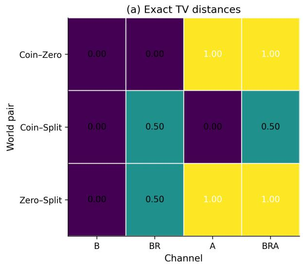

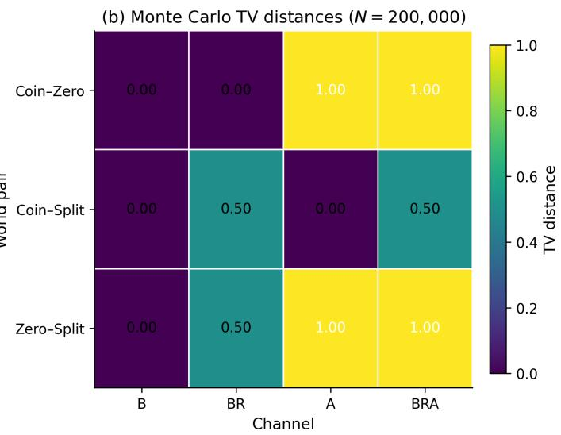  
Figure 3. Strict channel frontier via witness worlds. Rows compare the three explicit one-query witness pairs: COIN–ZERO, COIN– SPLIT, and ZERO–SPLIT. Columns correspond to the observable channels B, BR, A, and BRA. Each cell reports the total variation distance between the two observable laws under the given channel. Panel (a) shows the exact distances implied by Theorem 4.4, while panel (b) shows Monte Carlo estimates that recover the same strict-refinement pattern.

## H.5. Repeat-based recovery of persistent disagreement

For the repeat-recovery experiment, the query set has size

$$
| \mathcal { Q } | = 2 5 0 .
$$

The latent world is generated by

$$
\mu _ { q } \sim \mathrm { U n i f } [ - 0 . 8 , 0 . 8 ] , \qquad \alpha _ { q } = 0 , \qquad \tau _ { q } = c _ { q } ( 1 - \mu _ { q } ^ { 2 } ) , \qquad c _ { q } \sim \mathrm { U n i f } [ 0 , 0 . 8 ] .
$$

This ensures

$$
0 \leq \tau _ { q } \leq 1 - \mu _ { q } ^ { 2 } ,
$$

so the world is feasible querywise. The world-generation seed is

$$
\mathsf { w o r l d \_ s e e d = 1 1 } .
$$

For binary data we use a fixed budget

$$
n _ { B } = 5 1 2 . \quad 
$$

For repeat pairs we use the grid

$$
n _ { R } \in \{ 2 , 4 , 8 , 1 6 , 3 2 , 6 4 \} .
$$

The representative display budget in panels (a) and (c) is

$$
n _ { R } = 3 2 .
$$

The simulation seed is

$$
\mathtt { s i m \_ s e e d } = 1 2 3 .
$$

The estimators are

$$
\begin{array} { c } { { \displaystyle { \widehat { \mu } _ { q } = \frac { 1 } { n _ { B } } \sum _ { i = 1 } ^ { n _ { B } } Y _ { q , i } ^ { B } , \qquad \widehat { \nu } _ { q } = \frac { 1 } { n _ { R } } \sum _ { i = 1 } ^ { n _ { R } } Y _ { q , i } ^ { R , ( 1 ) } Y _ { q , i } ^ { R , ( 2 ) } , } } } \\ { { \widehat { \tau } _ { q } = \widehat { \nu } _ { q } - \widehat { \mu } _ { q } ^ { 2 } . } } \end{array}
$$

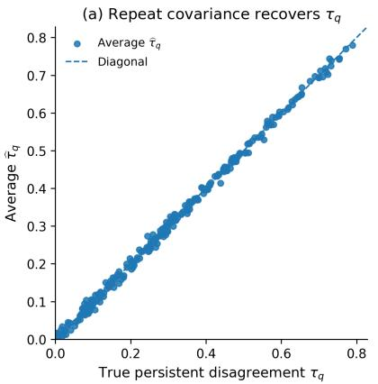

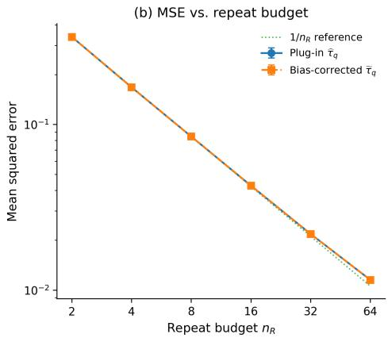

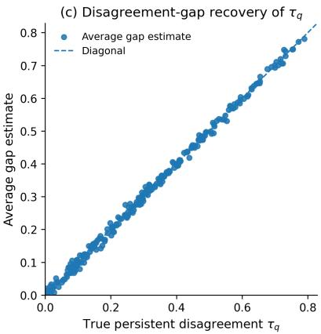  
Figure 4. Recovery of persistent disagreement from repeats. Queries are generated with $\alpha _ { q } = 0 , \mu _ { q } \sim \mathrm { U n i f } [ - 0 . 8 , 0 . 8 ]$ , and $\tau _ { q } = c _ { q } ( 1 - \mu _ { q } ^ { 2 } )$ with $c _ { q } \sim \mathrm { U n i f } [ 0 , 0 . 8 ]$ . Panel (a) shows querywise recovery of $\tau _ { q }$ from repeat covariance at representative repeat budget $n _ { R } = 3 2$ . Panel (b) reports mean squared error versus repeat budget n , together with a $1 / n _ { R }$ reference line and the bias-corrected estimator from Appendix F. Panel (c) validates the disagreement-gap identit $2 ( D _ { q } ^ { \mathrm { d i f f } } - D _ { q } ^ { \mathrm { s a m i e } } ) = \tau _ { q } .$ All estimates in panels (a) and (c) are averaged over 250 Monte Carlo replications.

For panel (b) we also report the bias-corrected estimator from Appendix F:

$$
\widetilde { \tau } _ { q } = \widehat { \nu } _ { q } - \frac { n _ { B } \widehat { \mu } _ { q } ^ { 2 } - 1 } { n _ { B } - 1 } .
$$

Panel (c) uses the empirical disagreement-gap estimator

$$
\begin{array} { r } { \widehat { \tau } _ { q } ^ { \mathrm { g a p } } = 2 \big ( \widehat { D } _ { q } ^ { \mathrm { d i f f } } - \widehat { D } _ { q } ^ { \mathrm { s a m e } } \big ) , } \end{array}
$$

where

$$
\widehat { D } _ { q } ^ { \mathrm { s a m e } } = \frac { 1 } { n _ { R } } \sum _ { i = 1 } ^ { n _ { R } } \mathbf { 1 } \{ Y _ { q , i } ^ { R , ( 1 ) } \neq Y _ { q , i } ^ { R , ( 2 ) } \} ,
$$

and $\widehat { D } _ { q } ^ { \mathrm { d i f f } }$ is formed by pairing consecutive anonymous binary labels:

$$
\widehat { D } _ { q } ^ { \mathrm { d i f f } } = \frac { 1 } { \left\lfloor n _ { B } / 2 \right\rfloor } \sum _ { i = 1 } ^ { \left\lfloor n _ { B } / 2 \right\rfloor } \mathbf { 1 } \{ Y _ { q , 2 i - 1 } ^ { B } \neq Y _ { q , 2 i } ^ { B } \} .
$$

Panel (b) reports the mean and ±2 standard errors of the querywise MSE over

## 250

Monte Carlo replications. Panels (a) and (c) report querywise averages of the corresponding estimators over

## 250

replications at the representative budget $n _ { R } = 3 2$ . The dotted $1 / n _ { R }$ line in panel (b) is a guide-to-eye reference anchored at the first empirical plug-in MSE; it is not itself a fitted model.

## H.6. Abstention-based recovery of non-binary mass

For the abstention-recovery experiment, the query set again has size

$$
| \mathcal { Q } | = 2 5 0 .
$$

The latent world is generated by

$$
\mu _ { q } \sim \mathrm { U n i f } [ - 0 . 8 , 0 . 8 ] , \qquad \alpha _ { q } = b _ { q } ( 1 - | \mu _ { q } | ) , \qquad b _ { q } \sim \mathrm { U n i f } [ 0 , 0 . 7 ] , \qquad \tau _ { q } = 0 .
$$

This guarantees

$$
0 \leq \alpha _ { q } \leq 1 - | \mu _ { q } | ,
$$

so the world is feasible. The world-generation seed is

$$
\mathsf { w o r l d \_ s e e d } = 1 9 .
$$

The abstention budgets are

$$
n _ { A } \in \{ 2 , 4 , 8 , 1 6 , 3 2 , 6 4 \} ,
$$

with representative display budget

$$
n _ { A } = 3 2 .
$$

The simulation seed is

$$
\mathtt { s i m \_ s e e d } = 3 2 1 .
$$

The estimator is

$$
\widehat { \alpha } _ { q } = \frac { 1 } { n _ { A } } \sum _ { i = 1 } ^ { n _ { A } } \mathbf { 1 } \{ \widetilde { Y } _ { q , i } ^ { A } = 0 \} .
$$

The exact query-averaged theoretical MSE in panel (b) is the Bernoulli variance formula,

$$
\frac { 1 } { | \mathcal { Q } | } \sum _ { q \in \mathcal { Q } } \frac { \alpha _ { q } ( 1 - \alpha _ { q } ) } { n _ { A } } ,
$$

which is computed directly from the latent world and plotted without fitting.

For panel (c), we use the Hoeffding confidence interval from Appendix F with confidence level

$$
1 - \delta = 0 . 9 5 , \qquad \delta = 0 . 0 5 ,
$$

and radius

$$
r _ { A } ( n _ { A } , \delta ) = \sqrt { \frac { \log ( 2 / \delta ) } { 2 n _ { A } } } .
$$

For each replication, we compute the querywise coverage fraction

$$
\frac { 1 } { | \mathcal { Q } | } \sum _ { q \in \mathcal { Q } } \mathbf { 1 } \{ | \widehat { \alpha } _ { q } - \alpha _ { q } | \leq r _ { A } ( n _ { A } , \delta ) \} ,
$$

and then average this quantity across replications.

Panel (b) and panel (c) both use

$$
2 5 0
$$

Monte Carlo replications. Panel (a) plots the querywise average of $\widehat { \alpha } _ { q }$ over

$$
2 5 0
$$

replications at the representative budget $n _ { A } = 3 2$

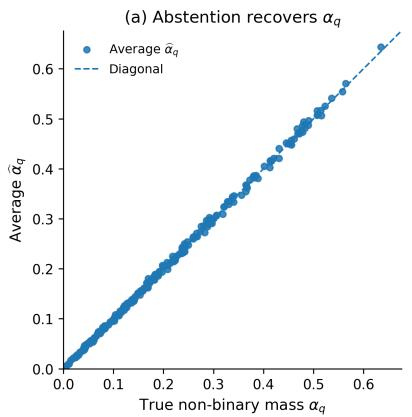

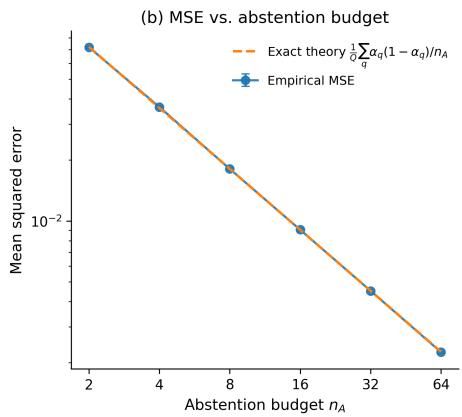

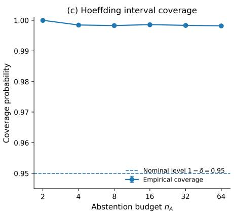  
Figure 5. Recovery of non-binary mass from abstention. Queries are generated with $\mu _ { q } \sim \mathrm { U n i f } [ - 0 . 8 , 0 . 8 ] , \alpha _ { q } = b _ { q } ( 1 - | \mu _ { q } | )$ with $b _ { q } \sim \mathrm { U n i f } [ 0 , 0 . 7 ]$ , and $\tau _ { q } = 0 .$ . Panel (a) shows querywise recovery of $\alpha _ { q }$ at representative abstention budget n $_ A = 3 2$ . Panel (b) reports mean squared error versus abstention budget $n _ { A } .$ , together with the exact theoretical Bernoulli MSE $\begin{array} { r } { \frac { 1 } { | \mathcal { Q } | } \sum _ { q } \alpha _ { q } ( 1 - \alpha _ { q } ) / n _ { A } } \end{array}$ . Panel (c) shows empirical coverage of the Hoeffding confidence interval for $\alpha _ { q } ,$ , illustrating valid but conservative finite-sample coverage.

## H.7. Main-text action-recovery experiment

The action-recovery experiment evaluates the decision-theoretic consequence of the channel-refinement results. We define the thresholds

$$
t _ { \tau } = t _ { \alpha } = 0 . 1 5
$$

and three semantic regimes:

$$
\mathrm { D E N O I S E : } \ ( \tau , \alpha ) = ( 0 . 0 2 , 0 . 0 2 ) ,
$$

$$
\mathrm { P E R S O N A L I Z E : } ~ ( \tau , \alpha ) = ( 0 . 3 5 , 0 . 0 2 ) ,
$$

$$
\mathrm { Q U E R Y : ~ } ( \tau , \alpha ) = ( 0 . 0 2 , 0 . 3 5 ) .
$$

Each regime contains

$$
Q _ { \mathrm { p e r c l a s s } } = 1 2 0
$$

queries, so the total number of queries is

$$
| \mathcal { Q } | = 3 6 0 .
$$

To make binary underidentification especially sharp, we first draw a base set

$$
\mu _ { q } ^ { \mathrm { b a s e } } \sim \mathrm { U n i f } [ - 0 . 6 , 0 . 6 ]
$$

of size $Q _ { \mathrm { p e r c l a s s } }$ and then reuse exactly the same set of µ-values across all three regimes. This ensures that the three regimes share the same empirical binary-law distribution, while differing only in $( \tau , \alpha )$ . After concatenation, the queries are randomly permuted. The world-generation seed is

$$
\mathsf { w o r l d \_ s e e d = 2 3 . }
$$

The fixed binary budget is

$$
n _ { B } = 5 1 2 , 
$$

and the calibration budgets are tied:

$$
n _ { R } = n _ { A } = b , \qquad b \in \{ 2 , 4 , 8 , 1 6 , 3 2 , 6 4 \} .
$$

The representative confusion-matrix budget is

$$
b = 1 6 .
$$

The simulation seed is

$$
\mathtt { s i m \_ s e e d } = 7 7 7 .
$$

For each replication, we generate a single binary sample of size $n _ { B } .$ , a repeat sample of size max $b ,$ and an abstention sample of size max $^ { \ l } .$ and then use the first b samples of each refined channel when evaluating budget b. This coupling reduces Monte Carlo variance across budgets without changing the distribution at any fixed budget.

The binary-only baseline is the constant rule

$$
\begin{array} { r } { \widehat { a } _ { q } ^ { \mathsf { B } } \equiv \mathbf { D } \mathbf { E } \mathbf { N } \mathbf { O } \mathbf { I } \mathbf { S } \mathbf { E } , } \end{array}
$$

which is the tie-broken majority-class baseline in this balanced three-class design. The refined-channel action rules are

$$
\widehat { a } _ { q } ^ { \mathsf { B R } } = \left\{ \begin{array} { l l } { \mathsf { P E R S O N A L I Z E } , } & { \widehat { \tau } _ { q } > t _ { \tau } , } \\ { \mathsf { D E N O I S E } , } & { \widehat { \tau } _ { q } \leq t _ { \tau } , } \end{array} \right.
$$

$$
\widehat { a } _ { q } ^ { \mathsf { A } } = \left\{ \begin{array} { l l } { \mathsf { Q } \mathrm { U E R Y } , } & { \widehat { \alpha } _ { q } > t _ { \alpha } , } \\ { \mathsf { D } \mathrm { E N O I S E } , } & { \widehat { \alpha } _ { q } \leq t _ { \alpha } , } \end{array} \right.
$$

and

$$
\begin{array} { r } { \widehat { a } _ { q } ^ { \mathsf { B R A } } = \left\{ \begin{array} { l l } { \mathbf { Q } \mathbf { U E R Y } , } & { \widehat { \alpha } _ { q } > t _ { \alpha } , } \\ { \mathbf { P } \mathbf { E R } \mathbf { S O N A L I Z E } , } & { \widehat { \alpha } _ { q } \leq t _ { \alpha } \mathbf { a n d } \widehat { \tau } _ { q } > t _ { \tau } , } \\ { \mathbf { D } \mathbf { E N O I S E } , } & { \widehat { \alpha } _ { q } \leq t _ { \alpha } \mathbf { a n d } \widehat { \tau } _ { q } \leq t _ { \tau } . } \end{array} \right. } \end{array}
$$

Panel (a) in the main-text action-recovery figure plots the mean and ±2 standard errors of the action accuracy over

$$
2 5 0
$$

Monte Carlo replications. Panels (b)–(d) aggregate confusion counts over the same

$$
2 5 0
$$

replications at representative budget $b = 1 6$ and then row-normalize them. The binary-only confusion matrix is omitted because the rule is constant and therefore uninformative once the accuracy curve is shown.

## H.8. Implementation notes

All figures were generated directly from deterministic scripts using fixed seeds, with no hyperparameter search and no external data. The exact filenames are:

$$
\mathtt { f i g u r e 1 \_ e x a c t \_ s e m a n t i c \_ f i b e r \_ f i n a l \_ p n g } ,
$$

$$
\mathtt { f i g u r e 2 \_ c h a n n e l \_ f r o n t i e r \_ f i n a l . p n g , }
$$

$$
\mathtt { f i g u r e 3 \_ r e c o v e r y \_ p e r s i s t e n t \_ d i s a g r e e m e n t \_ f i n a l . p n g , }
$$

$$
\mathtt { f i g u r e 4 \_ r e c o v e r y \_ n o n b i n a r y \_ m a s s \_ f i n a l \_ p n g , }
$$

$$
\mathtt { f i g u r e 5 \_ s e m a n t i c s \_ a w a r e \_ a c t i o n \_ r e c o v e r y \_ f i n a l \_ p n g . }
$$

The plotting code computes all displayed quantities directly from the synthetic samples and the formulas in this appendix;   
no manual post-processing or selective smoothing was applied.