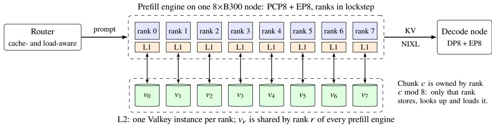
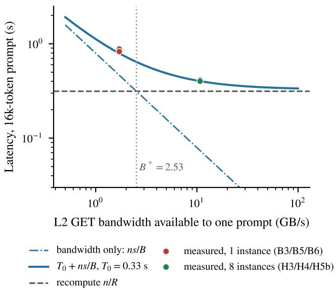
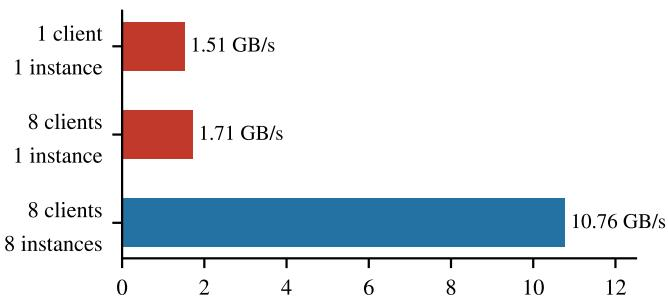
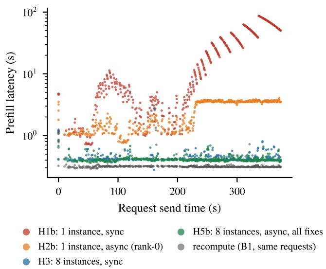
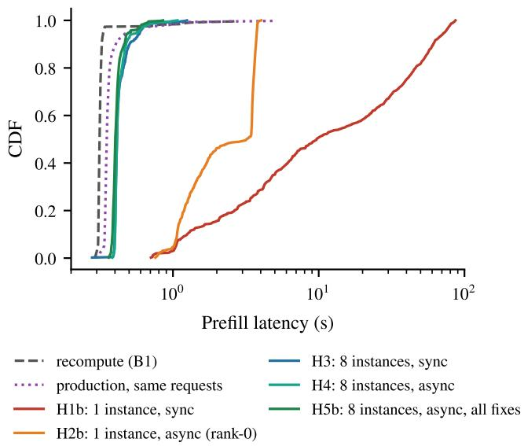
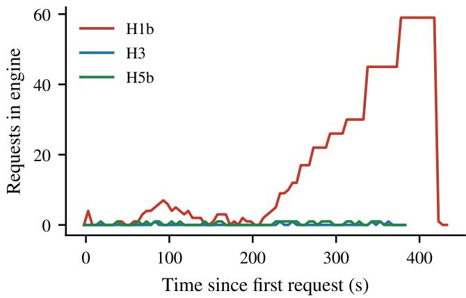
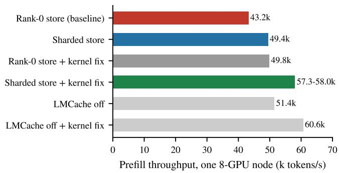
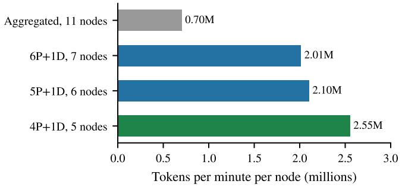

# When the KV Cache Is Slower Than the GPU: Scaling Remote KV Tiers for Context-Parallel Prefill

Muhammad Ibrahim

Multiverse Computing

muhammad.ibrahim@multiversecomputing.com

## Abstract

Reusing the attention KV cache across requests is a standard way to cut prefill cost in long-context LLM serving, and production systems increasingly back the per-engine cache with a remote tier shared by every engine. We study such a tier in a disaggregated deployment of GLM-5.3, an FP8 mixture-of-experts model with multi-head latent attention (MLA), on 8×B300 nodes running prefill context parallelism (PCP8). Enabling the remote tier (LMCache with a Valkey store) left median time-to-first-token unchanged but raised the 16k-token p99 from 3.96 s to 17.3 s. Replaying a production request stream on an isolated engine, we find that a remote hit took 0.88 s against 0.31 s to recompute the prompt, and that synchronous loading turned a hit-heavy stream into an unstable queue: p99 83.32 s with the GPUs 7% busy. A two-term cost model explains both: a hit pays of only if the tier delivers more than �∗ = �� (2.53 GB/s for this model and GPU), and a fixed per-hit engine cost $( T _ { 0 } \approx 0 . 3 3 { \mathrm { s } } )$ means that hits on prompts shorter than about 17k tokens cannot beat recompute at any bandwidth. Guided by the model, we (i) shard the MLA KV store across PCP ranks, with a proof that the existing minimum-over-ranks lookup returns the longest cached prefix and a load protocol that can never desynchronize collectives; (ii) partition the remote tier by rank, one server instance per rank with no coordination, which raises GET bandwidth 6.3× to 10.76 GB/s; (iii) add asynchronous loading to the sharded store; and (iv) fix three client bugs that caused unbounded stalls. On the hit-heavy stream, with 98.5% of prompt tokens served from the remote tier, p99 falls from 83.32 s to 0.67 s. The sharded store raises prefill throughput by 14%, and by 34% together with an upstream kernel fix. All changes are submitted upstream to LMCache.

## 1 Introduction

For long prompts, prefill dominates time-to-first-token (TTFT): reading a 200k-token prompt takes seconds even on the newest accelerators. Serving systems therefore keep the attention key/value (KV) cache of earlier prompts and reuse it when a new prompt shares a prefix [4, 16, 19, 22, 26]. A common layout has two tiers: a fast tier in each engine’s host memory, and a larger remote tier that every engine can read and that survives restarts. The remote tier is attractive because it decouples cache capacity from engine count and lets one engine reuse what another computed.

The implicit assumption behind a remote tier is that loading KV is cheaper than recomputing it. This paper reports a production setting in which the assumption failed, explains why with a simple model, and shows how to restore it.

Setting. We serve GLM-5.3, a large mixture-of-experts (MoE) model with DeepSeek-style multi-head latent attention (MLA) [1, 2], in FP8 on nodes with eight NVIDIA B300 GPUs. Prefill and decode run on separate nodes [21, 27]. Each prefill node runs one vLLM [16] engine with prefill context parallelism across its eight GPUs (PCP8): the prompt is split along the sequence, the ranks exchange KV with collectives, and all eight ranks advance in lockstep. LMCache [19] stores KV in 256-token chunks in host memory (L1) and in a Valkey [24] remote store (L2).

Problem. Turning on L2 for an enterprise SLA workload of 9k–200k-token prompts left median TTFT unchanged but inflated the tail: p99 rose from 3.96 s to 17.3 s at 16k tokens and from 6.06 s to 25.0 s at 32k. The deployment was rolled back to L1 only.

Findings. We rebuilt one production engine’s request stream from logs, replayed it against an isolated engine with the identical image and configuration, and profiled it (§3). Three efects explain the regression:

1. A hit was slower than a miss. A 16k-token prompt took 0.31 s to recompute but 0.88 s to load from L2 (§6.1). On a B300 node the GPU prefills about 52.2k tokens/s; the L2 path delivered well under the bandwidth needed to keep up with that.

2. Synchronous loading is unstable under hit-heavy load. A load inside the engine step stalls all eight PCP ranks. When the arrival rate times the per-hit service time exceeds one, the engine becomes an overloaded queue: median latency grew from 3.52 s to 52.30 s within six minutes while the GPUs were 7% busy (§6.3).

3. Rare client bugs caused unbounded stalls. A lost-completion race and a missing-key read that never returns each froze an engine for 3–10 s per request, or permanently (§5.4).

Contributions.

• A cost model for remote KV hits with two parameters, break-even bandwidth $B ^ { * } = s R$ and a fixed per-hit cost �0, validated on configurations that were not used to fit it (§4).

• A sharded MLA KV store for context parallelism that spreads store, lookup and load across ranks, with a proof that the scheduler’s existing minimum-over-ranks lookup returns the longest cached prefix and a load protocol in which every rank issues the same collectives (§5.1).

• A rank-partitioned remote tier: because the sharded store partitions chunks statically by rank, rank � of every engine can use its own server instance without a cluster protocol or client-side hashing, while cross-engine reuse still works (§5.2).

• Asynchronous loading for the sharded store and fixes for three client bugs, each with a regression test (§5.3, §5.4).

• An evaluation by trace replay of production trafic: p99 on a hit-heavy stream falls from 83.32 s to 0.67 s, a 124× reduction, with 98.5% of prompt tokens served from L2; the sharded store raises prefill throughput by 14–34%; and a five-node disaggregated deployment using these changes passes the workload’s SLA (§6).

The broader lesson is that on current GPUs recompute is a demanding baseline. A cache tier has to be judged against the prefill rate of the hardware it serves, not against the latency of the network.

## 2 Background

MLA and its KV cache. MLA [1] projects each token’s keys and values into one low-rank latent vector shared by all attention heads. The per-token KV state is therefore small and independent of the head count. For GLM-5.3 in FP8, one 256-token LMCache chunk covering all layers is 12.4 MB, so � ≈ 48.4 KB per token. Splitting attention heads across GPUs (tensor parallelism) does not shrink this state, because every head needs the full latent.

Prefill context parallelism. PCP [13, 17, 25] splits the prompt along the sequence, so each of the � ranks processes about 1/� of the tokens. Ranks exchange KV with an All-Gather so that causal attention sees every earlier token; after the exchange every rank holds the whole prompt’s latent KV. In our deployment the MoE layers additionally use expert parallelism (EP8). Every forward step contains NCCL collectives, so the ranks run in lockstep: anything that delays one rank delays all of them.

Prefill/decode disaggregation. Prefill is compute-bound and decode is memory-bandwidth-bound, so separating them lets each use its own parallelism and batch limits [21, 27]. A router sends each request to a prefill engine, which computes (or loads) the prompt’s KV and ships it to a decode engine over NIXL [20]; the decode engine streams the answer.

LMCache. LMCache [19] splits KV into fixed-size chunks keyed by a hash of the token prefix, so a chunk’s key identifies everything before it. A lookup returns the longest prompt prefix whose chunks are all present; a gap means everything after it is recomputed. For MLA, LMCache stores and loads only on worker 0 (save\_only\_first\_rank), since every tensor-parallel rank holds the same latent KV. The remote backend speaks the RESP protocol to a Redis-compatible server, through a native client that keeps a pool of connections per engine worker.

Valkey. Valkey [24], like Redis, executes every command on a single main thread; I/O threads only parallelize socket reads and writes. A single instance’s command throughput is therefore bounded by one core, whatever the client count.

## 3 Methodology

We wanted measurements that match production without touching it.

Trace replay. From router logs and the benchmark client’s database we rebuilt the exact request stream that one pro- duction prefill engine received in the 16k-token cell of the SLA workload: 683 requests with their original prompts and send times. A replayer sends each request at its original ofset and records completion time, prompt tokens and cached tokens. Unless stated otherwise, latency is the prefill leg’s completion time, which the router logs as “prefill completed” in production.

Isolated engine. Replays ran on a free 8×B300 node with the production container image, command line and environ- ment (vLLM 0.31.0, LMCache 0.5.5 with the sharded-store patch, FlashInfer 0.7.0, NCCL 2.30, CUDA 13.0). The diferences from production were: prefill only (no decode handof), the LMCache controller of (so no production router could select the engine), and a private Valkey 8.1 (400 GB, LRU, 16 I/O threads) instead of the shared 1.28 TB instance. A sampler recorded engine metrics every 5 s and Valkey INFO commandstats for server-side GET counts and time.

Hit-heavy subset. The full stream’s chunks (≈495 GB) ex-ceed the private Valkey, and replaying it in order under LRU evicts each prompt just before it is needed again, so hit rates stay at 10–20%. To measure the hit path we use the first 450 requests (7.35M prompt tokens, median 16,390 tokens, range 14,715–17,889), which fit. Before each arm, Valkey is flushed, primed by one replay, and the engine restarted so that L1 is empty; 98.5% of prompt tokens are then served from L2. The same 450 requests in the cold run give the recompute baseline.

Profiling. Nsight Systems captured all eight GPU workers with CUDA and NVTX tracing, started and stopped through vLLM’s profiler hook; py-spy took stack dumps of engine processes during stalls with no GPU activity. Profiled runs are used only to attribute time, never as latency measurements.

  
Figure 1: System overview, final design. The original design stored every chunk from rank 0 into a single Valkey instance.

Reporting. Percentiles use linear interpolation over all re-quests of a run. Every number in §6 is computed by one script from the raw per-request logs. Each condition was run once; §8 discusses what this does and does not support.

## 4 A Cost Model for Remote KV Hits

Let � be the number of prompt tokens served from the cache, � the KV bytes per token, � the engine’s prefill rate in tokens per second, and � the bandwidth the cache tier delivers to one prompt. To first order,

$$
T _ { \mathrm { r e c o m p u t e } } = { \frac { n } { R } } , \qquad T _ { \mathrm { l o a d } } = T _ { 0 } + { \frac { n s } { B } } ,\tag{1}
$$

where $T _ { 0 }$ is everything a hit still pays that does not scale with bandwidth: scheduling, lookup round-trips, the forward step over the few uncached tail tokens, and the per-chunk metadata exchange and broadcast.

Break-even bandwidth. Ignoring $T _ { 0 } ,$ , a hit pays of if $B > B ^ { * } = s R$ . The prompt length cancels: the threshold depends only on the model’s KV footprint and the hard- ware’s prefill speed. For GLM-5.3 FP8 on one B300 node, � = 48.4 KB/token and $R = 5 2 \AA$ .2k tokens/s (the median rate of cold misses in our replay), so

$$
B ^ { * } = s R \approx 2 . 5 3 { \mathrm { G B } } / { \mathrm { s } } .
$$

A single Valkey instance serving eight PCP ranks delivered 1.71 GB/s at best (§6.2), below $B ^ { * } \colon$ every L2 hit was slower than recomputing.

Fixed cost. With $T _ { 0 } ~ > ~ 0$ , a hit pays of only if $n / R ~ >$ $T _ { 0 } + n s / B ,$ , which requires at least $n > { \cal R } T _ { 0 }$ Below that prompt length, recomputing is faster at any bandwidth. We fit $T _ { 0 }$ on a single point, the median of the fastest configuration (8 instances, $B = 1 0 . 7 6 \mathrm { G B } / \mathrm { s } , \ S 6 . 3 ) \colon T _ { 0 } = 0 . 4 0 - 0 . 7 9 / 1 0 . 7 6$ ≈ 0.33 s. The model then predicts $T _ { 0 } + 0 . 7 9 / 1 . 7 1 = 0 . 7 9 \mathrm { s }$ for a 16k-token hit on a single instance, close to the 0.83–0.88 s we measured in three runs not used for the fit (Fig. 2). The implied threshold is $R T _ { 0 } \approx 1 7 \mathrm { k \Omega }$ tokens: on this hardware and implementation, L2 cannot improve the median latency of a 16k-token prompt, and pays of in latency only for longer prompts. Its value at 16k is capacity: a hit consumes no GPU compute, which matters when prefill engines are saturated.

  
Figure 2: Model (Eq. (1)) against measurement for a 16k-token hit. $T _ { 0 }$ is fitted on the H5b median only; the single-instance runs were not used to fit. The dashed line is the measured recompute median.

Stability of synchronous loading. With synchronous loading, a load runs inside the engine step and, under PCP, stalls all ranks. The engine then behaves like a single-server queue [15] whose service time per hit is at least $n s / B .$ . With arrival rate �, its utilization is $\rho = \lambda n s / B$ . In the hit-heavy replay $\lambda = 1 . 2 1$ requests/s and a median prompt is 0.79 GB. Under that load the single instance sustained only 0.78–0.89 GB/s (server-side measurement), so $\rho \approx 1 . 1 3 > 1 \colon$ the queue has no steady state and grows for as long as hits keep arriving. With eight instances, $\rho \approx 0 . 0 9$

## 5 Design

The model points to two levers: deliver more bandwidth per prompt, and keep the engine running while loads are slow.

Both start from where the KV lives under PCP.

## 5.1 Sharding the MLA KV Store Across PCP Ranks

The rank-0 bottleneck. Under tensor parallelism, storing MLA KV only from rank 0 is sound: every rank holds the same latent. Under PCP the latent is also replicated after the AllGather, but now rank 0 copies the entire prompt’s KV to host memory inside the step, while the other seven ranks wait for it at the next collective. In an Nsight trace of two concurrent ∼200k-token prompts, rank 0 wrote 19.1 GB to host memory and was 82% busy against 98% on the other ranks, which accumulated ∼1.55 s of AllGather wait each in a 9.5 s window.

Ownership. Since every rank holds the whole prompt’s KV after the AllGather, any rank can store any chunk. Chunk �, the chunk that starts at token 256�, is owned by rank $o ( c ) = c$ mod �. Each rank stores, looks up and loads only its own chunks, and its L1 is a $1 / W$ slice of the engine’s host-memory budget, so total memory is unchanged.

Lookup. The vLLM scheduler already sends each lookup to every rank’s lookup server and takes the minimum of the answers. In shard mode, rank � answers with the start of its first owned chunk that is missing, $a _ { r } = \operatorname* { m i n } \{ c : o ( c ) =$ $r ,$ � missing}, or � if it has all of them.

Proposition 1. Let a prompt have chunks $0 , \ldots , N - 1$ and let � be thefirst chunk missing on its owner (� = � ifnone). Then min $a _ { r } = m$

Proof. Every chunk $c < m$ is present, so no rank has a missing owned chunk below �, and $a _ { r } \geq m$ for all �. If $\dot { m } < N ,$ , chunk � is missing and owned by $o ( m )$ , and all of that rank’s owned chunks below � are present, so $a _ { o ( m ) } = m$ □

The minimum the scheduler already computes is therefore exactly the longest prefix whose chunks are all present: sharded lookup needs no new messages. We also checked the claim exhaustively for up to 10 chunks and $W \in \{ 2 , 3 , 4 , 8 \}$ , and on random prompts of up to 800 chunks.

Load. Loading must never let one rank skip a collective that the others enter, or the step hangs. Every rank therefore runs the same sequence regardless of what it found locally (Algorithm 1): fetch and stage its owned chunks, then exchange one small message per rank containing a fingerprint of the chunk list, its first failure and its chunk metadata; compute the agreed prefix from the � messages, which are identical on every rank; and broadcast each chunk of the prefix from its owner. Local failures (eviction, a failed GET, an unhealthy engine, a staging error) are reported only through the exchange and become an agreed, shorter prefix; mismatched inputs produce diferent fingerprints and an agreed prefix of zero. Multi-process tests with real cache engines check these invariants under random failures and after repeated failed loads.

Algorithm 1 Sharded load on rank � (all ranks run it)   
1: � ← chunk list of (tokens, mask); � ← fingerprint(�)   
2: $H , f _ { r }$ ← fetch owned chunks of �; � = first owned failure   
3: stage � on the local GPU (non-blocking)   
4: for $q = 0 , \ldots , W - 1$ do ⊲ same order on every rank   
5: $M _ { q } \gets$ BroadcastObject $( ( F , f _ { r } ,$ , meta(�)), src =   
$q )$   
6: � ← AgreePrefix $( M _ { 0 } , \ldots , M _ { W - 1 } )$ ⊲ 0 if fingerprints   
difer   
7: for $c = 0 , \ldots , P - 1$ do   
8: Broadcast(chunk , src = � mod �)   
9: write chunks < � to the KV cache; release owned bufers

Remote keys. For MLA, LMCache names every remote key after worker 0 so that ranks share one copy. In shard mode every rank writes its own chunks under that worker-0 name, which keeps a chunk’s remote key independent of the rank that wrote it and preserves reuse across engines.

## 5.2 A Rank-Partitioned Remote Tier

Raising � needs more server threads, hence more Valkey instances. Spreading keys over instances usually requires a cluster protocol or client-side consistent hashing. The sharded store already provides a static partition: rank � only ever touches chunks with � mod $W = r ,$ and rank � of every engine owns the same chunk indexes. Instance � can therefore hold ex- actly rank �’s chunks, with no routing logic, no trafic between instances, and no loss of cross-engine reuse. The client change is one substitution: {rank} in the remote URL becomes the worker’s rank, e.g. resp://valkey-{rank}:6379. Each rank’s share of a 16k-token prompt (∼100 MB) is then fetched from its own instance in parallel with the other seven.

## 5.3 Asynchronous Loading for the Sharded Store

With enough bandwidth, $\rho \ll 1$ and synchronous loads keep up (§4). Asynchronous loading is still valuable because it removes the failure mode: a slow load delays only its own request while the engine keeps running others. LMCache’s asynchronous path assumed rank 0 performs all lookups; we extend it to shard mode without new protocol messages. Each rank prefetches only its owned chunks and passes the storage layer a custom cumulative-length vector whose �-th entry is the start token of its �-th owned chunk. The storage layer’s “contiguous hits” answer is then exactly $a _ { r }$ from the proposition, in tokens, and the scheduler’s minimum is the same prefix as in the synchronous path. A property test over 3,000 random presence patterns checks this equivalence. One edge case changed: a rank with no hits used to report 0 tokens, which is wrong under sharding (if rank 1’s first owned chunk is missing, the correct answer is 256 tokens, since chunk 0 belongs to rank 0). It now reports the first entry of the vector, which is 0 outside shard mode.

## 5.4 Three Client Bugs

Bandwidth explained the steady cost; three bugs explained the worst outliers, all of which left an empty GPU timeline.

Lost completions. The native client’s synchronous methods submitted a request and only then registered the future that would receive the result, while completions were drained on an event-loop thread. A completion drained between the two steps was dropped, and the caller blocked forever. Sharding multiplies the exposure by �, since every lookup now goes to every rank, and one loss is permanent: afterwards every scheduler lookup waits its full 3 s timeout. One production engine logged exactly this, one timeout per routed request (16 of 16 in one minute) from one moment on, and py-spy showed every lookup thread blocked in fut.result() with nothing outstanding. The fix holds one lock across submit-and-register and across the drain. A test with a fake client that drains before submit returns fails without the fix; replays showed no measurable latency cost.

A GET of a missing key never returns. RESP encodes a missing value as the 5-byte null bulk string \$-1\r\n. The native connector read a fixed 11-byte header sized for a chunk, so on a missing key the read never completed and the connection was lost for good. Under LRU eviction a chunk can disappear between the lookup (EXISTS) and the load (GET); a synchronous load then stalls all ranks for the 10 s blocking timeout. The fix parses the header up to CRLF, treats \$-1 as a per-key miss with the reply fully consumed, and makes the Python layer free unfilled bufers instead of returning them as KV. Against a real Valkey, a 4-chunk GET with one key deleted now returns [T,T,F,T] in 69 ms and the connection serves the next GET in 40 ms; before, it produced no completion within 12 s.

Async GETs used the wrong key. The asynchronous GET did not rewrite keys to the worker-0 name used by the asyn- chronous lookup, so ranks other than 0 found their chunks and then requested keys that do not exist (which is how we found the previous bug). Upstream never exercised this, because only rank 0 performed asynchronous lookups for MLA.

## 6 Evaluation

## 6.1 Where a 16k-Token Prompt’s KV Comes From

Table 1 replays the full 683-request stream under diferent cache states. Loading from L1 (host memory) is slightly faster than recompute; loading from a single L2 instance is 2.7× slower, on an idle engine (at most one request running, none waiting). This matches the model: at 1.71 GB/s a 0.79 GB prompt needs 0.46 s of transfer on top of �0.

Table 1: Prefill latency of the 683-request 16k-token stream by cache state. “Hits” are requests with ≥12k cached tokens. Single L2 instance, synchronous loading unless noted.
<table><tr><td>Run</td><td>State</td><td>p50</td><td>p99</td><td>hits: n, p50</td></tr><tr><td>B1</td><td>cold (recompute)</td><td>0.31</td><td>1.16</td><td>4,0.74</td></tr><tr><td>B2</td><td>L1 warm</td><td>0.32</td><td>0.36</td><td>60,0.29</td></tr><tr><td>B3</td><td>L1 cold, L2 warm</td><td>0.32</td><td>1.11</td><td>62, 0.88</td></tr><tr><td>B5</td><td>as B3 (control)</td><td>0.32</td><td>1.00</td><td>62, 0.83</td></tr><tr><td>B6</td><td>as B3, race fix</td><td>0.32</td><td>0.95</td><td>60,0.83</td></tr><tr><td>A1</td><td>as B3, async, rank-0</td><td>0.38</td><td>1.34</td><td>57,0.89</td></tr></table>

  
Aggregate GET bandwidth, 12.4 MB chunks (GB/s)  
Figure 3: Aggregate GET bandwidth, LMCache native RESP client, 12.4 MB chunks.

## 6.2 Remote-Tier Bandwidth

Figure 3 measures aggregate GET bandwidth for 12.4 MB chunks with LMCache’s native client against Valkey, with each client fetching 8-chunk batches (99 MB, one rank’s share of a 16k prompt). Going from one client to eight on one instance adds only 13%, because the clients queue on the same server thread, and one rank’s batch takes 440 ms at p50 instead of 65 ms. With one instance per rank, bandwidth scales to 10.76 GB/s (6.3×) and a batch takes 70 ms. During the hit-heavy runs on a single instance, Valkey’s main thread spent 73–74% of wall-clock time executing GETs (89–91% in the busiest minute).

## 6.3 Hit-Heavy Trafic

Table 2 and Figs. 4 and 5 compare five configurations on the 450-request hit-heavy subset with 98.5% of tokens served from L2 (except H2b; see below).

One instance, synchronous (H1b). The run behaves as the model predicts for � > 1: median latency grows from 3.52 s in the first third of the run to 52.30 s in the last, up to 59 requests are in the engine at once (Fig. 6), and the GPUs are 7% busy. Every request completes, but the engine spends most of its time waiting for Valkey.

One instance, asynchronous (H2b). Asynchronous loading with the default rank-0 store bounds latency at 3.2–3.8 s, but only by giving up: 49% of requests hit the 3 s asynchronous- lookup timeout and recomputed while their prefetch continued in the background, which is why only 50.6% of tokens came from L2 despite the same number of GETs as H1b.

Table 2: Hit-heavy subset (450 requests, 16k tokens, L2 primed, L1 empty). Latencies in seconds. All runs completed 450/450 requests without errors.
<table><tr><td>Run</td><td>L2</td><td>Loading</td><td>p50</td><td>p90</td><td>p99</td><td>max</td><td>p50 by third of run</td><td>from L2</td><td>GPU util</td></tr><tr><td>H1b</td><td>1 instance</td><td>sync</td><td>9.70</td><td>61.17</td><td>83.32</td><td>86.72</td><td> $3 . 5 2  9 . 0 2  5 2 . 3 0$ </td><td>98.5%</td><td>7%</td></tr><tr><td>H2b</td><td>1 instance</td><td>async (rank-0 store)</td><td>3.20</td><td>3.70</td><td>3.82</td><td>4.04</td><td> $1 . 2 0  3 . 2 4  3 . 5 6$ </td><td>50.6%</td><td>28%</td></tr><tr><td>H3</td><td>8 instances</td><td>sync, sharded</td><td>0.41</td><td>0.50</td><td>0.80</td><td>1.25</td><td> $0 . 4 1  0 . 4 1  0 . 4 1$ </td><td>98.5%</td><td>21%</td></tr><tr><td>H4</td><td>8 instances</td><td>async, sharded</td><td>0.41</td><td>0.48</td><td>0.73</td><td>1.07</td><td>0.42 → 0.41 → 0.41</td><td>98.5%</td><td>20%</td></tr><tr><td>H5b</td><td>8 instances</td><td>async, sharded, all fixes</td><td>0.40</td><td>0.46</td><td>0.67</td><td>0.86</td><td>0.41 → 0.40 → 0.40</td><td>98.5%</td><td>22%</td></tr><tr><td colspan="4">Recompute, same requests (B1) Production engine, same requests</td><td>0.31 0.35 0.41</td><td>0.32</td><td>1.28 1.14</td><td>2.76 4.86</td><td colspan="2">0.8%</td></tr></table>

  
Figure 4: Per-request prefill latency over the hit-heavy replay (log scale). With one instance and synchronous loading (H1b) the engine never catches up; with one instance per rank (H3, H5b) latency is flat from the first request to the last.

Eight instances (H3–H5b). With one instance per rank, median latency is 0.41 s from start to finish, p99 drops to 0.80 s, and the engine never holds more than one request. Asynchronous loading (H4) matches the synchronous median, as expected $\mathrm { a t } \rho \approx 0 . 0 9$ , and trims the tail. With all fixes (H5b), p99 is 0.67 s, 124× below H1b, and the latency distribution sits close to the production engine’s on the same requests, which served only 1–35% of tokens from any cache (Fig. 5). The Valkey shards averaged 8.9 ms of server time per 12.4 MB GET.

Remaining gap to recompute. At the median, H5b is 0.09 s slower than recomputing the same prompts. Transfer accounts for only 0.074 s of a hit at 10.76 GB/s; the rest is $T _ { 0 } ,$ spent in the engine (scheduling, the forward step over the uncached tail, and the per-chunk exchange and broadcast) rather than in Valkey. Even at infinite bandwidth a 16k-token hit would take about 0.33 s, slightly more than recompute, so on a fast GPU it cannot win on median latency until $T _ { 0 }$ shrinks (§7). The tail is better than recompute’s (p99 0.67 s against 1.28 s), and a hit uses no GPU compute.

  
Figure 5: Latency CDFs on the hit-heavy subset (log scale), with the recompute baseline and the production engine on the same requests.

## 6.4 Prefill Throughput

Figure 7 measures computed prompt tokens per second on one node with 8 concurrent ∼200k-token prompts for 3 rounds, with LMCache storing every chunk. The sharded store alone raises throughput from 43.2k to 49.4k tokens/s (+14%). The same traces exposed a second, unrelated bottleneck: FlashInfer’s fused SwiGLU + FP8 re-quantization kernel took 1.57 ms per call and 17% of prefill GPU time, because under EP8 most of its thread blocks process slots routed to other GPUs. An upstream kernel rewrite [3], which we built for SM103 and validated, reduces it to 0.23 ms. Each fix alone gives +14–15%; together they give 57.3–58.0k tokens/s (+34%), within 4–5% of running with LMCache turned of. In the two-prompt Nsight window, total AllGather time fell from 15.8 s to 5.8 s and rank 0’s device-to-host trafic from 19.1 GB to 2.4 GB. With a remote backend attached, puts equal stored chunks and throughput is unchanged (57.3k against 57.7k tokens/s).

Figure 6: Requests running or waiting in the engine (5 s samples).  
  
Figure 7: Prefill throughput on one 8×B300 node, 8 concurrent ∼200k-token prompts. “Kernel fix” is FlashInfer PR #3969 [3].

## 6.5 Correctness

Bit-exact comparison is not usable: the engine is not determin- istic, and two cold runs of the same prompt already produce diferent text. We test semantics with six needle-in-a-haystack prompts of 12.8k–166.7k tokens, each hiding a random code at a random depth, answered with greedy decoding four ways: cold; from L1 via asynchronous prefetch; from L2 via asyn- chronous prefetch after an engine restart (12,800–166,656 tokens loaded); and cold again as a control. The code was found in 24 of 24 answers, and cache-served answers difer from cold ones no more than the two cold runs difer from each other. All runs logged zero lookup timeouts, zero asyn- chronous timeouts and zero errors. The synchronous sharded store passed 3/3 needles after GPU-cache eviction (174k–204k tokens loaded), 36/36 answers in a concurrent burst, and a 30-minute soak of 1,549 requests without errors.

Table 3: 200k-token SLA benchmark. TPM: input plus output tokens per minute.
<table><tr><td></td><td>Aggr.</td><td>6P+1D</td><td>5P+1D</td><td>4P+1D</td></tr><tr><td>B300 nodes</td><td>11</td><td>7</td><td>6</td><td>5</td></tr><tr><td>Success</td><td>100%</td><td>99.9%</td><td>99.88%</td><td>100%</td></tr><tr><td>TTFT P90 (s)</td><td>34.0</td><td>25.3</td><td>44.5</td><td>30.5</td></tr><tr><td>TTFT P50 (s)</td><td>13.1</td><td>15.1</td><td>28.4</td><td>18.0</td></tr><tr><td>TTFT mean (s)</td><td>19.9</td><td>17.0</td><td>29.6</td><td>20.1</td></tr><tr><td>TPM (M)</td><td>7.74</td><td>14.1</td><td>12.6</td><td>12.7</td></tr><tr><td>TPM per node (M)</td><td>0.70</td><td>2.01</td><td>2.10</td><td>2.55</td></tr></table>

  
Figure 8: Tokens per minute per B300 node on the SLA benchmark.

## 6.6 End-to-End Deployment

Finally, we ran the full configuration (sharded store, eight L2 instances, asynchronous loading, all fixes) as a disaggregated deployment with four PCP8 prefill nodes and one decode node (DP8, EP8) on the workload’s 200k-token SLA benchmark, which sends a sustained closed-loop mix of long prompts and checks TTFT against P90 < 70 s, P50 < 30 s and mean < 30 s. Table 3 and Fig. 8 compare it with earlier deployments that passed the same benchmark. This comparison changes more than the cache tier: the aggregated baseline also difers in parallelism and in prefill/decode placement. We report it as deployment context, not as an ablation of the techniques above.

## 7 Discussion

Judge a cache tier against the prefill rate. �∗ = �� grows with accelerator speed: every faster GPU generation raises the bandwidth a cache tier must deliver to be worth reading. At 2.53 GB/s per prompt for one B300 node, a cache tier built from general-purpose key-value servers needs to scale out with the engine’s parallelism, as the rank partitioning does here, or move to RDMA transports [22]. Compression [18] lowers �, and loading and computing diferent parts of a prompt concurrently [14] avoids treating the choice as all-or-nothing.

Shrink the fixed cost. Our $T _ { 0 } ~ \approx ~ 0 . 3 3$ s means that, on this implementation, remote hits on prompts below ∼17k tokens are slower than recompute at any bandwidth. The load path broadcasts each chunk from its owner, one collective per chunk; for a 16k prompt that is 64 broadcasts plus � metadata exchanges. Batching chunks per owner into a single AllGather-style collective, and overlapping the exchange with the fetch, are natural next steps. A load-or-recompute policy that compares the model’s predicted load time with �/� per request would also stop short prompts from paying �0.

Static partitions make scale-out free. The rank partitioning works because the sharded store fixes ownership by chunk index, a property any deterministic, rank-local placement shares. Scaling to more instances than ranks (for capacity rather than bandwidth) needs a second-level hash within each rank’s partition; scaling the instance count with � keeps the property that one rank talks to one server.

Lockstep amplifies everything. Under PCP, any per-rank stall (a rank doing all the stores, a slow GET, a lost completion) stalls all ranks. Designs for context-parallel engines should keep per-rank work symmetric and keep any operation that can block for an unbounded time out of the step.

## 8 Limitations

• Single runs. Each condition was run once. The large efects (124× at p99, 6.3× bandwidth, the unstable queue) are far outside run-to-run variation, but diferences under about 10% (for example H3 against H4) are not established.

• Prefill only, one engine. The replays omit the KV handof to decode and use one engine as the only Valkey client; contention from several engines on shared instances is estimated, not measured. At the workload’s ∼0.45 requests/s per engine and 0.79 GB per prompt, six engines would draw about 2 GB/s, well below 10.76 GB/s.

• One prompt-length bucket. Latency results are for 14.7k– 17.9k-token prompts. $T _ { 0 }$ is fitted on one point, and the prompt-length threshold it implies is a prediction that we have not yet measured directly.

• Cache state. The hit-heavy subset was chosen to fit in the private instance; production’s full, evicting instance would produce more misses and more EXISTS-to-GET races.

• End-to-end comparison. §6.6 compares deployments that difer in more than the cache tier.

## 9 Related Work

KV-cache reuse and tiering. vLLM’s PagedAttention [16] and SGLang’s RadixAttention [26] reuse prefixes within an engine. CachedAttention [4] keeps conversation KV in host memory and disk and overlaps loading with computation; Mooncake [22] builds a disaggregated KV store over RDMA for a production chatbot; MemServe [6] adds an elastic memory pool for disaggregated serving; LMCache [19] provides the multi-tier cache layer we build on. These systems motivate remote tiers; we characterize when such a tier is slower than recompute on fast GPUs and show how context parallelism enables a coordination-free scale-out of the tier.

Load versus recompute. CacheGen [18] compresses KV to cut transfer time over networks. Cake [14] computes and loads diferent parts of the prompt concurrently, and HCache [5] restores state from cached hidden states, trading transfer for partial recomputation. Our cost model makes the underlying trade-of explicit for a remote tier, including a fixed cost that bandwidth cannot remove; these techniques act on its � and � terms.

Disaggregation and context parallelism. DistServe [27] and Splitwise [21] separate prefill from decode; DéjàVu [23] streams KV between stages. Ring Attention [17], DeepSpeed-Ulysses [13] and context-parallel inference [25] split long sequences across devices. We show that combining MLA, context parallelism and a KV cache layer designed for tensor parallelism concentrates cache I/O on one rank, and give a sharded store whose correctness follows from the existing lookup protocol.

## 10 Conclusion

A remote KV tier is only useful if it beats recomputation, and on current GPUs that is a high bar: for GLM-5.3 on a B300 node, a cache hit must arrive at more than 2.53 GB/s, and a fixed engine cost puts short prompts out of reach altogether. A single key-value server could not meet the bar, and synchronous loading turned the shortfall into an unstable queue. Sharding the MLA KV store across context-parallel ranks spreads cache I/O evenly, and its static ownership lets the remote tier scale out by rank with no coordination. Together with asynchronous loading and three client fixes, this brings hit-heavy p99 from 83.32 s to 0.67 s.

## Availability

The changes are submitted upstream to LMCache: the sharded store [7], the per-rank remote URL [9], asynchronous loading for the sharded store [12], and the three client fixes [8, 10, 11].

## References

[1] DeepSeek-AI. DeepSeek-V2: A strong, economical, and efi-cient mixture-of-experts language model. arXiv:2405.04434, 2024.

[2] DeepSeek-AI. DeepSeek-V3 technical report. arXiv:2412.19437, 2024.

[3] FlashInfer contributors. Optimized DeepSeek FP8 activation kernel (FlashInfer pull request #3969). https://github. com/flashinfer-ai/flashinfer/pull/3969, 2026.

[4] Bin Gao, Zhuomin He, Puru Sharma, Qingxuan Kang, Djordje Jevdjic, Junbo Deng, Xingkun Yang, Zhou Yu, and Pengfei Zuo. Cost-eficient large language model serving for multi-turn conversations with CachedAttention. In 2024 USENIX Annual Technical Conference (USENIX ATC), 2024.

[5] Shiwei Gao, Youmin Chen, and Jiwu Shu. Fast state restoration in LLM serving with HCache. In Proceedings of the Twentieth European Conference on Computer Systems (EuroSys), 2025.

[6] Cunchen Hu, Heyang Huang, Junhao Hu, Jiang Xu, Xusheng Chen, Tao Xie, Chenxi Wang, Sa Wang, Yungang Bao, Ninghui Sun, and Yizhou Shan. MemServe: Context caching for disaggregated LLM serving with elastic memory pool. arXiv:2406.17565, 2024.

[7] Muhammad Ibrahim. Shard the MLA KV store across prefillcontext-parallel ranks (LMCache pull request #5545). https: //github.com/LMCache/LMCache/pull/5545, 2026.

[8] Muhammad Ibrahim. Native clients: do not lose completions drained before the future is registered (LMCache pull request #5547). https://github.com/LMCache/LMCache/pull/ 5547, 2026.

[9] Muhammad Ibrahim. Remote backend: “{rank}” in remote\_url selects a per-worker remote instance (LMCache pull request #5548). https://github.com/LMCache/LMCache/pull/ 5548, 2026.

[10] Muhammad Ibrahim. Remote backend: async get must read the worker-0 keys (LMCache pull request #5550). https: //github.com/LMCache/LMCache/pull/5550, 2026.

[11] Muhammad Ibrahim. RESP connector: a GET of a missing key is a miss, not a hang (LMCache pull request #5551). https: //github.com/LMCache/LMCache/pull/5551, 2026.

[12] Muhammad Ibrahim. pcp\_shard\_store: support async loading (LMCache pull request #5553). https://github.com/ LMCache/LMCache/pull/5553, 2026.

[13] Sam Ade Jacobs, Masahiro Tanaka, Chengming Zhang, Min jia Zhang, Shuaiwen Leon Song, Samyam Rajbhandari, and Yuxiong He. DeepSpeed Ulysses: System optimizations for enabling training of extreme long sequence transformer models. arXiv:2309.14509, 2023.

[14] Shuowei Jin, Xueshen Liu, Qingzhao Zhang, and Z. Morley Mao. Compute or load KV cache? why not both? arXiv:2410.03065, 2024.

[15] Leonard Kleinrock. Queueing Systems, Volume 1: Theory. Wiley, 1975.

[16] Woosuk Kwon, Zhuohan Li, Siyuan Zhuang, Ying Sheng, Lianmin Zheng, Cody Hao Yu, Joseph E. Gonzalez, Hao Zhang, and Ion Stoica. Eficient memory management for large language model serving with PagedAttention. In Proceedings of the 29th Symposium on Operating Systems Principles (SOSP), 2023.

[17] Hao Liu, Matei Zaharia, and Pieter Abbeel. Ring attention with blockwise transformers for near-infinite context. arXiv:2310.01889, 2023.

[18] Yuhan Liu, Hanchen Li, Yihua Cheng, Siddhant Ray, Yuyang Huang, Qizheng Zhang, Kuntai Du, Jiayi Yao, Shan Lu, Ganesh Ananthanarayanan, Michael Maire, Henry Hofmann, Ari Holtz- man, and Junchen Jiang. CacheGen: KV cache compression and streaming for fast large language model serving. In Proceedings ofthe ACM SIGCOMM 2024 Conference, 2024.

[19] Yuhan Liu, Yihua Cheng, Jiayi Yao, Yuwei An, Xiaokun Chen, Shaoting Feng, Yuyang Huang, Samuel Shen, Rui Zhang, Kun- tai Du, and Junchen Jiang. LMCache: An eficient KV cache layer for enterprise-scale LLM inference. arXiv:2510.09665, 2025.

[20] NVIDIA. NIXL: NVIDIA inference xfer library. https: //github.com/ai-dynamo/nixl, 2025.

[21] Pratyush Patel, Esha Choukse, Chaojie Zhang, Aashaka Shah, Íñigo Goiri, Saeed Maleki, and Ricardo Bianchini. Splitwise: Eficient generative LLM inference using phase splitting. In ACM/IEEE 51st Annual International Symposium on Computer Architecture (ISCA), 2024.

[22] Ruoyu Qin, Zheming Li, Weiran He, Jialei Cui, Feng Ren, Mingxing Zhang, Yongwei Wu, Weimin Zheng, and Xinran Xu. Mooncake: Trading more storage for less computation — a KVCache-centric architecture for serving LLM chatbot. In 23rd USENIX Conference on File and Storage Technologies (FAST), 2025.

[23] Foteini Strati, Sara McAllister, Amar Phanishayee, Jakub Tarnawski, and Ana Klimovic. DéjàVu: KV-cache streaming for fast, fault-tolerant generative LLM serving. In Proceedings of the 41st International Conference on Machine Learning (ICML), 2024.

[24] Valkey contributors. Valkey: an open source, in-memory data store. https://valkey.io, 2024.

[25] Amy Yang, Jingyi Yang, Aya Ibrahim, Xinfeng Xie, Bangsheng Tang, Grigory Sizov, Jeremy Reizenstein, Jongsoo Park, and Jianyu Huang. Context parallelism for scalable million-token inference. In Proceedings of Machine Learning and Systems (MLSys), 2025.

[26] Lianmin Zheng, Liangsheng Yin, Zhiqiang Xie, Chuyue Sun, Jef Huang, Cody Hao Yu, Shiyi Cao, Christos Kozyrakis, Ion Stoica, Joseph E. Gonzalez, Clark Barrett, and Ying Sheng. SGLang: Eficient execution of structured language model programs. In Advances in Neural Information Processing Systems (NeurIPS), 2024.

[27] Yinmin Zhong, Shengyu Liu, Junda Chen, Jianbo Hu, Yibo Zhu, Xuanzhe Liu, Xin Jin, and Hao Zhang. DistServe: Disaggregat- ing prefill and decoding for goodput-optimized large language model serving. In 18th USENIX Symposium on Operating Systems Design and Implementation (OSDI), 2024.