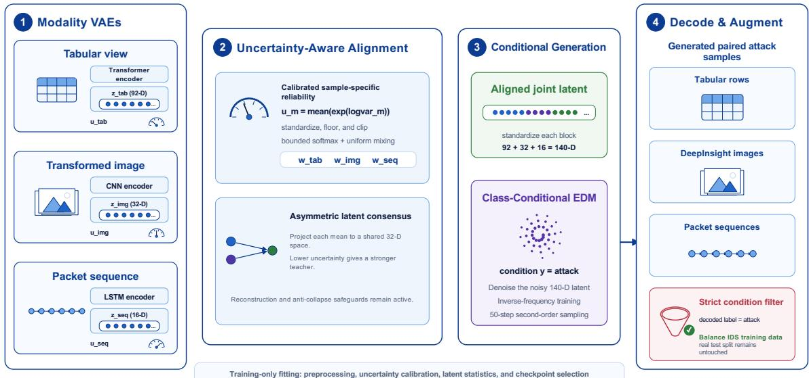

# Uncertainty-Guided Cross-Modal Alignment for Diffusion-Based IoT Intrusion Detection

Mahdi Arab Loodaricheh, Anita Raja, and Mohammad Hossein Manshaei MAHDI.ARABLOODARICHEH41@GC.CUNY.EDU; {ANITA.RAJA,MOHAMMAD.MANSHAEI}@HUNTER.CUNY.EDU Department ofComputer Science, Hunter College and The Graduate Center, CUNY, New York, NY, USA

## Abstract

Diffusion models evolve noisy states toward a learned data distribution, so their sampling behavior depends on the geometry of the representation in which denoising occurs. This dependence is especially important for multimodal data: independently trained encoders can map synchronized views to incompatible latent regions, while uniform alignment can let an uncertain view distort the shared geometry. To address this gap, we introduce a novel reliability-guided alignment rule that uses normalized VAE posterior variance to control directional cross-modal influence before diffusion training. We study this issue in minority-attack generation for imbalanced Internet-of-Things intrusion detection. Tabular flow attributes, a DeepInsight image, and a packet sequence are encoded by modality-specific variational autoencoders. Per-modality normalized VAE posterior variances provide bounded, sample-specific weighting signals in an asymmetric stop-gradient alignment objective. We use these quantities as heuristic encoder-derived reliability proxies rather than calibrated probabilistic uncertainties. The full modality-specific latent means obtained after alignment fine-tuning are standardized and modeled jointly by a class-conditional EDM; a secondorder sampler then generates paired attack-conditioned latent blocks for the three decoders. In controlled experiments on TON-IoT, uncertainty-aware alignment obtains the highest mean precision, recall, density, and coverage among three diffusion variants. Augmenting only the training split yields ROC-AUC 0.9515, PR-AUC 0.8954, balanced accuracy 0.8395, and attack-class F1 0.7940 on an untouched real test set. Among the two variants with matched alignment fine-tuning, posterior-variance-based weighting improves both tabular generative fidelity and downstream detection relative to uniform weighting.

Keywords: conditional diffusion, multimodal latent alignment, uncertainty, class imbalance, IoT intrusion detection

## 1. Introduction

Diffusion-based generation transports a simple noisy distribution toward a structured data distribution. In latent diffusion, this transport inherits its geometry from the encoders: latent scales and correspondences determine what the denoiser must learn and how a numerical sampler traverses the state space. Tabular diffusion benefits from compact latent representations [8, 12], while MAGE-ID couples tabular flows and image transformations through a joint latent diffusion prior [9]. Adding packet sequences creates a three-view constraint: every generated block must describe the same event.

In imbalanced IoT intrusion detection, random oversampling adds no observations and SMOTE is limited to local interpolation [2], whereas conditional generation can model the minority distribution.

Independent encoders do not guarantee synchronization, whereas uniform alignment assumes every view is equally informative for every sample. A noisy packet sequence or ambiguous image can then pull reliable representations toward an uncertain target, compounding the modality imbalance observed in multimodal VAEs [5]. Reliability weighting is useful in multimodal fusion [4, 13]; here it shapes the state space on which conditional denoising is learned.

In our method, modality-specific VAEs first encode the three views. The novel technical component is a bounded, sample-dependent asymmetric alignment objective in which each target modality’s normalized VAE posterior-variance proxy controls its influence on the other encoders. We use mean VAE posterior variance as a heuristic, encoder-derived reliability proxy and normalize it separately for each modality. The resulting bounded, sample-specific weights control an asymmetric stop-gradient alignment objective. The full modality-specific latent means are then standardized, concatenated, and modeled by a class-conditional EDM [6]. The uniform and posterior-varianceweighted variants receive identical alignment fine-tuning and differ only in their target weights; their comparison therefore evaluates the effect of the weighting rule.

## 2. Reliability-Aware Joint Latent Dynamics

## 2.1. Multimodal state construction

Let $\mathbf x _ { n } = ( \mathbf x _ { n } ^ { t } , \mathbf x _ { n } ^ { i } , \mathbf x _ { n } ^ { s } , y _ { n } )$ contain tabular, image, and sequence views and a normal/attack label. We learn their joint distribution conditioned on $y = 1$ and add generated attacks only to training. The 22 flow features are also mapped to an $8 \times 8$ DeepInsight image [11]; the sequence retains 50 packets with eight attributes. Common indices preserve correspondence. Transformer, convolutional, and LSTM VAEs encode the views. Each diagonal-Gaussian posterior has mean $\pmb { \mu } ^ { m }$ and log-variance $\ell ^ { m }$ and is pretrained with reconstruction and KL losses [7]; its full mean has dimension 92, 32, or 16.

## 2.2. Uncertainty-weighted alignment

For sample n, modality m has mean posterior variance $\begin{array} { r } { u _ { n , m } = d _ { m } ^ { - 1 } \sum _ { r } \exp ( \ell _ { n , r } ^ { m } ) } \end{array}$ . Because encoder scales differ, we standardize log $u _ { n , m }$ using per-modality statistics from a fixed clean training subset, apply a deviation floor, and clip the result to $\widetilde { u } _ { n , m }$ . Confidence and the bounded weight are

$$
a _ { n , m } = \frac { \exp ( - \gamma \widetilde { u } _ { n , m } ) } { \sum _ { k } \exp ( - \gamma \widetilde { u } _ { n , k } ) } , \qquad w _ { n , m } = \eta a _ { n , m } + ( 1 - \eta ) / 3 ,\tag{1}
$$

with $\gamma = 2$ and $\eta = 0 . 5$ . Thus, confidence changes relative influence without assigning zero weight to any view. The weights are detached so an encoder cannot reduce the objective by manipulating its reported variance.

Projection heads $P _ { m }$ map posterior means to a shared 32-dimensional space, $\mathbf { h } _ { n } ^ { m } = P _ { m } ( \mu _ { n } ^ { m } )$ For mini-batch $B ,$ alignment uses

$$
\mathcal { L } _ { \mathrm { a l i g n } } = \frac { 1 } { 6 | \mathcal { B } | } \sum _ { n \in \mathcal { B } } \sum _ { m } \sum _ { k \neq m } w _ { n , k } \left\| \mathbf { h } _ { n } ^ { m } - \mathrm { s g } ( \mathbf { h } _ { n } ^ { k } ) \right\| _ { 2 } ^ { 2 } ,\tag{2}
$$

where sg stops gradients through the target. The target’s weight, rather than the source’s, controls the update: a lower-uncertainty view is a stronger teacher. Reconstruction and KL losses remain active, and a variance-floor penalty discourages collapsed projection dimensions. The projection heads impose correspondence but are not passed to the diffusion model.

  
Figure 1: The proposed pipeline. Reliability-weighted alignment shapes an auxiliary shared geometry; class-conditional EDM operates on the standardized full latent blocks and decodes synchronized attack views. All fitted transformations and checkpoint decisions use training data only.

## 2.3. Conditional denoising trajectory

The complete means are standardized blockwise with training statistics and concatenated into ${ \pmb z } \in$ $\mathbb { R } ^ { 1 4 0 }$ . This removes coordinate-scale differences that could otherwise let one modality dominate the denoising loss. EDM samples a noise level $\sigma ,$ forms $\widetilde { \mathbf z } = \overline { { \mathbf z } } + \sigma \epsilon$ , and minimizes

$$
\mathcal { L } _ { \mathrm { d i f f } } = \mathbb { E } \Big [ \omega ( \sigma ) \| D _ { \theta } ( \widetilde { \mathbf { z } } , \sigma , y ) - \overline { { \mathbf { z } } } \| _ { 2 } ^ { 2 } \Big ] .\tag{3}
$$

An inverse-frequency sampler balances exposure to the two classes during training. With σ as the integration variable, the EDM derivative is $\mathrm { d } \widetilde { \mathbf { z } } / \mathrm { d } \sigma = ( \widetilde { \mathbf { z } } - D _ { \theta } ( \widetilde { \mathbf { z } } , \sigma , y ) ) / \sigma$ . Starting from Gaussian noise and fixing $y = 1$ , 50 second-order updates follow this direction toward an attack-conditioned latent. The state is split, returned to each block’s original scale, and decoded. A candidate is retained only when the reconstructed categorical label agrees with the requested attack condition.

Alignment changes the representation geometry through directed, reliability-weighted updates; the EDM sampler then transports noise through that geometry. Alignment makes corresponding blocks compatible, while uncertainty weighting limits distortion from an unreliable target.

## 3. Existing Experimental Study

## 3.1. Protocol

Experiments use the network-traffic component of TON-IoT [1]. The binary target combines every non-normal attack category while retaining original multiclass labels during stratification. The downstream study uses a fixed 30,000-event, 80:20 pool split into 21,000 training, 3,000 validation, and 6,000 test observations; training contains 16,800 normal and 4,200 attack events. PRDC uses independently prepared 30,000-event artifacts under the same class ratio, split proportions, and saved-index protocol. Comparisons within each evaluation therefore use identical observations. Preprocessing, image coordinates, normalization, latent statistics, uncertainty normalization, and checkpoint selection are fitted without test data.

Table 1: PRDC for generated tabular attacks (mean ± standard deviation over three seeds). Higher is better.
<table><tr><td>Method</td><td>Precision</td><td>Recall</td><td>Density</td><td>Coverage</td></tr><tr><td>No alignment</td><td> $0 . 6 6 8 8 \pm 0 . 1 0 1 5$ </td><td> $0 . 8 5 6 3 \pm 0 . 0 7 7 5$ </td><td> $0 . 6 6 1 6 \pm 0 . 0 9 6 9$ </td><td> $0 . 7 0 9 3 \pm 0 . 0 8 9 7$ </td></tr><tr><td>Uniform alignment</td><td> $0 . 7 2 4 8 \pm 0 . 0 1 3 7$ </td><td> $0 . 9 0 5 4 \pm 0 . 0 1 8 1$ </td><td> $0 . 7 0 9 0 \pm 0 . 0 1 5 4$ </td><td> $0 . 7 6 9 6 \pm 0 . 0 0 6 3$ </td></tr><tr><td>Uncertainty-aware</td><td> $\mathbf { 0 . 7 3 4 1 \pm 0 . 0 3 1 6 }$ </td><td> $\mathbf { 0 . 9 0 6 7 \pm 0 . 0 1 9 4 }$ </td><td> $\mathbf { 0 . 7 2 2 9 \pm 0 . 0 4 0 3 }$ </td><td> $\mathbf { 0 . 7 9 2 1 \pm 0 . 0 1 8 5 }$ </td></tr></table>

We compare real-only, class-weighted, random-oversampled, and SMOTE training with three diffusion variants. No alignment uses the independently pretrained VAE latents; uniform alignment sets every modality weight to $1 / 3 ;$ uncertainty-aware alignment uses Eq. (1). The three diffusion variants share encoders, latent dimensions, denoiser, optimizer settings, class condition, sampler, augmentation volume, and data split. Each augments the training set to equal class counts. Downstream utility is measured by one fixed XGBoost configuration [3]; the test set remains real and imbalanced. We report mean and sample standard deviation over three model seeds. Precision, recall, density, and coverage (PRDC) compare equal-sized sets of real and generated tabular attacks [10].

The VAEs train for at most 100 epochs, followed by 50 alignment epochs. The alignment coefficient reaches 0.01 after a linear warm-up; the anti-collapse penalty has weight $1 0 ^ { - 3 }$ . Loguncertainties use a 0.05 standard-deviation floor and are clipped to [−5, 5]. The diffusion model trains for at most 1,000 epochs with early-stopping patience 200. NumPy, PyTorch, syntheticsample selection, and XGBoost use three model seeds while the saved data split is held fixed.

## 3.2. Fidelity and downstream utility

Table 1 isolates the geometry used by the same conditional diffusion process. Uniform alignment improves every mean relative to no alignment. Its coverage standard deviation falls from 0.0897 to 0.0063. The uncertainty-aware variant obtains the highest mean in all four columns; coverage rises from 0.7696 to 0.7921 relative to uniform alignment while the other means do not decrease. Its standard deviations are higher than the uniform variant’s for three metrics, so the result supports better mean fidelity rather than uniformly lower variance.

Table 2 shows that class balance alone is insufficient. Class weighting and random oversampling reduce balanced accuracy and F1 relative to real-only training; SMOTE improves balanced accuracy but not the other three measures. No-alignment and uniform-alignment diffusion are also nearly indistinguishable downstream. In contrast, uncertainty-aware alignment has the best mean in every column. Against uniform alignment it adds 0.0129 ROC-AUC, 0.0204 PR-AUC, 0.0150 balanced accuracy, and 0.0143 F1. Against the strongest alternative in each column, the gains are 0.0097, 0.0155, 0.0085, and 0.0119, respectively.

Uniform alignment improves fidelity but not the classifier. Reliability- aware alignment improves both under the same denoising and sampling setup, consistent with the hypothesis that a shared geometry is insufficient when uncertain views remain equally strong targets. With only three seeds, we treat the differences as controlled evidence, not statistical significance.

Table 2: Downstream performance on the untouched real test set (mean ± standard deviation over three seeds). BAcc. denotes balanced accuracy; higher is better.
<table><tr><td>Training strategy</td><td>ROC-AUC</td><td>PR-AUC</td><td>BAcc.</td><td>F1</td></tr><tr><td>Real only</td><td> $0 . 9 4 1 0 \pm 0 . 0 0 1 4$ </td><td> $0 . 8 7 9 9 \pm 0 . 0 0 1 3$ </td><td> $0 . 8 2 4 4 \pm 0 . 0 0 1 8$ </td><td> $0 . 7 8 2 1 \pm 0 . 0 0 2 9$ </td></tr><tr><td>Class weighted</td><td> $0 . 9 4 1 8 \pm 0 . 0 0 1 5$ </td><td> $0 . 8 7 8 6 \pm 0 . 0 0 1 4$ </td><td> $0 . 8 2 1 2 \pm 0 . 0 0 1 6$ </td><td> $0 . 7 2 1 3 \pm 0 . 0 0 5 1$ </td></tr><tr><td>Random oversampling</td><td> $0 . 9 4 1 6 \pm 0 . 0 0 1 8$ </td><td> $0 . 8 7 8 3 \pm 0 . 0 0 2 1$ </td><td> $0 . 8 2 0 7 \pm 0 . 0 0 2 7$ </td><td> $0 . 7 2 0 9 \pm 0 . 0 0 4 8$ </td></tr><tr><td>SMOTE</td><td> $0 . 9 3 7 6 \pm 0 . 0 0 1 8$ </td><td> $0 . 8 7 1 6 \pm 0 . 0 0 3 3$ </td><td> $0 . 8 3 1 0 \pm 0 . 0 0 2 6$ </td><td> $0 . 7 3 4 9 \pm 0 . 0 0 8 6$ </td></tr><tr><td>No-align. diffusion</td><td> $0 . 9 3 8 1 \pm 0 . 0 0 2 2$ </td><td> $0 . 8 7 4 7 \pm 0 . 0 0 2 5$ </td><td> $0 . 8 2 4 3 \pm 0 . 0 0 2 5$ </td><td> $0 . 7 8 0 0 \pm 0 . 0 0 3 5$ </td></tr><tr><td>Uniform-align. diffusion</td><td> $0 . 9 3 8 6 \pm 0 . 0 0 0 8$ </td><td> $0 . 8 7 5 0 \pm 0 . 0 0 1 1$ </td><td> $0 . 8 2 4 5 \pm 0 . 0 0 1 9$ </td><td> $0 . 7 7 9 7 \pm 0 . 0 0 2 2$ </td></tr><tr><td>Uncertainty-aware</td><td> $\mathbf { 0 . 9 5 1 5 \pm 0 . 0 0 0 3 }$ </td><td> $\mathbf { 0 . 8 9 5 4 \pm 0 . 0 0 0 6 }$ </td><td> $\mathbf { 0 . 8 3 9 5 \pm 0 . 0 0 2 4 }$ </td><td> $\mathbf { 0 . 7 9 4 0 \pm 0 . 0 0 2 2 }$ </td></tr></table>

## 4. Discussion

The results distinguish two roles of multimodal latent alignment. Uniform alignment improves all PRDC means relative to independent latent modeling, suggesting that cross-modal compatibility provides a more coherent state space for conditional denoising. However, this improvement does not translate into comparable downstream gains. Generative fidelity alone is therefore insufficient: the aligned representation must also preserve minority-class structure that is useful to the detector. Uncertainty-aware alignment improves both fidelity and downstream performance, supporting the use of selective, sample-dependent cross-modal influence rather than treating every modality as an equally reliable target.

This interpretation also connects representation learning to the resulting denoising dynamics. Blockwise standardization prevents latent scale differences from dominating the EDM objective, bounded reliability weights preserve all modalities while varying their influence, and stop-gradient targets make the direction of alignment explicit. Together, these mechanisms shape the geometry through which the sampler transports noise toward an attack-conditioned multimodal state. The present endpoint measurements motivate future analysis of the complete trajectory, including path length, curvature, solver error, and cross-modal agreement throughout sampling.

Future Work. Future work will extend the evaluation to multiclass and cross-dataset settings, examine joint multimodal fidelity, and investigate more formal measures of modality uncertainty and denoising stability.

## 5. Conclusion

Our work shows that calibrated reliability can guide multimodal alignment while bounded weights and anti-collapse safeguards preserve every view. The conditional EDM then models the resulting joint geometry to generate synchronized attack latents. Under the same denoising and sampling setup, uniform alignment improves generative fidelity but provides little downstream benefit, whereas uncertainty-aware alignment improves both fidelity and intrusion-detection performance. These results demonstrate that effective multimodal diffusion depends not only on aligning representations, but also on controlling which modalities are trusted during alignment.

## References

[1] Abdullah Alsaedi, Nour Moustafa, Zahir Tari, Abdun Mahmood, and Adnan Anwar. TON IoT telemetry dataset: A new generation dataset of IoT and IIoT for data-driven intrusion detection systems. IEEE Access, 8:165130–165150, 2020. doi: 10.1109/ACCESS.2020.3022862.

[2] Nitesh V. Chawla, Kevin W. Bowyer, Lawrence O. Hall, and W. Philip Kegelmeyer. SMOTE: Synthetic minority over-sampling technique. Journal ofArtificial Intelligence Research, 16: 321–357, 2002. doi: 10.1613/jair.953.

[3] Tianqi Chen and Carlos Guestrin. XGBoost: A scalable tree boosting system. In Proceedings ofthe 22nd ACM SIGKDD International Conference on Knowledge Discovery and Data Mining, pages 785–794, 2016. doi: 10.1145/2939672.2939785.

[4] Zixian Gao, Xun Jiang, Xing Xu, Fumin Shen, Yujie Li, and Heng Tao Shen. Embracing unimodal aleatoric uncertainty for robust multimodal fusion. In Proceedings of the IEEE/CVF Conference on Computer Vision and Pattern Recognition, pages 26876–26885, 2024.

[5] Adrian Javaloy, Maryam Meghdadi, and Isabel Valera. Mitigating modality collapse in multimodal VAEs via impartial optimization. In Proceedings of the 39th International Conference on Machine Learning, volume 162 of Proceedings of Machine Learning Research, pages 9938–9964, 2022.

[6] Tero Karras, Miika Aittala, Timo Aila, and Samuli Laine. Elucidating the design space of diffusion-based generative models. In Advances in Neural Information Processing Systems, volume 35, pages 26565–26577. Curran Associates, Inc., 2022. doi: 10.52202/068431-1926. URL https://proceedings.neurips.cc/paper\_files/paper/2022/ hash/a98846e9d9cc01cfb87eb694d946ce6b-Abstract-Conference. html.

[7] Diederik P. Kingma and Max Welling. Auto-encoding variational bayes. In Proceedings of the 2nd International Conference on Learning Representations (ICLR), Banff, AB, Canada, 2014. URL https://arxiv.org/abs/1312.6114.

[8] Akim Kotelnikov, Dmitry Baranchuk, Ivan Rubachev, and Artem Babenko. TabDDPM: Modelling tabular data with diffusion models. In Proceedings of the 40th International Conference on Machine Learning, volume 202 of Proceedings ofMachine Learning Research, pages 17564–17579, 2023.

[9] Mahdi Arab Loodaricheh, Mohammad Hossein Manshaei, and Anita Raja. MAGE-ID: A multimodal generative framework for intrusion detection systems. In 2026 International Conference on Computing, Networking and Communications (ICNC), pages 585–589, 2026. doi: 10.1109/ICNC68183.2026.11416962.

[10] Muhammad Ferjad Naeem, Seong Joon Oh, Youngjung Uh, Yunjey Choi, and Jaejun Yoo. Reliable fidelity and diversity metrics for generative models. In Proceedings of the 37th International Conference on Machine Learning, volume 119 of Proceedings of Machine Learning Research, pages 7176–7185, 2020.

[11] Alok Sharma, Edwin Vans, Daichi Shigemizu, Keith A. Boroevich, and Tatsuhiko Tsunoda. Deepinsight: A methodology to transform a non-image data to an image for convolution neural network architecture. Scientific Reports, 9(1):11399, 2019. doi: 10.1038/ s41598-019-47765-6.

[12] Hengrui Zhang, Jiani Zhang, Balasubramaniam Srinivasan, Zhengyuan Shen, Xiao Qin, Christos Faloutsos, Huzefa Rangwala, and George Karypis. Mixed-type tabular data synthesis with score-based diffusion in latent space. In The Twelfth International Conference on Learning Representations, 2024. URL https://openreview.net/forum?id=4Ay23yeuz0.

[13] Qingyang Zhang, Haitao Wu, Changqing Zhang, Qinghua Hu, Huazhu Fu, Joey Tianyi Zhou, and Xi Peng. Provable dynamic fusion for low-quality multimodal data. In Proceedings of the 40th International Conference on Machine Learning, volume 202 of Proceedings of Machine Learning Research, pages 41753–41769, 2023.