# Your LR Schedule May Not Be Principled: Effective Learning Rate Scheduling in Weight-Normalized Training

Qifan Yu1,2,∗, Xinyu Ma1, Xingyan Bin1,†, Di He2,†

1ByteDance Seed, 2Peking University

∗Work done at ByteDance Seed, †Corresponding authors

## Abstract

Weight-normalized (WN) training is emerging as a compelling alternative to conventional weight decay (WD), with recent studies reporting substantial pretraining loss gains. We show that these gains are driven primarily by the induced efective learning rate (ELR) trajectory rather than by normalization alone. Matching ELR trajectories largely collapses the training loss dynamics of WN and WD. Schedule design should therefore target ELR rather than the nominal learning rate (LR) alone. Building on this principle, we propose AIR (Afine Inverse-square-Root decay), which combines a theoretically derived 1/ t decay with an afine adjustment to satisfy prescribed peak and terminal LRs over a finite training horizon. We further identify late-stage ELR scheduling as a key source of its gains, because a shared late schedule attenuates the efect of earlier LR choices. Experiments on 128 B-token Mixture-of-Experts pretraining demonstrate that AIR outperforms cosine and other candidate schedules in training loss, downstream performance, and hyperparameter robustness, reducing terminal training loss by approximately 0.01 relative to cosine at matched cumulative LR. Applying the same ELR trajectory to WD reproduces the corresponding training dynamics, showing that the benefits extend beyond fixed-norm training and establishing ELR as the principled scheduling object.

Date: October 30, 2026

Correspondence: Qifan Yu at qifanyu@stu.pku.edu.cn, Xinyu Ma at maxinyu.flame@bytedance.com, Xingyan Bin at binxingyan@bytedance.com, Di He at di\_he@pku.edu.cn

## 1 Introduction

In Large Language Model (LLM) pretraining, weight-normalized (WN) training [23, 33] has emerged as a promising alternative to conventional weight decay (WD) [20]. It keeps parameter norms fixed after each update, with recent work reporting lower pretraining loss, improved token eficiency, greater stability, and better hyperparameter transfer [1, 18, 33]. Yet WN and WD exhibit markedly diferent training dynamics under the same learning rate (LR) schedule. As shown in Figure 1(a), under cosine decay [19], WN initially trails WD but eventually outperforms it. However, under warmup-stable-decay (WSD) [10], WN remains behind WD throughout training and ends with a substantially higher loss. Therefore, understanding this contrast is essential to explaining when and why WN outperforms WD.

We attribute this contrast to the efective learning rate (ELR) [5, 29], defined as $\eta ^ { \mathrm { e f f } } = \eta / r$ , where η is the nominal LR and r is the norm of a parameter block. In our study, we discover that the loss dynamics is strongly related to the decay of ELR. When WN and WD share the same WSD LR schedule, their ELR is governed entirely by the parameter norm r, which evolves very diferently in the two regimes (Figure $^ { 1 ( \mathrm { b , c } ) ) }$ ). WN fixes the parameter norm, holding its ELR constant at peak throughout the entire stable phase and leading to a slow decrease in loss. By contrast, WD’s ELR keeps falling steadily, owing to the continuing growth of its parameter norm. This sustained ELR decay keeps its loss dropping much faster than WN.

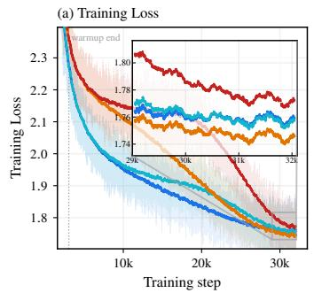

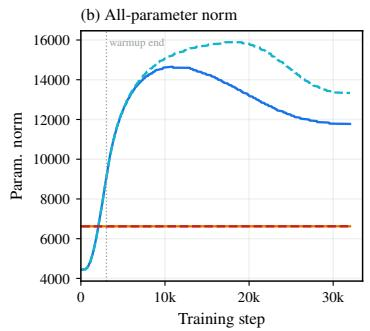

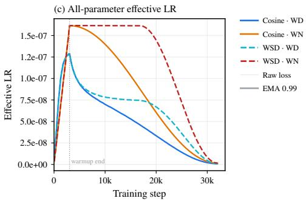  
Figure 1 WN achieves lower final loss than WD under cosine, but significantly higher under WSD. Efective LR (nominal LR / all-parameter norm) is the key driver of loss dynamics.

(a) Cosine  
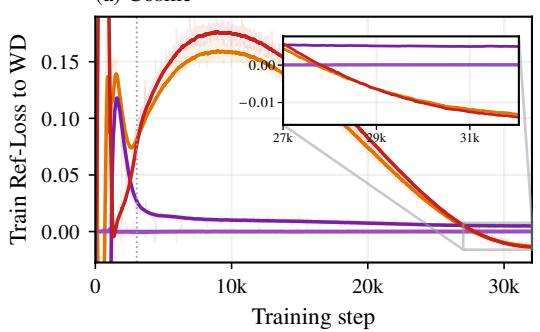

(b) AIR  
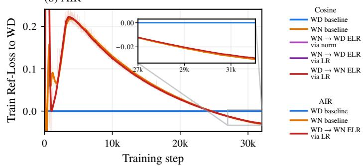  
Figure 2 ELR matching collapses WD-WN training loss dynamics. Training loss minus the WD baseline under (a) cosine or (b) AIR, paired at the same step; zero denotes the reference. Arrows indicate the ELR target, matched by replaying WD norms (via norm) or rescaling blockwise LR (via LR). WD→WN also replays WD norms.

A more interesting finding is that the loss dynamics of WN and WD largely collapse onto a common trajectory once we align their ELR trajectories, whether by replaying WD’s norms or by rescaling one’s blockwise LRs. (see Figure 2 and Section 2.2 for details). Concurrent studies [17, 34, 38] also report similar results, corroborating our findings.

Taken together, these findings lead us to our core conclusion: ELR is the key driver of the loss dynamics. WN’s core advantage actually comes from a better ELR schedule, not normalization alone. Principled LR schedule design should therefore target ELR rather than the nominal LR alone. This core idea naturally inspires an essential research question:

## What should a better ELR schedule look like?

To address this question, we study ELR scheduling under WN, a clean setting in which each block’s ELR is proportional to its nominal LR. Here, we find that $1 / \sqrt { t }$ decay further improves training. A theoretical analysis of WN dynamics shows that, in the unconstrained setting, $1 / \sqrt { t }$ decay maximizes alignment with an oracle direction at every step. To make this practical, we introduce AIR (Afine Inverse-square-Root decay), which adapts this $1 / \sqrt { t }$ decay through an afine transformation to meet prescribed peak and terminal LRs over a finite horizon. A further analysis shows how a shared late-stage schedule attenuates the alignment diferences induced by earlier LR choices. This helps explain our finding that late-stage ELR scheduling is a key source of AIR’s gains.

Empirically, we evaluate AIR against cosine decay and alternative LR schedule families. In 128 B-token Mixture-of-Experts (MoE) [25] pretraining, AIR reduces terminal training loss by approximately 0.01 relative to cosine decay. Among these families, it achieves the lowest loss, the best downstream performance, and the greatest robustness to hyperparameter choices. Consistent with our theoretical analysis, controlled experiments show that the final training loss gaps between schedules narrow substantially when they share the same late-stage AIR schedule and difer only in their earlier LR trajectories. Transferring the induced ELR trajectory to WD also reproduces the corresponding training dynamics, showing that the benefits extend beyond fixed-norm training.

In summary, our contributions are:

• We identify the induced ELR trajectory as the key driver of WN’s loss advantage over WD. Matching ELR trajectories largely aligns their training loss dynamics, highlighting ELR, rather than nominal LR alone, as the target for schedule design.

• We propose AIR, an afine $1 / \sqrt { t }$ schedule for finite-horizon pretraining. Its decay shape follows from a theoretical analysis of directional alignment under WN, which also helps explain the role of late-stage ELR scheduling in AIR’s gains.

• We empirically validate AIR against cosine decay and alternative schedule families in 128 B-token MoE pretraining, demonstrating improvements in training loss, downstream performance, and hyperparameter robustness. It reduces terminal training loss by approximately 0.01 relative to cosine at matched cumulative LR. Applying the same ELR trajectory to WD reproduces the corresponding training loss dynamics.

## 2 Effective Learning Rate as the Scheduling Principle

## 2.1 Effective learning rate under WN and WD

Let $\pmb { \theta } _ { k }$ denote a nonzero, vectorized parameter block at optimizer step $k , \eta _ { k }$ the nominal learning rate, and $\mathbf { \Delta } \mathbf { u } _ { k }$ the optimizer update before LR scaling. With decay coeficient $\lambda \geq 0$ and prescribed norm $R > 0$ , decoupled WD [20] and fixed-norm WN [33] use the following update rules, respectively:

$$
\begin{array} { r l } { \mathrm { W D } ; } & { { } \pmb { \theta } _ { k + 1 } = ( 1 - \lambda \eta _ { k } ) \pmb { \theta } _ { k } + \eta _ { k } \pmb { u } _ { k } , } \end{array}\tag{1}
$$

$$
\mathrm { W N } ; \quad \pmb { \theta } _ { k + 1 } = R \frac { \pmb { \theta } _ { k } + \eta _ { k } \pmb { u } _ { k } } { \lVert \pmb { \theta } _ { k } + \eta _ { k } \pmb { u } _ { k } \rVert } .\tag{2}
$$

WD shrinks the current parameters before adding the optimizer update, while WN rescales the updated block to norm R, preserving its direction.

The same nominal LR can produce diferent relative updates when parameter norms difer. Writing $r _ { k } = \lVert \pmb { \theta } _ { k } \rVert$ for the block’s norm at step $k ,$ we define the blockwise norm-based efective learning rate [5, 13, 29] as

$$
\eta _ { k } ^ { \mathrm { e f f } } : = \frac { \eta _ { k } } { r _ { k } } .\tag{3}
$$

It captures how much a given optimizer update can afect the parameter direction, providing a more informative measure of its impact than the nominal LR alone (see Appendices A.1 and A.2).

## 2.2 Aligning the training dynamics of WN and WD

Experimental setup. To validate the claim that matching ELRs in Eq. (3) aligns the training dynamics of WN and WD, we match WN’s ELR to WD’s on each parameter block in two ways: (i) Via norm. We rescale each WN block at each step to the corresponding recorded WD norm while retaining the same nominal LR as WD. (ii) Via LR. We keep each WN block at its fixed norm R and adjust its blockwise nominal LR to satisfy

$$
\frac { \eta _ { k } ^ { \mathrm { W N } } } { R } = \frac { \eta _ { k } ^ { \mathrm { W D } } } { r _ { k } ^ { \mathrm { W D } } } \implies \eta _ { k } ^ { \mathrm { W N } } = R \frac { \eta _ { k } ^ { \mathrm { W D } } } { r _ { k } ^ { \mathrm { W D } } } ,\tag{4}
$$

where $r _ { k } ^ { \mathrm { W D } }$ is the recorded WD norm before the current update, and $\eta _ { k } ^ { \mathrm { W N } }$ and $\eta _ { k } ^ { \mathrm { W D } }$ are the respective nominal LRs.

For the reverse matching, we replay the WD norm trajectories and adjust blockwise LRs to match WN’s ELR. Details are given in Appendix A.3. We conduct this reverse comparison under both cosine and AIR, alongside the corresponding WD and WN baselines.

Results. Figure 2 shows that ELR matching collapses the training loss dynamics between WD and WN. Under cosine, norm replay precisely reproduces WD dynamics, with a gap less than $2 \times 1 0 ^ { - 4 }$ , while LR matching at fixed WN norms also closely tracks the WD baseline, leaving a residual loss gap of several $\times 1 0 ^ { - 3 }$ . Under both cosine and AIR, matching WN’s ELR along recorded WD norms yields a loss dynamics close to the WN baseline. The consistent collapse across both schedules supports ELR as a key driver of training dynamics and thus a principled target for schedule design.

## 2.3 WN as a setting for ELR schedule design

Under WD, changing the nominal LR also afects the subsequent parameter norms, coupling the two quantities in Eq. (3), so that rescaling the nominal LR alone does not reproduce a target ELR trajectory [13]. WN removes this coupling by fixing $r _ { k } = R$ , giving $\eta _ { k } ^ { \mathrm { e f f } } = \eta _ { k } / R$ , making each block’s ELR proportional to its nominal LR [1, 33]. This direct proportionality makes WN a clean setting. Therefore, we study ELR scheduling under WN, using its update rule as the starting point for the theory.

## 3 Designing a Better ELR Schedule under WN: AIR

## 3.1 Directional-alignment dynamics under WN

Starting from the WN update in Eq. (2), which fixes a parameter block’s norm and thus leaves only its direction to evolve, we analyze how the LR schedule afects this evolution. Let v denote an idealized unit target direction, fixed throughout the analysis. Given the training history $\mathcal { F } _ { 0 }$ at the analysis starting point, define

$$
m _ { k } : = \mathbb { E } \bigg [ \frac { { \pmb v } ^ { \top } { \pmb \theta } _ { k } } { R } \bigg | \mathcal { F } _ { 0 } \bigg ] .\tag{5}
$$

This is the expected cosine alignment after k updates from the same starting point. The expectation averages over minibatch sampling and other randomness in these k updates, while the initial history stays fixed. For this analysis, we consider an LR schedule specified in advance and assume tangential updates of fixed magnitude, $\pmb \theta _ { k } ^ { \top } \pmb u _ { k } = 0$ and $\| \boldsymbol { u } _ { k } \| = U > 0$

Deriving the alignment dynamics. Taking the conditional expectation of the inner product with v in Eq. (2) gives

$$
m _ { k + 1 } = \frac { m _ { k } + a \eta _ { k } } { \sqrt { 1 + 2 b \eta _ { k } ^ { 2 } } } ,\tag{6}
$$

where

$$
a : = \mathbb { E } \bigg [ \frac { \pmb { v } ^ { \top } \pmb { u } _ { k } } { R } \bigg | \mathcal { F } _ { 0 } \bigg ] > 0 , \qquad b = \frac { U ^ { 2 } } { 2 R ^ { 2 } } .\tag{7}
$$

We assume that a and b are constant across steps and schedules. The optimization below concerns these constant-coeficient scalar dynamics. For $2 b \eta _ { k } ^ { 2 } \ll 1$ , a second-order expansion yields the continuous approximation, with time measured in optimizer steps,

$$
\dot { m } ( t ) = a \eta ( t ) - b \eta ( t ) ^ { 2 } m ( t ) .\tag{8}
$$

A larger LR increases new alignment linearly but strengthens the retraction of existing alignment quadratically.   
Detailed derivations are provided in Appendix B.1.

Exact integral solution. For a nonnegative, square-integrable schedule on [0, h] and initial alignment $m ( 0 ) =$ $m _ { 0 } > 0$ , Eq. (8) has the exact solution

$$
m ( h ) = m _ { 0 } H ( h , 0 ) + a \int _ { 0 } ^ { h } H ( h , t ) \eta ( t ) \mathrm { d } t , \quad H ( h , t ) : = \exp \left[ - b \int _ { t } ^ { h } \eta ( s ) ^ { 2 } \mathrm { d } s \right] .\tag{9}
$$

The solution decomposes endpoint alignment into retained initial alignment and retained contributions from subsequent updates. Each contribution is weighted by $H ( h , t )$ , which represents the fraction of alignment present at time t that remains at the endpoint h. Detailed derivations are provided in Appendix B.2.

## 3.2 Unconstrained optimal schedule: inverse-square-root decay

We first maximize terminal alignment $m ( h )$ in Eq. (9) without prescribing a peak, a terminal LR, or an LR budget. For fixed $a , b , m _ { 0 } , h > 0$ , completing the square in the alignment dynamics gives

$$
\frac { \mathrm { d } } { \mathrm { d } t } m ( t ) ^ { 2 } = \frac { a ^ { 2 } } { 2 b } - 2 b \left( m ( t ) \eta ( t ) - \frac { a } { 2 b } \right) ^ { 2 } .\tag{10}
$$

Since $m ( t ) > 0$ , integration yields the bound $m ( h ) \leq \sqrt { m _ { 0 } ^ { 2 } + a ^ { 2 } h / ( 2 b ) }$ , with equality if and only if $m ( t ) \eta ( t ) =$ $a / ( 2 b )$ almost everywhere on $[ 0 , h ]$ . Under this condition, $m ( t ) ^ { 2 }$ grows linearly, giving $m ^ { \star } ( t ) = \sqrt { m _ { 0 } ^ { 2 } + a ^ { 2 } t / ( 2 b ) }$ and hence the optimal time-shifted schedule:

$$
\eta ^ { \star } ( t ) = \frac { \eta _ { 0 } } { \sqrt { 1 + 2 b \eta _ { 0 } ^ { 2 } t } } , \qquad \eta _ { 0 } = \frac { a } { 2 b m _ { 0 } } .\tag{11}
$$

Because the same schedule attains the bound for every endpoint $h ,$ it maximizes expected alignment at every time under these dynamics. The $1 / \sqrt { t }$ ELR profiles have also been observed to arise implicitly: without weight decay, growing parameter norms make the realized relative update decay as $t ^ { - 1 / 2 } \ \lceil 1 \bar { 3 } \rceil$ . Here the same shape instead follows from maximizing directional alignment under WN. Appendix B.3 gives the full proof and shows that its integer samples are also optimal for the discrete recurrence in Eq. (6). Appendix B.4 derives the geometric restrictions needed to interpret these states as expected cosine alignments.

## 3.3 AIR: A practical schedule design

Building on the $1 / \sqrt { t }$ decay in Eq. (11), we propose AIR (Afine Inverse-square-Root decay) for pretraining with prescribed peak and terminal LRs. The decay schedule controls how rapidly the LR decreases at diferent stages of training. To preserve the relative magnitudes of LR decay, we use an afine transformation that scales them by a common positive factor. Let $k = 0 , \ldots , K$ index the decay stage, with $K > 0$ its horizon. For a decay time scale $\alpha > 0$ , define

$$
q ( k ) = \left( 1 + \frac { k } { \alpha } \right) ^ { - 1 / 2 } , \qquad f ( k ) = \frac { q ( k ) - q ( K ) } { 1 - q ( K ) } .\tag{12}
$$

Here, $f ( k )$ rescales the $1 / \sqrt { t }$ curve $q ( k )$ from 1 to 0. For a peak LR $p$ and a terminal LR $0 < \eta _ { \mathrm { m i n } } < p$ , the resulting schedule is

$$
\eta _ { \mathrm { A I R } } ( k ) = \eta _ { \mathrm { m i n } } + ( p - \eta _ { \mathrm { m i n } } ) f ( k ) , \qquad k = 0 , \ldots , K .\tag{13}
$$

This schedule decreases monotonically from p at $k = 0$ to $\eta _ { \mathrm { m i n } }$ at $k = K$ . Appendix B.5 derives this afine construction and shows that it preserves the ratios between decay rates. We use $\alpha = K / 8$ in the main comparisons and evaluate sensitivity to this choice in Section 4.3.

When an LR budget is prescribed instead of the peak, we determine $p$ from the complete discrete LR sum, including warmup, with the other settings fixed in Appendix B.6.

## 4 Empirical Evaluation

## 4.1 Experimental setup

Pretraining setting. We pretrain a mixture-of-experts (MoE) model with 110 M activated parameters and 4.7 B total parameters on 128 B tokens using Muon [11] under WN. Each complete run takes 48 hours on 16 GPUs. To further test scalability, we apply the same scheduler design to a larger MoE with 790 M activated and 35.7 B total parameters, trained on 500 B tokens, with each run taking 168 hours on 32 GPUs. Additional experimental settings and reporting conventions are given in Appendix C.

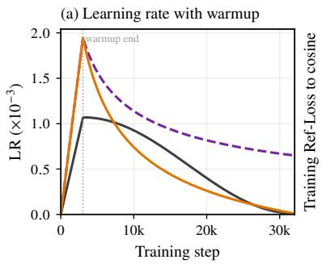

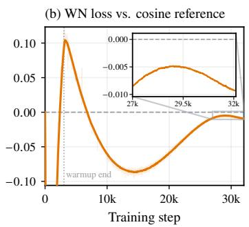  
Figure 3 Learning rate schedules and training loss under WN. With the same terminal and cumulative LRs, AIR achieves lower final training loss than cosine.

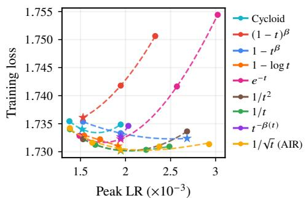  
Figure 4 AIR stays near its best loss over the widest peak LR range. Circles are measured configurations, stars the best per family, and dashed curves family-wise convex fits.

Comparison controls. We perform a hyperparameter search on the cosine baseline and select the best peak LR and warmup ratio. For a fair comparison across all schedule families, we use linear warmup with the same duration and match the terminal LR and cumulative LR, defined as the sum of LRs over all training steps. Each schedule’s peak LR is calibrated to match this sum, including warmup, as described in Appendix B.6. All schedules are compared at the end of training.

Figure 3(a) shows the cosine baseline, raw $1 / \sqrt { t }$ decay [30], and its afine transformation AIR, defined by Eqs. (12)–(13). The raw curve is shown as a reference with the same peak as AIR, without matching its terminal or cumulative LR. We also compare other decay shapes under the same controls and afine construction, including $e ^ { - t } \ [ 3 4 ] , 1 - \log ( 1 + t ) \ [ 1 8 ]$ , and $1 - { \sqrt { t } } \left[ 7 , 3 8 \right]$ . Appendix C.2 lists the complete set of decay shapes.

## 4.2 Pretraining loss and downstream performance

Experimental setup. Following Section 4.1, all schedules share the same warmup, terminal LR, and cumulative LR, and each decay shape enters the comparison at its best shape parameter selected during evaluation, listed in Table 4. We report terminal training and evaluation loss together with performance on the downstream benchmarks listed in Appendix C.4. We repeat the comparison between cosine and AIR at a larger model scale.

Results. Figure 3(b) and Table 1 show that AIR lowers terminal training and evaluation loss by about 0.01 relative to cosine at both model scales and achieves the lowest reported losses among the compared schedulers. It also attains the best downstream average among all compared shapes, and at the larger scale it improves over cosine on most benchmarks, highlighting the scale-up ability of our scheduler design.

## 4.3 Robustness to hyperparameter choices

Experimental setup. Under the same matched controls, we sweep each family’s shape parameter, which also moves its peak LR. For each family we report its LR sensitivity S, the average loss above the family’s best configuration per e-fold of peak LR, defined formally in Appendix C.5 (Eq. (31)).

Results. Figure 4 plots terminal training loss against peak LR with family-wise polynomial fits, and Table 5 in Appendix C.5 reports the resulting LR sensitivity. AIR has the lowest LR sensitivity over the widest range of peak LR. Its region of low loss is therefore wide enough that the gain does not depend on a narrowly tuned peak LR and thus facilitates LR transfer [21].

## 5 Late-Stage Scheduling Matters More

Having established the gains of AIR in Section 4, we further explore where in training this advantage is created. We find that late-stage scheduling drives the final loss gap (Section 5.1) and that sharing the late schedule substantially reduces gaps created by distinct early schedules (Section 5.2). Further comparisons in Section 5.3 reveal a trade-of between sustained annealing and gradual LR changes, with AIR naturally striking this balance. Finally, we provide a brief theoretical explanation in Section 5.4 of how early and late schedules afect terminal alignment.

Table 1 Terminal losses and downstream performance of matched-budget decay shapes under WN. Each row is labeled by its raw decay shape before the common afine transformation and uses that shape’s best parameter selected during evaluation (Appendix C.2). AIR achieves the lowest terminal losses and attains the best downstream average at both model scales.
<table><tr><td>Schedule</td><td>Train Loss (↓)</td><td>Eval Loss (↓)</td><td>MMLU (↑)</td><td>MMLU-Pro (↑)</td><td>AGIEval (↑)</td><td>WinoGrande (↑)</td><td>BBH (↑)</td><td>DROP (↑)</td><td>GSM8k (↑)</td><td>MATH HumanEval MBPP+ (↑)</td><td>(↑)</td><td>(↑)</td><td>TriviaQA (↑)</td><td>Avg. (↑)</td></tr><tr><td>110 M/4.7 B model</td><td></td><td></td><td></td><td></td><td></td><td></td><td></td><td></td><td></td><td></td><td></td><td></td><td></td><td></td></tr><tr><td>Cosine</td><td>1.740</td><td>2.185</td><td>49.0</td><td>18.2</td><td>29.1</td><td>49.5</td><td>30.9</td><td>22.0</td><td>17.0</td><td>11.1</td><td>28.7</td><td>35.2</td><td>30.9</td><td>29.24</td></tr><tr><td>Linear</td><td>1.742</td><td>2.187</td><td>48.9</td><td>16.4</td><td>26.3</td><td>49.6</td><td>31.1</td><td>22.6</td><td>13.4</td><td>11.3</td><td>26.2</td><td>35.4</td><td>31.2</td><td>28.40</td></tr><tr><td>Half-cosine</td><td>1.749</td><td>2.195</td><td>48.6</td><td>15.5</td><td>28.2</td><td>50.7</td><td>32.5</td><td>23.9</td><td>15.0</td><td>11.7</td><td>24.4</td><td>34.7</td><td>29.5</td><td>28.61</td></tr><tr><td>Rear-cosine</td><td>1.736</td><td>2.180</td><td>48.0</td><td>16.2</td><td>28.7</td><td>51.2</td><td>31.6</td><td>22.3</td><td>14.3</td><td>10.5</td><td>25.0</td><td>36.2</td><td>30.7</td><td>28.61</td></tr><tr><td>Cycloid</td><td>1.734</td><td>2.178</td><td>47.3</td><td>16.0</td><td>27.5</td><td>49.9</td><td>30.7</td><td>22.6</td><td>15.1</td><td>10.0</td><td>26.2</td><td>33.6</td><td>31.1</td><td>28.18</td></tr><tr><td></td><td>1.736</td><td>2.181</td><td>48.1</td><td>16.8</td><td>27.6</td><td>50.7</td><td>30.6</td><td>22.1</td><td>16.5</td><td>12.0</td><td>27.4</td><td>36.8</td><td>29.5</td><td>28.92</td></tr><tr><td> $\begin{array} { l } { ( 1 - t ) ^ { 2 } } \\ { 1 - t ^ { \beta } } \end{array}$ </td><td>1.732</td><td>2.174</td><td>48.5</td><td>18.1</td><td>30.2</td><td>50.9</td><td>31.8</td><td>22.3</td><td>16.4</td><td>10.9</td><td>31.1</td><td>35.2</td><td>32.3</td><td>29.79</td></tr><tr><td> $1 - \log t$ </td><td>1.731</td><td>2.175</td><td>48.1</td><td>15.6</td><td>29.6</td><td>48.8</td><td>32.0</td><td>21.5</td><td>16.8</td><td>11.6</td><td>23.8</td><td>34.4</td><td>33.2</td><td>28.67</td></tr><tr><td> $e ^ { - t }$ </td><td>1.732</td><td>2.176</td><td>48.9</td><td>16.0</td><td>29.2</td><td>50.6</td><td>31.6</td><td>21.2</td><td>16.8</td><td>10.8</td><td>27.4</td><td>36.8</td><td>31.7</td><td>29.18</td></tr><tr><td> $1 / t ^ { 2 }$ </td><td>1.730</td><td>2.175</td><td>50.5</td><td>18.4</td><td>29.0</td><td>50.8</td><td>32.1</td><td>22.2</td><td>17.5</td><td>11.6</td><td>29.9</td><td>33.1</td><td>30.3</td><td>29.58</td></tr><tr><td> $1 / t$ </td><td>1.730</td><td>2.174</td><td>49.7</td><td>16.9</td><td>29.6</td><td>50.8</td><td>30.8</td><td>23.0</td><td>16.7</td><td>12.2</td><td>26.8</td><td>32.8</td><td>29.7</td><td>29.00</td></tr><tr><td> $t ^ { \dot { - } \beta ( t ) }$ </td><td>1.733</td><td>2.176</td><td>48.8</td><td>16.7</td><td>30.1</td><td>50.7</td><td>30.0</td><td>22.9</td><td>14.2</td><td>10.6</td><td>28.0</td><td>34.7</td><td>30.6</td><td>28.85</td></tr><tr><td>1/√t (AIR)</td><td>1.730</td><td>2.174</td><td>49.7</td><td>18.6</td><td>29.6</td><td>50.1</td><td>31.1</td><td>23.8</td><td>15.8</td><td>13.0</td><td>29.9</td><td>36.5</td><td>31.6</td><td>29.97</td></tr><tr><td>790 M/35.7 B model</td><td></td><td></td><td></td><td></td><td></td><td></td><td></td><td></td><td></td><td></td><td></td><td></td><td></td><td></td></tr><tr><td>Cosine</td><td>1.431</td><td>1.843</td><td>70.7</td><td>40.6</td><td>54.2</td><td></td><td>56.2</td><td>56.0</td><td>59.9</td><td></td><td></td><td></td><td></td><td>|56.22</td></tr><tr><td>1/√t (AIR)</td><td>1.421</td><td>1.832</td><td>72.1</td><td>42.4</td><td>55.7</td><td>50.4 51.8</td><td>59.4</td><td>51.2</td><td>64.2</td><td>36.8 37.2</td><td>67.7 70.1</td><td>60.1 65.3</td><td>65.8 66.2</td><td>57.78</td></tr></table>

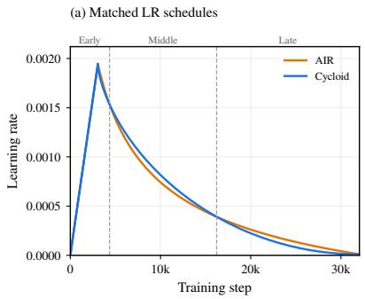

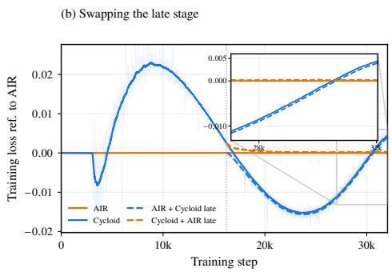

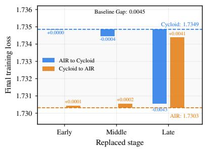  
Figure 5 Late-stage scheduling dominates the final loss difference. Starting from two full schedules with matched peak, terminal, and cumulative LRs, swapping the late stage between AIR and Cycloid nearly transfers the full final loss gap to either schedule, whereas swaps of the early and middle stages have little efect. The bars use the terminal exponential moving average (EMA-0.99) training loss, as in Table 1; the intervention and reporting details are given in Appendix C.6.

## 5.1 Late-stage scheduling drives the final loss gap

Among the candidate schedules matched to the same cumulative LR, a Cycloid schedule with $\theta _ { 1 } = \pi$ happens to take exactly the same peak LR as AIR, so the two runs share their warmup and terminal LR as well and difer only in the shape of the decay in between (Figure 5(a)). However, their final training losses still difer by approximately 0.005, a substantial gap at this scale. Notice that the two intersections of their decay curves naturally divide the training horizon into early, middle, and late stages, we then swap one stage at a time between them while leaving the other two unchanged.

As shown in Figure 5(b,c), swaps of the early and middle stages leave the final loss nearly unchanged, whereas swapping the late stage closes about 90 % of the gap for either schedule. For this matched pair, the gap is almost entirely attributable to the late stage. This motivates us to examine whether a shared late schedule can reduce the final loss gap created by distinct early schedules. A related efect was reported for scale-invariant networks trained with weight decay, where reaching the equilibrium of a late phase makes the outcome largely independent of earlier phases [15].

## 5.2 Shared late scheduling reduces the final loss gap

Table 2 A shared late schedule narrows the endpoint gap for every early decay shape. Each schedule is trained twice, once in its original form and once with the common late schedule. Parentheses give the gap of each loss to the AIR anchor in the last row, and Gap is the fraction of that gap the shared tail removes. Training loss is the terminal EMA-0.99 value and evaluation loss the terminal raw value, as in Table 1.
<table><tr><td rowspan="2">Schedule</td><td colspan="3">Training loss (relative to AIR)</td><td colspan="3">Eval loss (relative to AIR)</td></tr><tr><td>Original</td><td>Shared tail</td><td>Gap closed (%) ↑</td><td>Original</td><td>Shared tail</td><td>Gap closed (%) ↑</td></tr><tr><td>Cosine</td><td>1.7399 (+0.0096)</td><td>1.7358 (+0.0055)</td><td>42%</td><td>2.1846 (+0.0106)</td><td>2.1799 (+0.0059)</td><td>45%</td></tr><tr><td>Linear</td><td>1.7415(+0.0112)</td><td>1.7341 (+0.0038)</td><td>66%</td><td>2.1875 (+0.0135)</td><td>2.1787(+0.0047)</td><td>65%</td></tr><tr><td>Half-cosine</td><td>1.7487 (+0.0184)</td><td>1.7374(+0.0071)</td><td>62%</td><td>2.1950 (+0.0210)</td><td>2.1815 (+0.0076)</td><td>64%</td></tr><tr><td></td><td>Double-cosine 1.7446 (+0.0143)</td><td>1.7328 (+0.0025)</td><td>83%</td><td>2.1901 (+0.0161)</td><td>2.1769 (+0.0029)</td><td>82%</td></tr><tr><td> $( 1 - t ) ^ { 2 }$ </td><td>1.7361 (+0.0058)</td><td>1.7319 (+0.0016)</td><td>72%</td><td>2.1805 (+0.0065)</td><td>2.1753 (+0.0013)</td><td>80%</td></tr><tr><td> $1 - { \sqrt { t } }$ </td><td>1.7354 (+0.0050)</td><td>1.7316 (+0.0012)</td><td>75%</td><td>2.1787(+0.0047)</td><td>2.1743 (+0.0003)</td><td>94%</td></tr><tr><td>1/√t (AIR)</td><td colspan="6"></td></tr></table>

Experimental setup. To address this question, we consider six decay schedules, Cosine, Linear, Half-cosine, Double-cosine, $( 1 - t ) ^ { 2 }$ , and $1 - { \sqrt { t } }$ , whose original runs end with training losses 0.005–0.018 higher than AIR. For each schedule, we retain its decay shape over the first 70 % of training steps and concatenate it with the same late-stage schedule of AIR. The early segment and its warmup target are rescaled to match the cumulative LR under the same comparison constraints as in Section 4.1. The two runs of each schedule are denoted original and shared tail, respectively.

Results. Table 2 shows that the shared late schedule lowers terminal training and evaluation loss for all six schedules, closing 42 %–83 % and 45 %–94 % of their respective gaps to AIR. Thus, a shared late schedule substantially reduces the performance diferences arising from diferent early schedules.

## 5.3 A trade-off in late-stage scheduling

Experimental setup. Having established the importance of late-stage scheduling, we next examine what makes a late schedule efective. Based on the design of AIR in Section 3.3, we vary the final 20 % of its decay stage, starting at $K _ { s } \approx 0 . 8 K$ , as

$$
\eta _ { \gamma } ( k ) = \eta _ { \mathrm { m i n } } + \left[ \eta _ { \mathrm { A I R } } ( K _ { s } ) - \eta _ { \mathrm { m i n } } \right] \left( \frac { K - k } { K - K _ { s } } \right) ^ { \gamma } , \quad K _ { s } \le k \le K ,\tag{14}
$$

where $\gamma \in \{ 0 . 5 , 0 . 7 5 , 1 , 2 , 3 \}$ . Smaller exponents postpone more of the LR reduction to the endpoint, whereas larger exponents reduce the LR earlier and then flatten out. The junction and terminal LRs remain fixed, while the area under the recorded LR traces varies by less than 1 % (Appendix C.7).

Results. Figure 6 shows that both the abrupt decay at $\gamma = 0 . 5$ and the early flattening at $\gamma \in \{ 2 , 3 \}$ increase final loss, while AIR and the variants with $\gamma \in \{ 0 . 7 5 , 1 \}$ perform comparably, achieving the lowest final losses. These results suggest a trade-of: late-stage scheduling should sustain annealing while avoiding overly abrupt LR changes. The design of AIR naturally balances these requirements and performs close to the best variants in this sweep.

## 5.4 A theoretical explanation of schedule dependence

To interpret these results, we use the alignment dynamics of Section 3 to separate the efects of early- and late-stage schedule changes. Consider bounded nonnegative schedules $\eta _ { 1 } , \eta _ { 2 }$ on the decay interval [0, K], with

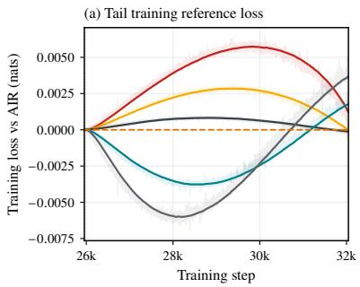

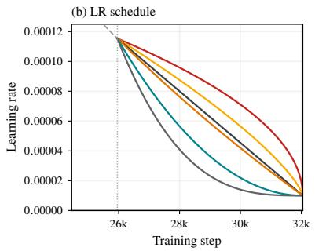

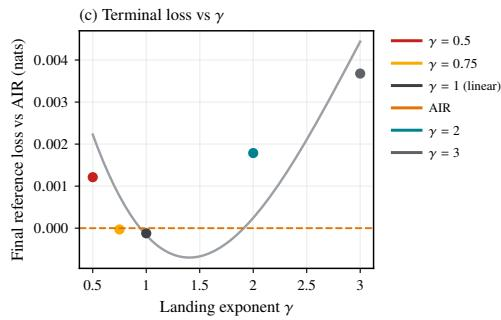  
Figure 6 Late-stage decay exhibits a two-sided trade-off. With the junction and terminal LRs fixed, both overly abrupt decay and early flattening increase final loss.

common $a , b , m _ { 0 } , \mathcal { F } _ { 0 }$ and a fixed stage boundary $K _ { s }$ . Write $\Delta m = m _ { 1 } - m _ { 2 }$ and $\Delta \eta = \eta _ { 1 } - \eta _ { 2 }$ , where the expected alignments $m _ { i }$ retain the conditioning in Eq. (5) throughout. For a shared late schedule, $\eta _ { 1 } = \eta _ { 2 } = \eta$ on $[ K _ { s } , K ]$ , Eq. (9) gives

$$
\Delta m ( K ) = H ( K , K _ { s } ) \Delta m ( K _ { s } ) , \quad H ( K , K _ { s } ) = \exp \left[ - b \int _ { K _ { s } } ^ { K } \eta ( k ) ^ { 2 } \mathrm { d } k \right] .\tag{15}
$$

Since $0 < H ( K , K _ { s } ) \le 1$ , the shared late stage attenuates the entering diference without reversing its sign, ignoring stochastic fluctuations around the mean. Over a fixed late interval, higher LRs increase the cumulative squared LR and reduce $H ( K , K _ { s } )$ , thereby weakening the efect of early-stage scheduling on endpoint alignment. The derivation is given in Appendix D.2.

For diferent late-stage schedules, a shared early schedule gives $\Delta m ( K _ { s } ) = 0$ . For bounds $0 \leq \eta _ { i } \leq P$ and $0 \leq m _ { i } \leq M$ over the late-stage interval, let $L _ { 1 2 } = \operatorname* { m a x } \{ a , | a - 2 b P M | \}$ and $H _ { 1 2 } = \sqrt { H _ { 1 } H _ { 2 } }$ , with $H _ { i }$ the retention factor for $\eta _ { i }$ . This gives

$$
| \Delta m ( K ) | \leq L _ { 1 2 } \int _ { K _ { s } } ^ { K } H _ { 1 2 } ( K , k ) | \Delta \eta ( k ) | \mathrm { d } k .\tag{16}
$$

Smaller weighted LR diferences give a tighter bound on the terminal alignment diference. Within this bound, diferences nearer the endpoint receive greater weight because less subsequent attenuation remains. Details are given in Appendix D.3. Further, if the schedules difer in both stages,

$$
| \Delta m ( K ) | \leq H _ { 1 2 } ( K , K _ { s } ) | \Delta m ( K _ { s } ) | + L _ { 1 2 } \int _ { K _ { s } } ^ { K } H _ { 1 2 } ( K , k ) | \Delta \eta ( k ) | \mathrm { d } k .\tag{17}
$$

The first term retains the early-stage diference, while the second bounds the late-stage contribution. Slopebased refinements are in Appendix D.4. These bounds on expected alignment provide a qualitative explanation for the observed loss gaps.

## 6 Related Work

WN and related constraints provide explicit parameter-scale control as an alternative to WD, with reported eficiency and stability gains [1, 33]. Methods difer in whether they separate magnitude from direction [23] or fix weight and update norms [33]. The choice of matrix norm further shapes the weight constraints and update geometry [35, 36]. For manifold constraints, Su [26, 27] and Bernstein [2] optimize tangent-space descent directions before retracting weights, so that the update respects the imposed geometry.

Beyond norm control, scheduling determines how the efective step size evolves during training. River-valley analyses explain WSD [32], while convex bounds and functional scaling laws motivate cooldown and power decay [14, 24]. However, these theories focus on nominal LR alone, which is not principled when parameter norms evolve [5]. Concurrent work corroborates our finding that matching ELR largely aligns WN and WD loss dynamics [17, 34, 38], but does not derive a decay law from an optimization objective. We address this gap by optimizing directional alignment under WN to derive $1 / \sqrt { t }$ decay, then adapting it to finite horizons through an afine transformation, yielding AIR as an efective ELR schedule.

## 7 Conclusion and Future Work

We identify the induced efective learning rate (ELR) trajectory as the key driver of WN’s advantage over WD, with matched ELRs largely aligning their training loss dynamics. This finding motivates schedule design that targets ELR directly. Our theoretical analysis of directional alignment under WN, together with an afine adaptation of the unconstrained optimal $1 / \sqrt { t }$ schedule, yields AIR for finite-horizon training. Experiments on MoE models at two scales show that, at matched cumulative LR, AIR reduces terminal loss by about 0.01 relative to cosine and improves downstream performance, while schedule sweeps demonstrate hyperparameter robustness. Further stage-wise interventions show that sharing the late schedule substantially narrows final loss gaps from diferent early schedules, identifying late-stage scheduling as a key source of AIR’s efectiveness. Transferring its ELR trajectory to WD reproduces WN training loss dynamics, demonstrating that our design extends beyond fixed-norm training.

Future work includes extending our directional-alignment theory to account for evolving update statistics and quantitatively connect alignment to loss. We also aim to investigate the ELR principle and AIR across more architectures, optimizers, and larger training scales, and to study ELR scheduling in continued training (CT), supervised fine-tuning (SFT), and reinforcement learning (RL).

## References

[1] Kang An, Jiaxiang Li, Donald Goldfarb, and Shiqian Ma. Demystifying Manifold Constraints in LLM Pre-training, 2026. URL https://arxiv.org/abs/2605.04418.

[2] Jeremy Bernstein. Modular manifolds. Thinking Machines Lab: Connectionism, 2025. doi: 10.64434/tml.20250926. https://thinkingmachines.ai/blog/modular-manifolds/.

[3] Mark Chen, Jerry Tworek, Heewoo Jun, Qiming Yuan, Henrique Ponde de Oliveira Pinto, Jared Kaplan, Harri Edwards, Yuri Burda, Nicholas Joseph, Greg Brockman, Alex Ray, Raul Puri, Gretchen Krueger, Michael Petrov, Heidy Khlaaf, Girish Sastry, Pamela Mishkin, Brooke Chan, Scott Gray, Nick Ryder, Mikhail Pavlov, Alethea Power, Lukasz Kaiser, Mohammad Bavarian, Clemens Winter, Philippe Tillet, Felipe Petroski Such, Dave Cummings, Matthias Plappert, Fotios Chantzis, Elizabeth Barnes, Ariel Herbert-Voss, William Hebgen Guss, Alex Nichol, Alex Paino, Nikolas Tezak, Jie Tang, Igor Babuschkin, Suchir Balaji, Shantanu Jain, William Saunders, Christopher Hesse, Andrew N. Carr, Jan Leike, Josh Achiam, Vedant Misra, Evan Morikawa, Alec Radford, Matthew Knight, Miles Brundage, Mira Murati, Katie Mayer, Peter Welinder, Bob McGrew, Dario Amodei, Sam McCandlish, Ilya Sutskever, and Wojciech Zaremba. Evaluating Large Language Models Trained on Code, 2021. URL https://arxiv.org/abs/2107.03374.

[4] Karl Cobbe, Vineet Kosaraju, Mohammad Bavarian, Mark Chen, Heewoo Jun, Lukasz Kaiser, Matthias Plappert, Jerry Tworek, Jacob Hilton, Reiichiro Nakano, Christopher Hesse, and John Schulman. Training Verifiers to Solve Math Word Problems, 2021. URL https://arxiv.org/abs/2110.14168.

[5] Francesco D’Angelo, Maksym Andriushchenko, Aditya Varre, and Nicolas Flammarion. Why Do We Need Weight Decay in Modern Deep Learning? In A. Globerson, L. Mackey, D. Belgrave, A. Fan, U. Paquet, J. Tomczak, and C. Zhang, editors, Advances in Neural Information Processing Systems, volume 37, pages 23191–23223. Curran Associates, Inc., 2024. doi: 10.52202/079017-0730. URL https://proceedings.neurips.cc/paper\_ files/paper/2024/file/29496c942ed6e08ecc469f4521ebfff0-Paper-Conference.pdf.

[6] Dheeru Dua, Yizhong Wang, Pradeep Dasigi, Gabriel Stanovsky, Sameer Singh, and Matt Gardner. DROP: A Reading Comprehension Benchmark Requiring Discrete Reasoning Over Paragraphs. In Jill Burstein, Christy Doran, and Thamar Solorio, editors, Proceedings of the 2019 Conference of the North American Chapter of the Association for Computational Linguistics: Human Language Technologies, Volume 1 (Long and Short Papers), pages 2368–2378, Minneapolis, Minnesota, June 2019. Association for Computational Linguistics. doi: 10.18653/v1/N19-1246. URL https://aclanthology.org/N19-1246/.

[7] Alexander Hägele, Elie Bakouch, Atli Kosson, Loubna Ben Allal, Leandro Von Werra, and Martin Jaggi. Scaling Laws and Compute-Optimal Training Beyond Fixed Training Durations. In A. Globerson, L. Mackey, D. Belgrave, A. Fan, U. Paquet, J. Tomczak, and C. Zhang, editors, Advances in Neural Information Processing Systems, volume 37, pages 76232–76264. Curran Associates, Inc., 2024. doi: 10.52202/079017-2427. URL https://proceedings. neurips.cc/paper\_files/paper/2024/file/8b970e15a89bf5d12542810df8eae8fc-Paper-Conference.pdf.

[8] Dan Hendrycks, Collin Burns, Steven Basart, Andy Zou, Mantas Mazeika, Dawn Song, and Jacob Steinhardt. Measuring Massive Multitask Language Understanding. In 9th International Conference on Learning Representations, ICLR 2021, Virtual Event, Austria, May 3-7, 2021. OpenReview.net, 2021. URL https://openreview.net/forum?id=d7KBjmI3GmQ.

[9] Dan Hendrycks, Collin Burns, Saurav Kadavath, Akul Arora, Steven Basart, Eric Tang, Dawn Song, and Jacob Steinhardt. Measuring Mathematical Problem Solving With the MATH Dataset. In J. Vanschoren and S. Yeung, editors, Proceedings of the Neural Information Processing Systems Track on Datasets and Benchmarks, volume 1, 2021. URL https://datasets-benchmarks-proceedings.neurips.cc/paper\_files/paper/2021/file/ be83ab3ecd0db773eb2dc1b0a17836a1-Paper-round2.pdf.

[10] Shengding Hu, Yuge Tu, Xu Han, Ganqu Cui, Chaoqun He, Weilin Zhao, Xiang Long, Zhi Zheng, Yewei Fang, Yuxiang Huang, Xinrong Zhang, Zhen Leng Thai, Chongyi Wang, Yuan Yao, Chenyang Zhao, Jie Zhou, Jie Cai, Zhongwu Zhai, Ning Ding, Chao Jia, Guoyang Zeng, dahai li, Zhiyuan Liu, and Maosong Sun. MiniCPM: Unveiling the Potential of Small Language Models with Scalable Training Strategies. In First Conference on Language Modeling, 2024. URL https://openreview.net/forum?id=3X2L2TFr0f.

[11] Keller Jordan, Yuchen Jin, Vlado Boza, You Jiacheng, Franz Cesista, Laker Newhouse, and Jeremy Bernstein. Muon: An optimizer for hidden layers in neural networks, 2024. URL https://kellerjordan.github.io/posts/muon/.

[12] Mandar Joshi, Eunsol Choi, Daniel Weld, and Luke Zettlemoyer. TriviaQA: A Large Scale Distantly Supervised

Challenge Dataset for Reading Comprehension. In Regina Barzilay and Min-Yen Kan, editors, Proceedings of the 55th Annual Meeting of the Association for Computational Linguistics (Volume 1: Long Papers), pages 1601–1611, Vancouver, Canada, July 2017. Association for Computational Linguistics. doi: 10.18653/v1/P17-1147. URL https://aclanthology.org/P17-1147/.

[13] Atli Kosson, Jeremy Welborn, Yang Liu, Martin Jaggi, and Xi Chen. Weight Decay may matter more than µP for Learning Rate Transfer in Practice. In C. Vondrick, B. Hariharan, C. Rafel, L. Pinto, D. Yang, and A. Faust, editors, International Conference on Learning Representations, volume 2026, pages 67012–67048, 2026. URL https://proceedings.iclr.cc/paper\_files/paper/2026/file/ 6dc63b4063c978cf195bc15178e8152a-Paper-Conference.pdf.

[14] Binghui Li, Zilin Wang, Fengling Chen, Shiyang Zhao, Ruiheng Zheng, and Lei Wu. Optimal Learning Rate Schedules under Functional Scaling Laws: Power Decay and Warmup–Stable–Decay (Extended Abstract). In Steve Hanneke and Tor Lattimore, editors, Proceedings of Thirty Ninth Conference on Learning Theory, volume 336 of Proceedings of Machine Learning Research, pages 4722–4723. PMLR, 29 Jun–03 Jul 2026. URL https://proceedings.mlr.press/v336/li26b.html.

[15] Zhiyuan Li, Kaifeng Lyu, and Sanjeev Arora. Reconciling Modern Deep Learning with Traditional Optimization Analyses: The Intrinsic Learning Rate. In H. Larochelle, M. Ranzato, R. Hadsell, M.F. Balcan, and H. Lin, editors, Advances in Neural Information Processing Systems, volume 33, pages 14544– 14555. Curran Associates, Inc., 2020. URL https://proceedings.neurips.cc/paper\_files/paper/2020/file/ a7453a5f026fb6831d68bdc9cb0edcae-Paper.pdf.

[16] Jiawei Liu, Chunqiu Steven Xia, Yuyao Wang, and LINGMING ZHANG. Is Your Code Generated by ChatGPT Really Correct? Rigorous Evaluation of Large Language Models for Code Generation. In A. Oh, T. Naumann, A. Globerson, K. Saenko, M. Hardt, and S. Levine, editors, Advances in Neural Information Processing Systems, volume 36, pages 21558–21572. Curran Associates, Inc., 2023. doi: 10.52202/075280-0943. URL https://proceedings. neurips.cc/paper\_files/paper/2023/file/43e9d647ccd3e4b7b5baab53f0368686-Paper-Conference.pdf.

[17] Zihan Liu, Ruiheng Zheng, Shaobo Zhang, Changxin Tian, Kunlong Chen, Zhiqiang Zhang, and Lei Wu. Efective Learning Rate Governs Loss Dynamics in Language Model Pretraining, 2026. URL https://arxiv.org/abs/ 2608.24814

[18] Ilya Loshchilov and Boris Ginsburg. Training nGPT, 2026. URL https://arxiv.org/abs/2608.01284.

[19] Ilya Loshchilov and Frank Hutter. SGDR: Stochastic Gradient Descent with Warm Restarts. In 5th International Conference on Learning Representations, ICLR 2017, Toulon, France, April 24-26, 2017, Conference Track Proceedings. OpenReview.net, 2017. URL https://openreview.net/forum?id=Skq89Scxx.

[20] Ilya Loshchilov and Frank Hutter. Decoupled Weight Decay Regularization. In 7th International Conference on Learning Representations, ICLR 2019, New Orleans, LA, USA, May 6-9, 2019. OpenReview.net, 2019. URL https://openreview.net/forum?id=Bkg6RiCqY7.

[21] Liliang Ren, Yang Liu, Yelong Shen, and Weizhu Chen. Rethinking Language Model Scaling under Transferable Hypersphere Optimization, 2026. URL https://arxiv.org/abs/2603.28743.

[22] Keisuke Sakaguchi, Ronan Le Bras, Chandra Bhagavatula, and Yejin Choi. WinoGrande: An Adversarial Winograd Schema Challenge at Scale. Proceedings of the AAAI Conference on Artificial Intelligence, 34(05):8732–8740, April 2020. ISSN 2159-5399. doi: 10.1609/aaai.v34i05.6399. URL http://dx.doi.org/10.1609/aaai.v34i05.6399.

[23] Tim Salimans and Durk P Kingma. Weight Normalization: A Simple Reparameterization to Accelerate Training of Deep Neural Networks. In D. Lee, M. Sugiyama, U. Luxburg, I. Guyon, and R. Garnett, editors, Advances in Neural Information Processing Systems, volume 29. Curran Associates, Inc., 2016. URL https://proceedings. neurips.cc/paper\_files/paper/2016/file/ed265bc903a5a097f61d3ec064d96d2e-Paper.pdf.

[24] Fabian Schaipp, Alexander Hägele, Adrien Taylor, Umut Simsekli, and Francis Bach. The Surprising Agreement Between Convex Optimization Theory and Learning-Rate Scheduling for Large Model Training. In Aarti Singh, Maryam Fazel, Daniel Hsu, Simon Lacoste-Julien, Felix Berkenkamp, Tegan Maharaj, Kiri Wagstaf, and Jerry Zhu, editors, Proceedings of the 42nd International Conference on Machine Learning, volume 267 of Proceedings of Machine Learning Research, pages 53267–53294. PMLR, 13–19 Jul 2025. URL https://proceedings.mlr. press/v267/schaipp25a.html.

[25] Noam Shazeer, Azalia Mirhoseini, Krzysztof Maziarz, Andy Davis, Quoc V. Le, Geofrey E. Hinton, and Jef Dean. Outrageously Large Neural Networks: The Sparsely-Gated Mixture-of-Experts Layer. In

International Conference on Learning Representations, 2017. URL https://mlanthology.org/iclr/2017/ shazeer2017iclr-outrageously/.

[26] Jianlin Su. Steepest Descent on Manifolds: 1. SGD + Hypersphere, Aug 2025. URL https://kexue.fm/archives/ 11196.

[27] Jianlin Su. Steepest Descent on Manifolds: 3. Muon + Stiefel, Aug 2025. URL https://kexue.fm/archives/11221.

[28] Mirac Suzgun, Nathan Scales, Nathanael Schärli, Sebastian Gehrmann, Yi Tay, Hyung Won Chung, Aakanksha Chowdhery, Quoc Le, Ed Chi, Denny Zhou, and Jason Wei. Challenging BIG-Bench Tasks and Whether Chain-of-Thought Can Solve Them. In Anna Rogers, Jordan Boyd-Graber, and Naoaki Okazaki, editors, Findings of the Association for Computational Linguistics: ACL 2023, pages 13003–13051, Toronto, Canada, July 2023. Association for Computational Linguistics. doi: 10.18653/v1/2023.findings-acl.824. URL https: //aclanthology.org/2023.findings-acl.824/.

[29] Twan van Laarhoven. L2 Regularization versus Batch and Weight Normalization, 2017. URL https://arxiv. org/abs/1706.05350.

[30] Ashish Vaswani, Noam Shazeer, Niki Parmar, Jakob Uszkoreit, Llion Jones, Aidan N Gomez, Łukasz Kaiser, and Illia Polosukhin. Attention is All you Need. In I. Guyon, U. Von Luxburg, S. Bengio, H. Wallach, R. Fergus, S. Vishwanathan, and R. Garnett, editors, Advances in Neural Information Processing Systems, volume 30. Curran Associates, Inc., 2017. URL https://proceedings.neurips.cc/paper\_files/paper/2017/ file/3f5ee243547dee91fbd053c1c4a845aa-Paper.pdf.

[31] Yubo Wang, Xueguang Ma, Ge Zhang, Yuansheng Ni, Abhranil Chandra, Shiguang Guo, Weiming Ren, Aaran Arulraj, Xuan He, Ziyan Jiang, Tianle Li, Max Ku, Kai Wang, Alex Zhuang, Rongqi Fan, Xiang Yue, and Wenhu Chen. MMLU-Pro: A More Robust and Challenging Multi-Task Language Understanding Benchmark. In A. Globerson, L. Mackey, D. Belgrave, A. Fan, U. Paquet, J. Tomczak, and C. Zhang, editors, Advances in Neural Information Processing Systems, volume 37, pages 95266–95290. Curran Associates, Inc., 2024. doi: 10.52202/079017-3018. URL https://proceedings.neurips.cc/paper\_files/paper/2024/file/ ad236edc564f3e3156e1b2feafb99a24-Paper-Datasets\_and\_Benchmarks\_Track.pdf.

[32] Kaiyue Wen, Zhiyuan Li, Jason Wang, David Hall, Percy Liang, and Tengyu Ma. Understanding Warmup-Stable-Decay Learning Rates: A River Valley Loss Landscape View. In Y. Yue, A. Garg, N. Peng, F. Sha, and R. Yu, editors, International Conference on Learning Representations, volume 2025, pages 42840–42885, 2025. URL https://proceedings.iclr.cc/paper\_files/paper/2025/file/ 6a1fe80a9e2dcda0b3e5fd0fd87eb097-Paper-Conference.pdf.

[33] Kaiyue Wen, Xingyu Dang, Kaifeng Lyu, Tengyu Ma, and Percy Liang. Fantastic Pretraining Optimizers and Where to Find Them II: Hyperball Optimization, 2026. URL https://arxiv.org/abs/2606.16899.

[34] Yihao Xiao, Jialong Sun, Zitian Gao, Zeming Wei, Chutian Wang, Ran Tao, Jiaye Teng, and Bryan Dai. Hyperball May Not Be a Free Lunch, 2026. URL https://arxiv.org/abs/2607.22444.

[35] Tian Xie, Haoming Luo, Haoyu Tang, Yiwen Hu, Jason Klein Liu, Qingnan Ren, Yang Wang, Wayne Xin Zhao, Rui Yan, Bing Su, Chong Luo, and Baining Guo. Controlled LLM Training on Spectral Sphere, 2026. URL https://arxiv.org/abs/2601.08393.

[36] Ruihan Xu, Jiajin Li, and Yiping Lu. On the Width Scaling of Neural Optimizers Under Matrix Operator Norms I: Row/Column Normalization and Hyperparameter Transfer, 2026. URL https://arxiv.org/abs/2603.09952.

[37] Wanjun Zhong, Ruixiang Cui, Yiduo Guo, Yaobo Liang, Shuai Lu, Yanlin Wang, Amin Saied, Weizhu Chen, and Nan Duan. AGIEval: A Human-Centric Benchmark for Evaluating Foundation Models. In Kevin Duh, Helena Gomez, and Steven Bethard, editors, Findings of the Association for Computational Linguistics: NAACL 2024, pages 2299–2314, Mexico City, Mexico, June 2024. Association for Computational Linguistics. doi: 10.18653/v1/2024.findings-naacl.149. URL https://aclanthology.org/2024.findings-naacl.149/.

[38] Zhanpeng Zhou, Wenjie Zhou, Yufei Gu, Juqiu Wang, Guanwei Zhang, Ruobing Xie, Xianbiao Qi, Yushi Bai, Kaifeng Lyu, and Shunyu Yao. From LR to ELR: A Better Heuristic for Pretraining Dynamics, 2026. URL https://hy.tencent.ai/research/elr.

## Appendix

## A Directional Geometry and ELR Matching

We derive the geometric interpretation of ELR in Section 2.1 and the blockwise matching rule used in Section 2.2.

## A.1 Exact normalized updates

For a nonzero parameter block, retain $r _ { k } = \lVert \pmb { \theta } _ { k } \rVert$ and $\eta _ { k } ^ { \mathrm { e f f } } = \eta _ { k } / r _ { k }$ from Section 2.1, and write $\hat { \theta } _ { k } = \theta _ { k } / r _ { k }$ for its unit direction. Throughout, $\eta _ { k } \ge 0 ,$ , and norms are Euclidean on vectorized blocks. Under fixed-norm WN, $r _ { k } = R$ . Dividing the updates in Eqs. (1) and (2) by their pre-update parameter norms and normalizing gives

$$
\mathrm { W D } \colon \hat { \pmb { \theta } } _ { k + 1 } = \frac { ( 1 - \lambda \eta _ { k } ) \hat { \pmb { \theta } } _ { k } + \eta _ { k } ^ { \mathrm { e f f } } { \pmb { u } } _ { k } } { \| ( 1 - \lambda \eta _ { k } ) \hat { \pmb { \theta } } _ { k } + \eta _ { k } ^ { \mathrm { e f f } } { \pmb { u } } _ { k } \| } ,\tag{18}
$$

$$
\mathrm { W N } \colon \quad \hat { \pmb { \theta } } _ { k + 1 } = \frac { \hat { \pmb { \theta } } _ { k } + \eta _ { k } ^ { \mathrm { e f f } } { \pmb u } _ { k } } { \lVert \hat { \pmb { \theta } } _ { k } + \eta _ { k } ^ { \mathrm { e f f } } { \pmb u } _ { k } \rVert } , \qquad \eta _ { k } ^ { \mathrm { e f f } } = \eta _ { k } / R .\tag{19}
$$

These identities hold whenever the vector being normalized is nonzero. They keep the realized optimizer update explicit. The ELR multiplies that update relative to the current parameter norm, while WD also contributes radial shrinkage.

## A.2 Radial and tangential components

Define

$$
\begin{array} { r } { \boldsymbol { u } _ { \parallel , k } = \hat { \boldsymbol { \theta } } _ { k } ^ { \top } \boldsymbol { u } _ { k } , \qquad \boldsymbol { u } _ { k } ^ { \bot } = \boldsymbol { u } _ { k } - \boldsymbol { u } _ { \parallel , k } \hat { \boldsymbol { \theta } } _ { k } . } \end{array}
$$

The scalar $u _ { \parallel , k }$ is the radial component, and $\pmb { u } _ { k } ^ { \perp }$ is the component orthogonal to the parameter direction. Under WD, the updated vector is

$$
\begin{array} { r } { \left[ ( 1 - \lambda \eta _ { k } ) r _ { k } + \eta _ { k } u _ { \parallel , k } \right] \hat { \pmb \theta } _ { k } + \eta _ { k } \pmb u _ { k } ^ { \perp } . } \end{array}
$$

Orthogonality gives its squared norm as the sum of the squared radial and tangential terms. The unsigned angle $\phi _ { k } \in [ 0 , \pi ]$ between the old and updated directions is therefore

$$
\phi _ { k } = \mathrm { a t a n 2 } \big ( \eta _ { k } \| \pmb { u } _ { k } ^ { \perp } \| , ( 1 - \lambda \eta _ { k } ) r _ { k } + \eta _ { k } \pmb { u } _ { \| , k } \big ) .\tag{20}
$$

For WN, the same expression applies with $\lambda = 0$ and $r _ { k } = R .$ , because the final normalization preserves direction.

To obtain the first-order change, the derivative of ${ \pmb x } \mapsto { \pmb x } / \| { \pmb x } \|$ at a unit vector $\hat { \pmb { \theta } } _ { k }$ is $I - \hat { \theta } _ { k } \hat { \theta } _ { k } ^ { \top }$ . Applied to the increment $- \lambda \eta _ { k } \hat { \pmb { \theta } } _ { k } + \eta _ { k } ^ { \mathrm { e f f } } { \pmb u } _ { k }$ , it removes the radial term and gives

$$
\begin{array} { r } { \hat { \pmb { \theta } } _ { k + 1 } - \hat { \pmb { \theta } } _ { k } = \eta _ { k } ^ { \mathrm { e f f } } \pmb { u } _ { k } ^ { \perp } + O \big ( ( \lambda \eta _ { k } + \eta _ { k } ^ { \mathrm { e f f } } \| \pmb { u } _ { k } \| ) ^ { 2 } \big ) . } \end{array}\tag{21}
$$

The expansion requires $\lambda \eta _ { k } + \eta _ { k } ^ { \mathrm { e f f } } \lVert \mathbf { u } _ { k } \rVert \ll 1$ . The WN expression again sets $\lambda = 0$ . For a given tangential optimizer update, the ELR thus sets the first-order scale of the directional change.

## A.3 Blockwise ELR transfer

For a target trajectory $\eta _ { k } ^ { \mathrm { e f f , t a r } }$ , choosing $\eta _ { k } ^ { \mathrm { W D } } = r _ { k } ^ { \mathrm { W D } } \eta _ { k } ^ { \mathrm { e f f , t a r } }$ gives $\eta _ { k } ^ { \mathrm { W D } } / r _ { k } ^ { \mathrm { W D } } = \eta _ { k } ^ { \mathrm { e f f , t a r } }$ by substitution. A WN schedule supplies the target $\eta _ { k } ^ { \mathrm { e f f , t a r } } = \eta _ { k } ^ { \mathrm { W N } } / R .$ giving

$$
\eta _ { k } ^ { \mathrm { W D } } = \frac { r _ { k } ^ { \mathrm { W D } } } { R } \eta _ { k } ^ { \mathrm { W N } } .\tag{22}
$$

This is the reverse direction of the coeficient matching in Eq. (4). We apply this rule separately to each controlled block, using the recorded WD norm $r _ { k } ^ { \mathrm { W D } }$ replayed at step k in the reverse-matching experiments.

## B WN Schedule Design and Calibration

We first derive the alignment dynamics and their unconstrained optimum from Section 3. We then establish the afine endpoint construction and discrete LR sum calibration used for finite-horizon schedules.

## B.1 From the WN update to alignment dynamics

Under the assumptions in Section 3.1, $\| \pmb { \theta } _ { k } \| = R , \pmb { \theta } _ { k } ^ { \top } \pmb { u } _ { k } = 0$ , and $\| \pmb { u } _ { k } \| = U$ . Hence

$$
\begin{array} { r } { \| \pmb \theta _ { k } + \eta _ { k } \pmb u _ { k } \| ^ { 2 } = R ^ { 2 } + \eta _ { k } ^ { 2 } U ^ { 2 } . } \end{array}
$$

Taking the inner product of Eq. (2) with ${ \pmb v } / R$ gives

$$
\frac { { \pmb v } ^ { \top } { \pmb \theta } _ { k + 1 } } { R } = \frac { { \pmb v } ^ { \top } { \pmb \theta } _ { k } / R + \eta _ { k } { \pmb v } ^ { \top } { \pmb u } _ { k } / R } { \sqrt { 1 + 2 b \eta _ { k } ^ { 2 } } } .
$$

We condition on a fixed initial history $\mathcal { F } _ { 0 }$ and a prescribed LR schedule, so $\eta _ { k }$ and the denominator are deterministic under this conditioning. We average over the first k updates that generate $\pmb { \theta } _ { k }$ and the randomness in $\mathbf { \Delta } \mathbf { u } _ { k }$ . No independence between $\pmb { \theta } _ { k }$ and $\mathbf { \Delta } \mathbf { u } _ { k }$ is needed. For an LR selected adaptively from later random observations, this factorization would in general fail. The definitions of $m _ { k }$ and a then give Eq. (6). For $2 b \eta _ { k } ^ { 2 } \ll 1$ , the binomial expansion gives

$$
( 1 + 2 b \eta _ { k } ^ { 2 } ) ^ { - 1 / 2 } = 1 - b \eta _ { k } ^ { 2 } + O ( b ^ { 2 } \eta _ { k } ^ { 4 } ) .
$$

Multiplying by $m _ { k } + a \eta _ { k }$ and subtracting $m _ { k } \mathrm { ~ y ~ }$ ields

$$
m _ { k + 1 } - m _ { k } = a \eta _ { k } - b m _ { k } \eta _ { k } ^ { 2 } + O \bigl ( a b \eta _ { k } ^ { 3 } + b ^ { 2 } | m _ { k } | \eta _ { k } ^ { 4 } \bigr ) .\tag{23}
$$

Approximating this increment by a derivative with one optimizer step as the time unit gives

$$
\dot { m } ( t ) = a \eta ( t ) - b \eta ( t ) ^ { 2 } m ( t ) .
$$

This establishes the second-order discrete increment underlying Eq. (8). Replacing that increment by a derivative is a further continuous approximation, requiring small relative updates, slow variation of the LR and alignment over individual optimizer steps, and approximately constant update statistics.

## B.2 Derivation of the integral solution

To solve Eq. (8) on $[ 0 , h ]$ with $m ( 0 ) = m _ { 0 } > 0$ , take a nonnegative $\eta \in L ^ { 2 } ( [ 0 , h ] )$ . Both $\eta$ and $\eta ^ { 2 }$ are integrable on the finite interval, so the initial-value problem has a unique absolutely continuous solution. Multiplying the ODE by $\begin{array} { r } { \exp [ b \int _ { 0 } ^ { t } \eta ( s ) ^ { 2 } \mathrm { d } s ] } \end{array}$ gives

$$
\frac { \mathrm { d } } { \mathrm { d } t } \left( m ( t ) \exp \left[ b \int _ { 0 } ^ { t } \eta ( s ) ^ { 2 } \mathrm { d } s \right] \right) = a \eta ( t ) \exp \left[ b \int _ { 0 } ^ { t } \eta ( s ) ^ { 2 } \mathrm { d } s \right] .
$$

Integration from 0 to $h ,$ followed by division by the terminal integrating factor, multiplies each contribution introduced at time t by

$$
\begin{array} { r } { \frac { \exp [ b \int _ { 0 } ^ { t } \eta ( s ) ^ { 2 } \mathrm { d } s ] } { \exp [ b \int _ { 0 } ^ { h } \eta ( s ) ^ { 2 } \mathrm { d } s ] } = \exp \left[ - b \int _ { t } ^ { h } \eta ( s ) ^ { 2 } \mathrm { d } s \right] = H ( h , t ) . } \end{array}
$$

This is the fraction retained from t to h, as introduced in Eq. (9). Combining the initial and accumulated contributions gives

$$
m ( h ) = m _ { 0 } H ( h , 0 ) + a \int _ { 0 } ^ { h } H ( h , t ) \eta ( t ) \mathrm { d } t .\tag{24}
$$

This proves $\operatorname { E q . } \ ( 9 )$ . Since $m _ { 0 } > 0 , H ( h , t ) > 0$ , and the integral term is nonnegative, the solution is strictly positive at every time in the interval.

## B.3 Proof of the unconstrained optimal schedule

For any nonnegative $\eta \in L ^ { 2 } ( [ 0 , h ] )$ , with fixed $a , b , m _ { 0 } , h > 0$ , the positive solution satisfies

$$
{ \frac { \mathrm { d } } { \mathrm { d } t } } m ( t ) ^ { 2 } = 2 a m ( t ) \eta ( t ) - 2 b m ( t ) ^ { 2 } \eta ( t ) ^ { 2 } = { \frac { a ^ { 2 } } { 2 b } } - 2 b \left( m ( t ) \eta ( t ) - { \frac { a } { 2 b } } \right) ^ { 2 }
$$

almost everywhere. Integrating establishes $m ( h ) ^ { 2 } \leq m _ { 0 } ^ { 2 } + a ^ { 2 } h / ( 2 b )$ . Equality requires $m ( t ) \eta ( t ) = a / ( 2 b )$ almost everywhere. Under this condition, $\mathrm { d } ( m ^ { 2 } ) / \mathrm { d } t = a ^ { 2 } / ( 2 b )$ , so

$$
m ^ { \star } ( t ) = \sqrt { m _ { 0 } ^ { 2 } + \frac { a ^ { 2 } } { 2 b } t } , \qquad \eta ^ { \star } ( t ) = \frac { a } { 2 b \sqrt { m _ { 0 } ^ { 2 } + a ^ { 2 } t / ( 2 b ) } } .
$$

The resulting LR is nonnegative, continuous, and square-integrable on any finite interval. With $\eta _ { 0 } = a / ( 2 b m _ { 0 } )$ it is exactly Eq. (11). Substitution verifies that it solves the ODE with the prescribed initial state and attains the bound. For every candidate, the precise terminal gap is

$$
m ^ { \star } ( h ) ^ { 2 } - m ( h ) ^ { 2 } = 2 b \int _ { 0 } ^ { h } \left( m ( t ) \eta ( t ) - \frac { a } { 2 b } \right) ^ { 2 } \mathrm { d } t .\tag{25}
$$

The nonnegative right-hand side proves global optimality. A zero gap uniquely determines $m ^ { \star }$ at every time and $\eta ^ { \star }$ almost everywhere. Since the endpoint h was arbitrary and the optimal curve does not depend on it, this same curve attains the alignment bound at every time. This completes the proof of the result in Section 3.2. The squared states here are squares of expected alignments, not expectations of squared alignments.

Exact discrete counterpart. For the recurrence in Eq. (6), direct algebra gives, for $m _ { k } > 0$

$$
m _ { k } ^ { 2 } + \frac { a ^ { 2 } } { 2 b } - m _ { k + 1 } ^ { 2 } = \frac { 2 b \left( m _ { k } \eta _ { k } - a / ( 2 b ) \right) ^ { 2 } } { 1 + 2 b \eta _ { k } ^ { 2 } } \ge 0 .
$$

After N updates, this implies $m _ { N } ^ { 2 } \leq m _ { 0 } ^ { 2 } + N a ^ { 2 } / ( 2 b )$ . Choosing $\eta _ { k } = a / ( 2 b m _ { k } )$ makes every single-step gap zero and yields

$$
m _ { k } ^ { \star } = \sqrt { m _ { 0 } ^ { 2 } + \frac { k a ^ { 2 } } { 2 b } } , \qquad \eta _ { k } ^ { \star } = \frac { \eta _ { 0 } } { \sqrt { 1 + 2 b \eta _ { 0 } ^ { 2 } k } } .\tag{26}
$$

Thus the integer samples of the continuous optimum exactly maximize terminal alignment in this discrete recurrence. The N updates use $\eta _ { 0 } , \dots , \eta _ { N - 1 }$ and produce mN.

## B.4 Geometric range of the constant-coefficient assumptions

The scalar recurrence and its continuous approximation have a broader algebraic domain than an expected cosine alignment. To identify the necessary geometric restriction, tangency and the Cauchy–Schwarz inequality give, pathwise,

$$
\begin{array} { r l } & { \left| \frac { v ^ { \top } u _ { k } } { R } \right| = \left| \frac { \left[ v - ( v ^ { \top } \theta _ { k } / R ) \theta _ { k } / R \right] ^ { \top } u _ { k } } { R } \right| } \\ & { \qquad \leq \displaystyle \frac { U } { R } \sqrt { 1 - \left( \frac { v ^ { \top } \theta _ { k } } { R } \right) ^ { 2 } } . } \end{array}
$$

The square-root function here is concave as a function of the cosine on $[ - 1 , 1 ]$ . Taking the conditional expectation and using Jensen’s inequality therefore yields

$$
a \leq \sqrt { 2 b } \mathbb { E } \left[ \sqrt { 1 - \left( \frac { { \pmb v } ^ { \top } { \pmb \theta } _ { k } } { R } \right) ^ { 2 } } \Bigg | { \mathcal F } _ { 0 } \right] \leq \sqrt { 2 b } \sqrt { 1 - m _ { k } ^ { 2 } } .\tag{27}
$$

Thus $m _ { k } ^ { 2 } + a ^ { 2 } / ( 2 b ) \leq 1$ is necessary at every state from which an update with the assumed positive drift is taken. For the exact discrete optimum over N updates, applying it at $k = N - 1$ requires

$$
m _ { 0 } ^ { 2 } + \frac { N a ^ { 2 } } { 2 b } \le 1 .
$$

A constant positive drift cannot therefore describe an indefinitely growing physical alignment. The optimization proof is global over the prescribed nonnegative schedules of the scalar dynamics, while its interpretation as WN alignment is restricted to intervals on which the geometric assumptions remain realizable. Likewise, the continuous optimum need not satisfy the small-step condition automatically: its largest relative squared step is $2 b \eta _ { 0 } ^ { 2 } = a ^ { 2 } / ( 2 b m _ { 0 } ^ { 2 } )$ . This ratio must be small when the ODE optimum is used through the continuous approximation, although the discrete optimality identity itself does not require it.

## B.5 Affine endpoint construction

Let $K \geq 1$ be the integer decay horizon from Section 3.3. For $\alpha > 0$ , the inverse-square-root curve in Eq. (12) satisfies $q ( 0 ) = 1 > q ( K ) > 0$ . Write an afine transformation of this curve as $s q ( k ) + d ,$ where s sets its scale and d its ofset. An initial decay LR $p$ and final LR $\eta _ { \mathrm { m i n } }$ require

$$
s + d = p , s q ( K ) + d = \eta _ { \mathrm { m i n } } .
$$

Since $q ( K ) < 1$ , these equations uniquely determine

$$
s = \frac { p - \eta _ { \mathrm { m i n } } } { 1 - q ( K ) } , \qquad d = \eta _ { \mathrm { m i n } } - s q ( K ) .
$$

Substitution gives the decay sequence

$$
\eta _ { \mathrm { m i n } } + ( p - \eta _ { \mathrm { m i n } } ) \frac { q ( k ) - q ( K ) } { 1 - q ( K ) } .
$$

For $p > \eta _ { \mathrm { m i n } } ,$ , we have $s > 0$ , so the schedule decreases monotonically between its prescribed endpoints. For any $0 \leq i < j \leq K$ , subtracting the two LR values gives

$$
\eta _ { \mathrm { A I R } } ( i ) - \eta _ { \mathrm { A I R } } ( j ) = s \big ( q ( i ) - q ( j ) \big ) .
$$

Since $p - \eta _ { \mathrm { m i n } } = s [ 1 - q ( K ) ]$ , it follows that

$$
\frac { \eta _ { \mathrm { A I R } } ( i ) - \eta _ { \mathrm { A I R } } ( j ) } { p - \eta _ { \mathrm { m i n } } } = \frac { q ( i ) - q ( j ) } { 1 - q ( K ) } .\tag{28}
$$

Thus, each interval accounts for the same fraction of the total LR reduction as in the original curve. In particular, all per-step decreases are scaled by the same positive factor. For the continuous interpolation, $\eta _ { \mathrm { A I R } } ^ { \prime } ( t ) = s q ^ { \prime } ( t )$ , so all decay rates are scaled by the same positive factor and their relative magnitudes are preserved. These properties establish the endpoint calibration and preservation of the relative magnitudes of decay rates. The unconstrained optimum in Section 3.2 thereby inspires the practical afine schedule.

## B.6 Matching the discrete LR sum

Fix the warmup rule, decay horizon $K ,$ time scale $\alpha ,$ terminal LR $\eta _ { \mathrm { m i n } } ,$ and the indices at which LR values are executed. Write the warmup values as $c _ { i } p + d _ { i }$ , where the coeficients $c _ { i } , d _ { i }$ are fixed independently of the peak $p .$ This includes linear warmup and fixed multiplicative adjustments to it. Let ${ \mathcal { T } } \subseteq \{ 0 , \ldots , K \}$ be the executed decay indices, and let $n _ { \mathrm { d } } = | \mathcal { T } |$ . For a target sum $S _ { \mathrm { d } }$ over all executed LR values, define

$$
C _ { W } : = \sum _ { i \in \mathrm { w a r m u p } } c _ { i } , \qquad B _ { W } : = \sum _ { i \in \mathrm { w a r m u p } } d _ { i } , \qquad F _ { \bar { Z } } : = \sum _ { k \in \bar { \cal Z } } f ( k ) .
$$

The first two quantities collect the peak-dependent and constant warmup contributions, and the third collects the peak coeficient from decay. Summing the warmup and Eq. (13) gives

$$
S _ { \mathrm { d } } = B _ { W } + p ( C _ { W } + F _ { \mathbb { Z } } ) + \eta _ { \mathrm { m i n } } ( n _ { \mathrm { d } } - F _ { \mathbb { Z } } ) .
$$

If $C _ { W } + F _ { \mathcal { T } } > 0$ , the peak has the unique solution

$$
p = \frac { S _ { \mathrm { d } } - B _ { W } - \eta _ { \mathrm { m i n } } ( n _ { \mathrm { d } } - F _ { \mathcal { T } } ) } { C _ { W } + F _ { \mathcal { T } } } .\tag{29}
$$

The calibrated peak must still exceed $\eta _ { \mathrm { m i n } }$ and satisfy the prescribed warmup constraints. Under the positivecoeficient condition above, a prescribed peak fixes the sum, whereas a prescribed feasible sum determines the peak. The endpoint $k = K$ contributes $\eta _ { \mathrm { m i n } }$ exactly when it belongs to I. Thus the sum must use the executed LR values rather than infer endpoint inclusion from a logging convention.

For example, consider $W \geq 1$ linear warmup values $\eta _ { \mathrm { i n i t } } + ( p - \eta _ { \mathrm { i n i t } } ) i / W { \mathrm { ~ a t ~ } } i = 0 , \dots , W - 1$ , followed by all decay values $k = 0 , \ldots , K$ . For this convention,

$$
C _ { W } = \frac { W - 1 } { 2 } , \qquad B _ { W } = \eta _ { \mathrm { i n i t } } ( W - C _ { W } ) , \qquad n _ { \mathrm { d } } = K + 1 .
$$

There are $W + K + 1$ values, the peak occurs at the first decay step, and both decay endpoints are included. The warmup and decay regime requires $p \geq \eta _ { \mathrm { i n i t } }$ and $p > \eta _ { \mathrm { m i n } }$ . For any other execution convention, the same general formula applies with its actual coeficients and index set.

## C Experimental Settings and Evaluation Protocol

This appendix details the experimental setup in Sections 4 and 5.

## C.1 Training settings and comparison controls

Table 3 summarizes the training settings for the smaller-scale scheduler experiments. The larger-scale comparison uses 790 M activated and 35.7 B total parameters, 500 B training tokens, and 168 hours per run on 32 GPUs. Within each fixed-norm scheduler comparison, the training setting is held fixed and the LR schedule is varied.

Table 3 Training settings for the smaller-scale scheduler comparisons. The peak LRs specify the main comparison between cosine and AIR; other schedule peaks are calibrated to the same cumulative LR.
<table><tr><td>Configuration</td><td>Value</td></tr><tr><td>Activated parameters</td><td>110M</td></tr><tr><td>Total parameters</td><td>4.7B</td></tr><tr><td>Training tokens</td><td>128 B</td></tr><tr><td>Optimizer Global batch size</td><td>Muon</td></tr><tr><td>Normalization</td><td>128</td></tr><tr><td>Normalization epsilon</td><td>Frobenius norm 10-8</td></tr><tr><td>Scheduled optimizer updates</td><td>32,047</td></tr><tr><td>Warmup updates</td><td>3,040</td></tr><tr><td>Minimum LR</td><td>10-5</td></tr><tr><td>Cosine peak LR</td><td> $1 . 0 7 \times 1 0 ^ { - 3 }$ </td></tr><tr><td>AIR peak LR</td><td> $1 . 9 4 6 3 6 7 \times 1 0 ^ { - 3 }$ </td></tr><tr><td>AIR decay time scale</td><td> $\alpha = K / 8$ </td></tr><tr><td>GPUs per run</td><td>16</td></tr><tr><td>Wall-clock per complete run</td><td>48 hours</td></tr><tr><td></td><td></td></tr></table>

The LR curves in Figure 3(a) show a linear warmup illustration; the comparison controls concern the complete training schedule, including its batch-size ramp. The observed terminal training loss step for these runs is 32,046. Logging indices and scheduled endpoints are therefore distinguished when pairing losses or evaluating a schedule sum.

Within a fixed-norm comparison, the model, token budget, optimizer settings, batch-size schedule, constrained parameter blocks, and their radii are held fixed. The complete optimizer-step LR sequence is the object being compared. Warmup and the last executed update are included in its LR sum. For matched-sum comparisons with cosine, peak calibration follows Appendix B.6. This leaves peak LR free to difer between schedules while holding the specified sum, horizon, warmup, and terminal LR fixed.

Stage replacements require a separate accounting of the resulting sequence. Replacing only one interval can alter its total LR sum or create a jump at the boundary. These properties follow from the actual combined curve and cannot be inferred from the controls of the original full schedules. A shared late schedule means equal LR values at every shared optimizer step, not merely equal endpoints or equal integrated LR. Likewise, varying an entire decay exponent is a diferent intervention from fixing the early schedule and replacing only the late part.

## C.2 Compared decay shapes

Let $k = 0 , \ldots , K$ index the decay stage as in Eq. (12), and write $\tau = k / K$ . Thus $\tau \in [ 0 , 1 ]$ is the fraction of the decay stage completed. Table 4 gives the raw shape $q ( k )$ for each schedule. All shapes satisfy $q ( 0 ) = 1$ and use the same afine endpoint transformation and LR interpolation in Eqs. $( 1 2 )  { - } ( 1 3 )$ , with their own q substituted for the inverse-square-root curve. The peak is then calibrated to match the cosine baseline’s cumulative LR, including warmup, following Appendix B.6. This holds the warmup duration and terminal LR fixed while allowing the peak to difer. The raw inverse-square-root reference in Figure $\mathrm { 3 ( a ) }$ is excluded from these controls.

Table 4 Raw decay shapes before the common afine transformation, and the shape parameter selected for the smaller-scale rows of Table 1. The time scale $\alpha > 0 _ { : }$ decay exponent $\beta > 0 ,$ which is fixed for the two power families and rises to $\beta _ { \mathrm { e n d } }$ for variable power, the terminal angle $0 < \theta _ { 1 } \le \pi$ , and the exponential decay parameter $\rho > 0$ control the respective curve shapes. A dash marks a shape with no free parameter.
<table><tr><td>Shape</td><td> $q ( k ) _ { : }$  with  $\tau = k / K$ </td><td>Selected</td></tr><tr><td>Cosine</td><td> ${ \scriptstyle { \frac { 1 } { 2 } } } [ 1 + \cos ( \pi \tau ) ]$ </td><td></td></tr><tr><td>Linear</td><td> $1 - \tau$ </td><td></td></tr><tr><td>Half-cosine</td><td> $\cos ( \pi \tau / 2 )$ </td><td></td></tr><tr><td>Rear-cosine</td><td> $1 - \sin ( \pi \tau / 2 )$ </td><td></td></tr><tr><td>Cycloid</td><td> $\quad \cos \theta , \quad \theta - \sin \theta = \tau ( \theta _ { 1 } - \sin \theta _ { 1 } )$ </td><td> $\theta _ { 1 } = 3 \pi / 4$ </td></tr><tr><td>Double-cosine</td><td> $q _ { \mathrm { d c } } ( \tau )$  , defined below</td><td></td></tr><tr><td>Power of  $1 - \tau$ </td><td> $( 1 - \tau ) ^ { \beta }$ </td><td> $\beta = 2$ </td></tr><tr><td>Power of τ</td><td> $1 - \tau ^ { \beta }$ </td><td> $\beta = 0 . 2$ </td></tr><tr><td>Logarithmic</td><td> $1 - \log ( 1 + k / \alpha )$ </td><td> $\alpha = K / 3 2$ </td></tr><tr><td>Exponential</td><td> $\exp ( - \rho \tau )$ </td><td> $\rho = 3 . 5 9 4$ </td></tr><tr><td>Inverse square</td><td> $( 1 + k / \alpha ) ^ { - 2 }$ </td><td> $\alpha = K / 2$ </td></tr><tr><td>Inverse time</td><td> $( 1 + k / \alpha ) ^ { - 1 }$ </td><td> $\alpha = 0 . 2 4 3 K$ </td></tr><tr><td>Variable power</td><td> $( 1 + \dot { k } / \alpha ) ^ { - [ 1 / 2 + ( \beta _ { \mathrm { e n d } } - 1 / 2 ) \tau ] }$ </td><td> $\alpha = K / 8 , \beta _ { \mathrm { e n d } } = 1 . 7 7 1$ </td></tr><tr><td>Inverse square root (AIR)</td><td> $( 1 + k / \alpha ) ^ { - 1 / 2 }$ </td><td> $\alpha = K / 8$ </td></tr></table>

The square-root shape used outside Table 1 is $1 - \tau ^ { \beta }$ with $\beta = 1 / 2$ , and the quadratic shape is $( 1 - \tau ) ^ { \beta }$ with $\beta = 2 .$ In Table 1 each schedule is named by the shape in this table, written up to the afine transformation: the time variable t absorbs an afine rescaling, so $t = \tau$ for the polynomial shapes and $t = 1 + k / \alpha$ for the inverse-power and logarithmic ones, and $t = \rho \tau$ for the exponential shape, and the endpoint normalization is left implicit. Cosine, Half-cosine, Rear-cosine, and Cycloid are not separated by such a formula and keep their names there.

For the symmetric double-cosine schedule, the two cosine segments join at $\tau = 1 / 2$ and $q _ { \mathrm { d c } } = 1 / 2$

$$
\begin{array} { r } { q _ { \mathrm { d c } } ( \tau ) = \left\{ \frac { 3 } { 4 } + \frac { 1 } { 4 } \cos ( 2 \pi \tau ) , \quad 0 \leq \tau \leq \frac { 1 } { 2 } , \right. } \\ { \frac { 1 } { 4 } + \frac { 1 } { 4 } \cos ( 2 \pi \tau - \pi ) , \quad \frac { 1 } { 2 } < \tau \leq 1 . } \end{array}
$$

For Cycloid, $\theta \in [ 0 , \theta _ { 1 } ]$ is the unique solution of the relation in the table. For variable power, the exponent varies linearly from $1 / 2$ to $\beta _ { \mathrm { e n d } }$

## C.3 Loss summaries

Tables 1 and 2, and the robustness comparison, use the same terminal loss convention. For training loss, take the last 100 finite logged values in step order, denoted $x _ { 1 } , \ldots , x _ { 1 0 0 }$ , initialize $z _ { 1 } = x _ { 1 }$ , and recursively compute

$$
z _ { j } = 0 . 9 9 z _ { j - 1 } + 0 . 0 1 x _ { j } , \qquad j = 2 , \ldots , 1 0 0 .\tag{30}
$$

The reported value is $z _ { 1 0 0 } ;$ evaluation loss is the last finite logged evaluation value without smoothing. The last 100 observations need not span exactly 100 optimizer steps if a log has gaps. The smaller-scale comparison ends with training loss at step 32,046 and evaluation loss at step 32,000; the corresponding larger-scale steps are 62,602 and 62,000. These are terminal summaries of individual trajectories, not averages across independent training seeds.

Training restarts are stitched by optimizer step, with the later-started segment taking precedence at duplicate steps. For reference loss curves, we first pair raw losses at common optimizer steps and subtract the specified reference, then apply a debiased EMA with decay 0.99 to the complete paired sequence. For paired diferences $d _ { 1 } , \ldots , d _ { j }$ , the plotted value is

$$
\frac { \sum _ { i = 1 } ^ { j } 0 . 9 9 ^ { j - i } d _ { i } } { \sum _ { i = 1 } ^ { j } 0 . 9 9 ^ { j - i } } .
$$

Smoothing advances once per retained paired observation; missing steps are not filled by interpolation. The terminal reference loss points in Figure 6 use the final value of this curve. Figure $5 ( \mathrm { c } )$ does not use this curve: for each of the eight runs it reports the terminal training loss summary of $\operatorname { E q . }$ (30), and its stage-swap gaps are diferences of these terminal values. No independent-seed confidence interval is inferred from adjacent training steps.

## C.4 Downstream benchmarks

Table 1 reports performance on MMLU [8], MMLU-Pro [31], AGIEval [37], WinoGrande [22], BBH [28], DROP [6], GSM8k [4], MATH [9], HumanEval [3], MBPP+ [16], and TriviaQA [12].

## C.5 Hyperparameter sweeps and LR sensitivity

For the robustness sweep in Section 4.3, we report each family’s LR sensitivity. For a family with configurations $i = 1 , \ldots , n$ of terminal loss $L _ { i }$ and peak LR $\eta _ { i } ,$ , the LR sensitivity is

$$
S = \frac { 1 } { W _ { \mathrm { l o g } } } \left( \frac { 1 } { n } \sum _ { i = 1 } ^ { n } L _ { i } - \operatorname* { m i n } _ { i } L _ { i } \right) , \qquad W _ { \mathrm { l o g } } = \ln \frac { \operatorname* { m a x } _ { i } \eta _ { i } } { \operatorname* { m i n } _ { i } \eta _ { i } } ,\tag{31}
$$

the average loss above the family’s best configuration per e-fold of peak LR: the numerator is the mean terminal loss above the family’s best measured configuration, and dividing by the log-span $W _ { \mathrm { l o g } }$ of the swept peak LR normalizes for search width. This is a descriptive statistic over each family’s measured range and is not extrapolated beyond it. Table 5 reports S on training and evaluation loss.

Table 5 gives the configuration counts and logarithmic spans. Search ranges and configuration counts difer across families; the normalization by $W _ { \mathrm { l o g } }$ does not make their tuning budgets identical. The fitted curves visualize the measured points, whereas S is computed directly from those points. For a family with n configurations, the fit has degree min $( 3 , n - 1 )$ ); fits with at least three points are constrained to be convex over the observed peak-LR interval.

## C.6 Stage swaps

Figure 5 compares AIR with Cycloid at $\theta _ { 1 } = \pi$ , which shares its peak LR, warmup, terminal LR, and full-schedule cumulative LR. This comparator difers from the evaluation-selected Cycloid at $\theta _ { 1 } = 3 \pi / 4$ in

Table 5 AIR is the least sensitive to the peak LR on training loss. Sensitivity is the mean loss above a family’s best per e-fold of peak LR (Eq. (31)).
<table><tr><td rowspan="2">Schedule</td><td rowspan="2">Configs LR range (e-folds)</td><td colspan="2">LR sensitivity (↓)</td></tr><tr><td>Train</td><td>Eval</td></tr><tr><td>Cycloid</td><td>3 0.3461</td><td>0.0022</td><td>0.0017</td></tr><tr><td> $( 1 - t ) ^ { \beta }$ </td><td>3 0.4219</td><td>0.0160</td><td>0.0126</td></tr><tr><td> $1 - t ^ { \beta }$ </td><td>3 0.5630</td><td>0.0023</td><td>0.0039</td></tr><tr><td> $1 - \log t$ </td><td>3 0.2182</td><td>0.0047</td><td>0.0054</td></tr><tr><td> $e ^ { - t }$ </td><td>4 0.7081</td><td>0.0113</td><td>0.0110</td></tr><tr><td> $1 / t ^ { 2 }$ </td><td>3 0.5630</td><td>0.0032</td><td>0.0021</td></tr><tr><td> $1 / t$ </td><td>5 0.5874</td><td>0.0019</td><td>0.0027</td></tr><tr><td> $t ^ { - \beta ( t ) }$ </td><td>2 0.0427</td><td>0.0230</td><td>0.0234</td></tr><tr><td> $1 / \sqrt { t }$  (AIR)</td><td>5</td><td>0.7506</td><td>0.0018 0.0018</td></tr></table>

Table 6 Measured shape settings and peak-LR ranges for the smaller-scale sweep. Decimal shape settings are rounded to three places; the other values are exact. Counts and logarithmic spans appear in Table 5.
<table><tr><td>Family</td><td>Shape settings</td><td>Peak LR  $( 1 0 ^ { - 3 } )$ </td></tr><tr><td> $\mathrm { C y c l o i d }$ </td><td> $\theta _ { 1 } \in \{ \pi / 2 , 3 \pi / 4 , \pi \}$ </td><td>1.377-1.946</td></tr><tr><td> $( 1 - t ) ^ { \beta }$ </td><td> $\beta \in \{ 2 , 3 , 4 \}$ </td><td>1.528-2.330</td></tr><tr><td> $1 - t ^ { \beta }$ </td><td> $\beta \in \{ 1 / 2 , 1 / 3 , 1 / 5 \}$ </td><td>1.528–2.683</td></tr><tr><td>Logarithmic</td><td> $\alpha / K \in \{ 1 / 8 , 1 / 1 6 , 1 / 3 2 \}$ </td><td>1.541-1.916</td></tr><tr><td>Exponential</td><td> $\rho \in \{ 2 , 3 . 5 9 4 , 5 . 5 4 9 , 7 \}$ </td><td>1.489–3.023</td></tr><tr><td>Inverse square</td><td> $\alpha / K \in \{ 1 , 1 / 2 , 1 / 4 \}$ </td><td>1.528-2.683</td></tr><tr><td>Inverse time</td><td> ${ \alpha } / { K } \in \{ 0 . 8 6 4 , 0 . 4 0 0 , 0 . 2 4 3 , 0 . 1 6 6 , 0 . 1 2 5 \}$ </td><td>1.382-2.487</td></tr><tr><td>Variable power</td><td> $\beta _ { \mathrm { e n d } } \in \{ 1 . 7 7 1 , 2 \} , \ \alpha = K / 8$ </td><td>1.946-2.031</td></tr><tr><td>AIR</td><td> $\alpha / K \in \{ 0 . 5 5 7 , 1 / 4 , 1 / 8 , 1 / 1 6 , 1 / 3 2 \}$ </td><td>1.382-2.928</td></tr></table>

Table 1. The two intersections occur at approximately global steps 4,346 and 16,219 and define the early, middle, and late intervals. Each replacement follows the donor schedule only within the named interval and the recipient schedule outside it. Matching the cumulative LR of the two original schedules does not imply that an individual stage replacement preserves that sum. The terminal summary and reference loss smoothing are specified in Appendix C.3.

## C.7 Late decay exponents

The exponent interventions in Eq. (14) switch at global step 25,955, corresponding to $K _ { s } / K \simeq 0 . 7 9$ of the decay stage after warmup. They use $\gamma \in \{ 0 . 5 , 0 . 7 5 , 1 , 2 , 3 \}$ , with the same earlier schedule, junction LR, and configured terminal LR. Their cumulative LR is not exactly matched. Trapezoidal integration of the recorded LR traces gives deviations below 1 % relative to the AIR reference. Figure 6 reports same-step loss diferences to the full-run AIR reference with the full-sequence EMA convention in Appendix C.3.

## D Bounds for Early- and Late-Schedule Differences

## D.1 Common setting

We use the continuous relaxation of the decay-step coordinate $k \in [ 0 , K ]$ , with a fixed split $0 \le K _ { s } < K$ . For $i \in \{ 1 , 2 \}$ , the expected alignment $m _ { i }$ follows the dynamics from Section $^ { 3 , }$

$$
\begin{array} { r } { \dot { m } _ { i } ( k ) = a \eta _ { i } ( k ) - b \eta _ { i } ( k ) ^ { 2 } m _ { i } ( k ) , \qquad m _ { i } ( 0 ) = m _ { 0 } \ge 0 , } \end{array}
$$

with common $a , b > 0$ and bounded, measurable, nonnegative schedules $\eta _ { i }$ . Dots denote derivatives with respect to this continuous step coordinate. The expectations retain the same initial conditioning $\mathcal { F } _ { 0 }$ as Eq. (5); the conditioning is not reset at $K _ { s } .$ Write $\Delta m = m _ { 1 } - m _ { 2 }$ and $\Delta \eta = \eta _ { 1 } - \eta _ { 2 }$ . A shared early schedule and the common initial alignment give $\Delta m ( K _ { s } ) = 0$ by uniqueness of the linear ODE.

For each schedule, the retention factor from Eq. (9) is

$$
\begin{array} { l } { { \displaystyle { \cal H } _ { i } ( K , k ) = \exp \left[ - b \int _ { k } ^ { K } \eta _ { i } ( s ) ^ { 2 } \mathrm { d } s \right] , } } \\ { { \displaystyle { \cal H } _ { 1 2 } ( K , k ) = \sqrt { { \cal H } _ { 1 } ( K , k ) { \cal H } _ { 2 } ( K , k ) } . } } \end{array}\tag{32}
$$

The second factor retains a diference under the average retraction coeficient $b ( \eta _ { 1 } ^ { 2 } + \eta _ { 2 } ^ { 2 } ) / 2$ . When the late schedules coincide, $H _ { 1 } = H _ { 2 } = H _ { 1 2 } = H$ on that interval.

## D.2 Varying early-stage schedules

If $\eta _ { 1 } = \eta _ { 2 } = \eta$ on $[ K _ { s } , K ]$ , subtracting the state equations gives

$$
\frac { \mathrm { d } \Delta m ( k ) } { \mathrm { d } k } = - b \eta ( k ) ^ { 2 } \Delta m ( k ) .
$$

Multiplication by exp[b $\begin{array} { r } { \int _ { K _ { s } } ^ { k } \eta ( s ) ^ { 2 } \mathrm { d } s ] } \end{array}$ makes the derivative of the product zero. Evaluating this constant at $K _ { s }$ and K yields

$$
\Delta m ( K ) = H ( K , K _ { s } ) \Delta m ( K _ { s } ) .\tag{33}
$$

The argument never divides by $\Delta m$ , so it also covers zero or negative entering diferences. Since $0 ~ <$ $H ( K , K _ { s } ) \le 1$ , the sign is preserved and the magnitude cannot increase, proving Eq. (15). Ignoring the efects of stochastic noise, the expected-alignment ordering is therefore preserved along the shared tail.

Early schedules with equal integrated LR. Assume additionally $0 \leq m _ { i } ( k ) \leq 1 \mathrm { ~ o n ~ } [ 0 , K _ { s } ]$ and $\begin{array} { r l } { \int _ { 0 } ^ { K _ { s } } \eta _ { 1 } ( k ) \mathrm { d } k = } & { { } } \end{array}$ $\int _ { 0 } ^ { K _ { s } } \eta _ { 2 } ( k )$ dk. Integrating the two state equations cancels the common initial alignment and the cumulative new-alignment terms:

$$
\Delta m ( K _ { s } ) = - b \int _ { 0 } ^ { K _ { s } } \left[ \eta _ { 1 } ( k ) ^ { 2 } m _ { 1 } ( k ) - \eta _ { 2 } ( k ) ^ { 2 } m _ { 2 } ( k ) \right] \mathrm { d } k .
$$

Each retraction integral is nonnegative and at most $\begin{array} { r } { \int _ { 0 } ^ { K _ { s } } \eta _ { i } ( k ) ^ { 2 } \mathrm { d } k } \end{array}$ . Their absolute diference is therefore bounded by the larger integral, giving

$$
| \Delta m ( K ) | \leq b H ( K , K _ { s } ) \operatorname* { m a x } _ { i \in \{ 1 , 2 \} } \int _ { 0 } ^ { K _ { s } } \eta _ { i } ( k ) ^ { 2 } \mathrm { d } k .\tag{34}
$$

Equal integrated LR cancels the cumulative new-alignment diference but does not equate the retraction corrections.

Discrete counterpart. Take $K _ { s } , K$ to be integers and let $\Delta m _ { k } = m _ { 1 , k } - m _ { 2 , k }$ for the recurrences in Eq. (6). If they share $\eta _ { k }$ for $k = K _ { s } , \ldots , K - 1$ , their diference obeys $\Delta m _ { k + 1 } = \Delta m _ { k } / \sqrt { 1 + 2 b \eta _ { k } ^ { 2 } }$ . Iteration gives

$$
\Delta m _ { K } = \Delta m _ { K _ { s } } \prod _ { k = K _ { s } } ^ { K - 1 } ( 1 + 2 b \eta _ { k } ^ { 2 } ) ^ { - 1 / 2 } .
$$

This exact discrete relation has the same sign-preserving attenuation property without replacing the product by a continuous exponential.

## D.3 Varying late-stage schedules

On $[ K _ { s } , K ]$ , the algebraic identity

$$
\eta _ { 1 } ^ { 2 } m _ { 1 } - \eta _ { 2 } ^ { 2 } m _ { 2 } = \frac { \eta _ { 1 } ^ { 2 } + \eta _ { 2 } ^ { 2 } } { 2 } \Delta m + \frac { ( \eta _ { 1 } + \eta _ { 2 } ) ( m _ { 1 } + m _ { 2 } ) } { 2 } \Delta \eta
$$

gives the exact diference equation

$$
\frac { \mathrm { d } \Delta m } { \mathrm { d } t } = - \frac { b } { 2 } ( \eta _ { 1 } ^ { 2 } + \eta _ { 2 } ^ { 2 } ) \Delta m + \left[ a - \frac { b } { 2 } ( \eta _ { 1 } + \eta _ { 2 } ) ( m _ { 1 } + m _ { 2 } ) \right] \Delta \eta .\tag{35}
$$

Using the integrating factor associated with the first term yields

$$
\begin{array} { l } { \displaystyle \Delta m ( K ) = H _ { 1 2 } ( K , K _ { s } ) \Delta m ( K _ { s } ) } \\ { \displaystyle \qquad + \int _ { K _ { s } } ^ { K } H _ { 1 2 } ( K , k ) \left[ a - \frac { b } { 2 } ( \eta _ { 1 } ( k ) + \eta _ { 2 } ( k ) ) ( m _ { 1 } ( k ) + m _ { 2 } ( k ) ) \right] \Delta \eta ( k ) \mathrm { d } k . } \end{array}\tag{36}
$$

The first term propagates the entering diference, and the second accumulates diferences caused by the later LR choices. This identity is exact within the ODE and does not assume a small schedule perturbation.

Choose common bounds $0 \leq \eta _ { i } \leq P$ and $0 \leq m _ { i } \leq M$ on the late interval. Here P bounds both schedules; it does not require them to have equal peaks. The integral solution preserves nonnegative states, and $\dot { m } _ { i } \leq a P . $ so $M = \operatorname* { m a x } _ { i } m _ { i } ( K _ { s } ) + a P ( K - K _ { s } )$ is a valid finite choice. When the alignments stay in their physical range, $M = 1$ also sufices. Since

$$
0 \leq { \frac { b } { 2 } } ( \eta _ { 1 } + \eta _ { 2 } ) ( m _ { 1 } + m _ { 2 } ) \leq 2 b P M ,
$$

the response coeficient in brackets lies between $a - 2 b P M$ and $a .$ Its absolute value is bounded by

$$
L _ { 1 2 } = \operatorname* { m a x } \{ a , | a - 2 b P M | \} .
$$

This preserves the cancellation between alignment gain and retraction before taking absolute values. When only the late-stage schedule varies, the shared early schedule gives $\Delta m ( K _ { s } ) = 0$ . Applying the triangle inequality to Eq. (36) therefore gives

$$
| \Delta m ( K ) | \leq L _ { 1 2 } \int _ { K _ { s } } ^ { K } H _ { 1 2 } ( K , k ) | \Delta \eta ( k ) | \mathrm { d } k ,
$$

which proves Eq. (16).

If both stages vary, retain the first term in Eq. (36) and apply the same bound to its integral. Since $H _ { 1 2 } > 0$ , this gives

$$
| \Delta m ( K ) | \leq H _ { 1 2 } ( K , K _ { s } ) | \Delta m ( K _ { s } ) | + L _ { 1 2 } \int _ { K _ { s } } ^ { K } H _ { 1 2 } ( K , k ) | \Delta \eta ( k ) | { \mathrm { d } } k ,
$$

proving Eq. (17) without requiring a common entering alignment. Together, these comparisons characterize how LR schedules promote expected directional alignment under common coeficients, thereby providing a mechanism for improved training loss.

## D.4 Slope bounds and endpoint information

Assume $\Delta m ( K _ { s } ) = 0$ , absolutely continuous late schedules, and a common terminal LR $\eta _ { 1 } ( K ) = \eta _ { 2 } ( K )$ . Let $\varepsilon _ { 1 } = \mathrm { e s s } \operatorname* { s u p } _ { [ K _ { s } , K ] } | \dot { \eta } _ { 1 } - \dot { \eta } _ { 2 } | < \infty$ . Subtracting the terminal values and integrating the derivative diference gives

$$
\Delta \eta ( k ) = - \int _ { k } ^ { K } ( \dot { \eta } _ { 1 } ( s ) - \dot { \eta } _ { 2 } ( s ) ) \mathrm { d } s , \qquad | \Delta \eta ( k ) | \le \varepsilon _ { 1 } ( K - k ) .
$$

Substitution into Eq. (16), followed by $H _ { 1 2 } \leq 1$ , yields

$$
| \Delta m ( K ) | \leq L _ { 1 2 } \varepsilon _ { 1 } \int _ { K _ { s } } ^ { K } H _ { 1 2 } ( K , k ) ( K - k ) \mathrm { d } k\tag{37}
$$

$$
\leq \frac { L _ { 1 2 } \varepsilon _ { 1 } ( K - K _ { s } ) ^ { 2 } } { 2 } .\tag{38}
$$

If the schedules also share their LR at $K _ { s } .$ , integration from the left endpoint gives $| \Delta \eta ( k ) | \leq \varepsilon _ { 1 }$ min{k − $K _ { s } , K - k \}$ . The integral of this envelope is $\varepsilon _ { 1 } ( K - K _ { s } ) ^ { 2 } / 4$ , hence

$$
| \Delta m ( K ) | \leq \frac { L _ { 1 2 } \varepsilon _ { 1 } ( K - K _ { s } ) ^ { 2 } } { 4 } .
$$

A shared early schedule alone does not impose this extra endpoint condition if a jump is allowed at the switch.

Applicability to the late-stage ablation. The schedules in Eq. (14) are bounded and absolutely continuous for every $\gamma > 0$ , so the LR-diference bound in Eq. (16) applies under the stated alignment dynamics. For $0 < \gamma < 1$ , however, the continuous terminal derivative is unbounded. Indeed, writing the positive junction-to-floor diference directly, diferentiation gives

$$
\dot { \eta } _ { \gamma } ( k ) = - \frac { \gamma [ \eta _ { \mathrm { A I R } } ( K _ { s } ) - \eta _ { \mathrm { m i n } } ] } { K - K _ { s } } \left( \frac { K - k } { K - K _ { s } } \right) ^ { \gamma - 1 } , \qquad k < K .
$$

Its magnitude diverges at K when $\gamma < 1$ , is constant when $\gamma = 1$ , and vanishes there when $\gamma > 1$ . A comparison with the smooth AIR tail, or with a distinct exponent, therefore need not satisfy the finite $\varepsilon _ { 1 }$ condition. Accordingly, comparisons involving $0 < \gamma < 1$ are governed by the general LR-diference bound rather than its slope-based corollary. This bound connects the exponent intervention to expected directional alignment, complementing the empirical loss comparison in Section 5.3.

Knowing only the terminal slope. For twice continuously diferentiable schedules with a common terminal LR and ∆m $K _ { s } ) = 0 ;$ define $\delta _ { K } = | \dot { \eta } _ { 1 } ( K ) - \dot { \eta } _ { 2 } ( K ) |$ and $C _ { 2 } = \operatorname* { s u p } _ { [ K _ { s } , K ] } | \ddot { \eta } _ { 1 } - \ddot { \eta } _ { 2 } |$ . These measure the terminal slope diference and the curvature diference over the full interval. Taylor expansion with integral remainder gives

$$
| \Delta \eta ( k ) | \le \delta _ { K } ( K - k ) + \frac { C _ { 2 } } { 2 } ( K - k ) ^ { 2 } .
$$

Substitution into the LR-diference bound yields

$$
| \Delta m ( K ) | \leq L _ { 1 2 } \left( \frac { \delta _ { K } ( K - K _ { s } ) ^ { 2 } } { 2 } + \frac { C _ { 2 } ( K - K _ { s } ) ^ { 3 } } { 6 } \right) .
$$

Equal terminal slopes remove the first contribution, while the curvature term captures diferences across the interior of the schedules.

## D.5 Affine power curves and the scope of the bounds

As an auxiliary example on $[ K _ { s } , K ]$ , fix a common initial LR $P > \eta _ { \mathrm { m i n } } \ge 0$ and a time scale $\alpha _ { \mathrm { t a i l } } > 0$ . For exponent $\beta > 0$ , define

$$
q _ { \beta } ( k ) = \bigg ( 1 + \frac { k - K _ { s } } { \alpha _ { \mathrm { t a i l } } } \bigg ) ^ { - \beta } , \qquad \eta _ { \beta } ( k ) = \eta _ { \mathrm { m i n } } + ( P - \eta _ { \mathrm { m i n } } ) \frac { q _ { \beta } ( k ) - q _ { \beta } ( K ) } { 1 - q _ { \beta } ( K ) } .
$$

This afine inverse-power family shares its initial and terminal LRs; $\beta = 1 / 2$ gives an inverse-square-root shape. It is distinct from the terminal-power variants indexed by $\gamma$ in Eq. (14). Direct diferentiation gives

$$
\vert \dot { \eta } _ { \beta } ( k ) \vert = \frac { P - \eta _ { \mathrm { m i n } } } { \alpha _ { \mathrm { t a i l } } } \frac { \beta \bigl ( 1 + ( k - K _ { s } ) / \alpha _ { \mathrm { t a i l } } \bigr ) ^ { - \beta - 1 } } { 1 - \bigl ( 1 + ( K - K _ { s } ) / \alpha _ { \mathrm { t a i l } } \bigr ) ^ { - \beta } } .
$$

The terminal slope follows by setting $k = K$ . On a compact interval of positive exponents, the slope is jointly continuous in $\beta$ and $k ,$ so close exponents give uniformly close slopes. Combined with the preceding bounds, this continuity shows that nearby exponents produce nearby terminal expected alignments from a common entering state. When the early stage also varies, Eq. (36) incorporates the resulting entering-state diference.

## D.6 Infinitesimal sensitivity to the time of an LR change

For an admissible family $\eta _ { \varepsilon } = \eta + \varepsilon \delta \eta$ with bounded perturbation $\delta \eta$ and a common initial state, let $\delta m =$ $\partial _ { \varepsilon } m _ { \varepsilon } | _ { \varepsilon = 0 }$ . It is the first-order change in expected alignment induced by the LR perturbation. Diferentiating the state equation gives

$$
\frac { \mathrm { d } \delta m } { \mathrm { d } t } = - b \eta ^ { 2 } \delta m + ( a - 2 b \eta m ) \delta \eta , \qquad \delta m ( 0 ) = 0 .
$$

This diferentiation is justified directly from the integral solution: bounded η and δη on the finite interval uniformly bound both the integrand and its derivative for suficiently small admissible ε. Diferentiation under the integral sign therefore gives an absolutely continuous δm satisfying this linear equation. Applying the same integrating factor gives

$$
\delta m ( K ) = \int _ { 0 } ^ { K } H ( K , k ) \big [ a - 2 b \eta ( k ) m ( k ) \big ] \delta \eta ( k ) \mathrm { d } k .
$$

Later perturbations are retained more strongly through $H ( K , k )$ , while the factor $a - 2 b \eta ( k ) m ( k )$ determines their local alignment gain. The resulting sensitivity kernel identifies when and where an LR change most strongly influences terminal alignment.