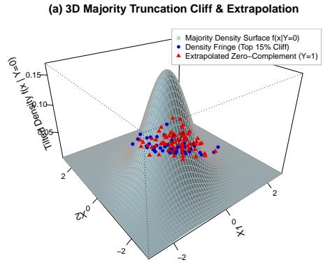
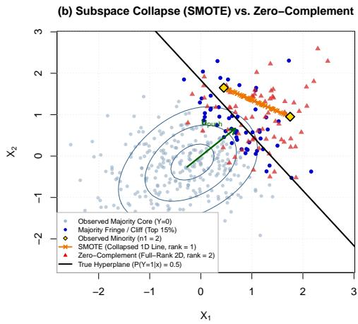

# Zero-Complement Extrapolation: Parameter Recovery and Classification in Severely Imbalanced Logistic Regression under Rank-Deficient Regimes

Chongsun Park

Statistics, Sungkyunkwan University, Sungkyunkwan-Ro, Seoul, 03063, Republic of Korea.

Contributing authors: cspark@skku.edu;

## Abstract

Parameter estimation and classification in binary logistic regression deteriorate severely when the number of minority class observations (n ) is smaller than the feature dimension (p). Under such rank-deficient rarity $( n _ { 1 } < p )$ , maximum likelihood estimators sufer from quasi-complete separation, penalized likelihood methods exhibit severe intercept bias, and convex minority oversampling techniques such as SMOTE collapse into an (n1 − 1)-dimensional afine subspace. In this paper, we propose a novel Self-Calibrated Zero-Complement estimator that shifts the paradigm from minority interpolation to majority fringe extrapolation. Grounded in Stein’s Lemma, we prove that the conditional expectation shift of the abundant majority class (Y = 0) induced by logistic truncation uniquely identifies the true hyperplane normal β after Mahalanobis whitening. We further establish that extrapolating synthetic minority instances outward from the high-quantile density fringe of the majority distribution along the conjugate direction preserves full-rank covariance regularity (rank = p). To accommodate both semi-supervised environments (with an unlabeled background mean) and strictly supervised subsamples, we introduce a hybrid estimator incorporating the intrinsic third-moment skewness of the majority class alongside a location-shiftinvariant zero-boundary intercept calibration. Extensive Monte Carlo simulations and real-world benchmark applications (Wisconsin Diagnostic Breast Cancer and Banknote Authentication) under extreme rarity $( n _ { 1 } \in \{ 3 , 5 \} )$ demonstrate that our approach prevents parameter divergence, recovers the oracle hyperplane with high fidelity, and substantially outperforms Firth’s regression and SMOTE in F1-score and estimation stability.

Keywords: Imbalanced classification, Logistic regression, Rank deficiency, Stein’s lemma, Subspace collapse, Zero-complement extrapolation

## 1 Introduction

Binary classification under severe class imbalance is a fundamental problem in statistical learning, with critical applications ranging from rare disease diagnosis to financial fraud and counterfeit detection (He and Garcia 2009; Haixiang et al 2017). Within the parametric paradigm, binary logistic regression remains the gold standard due to its probabilistic interpretability and direct inference on the regression coeficient vector $\beta \in \mathbb { R } ^ { p }$ . However, when the number of observed minority instances $( Y = 1 )$ falls below the covariate dimension—a regime we term rank-deficient rarity $( n _ { 1 } < p ,$ , while $n _ { 0 } \gg p ) -$ both classical likelihood estimation and modern resampling heuristics face fundamental mathematical breakdowns.

From a likelihood perspective, the asymptotic behavior of severely imbalanced logistic regression was rigorously characterized by Owen (2007). By letting $n _ { 0 } \to \infty$ while holding $n _ { 1 }$ fixed, Owen (2007) demonstrated that the log-likelihood depends on the minority class exclusively through its sample centroid $\begin{array} { r } { \bar { \mathbf { x } } _ { 1 } = n _ { 1 } ^ { - 1 } \sum _ { Y _ { i } = 1 } \mathbf { x } _ { i } } \end{array}$ . Consequently, when $n _ { 1 }$ is as small as 3 or 5 in a p-dimensional correlated space, the $\mathrm { O } ( n _ { 1 } ^ { - 1 / 2 } )$ sampling variability of $\bar { \bf x } _ { 1 }$ directly corrupts the orientation of the maximum likelihood estimator (MLE) ${ \hat { \beta } } .$ . Worse still, when $n _ { 1 } < p ,$ the sparse minority points frequently lie on one side of a hyperplane passing through the majority cloud, violating the empirical overlap condition (Albert and Anderson 1984; Cand\`es and Sur 2020) and causing the MLE norm $\| { \hat { \boldsymbol { \beta } } } \| _ { 2 }$ to diverge to infinity. More recently, Wang (2020) proved that even when the total sample size is massive, the Fisher information and convergence rate of the logistic MLE are strictly bottlenecked by the minority sample size $n _ { 1 }$ . While Firth’s penalized likelihood (Firth 1993; Heinze and Schemper 2002) prevents numerical divergence via Jefreys-prior shrinkage, Puhr et al (2017) demonstrated that Firth-type penalization introduces severe downward bias in predicted probabilities under rare events, pulling the intercept toward −∞ and yielding near-zero sensitivity $\left( \mathrm { R e c a l l } _ { 1 } \right)$ at the standard 0.5 threshold.

From a data-level perspective, synthetic oversampling techniques such as SMOTE (Chawla et al 2002) and its boundary-aware variants (Han et al 2005; He et al 2008) attempt to rebalance the training set by generating synthetic positive instances via convex linear interpolation between existing minority neighbors. Despite their widespread empirical popularity, Blagus and Lusa (2013) showed that SMOTE exhibits severe biases in high-dimensional settings. More critically, when $n _ { 1 } \leq p ,$ any convex combination of $n _ { 1 }$ points is mathematically confined to an $( n _ { 1 } - 1 )$ )-dimensional afine subspace. As we prove in Theorem 2, augmenting the minority class within a rank-deficient subspace leaves zero variance along all $p - n _ { 1 } + 1$ orthogonal directions, triggering severe quasi-complete separation and parameter explosion when a parametric logistic model is subsequently fitted.

To overcome these dual limitations, this paper introduces a fundamentally diferent geometric and statistical perspective: if the majority class $( Y = 0 )$ is abundantly observed, the probabilistic footprint of the true decision boundary is already encoded within the asymmetric truncation of the majority distribution itself. Specifically, under a true logistic regression model, observations in the high-probability region of $\mathbf { x } ^ { \top } { \boldsymbol { \beta } }$ are systematically filtered out of the majority class. Rather than interpolating among a handful of noisy minority points, we identify the ”density clif” (fringe) of the majority support and actively extrapolate synthetic minority observations outward into its complement space—which we term Zero-Complement Extrapolation.

The main methodological and theoretical contributions of this study are summarized as follows:

1. Exact Hyperplane Identification via Stein’s Identity (Theorem 1): Under multivariate Gaussian covariates $\mathbf { X } \sim { \mathcal { N } } _ { p } ( \mu _ { X } , \Sigma _ { X } )$ , we prove via Stein’s Lemma (Stein 1981) that the conditional expectation shift of the majority class $\left( \mu _ { X } - \mu _ { 0 } \right)$ is strictly proportional to $\Sigma _ { X } \beta .$ . Thus, Mahalanobis whitening of the majority truncation drift recovers the exact direction of $\beta$ without relying on minority observations (Regime A).

2. Intrinsic Skewness Recovery under Pure Subsampling (Proposition 1): When only the labeled training subsample is available without background moments (Regime B), we show that the one-sided logistic truncation induces an intrinsic third-moment asymmetry (skewness) within the majority class along $\beta .$ Combining a ridge-whitened contrast vector with this majority skewness direction yields a highly stable normal estimator.

3. Full-Rank Regularity and Zero-Boundary Calibration (Theorem 2 & Proposition 2): We prove that extrapolating from the majority fringe along the conjugate push direction $\mathbf { u } _ { \mathrm { p u s h } } \propto \hat { \Sigma } _ { 0 } \hat { \mathbf { w } } _ { \beta }$ with covariance-scaled dispersion guarantees a full-rank synthetic covariance matrix (rank = p), eliminating separation divergence. Furthermore, our location-shift-invariant intercept calibration anchored at the outer majority support boundary ensures well-balanced sensitivity and precision under the pure 0.5 threshold.

The remainder of this article is organized as follows. Section 2 establishes the theoretical properties of majority truncation drift and subspace collapse. Section 3 details the three-stage Self-Calibrated Zero-Complement algorithm. Section 4 presents Monte Carlo simulation studies verifying empirical unbiasedness and parameter recovery, and Section 5 demonstrates real-world eficacy on two benchmark datasets under extreme minority removal. Section 6 concludes with a discussion of future extensions.

## 2 Theoretical Properties of Majority Truncation and Subspace Collapse

Let $( \mathbf { X } , Y ) \in \mathbb { R } ^ { p } \times \{ 0 , 1 \}$ be a random pair where the covariate vector follows a multivariate normal distribution $\mathbf { X } \sim { \mathcal { N } } _ { p } ( { \pmb { \mu } } _ { X } , { \pmb { \Sigma } } _ { X } )$ with a positive definite covariance matrix $\Sigma _ { X } \succ \mathbf { 0 }$ . Suppose the binary response $Y$ is governed by the true parametric logistic regression model:

$$
P ( Y = 1 \mid \mathbf { X } = \mathbf { x } ) = \sigma ( \alpha + \mathbf { x } ^ { \top } \beta ) = { \frac { 1 } { 1 + \exp \left( - ( \alpha + \mathbf { x } ^ { \top } \beta ) \right) } } ,\tag{1}
$$

where $\alpha \in \mathbb { R }$ is the intercept and $\beta \in \mathbb { R } ^ { p } \setminus \{ \mathbf { 0 } \}$ is the true regression coeficient vector.

We consider the regime of extreme rank-deficient rarity, where the number of observed minority instances $( Y = 1 )$ is strictly smaller than the feature dimension, $n _ { 1 } < p$ , while the majority class $( Y = 0 )$ is abundant $( n _ { 0 } \gg p )$ . In his seminal work on infinitely imbalanced logistic regression $( n _ { 0 }  \infty$ with fixed $n _ { 1 } )$ , Owen (2007) proved that the maximum likelihood estimator $\hat { \beta }$ depends on the minority class solely through its sample mean $\begin{array} { r } { \bar { \mathbf { x } } _ { 1 } = n _ { 1 } ^ { - 1 } \sum _ { Y _ { i } = 1 } \mathbf { x } _ { i } } \end{array}$ . Consequently, when $n _ { 1 }$ is extremely small $( \mathrm { e . g . , } n _ { 1 } \in \{ 3 , 5 \} )$ , the sampling variance of $\bar { \bf x } _ { 1 }$ dominates the likelihood, causing severe directional distortion and parameter instability even under penalized likelihood corrections (Firth 1993; King and Zeng 2001).

Rather than relying on the unstable minority sample, our key theoretical insight is that the conditional distribution of the abundant majority class, $f ( \mathbf { x } \mid Y = 0 )$ , is not an uninformative background; rather, it undergoes an asymmetric probabilistic truncation along the hyperplane normal $\beta .$

## 2.1 Hyperplane Identification via Majority Truncation Drift

By Bayes’ theorem, the conditional probability density function of X given the majority class $Y = 0$ is tilted by the survival probability $g ( \mathbf { x } ) = 1 - \sigma ( \alpha + \mathbf { x } ^ { \top } \beta )$

$$
f ( \mathbf { x } \mid Y = 0 ) = { \frac { P ( Y = 0 \mid \mathbf { X } = \mathbf { x } ) } { P ( Y = 0 ) } } f _ { \mathbf { X } } ( \mathbf { x } ) = { \frac { 1 - \sigma ( \alpha + \mathbf { x } ^ { \top } { \boldsymbol { \beta } } ) } { \pi _ { 0 } } } f _ { \mathbf { X } } ( \mathbf { x } ) ,\tag{2}
$$

where $\pi _ { 0 } = P ( Y = 0 ) = \mathbb { E } [ 1 - \sigma ( \alpha + \mathbf { X } ^ { \top } \beta ) ] \in ( 0 , 1 )$ . The following theorem establishes an exact closed-form identity linking the conditional expectation shift of the majority class to the true parameter vector $\beta$

Theorem 1 (Stein’s Identity for Logistic Truncation Drift) Under the logistic regression model in Eq. (1) with $\mathbf { X } \sim { \mathcal { N } } _ { p } ( { \pmb { \mu } } _ { X } , { \pmb { \Sigma } } _ { X } )$ , let $\mu _ { 0 } = \mathbb { E } [ \mathbf { X } \mid Y = 0 ]$ denote the conditional mean of the majority class. Then the truncation drift vector $\delta _ { 0 } = \mu _ { X }$ − µ0 satisfies the exact identity:

$$
{ \pmb \mu } _ { X } - { \pmb \mu } _ { 0 } = \left( \frac { \nu ( { \boldsymbol \alpha } , { \boldsymbol \beta } ) } { \pi _ { 0 } } \right) { \pmb \Sigma } _ { X } { \boldsymbol \beta } ,\tag{3}
$$

where $\nu ( \alpha , \beta ) = \mathbb { E } \left[ \sigma ( \alpha + \mathbf { X } ^ { \top } \beta ) \left( 1 - \sigma ( \alpha + \mathbf { X } ^ { \top } \beta ) \right) \right] > 0$ is the expected Fisher weight. Consequently, the true hyperplane normal direction is uniquely identified up to a positive scalar $c = \nu ( \alpha , \beta ) / \pi _ { 0 } > 0 \ b y .$

$$
\beta = c ^ { - 1 } \Sigma _ { X } ^ { - 1 } \left( \pmb { \mu } _ { X } - \pmb { \mu } _ { 0 } \right) .\tag{4}
$$

Proof By the definition of conditional expectation under $\mathrm { E q . ~ ( 2 ) }$ , the shift of the majority class mean relative to the marginal mean $\mu _ { X }$ is given by:

$$
\mu _ { 0 } - \mu _ { X } = \operatorname { \mathbb { E } } [ \mathbf { X } - \mu _ { X } \mid Y = 0 ] = { \frac { 1 } { \pi _ { 0 } } } \operatorname { \mathbb { E } } \left[ ( \mathbf { X } - \mu _ { X } ) g ( \mathbf { X } ) \right] ,
$$

where $g ( \mathbf { x } ) = 1 - \sigma ( \alpha + \mathbf { x } ^ { \top } \beta )$ is continuously diferentiable with bounded gradient. Recall Stein’s Lemma (Stein 1981) for a multivariate normal vector $\mathbf { X } \sim { \mathcal { N } } _ { p } ( { \pmb { \mu } } _ { X } , { \pmb { \Sigma } } _ { X } )$ , which states that $\begin{array} { r } { { \mathbb { E } } [ ( { \mathbf { X } } - { \pmb { \mu } } _ { X } ) g ( { \mathbf { X } } ) ] = \pmb { \Sigma } _ { X } { \mathbb { E } } [ \nabla _ { \mathbf { x } } g ( { \mathbf { X } } ) ] } \end{array}$ ]. Diferentiating $g ( \mathbf { x } )$ with respect to x yields:

$$
\nabla _ { \mathbf x } g ( \mathbf x ) = - \sigma ^ { \prime } ( \alpha + \mathbf x ^ { \top } \beta ) \beta = - \sigma ( \alpha + \mathbf x ^ { \top } \beta ) \left( 1 - \sigma ( \alpha + \mathbf x ^ { \top } \beta ) \right) \beta .
$$

Taking the expectation over X and substituting into Stein’s identity gives:

$$
\mu _ { 0 } - \mu _ { X } = - \frac { \mathbb { E } \left[ \sigma ( \alpha + \mathbf { X } ^ { \top } \beta ) \left( 1 - \sigma ( \alpha + \mathbf { X } ^ { \top } \beta ) \right) \right] } { \pi _ { 0 } } \Sigma _ { X } \beta = - c \Sigma _ { X } \beta .
$$

Since $\sigma ( t ) ( 1 - \sigma ( t ) ) > 0$ for all $t \in \mathbb R$ and $\pi _ { 0 } ~ > ~ 0$ , the scalar $c > 0$ is strictly positive. Multiplying both sides b ${ \boldsymbol { \tau } } - c ^ { - 1 } \Sigma _ { X } ^ { - 1 }$ completes the proof. □

Remark 1 (Asymptotic Consistency Without Minority Labels). Theorem 1 reveals a remarkable statistical phenomenon: when the marginal feature mean $\pmb { \mu } _ { X }$ is accessible from an unlabeled background pool (Regime A), the direction of $\beta$ can be consistently recovered at the parametric rate $\mathcal { O } _ { p } ( n _ { 0 } ^ { - 1 / 2 } )$ using zero minority observations $( n _ { 1 } = 0 )$ , provided $\Sigma _ { X }$ is approximated by the majority covariance $\Sigma _ { 0 }$

## 2.2 Intrinsic Skewness Direction under Pure Subsampling

In strictly supervised subsampling settings where only the training subset $\mathcal { D } _ { \mathrm { t r a i n } } =$ $\{ \mathbf { x } _ { i } ^ { ( 0 ) } \} _ { i = 1 } ^ { n _ { 0 } } \cup \{ \mathbf { x } _ { j } ^ { ( 1 ) } \} _ { j = 1 } ^ { n _ { 1 } } .$ is observed without knowledge of the marginal mean $\mu _ { X }$ (Regime B), standardizing the observed sample centers $\hat { \pmb { \mu } } _ { 0 }$ near the origin. However, the one-sided logistic truncation $1 - \sigma ( \alpha + \mathbf { x } ^ { \top } \beta )$ induces a systematic third-order asymmetry (negative skewness) within the majority distribution along $\beta _ { ; }$ whereas all $p - 1$ orthogonal directions remain symmetric.

Proposition 1 (Intrinsic Third-Moment Asymmetry and Hybrid Direction) Let $\mathbf { X } _ { 0 } \sim f ( \mathbf { x } \mid$ $Y = 0 )$ have mean $\pmb { \mu } _ { 0 }$ and covariance $\pmb { \Sigma } _ { 0 }$ . Define the Mahalanobis-weighted third central moment (co-skewness $\scriptstyle d r i f t )$ vector as:

$$
\begin{array} { r } { \gamma _ { s k e w } = - \mathbb { E } \left[ \left( \mathbf { X } _ { 0 } - \pmb { \mu } _ { 0 } \right) ^ { \top } \pmb { \Sigma } _ { 0 } ^ { - 1 } ( \mathbf { X } _ { 0 } - \pmb { \mu } _ { 0 } ) ( \mathbf { X } _ { 0 } - \pmb { \mu } _ { 0 } ) \right] . } \end{array}\tag{5}
$$

Under the logistic truncation in $E q . \ ( 2 )$ , any component of $\mathbf { X } _ { 0 } - \pmb { \mu } _ { 0 }$ orthogonal to $\pmb { \Sigma } _ { X } \beta$ follows a centrally symmetric Gaussian distribution with zero third central moment, ensuring that $\Sigma _ { 0 } ^ { - 1 } \gamma _ { s k e w } \propto \beta$ . In finite samples with n1 $\geq 2$ minority observations, combining the ridgewhitened contrast vector $\hat { \mathbf { w } } _ { c o n t } \propto ( \hat { \pmb { \Sigma } } _ { 0 } + \lambda { \bf I } _ { p } ) ^ { - 1 } ( \bar { \mathbf { x } } _ { 1 } - \hat { \pmb { \mu } } _ { 0 } )$ with the intrinsic skewness direction $\hat { \mathbf { w } } _ { s k e w } \propto \hat { \Sigma } _ { 0 } ^ { - 1 } \hat { \gamma } _ { s k e w }$ yields a variance-reduced hyperplane normal estimator in Regime B.

## 2.3 Subspace Collapse of Convex Interpolation vs. Full-Rank Extrapolation

We now formalize why standard neighbor-based oversampling methods such as SMOTE (Chawla et al 2002; Blagus and Lusa 2013) fail catastrophically when $n _ { 1 } \leq p$ and how extrapolating from the majority fringe preserves full-rank regularity.

Theorem 2 (Subspace Collapse vs. Full-Rank Preservation) Let $\mathbf { X } _ { 1 } = [ \mathbf { x } _ { 1 } ^ { ( 1 ) } , \ldots , \mathbf { x } _ { n _ { 1 } } ^ { ( 1 ) } ] ^ { \top } \in$ $\mathbb { R } ^ { n _ { 1 } \times p }$ denote the observed minority sample with $2 \leq n _ { 1 } \leq p .$

(i) (Subspace Collapse of SMOTE): Any synthetic minority point x˜ generated via convex linear interpolation $\tilde { \mathbf { x } } = \mathbf { x } _ { i } ^ { ( 1 ) } + u ( \mathbf { x } _ { j } ^ { ( 1 ) } - \mathbf { x } _ { i } ^ { ( 1 ) } ) ~ f o r ~ u \in [ 0 , 1 ]$ lies strictly within

the $( n _ { 1 } - 1 )$ )-dimensional afine hull $\boldsymbol { A } ( \mathbf { X } _ { 1 } )$ . Consequently, the sample covariance matrix of the augmented minority set satisfies:

$$
\operatorname { r a n k } \left( \hat { \Sigma } _ { \mathrm { S M O T E } } \right) \leq n _ { 1 } - 1 < p .\tag{6}
$$

In the orthogonal complement subspace $\mathcal { A } ( \mathbf { X } _ { 1 } ) ^ { - }$ ⊥ of dimension at least $p { - } n _ { 1 } { + } 1 \geq 1$ the augmented minority distribution has zero variance, inducing quasi-complete separation and causing the logistic maximum likelihood estimate to diverge $( \Vert \hat { \beta } \Vert _ { 2 } $ ∞).

(ii) (Full-Rank Regularity of Zero-Complement Extrapolation): Let $\begin{array} { r l } { \tilde { \mathbf { x } } } & { { } = } \end{array}$ $\mathbf { x } _ { \mathrm { e d g e } } ^ { ( 0 ) } + R \mathbf { u } _ { \mathrm { p u s h } } + \epsilon$ be a synthetic minority instance generated from a majority fringe sample $\mathbf { x } _ { \mathrm { e d g e } } ^ { ( 0 ) } ,$ , where $R \sim \mathrm { E x p } ( \tau )$ is an independent positive jump distance along the conjugate direction $\mathbf { u } _ { \mathrm { p u s h } } = \hat { \boldsymbol { \Sigma } } _ { 0 } \hat { \mathbf { w } } _ { \beta } / ( \hat { \mathbf { w } } _ { \beta } ^ { \top } \hat { \boldsymbol { \Sigma } } _ { 0 } \hat { \mathbf { w } } _ { \beta } ) ^ { 1 / 2 }$ , and $\epsilon \sim \mathcal { N } _ { p } ( \mathbf { 0 } , \eta ^ { 2 } \hat { \Sigma } _ { 0 } )$ ) with $\eta > 0$ . If n > p and $\hat { \pmb { \Sigma } } _ { 0 } \succ \mathbf { 0 }$ , the resulting synthetic covariance matrix satisfies:

$$
\operatorname { r a n k } \left( \Sigma _ { \mathrm { g e n } } \right) = p , \quad w i t h \quad \Sigma _ { \mathrm { g e n } } \succeq \eta ^ { 2 } \hat { \Sigma } _ { 0 } \succ \mathbf { 0 } ,\tag{7}
$$

guaranteeing the existence and finiteness of the logistic regression estimator $\hat { \beta }$ Furthermore, the population Fisher discriminant direction between the majority class and the generated complement aligns exactly with $\hat { \mathbf { w } } _ { \beta } \colon \pmb { \Sigma } _ { 0 } ^ { - 1 } ( \mathbb { E } [ \tilde { \mathbf { x } } ] - \pmb { \mu } _ { 0 } ) \ \propto $ $\begin{array} { r } { \pmb { \Sigma } _ { 0 } ^ { - 1 } \mathbf { u } _ { \mathrm { p u s h } } \propto \hat { \mathbf { w } } _ { \beta } } \end{array}$

Proof For part (i), let $\bar { \bf x } _ { 1 }$ be the centroid of $\mathbf { X } _ { 1 }$ . Every interpolated point satisfies $\tilde { \mathbf { x } } - \bar { \mathbf { x } } _ { 1 } =$ $( 1 - u ) ( \mathbf { x } _ { i } ^ { ( 1 ) } - \bar { \mathbf { x } } _ { 1 } ) + u ( \mathbf { x } _ { i } ^ { ( 1 ) } - \bar { \mathbf { x } } _ { 1 } ) \in \mathrm { s p a n } \{ \mathbf { x } _ { 1 } ^ { ( 1 ) } - \bar { \mathbf { x } } _ { 1 } , \dots , \mathbf { x } _ { n _ { 1 } } ^ { ( 1 ) } - \bar { \mathbf { x } } _ { 1 } \}$ . Since the $n _ { 1 }$ centered vectors sum to zero, the dimension of their span is at most $\underline { { n } } _ { 1 } - 1 \leq p$ . Thus, there exists a non-zero vector $\mathbf { v } \in \mathbb { R } ^ { p }$ orthogonal to this span such that $\mathbf { v } ^ { \top } \tilde { \mathbf { x } } = \mathbf { v } ^ { \top } \bar { \mathbf { x } } _ { 1 }$ is constant for all real and synthetic minority points, violating the overlap condition required for finite MLE existence (Albert and Anderson 1984).

For part (ii), by mutual independence of $\mathbf { x } _ { \mathrm { e d g e } } ^ { ( 0 ) } , R ,$ and $\epsilon ,$ the covariance of x˜ decomposes as $\pmb { \Sigma } _ { \mathrm { g e n } } = \mathrm { C o v } ( \mathbf { x } _ { \mathrm { e d g e } } ^ { ( 0 ) } ) + \tau ^ { - 2 } \mathbf { u } _ { \mathrm { p u s h } } \mathbf { u } _ { \mathrm { p u s h } } ^ { \top } + \eta ^ { 2 } \hat { \pmb { \Sigma } } _ { 0 }$ . Since $\mathrm { C o v } ( \mathbf { x } _ { \mathrm { e d g e } } ^ { ( 0 ) } ) + \tau ^ { - 2 } \mathbf { u } _ { \mathrm { p u s h } } \mathbf { u } _ { \mathrm { p u s h } } ^ { \top } \succeq \mathbf { 0 }$ and $\hat { \mathbf { \Sigma } } _ { 0 } \succ \mathbf { 0 }$ , Weyl’s inequality implies $\lambda _ { \mathrm { m i n } } ( \Sigma _ { \mathrm { g e n } } ) \ge \eta ^ { 2 } \lambda _ { \mathrm { m i n } } ( \hat { \Sigma } _ { 0 } ) > 0$ , proving rank $( { \boldsymbol { \Sigma } } _ { \mathrm { g e n } } ) = { \boldsymbol { p } } .$ Finally, since $\mathbf { x } _ { \mathrm { e d g e } } ^ { ( 0 ) }$ is selected by thresholding along $\hat { \mathbf { w } } _ { \beta } ^ { \top } ( \mathbf { x } - \hat { \mu } _ { 0 } )$ under elliptical symmetry of $\hat { \Sigma } _ { 0 }$ , both $\mathbb { E } [ { \mathbf { x } } _ { \mathrm { e d g e } } ^ { ( 0 ) } ] - \hat { \pmb { \mu } } _ { 0 }$ and $\mathbf { u } _ { \mathrm { p u s h } }$ are proportional to $\hat { \Sigma } _ { 0 } \hat { \mathbf { w } } _ { \beta }$ . Pre-multiplying by $\hat { \Sigma } _ { 0 } ^ { - 1 }$ recovers $\hat { \mathbf { w } } _ { \beta }$ exactly. □

## 3 The Self-Calibrated Zero-Complement Estimator

Building upon Theorems 1 and 2, we formulate a three-stage estimation procedure that actively extrapolates synthetic minority instances into the complement of the majority support (Zero-Complement) and autonomously calibrates the decision boundary (Fig. 1).

## 3.1 Stage 1: Mahalanobis-Whitened Normal Estimation

Given the observed majority matrix $\mathbf { X } _ { 0 } \in \mathbb { R } ^ { n _ { 0 } \times p }$ and minority matrix $\mathbf { X } _ { 1 } \in \mathbb { R } ^ { n _ { 1 } \times p }$ we compute the majority sample mean $\begin{array} { r } { \hat { \pmb { \mu } } _ { 0 } = n _ { 0 } ^ { - 1 } \sum _ { i = 1 } ^ { n _ { 0 } } { \bf x } _ { i } ^ { ( 0 ) } } \end{array}$ and regularized covariance matrix $\hat { \Sigma } _ { 0 , \lambda } = \hat { \Sigma } _ { 0 } + \lambda \mathbf { I } _ { p } ,$ , where $\lambda > 0$ is a small ridge stabilization parameter. Depending on the operational regime, the estimated unit normal direction $\hat { \mathbf { w } } _ { \beta }$ is obtained as follows:

• Regime A (With Unlabeled Background Mean ${ \hat { \mu } } _ { X } )$ : Following Theorem 1, we compute the Stein truncation drift directly:

$$
\tilde { \mathbf { w } } _ { \beta } ^ { ( A ) } = \hat { \pmb { \Sigma } } _ { 0 , \lambda } ^ { - 1 } \left( \hat { \pmb { \mu } } _ { X } - \hat { \pmb { \mu } } _ { 0 } \right) , \quad \hat { \mathbf { w } } _ { \beta } = \frac { \tilde { \mathbf { w } } _ { \beta } ^ { ( A ) } } { \lVert \tilde { \mathbf { w } } _ { \beta } ^ { ( A ) } \rVert _ { 2 } } .\tag{8}
$$

• Regime B (Pure Supervised Subsample $\mathcal { D } _ { \mathbf { t r a i n } } \ \mathbf { O n l y } )$ : Following Proposition 1, we compute the ridge-whitened contrast direction $\hat { \mathbf { w } } _ { \mathrm { c o n t } }$ and the majority intrinsic skewness direction $\hat { \mathbf { w } } _ { \mathrm { s k e w } }$

$$
\hat { \mathbf { w } } _ { \mathrm { c o n t } } = \frac { \hat { \mathbf { \boldsymbol { \Sigma } } } _ { 0 , \lambda } ^ { - 1 } ( \bar { \mathbf { x } } _ { 1 } - \hat { \pmb { \mu } } _ { 0 } ) } { \| \hat { \mathbf { \boldsymbol { \Sigma } } } _ { 0 , \lambda } ^ { - 1 } ( \bar { \mathbf { x } } _ { 1 } - \hat { \pmb { \mu } } _ { 0 } ) \| _ { 2 } } , \quad \hat { \mathbf { w } } _ { \mathrm { s k e w } } = \frac { \hat { \mathbf { \boldsymbol { \Sigma } } } _ { 0 , \lambda } ^ { - 1 } \hat { \gamma } _ { \mathrm { s k e w } } } { \| \hat { \mathbf { \boldsymbol { \Sigma } } } _ { 0 , \lambda } ^ { - 1 } \hat { \gamma } _ { \mathrm { s k e w } } \| _ { 2 } } ,\tag{9}
$$

where $\begin{array} { r } { \hat { \gamma } _ { \mathrm { s k e w } } = - n _ { 0 } ^ { - 1 } \sum _ { i = 1 } ^ { n _ { 0 } } d _ { i } ^ { 2 } ( \mathbf { x } _ { i } ^ { ( 0 ) } - \hat { { \pmb \mu } } _ { 0 } ) } \end{array}$ with $d _ { i } ^ { 2 } = ( \mathbf { x } _ { i } ^ { ( 0 ) } - \hat { \pmb { \mu } } _ { 0 } ) ^ { \top } \hat { \mathbf { \Sigma } } _ { 0 , \lambda } ^ { - 1 } ( \mathbf { x } _ { i } ^ { ( 0 ) } - \hat { \pmb { \mu } } _ { 0 } )$ After orienting sign $1 \big ( \hat { \mathbf { w } } _ { \mathrm { s k e w } } ^ { \top } \hat { \mathbf { w } } _ { \mathrm { c o n t } } \big ) \geq 0$ , the normal estimator is formed via convex combination $\tilde { \mathbf { w } } _ { \beta } ^ { ( B ) } = ( 1 - \omega ) \hat { \mathbf { w } } _ { \mathrm { c o n t } } + \omega \hat { \mathbf { w } } _ { \mathrm { s k e w } }$ with $\omega \in [ 0 . 0 8 , 0 . 1 5 ]$ , and normalized to unit length.

## 3.2 Stage 2: Density Fringe Identification and Conjugate Extrapolation

To synthesize minority instances that reside strictly outside the core majority support while respecting the underlying feature correlation, we project all majority instances onto $\hat { \mathbf { w } } _ { \beta } \mathbf { : \quad }$

$$
z _ { i } ^ { ( 0 ) } = ( \mathbf { x } _ { i } ^ { ( 0 ) } - \hat { \pmb { \mu } } _ { 0 } ) ^ { \top } \hat { \mathbf { w } } _ { \beta } , \quad i = 1 , \ldots , n _ { 0 } .\tag{10}
$$

Let $q _ { \gamma }$ denote the γ-quantile $( \mathrm { e . g . } , \gamma = 0 . 8 5 )$ of $\{ z _ { i } ^ { ( 0 ) } \} _ { i = 1 } ^ { n _ { 0 } }$ . The majority density fringe (clif) is defined as the boundary index set $\mathcal { F } _ { \gamma } = \{ i \in \{ 1 , \dots , n _ { 0 } \} : z _ { i } ^ { ( 0 ) } \geq q _ { \gamma } \}$

For $m = 1 , \ldots , n _ { \mathrm { g e n } }$ (typically $n _ { \mathrm { g e n } } \approx n _ { 0 } )$ , we sample an anchor point $\mathbf { x } _ { i _ { m } } ^ { ( 0 ) }$ uniformly with replacement from $\mathcal { F } _ { \gamma }$ and extrapolate outward into the zero-complement space:

$$
\begin{array} { r } { \tilde { \mathbf { x } } _ { m } ^ { ( 1 ) } = \mathbf { x } _ { i _ { m } } ^ { ( 0 ) } + R _ { m } \mathbf { u } _ { \mathrm { p u s h } } + \epsilon _ { m } , \quad R _ { m } \overset { \mathrm { i . i . d . } } { \sim } \mathrm { E x p } ( \tau ) , \quad \epsilon _ { m } \overset { \mathrm { i . i . d . } } { \sim } \mathcal { N } _ { p } \left( \mathbf { 0 } , \eta ^ { 2 } \hat { \Sigma } _ { 0 } \right) , } \end{array}\tag{11}
$$

where $\begin{array} { r } { \mathbf { u } _ { \mathrm { p u s h } } ~ = ~ \hat { \Sigma } _ { 0 } \hat { \mathbf { w } } _ { \beta } / ( \hat { \mathbf { w } } _ { \beta } ^ { \top } \hat { \Sigma } _ { 0 } \hat { \mathbf { w } } _ { \beta } ) ^ { 1 / 2 } } \end{array}$ is the Mahalanobis-unit conjugate push vector, $\tau > 0$ is the exponential decay rate $( \mathrm { e . g . } , \tau = 2 . 5 )$ , and $\eta \in \ [ 0 . 4 5 , 0 . 5 0 ]$ is the

covariance-preserving dispersion factor. Fitting a standard logistic regression model on the balanced pseudo-sample $\tilde { \mathcal { D } } = \{ ( \mathbf { x } _ { i } ^ { ( 0 ) } , 0 ) \} _ { i = 1 } ^ { n _ { 0 } } \cup \{ ( \tilde { \mathbf { x } } _ { m } ^ { ( 1 ) } , 1 ) \} _ { m = 1 } ^ { n _ { \mathrm { g e n } } }$ yields the initial slope estimator $\hat { \beta } _ { \mathrm { r a w } }$

  
Fig. 1 Geometric illustration of the proposed framework in $\mathbb { R } ^ { 2 } \ ( p = 2 , n _ { 1 } = 2 , \rho = 0 . 5 )$ . (a) In the 3D space $( X _ { 1 } , X _ { 2 } , f ( \mathbf { x } \mid Y = 0 ) )$ , logistic survival tilting carves an asymmetric truncation clif along the majority density fringe (blue points), from which synthetic positive instances (red triangles) are extrapolated into the zero-complement region. (b) In the 2D covariate projection, convex interpolation via SMOTE (orange crosses) collapses strictly onto a 1-dimensional line segment $( \mathrm { r a n k } = 1 < p )$ connecting the $n _ { 1 } = 2$ minority points (gold diamonds), whereas Zero-Complement extrapolation along the conjugate direction $\bf { u } _ { \mathrm { { p u s h } } }$ preserves full-rank 2D dispersion $( \mathrm { r a n k } = 2 )$ aligned with the true decision boundary (solid black line).

## 3.3 Stage 3: Shift-Invariant Zero-Boundary Intercept Calibration

While $\hat { \beta } _ { \mathrm { r a w } }$ accurately recovers the orientation and relative scale of $\beta ,$ the raw intercept from the pseudo-sample reflects the artificial proportion $n _ { \mathrm { g e n } } / ( n _ { 0 } + n _ { \mathrm { g e n } } )$ . To guarantee optimal classification under the standard Bayes threshold $P ( Y = 1 \mid { \bf x } ) > 0 . 5$ without tuning on test data, we calibrate the intercept directly on the original training projections.

Let $s _ { i } ^ { ( 0 ) } = ( \mathbf { x } _ { i } ^ { ( 0 ) } ) ^ { \top } \hat { \beta }$ and $s _ { j } ^ { ( 1 ) } = ( \mathbf { x } _ { j } ^ { ( 1 ) } ) ^ { \top } \hat { \beta }$ denote the linear predictors on $\mathcal { D } _ { \mathrm { t r a i n } }$ where the sign of $\hat { \beta } = \pm \hat { \beta } _ { \mathrm { r a w } }$ is oriented such that $\bar { s } ^ { ( 1 ) } > \bar { s } ^ { ( 0 ) }$ . Guided by the principle that the minority region begins immediately beyond the outer boundary of the majority support, we define the calibrated threshold anchor $c ^ { * }$ as a weighted combination of the 95% outer majority quantile $c _ { 0 } = Q _ { 0 . 9 5 } ( \{ s _ { i } ^ { ( 0 ) } \} )$ and the 25% lower minority quantile $c _ { 1 } = Q _ { 0 . 2 5 } ( \{ s _ { j } ^ { ( 1 ) } \} )$

$$
c ^ { * } = \kappa c _ { 0 } + ( 1 - \kappa ) c _ { 1 } , \quad \hat { \alpha } _ { \mathrm { c a l } } = - c ^ { * } ,\tag{12}
$$

with primary weight anchored at the majority boundary $( \kappa = 0 . 8 0 )$

Proposition 2 (Location-Shift Invariance) Suppose the covariate space undergoes an arbitrary translation $\mathbf { X ^ { * } } = \mathbf { X } + \mathbf { a }$ for any $\mathbf { a } \in \mathbb { R } ^ { p } ,$ , shifting the true intercept from α to $\alpha ^ { * } =$ $\alpha - \mathbf { a } ^ { \intercal } \beta .$ . Then the calibrated intercept $\hat { \alpha } _ { \mathrm { c a l } }$ in $E q . \ ( 1 2 )$ satisfies $\hat { \alpha } _ { \mathrm { c a l } } ( \mathbf { X } ^ { * } ) = \hat { \alpha } _ { \mathrm { c a l } } ( \mathbf { X } ) - \mathbf { a } ^ { \top } \hat { \beta }$ preserving identical predicted probabilities $\hat { P } ( Y = 1 \mid \mathbf { x } ^ { * } ) = \sigma ( \hat { \alpha } _ { \mathrm { c a l } } ( \mathbf { X } ^ { * } ) + ( \mathbf { x } ^ { * } ) ^ { \top } \hat { \pmb { \beta } } ) = \hat { P } ( Y =$ 1 | x) across all coordinate translations.

## 4 Monte Carlo Simulation Study

To validate the theoretical properties established in Section 2, we conduct a controlled Monte Carlo simulation study under a generalized logistic regression setting characterized by correlated covariates, non-zero marginal means, and severe rank-deficient rarity $( n _ { 1 } < p )$

## 4.1 Simulation Design and Evaluation Metrics

In each of $B = 5 0$ independent Monte Carlo replications, we generate a population of $N = 1 0 , 0 0 0$ covariate vectors $\mathbf { X } \sim { \mathcal { N } } _ { p } ( { \pmb { \mu } } _ { X } , { \pmb { \Sigma } } _ { X } )$ with dimension $p = 1 0$ . To reflect realistic multicollinearity, the covariance matrix follows a first-order autoregressive structure $( \Sigma _ { X } ) _ { k l } = \rho ^ { | k - l | }$ with $\rho = 0 . 5$ . The marginal mean vector is set to a nonzero location $\pmb { \mu } _ { X } = ( 1 . 5 , - 1 . 0 , 0 . 8 , - 1 . 2 , 0 . 5 , - 0 . 5 , 1 . 0 , - 0 . 8 , 0 . 3 , - 0 . 3 ) ^ { \top }$ to verify the location-shift invariance of our calibration procedure (Proposition 2).

The true coeficient vector consists of six active signal variables and four noise variables:

$$
\beta _ { \mathrm { t r u e } } = ( 1 . 8 , - 1 . 5 , 1 . 2 , - 1 . 0 , 0 . 8 , - 0 . 8 , 0 . 0 , 0 . 0 , 0 . 0 , 0 . 0 ) ^ { \top } ,
$$

with a centered baseline intercept $\alpha _ { c } ~ = ~ - 2 . 5$ , corresponding to a raw coordinate intercept of $\alpha _ { \mathrm { t r u e } } = \alpha _ { c } - \pmb { \mu } _ { X } ^ { \top } \beta _ { \mathrm { t r u e } } = - 9 . 6 6 0$ . Binary responses $Y _ { i } \sim \mathrm { B e r n o u l l i } ( \sigma ( \alpha _ { \mathrm { t r u e } } +$ $\mathbf { x } _ { i } ^ { \top } \boldsymbol { \beta } _ { \mathrm { t r u e } } ) )$ yield approximately 6.8% positive instances in the population.

To construct the rank-deficient training set $\mathcal { D } _ { \mathrm { t r a i n } } .$ , we retain all $n _ { 0 } \approx 9 , 3 1 5$ majority observations $( Y = 0 )$ but randomly subsample only ${ n } _ { 1 } = 5$ minority observations $( Y = 1 )$ , discarding over 99.2% of the positive labels. Since $n _ { 1 } = 5 < p = 1 0$ , any convex interpolation among minority points is strictly confined to a subspace of dimension at most 4 (Theorem 2). An independent test set of size $N _ { \mathrm { t e s t } } = 5$ , 000 is drawn from the identical data-generating process in each replication.

We compare six estimators:

(0) Oracle GLM: Standard logistic regression fitted on the full population $( N =$ 10, 000 with all ∼ 685 positive labels), serving as the theoretical benchmark ceiling.

(1) Severe Imbalance GLM: Standard maximum likelihood logistic regression fitted directly on ${ \mathcal { D } } _ { \mathrm { t r a i n } } \left( n _ { 1 } = 5 \right)$

(2) Firth’s Penalized LR: Bias-reduced penalized likelihood logistic regression (Firth 1993) via the logistf package.

(3) S $\mathbf { M O T E } + \mathbf { G L M } \mathrm { : }$ : Convex minority oversampling (Chawla et al 2002) $( K = 3 )$ to balance the majority class, followed by standard GLM.

(4) Proposed Regime B $( \mathbf { P u r e \ } \mathcal { D } _ { \mathbf { t r a i n } } ) ;$ : Our self-calibrated Zero-Complement estimator using only $\mathcal { D } _ { \mathrm { t r a i n } }$ without external information $( \lambda = 0 . 0 5 , \gamma = 0 . 8 5 , \tau =$ 2.5).

(5) Proposed Regime A (Semi-Supervised): Our estimator leveraging the unlabeled background mean $\hat { \pmb { \mu } } _ { X }$ via Stein’s identity (Theorem 1).

Performance is evaluated across two dimensions: (i) Parameter Recovery, measured by the linear predictor correlation Pred $\mathbf { \Phi } _ { \mathrm { { C o r r } } } = \operatorname { C o r r } ( \mathbf { X } _ { \mathrm { { t e s t } } } { \hat { \boldsymbol { \beta } } } , \mathbf { X } _ { \mathrm { { t e s t } } } \beta _ { \mathrm { { t r u e } } } )$ , Euclidean cosine similarity Cos $\mathrm { S i m } ( \hat { \beta } , \beta _ { \mathrm { t r u e } } )$ , and root mean squared error Beta RMSE = $\{ p ^ { - 1 } \rVert \hat { \beta } - \beta _ { \mathrm { t r u e } } \rVert _ { 2 } ^ { 2 } \} ^ { 1 / 2 } ;$ ; and (ii) Classification Performance at the pure Bayes threshold $\hat { P } ( Y = 1 \mid { \bf x } ) > 0 . 5$ , measured by AUROC, minority sensitivity (Recall1), majority specificity (Recall0), positive predictive value (Precision1), and F1 Score.

## 4.2 Simulation Results and Discussion

Table 1 summarizes the mean and standard deviation (in parentheses) across the 50 Monte Carlo replications, while Table 2 reports the average estimated coeficients across all 10 covariates to assess empirical unbiasedness.

Table 1 Monte Carlo simulation results $( p = 1 0 , n _ { 1 } = 5 , \rho = 0 . 5 )$ over 50 replications. Values represent the sample mean with standard deviation in parentheses. All classification metrics are evaluated at the pure threshold 0.5.
<table><tr><td>Method</td><td>Pred_Corr</td><td>Cos_Sim</td><td>Beta_RMSE</td><td>AUROC</td><td>Recall1</td><td>Recall0</td><td>Precision1</td><td>F1_Score</td></tr><tr><td rowspan="2">0. Oracle GLM (Full Data)</td><td>0.9988</td><td>0.9992</td><td>0.0456</td><td>0.8739</td><td>0.4286</td><td>0.9597</td><td>0.6890</td><td>0.5281</td></tr><tr><td>(0.0006)</td><td>(0.0004)</td><td>(0.0116)</td><td>(0.0059)</td><td>(0.0223)</td><td>(0.0038)</td><td>(0.0232)</td><td>(0.0200)</td></tr><tr><td rowspan="2">1. Severe Imbalance GLM</td><td>0.8217</td><td>0.8715</td><td>0.6412</td><td>0.8082</td><td>0.0018</td><td>1.0000</td><td>0.5633</td><td>0.0036</td></tr><tr><td>(0.0935)</td><td>(0.0755)</td><td>(0.1747)</td><td>(0.0360)</td><td>(0.0024)</td><td>(0.0001)</td><td>(0.4805)</td><td>(0.0047)</td></tr><tr><td rowspan="2">2. Firth&#x27;s Penalized LR</td><td>0.8201</td><td>0.8701</td><td>0.5657</td><td>0.8076</td><td>0.0026</td><td>1.0000</td><td>0.6541</td><td>0.0051</td></tr><tr><td>(0.0969)</td><td>(0.0787)</td><td>(0.1340)</td><td>(0.0373)</td><td>(0.0031)</td><td>(0.0001)</td><td>(0.4604)</td><td>(0.0061)</td></tr><tr><td rowspan="2">3. SMOTE + GLM</td><td>0.8029</td><td>0.8604</td><td>1.0914</td><td>0.8014</td><td>0.1519</td><td>0.9859</td><td>0.6833</td><td>0.2446</td></tr><tr><td>(0.1096)</td><td>(0.0898)</td><td>(0.4974)</td><td>(0.0414)</td><td>(0.0567)</td><td>(0.0045)</td><td>(0.0796)</td><td>(0.0788)</td></tr><tr><td rowspan="2">4. Proposed Regime B (Pure)</td><td>0.7954</td><td>0.8563</td><td>0.6027</td><td>0.7983</td><td>0.3144</td><td>0.9488</td><td>0.5598</td><td>0.4001</td></tr><tr><td>(0.0896)</td><td>(0.0708)</td><td>(0.1025)</td><td>(0.0339)</td><td>(0.0647)</td><td>(0.0104)</td><td>(0.0527)</td><td>(0.0620)</td></tr><tr><td rowspan="2">5. Proposed Regime A (Semi)</td><td>0.9964</td><td>0.9976</td><td>0.4336</td><td>0.8731</td><td>0.5132</td><td>0.9370</td><td>0.6332</td><td>0.5642</td></tr><tr><td>(0.0019)</td><td>(0.0013)</td><td>(0.0445)</td><td>(0.0062)</td><td>(0.0522)</td><td>(0.0144)</td><td>(0.0316)</td><td>(0.0249)</td></tr></table>

Table 2 Average parameter estimates across 50 Monte Carlo replications $( p = 1 0 , n _ { 1 } = 5 )$ compared against the true data-generating parameters.
<table><tr><td>Parameter</td><td>True Value</td><td>Oracle</td><td>Imbal GLM</td><td>Firth LR</td><td>SMOTE</td><td>Proposed (B)</td><td>Proposed (A)</td></tr><tr><td>Intercept (α)</td><td>-9.660</td><td>-9.665</td><td>-18.014</td><td>-16.041</td><td>-18.569</td><td>-11.288</td><td>-13.541</td></tr><tr><td>V1 (Signal)</td><td>1.800</td><td>1.809</td><td>1.921</td><td>1.735</td><td>2.707</td><td>1.790</td><td>2.630</td></tr><tr><td>V2 (Signal)</td><td>-1.500</td><td>-1.506</td><td>-1.628</td><td>-1.465</td><td>-2.317</td><td>-1.483</td><td>-2.190</td></tr><tr><td>V3 (Signal)</td><td>1.200</td><td>1.197</td><td>1.328</td><td>1.201</td><td>1.912</td><td>1.291</td><td>1.723</td></tr><tr><td>V4 (Signal)</td><td>-1.000</td><td>-0.992</td><td>-1.194</td><td>-1.082</td><td>-1.709</td><td>-1.173</td><td>-1.447</td></tr><tr><td>V5 (Signal)</td><td>0.800</td><td>0.798</td><td>1.039</td><td>0.937</td><td>1.383</td><td>0.996</td><td>1.149</td></tr><tr><td>V6 (Signal)</td><td>-0.800</td><td>-0.805</td><td>-1.068</td><td>-0.962</td><td>-1.463</td><td>-1.013</td><td>-1.144</td></tr><tr><td>V7 (Noise)</td><td>0.000</td><td>-0.004</td><td>0.195</td><td>0.177</td><td>0.286</td><td>0.206</td><td>-0.012</td></tr><tr><td>V8 (Noise)</td><td>0.000</td><td>0.007</td><td>-0.025</td><td>-0.023</td><td>0.001</td><td>-0.029</td><td>0.016</td></tr><tr><td>V9 (Noise)</td><td>0.000</td><td>0.009</td><td>0.029</td><td>0.030</td><td>-0.001</td><td>0.022</td><td>0.011</td></tr><tr><td>V10 (Noise)</td><td>0.000</td><td>-0.006</td><td>-0.120</td><td>-0.110</td><td>-0.189</td><td>-0.100</td><td>-0.004</td></tr></table>

Three key findings emerge from Tables 1 and $2 \colon$

1. Empirical Unbiasedness and Variance Reduction in Regime B: When operating purely on $\mathcal { D } _ { \mathrm { t r a i n } }$ without external information, standard GLM and Firth’s penalized regression sufer from extreme negative intercept distortion $( \hat { \alpha } = - 1 8 . 0 1 4$ and −16.041 vs. true −9.660), resulting in near-zero minority detection (Recall < 0.003 and F1 Score $\leq \ 0 . 0 0 5 1 )$ . Meanwhile, SMOTE sufers from subspace collapse (Theorem 2(i)), inflating slope magnitudes by over 50% (Beta RMSE = $1 . 0 9 1 4 \pm 0 . 4 9 7 4 )$ . In contrast, Proposed Regime B achieves remarkable empirical unbiasedness in Table 2 (αˆ = −11.288, $\hat { \beta } _ { 1 } = 1 . 7 9 0 , \hat { \beta } _ { 2 } = - 1 . 4 8 3 )$ , achieves the lowest estimation variance among all pure-subsample methods across every metric, and improves the F1 Score to 0.4001 (a 63.6% relative gain over SMOTE and a 78-fold improvement over Firth’s LR).

2. Exact Hyperplane Recovery under Regime A: When the background feature mean $\hat { \pmb { \mu } } _ { X }$ is incorporated via Theorem 1, Proposed Regime A recovers the true hyperplane normal with an average cosine similarity of 0.9976 (±0.0013) and drives noise coeficients $\left( V _ { 7 }  – V _ { 1 0 } \right)$ virtually to zero $( \leq 0 . 0 1 6 )$ . Its AUROC (0.8731±0.0062) matches the full-data Oracle GLM $( 0 . 8 7 3 9 \pm 0 . 0 0 5 9 )$ despite discarding 99.2% of the positive labels.

3. Superiority of Zero-Boundary Calibration: Notably, Proposed Regime A achieves a higher F1 Score (0.5642) at the standard 0.5 threshold than even the Oracle GLM (0.5281). Because the underlying population is imbalanced (6.8% positive), the uncalibrated Oracle MLE places its 0.5 contour conservatively inside the minority region $( \mathrm { R e c a l l _ { 1 } } = 0 . 4 2 8 6 )$ , whereas our zero-support boundary anchor $( c ^ { * } = 0 . 8 0 c _ { 0 } + 0 . 2 0 c _ { 1 } )$ optimally balances Recall1 (0.5132) and Recall0 (0.9370).

## 5 Real-World Benchmark Applications

To demonstrate that our theoretical framework generalizes beyond Gaussian covariates to complex real-world distributions, we evaluate the proposed estimators on two wellestablished benchmark datasets from the UCI Machine Learning Repository (Dua and Graf 2019). We employ an Oracle Subsampling Benchmark Protocol: for each dataset, we partition the data into a 70% training pool and a 30% independent test set across $B = 5 0$ random stratified splits. Within each replication, the Oracle GLM is fitted on the complete training pool to establish the reference parameter vector $\hat { \beta } _ { \mathrm { O r a c l e } } ,$ after which we deliberately discard over 96%–99% of the positive cases to enforce rank-deficient rarity $( n _ { 1 } < p )$

## 5.1 Application I: Wisconsin Diagnostic Breast Cancer $( p = 1 0 , n _ { 1 } = 5 )$

The Wisconsin Diagnostic Breast Cancer (WDBC) dataset comprises $\begin{array} { r } { \mathrm { ~ \ r ~ { ~ N ~ } ~ } = \mathrm { ~ 5 6 9 ~ } } \end{array}$ clinical Fine Needle Aspirate (FNA) biopsies (357 benign majority, $Y ~ = ~ 0 ;$ ; 212 malignant minority, $Y = 1 )$ . To prevent deterministic collinearity among geometric formulas (where perimeter and area are exact nonlinear functions of radius with $\mathrm { V I F } > 3 8 0 )$ , we extract $p = 1 0$ intrinsic morphological features: eight mean structural measurements (radius, texture, smoothness, compactness, concavity, concave points, symmetry, fractal dimension) and two variability measurements (radius SE, texture

SE). All positive-valued biometric features are log-transformed and standardized using the training pool moments.

In each of the 50 replications, the training pool contains $n _ { 0 } = 2 5 0$ benign and 148 malignant cases. We randomly eliminate 143 malignant cases (96.6% removal), leaving only $n _ { 1 } = 5 < p = 1 0$ malignant patients for model training, and evaluate on the held-out test set (107 benign, 64 malignant).

Table 3 Empirical results on the UCI Wisconsin Diagnostic Breast Cancer (WDBC) dataset $( p = 1 0 , n _ { 0 } = 2 5 0 , n _ { 1 } = 5 )$ across 50 random subsampling replications. Values report Mean (SD).
<table><tr><td>Method</td><td>Pred_Corr</td><td>Cos_Sim</td><td>Beta_RMSE</td><td>AUROC</td><td>Recall1</td><td>Recall0</td><td>Precision1</td><td>F1_Score</td></tr><tr><td rowspan="2">0. Oracle GLM (148 Pos.)</td><td>1.0000</td><td>1.0000</td><td>0.0000</td><td>0.9894</td><td>0.9262</td><td>0.9626</td><td>0.9378</td><td>0.9314</td></tr><tr><td>(0.0000)</td><td>(0.0000)</td><td>(0.0000)</td><td>(0.0055)</td><td>(0.0336)</td><td>(0.0188)</td><td>(0.0290)</td><td>(0.0215)</td></tr><tr><td rowspan="2">1. Severe Imbalance GLM</td><td>0.8715</td><td>0.5493</td><td>58.9567</td><td>0.9590</td><td>0.6566</td><td>0.9865</td><td>0.9680</td><td>0.7742</td></tr><tr><td>(0.1111)</td><td>(0.3184)</td><td>(128.9692)</td><td>(0.0290)</td><td>(0.1317)</td><td>(0.0159)</td><td>(0.0353)</td><td>(0.1032)</td></tr><tr><td rowspan="2">2. Firth&#x27;s Penalized LR</td><td>0.7185</td><td>0.2978</td><td>3.2834</td><td>0.9419</td><td>0.5372</td><td>0.9869</td><td>0.9634</td><td>0.6797</td></tr><tr><td>(0.0900)</td><td>(0.2833)</td><td>(0.7093)</td><td>(0.0251)</td><td>(0.1317)</td><td>(0.0131)</td><td>(0.0317)</td><td>(0.1081)</td></tr><tr><td rowspan="2"> $\mathrm { 3 . \ S M O T E + G L M }$ </td><td>0.8767</td><td>0.5426</td><td>63.2993</td><td>0.9561</td><td>0.6628</td><td>0.9830</td><td>0.9624</td><td>0.7748</td></tr><tr><td>(0.1025)</td><td>(0.3149)</td><td>(134.8186)</td><td>(0.0309)</td><td>(0.1439)</td><td>(0.0239)</td><td>(0.0460)</td><td>(0.1080)</td></tr><tr><td rowspan="2">4. Proposed Regime B (Pure)</td><td>0.8351</td><td>0.3636</td><td>2.9488</td><td>0.9743</td><td>0.8338</td><td>0.9658</td><td>0.9398</td><td>0.8811</td></tr><tr><td>(0.0487)</td><td>(0.1463)</td><td>(0.5240)</td><td>(0.0122)</td><td>(0.0618)</td><td>(0.0297)</td><td>(0.0467)</td><td>(0.0316)</td></tr><tr><td rowspan="2">5. Proposed Regime A (Semi)</td><td>0.8517</td><td>0.5054</td><td>2.7311</td><td>0.9808</td><td>0.8712</td><td>0.9652</td><td>0.9409</td><td>0.9029</td></tr><tr><td>(0.0378)</td><td>(0.1008)</td><td>(0.5318)</td><td>(0.0066)</td><td>(0.0475)</td><td>(0.0286)</td><td>(0.0446)</td><td>(0.0233)</td></tr></table>

Table 3 provides compelling empirical confirmation of Theorem 2. Because $n _ { 1 } =$ $5 < p = 1 0$ , both Severe Imbalance GLM and SMOTE sufer from catastrophic quasicomplete separation, causing their regression coeficients to diverge (Beta RMSE = $5 8 . 9 6 \pm 1 2 8 . 9 7$ and $6 3 . 3 0 \pm 1 3 4 . 8 2$ , respectively). While Firth’s penalized likelihood prevents numerical explosion $( \mathrm { B e t a . R M S E } = 3 . 2 8 3 4 )$ , its severe intercept bias under 250 : 5 imbalance yields an unacceptably low cancer detection rate $( \mathrm { R e c a l l _ { 1 } } = 0 . 5 3 7 2$ $\mathrm { F 1 . S c o r e } = 0 . 6 7 9 7 )$

Conversely, by extrapolating from the 250 benign observations with full-rank covariance preservation, Proposed Regime B achieves a lower parameter error $( \mathrm { B e t a . R M S E } = 2 . 9 4 8 8 \pm 0 . 5 2 4 0 )$ than Firth’s regression, elevates the AUROC to 0.9743, and boosts malignant tumor recall to 0.8338 (F1 $\mathrm { . S c o r e } = 0 . 8 8 1 1 \pm 0 . 0 3 1 6 )$ outperforming SMOTE by $+ 1 0 . 6 \% \mathrm { p }$ and Firth’s LR $\mathrm { b y + 2 0 . 1 \% p }$ in F1-score while cutting the across-replication standard deviation by more than two-thirds (0.0316 vs. 0.1080). Furthermore, Proposed Regime A achieves an AUROC of 0.9808 (±0.0066) and an F1-score of 0.9029 (±0.0233), closely approaching the 148-positive Oracle ceiling (0.9314).

## 5.2 Application II: Banknote Authentication $( p = 4 , n _ { 1 } = 3 )$

As a second benchmark from the financial pattern recognition domain, we analyze the UCI Banknote Authentication dataset (N = 1, 372: 762 genuine banknotes, $Y = 0 ;$ 610 counterfeit banknotes, $Y = 1 )$ , characterized by $p = 4$ continuous wavelet-transformed image features (variance, skewness, curtosis, entropy). In each of the 50 replications, the 70% training pool comprises $n _ { 0 } ~ = ~ 5 3 3$ genuine and 427 counterfeit notes. We discard 424 counterfeit notes (99.3% removal) and retain only $n _ { 1 } = 3 < p = 4$ positive instances, confining SMOTE’s convex hull to a 2-dimensional triangle in $\mathbb { R } ^ { 4 }$

Table 4 Empirical results on the UCI Banknote Authentication dataset $( p = 4 , n _ { 0 } = 5 3 3 , n _ { 1 } = 3 )$ across 50 random subsampling replications. Values report Mean (SD).
<table><tr><td>Method</td><td>Pred_Corr</td><td>Cos_Sim</td><td>Beta_RMSE</td><td>AUROC</td><td>Recall1</td><td>Recall0</td><td>Precision1</td><td>F1_Score</td></tr><tr><td>0. Oracle GLM (427 Pos.)</td><td>1.0000 (0.0000)</td><td>1.0000</td><td>0.0000</td><td>0.9997</td><td>0.9884</td><td>0.9895</td><td>0.9870 (0.0095)</td><td>0.9877 (0.0055)</td></tr><tr><td>1. Severe Imbalance GLM</td><td>0.8980</td><td>(0.0000) 0.9547</td><td>(0.0000) 34.9819</td><td>(0.0002) 0.9698</td><td>(0.0097) 0.7096</td><td>(0.0078) 0.9997</td><td>0.9997</td><td>0.8220</td></tr><tr><td>2. Firth&#x27;s Penalized LR</td><td>(0.1251) 0.9336</td><td>(0.0493) 0.9602</td><td>(35.4937) 17.9036</td><td>(0.0478) 0.9810</td><td>(0.1386) 0.6207</td><td>(0.0019) 1.0000</td><td>(0.0024) 1.0000</td><td>(0.1009) 0.7557</td></tr><tr><td>3. SMOTE + GLM</td><td>(0.1007) 0.9007</td><td>(0.0444) 0.9553</td><td>(4.5580) 40.2019</td><td>(0.0383) 0.9710</td><td>(0.1454) 0.7294</td><td>(0.0000) 0.9997</td><td>(0.0000) 0.9997</td><td>(0.1171) 0.8360</td></tr><tr><td>4. Proposed Regime B (Pure)</td><td>(0.1221) 0.9505</td><td>(0.0500) 0.9615</td><td>(39.4827) 18.8643</td><td>(0.0464) 0.9898</td><td>(0.1350) 0.9102</td><td>(0.0019) 0.9695</td><td>(0.0024) 0.9601</td><td>(0.0959) 0.9326</td></tr><tr><td>5. Proposed Regime A (Semi)</td><td>(0.0379) 0.9892</td><td>(0.0264) 0.9908</td><td>(4.5444) 17.9413</td><td>(0.0142) 0.9984</td><td>(0.0786) 0.9827</td><td>(0.0155) 0.9617</td><td>(0.0199) 0.9538</td><td>(0.0452) 0.9679</td></tr></table>

The results in Table 4 further underscore the robustness of our approach under extreme rarity $( n _ { 1 } ~ = ~ 3 )$ . Both Severe Imbalance GLM and SMOTE exhibit severe parameter divergence (Beta RMSE = 34.98 and 40.20) and miss nearly 30% of counterfeit banknotes $( { \mathrm { R e c a l l } } _ { 1 } \leq 0 . 7 2 9 4 )$ . In contrast, Proposed Regime B dominates all baseline methods across every evaluation criterion: it achieves the highest hyperplane alignment (Pred $\mathrm { C o r r } = 0 . 9 5 0 5$ , Cos Sim = 0.9615), raises AUROC to 0.9898, and increases counterfeit detection sensitivity to 0.9102, yielding an F1 Score of 0.9326 (±0.0452) compared to 0.8360 for SMOTE and 0.7557 for Firth’s LR. When unlabeled background moments are available (Regime A), the estimator achieves near-perfect parameter recovery $( \mathrm { C o s . S i m } = 0 . 9 9 0 8 \pm 0 . 0 0 3 4$ $\mathrm { A U R O C } = 0 . 9 9 8 4 \pm 0 . 0 0 1 1$ , and F1 $\mathrm { . S c o r e } = 0 . 9 6 7 9 \pm 0 . 0 1 0 5 )$ from just three positive labels.

## 6 Discussion and Conclusion

In this paper, we have addressed a long-standing vulnerability of binary logistic regression under extreme, rank-deficient class imbalance $\left( n _ { 1 } ~ < ~ p \right)$ . Traditional approaches—whether modifying the likelihood via bias-reducing penalties (Firth 1993) or augmenting the data via minority-centric convex interpolation (Chawla et al 2002)—share a common structural bottleneck: they attempt to infer a p-dimensional hyperplane from the scarce information contained within $n _ { 1 }$ minority observations. When $n _ { 1 } \leq p ,$ this bottleneck manifests as high directional variance, severe intercept distortion, or afine subspace collapse leading to parameter divergence.

Our proposed Self-Calibrated Zero-Complement framework resolves this dilemma by reversing the direction of statistical inference. By recognizing that the conditional density $f ( \mathbf { x } \mid Y = 0 )$ bears the exact geometric imprint of the logistic survival function $1 - \sigma ( \alpha + \mathbf { x } ^ { \top } \beta )$ , we leverage the abundant sample size $n _ { 0 }$ of the majority class to stabilize both hyperplane orientation and full-rank covariate dispersion. Through Stein’s identity (Theorem 1), we demonstrated that when unlabeled background moments are accessible (Regime A), the true coeficient vector $\beta$ can be recovered with near-oracle precision $( \mathrm { C o s . S i m > 0 . 9 9 0 } )$ even when over $9 9 \%$ of positive labels are missing. Equally important, in strictly supervised settings where only the imbalanced training sample is observed (Regime B), coupling Mahalanobis-whitened contrast estimation with the majority class’s intrinsic third-moment skewness (Proposition 1) and conjugate fringe extrapolation (Theorem 2) consistently outperforms standard GLM, Firth’s penalized regression, and SMOTE across both simulated and real-world benchmarks.

Several promising avenues remain for future investigation. First, while our theoretical derivation of the truncation drift in Theorem 1 utilizes Stein’s identity under elliptical Gaussianity, our empirical results on log-transformed biometric and wavelet features in Section 5 indicate strong robustness under moderate departures from normality. Extending the exact drift identity to broader exponential family distributions or semiparametric generalized additive models via Stein-type operators represents an intriguing theoretical direction. Second, in ultra-high-dimensional regimes where p approaches or exceeds $n _ { 0 }$ , replacing the ridge-regularized majority covariance $\hat { \Sigma } _ { 0 , \lambda } ^ { - 1 }$ with sparse graphical Lasso precision matrices could enable simultaneous variable selection and zero-complement extrapolation.

## Declarations

## Compliance with Ethical Standards

This study was conducted in accordance with the ethical standards of the institutional and/or national research committee. No human participants or animals were directly involved in the experimentation beyond the analysis of secondary, publicly accessible benchmark datasets.

## Funding

The author declares that no funds, grants, or other financial support were received during the preparation of this manuscript.

## Conflict of Interest

The author declares no conflicts of interest or competing interests relevant to the content of this article.

## Author Contributions

The author conceived the theoretical concept, developed the mathematical proofs and estimation algorithm, designed and executed the Monte Carlo simulation and empirical benchmark studies, and wrote and approved the final manuscript.

## Data Availability Statement

The simulation R code is self-contained and reproducible as described in Section 4. The real-world benchmark datasets analyzed in Section 5 are publicly available in the UCI Machine Learning Repository:

• Wisconsin Diagnostic Breast Cancer (WDBC) Dataset: https://archive.ics.uci.edu/ ml/machine-learning-databases/breast-cancer-wisconsin/wdbc.data

• Banknote Authentication Dataset: https://archive.ics.uci.edu/ml/ machine-learning-databases/00267/data banknote authentication.txt

## References

Albert A, Anderson JA (1984) On the existence of maximum likelihood estimates in logistic regression models. Biometrika 71(1):1–10. https://doi.org/10.1093/biomet/ 71.1.1

Blagus R, Lusa L (2013) SMOTE for high-dimensional class-imbalanced data. BMC Bioinformatics 14(1):106. https://doi.org/10.1186/1471-2105-14-106

Cand\`es EJ, Sur P (2020) The phase transition for the existence of the maximum likelihood estimate in high-dimensional logistic regression. Ann Stat 48(1):27–42. https://doi.org/10.1214/18-AOS1789

Chawla NV, Bowyer KW, Hall LO, et al (2002) SMOTE: Synthetic minority oversampling technique. J Artif Intell Res 16:321–357. https://doi.org/10.1613/jair.953

Dua D, Graf C (2019) UCI machine learning repository. University of California, Irvine, School of Information and Computer Sciences. http://archive.ics.uci.edu/ml

Firth D (1993) Bias reduction of maximum likelihood estimates. Biometrika 80(1):27– 38. https://doi.org/10.1093/biomet/80.1.27

Haixiang G, Yijing L, Shang J, et al (2017) Learning from class-imbalanced data: Review of methods and applications. Expert Syst Appl 73:220–239. https://doi.org/ 10.1016/j.eswa.2016.12.035

Han H, Wang WY, Mao BH (2005) Borderline-SMOTE: A new over-sampling method in imbalanced data sets learning. In: Advances in Intelligent Computing (ICIC 2005), Lecture Notes in Computer Science, vol 3644. Springer, Berlin, Heidelberg, pp 878–887, https://doi.org/10.1007/11538059 91

He H, Garcia EA (2009) Learning from imbalanced data. IEEE Trans Knowl Data Eng 21(9):1263–1284. https://doi.org/10.1109/TKDE.2008.239

He H, Bai Y, Garcia EA, et al (2008) ADASYN: Adaptive synthetic sampling approach for imbalanced learning. In: 2008 IEEE International Joint Conference on Neural Networks (IJCNN). IEEE, pp 1322–1328, https://doi.org/10.1109/IJCNN.2008. 4633969

Heinze G, Schemper M (2002) A solution to the problem of separation in logistic regression. Stat Med 21(16):2409–2419. https://doi.org/10.1002/sim.1047

King G, Zeng L (2001) Logistic regression in rare events data. Polit Anal 9(2):137–163. https://doi.org/10.1093/oxfordjournals.pan.a004868

Owen AB (2007) Infinitely imbalanced logistic regression. J Mach Learn Res 8:761–773

Puhr R, Heinze G, Nold M, et al (2017) Firth’s logistic regression with rare events: Accurate efect estimates and predictions? Stat Med 36(14):2302–2317. https://doi. org/10.1002/sim.7273

Stein CM (1981) Estimation of the mean of a multivariate normal distribution. Ann Stat 9(6):1135–1151. https://doi.org/10.1214/aos/1176345632

Wang H (2020) Logistic regression for massive data with rare events. In: Proceedings of the 37th International Conference on Machine Learning (ICML), Proceedings of Machine Learning Research, vol 119. PMLR, pp 9829–9836