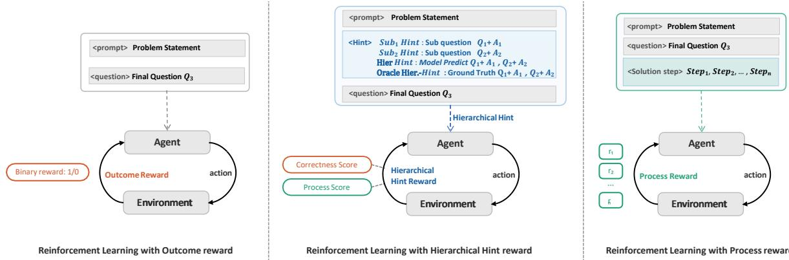
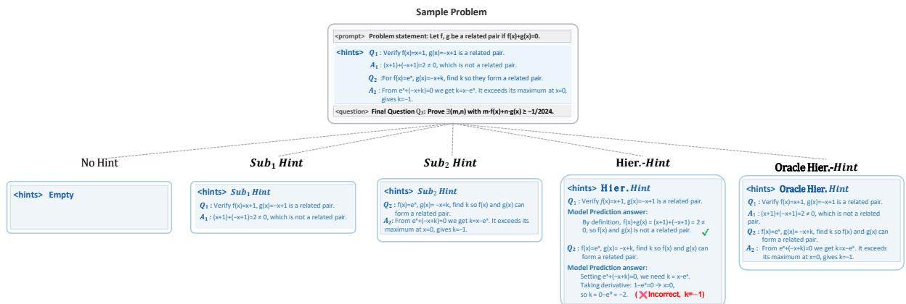
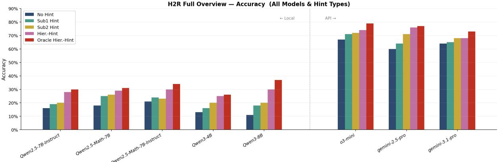
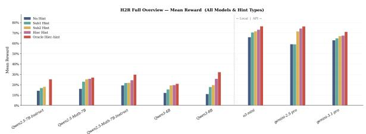
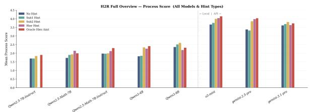
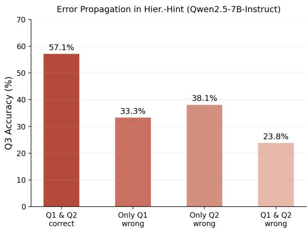
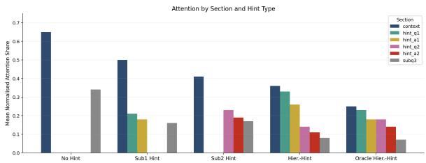
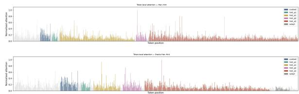

# $\mathbf { H } ^ { 2 } \mathbf { R } \mathbf { i }$ : Hierarchical Hint-Based Reward for Mathematical Reasoning via Reinforcement Learning

He Tu<sup>1,\*</sup>, Siye Li<sup>1,\*</sup>, Hongyi Wen<sup>1</sup>,

<sup>1</sup>New York University Shanghai

Equal contribution.

Emails: ht2604@nyu.edu, sl10962@nyu.edu, hongyi.wen@nyu.edu

## Abstract

Reinforcement Learning with Verifiable Rewards has shown great promise in enhancing mathematical reasoning in large language models. However, existing approaches provide limited intermediate supervision for complex, multi-step reasoning tasks. To bridge this gap, we propose Hierarchical Hint-based Reward, a framework that leverages the intrinsic subquestion structure of mathematical problems as structured intermediate conditioning signals during RLVR training. Unlike chain-of-thought prompting, these hierarchical hints serve as logically grounded intermediate milestones that effectively reduce the reasoning horizon toward the final answer. To validate this framework, we introduce HiMath, a benchmark of hierarchically structured mathematical problems. Across diverse LLMs, hierarchical hints consistently improve reasoning performance even without task-specific training. When integrated into RL training via H<sup>2</sup>R, they boost Qwen2.5-Math-7B accuracy on HiMath from 30.4% to 39.1% using hierarchical hints, and up to 45.6% with Oracle Hierarchical Hints. This pronounced improvement demonstrates that incorporating reliable intermediate checkpoints into reward design is essential for sustaining complex mathematical reasoning.

## 1 Introduction

Large Language Models (LLMs) have demonstrated remarkable potential in complex reasoning tasks, such as mathematical problemsolving (Cobbe et al., 2021; Hendrycks et al., 2021), code generation (Jain et al., 2024; Jimenez et al., 2024), and logical inference (bench authors, 2023). Among these, mathematical reasoning serves as a critical frontier: it requires sustained, multi-step logical trajectories where every intermediate decision critically impacts the final validity. While current models perform well on standard benchmarks, reliably solving hierarchically structured, highlevel mathematical problems remains a significant challenge for existing architectures (Hendrycks et al., 2021; Mirzadeh et al., 2024).

Reinforcement Learning with Verifiable Rewards (RLVR) has become the primary paradigm for bridging this gap. The prevailing approach relies on sparse rewards, where a positive signal is assigned only if the final answer is correct (DeepSeek-AI, 2025; Wen et al., 2025). While scalable, sparse rewards suffer from a fundamental credit assignment problem: a model may receive zero reward for a nearly correct derivation that fails only at the final step, while another model is positively reinforced for reward hacking, arriving at the correct answer through flawed or degenerate reasoning (Skalse et al., 2025). To mitigate this, dense rewards (e.g., Process Reward Models (Lightman et al., 2023; Luo et al., 2024; Zheng et al., 2025)) provide feedback at each step. However, dense rewards face a severe scalability bottleneck: obtaining step-level annotations requires prohibitive human labor or expensive teacher-model synthesis, and PRMs do not consistently generalize across domains (Chen et al., 2025). This creates a structural gap: sparse rewards are too coarse, while dense rewards are too costly, and both largely ignore the hierarchical decomposition encoded in many existing problems.

In this paper, we identify an overlooked structural property of complex mathematics: multi-part sub-question structure naturally serves as a principled resolution to this dilemma. Competitive exams typically decompose a problem into logically ordered sub-questions $( Q _ { 1 } , Q _ { 2 } , Q _ { 3 } )$ , where earlier results serve as prerequisite milestones for later ones. We argue that these sub-questions are hierarchical hints: naturally occurring, verifiable intermediate goals that encode the intended reasoning trajectory without requiring any additional manual step-level labeling. Building on this observation, we propose Hierarchical Hint-based Reward (H<sup>2</sup>R), a reward-shaping framework that integrates sub-question correctness as intermediate reward signals within the GRPO (Shao et al., 2024b) training objective. Importantly, H<sup>2</sup>R operates at the level of reward design, decomposing the long-horizon reasoning trajectory into a sequence of verifiable sub-goals, requiring no step-level annotation or architectural change. Unlike inferencetime decomposition methods, the hierarchical hints are used only during training and are removed entirely at test time; the trained policy therefore receives neither hints nor decomposition prompts at deployment. As illustrated in Figure 1, conditioning the model on a sub-question hint lifts the reward from 0.0 to 0.8 by anchoring its reasoning to a critical intermediate result.

  
Figure 1: Comparison of three reward signal paradigms on the same mathematical reasoning problem. Given an identical model output, ORM assigns a single binary reward based solely on final-answer correctness, providing no signal on intermediate reasoning quality. PRM assigns dense per-step scores requiring costly step-level annotation. H<sup>2</sup>R achieves a middle ground: a hint derived from sub-questions is provided during training to steer the model toward rigorous reasoning, and a judge model evaluates both answer correctness and process quality, yielding a hybrid reward without any step-level annotation.

H<sup>2</sup>R bridges sparse outcome rewards and dense process supervision by leveraging the problem’s logical structure to guide the model toward semantically meaningful intermediate states. This hierarchy provides a natural basis for intermediate supervision, while a lightweight LLM judge further enriches the binary outcome reward with process-level assessment (Zheng et al., 2023; Li et al., 2024). To instantiate and evaluate H<sup>2</sup>R, we introduce HiMath, a curated dataset of hierarchically structured mathematical problems.

Our experiments reveal three main findings: (1) in a purely inference-only setting, hierarchical hints consistently improve accuracy across eight diverse LLMs, confirming that their value is intrinsic to logical structure rather than task-specific fine-tuning; (2) when used as training-time supervision signals in RLVR, hierarchical hints drive consistent accuracy gains over standard GRPO, with all improvements persisting at test time without any hint dependency;(3) H<sup>2</sup>R generalizes consistently to MATH500 and AIME across three model families, outperforming GRPO, DAPO, and SAGE baselines by substantial margins,showing that the gains are not confined to the HiMath training distribution.

Our contributions are as follows:

• We introduce HiMath, a contaminationresistant benchmark of hierarchically structured mathematical problems, each decomposing into three logically chained sub-questions.

• We demonstrate that sub-question-derived hints consistently improve reasoning accuracy across diverse LLMs even without taskspecific training, establishing that their value is intrinsic to logical structure.

• We propose H<sup>2</sup>R, incorporating a hybrid reward design that combines answer correctness with process-level evaluation. Gains persist at test time without any hint dependency.

## 2 Related Work

Reinforcement Learning for LLM Reasoning. Prompt-based approaches such as Chainof-Thought prompting (Wei et al., 2023), Self-Consistency (Wang et al., 2023), and Tree-of-Thought (Yao et al., 2023) leverage prompts to encourage step-by-step reasoning. Building on these foundations, learning-based methods have advanced reasoning through supervised fine-tuning on high-quality reasoning datasets (Yu et al., 2023, 2025a; Yang et al., 2024a).

Recently, RLVR demonstrated that “thinking” behaviors can be induced through verifiable rewards (DeepSeek-AI, 2025; Wang et al., 2025). Methods such as GRPO (Shao et al., 2024a) and PPO (Schulman et al., 2017) have shown that models can self-discover reasoning paths when provided with binary reward signals. Research directions have shifted toward addressing reward hacking (Skalse et al., 2025), extending reasoning to multimodal settings (Zhang et al., 2025), and improving efficiency (Chae et al., 2025; Guo et al., 2025). Our work builds on this RLVR paradigm, addressing the sparsity of outcome-only rewards by introducing structured intermediate conditioning.

Reward Signal Design: Sparse vs. Dense. ORMs and PRMs represent two ends of a fundamental spectrum. ORM supervises reasoning solely based on final-answer correctness (Cobbe et al., 2021). While R1-style models demonstrate that ORM alone can induce self-correction behaviors (DeepSeek-AI, 2025; Hugging Face, 2025), early reasoning errors remain invisible until the end of trajectories (Sutton and Barto, 1998). PRMs address this by providing dense, step-level feedback (Lightman et al., 2023; Khalifa et al., 2025; Yao et al., 2026; Li and Li, 2025), but require costly step-by-step annotations or Monte Carlo estimation (Luo et al., 2024; Wang et al., 2024; Xiong et al., 2025), and do not consistently outperform ORM on strong RL-trained models (Feng et al., 2025). Recent hybrid approaches seek a middle ground (Jia et al., 2025; Setlur et al., 2025; Yu et al., 2025b). $\mathrm { H } ^ { 2 } \mathrm { R }$ is positioned in this spirit: rather than training a full PRM or relying on binary rewards alone, we leverage the intrinsic sub-question hierarchy of complex mathematical problems as verifiable intermediate checkpoints, augmented by an LLM judge for process quality assessment.

## 3 Hierarchical Hint Framework

## 3.1 The HiMath Dataset

We introduce HiMath, a structured, multi-part mathematics dataset specifically engineered to evaluate hierarchical reasoning. Inspired by the formatting of competitive examinations, each problem introduces a novel mathematical concept directly within its problem statement.

Each HiMath problem contains three sequentially dependent sub-questions $( Q _ { 1 } , Q _ { 2 }$ , and $Q _ { 3 } )$ of increasing difficulty. This hierarchy originates from the original problem design, with human reference solutions providing verifiable intermediate supervision for $\mathrm { H } ^ { 2 } \mathrm { R }$ . HiMath comprises 151 problems across functions, sequences, sets, and geometry. Rather than maximizing scale, it serves as a focused testbed for studying hierarchical reasoning. Its novel-concept format encourages reasoning from first principles and reduces reliance on memorization (Wu et al., 2025). Data collection details are provided in Appendix A.

Although HiMath is relatively compact, its scale is intentional: like targeted benchmarks such as BIG-Bench Hard (bench authors, 2023) and AIME (Hendrycks et al., 2021), it emphasizes focused problem selection over sheer volume. Hi-Math further prioritizes structural depth and contamination resistance: its explicit sub-question structure provides natural, reference-anchored intermediate supervision for $\mathrm { H } ^ { 2 } \mathrm { R } .$ , while its novelconcept design reduces reliance on memorization (Wu et al., 2025). Despite being trained on only 105 HiMath problems, the resulting models also improve on the held-out MATH500 and AIME benchmarks (Table 1), indicating that the gains are not confined to the HiMath training distribution.

Difficulty Analysis To demonstrate that HiMath problems present a genuine intellectual challenge rather than tasks solvable via pattern matching or memorization, we evaluate a broad selection of state-of-the-art LLMs on $Q _ { 3 }$ without providing any hint context. The empirical results paint a clear picture: even the most capable closed-source reasoning models fall well short of ceiling performance. Specifically, o3-mini (OpenAI, 2025) achieves only 66.9%, Gemini-3.1-pro (Google, 2025) scores 63.5%, and Gemini-2.5-pro (Comanici et al., 2025) reaches 59.3%. The performance gap widens substantially for open-source models. Qwen2.5-Math-7B-Instruct and Qwen2.5-7B-Instruct (Yang et al., 2024b) both achieve around 20.7%, Qwen2.5- Math-7B drops to 17.9%, and Qwen3-4B reaches only 12.4% (Yang et al., 2025). By comparison, the standard MATH500 pass rates for these identical open-source models regularly exceed 75%.

These findings highlight two properties that make HiMath suitable for evaluating $\mathrm { H } ^ { 2 } \mathrm { R } \mathrm { : }$ its difficulty leaves substantial headroom for intermediate supervision to improve performance, while its novel-concept design reduces reliance on memorization (Wu et al., 2025). Moreover, models trained on the 105 HiMath training problems also improve on held-out MATH500 and AIME benchmarks (Table 1), suggesting that the gains are not confined to the HiMath training distribution.

  
Figure 2: Overview of the $\mathrm { H } ^ { 2 } \mathrm { R }$ framework. Five hint conditions are constructed by varying the <hints> field: No-Hint provides no intermediate context; Sub -Hint and Sub -Hint provide the ground-truth solution to $Q _ { 1 }$ or $Q _ { 2 } ,$ respectively; Hier.-Hint provides model-generated solutions to both sub-questions; and Oracle Hier.-Hint provides both ground-truth solutions as an oracle upper bound. At each iteration, the policy receives a hint-conditioned prompt and $\mathrm { H } ^ { 2 } \mathrm { R }$ reward, and GRPO updates the policy toward high-reward trajectories.

## 3.2 Inference with Hierarchical Hint

We design a hierarchy of five hint conditions, illustrated in Figure 2, to investigate how structured intermediate conditioning affects the model’s ability to solve $Q _ { 3 }$ . These conditions span a spectrum ranging from a complete absence of context, denoted as No-Hint, to full oracle supervision via oracle Hier.-Hint, with three intermediate levels designed to isolate distinct reasoning factors. Specifically, $\mathbf { S u b } _ { 1 }$ -Hint and $\mathrm { \bf S u b _ { 2 } } .$ -Hint provide groundtruth solutions to individual sub-questions, establishing whether foundational or proximal intermediate results are more load-bearing for $Q _ { 3 }$ . Meanwhile, Hier.-Hint supplies solutions generated by a stronger external model for both sub-questions simultaneously, reflecting a realistic deployment scenario that operates without oracle supervision. Comparing the Hier.-Hint against oracle Hier.-Hint reveals whether performance differences stem from genuine reasoning transfer or merely from the quality of the intermediate context provided. By varying hint informativeness in a controlled manner, we directly attribute performance shifts to specific reasoning failure modes.

We evaluate hint effectiveness in an inferenceonly setting. Figure 3 presents results across eight models under five hint conditions. Accuracy gains range from +2.8% to +13.8% for Sub<sub>1</sub>-Hint and +0.7% to +17.4% for Sub<sub>2</sub>-Hint, highlighting the value of the logical structure encoded in hierarchical hints. Full results are in Appendix H. Pairwise bootstrap comparisons across the Qwen model family reveal no statistically significant differences between adjacent model scales (Appendix D.3).

## 3.3 Analysis of Hint Effectiveness

Logical Proximity Drives Hint Effectiveness. Sub<sub>1</sub>-Hint provides early-stage contextual information useful but not immediately actionable for $Q _ { 3 }$ . Sub<sub>2</sub>-Hint occupies a more pivotal position: it establishes the key intermediate constraint that $Q _ { 3 }$ directly builds upon. This structural difference explains why the marginal accuracy gain from Sub<sub>2</sub>- Hint is nearly 50% larger than $\operatorname { S u b } _ { 1 }$ -Hint on average (+8.0% vs. +5.5% across eight models).

The Role of Hier.-Hint. Across all models, Hier.- Hint consistently outperforms both Sub -Hint and Sub<sub>2</sub>-Hint, even though those two conditions provide oracle answers to individual sub-questions. This finding suggests that the performance advantage is primarily driven by the completeness of the intermediate context. Simultaneously providing solutions to both $Q _ { 1 }$ and $Q _ { 2 }$ offers a more comprehensive reasoning scaffold than either alone, and this holds true even when solutions are imperfect.

Hier.-Hint underperforms oracle Hier.-Hint across all models, highlighting the value of accurate intermediate solutions. Errors in $Q _ { 1 }$ or $Q _ { 2 }$ can propagate to $Q _ { 3 }$ (Appendix J).

## 3.4 RL with Hierarchical Hint Reward

The consistent inference-only gains in Figure 3 motivate the use of hierarchical hints as structured signals during RL training. Unlike sparse outcomeonly rewards, hint-conditioned training mitigates the credit assignment problem by providing verifiable intermediate milestones aligned with the problem’s logical structure. We therefore incorporate hints of varying informativeness into the GRPO (Shao et al., 2024a) framework, guiding the policy toward more reliable reasoning trajectories.

  
Figure 3: Inference-only accuracy of eight untrained checkpoints under five hint conditions, with hints given at inference time and no RL training. Hints consistently improve performance across model scales and architectures. Unlike these results, $\mathrm { H ^ { 2 } }$ R-trained policies receive no hints at inference. Differences between adjacent Qwen model scales are not statistically significant (Appendix D.3).

Reward Design. $\mathrm { H ^ { 2 } R }$ employs a two-component reward function that jointly evaluates answer correctness and reasoning quality. For the i-th model response, the reward $s _ { i }$ is computed as:

$$
s _ { i } = { \left\{ \begin{array} { l l } { \alpha + ( 1 - \alpha ) \cdot \operatorname* { m i n } \left( 1 , { \frac { p _ { i } } { \tau } } \right) } & { { \mathrm { i f ~ } } c _ { i } = 1 } \\ { 0 } & { { \mathrm { i f ~ } } c _ { i } = 0 } \end{array} \right. }\tag{1}
$$

where $c _ { i } \in \{ 0 , 1 \}$ denotes final-answer correctness, $p _ { i } \in [ 1 , 5 ]$ is the reasoning process quality score assessed by an LLM judge (Zheng et al., 2023), $\alpha \in ( 0 , 1 )$ is the base reward weight for answer correctness, and $\tau$ is a normalization threshold that maps the discrete process score to a continuous bonus range. We set $\alpha = 0 . 6$ and $\tau = 4$ throughout, yielding a reward in $[ 0 . 6 , 1 . 0 ]$ for correct responses whose process quality ranges from adequate to excellent.

Hard Gate and Reward Hacking Prevention. We enforce a hard gate $s _ { i } = 0$ whenever $c _ { i } = 0$ regardless of reasoning quality. Without gating, a model can receive non-zero reward for plausiblesounding but mathematically invalid reasoning, since the process score $p _ { i }$ evaluates structural fluency rather than absolute logical validity. $\mathrm { { A s } \ : { Q _ { 3 } } }$ is typically stated as an explicit claim to be proved, a model can mimic correct reasoning by copying the conclusion and padding it with invalid steps. A naive hybrid reward would therefore incentivize such pattern matching over genuine mathematical reasoning (Skalse et al., 2025).

Table 2 validates this design. Removing the hard gate degrades performance: Soft Gate $( s _ { i } ~ > ~ 0$ permitted when $c _ { i } = 0 )$ reaches 41.30% (−4.35 pp), while No Gate (pure linear combination) falls to 39.13% (−6.52 pp). Without gating, 34.2% of incorrect responses receive high process scores $\left( p _ { i } ~ \geq ~ 3 \right)$ , creating false training signals that the hard gate eliminates. Both non-gated variants fall in the suboptimal region of the hyperparameter grid (Appendix E.2), supporting the hard gate as a principled component of the reward design.

Note that the inference-only results in Figure 3 differ from those of the trained policy: an untrained Qwen2.5-7B-Instruct checkpoint given oracle hints at inference reaches only about 30%, whereas the $\mathrm { H } ^ { 2 } \mathrm { R }$ -trained policy reaches 41.30% with no hints at evaluation, showing that the improvement is retained in the learned policy.

## 4 Experiments

Evaluation of Proof-Style Questions. Since $Q _ { 3 }$ is typically phrased as a claim to be proved rather than a value to be computed, final-answer correctness $c _ { i }$ is assessed by the LLM judge rather than exact string matching. The judge is instructed to verify whether the submitted proof is logically complete and valid. Each HiMath problem is accompanied by a complete human-written reference solution, which serves as an anchor for the evaluation. The judge assesses whether a submitted proof is consistent with the reference in both its derivation and final conclusion, rather than evaluating it against an open-ended notion of correctness.

<table><tr><td>Model</td><td>Method</td><td>Training Hint</td><td>HiMath (avg@3)</td><td>MATH500 (pass@1)</td><td>AIME24 / 25 (avg@5)</td></tr><tr><td rowspan="7">Llama-3.2-3B-Instruct</td><td>Initial checkpoint</td><td></td><td>11.11</td><td>44.7</td><td>6.5 / 0.6</td></tr><tr><td>GRPO</td><td>No-Hint</td><td>11.67</td><td>54.6</td><td>10.0 / 0.7</td></tr><tr><td>DAPO</td><td>No-Hint</td><td>13.04</td><td>57.0</td><td>6.7 / 0.5</td></tr><tr><td>SFT</td><td>Oracle Hier.-Hint</td><td>13.04</td><td>53.8</td><td>9.5 /—</td></tr><tr><td>SAGE-Light</td><td>Self-Hint</td><td>8.69</td><td>54.1†</td><td>8.8 / 0.9</td></tr><tr><td>SAGE</td><td>Self-Hint</td><td>13.04</td><td>56.3†</td><td>9.2 / 0.8</td></tr><tr><td>H²R H²R</td><td>Hier.-Hint</td><td>19.57</td><td>59.5</td><td>12.1 / 1.2</td></tr><tr><td rowspan="7">Qwen2.5-7B-Instruct</td><td></td><td>Oracle Hier.-Hint</td><td>21.73</td><td>61.2</td><td>13.3 /1.7</td></tr><tr><td>Initial checkpoint GRPO</td><td>No-Hint</td><td>15.86 19.57</td><td>75.7 77.8</td><td>13.8 / 6.7 15.0 / 10.67</td></tr><tr><td>DAPO</td><td>No-Hint</td><td>21.74</td><td>82.0</td><td>16.31 / 12.00</td></tr><tr><td>SFT</td><td>Oracle Hier.-Hint</td><td>32.61</td><td>77.1</td><td>14.8 /—</td></tr><tr><td>SAGE-Light</td><td>Self-Hint</td><td>19.56</td><td>79.9†</td><td>17.1 / 11.7</td></tr><tr><td>SAGE</td><td>Self-Hint</td><td>23.91</td><td>80.0†</td><td>16.0 / 12.5</td></tr><tr><td>H²R</td><td>Hier.-Hint</td><td>34.78</td><td>84.5</td><td>22.00 / 15.33</td></tr><tr><td rowspan="8">Qwen3-4B-Instruct</td><td>H²R</td><td>Oracle Hier.-Hint</td><td>41.30</td><td>84.8</td><td>23.90 / 17.30</td></tr><tr><td>Initial checkpoint</td><td></td><td>25.16</td><td>90.6</td><td></td></tr><tr><td>GRPO</td><td>No-Hint</td><td>32.88</td><td>96.0</td><td>22.1 / 13.40 24.20 / 14.40</td></tr><tr><td>DAPO</td><td>No-Hint</td><td>34.28</td><td>93.4</td><td>29.33 / 12.00</td></tr><tr><td>SFT</td><td>Oracle Hier.-Hint</td><td>39.13</td><td>95.6</td><td>23.8 /—</td></tr><tr><td>SAGE-Light</td><td>Self-Hint</td><td>26.08</td><td>95.1†</td><td>27.6 / 14.7</td></tr><tr><td>SAGE</td><td>Self-Hint</td><td>28.26</td><td>95.4†</td><td>25.1 / 14.9</td></tr><tr><td>H²R</td><td>Hier.-Hint</td><td>47.82</td><td>97.06</td><td></td></tr><tr><td>H²R</td><td></td><td>Oracle Hier.-Hint</td><td>52.17</td><td>97.6</td><td>34.30 / 17.33 36.00 / 18.87</td></tr></table>

Table 1: Performance on HiMath and public benchmarks across three model families, where all models are evaluated without hints at test time. GRPO, DAPO, and SFT are controlled baselines trained on the same 105 HiMath problems, while SAGE and SAGE-Light are included as external reference points trained under a different data regime. The MATH500 results marked with <sup>†</sup> are sourced from Liao et al. (2026), while all other results come from our own evaluation. For the hint conditions, Hier.-Hint uses hints generated by o3-mini, whereas Oracle Hier.-Hint relies on expert-annotated ground-truth solutions to establish an upper bound only. The metrics are reported as the mean accuracy over three independent training seeds for HiMath avg@3, a single greedy decoding for MATH500 pass@1, and the mean over five samples at temperature 0.7 for AIME avg@5.

<table><tr><td>Gate</td><td>Acc.</td><td>Avg.P</td><td>Incorr.  $p _ { i } 2 3 \left( \% \right)$ </td><td>Grad.</td></tr><tr><td>No Gate</td><td>39.13</td><td>3.21</td><td>34.2</td><td>None</td></tr><tr><td>Soft Gate</td><td>41.30</td><td>3.45</td><td>18.7</td><td>Partial</td></tr><tr><td>Hard Gate</td><td>45.65</td><td>3.89</td><td>0.0</td><td>Full</td></tr></table>

Table 2: Gate design ablation on Qwen2.5-Math-7B with Oracle Hier.-Hint. “Incorr. $p _ { i } \geq 3 ^ { \circ }$ measures the fraction of incorrect responses receiving a high process score and directly captures the reward-hacking rate. The hard gate eliminates this false training signal while achieving the highest accuracy.

To assess evaluator sensitivity, we additionally evaluated the same responses with GPT-4o and DeepSeek-R1 as independent judges. Although the judges differ slightly in absolute accuracy, they preserve the same ordering across No-Hint, Hier.- Hint, and Oracle Hier.-Hint, supporting the robustness of the observed treatment effect. We further conducted a blinded human audit on a subset of the evaluated responses, including additional cases where the automated judges disagreed. Detailed cross-judge and human-validation results are reported in Appendix F.

## 4.1 Models and Training Configuration

We evaluate H<sup>2</sup>R on HiMath using Qwen2.5-Math-7B and Qwen2.5-7B-Instruct for the hint-condition ablation. For out-of-domain generalization experiments, we follow the model selection of Liao et al. (2026) and use: Llama-3.2-3B-Instruct (Meta AI, 2024), Qwen2.5-7B-Instruct (Yang et al., 2024a), and Qwen3-4B-Instruct (Yang et al., 2025), representing low, moderate, and high levels of mathfocused optimization. All models are trained with GRPO (Shao et al., 2024a) within the verl (Sheng et al., 2024) framework. Detailed hyperparameters are provided in Appendix B.

## 4.2 Main Results

Full hint condition ablation results including $\operatorname { A v g }$ Reward and Avg. Process Score are reported in Appendix D.4. In summary, accuracy increases monotonically from No-Hint to Oracle Hier.-Hint for both models (Table 5), confirming that structured intermediate conditioning during RL effectively guides the model toward better reasoning paths without any hint dependency at test time.

The primary practical result is Hier.-Hint: for Qwen2.5-Math-7B, Hier.-Hint achieves 39.13% accuracy (+8.70 pp over baseline), using only LLMgenerated intermediate solutions with no oracle supervision. Oracle Hier.-Hint, which requires expert-annotated sub-question solutions, serves as an oracle upper bound at 45.65% (+15.22 pp), establishing the performance ceiling available when intermediate supervision is perfect. Qwen2.5-7B-Instruct shows a similar pattern, improving from 19.57% to 34.78% under Hier.-Hint and 41.30% under Oracle Hier.-Hint. Across model families, training seeds, and benchmarks, $\mathrm { H } ^ { 2 } \mathrm { R }$ consistently improves performance over No-Hint training.

To assess the statistical reliability of these gains, we conducted paired cluster bootstrap resampling over the 46 test problems with 10,000 replicates. Compared with No-Hint, Hier.-Hint improves accuracy by 15.22 percentage points (95% CI: [4.3, 26.1], $p = 0 . 0 0 6 )$ , while Oracle Hier.-Hint improves accuracy by 21.74 percentage points (95% CI: [9.4, 33.4], $p < 0 . 0 0 1 )$ , confirming that both gains are statistically significant.

Table 1 evaluates three model families on public benchmarks. $\mathrm { H ^ { 2 } R }$ consistently outperforms the controlled GRPO, DAPO, and SFT baselines under the same evaluation setting. We also compare $\mathrm { H } ^ { 2 } \mathrm { R }$ with SAGE (Liao et al., 2026), which uses approximately 220K training problems, compared with just 105 HiMath problems for $\mathrm { H } ^ { 2 } \mathrm { R }$ . On Hi-Math, $\mathrm { H } ^ { 2 } \mathrm { R }$ (Hier.-Hint) surpasses SAGE by 6.53, 10.87, and 19.56 percentage points across the three models, without oracle supervision during training. Additional comparisons with Random-Hint and Unordered-Hint isolate the contribution of hierarchical reward design under the same HiMath training setting.

Compared with SFT trained on the same 105 Hi-Math problems using oracle hints, $\mathrm { H } ^ { 2 } \mathrm { R }$ performs better across all evaluated models and benchmarks, despite using generated hints in its practical setting. Its stronger gains on held-out benchmarks suggest that reward-based training better transfers the benefits of hierarchical supervision beyond HiMath.

## 4.3 Random-Hint and Unordered-Hint Ablations

To distinguish the effect of meaningful hierarchical structure from the effect of additional supervision or context, we introduce two training-time controls. Random-Hint pairs each problem with another problem’s gold hints, preserving the hint format, labels, and supervision volume while removing semantic relevance. Unordered-Hint uses the problem’s own gold hints but reverses their order and replaces hierarchical labels with a generic marker, preserving the hint content while removing its hierarchical organization. All hints are used only during training and are removed at inference.

The results form an ablation ladder. Across all nine settings, Random-Hint provides no consistent improvement over the No-Hint baseline, differing by at most one problem in HiMath and 0.4 points in MATH500. Since Random-Hint preserves the same reward function, gate, and supervision volume as Hier.-Hint, its lack of improvement indicates that the gains do not arise from additional training signal or hint format. Unordered-Hint consistently falls between Random-Hint and Hier.-Hint, recovering roughly half of the gain. Because it preserves the original hint content while removing its ordering and hierarchical labels, the gap between Unordered-Hint and Hier.-Hint isolates the contribution of hierarchical organization, while the gap between Random-Hint and Unordered-Hint reflects the importance of semantic relevance. The same ordering is observed on the held-out MATH500 and AIME24 benchmarks, indicating that the benefit is not limited to the HiMath training distribution.

## 4.4 Empirical Validation of the Hybrid Reward Design

We do not include a direct baseline with a standard process reward model (PRM) because its conventional construction is not directly applicable to HiMath’s proof-style questions. In particular, HiMath $Q _ { 3 }$ problems do not provide a canonical answer string from which intermediate proof states can be automatically labeled, so adapting a PRM would require additional judge-based annotation of intermediate steps and a substantially different supervision pipeline. A detailed analysis of this constructability issue and the associated annotation cost is provided in Appendix E.4.

<table><tr><td>Model</td><td>Benchmark</td><td>No-Hint</td><td>Random</td><td>Unordered</td><td>Hier.</td></tr><tr><td rowspan="3">Llama-3.2-3B-Instruct</td><td>HiMath</td><td>11.67</td><td>10.87</td><td>15.22</td><td>19.57</td></tr><tr><td>MATH500</td><td>54.6</td><td>54.8</td><td>57.4</td><td>59.5</td></tr><tr><td>AIME24</td><td>10.0</td><td>10.1</td><td>11.0</td><td>12.1</td></tr><tr><td rowspan="3">Qwen2.5-7B-Instruct</td><td>HiMath</td><td>19.57</td><td>21.74</td><td>26.09</td><td>34.78</td></tr><tr><td>MATH500</td><td>77.8</td><td>78.2</td><td>80.8</td><td>84.5</td></tr><tr><td>AIME24</td><td>15.0</td><td>15.3</td><td>17.7</td><td>22.0</td></tr><tr><td rowspan="3">Qwen3-4B-Instruct</td><td>HiMath</td><td>32.88</td><td>32.61</td><td>41.30</td><td>47.82</td></tr><tr><td>MATH500</td><td>96.0</td><td>96.1</td><td>96.4</td><td>97.1</td></tr><tr><td>AIME24</td><td>24.20</td><td>24.50</td><td>27.6</td><td>34.30</td></tr></table>

Table 3: Ablation of hint relevance and hierarchical organization across three model families and three benchmarks. Hints are used only during training and removed at inference.

The concurrent trajectory of Avg. Process Score in Table 5 demonstrates that our reward function successfully steers optimization without triggering reward hacking. For Qwen2.5-Math-7B, the average process score climbs from 2.81 under No-Hint to 3.89 under Oracle Hier.-Hint. This growth confirms that $\mathrm { H } ^ { 2 } \mathrm { R }$ penalizes superficial patternmatching and incentivizes rigorous, verifiable intermediate milestones. The gate design ablation in Appendix E.2 validates this choice.

## 5 Discussion

Intermediate-state Reliability. The Hier.-Hint condition mirrors how human students solve multi-step problems by conditioning on their selfgenerated intermediate results, thereby exposing realistic failure modes such as error propagation and limited self-correction. Our error-propagation analysis (Appendix J) suggests that the primary bottleneck is not the model’s ability to use intermediate context once provided, but its ability to generate reliable intermediate states in the first place. This finding motivates hint generation itself as a trainable objective and moves $\mathrm { H ^ { 2 } R }$ toward a fully self-supervised framework.

Generalization to Policy Optimization. More broadly, $\mathrm { H } ^ { 2 } \mathrm { R }$ requires only that problems decompose into verifiable sub-goals, a structure that arises naturally across STEM domains such as physics derivations, proof-based geometry, and multi-step programming. We conjecture that expert-encoded problem hierarchies could provide intermediate training signals in these settings, though validation beyond mathematics remains future work. This work focuses on reward formulation rather than optimization: by fixing the GRPO framework, we isolate reward structure as the independent variable and attribute improvements to hierarchical hintbased reward design. Developing algorithms tailored to multi-stage reasoning, such as curriculum scheduling over hint conditions or hint-aware policy optimization, remains an important direction.

## 6 Conclusion

We presented $\mathrm { H } ^ { 2 } \mathrm { R } .$ , a reward-shaping framework that uses hierarchical sub-question structures to provide intermediate supervision for LLM reasoning. By combining final-answer correctness with LLM-judged process quality, $\mathrm { H } ^ { 2 } \mathrm { R }$ yields a practical hybrid reward signal that can improve reasoning without requiring oracle supervision at test time. Through Hier.-Hint training, we show consistent gains across three model families, three random seeds, and three benchmarks. Our analysis further suggests that the key bottleneck in multi-step reasoning is not whether models can use intermediate context when it is available, but whether they can generate reliable intermediate states in the first place. Poor intermediate hints induce error propagation and substantially limit downstream performance. To support future work on this problem, we introduce HiMath, a benchmark with explicit sub-question hierarchies. Together, $\mathrm { H } ^ { 2 } \mathrm { R }$ and Hi-Math provide a foundation for studying more finegrained process rewards and training algorithms tailored to robust multi-stage reasoning.

## Limitations

Dataset Scale. HiMath prioritizes reasoning depth and contamination resistance over scale: each problem introduces a novel mathematical concept and chains three logically dependent subquestions, ensuring substantial structural richness per example. $\mathrm { H ^ { 2 } R }$ trained on HiMath improves performance on the held-out MATH500 and AIME24 benchmarks, indicating that the observed gains are not confined to the HiMath training distribution.

However, these results do not establish broad or general reasoning ability, and evaluation on a wider range of tasks and datasets is needed to assess the scope of the learned behavior. Broader empirical coverage across more diverse problem types therefore remains an important direction for future work.

Automated Evaluation. Our evaluation relies on automated grading, combining final-answer matching with LLM-as-judge assessment of reasoning quality. To assess evaluator robustness, we evaluated the same responses with o3-mini, GPT-4o, and DeepSeek-R1. Although the judges differ slightly in absolute accuracy, they preserve the same ordering across No-Hint, Hier.-Hint, and Oracle Hier.- Hint, with the corresponding treatment effects remaining statistically significant. We further conducted a blinded human audit of 25 responses, including 20 randomly sampled responses and 5 cases selected from judge disagreements. The two authors jointly judged 19 of the 20 randomly sampled responses as correct or incorrect in agreement with the automated evaluation, while 23 of the 25 responses were consistent in the pooled audit. Nevertheless, automated evaluation may not capture all nuances of mathematical reasoning, and broader human validation would provide an additional quality check.

PRM Baseline. We do not include a direct process reward model (PRM) baseline because conventional PRM construction is not directly applicable to HiMath’s proof-style questions. In particular, HiMath Q3 problems do not provide a canonical answer string from which intermediate proof states can be automatically labeled. Adapting an existing PRM pipeline would therefore require additional judge-based annotation of intermediate proof steps and a substantially different supervision pipeline. This constructability issue, together with the associated annotation and computational cost, makes a faithful in-domain PRM comparison beyond the scope of the current study. Developing proof-oriented PRMs for this setting remains an important direction for future work.

## Ethics Statement

While our work enhances the hierarchical reasoning capabilities of LLMs in complex mathematics, we recognize that such advancements are dual-use. We are committed to responsible development of

AI. All pre-trained models used in this work are publicly available under open-source licenses. Our code and the HiMath dataset will be released for academic use upon paper acceptance.

## References

BIG bench authors. 2023. Beyond the imitation game: Quantifying and extrapolating the capabilities of language models. Transactions on Machine Learning Research.

Justin Yang Chae, Md Tanvirul Alam, and Nidhi Rastogi. 2025. Towards understanding self-play for llm reasoning. Preprint, arXiv:2510.27072.

Zhengyu Chen, Yudong Wang, Teng Xiao, Ruochen Zhou, Xuesheng Yang, Wei Wang, Zhifang Sui, and Jingang Wang. 2025. From mathematical reasoning to code: Generalization of process reward models in test-time scaling. Preprint, arXiv:2506.00027.

Karl Cobbe, Vineet Kosaraju, Mohammad Bavarian, Mark Chen, Heewoo Jun, Lukasz Kaiser, Matthias Plappert, Jerry Tworek, Jacob Hilton, Reiichiro Nakano, Christopher Hesse, and John Schulman. 2021. Training verifiers to solve math word problems. arXiv preprint arXiv:2110.14168.

Gheorghe Comanici, Eric Bieber, Mike Schaekermann, Ice Pasupat, Noveen Sachdeva, Inderjit Dhillon, Marcel Blistein, Ori Ram, Dan Zhang, Evan Rosen, and 1 others. 2025. Gemini 2.5: Pushing the frontier with advanced reasoning, multimodality, long context, and next generation agentic capabilities. arXiv preprint arXiv:2507.06261.

DeepSeek-AI. 2025. Deepseek-r1: Incentivizing reasoning capability in llms via reinforcement learning. Preprint, arXiv:2501.12948.

Zhangying Feng, Qianglong Chen, Ning Lu, Yongqian Li, Siqi Cheng, Shuangmu Peng, Duyu Tang, Shengcai Liu, and Zhirui Zhang. 2025. Is prm necessary? problem-solving rl implicitly induces prm capability in llms. Preprint, arXiv:2505.11227.

Google. 2025. Gemini 3.1 pro preview. https://ai.g oogle.dev/gemini-api/docs/models.

Yongxin Guo, Wenbo Deng, Zhenglin Cheng, and Xiaoying Tang. 2025. G<sup>2</sup>rpo-a: Guided group relative policy optimization with adaptive guidance. arXiv preprint arXiv:2508.13023.

Dan Hendrycks, Collin Burns, Saurav Kadavath, Akul Arora, Steven Basart, Eric Tang, Dawn Song, and Jacob Steinhardt. 2021. Measuring mathematical problem solving with the math dataset. NeurIPS.

Hugging Face. 2025. Open r1: A fully open reproduction of deepseek-r1.

Naman Jain, King Han, Alex Gu, Wen-Ding Li, Fanjia Yan, Tianjun Zhang, Sida Wang, Armando Solar-Lezama, Koushik Sen, and Ion Stoica. 2024. Livecodebench: Holistic and contamination free evaluation of large language models for code. arXiv preprint arXiv:2403.07974.

Zeyu Jia, Alexander Rakhlin, and Tengyang Xie. 2025. Do we need to verify step by step? rethinking process supervision from a theoretical perspective. Preprint, arXiv:2502.10581.

Carlos E Jimenez, John Yang, Alexander Wettig, Shunyu Yao, Kexin Pei, Ofir Press, and Karthik R Narasimhan. 2024. SWE-bench: Can language models resolve real-world github issues? In The Twelfth International Conference on Learning Representations.

Muhammad Khalifa, Rishabh Agarwal, Lajanugen Logeswaran, Jaekyeom Kim, Hao Peng, Moontae Lee, Honglak Lee, and Lu Wang. 2025. Process reward models that think. Preprint, arXiv:2504.16828.

Haitao Li, Qian Dong, Junjie Chen, Huixue Su, Yujia Zhou, Qingyao Ai, Ziyi Ye, and Yiqun Liu. 2024. Llms-as-judges: A comprehensive survey on llm-based evaluation methods. Preprint, arXiv:2412.05579.

Wendi Li and Yixuan Li. 2025. Process reward model with q-value rankings. Preprint, arXiv:2410.11287.

Baohao Liao, Hanze Dong, Xinxing Xu, Christof Monz, and Jiang Bian. 2026. Self-hinting language models enhance reinforcement learning. Preprint, arXiv:2602.03143.

Hunter Lightman, Vineet Kosaraju, Yura Burda, Harri Edwards, Bowen Baker, Teddy Lee, Jan Leike, John Schulman, Ilya Sutskever, and Karl Cobbe. 2023. Let’s verify step by step. arXiv preprint arXiv:2305.20050.

Liangchen Luo, Yinxiao Liu, Rosanne Liu, Samrat Phatale, Meiqi Guo, Harsh Lara, Yunxuan Li, Lei Shu, Yun Zhu, Lei Meng, Jiao Sun, and Abhinav Rastogi. 2024. Improve mathematical reasoning in language models by automated process supervision. Preprint, arXiv:2406.06592.

Meta AI. 2024. Introducing Meta Llama 3: The most capable openly available LLM to date. Meta AI Blog.

Iman Mirzadeh, Keivan Alizadeh, Hooman Shahrokhi, Oncel Tuzel, Samy Bengio, and Mehrdad Farajtabar. 2024. Gsm-symbolic: Understanding the limitations of mathematical reasoning in large language models.

OpenAI. 2025. Openai o3 and o4-mini system card. Technical report, OpenAI.

John Schulman, Filip Wolski, Prafulla Dhariwal, Alec Radford, and Oleg Klimov. 2017. Proximal policy optimization algorithms. Preprint, arXiv:1707.06347.

Amrith Setlur, Chirag Nagpal, Adam Fisch, Xinyang Geng, Jacob Eisenstein, Rishabh Agarwal, Alekh Agarwal, Jonathan Berant, and Aviral Kumar. 2025. Rewarding progress: Scaling automated process verifiers for LLM reasoning. In The Thirteenth International Conference on Learning Representations.

Zhihong Shao, Peiyi Wang, Qihao Zhu, Runxin Xu, Junxiao Song, Xiao Bi, Haowei Zhang, Mingchuan Zhang, Y. K. Li, Y. Wu, and Daya Guo. 2024a. Deepseekmath: Pushing the limits of mathematical reasoning in open language models. Preprint, arXiv:2402.03300.

Zhihong Shao, Peiyi Wang, Qihao Zhu, Runxin Xu, Junxiao Song, Mingchuan Zhang, Y.K. Li, Y. Wu, and Daya Guo. 2024b. Deepseekmath: Pushing the limits of mathematical reasoning in open language models.

Guangming Sheng, Chi Zhang, Zilingfeng Ye, Xibin Wu, Wang Zhang, Ru Zhang, Yanghua Peng, Haibin Lin, and Chuan Wu. 2024. Hybridflow: A flexible and efficient rlhf framework. arXiv preprint arXiv:2409.19256.

Joar Skalse, Nikolaus H. R. Howe, Dmitrii Krasheninnikov, and David Krueger. 2025. Defining and characterizing reward hacking. Preprint, arXiv:2209.13085.

Richard S. Sutton and Andrew G. Barto. 1998. Reinforcement learning: An introduction. IEEE Trans. Neural Networks, 9:1054–1054.

Peiyi Wang, Lei Li, Zhihong Shao, R. X. Xu, Damai Dai, Yifei Li, Deli Chen, Y. Wu, and Zhifang Sui. 2024. Math-shepherd: Verify and reinforce llms step-by-step without human annotations. Preprint, arXiv:2312.08935.

Xuezhi Wang, Jason Wei, Dale Schuurmans, Quoc Le, Ed Chi, Sharan Narang, Aakanksha Chowdhery, and Denny Zhou. 2023. Self-consistency improves chain of thought reasoning in language models. Preprint, arXiv:2203.11171.

Yiping Wang, Qing Yang, Zhiyuan Zeng, Liliang Ren, Lucas Liu, Baolin Peng, Hao Cheng, Xuehai He, Kuan Wang, Jianfeng Gao, Weizhu Chen, Shuohang Wang, Simon Shaolei Du, and Yelong Shen. 2025. Reinforcement learning for reasoning in large language models with one training example. arXiv preprint arXiv:2504.20571.

Jason Wei, Xuezhi Wang, Dale Schuurmans, Maarten Bosma, Brian Ichter, Fei Xia, Ed Chi, Quoc Le, and Denny Zhou. 2023. Chain-of-thought prompting elicits reasoning in large language models. Preprint, arXiv:2201.11903.

Xumeng Wen, Zihan Liu, Shun Zheng, Shengyu Ye, Zhirong Wu, Yang Wang, Zhijian Xu, Xiao Liang, Junjie Li, Ziming Miao, Jiang Bian, and Mao Yang. 2025. Reinforcement learning with verifiable rewards implicitly incentivizes correct reasoning in base llms. Preprint, arXiv:2506.14245.

Mingqi Wu, Zhihao Zhang, Qiaole Dong, Zhiheng Xi, Jun Zhao, Senjie Jin, Xiaoran Fan, Yuhao Zhou, Huijie Lv, Ming Zhang, Yanwei Fu, Qin Liu, Songyang Zhang, and Qi Zhang. 2025. Reasoning or memorization? unreliable results of reinforcement learning due to data contamination. Preprint, arXiv:2507.10532.

Wei Xiong, Jiarui Yao, Yuhui Xu, Bo Pang, Lei Wang, Doyen Sahoo, Junnan Li, Nan Jiang, Tong Zhang, Caiming Xiong, and Hanze Dong. 2025. A minimalist approach to llm reasoning: from rejection sampling to reinforce. Preprint, arXiv:2504.11343.

An Yang, Anfeng Li, Baosong Yang, Beichen Zhang, Binyuan Hui, Bo Zheng, Bowen Yu, Chang Gao, Chengen Huang, Chenxu Lv, Chujie Zheng, Dayiheng Liu, Fan Zhou, Fei Huang, Feng Hu, Hao Ge, Haoran Wei, Huan Lin, Jialong Tang, and 41 others. 2025. Qwen3 technical report. Preprint, arXiv:2505.09388.

An Yang, Baosong Yang, Binyuan Hui, Bo Zheng, Bowen Yu, Chang Zhou, Chengpeng Li, Chengyuan Li, Dayiheng Liu, Fei Huang, and 1 others. 2024a. Qwen2 technical report. arXiv preprint arXiv:2407.10671.

An Yang, Baosong Yang, Beichen Zhang, and 1 others. 2024b. Qwen2.5 technical report. arXiv preprint arXiv:2412.15115.

Jiarui Yao, Ruida Wang, and Tong Zhang. 2026. Prl: Process reward learning improves llms’ reasoning ability and broadens the reasoning boundary. Preprint, arXiv:2601.10201.

Shunyu Yao, Dian Yu, Jeffrey Zhao, Izhak Shafran, Thomas L. Griffiths, Yuan Cao, and Karthik Narasimhan. 2023. Tree of Thoughts: Deliberate problem solving with large language models. Preprint, arXiv:2305.10601.

Bin Yu, Hang Yuan, Haotian Li, Xueyin Xu, Yuliang Wei, Bailing Wang, Weizhen Qi, and Kai Chen. 2025a. Long-short chain-of-thought mixture supervised fine-tuning eliciting efficient reasoning in large language models. Preprint, arXiv:2505.03469.

Fei Yu, Anningzhe Gao, and Benyou Wang. 2023. Outcome-supervised verifiers for planning in mathematical reasoning. Preprint, arXiv:2311.09724.

Zhuohao Yu, Weizheng Gu, Yidong Wang, Xingru Jiang, Zhengran Zeng, Jindong Wang, Wei Ye, and Shikun Zhang. 2025b. Reasoning through execution: Unifying process and outcome rewards for code generation. In Forty-second International Conference on Machine Learning.

Jingyi Zhang, Jiaxing Huang, Huanjin Yao, Shunyu Liu, Xikun Zhang, Shijian Lu, and Dacheng Tao. 2025. R1-vl: Learning to reason with multimodal large language models via step-wise group relative policy optimization. arXiv preprint arXiv:2503.12937.

Congming Zheng, Jiachen Zhu, Zhuoying Ou, Yuxiang Chen, Kangning Zhang, Rong Shan, Zeyu Zheng, Mengyue Yang, Jianghao Lin, Yong Yu, and Weinan Zhang. 2025. A survey of process reward models: From outcome signals to process supervisions for large language models. Preprint, arXiv:2510.08049.

Lianmin Zheng, Wei-Lin Chiang, Ying Sheng, Siyuan Zhuang, Zhanghao Wu, Yonghao Zhuang, Zi Lin, Zhuohan Li, Dacheng Li, Eric P. Xing, Hao Zhang, Joseph E. Gonzalez, and Ion Stoica. 2023. Judging llm-as-a-judge with mt-bench and chatbot arena. Preprint, arXiv:2306.05685.

## A HiMath Dataset

The New Definition Question. HiMath is built around New Definition questions, a problem format originating from competition mathematics. Such questions introduce a novel mathematical concept within the exam itself, requiring models to reason from first principles rather than recall a memorized procedure. Their primary purpose is to assess mathematical abstraction, logical reasoning, and exploratory problem-solving, making them wellsuited for probing the reasoning limits of LLMs.

A typical problem consists of a formal definition followed by three subquestions of increasing difficulty. Earlier subquestions establish results logically prerequisite to solving the final one, instantiating the hierarchical hint structure central to H<sup>2</sup>R.

Design Principles. HiMath is constructed according to four principles:

• Difficulty and Reasoning Depth. New Definition questions require multi-step inference across overlapping domains, providing deeper insight than standard benchmarks.

• Novelty and Contamination Resistance. Each problem introduces a previously unseen concept, requiring models to reason from first principles rather than recall memorized patterns.

• Hierarchical Sub-question Structure. The three-part design progresses from simple to complex, with earlier sub-questions establishing foundational results essential to the final one.

• Annotation Quality and Diversity. Each problem includes an official ground-truth solution with detailed annotations. The dataset spans functions, sequences, sets, and geometry.

Data Collection. We collect New Definition questions from public official examination repositories and established educational websites. PDF materials were converted to LAT X using Mathpixbased OCR followed by manual verification.

```latex
Example New Definition Question
Example: New Definition Question from
HiMath
Problem Statement.
Let $A = \{ 1 , 2 , 3 , 4 , 5 , 6 , 7 , 8 \}$ and define
$M \ = \ \{ ( x , y ) \mid x \in A , y \in A \}$ . Se
lect n points from M to form a sequence
$( x _ { 1 } , y _ { 1 } ) , ( x _ { 2 } , y _ { 2 } ) , \ldots , ( x _ { n } , y _ { n } )$ . Two con
secutive points must satisfy either $| x _ { i + 1 } -$
$x _ { i } | = 3 , | y _ { i + 1 } - y _ { i } | = 4 \mathrm { o r } | x _ { i + 1 } - x _ { i } | =$
4, $| y _ { i + 1 } - y _ { i } | = 3 .$ Such a sequence is
called a k-sequence.
1. If the first term is (3, 3), determine the
second term.
2. Determine whether (3, 2) and (4, 4)
can both appear in a k-sequence τ
where odd-indexed terms have $x _ { i } \in$
$\{ 1 , 2 , 7 , 8 \}$ and even-indexed terms
have $x _ { i } \in \{ 3 , 4 , 5 , 6 \}$
3. Prove that it is impossible for all ele
ments in M to form a k-sequence.
```

## B Experimental Setting

We split the 151 problems into training and test sets at an approximately 7:3 ratio, yielding 105 training problems and a held-out test set of 46 problems. The split is performed at the problem level to ensure no cross-split contamination: all three subquestions of a given problem are assigned exclusively to one split. All hint conditions are evaluated on this identical test set throughout all experiments.

Following the experimental design of Liao et al. (2026), we select backbone LLMs spanning varying degrees of mathematical specialization. Llama-3.2-3B-Instruct (Meta AI, 2024) represents a low level of math-focused optimization, while Qwen2.5-7B-Instruct (Yang et al., 2024a) offers moderate general and mathematical reasoning capabilities and is also used for our detailed hint-condition ablation studies. Qwen2.5-Math-7B is a math-specialized model used for ablation extensions to verify domainspecific persistence. Qwen3-4B-Instruct-2507 (Qwen/Qwen3-4B-Instruct-2507) (Yang et al., 2025) represents a high level of mathematical proficiency, having been extensively aligned via reinforcement learning. We use the updated Qwen3- 4B-Instruct-2507 checkpoint rather than the original Qwen3-4B checkpoint; throughout the paper, we refer to this model as Qwen3-4B-Instruct for brevity.All models are optimized using the Group Relative Policy Optimization (GRPO) algorithm (Shao et al., 2024a) implemented within the verl framework (Sheng et al., 2024), with o3-mini serving as the primary judge for our hybrid reward function. We apply a maximum response length of 2,048 tokens; responses exceeding this limit are filtered out. This cutoff affects only a negligible fraction of generations, is uniformly distributed across all hint conditions, and introduces no systematic bias. For optimization, we follow standard GRPO practices with a group size of G = 2, a clip epsilon of 0.2, and a learning rate of $1 \times 1 0 ^ { - 6 }$ with an AdamW optimizer under cosine learning rate scheduling. Each training run takes approximately 3–4 hours of wall-clock time on 4 NVIDIA H100 GPUs; the cumulative computational cost across all models, hint conditions, and 3 independent random seeds amounts to approximately 600 GPU hours. Full implementation scripts, dataset splits, and reproducibility instructions will be publicly released via GitHub upon acceptance.

## C Training and Judge Prompt Templates

## Training Prompt Template

<|im\_start|>system   
You are a helpful and rigorous mathematics   
assistant. Reason step by step. Clearly,→   
state the final answer using \boxed{},→   
inside <answer> </answer> tags.,→   
<|im\_end|>   
<|im\_start|>user   
<prompt>{problem}</prompt>   
<hints>{hint\_block}</hints>   
<question>{subquestion3}</question>   
<|im\_end|>   
<|im\_start|>assistant   
<think>

## Judge Prompt Template

Evaluate along TWO dimensions:   
1. correctness: 0 or 1   
2. process\_score: 1-5   
Rule: If correctness=0, process\_score <= 3.   
Return ONLY JSON:   
{"correctness": 0|1,   
"process\_score": int,   
"comment": "..."}

## D Main Experimental Results and Statistical Analysis

## D.1 Statistical Significance.

We assess the statistical significance of the accuracy gains using paired cluster bootstrap resampling over the 46 test problems. Each bootstrap replicate samples test problems with replacement and retains all model predictions associated with each sampled problem, preserving the pairing between the compared conditions. We use 10,000 bootstrap replicates to estimate the distribution of the accuracy difference between each hint condition and No-Hint. For Hier.-Hint, the estimated improvement is 15.22 percentage points with a 95% confidence interval of [4.3, 26.1] percentage points $( p = 0 . 0 0 6 )$ . For Oracle Hier.-Hint, the estimated improvement is 21.74 percentage points with a 95% confidence interval of [9.4, 33.4] percentage points $( p < 0 . 0 0 1 )$

## D.2 Per-Seed Results

Table 4 reports per-seed accuracy on the HiMath test set (46 problems) for all hint conditions.

<table><tr><td>Model</td><td>Cond.</td><td>S1</td><td>S2</td><td>S3</td><td>Mean</td></tr><tr><td rowspan="3">Qwen2.5 -Math-7B</td><td>No-Hint</td><td>23.91</td><td>32.61</td><td>34.78</td><td>30.43</td></tr><tr><td>Sub1</td><td>28.26</td><td>30.43</td><td>39.13</td><td>32.61</td></tr><tr><td>Sub2 Hier Oracle</td><td>30.43 32.61</td><td>39.13 41.30</td><td>41.30 43.48</td><td>36.96 39.13</td></tr><tr><td rowspan="5">Qwen2.5 -7B-Inst.</td><td>No-Hint</td><td>43.48 13.04</td><td>45.65 21.74</td><td>47.83 23.91</td><td>45.65 19.57</td></tr><tr><td>Sub1</td><td>19.57</td><td>28.26</td><td>30.43</td><td>26.09</td></tr><tr><td>Sub2</td><td>21.74</td><td>30.43</td><td>32.61</td><td>28.26</td></tr><tr><td>Hier</td><td>28.26</td><td>36.96</td><td>39.13</td><td>34.78</td></tr><tr><td>Oracle</td><td>34.78</td><td>43.48</td><td>45.65</td><td>41.30</td></tr></table>

Table 4: Per-seed accuracy (%) on HiMath test set (46 problems); max deviation 2 problems (4.35%).

## D.3 Cross-Model Statistical Significance

To assess whether the observed ordering across model scales is statistically meaningful, we applied the same paired cluster bootstrap procedure to pairwise comparisons between adjacent Qwen model variants on the HiMath test set. Comparing Qwen2.5-7B-Instruct with Qwen3-4B-Instruct yields a difference of 3.31 percentage points (95% CI: $[ - 4 . 0 , 1 0 . 6 ] , ~ p ~ = ~ 0 . 3 6 5 )$ , and comparing Qwen3-4B-Instruct with Qwen3-8B-Instruct yields a difference of 1.32 percentage points (95% CI: $[ - 6 . 0 , 8 . 6 ] , p = 0 . 7 2 7 )$ . Neither difference is statistically significant, indicating that performance on HiMath is comparable across these adjacent scales. The hint-induced gains are therefore consistent across model families and are not driven by model scale.

## D.4 Hint Condition Ablation Results

Table 5 reports the full hint-condition ablation on HiMath for Qwen2.5-Math-7B and Qwen2.5-7B-Instruct, evaluated without hints at test time.

## E Reward Design Analysis

## E.1 Reward Instantiation.

We set $\alpha = 0 . 6$ and $\tau = 4 .$ , yielding:

$$
s _ { i } = { \left\{ \begin{array} { l l } { 0 . 6 + 0 . 4 \cdot \operatorname* { m i n } { \left( 1 , { \frac { p _ { i } } { 4 } } \right) } } & { { \mathrm { i f } } c _ { i } = 1 } \\ { 0 } & { { \mathrm { i f } } c _ { i } = 0 } \end{array} \right. }\tag{2}
$$

## E.2 Hard Gate Ablation

We further analyze the role of the correctness gate through Soft Gate and No Gate variants. On Qwen2.5-Math-7B with Oracle Hier.-Hint, Soft Gate reduces accuracy from 45.65% to 41.30%, while No Gate reduces it to 39.13%. The corresponding reward-hacking rates, measured as the fraction of incorrect responses with $p _ { i } \geq 3 ,$ , are 18.7% and 34.2%, respectively, compared with 0.0% under the hard gate. These results show that allowing process reward on incorrect trajectories introduces substantial false training signals. The full hyperparameter sensitivity analysis further shows that both non-gated variants remain in the suboptimal region of the search grid, supporting the hard gate as a principled safeguard rather than a tuned choice.

## E.3 Reward Hyperparameter Ablation.

Table 6 reports sensitivity analysis over the $\{ \alpha , \tau \}$ grid under the Oracle Hier.-Hint setting using Qwen2.5-Math-7B evaluated with avg@3.

<table><tr><td></td><td> $\tau = 3$ </td><td>τ = 4</td><td>τ = 5</td></tr><tr><td>α = 0.5</td><td>40.58</td><td>42.75</td><td>42.03</td></tr><tr><td>α = 0.6</td><td>42.75</td><td>45.65</td><td>42.75</td></tr><tr><td>α = 0.7</td><td>40.58</td><td>42.03</td><td>39.37</td></tr></table>

Table 6: Accuracy (%) across the $\{ \alpha , \tau \}$ grid (Qwen2.5- Math-7B, Oracle Hier.-Hint, avg@3).

The optimal $\alpha = 0 . 6 , \tau = 4$ balances correctness dominance with meaningful process gradient.

## E.4 PRM Constructability

Standard process reward models (PRMs) are not directly applicable to HiMath because the dataset does not provide canonical intermediate states or step-level labels for its proof-style questions. In particular, the $Q _ { 3 }$ subquestions require open-ended mathematical proofs rather than a fixed answer string from which intermediate reasoning states can be automatically segmented and labeled.

<table><tr><td>Model</td><td>Training Hint</td><td>Test Hint</td><td>Accuracy (%)</td><td>Avg. Reward</td><td>Avg. Process Score</td></tr><tr><td rowspan="5">Qwen2.5-Math- 7B</td><td>No-Hint (GRPO Baseline)</td><td>None</td><td>30.43</td><td>0.22</td><td>2.81</td></tr><tr><td> $+ \operatorname { S u b } _ { 1 } { \mathrm { - H i n t } }$ </td><td>None</td><td>32.61</td><td>0.23</td><td>2.96</td></tr><tr><td> $+ \mathrm { S u b _ { 2 }  – H i n t }$ </td><td>None</td><td>36.96</td><td>0.28</td><td>3.25</td></tr><tr><td>+ Hier.-Hint</td><td>None</td><td>39.13</td><td>0.31</td><td>3.48</td></tr><tr><td>+ Oracle Hier.-Hint</td><td>None</td><td>45.65</td><td>0.35</td><td>3.89</td></tr><tr><td rowspan="5">Qwen2.5-7B- Instruct</td><td>No-Hint (GRPO Baseline)</td><td>None</td><td>19.57</td><td>0.18</td><td>2.43</td></tr><tr><td>+ Sub1-Hint</td><td>None</td><td>26.09</td><td>0.21</td><td>2.61</td></tr><tr><td>+ Sub2-Hint</td><td>None</td><td>28.26</td><td>0.26</td><td>2.79</td></tr><tr><td>+ Hier.-Hint</td><td>None</td><td>34.78</td><td>0.29</td><td>3.12</td></tr><tr><td>+ Oracle Hier.-Hint</td><td>None</td><td>41.30</td><td>0.33</td><td>3.23</td></tr></table>

Table 5: Performance of models trained under different hint conditions, all evaluated without hints at test time. Accuracy: avg@3 over 3 independent random seeds; std $\leq 2$ problems across all conditions. Oracle Hier.-Hint serves as an oracle upper bound using expert-curated sub-question solutions. Avg. Reward and Avg. Process Score are averaged over all test samples.

Adapting a conventional PRM pipeline would therefore require an additional judge-based annotation process to evaluate intermediate proof states. Such an adaptation would substantially change the supervision pipeline used in our experiments. For example, a proof-oriented adaptation of existing PRM methods would require constructing partialproof annotations and repeatedly evaluating intermediate states against the reference solution, introducing a substantial additional annotation and inference cost.

This constructability issue is particularly important for HiMath because our existing judge evaluates a complete response using both its final correctness and its consistency with the human-written reference solution. Converting this evaluation into dense step-level supervision would require additional judgments for intermediate proof prefixes rather than simply evaluating the final response. We therefore leave a direct in-domain PRM comparison to future work and instead validate the dense component of our hybrid reward through the process-score trajectory and the hard-gate ablation reported in the main text.

## F LLM Judge Validation

Reference-Anchored Evaluation. Following Zheng et al. (2023), we use o3-mini as the primary judge in a zero-shot setting. For each response, the judge outputs $( c _ { i } , p _ { i } , e _ { i } )$ , where $c _ { i } \in \{ 0 , 1 \}$ denotes final-answer correctness, $p _ { i } \in [ 1 , 5 ]$ is the process score, and $e _ { i }$ is a brief justification. We enforce $p _ { i } \le \tau - 1 = 3$ whenever $c _ { i } = 0$ to prevent incorrect responses from receiving a high process reward.

<table><tr><td>Judge</td><td>No-Hint</td><td>Hier.-Hint</td><td>Oracle Hier.-Hint</td></tr><tr><td>o3-mini</td><td> $9 / 4 6$ </td><td>16/46</td><td>19/46</td></tr><tr><td>GPT-40</td><td> $8 / 4 6$ </td><td>14/46</td><td>18/46</td></tr><tr><td>DeepSeek-R1</td><td> $7 / 4 6$ </td><td>13/46</td><td>17/46</td></tr></table>

Table 7: Cross-judge evaluation of the same 138 responses across the No-Hint, Hier.-Hint, and Oracle Hier.-Hint conditions. The independent judges preserve the same ordering across conditions, while differing slightly in absolute strictness.

The evaluation is reference-anchored rather than open-ended. Every HiMath problem is accompanied by a complete human reference solution. The judge evaluates whether a submitted response is consistent with the reference in both its derivation and final conclusion, rather than judging correctness against an unconstrained notion of mathematical validity. As a basic validation of the correctness component, when provided with ground-truth solutions, the judge assigns $p _ { i } \geq 4$ in 91.3% of cases.

Cross-Judge Validation. To assess potential selfpreference from o3-mini’s dual role as both Hier.- Hint generator and reward judge, we re-scored the same 138 evaluation responses using two independent judges, GPT-4o and DeepSeek-R1. Table 7 reports the number of responses judged correct under each condition.

The paired treatment contrasts are stable across judges. Under o3-mini, Hier.-Hint improves accuracy over No-Hint by 15.22 percentage points $( p ~ = ~ 0 . 0 0 6 )$ , while GPT-4o and DeepSeek-R1 both give a 13.04 percentage-point improvement $( p \ : = \ : 0 . 0 1 9$ and $p ~ = ~ 0 . 0 0 9$ , respectively). For

<table><tr><td>Stratum</td><td>n</td><td>03-mini agrees with human</td></tr><tr><td>Random (unbiased)</td><td>20</td><td> $1 9 / 2 0 = 9 5 . 0 \%$ </td></tr><tr><td>o3-mini/GPT-4o disagree</td><td>5</td><td> $4 / 5 = 8 0 . 0 \%$ </td></tr><tr><td>Pooled</td><td>25</td><td> $2 3 / 2 5 = 9 2 . 0 \%$ </td></tr></table>

Table 8: Human audit of the automated correctness judgments. The random stratum provides the unbiased estimate of agreement, while the disagreement stratum is deliberately over-sampled to stress-test the judge.

Oracle Hier.-Hint, the improvement is 21.74 percentage points under all three judges $( p < 0 . 0 0 1 )$ . Thus, although the judges differ slightly in absolute strictness, their relative treatment contrasts remain consistent.

Moving from o3-mini to GPT-4o to DeepSeek-R1, the No-Hint and Oracle Hier.-Hint counts each decrease by one problem per step, while Hier.-Hint decreases by two and then one. This largely uniform shift indicates that the judges differ mainly in overall strictness rather than in preference for a particular training condition. The one additional problem lost under Hier.-Hint thus bounds any potential judge-exploitation effect at a single problem, which leaves the significance of the treatment effect unchanged.

Human Validation. To further assess whether the judge threshold aligns with careful human evaluation, two authors with graduate-level mathematical training, blind to condition, seed, and judge score, jointly annotated a stratified sample of 25 responses in randomized order. The sample contained 20 randomly selected responses, which provide an unbiased estimate of agreement on the full evaluation set, and the 5 responses on which o3- mini and GPT-4o disagreed.

Agreement on the unbiased random stratum is 95.0% (Wilson 95% CI [76.4, 99.1]), and the pooled agreement is 92.0% with Cohen’s κ = 0.80. Since the five judge-disagreement cases are deliberately over-sampled, the pooled figure serves as a conservative lower estimate. The two observed disagreements were split evenly, with one false positive and one false negative, indicating no systematic tendency of the judge to over- or under-credit responses at this sample size. As the responses were adjudicated jointly by both annotators, agreement is reported between the consensus label and the automated judge.

## G Inference and Training Cost.

The additional computational cost of H<sup>2</sup>R primarily comes from one-time hint generation and LLMbased reward evaluation. For the 105 HiMath training problems, we use 105 o3-mini calls to generate the hierarchical hints, which are then reused throughout training. During training, approximately 4,200 reward-judge calls are issued per run, and approximately 1,334 additional judge calls are used for evaluation. Overall, the training and evaluation procedure requires approximately 5,700 LLM calls per run, in addition to the onetime 105 calls for hint generation.

## H Inference-Only Results

  
Figure 4: Inference-only mean reward across eight models under five hint conditions without RL training.

  
Figure 5: Inference-only mean process score across eight models under five hint conditions without RL training.

## I External-Benchmark Reasoning Analysis

We further analyze how $\mathrm { H } ^ { 2 } \mathrm { R }$ changes the structure of model reasoning on AIME24 and AIME25, which are outside the HiMath training distribution. Both policies are evaluated without hints at inference time.

On a representative AIME 2025 problem, the No-Hint policy asserts two closed-form rules “by standard circle properties” without deriving them and reaches an incorrect answer of $2 7 6 ^ { \circ }$ . In contrast, the $\mathrm { H } ^ { 2 } \mathrm { R }$ -trained policy derives the intermediate steps, verifies that its six sub-results sum to $3 6 0 ^ { \circ }$ , and reaches the correct answer of 336<sup>◦</sup>. This difference suggests that the change is not merely increased verbosity: the trained policy produces more explicit intermediate states that can be checked during reasoning. This observation is consistent with the error-propagation analysis in Appendix J, where unreliable intermediate states substantially reduce final-answer accuracy.

<table><tr><td>Metric</td><td>No-Hint</td><td> $\mathbf { H } ^ { 2 } \mathbf { R }$ </td><td>∆ (95% CI)</td></tr><tr><td>Length (tokens)</td><td> $5 9 8 \pm 8 7$ </td><td> $1 0 8 9 \pm 2 0 3$ </td><td>+491 [413, 570]</td></tr><tr><td>Step markers</td><td> $1 . 3 \pm 0 . 8$ </td><td> $3 . 1 \pm 1 . 2$ </td><td>+1.8 [1.3, 2.3]</td></tr><tr><td>Interm. conclusions</td><td> $2 . 8 \pm 1 . 4$ </td><td> $5 . 7 \pm 2 . 1$ </td><td>+2.9 [2.0, 3.8]</td></tr><tr><td>Sub-goal phrases</td><td> $0 . 4 \pm 0 . 5$ </td><td> $1 . 8 \pm 0 . 9$ </td><td>+1.4 [1.0, 1.8]</td></tr></table>

Table 9: Lexical and structural characteristics of Qwen2.5-7B-Instruct responses on AIME24 and AIME25 (60 problems, avg@5; 300 responses per condition). No-Hint denotes the GRPO baseline, while $\mathrm { H } ^ { 2 } \mathrm { R }$ denotes the Hier.-Hint-trained policy. Both are evaluated without hints at inference time. Confidence intervals are computed using paired cluster bootstrap resampling with problems as clusters; all four contrasts have $p < 0 . 0 0 1$

  
Figure 6: $Q _ { 3 }$ accuracy under Hier.-Hint, dropping from 57.1% (both correct) to 23.8% (both wrong).

## J Error Propagation in Hier.-Hint

To quantify this propagation effect, we analyze Qwen2.5-7B-Instruct under the Hier.-Hint condition by partitioning problems into four groups based on whether the model’s self-generated $Q _ { 1 }$ and $Q _ { 2 }$ answers are correct, and reporting $Q _ { 3 }$ accuracy for each group. We focus on this model as it provides the most balanced group sizes across all four conditions; stronger models rarely produce incorrect intermediate answers, making propagation analysis statistically underpowered for those settings.

In Figure $^ { 6 , }$ when both self-generated hints are correct, $Q _ { 3 }$ accuracy reaches 57.1%. However, this drops to 33.3% when only $Q _ { 1 }$ is incorrect, and to 38.1% when only $Q _ { 2 }$ is incorrect. It declines further to 23.8% when both hints are wrong.

These results yield three distinct observations.

Crucially, error propagation is empirically confirmed and measurable, as the 33% accuracy gap between the hint-correct and hint-incorrect conditions provides direct evidence that intermediate reasoning errors systematically undermine finalanswer quality. Notably, $Q _ { 1 }$ errors propagate more severely than $Q _ { 2 }$ errors, causing a 24% drop compared to a 19% drop. This discrepancy indicates that mistakes in foundational reasoning steps are far more damaging than errors in intermediate conclusions. This pattern also aligns perfectly with the hierarchical structure of HiMath problems, where $Q _ { 1 }$ establishes the definitional basis that all subsequent reasoning depends upon. Thirdly, even when both self-generated hints are incorrect, $Q _ { 3 }$ retains a non-trivial accuracy of 23.8%, indicating that the model retains some capacity for independent reasoning rather than blindly following its own prior outputs. Together, these findings suggest that closing the Hier.-Hint to Oracle Hier.-Hint gap requires improving the model’s ability to generate reliable intermediate reasoning states. We denote this as a direction for future work on trainable hint generation between automated and oracle supervision.

## K Attention Analysis

  
Figure 7: Mean normalised attention share across prompt sections under five hint conditions.

Three consistent patterns emerge. First, context attention decreases monotonically as hint informativeness increases $( 0 . 6 5  0 . 2 5 )$ , indicating that the model progressively shifts reliance from the raw problem statement to the provided intermediate guidance. Second, hint sections are attended to selectively and condition-specifically: Sub1 Hint activates only hint\_ $\scriptstyle { \underline { { Q } } } _ { 1 }$ and hint $\mathbf { \_ a l }$ , Sub2-Hint activates only hint $\boldsymbol { \mathbf { \mathit { \Omega } } } _ { - } \boldsymbol { \mathrm { { Q } } } _ { 2 }$ and hint ${ \underline { { \mathbf { a } } } } 2 .$ , and Hier./Oracle Hierarchical Hint engage all four hint sections simultaneously, confirming that the model correctly identifies relevant hint content rather than attending uniformly to all input tokens. Third, $\mathrm { s u b } Q _ { 3 }$ attention drops substantially under richer hint conditions $( 0 . 3 4  0 . 0 7 )$ ), suggesting that a more complete intermediate context reduces the need for repeated re-reading of the target question. Fourth, under

Hier.-Hint, the model allocates notably higher attention to hint $\ b _ { - } \ b { Q } _ { 1 }$ and hint\_a1 (0.33 and 0.26 respectively) compared to Oracle Hierarchical Hints (0.23 and 0.18), despite both conditions providing solutions to both subquestions. Together, these patterns provide mechanistic evidence that $\mathrm { H } ^ { 2 } \mathrm { R }$ hints are actively integrated into the model’s reasoning process rather than being ignored.

## L Case Study

  
Figure 8: Token-level normalised attention under Hier.- Hint (top) and Oracle Hier.-Hint (bottom). Colors: context (blue), hint\_ $Q _ { 1 }$ (teal), hint\_a1 (yellow), hint\_ $Q _ { 2 }$ (pink), hint\_a2 (red), $\mathrm { s u b } Q _ { 3 }$ (dark grey). Under Hier.- Hint with incorrect hints, attention peaks on the question text of $Q _ { 2 }$ rather than its predicted answer, indicating failed hint utilization. Under Oracle Hier.-Hint, sharp attention peaks emerge at specific oracle answer tokens.

Figure construction. Each bar in the figure corresponds to a single input token in the prompt. The horizontal axis represents token position, with tokens colour-coded by their prompt section: context (blue), hint\_ $\scriptstyle { \mathcal { Q } } _ { 1 }$ (teal), hint\_a1 (yellow), hint\_ $Q _ { 2 }$ (pink), hint $\_ { \mathrm { a 2 } }$ (red), and $\mathrm { s u b } Q _ { 3 }$ (dark grey). The vertical axis reports the normalised attention value for each token, computed as follows: we extract attention weights from the final eight transformer layers during $Q _ { 3 }$ generation, average across all attention heads and all generated output tokens, and apply min-max normalisation so that the mostattended token receives a value of 1.0. This produces a per-token measure of how much relative attention the model allocates to each part of the input while generating its answer.

Hier.-Hint (incorrect). The most prominent attention peak (1.0) occurs within the hint\_ $Q _ { 2 }$ section — the text of subquestion 2 itself — rather than within hint ${ \underline { { \mathbf { a } } } } 2 .$ , the model’s self-generated answer to $Q _ { 2 }$ . The hint\_a1 section shows moderate, uniformly distributed attention without a sharp peak, and hint\_ $_ { \mathbf { \lambda } , \mathbf { \lambda } } \mathbf { a } 2 .$ , despite occupying a large portion of the prompt, receives diffuse and low attention throughout. This pattern suggests that the model’s self-generated $Q _ { 2 }$ answer is of insufficient quality: unable to extract a reliable reasoning anchor from hint $\_ { \mathrm { a 2 } }$ , the model reverts to attending to the question text of $Q _ { 2 }$ instead. The absence of a focused attention peak within either answer section indicates that no clear intermediate reasoning step could be identified, and the model produces an incorrect final answer.

Oracle Hierarchical Hint (correct). The attention pattern shifts markedly. The highest peak (1.0) now falls within hint\_a1, the ground-truth solution to $Q _ { 1 }$ , indicating that the model successfully identifies a specific, high-salience token within the oracle answer. The hint\_ $Q _ { 2 }$ section, which dominated under Hier.-Hint, now shows a substantially lower peak, suggesting that the model no longer needs to retreat to the question text when a reliable answer is available. Although hint\_ $\mathbf { a } 2$ remains long, it exhibits several localised peaks of moderate height, indicating that the model extracts multiple relevant reasoning cues from the correct $Q _ { 2 }$ solution rather than scanning it diffusely.

Interpretation. The contrast between the two conditions reveals that the performance gap between Hier.-Hint and Oracle Hierarchical Hint is not a consequence of different attention strategies, but of different hint quality. In both conditions, the model actively attends to hint content. However, when self-generated hints are incorrect, the model cannot form focused attention peaks within the answer sections and is forced to fall back on the question text — a behavioural signature of failed hint utilisation. When oracle hints are provided, sharp attention peaks emerge at specific answer tokens, providing the reasoning anchors necessary for a correct final answer. This finding directly supports the claim that hint quality, rather than the presence of hints per se, is the primary determinant of Hier.-Hint performance.