# Susceptibilities for Neural Networks Learning from Physical Data

Rohan Hitchcock∗ Resolution hitchcock@resolution.org

Gary W. Delaney CSIRO gary.delaney@csiro.au

Richard Scalzo† Monash University richard.scalzo@monash.edu

Jonathan H. Manton University of Melbourne jmanton@unimelb.edu.au

Jingge Zhu University of Melbourne jingge.zhu@unimelb.edu.au

## Abstract

Neural networks that are trained on data arising from a physical system must somehow learn regularities induced by the underlying physical laws. In this setting, concepts from statistical physics provide powerful tools for analysing how physical laws influence the learning process. In this paper we explain how susceptibilities — which measure the response of a neural network to perturbations of a parameter of the data distribution — can be applied when learning from physical data. We show that such susceptibilities can identify the conditions under which specific input features are most informative for learning, guiding data selection, a prediction we validate experimentally. For distributions lacking a natural parameter, we propose introducing one via a physically meaningful scalar function of the physical state, and demonstrate that susceptibilities track the emergence of specific capabilities (such as collision detection) during training.

## 1 Introduction

Distributions of physical data have rich and interesting structure arising from underlying physical laws. While many kinds of data exhibit a high degree of regularity, physical data is somewhat unique in the respect that the distribution is often parametrised by physically meaningful parameters. A typical situation is a Boltzmann distribution $\mathsf { \bar { q } } _ { h } ( x ) \propto \exp ( - \bar { \beta } V ( x ; h ) )$ where $\bar { \beta > } 0$ and the energy function $V ( x ; h )$ of a state x depends on a parameter $h .$ Statistical physics studies such distributions via expectations ${ \bf E } _ { x \sim q } [ \psi ( x ) ]$ and their derivatives with respect to parameters like $\beta$ and h. For example, the response of the Ising model (a model of magnetism) to perturbations in an external field controlled by h is studied via the magnetic susceptibility $\begin{array} { r } { \chi = \frac { \partial } { \partial h } { \bf E } _ { x \sim q } [ \psi ( x ) ] } \end{array}$ , where $\psi ( x )$ is the magnetisation (Yeomans, 1992, Chapter 2).

When learning from physical data, physical parameters in the data distribution are inherited by the learning process. For example, when learning to approximate the distribution $q _ { h } ( x )$ via a family of distributions $p ( x ; w )$ parametrised by $w \in \mathcal { W } .$ , the expected negative log-likelihood function

$$
L ^ { h } ( w ) = - \int _ { \mathcal { X } } \log \bigl ( p ( x ; w ) \bigr ) q _ { h } ( x ) d x
$$

depends on h via $q _ { h } ( x )$ . It is natural to ask what role h plays in the learning process.

In this paper we study the Bayesian susceptibilities framework, proposed recently by Baker et al. (2025) in the context of language models, for neural networks trained on physical data. These measure the response of a neural network, as measured by a scalar function $\phi : \mathcal { W } \to \mathbb { R }$ of the model’s parameters, to fluctuations in a physical parameter h of the data distribution.

We show that susceptibilities can be used to identify conditions under which certain features of the input data are most informative for learning a particular task, in the setting of a transformer modelling the distribution of percolations on a lattice. This suggests a way of selecting training data to improve learning; this claim is validated experimentally by retraining with differently sampled training data.

For distributions lacking an existing parameter, we propose an approach to introducing one via a physically meaningful scalar function of the physical state. In a transformer trained to simulate a granular material, we demonstrate that a sign change in the susceptibility coincides with the emergence of collision-resolution capability.

## 2 Background

## 2.1 Singular learning theory

Singular learning theory (SLT) was developed as a theory of Bayesian learning (Watanabe, 2009) and it is argued (see Wei et al., 2022; Lehalleur et al., 2025) that SLT can be used as a theoretical framework for deep learning. Developments such as internal model selection (Chen et al., 2023) and the local learning coefficient (Lau et al., 2025) allow concepts from SLT to be applied to neural networks trained via stochastic optimization.

Let $q ( x )$ be a distribution on some set , which we aim to approximate. Let $\mathcal { W }$ be the parameter space of the model and consider distributions $p ( x | w )$ parametrised by $w \in \mathcal W$ together with a prior distribution $\varphi ( w )$ on $\mathcal { W }$ . For example, may be a set of sequences and $p ( x | w )$ the probability assigned to a sequence $x \in \mathcal { X }$ by a transformer with parameters $w \in \mathcal { W }$ . Let $\ell ( x , w ) = - \log p ( x | w )$ and define the negative log-likelihood function $L ( \bar { w } ) = \mathbf { E } _ { x \sim q } [ \ell ( x , w ) ]$ ]. Given an iid dataset $X _ { 1 } , \ldots , X _ { n }$ drawn from $q ( x )$ , define $\begin{array} { r } { L _ { n } ( w ) = \frac { 1 } { n } \sum _ { i = 1 } ^ { n } \ell ( X _ { i } , w ) } \end{array}$ ; the empirical version of $L ( w )$ . The posterior distribution is $p _ { n } ( w ) \propto \exp ( - n \beta L _ { n } ^ { \prime \prime } ( w ) ) \hat { \varphi } ( w )$

Posterior probability mass concentrates in distinct regions called internal models, and that the Bayesian learning process can be understood as selection between internal models as the dataset size n is increased (Watanabe, 2009; Chen et al., 2023; Lau et al., 2025). Chen et al. (2023); Lau et al. (2025) propose extending SLT to study neural networks trained via stochastic optimization where local neighbourhoods of parameters along the training trajectory are treated as internal models of a Bayesian model. Throughout this paper we refer to the internal model associated to a parameter $w ^ { * }$ on the training trajectory as its local Bayesian model and study the behaviour of the network at $w ^ { * }$ via this object.

In practice, locality to $w ^ { * }$ is enforced using a Gaussian prior $\begin{array} { r } { \varphi ( w ) \propto \exp ( - \frac { \gamma } { 2 } \lVert w - w ^ { * } \rVert ^ { 2 } ) } \end{array}$ , where $\gamma > 0$ is a hyperparameter defining a soft localisation constraint, and samples are collected from the posterior using a stochastic gradient Markov chain Monte Carlo algorithm. Lau et al. (2025); Hitchcock and Hoogland (2025) have validated that this approach is able to recover information about the local geometry of $w ^ { * }$ , and other empirical work (Wang et al., 2025b; Hoogland et al., 2025; Urdshals and Urdshals, 2025; Baker et al., 2025; Gordon et al., 2026; Wang et al., 2025a) has corroborated the utility of this perspective for understanding neural networks trained via stochastic optimization.

## 2.2 Susceptibilities

Susceptibilities are used to study how the model responds to variation in the data distribution. Suppose that the data distribution $q _ { h } ( x )$ depends smoothly on a real parameter h. The negative log-likelihood function

$$
L ^ { h } ( w ) = \int \ell ( x , w ) q _ { h } ( x ) d x
$$

also depends on $h .$ . Following Baker et al. (2025), for the purpose of defining susceptibility we consider the quenched posterior $p _ { h } ( w ) \propto \exp ( - n \beta L ^ { h } ( w ) ) \varphi ( w )$ at inverse temperature $n \beta > 0$

defined in terms of $L ^ { h } ( w )$ so that derivatives with respect to h may be taken. Recall that $\varphi ( w )$ is the Gaussian prior centred at some $w ^ { \ast } \in \mathcal { W }$

Definition 2.1 (Baker et al., 2025). Let $\phi : \mathcal { W } $ R be a function of the model weights. The susceptibility of ϕ with respect to h at inverse temperature $n \beta > 0$ is

$$
\chi ( h ) = \frac { 1 } { n \beta } \frac { \partial } { \partial h } { \bf E } _ { w \sim p _ { h } } \left[ \phi ( w ) \right] .\tag{1}
$$

The susceptibility measures the response in the (quenched) posterior to perturbations in h. In our experiments $\phi$ is always the loss on some dataset. One can show that (see Baker et al., 2025, Lemma 2.2)

$$
\chi ( h ) = - \operatorname { C o v } _ { w \sim p _ { h } } ( \phi ( w ) , \frac { \partial L ^ { h } } { \partial h } ( w ) ) + O ( 1 / n ) .\tag{2}
$$

In Baker et al. (2025), the family of distributions $q _ { h } ( x )$ is constructed such that setting $h = 0$ recovers the training distribution $q _ { \mathrm { t r a i n } } ( x )$ and $\chi ( 0 )$ quantifies the response to a perturbation away from it. More generally, one may estimate $\chi ( h )$ for $q _ { h } \neq q _ { \mathrm { t r a i n } } .$ , as the data-refined local learning coefficient (Wang et al., 2025b); we use this generalisation in Section 3.1. Other applications of susceptibilities are discussed and compared with our work in Section 5.2.

## 3 Susceptibilities in learning physical systems

We consider two settings: a physical system with a natural control parameter, demonstrated for percolations on a lattice (Section 3.1); and a physical system without one, where we propose introducing a control parameter via a scalar function of the state, demonstrated for granular materials (Section 3.2).

## 3.1 Percolation

We consider the distribution of percolations on a $H \times H$ lattice with $N = H ^ { 2 }$ sites. A state percolates if there exists a connected component of occupied sites spanning from the bottom to the top of the lattice. A site is either occupied or unoccupied, and a state is an assignment of ‘occupied’ or ‘unoccupied’ to each site. We represent a state by a vector $\pmb { x } = ( x _ { 1 } , \dots , \overset { \smile } { x } _ { N } ) \in \mathcal { X } = \{ 0 , \overset { \cdot } { 1 } \} ^ { N }$ where $x _ { i } = 1$ if site i is occupied and $x _ { i } = 0$ if it is unoccupied. Let $\begin{array} { r } { K ( \pmb { x } ) = \sum _ { i = 1 } ^ { N } x _ { i } } \end{array}$ be the number of occupied sites in a state x. We define a distribution on by

$$
q _ { h } ( { \pmb x } ) \propto { \bf 1 } ( { \pmb x } \mathrm { \ p e r c o l a t e s } ) h ^ { K ( { \pmb x } ) } ( 1 - h ) ^ { N - K ( { \pmb x } ) } .\tag{3}
$$

That is, $q _ { h } ( { \pmb x } )$ is obtained by conditioning the iid Bernoulli distribution where each site is occupied with probability h on the event that the state x percolates. In experiments we sample from $q _ { h } ( { \pmb x } )$ using rejection sampling (see Appendix B.1.1 and Figure 5). For an introduction to percolation theory see Stauffer (1985).

We regard $q _ { h } ( { \pmb x } )$ as a distribution on binary strings of length N by ordering the sites by first ordering the rows of the lattice from bottom to top and then ordering sites from left to right within each row. Let $p ( { \pmb x } | { \boldsymbol w } )$ denote the distribution on predicted by an autoregressive transformer with causal attention (see Phuong and Hutter, 2022), where $w \in \mathcal { W } \subseteq \mathbb { R } ^ { d }$ are the trainable parameters. Let $L ^ { h } ( w )$ and $p _ { h } ( w )$ be the expected negative log-likelihood and the local posterior distribution defined in Section 2 respectively, and $\chi ( h )$ the susceptibility of a function $\phi : \mathcal { W } \to \mathbb { R }$ with respect to h.

Lemma 3.1. The susceptibility $\chi ( h )$ is given by

$$
\chi ( h ) = \frac { - 1 } { h ( 1 - h ) } \mathrm { C o v } _ { w \sim p _ { h } } \left( \phi ( w ) , C _ { h } ( w ) \right) + O ( \textstyle { \frac { 1 } { n } } )\tag{4}
$$

where $\begin{array} { r } { C _ { h } ( w ) = \mathrm { C o v } _ { { \pmb x } \sim q _ { h } } \left( K ( { \pmb x } ) , \ell ( { \pmb x } , w ) \right) } \end{array}$

Proof. See Appendix A, Lemma A.1.

## 3.1.1 Masked susceptibilities

Regarding states x as binary sequences using the ordering of sites described above, let $p ( x | x _ { 1 } , \ldots , x _ { i } ; w )$ denote the probability the transformer predicts that site $i + 1$ has occupation status $x \in \{ 0 , 1 \}$ , so that

$$
p ( \pmb { x } | w ) = p ( x _ { 1 } ) \prod _ { i = 1 } ^ { N } p ( x _ { i + 1 } | x _ { 1 } , \dots , x _ { i } ; w ) .
$$

We can break down contributions of physical features of a state x to the susceptibility $\chi ( h )$ . Let $M : \mathcal { X }  2 ^ { \{ 1 , . . . , N \} }$ be a function from states to subsets of sites. We think of $M$ as defining a physical feature of a state x; for example, $M ( { \pmb x } )$ might be the set of sites within the largest occupied cluster. Let

$$
\ell ( { \pmb x } , { \pmb w } ; { \cal M } ) = - \sum _ { i \in { \cal M } ( { \pmb x } ) } \log p ( x _ { i + 1 } | x _ { 1 } , \dots , x _ { i } ; w )
$$

denote the contribution to the loss from sites within the mask M, and $\begin{array} { r } { K ( \pmb { x } ; M ) = \sum _ { i \in M ( \pmb { x } ) } x } \end{array}$ i denote the number of occupied sites within M.

Definition 3.2. Given $M , M ^ { \prime } : \mathcal { X } \to 2 ^ { \{ 1 , . . . , N \} }$ , the masked susceptibility $\chi ( h ; M , M ^ { \prime } )$ is defined as

$$
\chi ( h ; M , M ^ { \prime } ) = \frac { - 1 } { h ( 1 - h ) } \mathrm { C o v } _ { w \sim p _ { h } } \left( \phi ( w ) , C _ { h } ( w ; M , M ^ { \prime } ) \right)
$$

where $C _ { h } ( w ; M , M ^ { \prime } ) = \mathrm { C o v } _ { { \pmb x } \sim q _ { h } } \left( K ( { \pmb x } ; M ) , \ell ( { \pmb x } , w ; M ^ { \prime } ) \right)$

We use masked susceptibilities to understand the contribution to $\chi ( h )$ from different physical features of the input state. Given $M ,$ define $M ^ { c } ( { \pmb x } ) = \pmb { \chi } \backslash M ( { \pmb x } )$ . From Lemma 3.1, using the bilinearity of covariance and the decompositions $K ( \pmb { x } ) = K ( \pmb { x } ; M ) + K ( \pmb { x } ; M ^ { c } )$ and $\ell ( { \pmb x } , { \pmb w } ) = \ell ( { \pmb x } , { \pmb w } ; M )$ + $\ell ( \pmb { x } , \pmb { w } ; M ^ { c } )$ , we obtain

$$
\chi ( h ) = \chi ( h ; M , M ) + \chi ( h ; M , M ^ { c } ) + \chi ( h ; M ^ { c } , M ) + \chi ( h ; M ^ { c } , M ^ { c } ) .
$$

## 3.2 Granular materials

## 3.2.1 Introducing a control parameter

We begin by considering the general setting of a data distribution $q ( x )$ on a space $x ,$ , understood as a distribution on the set of states of some physical system. Let $\psi : { \mathcal { X } } \to $ R be a function which satisfies

$$
\int _ { \mathcal { X } } q ( x ) e ^ { h \psi ( x ) } d x < \infty\tag{5}
$$

for all $h$ in some open neighbourhood of zero. We can introduce a control parameter h by considering the distribution

$$
q _ { h } ( x ) \propto q ( x ) e ^ { h \psi ( x ) } .\tag{6}
$$

Setting $h = 0$ recovers the original distribution $q ( x )$ . The condition (5) is a technical requirement which ensures that the susceptibility below is well defined, but in practice $\psi$ should additionally be chosen to be a physically meaningful observable of the system, so that perturbations in $h$ are physically meaningful. We discuss the choice of $\psi$ in practice in Section 5.1. Given a function $\phi : \mathcal { W } $ R of the model parameters we consider susceptibility $\chi ( h )$ of $\phi$ with respect to $h ,$ evaluated at $h = 0 . \operatorname { L e t } \chi = \chi ( 0 )$

Lemma 3.3. We have

$$
\begin{array} { r } { \chi = - \operatorname { C o v } _ { w \sim p } \big ( \phi ( w ) , C ( w ) \big ) + O ( \frac { 1 } { n } ) } \end{array}\tag{7}
$$

where $p$ is the quenched posterior distribution on  at $h = 0 a n d C ( w ) = \mathrm { C o v } _ { x \sim q } \big ( \psi ( x ) , \ell ( x , w ) \big )$

Proof. See Appendix A, Lemma A.2.

Note that the expression (7) for $\chi$ has the same nested covariance structure as the expression (4) for the susceptibility in the percolation model case.

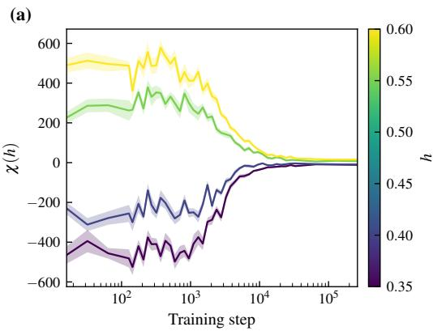

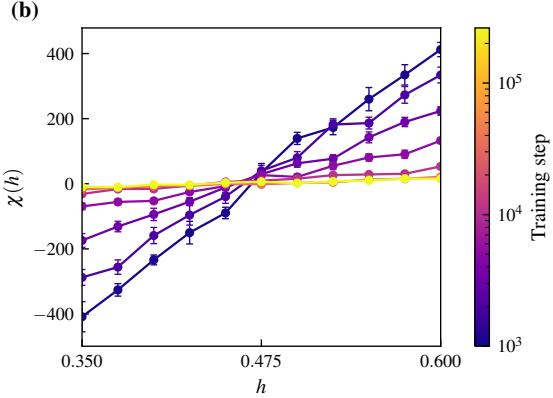  
Figure 1: The susceptibility $\chi ( h )$ shows how the percolation model described in Section $4 . 1$ becomes calibrated over all values of h in the training distribution $( 9 ) ;$ contrast this with $\chi _ { \mathrm { c r i t . } } ( h )$ in Figure 2 which shows the difficulty of learning percolation at different values of h. (a) $\chi ( h )$ over training for various values of $h .$ (b) $\chi ( h )$ plotted as a function of h at various points over training. Observe that $\chi ( h )$ is roughly symmetric about $h \approx 0 . 4 7 5$ mean value of h in the training distribution $- \mathrm { a t }$ each point in training, and that $\chi ( h )$ decays to zero over training for all $h \in [ 0 . 3 \bar { 5 } , 0 . 6 ]$

## 3.2.2 Granular material physics

We consider a system of two-dimensional identical spherical particles of radius $r ,$ confined to a rectangular box with constant gravitational acceleration. Collisions between particles are governed by damped linear spring dynamics (see Luding, 2008, Section 2.3.1); the force experienced by a pair of colliding particles is computed as damped linear spring compressed to a depth

$$
\delta _ { i j } ( x ) = \operatorname* { m a x } ( 0 , 2 r - d _ { i j } ( x ) )\tag{8}
$$

where $d _ { i j } ( x )$ is the distance between particle i and particle $j .$ . Note that two particles apply a force on one another if they overlap in space. This can be interpreted as a simple model for deformation at the contact point for real-world collisions. Collisions with boundaries are handled in the same way except that the boundary has “infinite $\mathrm { { \ m a s s ^ { \prime } } ; }$ it does not move when hit by a particle.

The state of the granular material consists of the position and momentum of each particle, and so can be understood as a subset of $\mathbb { R } ^ { 4 N }$ where N is the number of particles. A distribution $q ( x )$ on is induced by generating initial states according to some chosen distribution and allowing the system to evolve according to damped linear spring dynamics for some fixed duration. We show examples of granular material states in Figure 7.

We train a neural network to predict the future state after some fixed interval $\Delta t ,$ given the current state of the system. This is a regression task and we train the model using mean-squared error loss. To apply susceptibilities, we formulate this as a Bayesian learning task by defining

$$
p ( x | w ) \propto \exp \bigl ( - \| G ( x ) - F ( x ; w ) \| ^ { 2 } \bigr ) q ( x )
$$

where $F ( x ; w )$ denotes the function defined by the neural network with parameters w $\in \mathcal { W }$ and $G ( x )$ denotes the result of allowing x to evolve with damped linear spring dynamics for a duration $\Delta t ; \mathrm { i . e . }$ $G ( x )$ is the ‘true’ function the network is being trained to learn. In this case, the quenched posterior is $\dot { p ( w ) } \propto \exp ( - n \beta L ( w ) ) \varphi ( w )$ where $L ( w )$ is the expected mean-squared error on $q ( x )$ .

## 4 Experiments

## 4.1 Percolation experiments

Consider the setting of percolations described in Section 3.1. We train a 15M parameter transformer model on a mixture of percolating distributions $q _ { h } ( { \pmb x } )$ on a $1 6 \times 1 6$ lattice. Specifically, the training distribution is

$$
q ( { \pmb x } ) = \int _ { 0 . 3 5 } ^ { 0 . 6 } q _ { h } ( { \pmb x } ) u ( h ) d h\tag{9}
$$

(b)  
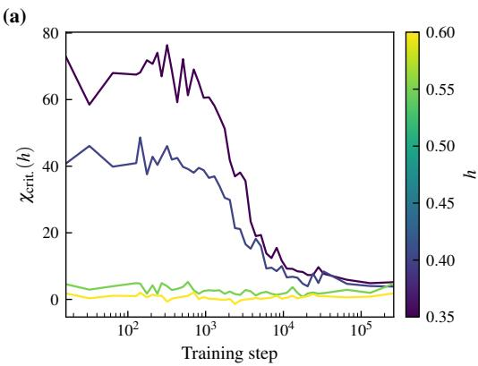

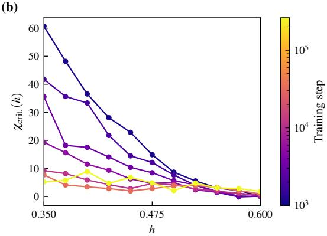  
Figure 2: The masked susceptibility $\chi _ { \mathrm { c r i t . } } ( h )$ (see Section 4.1) shows the difficulty of learning percolation at different values of $h ;$ contrast this with $\chi ( h )$ in Figure 1. (a) $\chi _ { \mathrm { c r i t . } } ( h )$ over training for various values of $h .$ (b) $\chi _ { \mathrm { c r i t . } } ( h )$ plotted as a function of h at various points over training. Unlike $\chi ( h )$ $\chi _ { \mathrm { c r i t . } } ( h )$ is non-negative for all values of $h \in [ 0 . 3 5 , 0 . 6 ]$ and is a decreasing function of $h$ at each point in training. We interpret this as indicating that smaller values of h make it easier to decrease the loss via improving prediction about percolation. This inference is supported by retraining the model on datasets biased toward smaller or larger values of $h ;$ see Figure 3.

where $u ( h )$ is a probability density supported on $[ 0 . 3 5 , 0 . 6 ]$ . In all except for a few specific experiments we take $u ( h )$ to be the uniform distribution. We use a standard transformer architecture; details are given in Appendix B.1.2. We treat each state x as a sequence using the ordering described in Section $3 . 1 ;$ rows are ordered from bottom to top and then within each row sites are ordered from left to right. This ordering determines which sites are ‘visible’ when predicting a given site.

## 4.1.1 Estimating susceptibilities

To understand how the model responds to different parts of the training distribution, we estimate the susceptibility $\chi ( h )$ of $\phi ( w ) = L ^ { \bar { h _ { } } } ( w )$ with respect to the parameter $h$ in $q _ { h } ( { \pmb x } )$ for different values of $h \in [ \bar { 0 } . 3 5 , \bar { 0 . 6 } ]$ . Since we want to understand how the model responds to different data at different points in training, we estimate the susceptibility at various training checkpoints.

In addition to $\chi ( h )$ , we also estimate a masked susceptibility $\chi _ { \mathrm { c r i t . } } ( h )$ which is designed to isolate the effect of features related to percolation. This is motivated by the observation that, conditioning on sites within the transformer’s causal mask, the majority of sites are unconstrained in the sense that their occupation status is not relevant to whether the state percolates, and predictions at these sites dominate the loss at all points in training. Sites involved in percolation are constrained to varying degrees, and certain sites are so constrained that they must be occupied in order for the state to percolate.

Definition 4.1. Let $\mathbf { \boldsymbol { x } } \in \mathcal { X }$ be a percolating state. A critical site is a site which, given the occupation status of sites in the model’s causal mask, must be occupied for x to percolate.

We define $\chi _ { \mathrm { c r i t . } } ( h ) = \chi ( h ; { { \bf 1 } } , M _ { \mathrm { c r i t . } } )$ (see Definition 3.2) where $M _ { \mathrm { c r i t . } } ( { \pmb x } )$ is the set of all critical sites in a percolating state x and ${ 1 } ( \pmb { x } )$ denotes the set of all sites. Recall that $M _ { \mathrm { c r i t } }$ t. selects the sites included in the sum of per-site losses, so $\chi _ { \mathrm { c r i t . } } ( h )$ can be understood as the contribution to $\chi ( h )$ from the per-site losses at critical sites.

We estimate $\chi ( h )$ and $\chi _ { \mathrm { c r i t . } } ( h )$ using the expression derived in Lemma 3.1. The covariance over the posterior distribution $p _ { h } ( w )$ is estimated via stochastic gradient MCMC; see Appendix B.1.3 for details.

## 4.1.2 Results

The key finding is that $\chi ( h )$ and $\chi _ { \mathrm { c r i t . } } ( h )$ tell different stories: the former reflects calibration across the training mixture and the latter reflects the difficulty of learning percolation at different h. In Figure 1 we see that $\chi ( h )$ is negative for $h < h _ { \mathrm { m i d } }$ , positive for $h > h _ { \mathrm { m i d } }$ and roughly symmetric about $h _ { \mathrm { m i d } }$ over training, where $\mathbf { \bar { { h } } _ { \mathrm { { m i d } } } } \approx 0 . 4 7 5$ . Over training $\chi ( h )$ appears to decay to zero for all values of h. On the other hand, $\chi _ { \mathrm { c r i t . } } ( h )$ is positive over training for all values of h and appears to decay to zero. These results are displayed in Figure 2.

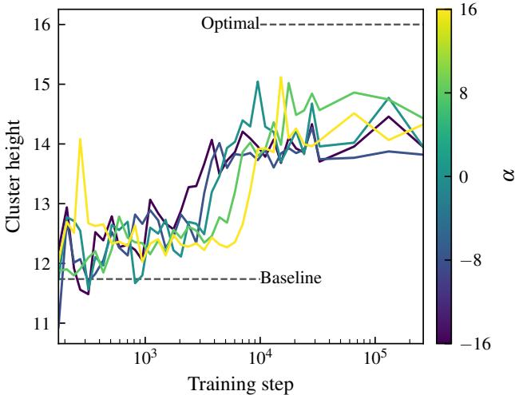  
Figure 3: Biasing the training data towards smaller values of h makes learning percolation easier. We retrain the model with different training datasets parametrised by $\alpha$ and track the mean maximum cluster height generated by the model as a downstream measure of to what degree the model has learned percolation. When the dataset is biased toward small h $( \alpha < 0 )$ the model learns percolation faster than when the dataset is biased towards large $h \left( \alpha > 0 \right)$ . For reference, we show the mean maximum cluster height when the model is replaced with a random Bernoulli model (baseline) and the optimal value for a model which always generates percolating configurations (optimal).

We interpret Figure 1 as the model becoming calibrated across the training distribution. The expected value of $\dot { L } ^ { h } ( w )$ over the local Bayesian model measures how well the model fits $q _ { h } ( { \pmb x } )$ ; smaller is better. $\chi ( h ) > 0$ at $h > h _ { \mathrm { m i d } }$ and $\chi ( h ) < 0$ at $h < h _ { \mathrm { m i d } }$ early in training reflects that the model is best adapted near $h \approx 0 . 4 7 5$ the mean of the training mixture — and the decay of $\chi ( h )$ toward zero reflects calibration across the full range. This behaviour reflects the mixture training distribution and is not specific to percolation.

In contrast, $\chi _ { \mathrm { c r i t . } } ( h ) > 0$ across all h indicates that critical sites contribute more to decreasing the posterior expectation of $L ^ { h } ( w )$ as h decreases. We interpret this as: smaller h makes it easier for the model to improve via better prediction about percolation. Note that the model must both predict unconstrained sites at the correct Bernoulli probability h and ensure that overall configurations percolate (these tasks are not independent).

To validate the prediction that smaller h is easier for percolation, we retrain the model on biased distributions of the form (9) with $u ( h ) \propto \exp ( \alpha h )$ on [0.35, 0.6] (α $< 0$ weights toward small $h ,$ $\alpha > 0$ toward large $h ,$ , and $\alpha  0$ recovers the uniform mixture). We track the model’s ability to generate percolating states via the mean maximum cluster height of generated sequences (see Appendix B.1.4). Figure 3 shows that models with $\alpha < 0$ learn percolation faster, and $\alpha > 0$ learn slower — consistent with our interpretation of $\chi _ { \mathrm { c r i t } }$

We also compared $\chi _ { \mathrm { c r i t . } } ( h )$ ) to other diagnostic values: the empirical loss $L _ { n } ^ { h }$ on iid samples drawn from $q _ { h }$ , the norm $\| \nabla L _ { n } ^ { h } \|$ of the gradient of this loss, and the dot product $\nabla L _ { n } ^ { h } \cdot \nabla L _ { \mathrm { c r i t } }$ . between the gradient of $L _ { n } ^ { h }$ and the gradient of the loss $L _ { \mathrm { c r i t . } }$ at critical sites in samples drawn from the training distribution q. These do not predict the same data selection result as cleanly as $\chi _ { \mathrm { c r i t . } } ( h )$ , though $\nabla L _ { n } ^ { h } \cdot \nabla L _ { \mathrm { c r i t . } }$ does have some similar structure. We discuss this in more detail in Appendix ${ \bf { B . 1 . 5 } }$

## 4.2 Granular material experiments

Consider the setting of Section 3.2. We train a transformer model to predict the future state of a granular material with damped linear spring dynamics after a short duration $\Delta t .$ , given an input state x. The data distribution $q ( x )$ is defined by randomly generating a particle state (with non-overlapping particles) and simulating damped linear spring dynamics, taking snapshots of particle states at regular intervals. The parameters of the particle simulation are given in Appendix B.2.1.

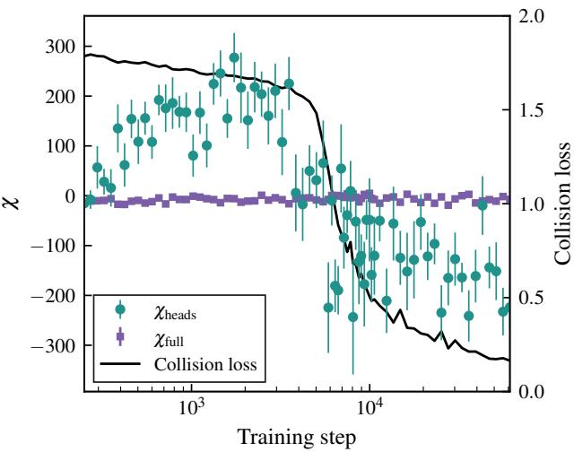  
Figure 4: The change in sign of the susceptibility $\chi _ { \mathrm { h e a d s } }$ over training reflects the development of collision resolution capability by the model. Early in training $\chi _ { \mathrm { h e a d s } }$ (the model’s susceptibility to the total collision force) is positive, reflecting that the model is less suitable for states with more collisions. Later in training it becomes negative at the same time that the collision loss (the mean-squared error of predicted vs. actual states of colliding particles) decreases rapidly. The full susceptibility $\chi _ { \mathrm { f u l l } }$ does not show this signal.

In the transformer, each particle is processed in its own residual stream and attention heads are used to transfer information between particles. We use a variant of attention where the sum of the attention scores can be less than one, but otherwise the transformer architecture and training setup is standard; see Appendix B.2.2 for details.

## 4.2.1 Susceptibilities for granular materials

In the granular materials setting there is no natural control parameter, so we demonstrate that one can be introduced via a physically meaningful scalar function $\psi ( x )$ as described in Section 3.2.1. Because the main difficulty in predicting future states of a granular material is resolving collisions between two or more particles, we take $\begin{array} { r } { \bar { \psi } ( x ) = \sum _ { i = 1 } ^ { N } \sum _ { j = 1 } ^ { N } f _ { i j } ( x ) } \end{array}$ where $f _ { i j } ( x ) \geq 0$ is the magnitude of the force exerted on particle $j$ by particle $i .$ This is computed as $f _ { i j } ( x ) = k \delta _ { i j } ( x )$ where $\delta _ { i j } ( x )$ is the overlap between particles i and j given in (8) and k is the collision spring constant.

Attention heads are expected to be essential for enabling the collision resolution capability of the model, given the model architecture. If susceptibilities defined using $\psi ( x )$ are informative, they should detect when this capability emerges. Following Baker et al. (2025, Definition 2.4), we consider component-wise loss observable $\phi _ { C } ( w ) = \delta _ { C } ( w ) { \cal L } ( w )$ , where $C$ is an architectural component of the model and $\delta _ { C } ( w )$ is a delta function-like term which has the effect of restricting posterior expectation integrals to only integrate over parameters in $C ;$ details are given in Appendix B.2.3. In our experiments with granular models we take $C$ to be the set of all attention heads in the model. This allows us to study how the loss varies over the posterior due to changes exclusively within attention head parameters. The corresponding susceptibility quantifies how this varies in response to perturbations in $h .$

Let $\chi _ { \mathrm { h e a d s } }$ denote the susceptibility of $\phi _ { C } ( w )$ with respect to the control parameter h in (6) at $h = 0 .$ where $\psi ( x )$ is the total collision force magnitude above. Similarly, let $\chi _ { \mathrm { f u l l } }$ denote the susceptibility of $\phi ( w ) = L ( w )$ ; that is, the susceptibility without the restriction to attention heads. We can estimate χheads and χfull using the nested covariance expression (7) derived in Lemma 3.3.

## 4.2.2 Results

We see in Figure 4 that $\chi _ { \mathrm { h e a d s } }$ shows that at a certain point in training, the model changes from being poorly suited to states with many collisions to being well-suited to such states. This coincides with the development of collision resolution capabilities as measured by the loss on colliding particles. Additionally, since we use the component-wise loss restricted to attention heads, this confirms attention heads contribute to this capability developing.

More specifically, the susceptibility is positive early in training, indicating that decreasing h below zero (i.e. weighting the data away from states where $\psi ( x )$ is large) decreases the expected component wise loss. We interpret this as indicating that the attention heads have not yet learned how to correctly resolve collisions between particles and so the model is better suited to a dataset with fewer collisions. Later in training, $\chi _ { \mathrm { h e a d s } }$ changes quickly to a negative value, indicating that increasing h (i.e. weighting the data towards states where $\psi ( x )$ is large) decreases the expected component-wise loss. In contrast, $\chi _ { \mathrm { f u l l } }$ stays flat over training and does not undergo a clear sign change that coincides with the emergence of collision detection behaviour.

## 5 Discussion

In percolation models, we showed that susceptibilities are able to identify components of the training distribution that are most informative for learning percolation. While the overall susceptibility reflects calibration over the range of parameter values in the training distribution, the contribution to the susceptibility from critical sites suggests that smaller parameter values make it easier to learn features related to percolation. This demonstrates how susceptibilities can be used to inform training data selection so as to promote or inhibit the model developing a given capability; for percolation models, the ability to generate states which percolate. Retraining on datasets biased toward (resp. away) from smaller parameter values accelerates (resp. decelerates) learning percolation capabilities, supporting our interpretation of susceptibilities at critical sites.

We further propose a general approach to defining susceptibilities via a scalar function $\psi ( x )$ of the data (Section 3.2.1). The construction applies to any data distribution and any ψ satisfying the technical condition (5) — though ψ should be chosen to be a physically meaningful observable (Section 5.1) — and the resulting susceptibility admits the same nested-covariance form as in the percolation case (Lemma 3.3). We demonstrate the construction in a transformer trained to simulate a granular material, taking $\psi ( x )$ to be the total magnitude of all collision forces in a state. The susceptibility undergoes a sign change that coincides with the emergence of collision-resolution capability.

## 5.1 Choosing observables in practice

In choosing an observable $\psi : { \mathcal { X } } \to $ R to define a susceptibility, we have in mind a practitioner who knows some property of the physical system they want the model to represent, and designs ψ to capture it. This choice does not need to be made once, or correctly on the first attempt: most of the cost of estimating the susceptibility comes from posterior sampling, and choosing several observables $\psi _ { 1 } , \ldots , \psi _ { P }$ only requires computing additional data covariances $\operatorname { C o v } _ { x \sim q } ( \psi _ { i } ( x ) , \ell ( x , w ) )$ at each sampling step. There is little additional cost to choosing many observables and analysing the resulting vector of susceptibilities.

Candidate observables can often be generated without deep domain knowledge. Several observables can serve as a proxy for the same behaviour: for example, while for the granular system we used total collision force, but quantities such as the mean overlap and mean number of particle contacts all capture interactions between particles. Another reasonable candidate are quantities which govern the crossover from one regime to another, such as the Reynolds number in fluid mechanics. Likewise, quantities related to the modelling application such as the stress or strain on a solid body due to mechanical or thermal loads.

## 5.2 Related work

Susceptibilities in the general sense were introduced by Baker et al. (2025), and prior work has applied the concept to different kinds of perturbations of the data distribution. In Baker et al.

(2025); Wang et al. (2025a); Gordon et al. (2026) a parameter h controls the mixture of two datasets $q _ { h } ( x ) = ( 1 \bar { - } h ) q ( x ) + h q ^ { \prime } ( x )$ in the context of language modelling. These are used to study the response of components of the model to different types of data (e.g. code vs. prose). In Kreer et al. (2025); Lee et al. (2025); Adam et al. (2025) the perturbation parameter h is the importance of a particular sample x and ϕ(w) the loss of another sample $x ^ { \prime }$ . This instantiation of susceptibilities is referred to as a local Bayesian influencefunction, and is proposed as a method for data attribution. In contrast to this prior work (which considers data-mixture and sample-importance perturbations) we study susceptibilities derived from physically meaningful perturbations of the data distribution, in the context of learning from physical data. These arise via either an existing control parameter or a function ψ of the physical system; the latter can be applied to any data distribution.

Analogies between statistical physics and statistical inference have been noted by many (see for example Zdeborová and Krzakala, 2016; LaMont and Wiggins, 2019). We exploit a direct connection when the training data itself comes from a physical system. In this context, we explain how perturbations of physical parameters — which induce a response in the physical system — similarly induce a response in the model, and that this connection can be used to make decisions about training.

## 5.3 Limitations

The sampling protocol which is used to estimate susceptibilities has hyperparameters (sampler step size, γ, and $n \beta )$ which must be jointly tuned to ensure stable sampling. This requirement substantially constrains the available choices. We did not conduct a systematic study of robustness to sampler hyperparameters. Our procedure for selecting them uses diagnostics of sampler health that are independent of the susceptibility (see Appendix C); a systematic sensitivity analysis is an important direction for future work. The measurements we report are corroborated by their predictive validity: in Section 4.1 the susceptibility correctly predicts which training distributions accelerate learning and in Section 4.2 the susceptibility tracks the independently measurable emergence of collision resolution.

The experimental evaluation in this paper is limited to two synthetic physical systems. Broader empirical validation in more complex or naturalistic settings is a natural direction for future work.

## 5.4 Future directions

It is natural to consider the effect of phase transitions and critical phenomena in the data distribution on the learning process, and in particular upon susceptibilities. The percolation system described in Section 3.1, for example, has a phase transition at $\dot { h } = h _ { c } \approx 0$ .59275 (Stauffer, 1985, Table 1; see Remark B.1). We did not see any special behaviour near $h _ { c }$ (we did not specifically design experiments to investigate critical phenomena), likely due to finite size effects; critical phenomena only truly occur as $N \to \infty$ where N is the size of the lattice. In our percolation experiments, N is relatively small and scaling N means scaling the context window of the model, which introduces additional cost and complexity.

The ψ-based construction offers an alternative to the data mixture approach described in Baker et al. (2025). Our approach may offer advantages when it is difficult to curate a dataset to target a certain property. Whether these approaches offer different trade-offs or are complementary remains to be investigated.

## Acknowledgments and Disclosure of Funding

RH was supported by CSIRO through the AI for Missions PhD Program and by the Commonwealth through an Australian Government Research Training Program Scholarship (DOI: https://doi. org/10.82133/C42F-K220). Computing resources were provided by CSIRO.

## References

Maxwell Adam, Zach Furman, and Jesse Hoogland. The Loss Kernel: A Geometric Probe for Deep Learning Interpretability, September 2025. URL http://arxiv.org/abs/2509.26537.

Garrett Baker, George Wang, Jesse Hoogland, and Daniel Murfet. Structural Inference: Interpreting Small Language Models with Susceptibilities, May 2025. URL http://arxiv.org/abs/2504. 18274.

Zhongtian Chen, Edmund Lau, Jake Mendel, Susan Wei, and Daniel Murfet. Dynamical versus Bayesian Phase Transitions in a Toy Model of Superposition, October 2023. URL http://arxiv. org/abs/2310.06301.

Andrew Gordon, Garrett Baker, George Wang, William Snell, Stan van Wingerden, and Daniel Murfet. Towards spectroscopy: Susceptibility clusters in language models, 2026. URL http: //arxiv.org/abs/2601.12703.

Rohan Hitchcock and Jesse Hoogland. From global to local: A scalable benchmark for local posterior sampling, 2025. URL http://arxiv.org/abs/2507.21449.

Jesse Hoogland, George Wang, Matthew Farrugia-Roberts, Liam Carroll, Susan Wei, and Daniel Murfet. Loss Landscape Degeneracy Drives Stagewise Development in Transformers. Transactions on Machine Learning Research, 2025.

Philipp Alexander Kreer, Wilson Wu, Maxwell Adam, and Jesse Hoogland. Bayesian Influence Functions for Scalable Data Attribution. In 3rd Workshop on High-dimensional Learning Dynamics, June 2025.

Colin H LaMont and Paul A Wiggins. Correspondence between thermodynamics and inference. Physical Review E, 99(5):052140, 2019.

Edmund Lau, Zach Furman, George Wang, Daniel Murfet, and Susan Wei. The local learning coefficient: A singularity-aware complexity measure. In Proceedings ofThe 28th International Conference on Artificial Intelligence and Statistics, volume 258, pages 244–252. PMLR, May 2025.

Jin Hwa Lee, Matthew Smith, Maxwell Adam, and Jesse Hoogland. Influence Dynamics and Stagewise Data Attribution, October 2025. URL http://arxiv.org/abs/2510.12071.

Simon Pepin Lehalleur, Jesse Hoogland, Matthew Farrugia-Roberts, Susan Wei, Alexander Gietelink Oldenziel, George Wang, Liam Carroll, and Daniel Murfet. You Are What You Eat – AI Alignment Requires Understanding How Data Shapes Structure and Generalisation, February 2025. URL http://arxiv.org/abs/2502.05475.

Chunyuan Li, Changyou Chen, David Carlson, and Lawrence Carin. Preconditioned stochastic gradient Langevin dynamics for deep neural networks. In Proceedings ofthe AAAI conference on artificial intelligence, volume 30, 2016.

Stefan Luding. Introduction to discrete element methods: basic of contact force models and how to perform the micro-macro transition to continuum theory. European journal ofenvironmental and civil engineering, 12(7-8):785–826, 2008.

Mary Phuong and Marcus Hutter. Formal Algorithms for Transformers, July 2022. URL http: //arxiv.org/abs/2207.09238.

K. Samiei, B. Peters, M. Bolten, and A. Frommer. Assessment of the potentials of implicit integration method in discrete element modelling of granular matter. Computers & Chemical Engineering, 49: 183–193, February 2013.

Dietrich Stauffer. Introduction to percolation theory. Taylor & Francis, 1985.

Robert Tuley, Matthew Danby, John Shrimpton, and Mark Palmer. On the optimal numerical time integration for Lagrangian DEM within implicit flow solvers. Computers & Chemical Engineering, 34(6):886–899, June 2010.

Einar Urdshals and Jasmina Urdshals. Structure development in list-sorting transformers. In ICML 2025 Workshop on Structured Probabilistic Inference & Generative Modeling, 2025. URL https://arxiv.org/abs/2501.18666.

George Wang, Garrett Baker, Andrew Gordon, and Daniel Murfet. Embryology of a Language Model, August 2025a. URL http://arxiv.org/abs/2508.00331.

George Wang, Jesse Hoogland, Stan van Wingerden, Zach Furman, and Daniel Murfet. Differentiation and specialization of attention heads via the refined local learning coefficient. In The Thirteenth International Conference on Learning Representations, 2025b.

Sumio Watanabe. Algebraic Geometry and Statistical Learning Theory. Cambridge University Press, 2009.

Susan Wei, Daniel Murfet, Mingming Gong, Hui Li, Jesse Gell-Redman, and Thomas Quella. Deep learning is singular, and That’s good. IEEE Transactions on Neural Networks and Learning Systems, 2022.

J. M. Yeomans. Statistical Mechanics ofPhase Transitions. Oxford University Press, 1992.

Lenka Zdeborová and Florent Krzakala. Statistical physics of inference: Thresholds and algorithms. Advances in Physics, 65(5):453–552, 2016.

## Appendix

These appendices contain proofs and additional methodological details, supporting the main text.

• Appendix A gives proofs for the theoretical results stated in Section 3.

• Appendix B provides additional details about the methodology of the experiments discussed in Section 4.

• Appendix C gives detail on sampling and hyperparameter selection.

## A Proofs

Lemma A.1 (restating Lemma 3.1). Consider the setting of Section 3.1 and let $\phi : \mathcal { W } \to \mathbb { R }$ be a function of the model’s weights. The susceptibility $\chi ( h )$ of ϕ with respect to h (see Definition 2.1) is given by

$$
\chi ( h ) = \frac { - 1 } { h ( 1 - h ) } \mathrm { C o v } _ { w \sim p _ { h } } ( \phi ( w ) , \mathrm { C o v } _ { { \pmb x } \sim q _ { h } } ( K ( { \pmb x } ) , \ell ( { \pmb x } , w ) ) ) + O ( \frac { 1 } { n } ) .
$$

where $\begin{array} { r } { K ( \pmb { x } ) = \sum _ { i = 1 } ^ { N } x _ { i } } \end{array}$ is the number of occupied sites in a given state.

Proof. Using (2) we have

$$
\begin{array} { r } { \chi ( h ) = - \operatorname { C o v } _ { w \sim p _ { h } } ( \phi ( w ) , \frac { \partial L ^ { h } } { \partial h } ( w ) ) + O ( \frac { 1 } { n } ) . } \end{array}
$$

We have

$$
\frac { \partial L ^ { h } } { \partial h } ( w ) = \sum _ { \pmb { x } \in \mathcal { X } } \ell ( \pmb { x } , w ) \frac { \partial } { \partial h } q _ { h } ( \pmb { x } ) = - \sum _ { \pmb { x } \in \mathcal { X } } \log p ( \pmb { x } | w ) \frac { \partial } { \partial h } q _ { h } ( \pmb { x } ) .
$$

Let $A \subseteq { \mathcal { X } }$ be the subset of all percolating configurations, and $\begin{array} { r } { K ( \pmb { x } ) = \sum _ { i = 1 } ^ { N } x _ { i } } \end{array}$ the number of occupied sites in a state $\mathbf { \boldsymbol { x } } \in \mathcal { X }$ . We have

$$
q _ { h } ( \pmb { x } ) = \mathbf { 1 } ( \pmb { x } \in A ) \frac { h ^ { K ( \pmb { x } ) } ( 1 - h ) ^ { N - K ( \pmb { x } ) } } { \mathbf { P } _ { h } ( A ) }
$$

where we define $\begin{array} { r } { \mathbf { P } _ { h } ( A ) = \sum _ { { \pmb x } \in A } h ^ { K ( x ) } ( 1 - h ) ^ { N - K ( x ) } } \end{array}$ . Taking derivatives with respect to h, we have:

$$
\begin{array} { l } { \displaystyle \frac { \partial } { \partial h } \left( \mathbf { 1 } ( \boldsymbol { x } \in A ) h ^ { K ( \boldsymbol { x } ) } ( 1 - h ) ^ { N - K ( \boldsymbol { x } ) } \right) = \mathbf { 1 } ( \boldsymbol { x } \in A ) \big ( K ( \boldsymbol { x } ) h ^ { K ( \boldsymbol { x } ) - 1 } ( 1 - h ) ^ { N - K ( \boldsymbol { x } ) } } \\ { \displaystyle \qquad - ( N - K ( \boldsymbol { x } ) ) h ^ { K ( \boldsymbol { x } ) } ( 1 - h ) ^ { N - K ( \boldsymbol { x } ) - 1 } \big ) } \\ { \displaystyle \qquad = \frac { 1 } { h } K ( \boldsymbol { x } ) \mathbf { P } _ { h } ( A ) q _ { h } ( \boldsymbol { x } ) - \frac { 1 } { 1 - h } ( N - K ( \boldsymbol { x } ) ) \mathbf { P } _ { h } ( A ) q _ { h } ( \boldsymbol { x } ) } \\ { \displaystyle \qquad = \mathbf { P } _ { h } ( A ) q _ { h } ( \boldsymbol { x } ) \left( \frac { K ( \boldsymbol { x } ) } { h ( 1 - h ) } - \frac { N } { 1 - h } \right) } \end{array}
$$

and

$$
\begin{array} { l } { \displaystyle \frac { \partial } { \partial h } \mathbf { P } _ { h } ( A ) = \sum _ { x \in A } \frac { \partial } { \partial h } \left( h ^ { K ( x ) } ( 1 - h ) ^ { N - K ( x ) } \right) } \\ { \displaystyle \qquad = \sum _ { x \in A } K ( x ) h ^ { K ( x ) - 1 } ( 1 - h ) ^ { N - K ( x ) } - ( N - K ( x ) ) h ^ { K ( x ) } ( 1 - h ) ^ { N - K ( x ) - 1 } } \\ { \displaystyle \qquad = \sum _ { x \in A } \frac { 1 } { h } K ( x ) \mathbf { P } _ { h } ( A ) q _ { h } ( x ) - \sum _ { x \in A } \frac { 1 } { 1 - h } ( N - K ( x ) ) \mathbf { P } _ { h } ( A ) q _ { h } ( x ) } \\ { \displaystyle \qquad = \frac { 1 } { h } \mathbf { E } _ { h } [ K ( x ) ] \mathbf { P } _ { h } ( A ) - \frac { 1 } { 1 - h } \mathbf { E } _ { h } [ N - K ( x ) ] \mathbf { P } _ { h } ( A ) } \\ { \displaystyle \qquad = \mathbf { P } _ { h } ( A ) \left( \frac { \mathbf { E } _ { h } [ K ( x ) ] } { h ( 1 - h ) } - \frac { N } { 1 - h } \right) . } \end{array}
$$

It follows from the product rule that

$$
\begin{array} { l } { \displaystyle \frac { \partial } { \partial h } q _ { h } ( \pmb { x } ) = \frac { 1 } { \mathbf { P } _ { h } ( A ) ^ { 2 } } \bigg ( \mathbf { P } _ { h } ( A ) ^ { 2 } q _ { h } ( \pmb { x } ) \left( \frac { K ( \pmb { x } ) } { h ( 1 - h ) } - \frac { N } { 1 - h } \right) } \\ { \displaystyle \qquad - \mathbf { 1 } ( \pmb { x } \in A ) h ^ { K ( \pmb { x } ) } ( 1 - h ) ^ { N - K ( \pmb { x } ) } \mathbf { P } _ { h } ( A ) \left( \frac { \mathbf { E } _ { h } [ K ( \pmb { x } ) ] } { h ( 1 - h ) } - \frac { N } { 1 - h } \right) \bigg ) } \\ { \displaystyle = q _ { h } ( \pmb { x } ) \left( \frac { K ( \pmb { x } ) } { h ( 1 - h ) } - \frac { N } { 1 - h } \right) - q _ { h } ( \pmb { x } ) \left( \frac { \mathbf { E } _ { h } [ K ( \pmb { x } ) ] } { h ( 1 - h ) } - \frac { N } { 1 - h } \right) } \\ { \displaystyle = \frac { q _ { h } ( \pmb { x } ) } { h ( 1 - h ) } \left( K ( \pmb { x } ) - \mathbf { E } _ { h } [ K ( \pmb { x } ) ] \right) . } \end{array}
$$

Hence we have

$$
\begin{array} { l } { \displaystyle \frac { \partial L ^ { h } } { \partial h } ( w ) = \sum _ { \pmb { x } \in \pmb { \mathcal X } } \ell ( \pmb { x } , w ) \frac { \partial } { \partial h } q _ { h } ( \pmb { x } ) } \\ { \displaystyle = \frac { 1 } { h ( 1 - h ) } \operatorname { C o v } _ { \pmb { x } \sim q _ { h } } ( K ( \pmb { x } ) , \ell ( \pmb { x } , w ) ) } \end{array}
$$

Lemma A.2 (restating Lemma 3.3). Consider the setting ofSection 3.2.1. In particular, let $\phi : \mathcal { W } \to$ R be afunction ofthe model weights and $\psi : \mathcal X \to \mathbb R \ : a$ function which satisfies

$$
\int _ { \mathcal { X } } q ( x ) e ^ { h \psi ( x ) } d x < \infty
$$

for all h in some neighbourhood of zero. We have

$$
\begin{array} { r } { \chi = - \operatorname { C o v } _ { w \sim p _ { h } } \left( \phi ( w ) , \operatorname { C o v } _ { x \sim q } \bigl ( \psi ( x ) , \ell ( x , w ) \bigr ) \right) + O \bigl ( \frac { 1 } { n } \bigr ) } \end{array}
$$

Proof. Using Equation (2) we have

$$
\chi ( h ) = - \operatorname { C o v } _ { w \sim p _ { h } } ( \phi ( w ) , \frac { \partial L ^ { h } } { \partial h } ( w ) ) + O ( \textstyle { \frac { 1 } { n } } )
$$

where

$$
L ^ { h } ( w ) = \int _ { \mathcal { X } } \ell ( x , w ) q _ { h } ( x ) d x
$$

and

$$
q _ { h } ( x ) = { \frac { 1 } { Z _ { h } } } q ( x ) e ^ { h \psi ( x ) } , \qquad Z _ { h } = \int _ { \chi } q ( x ) e ^ { h \psi ( x ) } d x .
$$

Note that $Z _ { h = 0 } = 1$ and $\begin{array} { r } { \frac { \partial Z _ { h } } { \partial h } | _ { h = 0 } = \mathbf { E } _ { x \sim q } [ \psi ( x ) ] } \end{array}$ . By the product rule

$$
\frac { \partial } { \partial h } q _ { h } ( x ) \Big | _ { h = 0 } = \psi ( x ) q ( x ) - q ( x ) { \bf E } _ { x \sim q } [ \psi ( x ) ] .
$$

Then

$$
\begin{array} { l } { \displaystyle \frac { \partial L ^ { h } } { \partial h } \Big | _ { h = 0 } = \int _ { \mathcal { X } } \ell ( x , w ) \frac { \partial } { \partial h } q _ { h } ( x ) \Big | _ { h = 0 } d x } \\ { \displaystyle = \mathbf { E } _ { x \sim q } [ \ell ( x , w ) \psi ( x ) ] - \mathbf { E } _ { x \sim q } [ \ell ( x , w ) ] \mathbf { E } _ { x \sim q } [ \psi ( x ) ] } \\ { \displaystyle = \mathrm { C o v } _ { x \sim q } \big ( \ell ( x , w ) , \psi ( x ) \big ) . } \end{array}
$$

(a)

#

Figure 5: An example of percolating and non-percolating states. Each lattice site is displayed as a square on a 16 16 grid. Occupied states are coloured black and unoccupied sites are coloured white. (a) A percolating state; the type of states which we train the model to predict. The percolating cluster — a cluster spanning from the bottom to the top of the lattice — is highlighted with a red border. (b) A non-percolating state; we do not include such states in the training distribution. In contrast to (a), there is no connected component of occupied sites spanning from the bottom to the top of the lattice. When evaluating a transformer trained on distributions of percolating states we consider the tallest cluster in the generated configuration (see Appendix B.1.4). The tallest cluster in (b) is highlighted with a red border and has height eight because it spans eight rows. The tallest cluster in (a) is the percolating cluster and it has height 16.

## B Experiment details

## B.1 Percolation models

In this section we give a detailed methodology for the experiments involving percolation models, discussed in Section 4.1.

## B.1.1 Data generation and identifying critical sites

We sample from the distribution $q _ { h } ( { \pmb x } )$ defined in (3) as follows. First we generate a candidate sample $\mathbf { x } ^ { \prime }$ in which each site’s occupation status is independent of the other sites. A site in $\mathbf { x } ^ { \prime }$ is occupied with probability h and unoccupied with probability 1  h. We then check whether $\mathbf { x } ^ { \prime }$ percolates by finding the largest connected cluster of occupied sites and checking whether it intersects with both the top and bottom row of the lattice. This process is repeated until $\bar { \mathbf { \boldsymbol { x } } } ^ { \prime }$ is found to percolate; $\mathbf { x } ^ { \prime }$ is then returned as a sample from $q _ { h } ( { \pmb x } )$ . An example of a percolating and non-percolating state is visualised in Figure 5.

Remark B.1. In an infinite lattice a state percolates if there exists a connected component of occupied sites with infinitely many sites. For an infinite two-dimensional (square) lattice $( \mathrm { i . e . }$ . in the limit $N \to \infty )$ it is known that percolation happens with probability zero for $h < h _ { c }$ where $h _ { c } \approx 0 . 5 9 2 7 5$ (the exact value is not known; see Stauffer 1985, Table 1). At finite N however, percolation occurs with positive probability for $0 < h < h _ { c }$ . This allows us to consider distributions $q _ { h } ( { \pmb x } )$ for $h < h _ { c }$ in our experiments with percolation models.

Let x be a percolating state. To identify if a given occupied site i is a critical site (Definition 4.1) in x we form a new state $\mathbf { x } ^ { \prime }$ in which $\dot { x } _ { i } ^ { \prime } = \bar { 0 } , x _ { j } ^ { \prime } = x _ { j }$ for $j < i$ and $x _ { j } ^ { \prime } = 1$ for $j > i$ . We then check whether $\mathbf { x } ^ { \prime }$ percolates. Site i is a critical site in x if and only if $\bar { \mathbf { \ b { x } } ^ { \prime } }$ percolates, according to Definition 4.1.

## B.1.2 Training and model details

We train an autoregressive transformer model on a mixture of data from different $q _ { h } ( { \pmb x } )$ , where the lattice size $H = 1 6$ . That is, for some distribution $u ( h )$ with support equal to [0.35, 0.6], the training distribution is defined as

$$
q ( { \pmb x } ) = \int _ { 0 . 3 5 } ^ { 0 . 6 } q _ { h } ( { \pmb x } ) u ( h ) d h .
$$

In most experiments we take $u ( h )$ to be uniform on [0.35, 0.6]; in experiments demonstrating the effect of biasing the training distribution to smaller and larger values of h we take

$$
u ( h ) \propto \exp ( \alpha h )
$$

for $h \in [ 0 . 3 5 , 0 . 6 ]$ and $u ( h ) = 0$ otherwise, where $\alpha \neq 0$ is a parameter controlling the bias towards either end of the interval [0.35, 0.6]. As $\alpha  0$ the density $u ( h )$ approaches the uniform density on [0.35, 0.6].

When considering a state x as an input to our model, we treat it as a binary string by fixing an ordering on lattice sites. Rows are ordered from bottom to top and sites are ordered from left to right within each row. Since the model uses a causal mask, when making predictions about site i, it can see all sites in rows below i and all sites to the left of i and in the same row. Each site has four input features: the coordinates of the site (normalised to $[ 0 , 1 ] ^ { 2 } )$ , the occupation status of the site (either 0 or 1), and the prior probability h of occupation.

We use a standard transformer architecture with blocks consisting of multi-head self attention, a two layer MLP with GeLU activation, and layer normalization applied twice: before computing attention and in-between the attention and MLP. For a positional embedding, we use a 2D version of RoPE which applies rotations based on the row and column of each lattice site. The initial embedding of the input features into the residual stream is done by treating the four input features as a vector in $\mathbb { R } ^ { 4 }$ and applying a two layer MLP with GeLU activation. For each input site, the model predicts a distribution on $\{ 0 , 1 \}$ ; the output logit is obtained by applying a linear layer to the final vector in the residual stream.

The model is trained using binary cross entropy loss and the AdamW optimizer for 262 144 steps. Unseen data is used every training step. We use a learning rate schedule, starting at 0 with a linear warmup over 2000 steps to a peak learning rate of $5 \times \mathrm { i 0 ^ { - 4 } }$ followed by cosine decay to a final learning rate of $1 \times 1 0 ^ { - 5 }$ over the remainder of the training steps. Gradient clipping and weight decay are used.

Training and architecture hyperparameters are summarised in Table 1.

Table 1: Hyperparameter values for the model architecture and training procedure of the percolation models.
<table><tr><td>Hyperparameter</td><td>Value</td></tr><tr><td>Total trainable parameters</td><td>14 839 809</td></tr><tr><td>Number of layers Residual stream dimension</td><td>8</td></tr><tr><td>Number of heads</td><td>256 4</td></tr><tr><td>MLP width Optimizer</td><td>1024</td></tr><tr><td>Batch size</td><td>AdamW 64</td></tr><tr><td>Weight decay</td><td> $0 . 0 1$ </td></tr><tr><td>Gradient clipping norm</td><td>1</td></tr><tr><td>Peak learning rate</td><td></td></tr><tr><td></td><td> $5 \times 1 0 ^ { - 4 }$ </td></tr><tr><td>Final learning rate Total training steps</td><td> $1 \times 1 0 ^ { - 5 }$   $2 ^ { 1 8 } = 2 6 2 1 4 4$ </td></tr></table>

## B.1.3 Estimating susceptibilities

We estimate susceptibilities using the covariance expression (4) found in Lemma 3.1:

$$
\chi ( h ) \approx \frac { - 1 } { h ( 1 - h ) } \operatorname { C o v } _ { w \sim p _ { h } } ( \phi ( w ) , \operatorname { C o v } _ { \mathbf { x } \sim q _ { h } } ( K ( \mathbf { x } ) , \ell ( \mathbf { x } , w ) ) ) .
$$

Recall that

$$
p _ { h } ( w ) \propto \exp ( - n \beta L ^ { h } ( w ) ) \varphi ( w )
$$

is the quenched posterior.

We estimate the covariance over $p _ { h } ( w )$ using stochastic gradient-based Markov chain Monte-Carlo sampling; the sampling procedure and the procedure for selecting sampling hyperparameters are described in Appendix C. Hyperparameter values are given in Table 2.

After a burn-in period, we estimate the inner covariance $\mathrm { C o v } _ { { \pmb x } \sim q _ { h } } ( K ( { \pmb x } ) , \ell ( { \pmb x } , { \pmb w } ) )$ each step. To estimate this covariance, we use a fixed ‘evaluation’ dataset, which is drawn from $q _ { h } ( x )$ independently of the data used by the sampler to compute each step. We run a number of independent chains; each chain receives independent data for the sampler, independent data to compute the inner covariance, and has independent noise. We estimate the variability in the estimate of the susceptibility by computing the standard error over the independent chains.

## B.1.4 Evaluating percolation performance via generated cluster height

Here we explain the methodology for evaluating a model’s overall ability to make predictions about percolation; these results are presented in Figure 3 for models trained on different distributions.

We assess the model’s ability to generate percolating configurations by sampling 16 384 elements from the mixture of percolation distributions $q ( { \pmb x } )$ defined in Equation (9), where $u ( h )$ is taken to be the uniform distribution on [0.35, 0.6]. Note that the uniform mixture is used regardless of the training distribution of the model so that we can compare evaluation metrics. The top 8 rows of each data sample are removed (recall the lattice size is $1 6 \times 1 6 )$ and the model is used to generate the occupation status for the remaining $1 6 \times 8$ sites, using the first 8 rows as a prompt. We then record the height of the tallest cluster in the generated state, and take the mean of this quantity over the dataset. An optimal model which always generates percolating configurations will always record a maximum cluster height of 16. An example demonstrating the maximum cluster height is given in Figure 5(b).

For a baseline we use the same procedure described above, except that the top 8 rows are instead completed by randomly generating the occupation status from an iid Bernoulli distribution with probability h, where h is the probability parameter used to generate the sample.

## B.1.5 Comparing susceptibilities to other quantities

To compare to $\chi _ { \mathrm { c r i t . } } ( h )$ , we compute other diagnostic quantities over the training of percolation models. In Figure 6 we show the empirical loss $L _ { n } ^ { h }$ on iid samples drawn from $q _ { h } .$ , the norm $\| \nabla L _ { n } ^ { h } \|$ of the gradient of this loss, and the dot product $\nabla L _ { n } ^ { h } \cdot \nabla L _ { \mathrm { c r i t } }$ between the gradient of $L _ { n } ^ { h }$ and the gradient of the loss $L _ { \mathrm { c r i t . } }$ at critical sites in samples drawn from the training distribution $q .$ These do not predict the same data selection result as cleanly as $\chi _ { \mathrm { c r i t . } } ( h )$ . The loss $L _ { n } ^ { h }$ is non-monotonic in $h ,$ not suggesting that smaller values of h should be more informative for learning percolation. The gradient norm $\| \nabla L _ { n } ^ { h } \|$ is noisy, with no consistent ordering in h across training steps. The gradient dot product $\nabla L _ { n } ^ { h } \cdot \nabla L _ { \mathrm { c r i t } }$ . does show similar structure to $\chi _ { \mathrm { c r i t . } } ( h )$ : the values are consistently ordered by $\bar { h }$ over training. However, the quantity changes sign twice in the period of training where percolation is learned and the different h curves are not as cleanly separated as $\chi _ { \mathrm { c r i t . } } ( h )$

Table 2: Hyperparameter values for susceptibility estimation in percolation models.
<table><tr><td>Hyperparameter</td><td>Value</td></tr><tr><td>Sampler step size  $n \beta$   $\gamma$ </td><td> $1 \times 1 0 ^ { - 7 }$  50 0.5</td></tr><tr><td>RMSProp stability parameter RMSProp exponential decay rate</td><td> $1 \times 1 0 ^ { - 3 }$  0.99</td></tr><tr><td>Sampler batch size Total steps</td><td>256 10240</td></tr><tr><td>Burn-in steps</td><td>9728</td></tr><tr><td>Estimation steps (draws)</td><td>512</td></tr><tr><td>Number of chains Estimation dataset size</td><td>12 4096</td></tr></table>

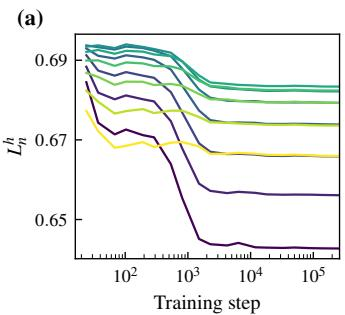

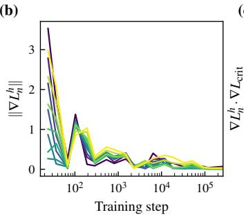  
(c)

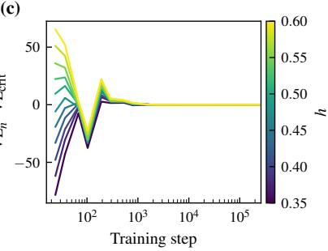  
Figure 6: Other diagnostic quantities do not predict the same data selection result as cleanly as $\chi _ { \mathrm { c r i t . } } ( h ) ;$ ; compare to Figure 2 (a). (a) The empirical loss $L _ { n } ^ { h }$ on iid samples drawn from $q _ { h }$ . (b) The norm $\| \nabla L _ { n } ^ { h } \|$ of the gradient of $L _ { n } ^ { h }$ . (c) The dot product $\ddot { \nabla L } _ { n } ^ { h } \cdot \nabla L _ { \mathrm { c r i t } }$ . between the gradient of $L _ { n } ^ { h }$ and the gradient of the loss $L _ { \mathrm { c r i t } }$ . at critical sites in samples drawn from $q .$

A more detailed comparison between susceptibilities and other diagnostic quantities is an important direction for future work.

## B.2 Granular material models

## B.2.1 Data generation

We train a model on a distribution $q ( x )$ of granular material states defined by the following data generation procedure. An initial state is generated by randomly generating particle positions in the top half of the box such the particles do not overlap, and initial velocities generated according to the standard normal distribution. Damped linear spring dynamics are simulated for 5.12 s; see Table 3 for other quantities defining the granular physics. This duration was chosen as it is long enough that the system has usually dissipated most of its energy via the damped collisions, but short enough that it avoids including a large number of states where the particles are static in the dataset. Example states are shown in Figure 7.

(a)  
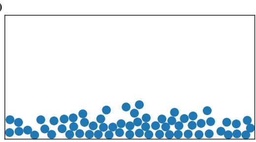

(b)  
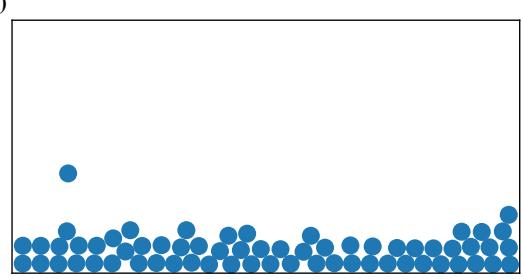  
Figure 7: Two example states of the granular system: 64 identical spherical particles confined to a rectangular box under damped linear spring dynamics. Particle momenta — which are part of the data of a state — are not visualised.

## B.2.2 Training and model details

We train a model with a transformer architecture to predict the future state of the granular material after some fixed duration ∆t, given an input state x. The architecture of the transformer blocks is standard. Each block consists of multi-head attention followed by a two-layer MLP with ReLU activation function, and two separate layer normalisations applied prior to both the attention and MLP layers. Each particle is processed in parallel in its own residual stream, and the attention heads are used to transfer information between particles. No attention mask is used. We allow the total attention assigned by a head to be less than one by including an additional null position with zero-valued key and value vectors.

Boundary information is included in the embedding step. Along each boundary, we define fixed points spaced regularly along the boundary. The position vector of each point is passed through a learned two-layer MLP (with ReLU activation), where the output has dimension equal to the residual stream dimension. Each particle’s state is passed through a separate two-layer MLP (with ReLU activation), and its embedding is augmented by summing the representations of all boundary points within a fixed radius.

The predicted state of particle i with position $p _ { i } \in \mathbb { R } ^ { 2 }$ and velocity $v _ { i } \in \mathbb { R } ^ { 2 }$ is computed by projecting the output of residual stream i to a vector $a _ { i } \in \mathbb { R } ^ { 2 }$ using a linear layer. This is then used to compute

$$
v _ { i } ^ { \prime } = v _ { i } + \Delta t ( a _ { i } + g ) \qquad p _ { i } ^ { \prime } = p _ { i } + \Delta t v _ { i } ^ { \prime }
$$

where $g \in \mathbb { R } ^ { 2 }$ is acceleration due to gravity. This is based on the update rule for the semi-implicit Euler integrator, which has good numerical stability properties for numerical simulations of damped linear spring dynamics (Samiei et al., 2013; Tuley et al., 2010).

The model is trained using mean-squared error loss and the Adam optimizer for 64000 steps. Unseen data is used each training step. We use a constant learning rate of $1 \times 1 0 ^ { - 3 }$ . We do not use either gradient clipping or weight decay.

Training and architecture hyperparameters are summarised in Table 4.

## B.2.3 Estimating susceptibilities

Susceptibilities are estimated in essentially the same way as for the percolation models (see Appendix B.1.3), using the covariance expression (7) found in Lemma 3.3

$$
\chi = - \operatorname { C o v } _ { w \sim p } ( \phi ( w ) , \operatorname { C o v } _ { x \sim q } ( \psi ( x ) , \ell ( x , w ) ) )
$$

where p is the (quenched) posterior. Expectations with respect to the (quenched) posterior are computed by sampling as in the percolation models; the sampling procedure and the procedure for selecting sampling hyperparameters are described in Appendix C. Hyperparameter values are given in Table 5. The inner covariance over the data distribution q is estimated using an evaluation dataset which is independent of the dataset used for sampling.

In the granular materials models we consider the susceptibility of the component-wise loss (Baker et al., 2025, Definition $2 . 4 ) \phi _ { C } ( w ) = \delta _ { C } ( w ) { \cal L } ( w )$ , where C denotes a component of the model and $\delta _ { C } ( w )$ is similar to a delta function which we describe below. By a ‘component’ of the model we mean a subset of the parameters (not a subset of parameter space). In experiments we take $C$ to be the set of all attention heads; a parameter is in C if it is used in any attention head of the model. Formally, C indicates a factorisation of parameter space $W = C \times V$ . Writing $w \in \mathcal { W }$ as $w = ( c , v )$ where $c \in C$ and $v \in V$ , the notation $\delta _ { C } ( w )$ indicates the restriction of the integral to parameters only in $C { : }$

Table 3: Hyperparameters of granular material data.
<table><tr><td>Hyperparameter</td><td>Value</td></tr><tr><td>Number of particles N Particle diameter</td><td>64 1</td></tr><tr><td>Particle mass</td><td>1</td></tr><tr><td>Collision spring constant k</td><td>1000</td></tr><tr><td>Collision damping coefficient</td><td>10</td></tr><tr><td>Acceleration due to gravity</td><td>9.8</td></tr><tr><td>Box height</td><td>14</td></tr><tr><td>Box width</td><td>28</td></tr><tr><td>Simulated duration</td><td>5.12s</td></tr></table>

$$
\int _ { \mathcal W } \delta _ { C } ( w ) L ( w ) p ( w ) d w = \int _ { C } L ( c , v ) p ( c , v ) d c .
$$

When estimating integrals involving $\delta _ { C } ( w )$ using ${ \mathrm { { \bf { M C M C } } } } ,$ , only parameters in $C$ are updated and the remainder are held fixed. This allows us to investigate the effect of specific parameters on posterior expectations. It is related to the weight-refined local learning coefficient introduced by Wang et al. (2025b).

## C Sampler hyperparameter selection

In both the percolation and granular material experiments, estimating susceptibilities involves estimating a covariance with respect to a posterior distribution of the form

$$
p ( w ) \propto \exp ( - n \beta L ( w ) ) \varphi ( w )
$$

where $L ( w )$ is the expected loss at a parameter w and $\varphi ( w )$ is a prior distribution. We estimate this covariance using stochastic gradient-based Markov chain Monte-Carlo sampling, using a similar methodology to Lau et al. (2025) for estimating the local learning coefficient. Following Lau et al. (2025), to estimate the susceptibility at parameter vector $w ^ { * }$ , we localise the posterior using a Gaussian prior

$$
\begin{array} { r } { \varphi ( w ) \propto \exp ( - \frac { \gamma } { 2 } \lVert w - w ^ { * } \rVert ^ { 2 } ) } \end{array}
$$

centred at $w ^ { * }$ , where $\gamma > 0$ is a hyperparameter of the estimation process used to control locality. Replacing $L ( w )$ with an estimate $\bar { L _ { m } ( w ) }$ computed from a batch of m data points, the gradient term used in sampling — which is designed to approximate $\nabla$ log $p ( w ) -$ is

$$
\boldsymbol { G } ( \boldsymbol { w } ) = - \gamma ( \boldsymbol { w } - \boldsymbol { w } ^ { * } ) - n \beta \nabla L _ { m } ( \boldsymbol { w } ) .
$$

We sample from $p ( w )$ using stochastic gradient Langevin dynamics (SGLD) with the RMSProp preconditioner (Li et al., 2016). We run several independent chains; the estimate is the mean over chains and its standard error is computed across chains. The sampler step size, γ and $n \beta > 0$ are treated as hyperparameters of the estimation procedure.

Sampling hyperparameters must be tuned so that sampling converges and is stable. This is primarily evaluated by visual inspection of loss traces: the plot of the loss versus sampling step. When sampling is working well, the loss trace increases above the value at $w ^ { * }$ and levels off into random oscillation about a stable mean. Hyperparameters are rejected if the loss traces have large spikes, do not level off, or have significant autocorrelation, or if independent chains level off at different values. We aim to find hyperparameters which produce stable sampling across all checkpoints of the model for which we want to estimate the susceptibility. Hyperparameters for the percolation and granular material models are tuned separately.

In practice, hyperparameter selection was done by sweeping over the sampler step size, $n \beta$ and $\gamma$ values (in log-space), and over several model checkpoints. Loss traces were inspected and evaluated according to the above criteria, and additional values were swept as needed until a single hyperparameter setting which produced healthy sampling at each selected training checkpoint was found. The number of steps and sampler batch size were increased as needed if no values for the step size, $n \beta$ and $\gamma$ could be found. Once candidate hyperparameter values were found, estimation was run at every checkpoint and the loss traces from sampling runs used to estimate the susceptibility were checked and evaluated according to the criteria above.

Table 4: Hyperparameters for model architecture and training procedure of granular material models.
<table><tr><td colspan="2">Hyperparameter Value</td></tr><tr><td>Total trainable parameters</td><td>432 989</td></tr><tr><td>Number of layers</td><td>4</td></tr><tr><td>Residual stream dimension</td><td>128</td></tr><tr><td>Number of heads</td><td>8</td></tr><tr><td>MLP width</td><td>128</td></tr><tr><td>Optimizer</td><td>Adam</td></tr><tr><td>Batch size</td><td>64</td></tr><tr><td>Learning rate</td><td>0.001</td></tr><tr><td>Total training steps</td><td>64000</td></tr></table>

Table 5: Hyperparameter values for susceptibility estimation in granular material models.
<table><tr><td>Hyperparameter</td><td>Value</td></tr><tr><td>Sampler step size  $n \beta$   $\gamma$ </td><td> $1 \times 1 0 ^ { - 6 }$  1385 1</td></tr><tr><td>RMSProp stability parameter RMSProp exponential decay rate Sampler batch size</td><td> $1 \times 1 0 ^ { - 3 }$  0.99</td></tr><tr><td>Total steps</td><td>128 2000</td></tr><tr><td>Burn-in steps Estimation steps (draws)</td><td>1800 200</td></tr><tr><td>Number of chains Estimation dataset size</td><td>16 2048</td></tr></table>

The robustness of this hyperparameter selection process and the question of how best to tune hyperparameters is an important direction for future work.