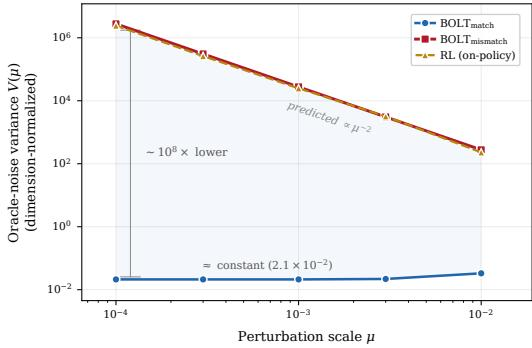
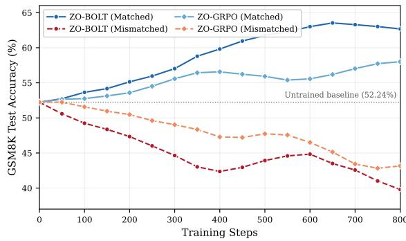

# The Cost of Mismatch: Noise Amplification in Zeroth-Order Reinforcement Learning

Lianmin Chen1 Junbin Qiu2 Chenxing Wei4 Yao Shu2,3∗ Kun He1∗

1School of Computer Science and Technology, Huazhong University of Science and Technology

2The Hong Kong University of Science and Technology (Guangzhou)

3The Hong Kong University of Science and Technology 4The University of Hong Kong

lianminchen@hust.edu.cn, jqiu236@connect.hkust-gz.edu.cn weichenxing@connect.hku.hk, yaoshu@hkust-gz.edu.cn, brooklet60@hust.edu.cn

## Abstract

Zeroth-order (ZO) optimization has emerged as a promising approach for memoryefficient large language model (LLM) post-training, yet its reliable application to reinforcement learning with verifiable rewards (RLVR) remains largely unexplored. Motivated by the distinct data regimes of on-policy RL and fixed-data optimization, we develop a generic variance-theoretic framework to investigate what limits the reliability of ZO gradient estimation. Our analysis reveals that estimation reliability is structurally determined by whether the two finite-difference evaluations are performed on matched data. On-policy reinforcement learning (RL) under the mismatched-data regime produces a 1/µ2 oracle-noise amplification that sets an irreducible noise floor as the perturbation scale µ decreases, whereas Boltzmann Targeted SFT (BOLT) under the matched-data regime eliminates this amplification via noise cancellation. We further derive convergence guarantees with explicit constants that cleanly separate the two regimes. These results naturally lead to ZO-BOLT, which applies ZO optimization to BOLT’s RLVR-aligned weighted-SFT objective. Controlled perturbation-scale sweeps and matched-versus-mismatched end-to-end comparisons validate the predicted effect of data matching. Experiments across three model variants and two mathematical reasoning benchmarks further show that ZO-BOLT consistently improves over the pretrained baseline while retaining a near-inference memory footprint. The code is publicly available at https://github.com/lianmin-chen/the\_cost\_of\_mismatch.

## 1 Introduction

Reinforcement learning with verifiable rewards (RLVR) has become a key component in the posttraining of large language models (LLMs) [1–4]. While first-order (FO) methods remain the default for this process, their reliance on backpropagation [5] imposes severe memory constraints due to the retention of intermediate activations, gradients, and often optimizer states [6, 7].

To mitigate these constraints, zeroth-order (ZO) optimization [8, 9] has received increasing attention as a compelling memory-efficient alternative. Instead of relying on backpropagation, ZO methods estimate gradients using only forward passes and thus reduce memory consumption to the inference level [6, 10]. Prior studies have demonstrated the feasibility of memory-efficient LLM post-training with ZO optimization in supervised fine-tuning (SFT) [6, 11, 10, 12, 13], and more recently, in preference optimization [14] (see App. A for related work). However, to the best of our knowledge, the reliability of ZO optimization for RLVR remains largely unexplored. This raises a key question:

what limits ZO optimization from being reliably applied to RLVR in LLM post-training, and how can this limitation be addressed?

To answer this question, our key observation is that on-policy RL [15–17] introduces a different data regime from the fixed-dataset settings commonly considered in existing ZO post-training studies. Specifically, ZO methods typically estimate gradients via the finite difference of two function evaluations under a parameter perturbation. In fixed-dataset settings such as SFT, since data remains unchanged across parameter perturbations, the two function evaluations can be performed on the same minibatch, which we refer to as a matched-data regime. In on-policy RL, however, each function evaluation uses data generated by the corresponding policy, so perturbing the parameters leads to different batches for the two evaluations, resulting in a mismatched-data regime.

In this work, we develop a generic variance-theoretic framework to characterize the reliability of ZO gradient estimation and analyze the impact of different data regimes. This framework decomposes the ZO gradient estimation error into a noise-free term and an oracle-noise term, revealing that the reliability of ZO gradient estimates is structurally determined by the noise correlation between the two finite-difference evaluations. In the mismatched-data regime, instantiated by on-policy RL, function evaluations are performed on independently sampled data, leaving their stochastic fluctuations uncorrelated and inducing a $1 / \mu ^ { 2 }$ amplification of oracle-noise variance, where $\mu$ denotes the perturbation scale. This establishes an irreducible noise floor as $\mu$ decreases, making it a key failure mechanism in direct ZO optimization for on-policy RL. Conversely, the matched-data regime, instantiated by Boltzmann Targeted SFT (BOLT) [18], utilizes the same data across the finite-difference pair, enforcing aligned stochasticity and eliminating this amplification. Accordingly, these results identify BOLT as a natural basis for reliable ZO optimization, motivating ZO-BOLT as a practical matched-data ZO algorithm for optimizing the corresponding RLVR-aligned objective.

Specifically, our contributions are:

1. A generic variance-theoretic framework for noisy ZO optimization. We develop a generic framework for analyzing ZO gradient estimation under noisy function evaluations. We establish Lem. 1, an exact decomposition of the ZO optimization estimator error, showing the oracle-noise term is entirely governed by the noise correlation between the two paired evaluations. This provides a unified foundation for analyzing different data regimes.

2. Variance-theoretic characterization of the mismatched- and matched-data regimes. We instantiate the two data regimes with on-policy RL and Boltzmann Targeted SFT (BOLT), respectively. We prove that on-policy RL under the mismatched-data regime induces a $1 / \bar { \mu } ^ { 2 }$ oracle-noise amplification (Prop. 1), whereas BOLT under the matched-data regime eliminates this amplification, leaving only a bounded minibatch-level variance term (Prop. 2). These results are unified into an oracle-noise separation theorem (Thm. 1) and translated into convergence guarantees with explicit constants that cleanly separate the two regimes (Thm. 2).

3. Empirical validation of noise amplification and practical evaluation of ZO-BOLT. We first validate the predicted effect of the matched- and mismatched-data regimes on ZO optimization. Controlled perturbation-scale $\mu$ sweeps verify the $1 / \mu ^ { 2 }$ amplification under independently sampled paired evaluations (Table 1 and Figure 1), while matchedversus-mismatched end-to-end comparisons validate its optimization consequences (Figure 2 and Table 2). We then evaluate ZO-BOLT across Qwen2.5-1.5B, Qwen2.5-7B, and DeepSeek-R1-Distill-Qwen-1.5B on GSM8K and MATH [19, 2, 20, 21], showing consistent performance gains while retaining a near-inference memory footprint (Tables 3 and 4).

## 2 Preliminaries

This section establishes the theoretical foundation for the analysis in Section 3. We begin by introducing the Zeroth-Order (ZO) gradient estimator with noisy function evaluations, which serves as the basic optimization primitive throughout this work. We then formalize the two primary settings considered in this work: on-policy Reinforcement Learning (RL) and Boltzmann Targeted SFT (BOLT). Although both target the same underlying objective, their reliance on online sampling versus offline fixed-data reuse gives rise to the mismatched- and matched-data regimes, respectively, leading to distinct noise dynamics in ZO gradient estimation (see Section 3).

## 2.1 ZO Gradient Estimator with Noisy Function Evaluations

We consider the minimization of an objective function $F : \mathbb { R } ^ { d } $ R in settings where gradients are unavailable and only noisy function evaluations can be queried. In ZO optimization, gradients are approximated via finite differences of function values. Let $g = \nabla F ( \theta )$ denote the gradient of $F$ at $\theta \in \mathbb { R } ^ { d }$ . Following [9], the standard forward finite-difference estimator $\hat { g }$ is defined as:

$$
\widehat { g } ( \theta ; u , \xi _ { + } , \xi _ { - } ) = \frac { \widetilde { F } ( \theta + \mu u , \xi _ { + } ) - \widetilde { F } ( \theta , \xi _ { - } ) } { \mu } u , \quad u \sim \mathcal { N } ( 0 , I _ { d } ) , \quad \mu > 0 .\tag{1}
$$

Here, $\mu$ denotes the perturbation scale, u is a Gaussian search direction, and $\tilde { F } ( \theta , \xi ) = F ( \theta ) + e ( \theta , \xi )$ is a noisy oracle evaluation. The random variable ξ captures the source of stochasticity in the function evaluation (e.g., data sampling or environment noise), and $e ( \theta , \xi )$ represents the resulting additive noise.

## 2.2 On-Policy Reinforcement Learning (RL)

We consider the standard on-policy RL objective [22] $J ( \theta ) = \mathbb { E } _ { \tau \sim P _ { \theta } } \left[ \ell ( \theta ; \tau ) \right]$ under a minimization convention, where $P _ { \theta }$ denotes the trajectory distribution induced by policy $\pi _ { \theta } .$ and $\ell ( \theta ; \tau )$ denotes a scalar loss associated with trajectory τ. A natural Monte Carlo oracle estimates $J ( \theta )$ using $N$ independent rollouts [15]:

$$
\tilde { J } ( \theta , \xi ) = \frac { 1 } { N } \sum _ { n = 1 } ^ { N } \ell ( \theta ; \tau _ { n } ) , \quad \tau _ { n } \overset { \mathrm { i . i . d . } } { \sim } P _ { \theta } .\tag{2}
$$

Critically, the trajectory distribution $P _ { \theta }$ depends on the current parameter $\theta ,$ so each oracle query requires fresh online rollouts from the policy being evaluated.

## 2.3 Boltzmann Targeted SFT

In contrast to on-policy RL, Boltzmann Targeted SFT (BOLT) [18] operates in an offline fixeddataset setting. Concretely, by reformulating the KL-regularized RLVR objective as an offline importance-weighted supervised learning problem, BOLT decouples data generation from policy optimization: trajectories are first collected under a reference policy to construct a weighted dataset $\mathcal { \bar { D } } = \{ ( x _ { i } , y _ { i } , w _ { i } ) \} _ { i = 1 } ^ { M }$ , where $x _ { i }$ is a prompt, $y _ { i }$ is a response sampled from the reference policy for $x _ { i } ,$ , and each weight $w _ { i } > 0$ is fixed at construction time and independent of θ. Optimization then proceeds entirely over this fixed dataset via the following objective:

$$
F _ { \mathrm { B O L T } } ( \theta ) = \frac { 1 } { M } \sum _ { i = 1 } ^ { M } \ell _ { i } ( \theta ) , \quad \ell _ { i } ( \theta ) = - w _ { i } \log \pi _ { \theta } ( y _ { i } \mid x _ { i } ) .\tag{3}
$$

## 3 Matched and Mismatched Data Regimes in Zeroth-Order Optimization

Building on Section 2, this section develops a precise variance-theoretic characterization of ZO gradient estimation. We first establish a generic variance-theoretic framework decomposing the noisy ZO estimator error into a noise-free and an oracle-noise term (Section 3.1). We then show that on-policy RL under the mismatched-data regime has a $1 / \mu ^ { 2 }$ amplification of the oracle-noise term (Section 3.2), while BOLT under the matched-data regime eliminates this effect (Section 3.3). These results are unified into an oracle-noise separation theorem (Section 3.4) and translated into smoothed-objective stationarity guarantees with explicit constants (Section 3.5).

## 3.1 A Variance-Theoretic Framework for Noisy ZO Gradient Estimation

We begin by decomposing the ZO gradient estimator (1) into a noise-free term and an oracle-noise term to isolate the contribution of function-evaluation noise. We adopt the following standard assumption on the oracle.

Assumption 1 (Conditionally unbiased, square-integrable oracle). For every queried point $x \in \mathbb { R } ^ { d }$ the oracle returns $\tilde { F } ( x , \xi ) = F ( x ) + e ( x , \xi )$ , where ${ \mathbb E } [ e ( x , \xi ) \mid x ] = 0 a n d { \mathbb E } [ e ( x , \xi ) ^ { 2 } \mid x ] < \infty$

Define the noise-free estimator $g _ { F } ( \theta ; u ) ~ : = ~ [ F ( \theta + \mu u ) - F ( \theta ) ] u / \mu$ . Substituting $\tilde { F } ( x , \xi ) =$ $F ( x ) + e ( x , \xi )$ into the noisy ZO gradient estimator (1) gives the exact decomposition:

$$
\hat { g } ( \theta ; u , \xi _ { + } , \xi _ { - } ) = \underbrace { g _ { F } ( \theta ; u ) } _ { \mathrm { n o i s e - f r e e ~ t e r m } } + \underbrace { \frac { e ( \theta + \mu u , \xi _ { + } ) - e ( \theta , \xi _ { - } ) } { \mu } u } _ { \mathrm { o r a c l e - n o i s e ~ t e r m } } .\tag{4}
$$

The noise-free term $g _ { F }$ corresponds to the standard Gaussian-smoothing gradient estimator whose bias and variance properties are well characterized in [9]. The oracle-noise term captures the propagation of oracle noise $e ( \theta , \xi )$ through the two function evaluations. Under Assumption 1, this term has zero mean, and its variance equals its second moment, which is governed by the dependence structure between $\xi _ { + }$ and $\xi _ { - }$ . The following Lemma 1 (proof in App. C.1) formalizes this dependence.

Lemma 1 (Exact oracle-noise identity). Assume $\begin{array} { r } { \mathbb { E } \Big [ \big ( e ( \theta + \mu u , \xi _ { + } ) - e ( \theta , \xi _ { - } ) \big ) ^ { 2 } \| u \| ^ { 2 } \Big | \theta \Big ] < \infty . } \end{array}$ Then thefollowing identity holds

$$
{ \mathbb E } \big [ \| \hat { g } - g _ { F } \| ^ { 2 } \big | \theta \big ] = \frac { 1 } { \mu ^ { 2 } } { \mathbb E } \Big [ \big ( e ( \theta + \mu u , \xi _ { + } ) - e ( \theta , \xi _ { - } ) \big ) ^ { 2 } \| u \| ^ { 2 } \Big | \theta \Big ] .\tag{5}
$$

Furthermore, ifthere exists $\nu ^ { 2 } > 0$ such that for all u, ${  { \mathbb E } } \Big [ \big ( e ( \theta + \mu u , \xi _ { + } ) - e ( \theta , \xi _ { - } ) \big ) ^ { 2 } \Big | \theta , u \Big ] \le \nu ^ { 2 }$ then $\mathbb { E } [ \left| \left| { \hat { g } } - g _ { F } \right| \right| ^ { 2 } \mid \theta ] \leq d \nu ^ { 2 } / \mu ^ { 2 }$ , where d arisesfrom $\mathbb { E } [ \| u \| ^ { 2 } ] = d f o r u \sim \mathcal { N } ( 0 , I _ { d } )$

Remark. Lem. 1 explicitly isolates the contribution of oracle noise to the estimator error, and reveals that the $\mathrm { _ { Z O } }$ gradient estimator amplifies not the oracle noise itself, but the mismatch between two noisy function evaluations. Consequently, the following analysis reduces to characterizing the conditional second moment E $\hat { | ( e ( \theta + \bar { \mu } u , \xi _ { + } ) - e ( \theta , \xi _ { - } ) ) ^ { 2 } | } \theta , u |$ under different data regimes.

A key implication arises when $\xi _ { + }$ and $\xi _ { - }$ are conditionally independent, in which the noise terms add rather than cancel; this is formalized in the following Corollary 1 (proof in App. C.2).

Corollary 1 (Independent evaluation noise). $I f \xi _ { + }$ and $\xi _ { - }$ are conditionally independent given $( \theta , u )$ and $\operatorname { V a r } ( e ( \theta ^ { \prime } , \xi ) \mid \theta ^ { \prime } ) \leq \sigma ^ { 2 }$ for all $\theta ^ { \prime } \in \mathbb { R } ^ { d }$ , then

$$
\mathbb { E } \left[ \left. \hat { g } - g _ { F } \right. ^ { 2 } \big | \theta \right] \leq \frac { 2 d \sigma ^ { 2 } } { \mu ^ { 2 } } .\tag{6}
$$

Cor. 1 reveals that the $1 / \mu ^ { 2 }$ amplification arises directly from evaluation independence. Whether this independence is structurally unavoidable depends on the data regime, which we analyze next.

## 3.2 On-policy RL: The Mismatched-data Regime

We now show that on-policy RL naturally induces independent evaluations, thereby instantiating the mismatched-data regime and making the $1 / \mu ^ { 2 }$ amplification identified in Cor. 1 unavoidable.

## 3.2.1 Mismatched Evaluations and Noise Amplification

Applying ZO optimization to the on-policy RL objective $J ( \theta ) = \mathbb { E } _ { \tau \sim P _ { \theta } } [ \ell ( \theta ; \tau ) ]$ yields the estimator:

$$
\hat { g } _ { \mathrm { o n _ { - } p o l i c y } } ( \theta ) = \frac { \tilde { J } ( \theta + \mu u , \xi _ { + } ) - \tilde { J } ( \theta , \xi _ { - } ) } { \mu } u , \quad g _ { J } ( \theta ; u ) : = \frac { J ( \theta + \mu u ) - J ( \theta ) } { \mu } u .\tag{7}
$$

where $\tilde { J }$ denotes the Monte Carlo oracle defined in (2).

We formalize the oracle behavior through the following assumption.

Assumption 2 (On-policy rollout oracle). For every queried point $x \in \mathbb { R } ^ { d } , \mathbb { E } [ \tilde { J } ( x , \xi ) \mid x ] = J ( x )$ and $\mathrm { V a r } ( \tilde { J } ( x , \xi ) \mid x ) \le \sigma _ { \mathrm { r o l l } } ^ { 2 }$ . Moreover, evaluations at $x _ { + } = \theta + \mu u$ and $x _ { - } = \theta$ are conditionally independent given $( \theta , u )$

This setting naturally instantiates the mismatched-data regime. Specifically, the evaluation at θ uses online rollouts sampled from $P _ { \theta }$ , while the evaluation at $\theta + \mu u$ uses online rollouts sampled from $P _ { \theta + \mu u }$ . These are different data-generating distributions, and for discrete autoregressive generation there is in general no construction to reuse identical trajectories across parameter values without violating the correct on-policy marginal distributions. Under this mismatched-data regime, the independent evaluations lead to $1 / \bar { \mu ^ { 2 } }$ oracle-noise amplification, as quantified by the following Proposition 1 (proof in App. C.3).

Proposition 1 (On-policy RL oracle-noise amplification). Under Assumptions 1 and 2,

$$
\mathbb { E } \big [ \lVert \hat { g } _ { \mathrm { o n \_ p o l i c y } } - g _ { J } \rVert ^ { 2 } \big | \theta \big ] \leq \frac { 2 d \sigma _ { \mathrm { r o l l } } ^ { 2 } } { \mu ^ { 2 } } ,\tag{8}
$$

Severity of the bound. The bound $2 d \sigma _ { \mathrm { r o l l } } ^ { 2 } / \mu ^ { 2 }$ exhibits double amplification: linear in dimension d and quadratic in $1 / \mu$ . Even under a parameter-efficient configuration with $d = 1 0 ^ { 6 }$ , the bound reaches $2 \times 1 0 ^ { 1 2 } \sigma _ { \mathrm { r o l l } } ^ { 2 } \dot { \mathrm { a t } } \mu = 1 0 ^ { - 3 }$ , rendering the oracle-noise contribution prohibitively large and dominating any learning-rate-based mitigation. Crucially, this extreme magnitude is intrinsic to the ZO optimization framework rather than an artifact of a loose upper bound: the factor d comes from the exact identity $\mathbb { E } [ \lVert u \rVert ^ { 2 } ] = d$ , and $1 / \mu ^ { 2 }$ is intrinsic to finite-difference estimation.

## 3.2.2 Limitations of Variance Reduction for ZO Optimization in On-Policy RL

Trajectory reuse changes the true objective. A natural question is whether reusing the same trajectories across evaluations can eliminate the $1 / \mu ^ { 2 }$ amplification. However, our analysis (see App. B.1) reveals that this is fundamentally limited: any variance reduction from trajectory reuse comes at the cost of replacing the true on-policy objective J with a frozen-distribution surrogate ${ \bar { J } } _ { \theta }$ , and the resulting distribution-shift term vanishes only when $P _ { \theta + \mu u } = P _ { \theta }$ . Thus, any variance reduction from trajectory reuse is obtained by changing the optimization target.

Importance-weighted correction. The standard remedy is importance weighting, which corrects the frozen-distribution surrogate back to the true objective. However, the second moment of the required trajectory-level weights can grow exponentially with sequence length T, making unbiased correction unstable for long-form reasoning (see App. B.2).

PPO/GRPO-style frozen-distribution surrogates. Methods such as PPO [23] and GRPO [1] optimize clipped or locally constrained surrogates on rollouts from a frozen behavior policy. This permits paired ZO evaluations to reuse identical trajectories and yields the matched-data regime; their token-level or clipped ratios also depart from the exact trajectory-level importance correction to which the exponential second-moment result applies (see App. B.3). However, these gains arise from replacing the true on-policy objective with a surrogate, rather than resolving the structural mismatch. Consequently, the $1 / \mu ^ { 2 }$ amplification remains applicable to direct ZO optimization of the true on-policy RL objective.

## 3.3 BOLT: The Matched-data Regime

The preceding analysis shows that direct ZO optimization of on-policy RL incurs mismatch-induced $1 / \mu ^ { 2 }$ oracle-noise amplification, while trajectory reuse avoids this mismatch only by changing the optimization target. We now turn to Boltzmann Targeted SFT (BOLT), introduced in Section 2, and establish that it structurally resolves the $1 / \mu ^ { 2 }$ oracle-noise amplification identified in Section 3.2.

## 3.3.1 Matched Evaluations and Noise Cancellation

The key structural property of BOLT is that optimization operates over a fixed offline dataset, which allows the two function evaluations to use the same minibatch B, resulting in the matched-data regime. Specifically, for a minibatch $B \subseteq \{ 1 , \dots , M \}$ of size $B ,$ the ZO gradient estimator takes the form

$$
\hat { g } _ { \mathrm { B O L T } } ( \theta ; u , \mathcal { B } ) = \frac { F _ { \mathcal { B } } ( \theta + \mu u ) - F _ { \mathcal { B } } ( \theta ) } { \mu } u , \quad F _ { \mathcal { B } } ( \theta ) = \frac { 1 } { B } \sum _ { i \in \mathcal { B } } \ell _ { i } ( \theta ) .\tag{9}
$$

Here, $\ell _ { i } ( \theta )$ is defined in (3).

This shared-data structure contrasts sharply with the on-policy online RL setting: the two evaluations are no longer driven by independent noise sources, but by a shared source of randomness. As we show in Prop. 2, this difference fundamentally alters the scaling of the estimator variance.

## 3.3.2 Variance Bound with Explicit Constants

We first impose standard regularity conditions on the individual loss functions to facilitate the subsequent analysis.

Assumption 3 (Individual smoothness). Each $\ell _ { i }$ is L-smooth: $\lVert \nabla \ell _ { i } ( \theta ) - \nabla \ell _ { i } ( \theta ^ { \prime } ) \rVert \leq L \lVert \theta - \theta ^ { \prime } \rVert$

Assumption 4 (Uniform minibatch gradient variance). For every $x \in \mathbb { R } ^ { d }$

$$
\mathbb { E } _ { B } \big [ \| \nabla F _ { B } ( x ) - \nabla F _ { \mathrm { B O L T } } ( x ) \| ^ { 2 } \big ] \leq \frac { \sigma _ { \mathrm { m b } } ^ { 2 } } { B } .
$$

Remark. Assumption 3 is standard in the nonconvex optimization literature. Assumption 4 follows from the classical bounded-variance-per-sample condition $\begin{array} { r } { \frac { 1 } { M } \sum _ { i = 1 } ^ { M } \| \nabla \ell _ { i } ( \theta ) - \nabla F _ { \mathrm { B O L T } } ( \theta ) \| ^ { 2 } \leq \sigma _ { \mathrm { m b } } ^ { 2 } } \end{array}$ via the standard minibatch variance reduction argument.

We now quantify the variance reduction for BOLT under the matched-data regime in Proposition 2 (proof in App. C.6).

Proposition 2 (Oracle-noise bound for BOLT under the matched-data regime). Under Assumptions 3 and 4,for every $\boldsymbol { \theta } \in \mathbb { R } ^ { d }$

$$
\mathbb { E } \big [ \| \hat { g } _ { \mathrm { B O L T } } - g _ { F _ { \mathrm { B O L T } } } \| ^ { 2 } \big | \theta \big ] \leq \left( \sqrt { \frac { ( d + 2 ) \sigma _ { \mathrm { m b } } ^ { 2 } } { B } } + L \mu \sqrt { d ( d + 2 ) ( d + 4 ) } \right) ^ { 2 } ,\tag{10}
$$

where $\begin{array} { r } { g _ { F _ { \mathrm { B O L T } } } ( \theta ; u ) : = \frac { F _ { \mathrm { B O L T } } ( \theta + \mu u ) - F _ { \mathrm { B O L T } } ( \theta ) } { \mu } u . } \end{array}$

Absence of $1 / \mu ^ { 2 }$ amplification. In contrast to the on-policy RL setting, the variance bound under BOLT contains no $1 / \bar { \mu } ^ { 2 }$ term. Because the same minibatch B is used in both $F _ { B } ( \theta + \mu u )$ and $F _ { B } ( \theta )$ their leading-order stochastic coefficients cancel in the finite-difference operation, entirely eliminating the catastrophic amplification identified in Section 3.2. The resulting bound does contain an $\mathcal { O } ( d ^ { 3 } )$ term, but this is negligible in practice under the standard condition $\mu ^ { 2 } d ^ { 2 } L ^ { 2 } \ll \sigma _ { \mathrm { m b } } ^ { 2 } / B$ , ensuring that the minibatch-noise term dominates.

## 3.4 The Oracle-Noise Separation Theorem

We now state our main theorem, which synthesizes the preceding analysis into a single quantitative contrast between mismatched-data and matched-data regimes.

Theorem 1 (Oracle-noise separation). Under Assumptions 1–4, we distinguish two regimes: onpolicy RL under the mismatched-data regime and BOLT under the matched-data regime. (i) on-policy RL (the mismatched-data regime).

$$
\mathbb { E } \big [ \| \hat { g } _ { \mathrm { o n } _ { - } \mathrm { p o l i c y } } - g _ { J } \| ^ { 2 } \big | \theta \big ] \leq \frac { 2 d \sigma _ { \mathrm { r o l l } } ^ { 2 } } { \mu ^ { 2 } } .\tag{11}
$$

(ii) BOLT (the matched-data regime).

$$
{  { \mathbb E } } \bigl [ \| \hat { g } _ { \mathrm { B O L T } } - g _ { F _ { \mathrm { B O L T } } } \| ^ { 2 } \bigr | \theta \bigr ] \le \left( \sqrt { \frac { ( d + 2 ) \sigma _ { \mathrm { m b } } ^ { 2 } } { B } } + L \mu \sqrt { d ( d + 2 ) ( d + 4 ) } \right) ^ { 2 } .\tag{12}
$$

The key distinction is that matched minibatches remove the $1 / \mu ^ { 2 }$ amplification in the oracle-noise term $\hat { g } - g _ { F }$ . They do not eliminate the intrinsic random-direction variability of one-point zeroth-order estimation.

## 3.5 Convergence to Approximate Stationarity

Thm. 1 establishes a sharp oracle-noise separation between on-policy RL and BOLT. This separation directly enables convergence analysis under both settings. We now combine the variance bounds from Thm. 1 with a standard descent lemma for Gaussian-smoothed nonconvex optimization to derive rates of convergence to approximate stationarity. Assume the objective function F (either J in on-policy RL or $F _ { \mathrm { B O L T } } ^ { \mathrm { - } }$ in BOLT) is $L _ { F } { \mathrm { - s m o o t h } } .$ , and define its Gaussian smoothing $F _ { \mu } ( \theta ) : =$ $\mathbb { E } _ { u \sim \dot { N ( 0 , I _ { d } ) } } \dot { \left[ F ( \theta + \mu u ) \right] }$ . We further impose the following standard assumptions.

Assumption 5 (Smoothed initial suboptimality). Let $F ^ { * } \ : = \ \operatorname* { i n f } _ { \theta \in \mathbb { R } ^ { d } } F ( \theta )$ , and assume that $F ( \theta _ { 0 } ) \stackrel { - } { - } F ^ { * } \leq \Delta _ { 0 } < \infty$ . For the Gaussian-smoothed objective $F _ { \mu } ( \theta \bar { ) }$ , define $\Delta _ { \mu , 0 } : = F _ { \mu } ( \theta _ { 0 } ) -$ ${ \operatorname* { i n f } } _ { \theta \in \mathbb { R } ^ { d } } F _ { \mu } ( \theta )$ . Under $L _ { F }$ -smoothness,

$$
\Delta _ { \mu , 0 } \leq \Delta _ { 0 } + \frac { L _ { F } \mu ^ { 2 } d } { 2 } < \infty .
$$

The following lemma (proof in App. C.7) collects standard properties of Gaussian smoothing.

Lemma 2 (Gaussian smoothing identity and gradient comparison). $\mathbb { E } _ { u } [ g _ { F } ( \theta ; u ) ] = \nabla F _ { \mu } ( \theta )$ , and $\| \nabla F _ { \mu } ( \theta ) - \nabla F ( \theta ) \| \le L _ { F } \mu \mathbb { E } [ \| u \| ] \le L _ { F } \mu \sqrt { d }$

Moreover, the second moment of the noise-free estimator satisfies Lemma 3 (proof in App. C.8):

Lemma 3 (Second moment of the noise-free one-point forward estimator). If F is $L _ { F }$ -smooth, then

$$
{  { \mathbb E } } _ { u } \bigl [ \| g _ { F } ( \theta ; u ) \| ^ { 2 } \bigr ] \le 4 ( d + 2 ) \| \nabla F _ { \mu } ( \theta ) \| ^ { 2 } + \frac { L _ { F } ^ { 2 } \mu ^ { 2 } d ( d + 2 ) ( d + 1 2 ) } 2 .\tag{13}
$$

We now state a unified convergence result for ZO methods in Theorem 2 (proof in App. C.9).

Theorem 2 (Smoothed nonconvex descent with explicit one-point ZO term). Consider the update: $\theta _ { t + 1 } = \theta _ { t } - \eta \hat { g } _ { t } , u _ { t } \stackrel { \mathrm { i . i . d . } } { \sim } \mathcal { N } ( 0 , I _ { d } )$ . Assume thatfor every $t , \mathbb { E } [ \hat { g } _ { t } - g _ { F } ( \theta _ { t } ; u _ { t } ) \mid \theta _ { t } , u _ { t } ] = 0 , \mathbb { E } [ \left| \left| \hat { g } _ { t } - \right. \right.$ $g _ { F } ( \theta _ { t } ; u _ { t } ) \lVert ^ { 2 } \mid \mathbf { \bar { \theta } } _ { t } ] \leq V ,$ almost surely, where V is a deterministic upper bound. $\begin{array} { r } { I f 0 < \eta \le \frac { 1 } { 4 L _ { F } ( d + 2 ) } } \end{array}$ then

$$
\frac { 1 } { T } \sum _ { t = 0 } ^ { T - 1 } \mathbb { E } \big [ \| \nabla F _ { \mu } ( \theta _ { t } ) \| ^ { 2 } \big ] \leq \frac { 2 \Delta _ { \mu , 0 } } { \eta T } + L _ { F } \eta \left( V + \frac { L _ { F } ^ { 2 } \mu ^ { 2 } d ( d + 2 ) ( d + 1 2 ) } { 2 } \right) .
$$

In particular, combining with Theorem 1 gives:

(i) on-policy RL (the mismatched-data regime).

$$
\frac { 1 } { T } \sum _ { t = 0 } ^ { T - 1 } \mathbb { E } \big [ \| \nabla J _ { \mu } ( \theta _ { t } ) \| ^ { 2 } \big ] \leq \frac { 2 \Delta _ { \mu , 0 } } { \eta T } + L _ { J } \eta \left( \frac { 2 d \sigma _ { \mathrm { r o l l } } ^ { 2 } } { \mu ^ { 2 } } + \frac { L _ { J } ^ { 2 } \mu ^ { 2 } d ( d + 2 ) ( d + 1 2 ) } { 2 } \right) .
$$

(ii) BOLT (the matched-data regime).

$$
\begin{array} { r l } & { \frac { 1 } { T } \displaystyle \sum _ { t = 0 } ^ { T - 1 } \mathbb { E } \big [ \| \nabla \big ( F _ { \mathrm { B O L T } } \big ) _ { \mu } ( \theta _ { t } ) \| ^ { 2 } \big ] \leq \frac { 2 \Delta _ { \mu , 0 } } { \eta T } + L _ { F _ { \mathrm { B o L T } } } \eta \left[ \left( \sqrt { \frac { ( d + 2 ) \sigma _ { \mathrm { m b } } ^ { 2 } } { B } } + L \mu \sqrt { d ( d + 2 ) ( d + 4 ) } \right) ^ { 2 } \right. } \\ & { \quad \quad \quad \quad \quad \left. + \frac { L _ { F _ { \mathrm { B o L T } } } ^ { 2 } \mu ^ { 2 } d ( d + 2 ) ( d + 1 2 ) } { 2 } \right] . } \end{array}
$$

Remark. Thm. 2 makes the cost of mismatched evaluations concrete. For on-policy RL under the mismatched-data regime, the $1 / \mu ^ { 2 }$ amplification creates an irreducible bias-variance tension: shrinking $\mu$ to reduce smoothing bias simultaneously inflates the noise floor, imposing a hard lower bound on the achievable gradient norm that is independent of $T .$ . For BOLT under the matched-data regime, the absence of this factor means the bound is fully controllable via $( \mu , B , \eta , T )$ ), allowing convergence to any target accuracy ϵ.

## 4 Experiments

In this section, we first validate the predicted effects of the matched- and mismatched-data regimes on ZO optimization through perturbation-scale µ sweeps and end-to-end comparisons (Section 4.1). Building on these findings, we evaluate ZO-BOLT, a practical matched-data ZO algorithm for optimizing the RLVR-aligned objective, in terms of performance and memory efficiency across different models and mathematical reasoning benchmarks (Section 4.2). Experimental details are in App. D.

## 4.1 Controlled Comparison of the Matched- and Mismatched-Data Regimes

Oracle-noise variance across perturbation scales. Following our theory, we directly estimate the oracle-noise variance for on-policy RL under the mismatched-data regime and BOLT under the matched-data regime, as characterized by Prop. 1 and Prop. 2. For BOLT, an independent-minibatch variant, termed mismatched BOLT, is included to isolate the impact of data matching. Using Qwen2.5- 1.5B with 1.09M trainable LoRA parameters on GSM8K, we sweep five perturbation scales and report the dimension-normalized oracle-noise variance $V ( \mu ) = d ^ { - 1 } \mathbb { E } \| \hat { g } ^ { - } g _ { F } \| ^ { 2 }$ in Table 1 and Figure 1. Full experimental details are provided in App. D.2.1.

Table 1: Dimension-normalized oracle-noise variance $V ( \mu )$ across perturbation scales. Matched BOLT shares the same minibatch; mismatched BOLT and on-policy RL sample data independently.
<table><tr><td> $\mu$ </td><td> $\mathbf { B O L T _ { m a t c h } }$ </td><td> $\mathbf { B O L T _ { m i s m a t c h } }$ </td><td>RL</td></tr><tr><td> $1 0 ^ { - 4 }$ </td><td> $\mathbf { 2 . 1 2 \times 1 0 ^ { - 2 } }$ </td><td> $2 . 7 7 \times 1 0 ^ { 6 }$ </td><td> $2 . 4 4 \times 1 0 ^ { 6 }$ </td></tr><tr><td> $3 \times 1 0 ^ { - 4 }$ </td><td> $\mathbf { 2 . 1 2 \times 1 0 ^ { - 2 } }$ </td><td> $3 . 0 7 \times 1 0 ^ { 5 }$ </td><td> $2 . 6 3 \times 1 0 ^ { 5 }$ </td></tr><tr><td> $1 0 ^ { - 3 }$ </td><td> $\mathbf { 2 . 1 2 \times 1 0 ^ { - 2 } }$ </td><td> $2 . 7 6 \times 1 0 ^ { 4 }$ </td><td> $2 . 4 9 \times 1 0 ^ { 4 }$ </td></tr><tr><td> $3 \times 1 0 ^ { - 3 }$ </td><td> $\mathbf { 2 . 1 9 \times 1 0 ^ { - 2 } }$ </td><td> $3 . 0 7 \times 1 0 ^ { 3 }$ </td><td> $3 . 2 1 \times 1 0 ^ { 3 }$ </td></tr><tr><td> $1 0 ^ { - 2 }$ </td><td> $\mathbf { 3 . 3 1 \times 1 0 ^ { - 2 } }$ </td><td> $2 . 7 7 \times 1 0 ^ { 2 }$ </td><td> $2 . 3 0 \times 1 0 ^ { 2 }$ </td></tr></table>

  
Figure 1: Oracle-noise variance across perturbation scales. Matched BOLT remains nearly constant, while mismatched BOLT and on-policy RL follow the predicted $1 / \mu ^ { 2 }$ trend. Both axes are logarithmic.

Table 1 and Figure 1 show that $V ( \mu )$ grows approximately as $1 / \mu ^ { 2 }$ as $\mu$ decreases for mismatched BOLT and on-policy RL, while remaining nearly constant for matched BOLT. These results confirm the predicted separation between the two data regimes in terms of oracle-noise amplification.

End-to-end performance. To assess whether the estimator-level separation translates into end-toend performance, we compare matched- and mismatched-data variants of ZO-BOLT and ZO-GRPO using Qwen2.5-1.5B with LoRA on GSM8K. The matched variants reuse the same minibatch across paired function evaluations, whereas the mismatched variants sample minibatches independently. While ZO-GRPO optimizes a frozen-distribution surrogate rather than the true on-policy objective, we include ZO-GRPO as the ZO counterpart of the widely used RLVR method GRPO, providing a practical setting for evaluating data-regime effects. Figure 2 and Table 2 report the results, with experimental details in App. D.2.2.

Figure 2 and Table 2 show that matched-data variants of both ZO-BOLT and ZO-GRPO consistently outperform their mismatched counterparts, with ZO-BOLT achieving larger gains over the pretrained baseline. Together with the oracle-noise measurements, these results demonstrate the impact of different data regimes on ZO optimization performance.

## 4.2 Effectiveness and Memory Efficiency of ZO-BOLT

Having established the benefits of the matched-data regime, we further evaluate ZO-BOLT, a practical matched-data ZO algorithm for optimizing the corresponding RLVR-aligned objective, across different models and mathematical reasoning benchmarks, focusing on its effectiveness and memory efficiency.

  
Table 2: Best and final GSM8K test accuracy (%) in the matched-versus-mismatched control. ∆ Best is the absolute gain over the pretrained baseline (52.24%). Column-wise best and second-best results are bolded and underlined; gains are red.  
Figure 2: GSM8K test accuracy vs. training steps. Four-point smoothed curves end at Step 800; markers indicate evaluated checkpoints. The dashed line marks the pretrained baseline (52.24%).

<table><tr><td>Method</td><td>Data Regime</td><td>Best</td><td>∆ Best Final</td></tr><tr><td>Baseline</td><td></td><td>52.24</td><td>52.24</td></tr><tr><td>ZO-BOLT Matched</td><td></td><td></td><td>63.78 +11.54 62.95</td></tr><tr><td>ZO-BOLT Mismatched</td><td></td><td>49.35</td><td>-2.8941.76</td></tr><tr><td>ZO-GRPO Matched</td><td></td><td>59.00</td><td>+6.76 57.56</td></tr><tr><td>ZO-GRPO Mismatched</td><td></td><td>53.08</td><td>+0.84 44.80</td></tr></table>

ZO-BOLT in practice. ZO-BOLT applies ZO optimization to BOLT’s fixed weighted-SFT objective under the matched-data regime, incorporating a symmetric finite-difference estimator, ZoAR query reuse [24], and R-AdaZO [25] for improved optimization efficiency. Algorithm 1 outlines the method, with implementation details provided in App. D.3. Its relationship to the forward estimator analyzed in (1) is discussed in App. D.3.1.

Algorithm 1 ZO-BOLT with Symmetric Finite Differences, ZoAR, and R-AdaZO.   
Require: Fixed dataset $\mathcal { D } ;$ initial parameters $\pmb \theta _ { 0 } ;$ perturbation scale $\mu ;$ minibatch size $B ;$ history   
size $N _ { h } ;$ steps $T ;$ learning rates $\left\{ \eta _ { t } \right\}$ ; R-AdaZO settings   
1: Initialize ZoAR query history and R-AdaZO optimizer state   
2: for $t = 1 , \dots , T$ do   
3: Sample minibatch $B _ { t }$ of size $B$ and Gaussian direction $\mathbf { u } _ { t } \sim \mathcal { N } ( 0 , I _ { d } )$   
4: $y _ { t } ^ { + } \gets F _ { \mathcal { B } _ { t } } ( \pmb { \theta } _ { t - 1 } + \mu \mathbf { u } _ { t } )$   
5: $y _ { t } ^ { - } \gets F _ { \mathcal { B } _ { t } } ( \pmb { \theta } _ { t - 1 } - \mu \mathbf { u } _ { t } )$ ▷ Same minibatch $B _ { t }$ for both function evaluations   
6: $\mathbf { g } _ { t } \gets \mathrm { Z o A R U p d a t e } ( \mathbf { u } _ { t } , y _ { t } ^ { + } , y _ { t } ^ { - } ; N _ { h } )$   
7: $\pmb { \theta } _ { t } \gets \mathrm { R e A d a Z O U p d a t e } ( \pmb { \theta } _ { t - 1 } , \mathbf { g } _ { t } ; \eta _ { t } )$   
8: end for   
9: return $\pmb { \theta } _ { T }$

Performance across models and tasks. Table 3 compares ZO-BOLT with the pretrained baseline and first-order BOLT on GSM8K and MATH across Qwen2.5-1.5B, Qwen2.5-7B, and DeepSeek-R1-Distill-Qwen-1.5B. All methods use LoRA $( r = 8 , \alpha = 1 6 )$ . App. D.3 provides the training details.

ZO-BOLT consistently improves over the pretrained model across all six settings, recovering a substantial portion of the corresponding first-order BOLT gains on GSM8K, with more limited recovery on the more challenging MATH benchmark. These results demonstrate the effectiveness of ZO-BOLT across different models and mathematical reasoning benchmarks.

Memory efficiency. We assess the memory efficiency of ZO-BOLT by comparing peak GPU memory and inference overhead against BOLT, GRPO, and ZO-GRPO at the 1.5B and 7B scales under consistent experimental settings (Table 4). Experimental details are provided in App. D.4.

ZO-BOLT reduces peak GPU memory by 59.5% and 43.7% compared with first-order BOLT at the 1.5B and 7B scales, respectively, while maintaining a near-inference memory footprint. These results confirm that ZO-BOLT retains the memory efficiency of standard ZO optimization alongside its demonstrated performance gains.

Table 3: ZO-BOLT performance across tasks and model variants. The table reports bestcheckpoint accuracy for trained methods. Values are shown as “Accuracy $( \Delta ) ^ { \dag }$ , where ∆ is the improvement over the pretrained baseline. Rec. (%) denotes the percentage of the first-order BOLT gain recovered by ZO-BOLT. Gains are shown in red.
<table><tr><td>Model</td><td>Task</td><td>Baseline</td><td>BOLT (FO)</td><td>ZO-BOLT (ZO) Rec. (%)</td><td></td></tr><tr><td>Qwen2.5-1.5B</td><td>GSM8K</td><td>52.24</td><td>63.99 (+11.75)</td><td>63.78 (+11.54)</td><td>98.2</td></tr><tr><td>Qwen2.5-1.5B</td><td>MATH</td><td>29.82</td><td>33.60 (+3.78)</td><td>32.84 (+3.02)</td><td>79.9</td></tr><tr><td>Qwen2.5-7B</td><td>GSM8K</td><td>75.93</td><td>86.56 (+10.63)</td><td>85.73 (+9.80)</td><td>92.2</td></tr><tr><td>Qwen2.5-7B</td><td>MATH</td><td>50.30</td><td>61.42 (+11.12)</td><td>58.00 (+7.70)</td><td>69.2</td></tr><tr><td>DeepSeek-R1-Distill-Qwen-1.5B</td><td>GSM8K</td><td>60.97</td><td>70.77 (+9.80)</td><td>66.89 (+5.92)</td><td>60.4</td></tr><tr><td>DeepSeek-R1-Distill-Qwen-1.5B</td><td>MATH</td><td>52.28</td><td>54.66 (+2.38)</td><td>52.78 (+0.50)</td><td>21.0</td></tr></table>

Table 4: Peak GPU memory usage on NVIDIA L40 GPUs under LoRA (r = 8, α = 16, bs= 2, max\_len= 1024, bf16). Best and second-best values among training methods are bolded and underlined.
<table><tr><td rowspan="2">Method</td><td colspan="2">Qwen2.5-1.5B</td><td colspan="2">Qwen2.5-7B</td></tr><tr><td>Peak (MB)</td><td>∆ over Inference</td><td>Peak (MB)</td><td>∆ over Inference</td></tr><tr><td>Inference only</td><td>3,281</td><td></td><td>14,900</td><td></td></tr><tr><td>BOLT (FO)</td><td>10,363</td><td>+7,082</td><td>28,436</td><td>+13,536</td></tr><tr><td>GRPO (FO)</td><td>12,012</td><td>+8,731</td><td>29,379</td><td>+14,479</td></tr><tr><td>ZO-BOLT</td><td>4,201</td><td>+920</td><td>16,014</td><td>+1,114</td></tr><tr><td>ZO-GRPO (ZO)</td><td>5,245</td><td>+1,964</td><td>16,598</td><td>+1,698</td></tr></table>

## 5 Conclusions and Limitations

This work establishes that ZO gradient reliability is structurally determined by the data regime: on-policy RL under the mismatched-data regime incurs a $1 / \mu ^ { 2 }$ oracle-noise amplification that sets an irreducible noise floor, while BOLT under the matched-data regime eliminates this amplification. Controlled variance measurements and matched-versus-mismatched end-to-end comparisons empiri cally validate this separation. Guided by these findings, ZO-BOLT provides a practical realization of matched-data ZO optimization toward the corresponding RLVR-aligned target, achieving consistent improvements across tasks and model variants while retaining a near-inference memory footprint.

Limitations and Future Work. Our experiments are limited to mathematical reasoning tasks and models up to 7B parameters, and the performance gap between zeroth- and first-order BOLT widens on harder tasks. Future work will pursue broader task coverage, larger model scales, and improved zeroth-order optimization strategies to narrow these gaps.

## Acknowledgments

This work is supported by National Natural Science Foundation of China (U22B2017), International Cooperation Foundation of Hubei Province, China (2024EHA032), and the Youth S&T Talent Support Programme of Guangdong Provincial Association for Science and Technology (Grant No. SKXRC2025466).

## References

[1] Zhihong Shao, Peiyi Wang, Qihao Zhu, Runxin Xu, Junxiao Song, Xiao Bi, Haowei Zhang, Mingchuan Zhang, YK Li, Yang Wu, et al. Deepseekmath: Pushing the limits of mathematical reasoning in open language models. arXiv preprint arXiv:2402.03300, 2024.

[2] Daya Guo, Dejian Yang, Haowei Zhang, Junxiao Song, Peiyi Wang, Qihao Zhu, Runxin Xu, Ruoyu Zhang, Shirong Ma, Xiao Bi, et al. Deepseek-r1 incentivizes reasoning in llms through reinforcement learning. Nature, 645(8081):633–638, 2025.

[3] Chenxing Wei, Jiarui Yu, Ying He, Hande Dong, Yao Shu, and Fei Richard Yu. ReDit: Reward dithering for improved LLM policy optimization. In Advances in Neural Information Processing Systems, volume 38, 2025. URL https://papers.neurips.cc/paper\_files/paper/ 2025/hash/58caefe277fc1d48173bc59f56c9b86a-Abstract-Conference.html.

[4] Hong Wang, Zhezheng Hao, Jian Luo, Chenxing Wei, Yao Shu, Lei Liu, Qiang Lin, Hande Dong, and Jiawei Chen. Scheduling your LLM reinforcement learning with reasoning trees. In International Conference on Learning Representations, 2026. URL https://openreview. net/forum?id=V4zln7XiJj.

[5] David E Rumelhart, Geoffrey E Hinton, and Ronald J Williams. Learning representations by back-propagating errors. nature, 323(6088):533–536, 1986.

[6] Sadhika Malladi, Tianyu Gao, Eshaan Nichani, Alex Damian, Jason D Lee, Danqi Chen, and Sanjeev Arora. Fine-tuning language models with just forward passes. Advances in Neural Information Processing Systems, 36:53038–53075, 2023.

[7] Sizhe Dang, Yangyang Guo, Yanjun Zhao, Xiaodong Zheng, Guang Dai, Ivor W. Tsang, and Haishan Ye. Fzoo: Fast zeroth-order optimizer for fine-tuning large language models towards adam-scale speed. In International Conference on Learning Representations, 2026. URL https://openreview.net/forum?id=NMlF3YjS8E.

[8] JC SPALL. Multivariate stochastic approximation using a simultaneous perturbation gradient approximation. IEEE transactions on automatic control, 37(3):332–341, 1992.

[9] Yurii Nesterov and Vladimir Spokoiny. Random gradient-free minimization of convex functions. Foundations ofComputational Mathematics, 17(2):527–566, 2017.

[10] Yihua Zhang, Pingzhi Li, Junyuan Hong, Jiaxiang Li, Yimeng Zhang, Wenqing Zheng, Pin Yu Chen, Jason D Lee, Wotao Yin, Mingyi Hong, et al. Revisiting zeroth-order optimization for memory-efficient llm fine-tuning: A benchmark. In Proceedings ofthe 41st International Conference on Machine Learning, volume 235 of Proceedings ofMachine Learning Research, pages 59173–59190. ML Research Press, 2024.

[11] Tanmay Gautam, Youngsuk Park, Hao Zhou, Parameswaran Raman, and Wooseok Ha. Variancereduced zeroth-order methods for fine-tuning language models. In Proceedings of the 41st International Conference on Machine Learning, pages 15180–15208, 2024.

[12] Yao Shu and Zilin Zhu. Compander-aligned query geometry for quantized zeroth-order optimization, 2026. URL https://arxiv.org/abs/2605.10673.

[13] Junbin Qiu, Zhaowei Hong, Renzhe Xu, and Yao Shu. Revisiting zeroth-order Hessian approximation: A single-step policy optimization lens. In Proceedings ofthe 43rd International Conference on Machine Learning, volume 306 of Proceedings ofMachine Learning Research, pages 102036–102072. PMLR, 2026. URL https://proceedings.mlr.press/v306/qiu26h. html.

[14] Alessio Galatolo, Zhenbang Dai, Katie Winkle, and Meriem Beloucif. Visualising policy-reward interplay to inform zeroth-order preference optimisation of large language models. In Findings of the Association for Computational Linguistics: ACL 2025, pages 17446–17461, 2025.

[15] Ronald J Williams. Simple statistical gradient-following algorithms for connectionist reinforcement learning. Machine learning, 8(3–4):229–256, 1992.

[16] Richard S Sutton, David McAllester, Satinder Singh, and Yishay Mansour. Policy gradient methods for reinforcement learning with function approximation. Advances in neural information processing systems, 12, 1999.

[17] Xu Wang, Sen Wang, Xingxing Liang, Dawei Zhao, Jincai Huang, Xin Xu, Bin Dai, and Qiguang Miao. Deep reinforcement learning: A survey. IEEE Transactions on Neural Networks and Learning Systems, 35(4):5064–5078, 2024.

[18] Yao Shu, Chenxing Wei, Hongbin Lin, Shuang Qiu, and Hui Xiong. Reference-sampled boltzmann projection for kl-regularized rlvr: Target-matched weighted sft, finite one-shot gaps, and policy mirror descent, 2026. URL https://arxiv.org/abs/2605.02469.

[19] Qwen, An Yang, Baosong Yang, Beichen Zhang, Binyuan Hui, Bo Zheng, Bowen Yu, Chengyuan Li, Dayiheng Liu, Fei Huang, Haoran Wei, Huan Lin, Jian Yang, Jianhong Tu, Jianwei Zhang, Jianxin Yang, Jiaxi Yang, Jingren Zhou, Junyang Lin, Kai Dang, Keming Lu, Keqin Bao, Kexin Yang, Le Yu, Mei Li, Mingfeng Xue, Pei Zhang, Qin Zhu, Rui Men, Runji Lin, Tianhao Li, Tianyi Tang, Tingyu Xia, Xingzhang Ren, Xuancheng Ren, Yang Fan, Yang Su, Yichang Zhang, Yu Wan, Yuqiong Liu, Zeyu Cui, Zhenru Zhang, and Zihan Qiu. Qwen2.5 technical report, 2024. URL https://arxiv.org/abs/2412.15115.

[20] Karl Cobbe, Vineet Kosaraju, Mohammad Bavarian, Mark Chen, Heewoo Jun, Lukasz Kaiser, Matthias Plappert, Jerry Tworek, Jacob Hilton, Reiichiro Nakano, Christopher Hesse, and John Schulman. Training verifiers to solve math word problems, 2021. URL https://arxiv.org/ abs/2110.14168.

[21] Dan Hendrycks, Collin Burns, Saurav Kadavath, Akul Arora, Steven Basart, Eric Tang, Dawn Song, and Jacob Steinhardt. Measuring mathematical problem solving with the math dataset, 2021. URL https://arxiv.org/abs/2103.03874.

[22] Richard S Sutton and Andrew G Barto. Reinforcement learning: An introduction. MIT press Cambridge, 1998.

[23] John Schulman, Filip Wolski, Prafulla Dhariwal, Alec Radford, and Oleg Klimov. Proximal policy optimization algorithms. arXiv preprint arXiv:1707.06347, 2017.

[24] Junbin Qiu, Zhengpeng Xie, Xiangda Yan, Yongjie Yang, and Yao Shu. Zeroth-order optimization is secretly single-step policy optimization, 2025. URL https://arxiv.org/abs/2506. 14460.

[25] Yao Shu, Qixin Zhang, Kun He, and Zhongxiang Dai. Refining adaptive zeroth-order optimization at ease. In Forty-second International Conference on Machine Learning, ICML 2025, Vancouver, BC, Canada, July 13-19, 2025, Proceedings of Machine Learning Research. PMLR / OpenReview.net, 2025. URL https://proceedings.mlr.press/v267/shu25b.html.

[26] Ziming Yu, Pan Zhou, Sike Wang, Jia Li, Mi Tian, and Hua Huang. Zeroth-order fine-tuning of llms in random subspaces. In Proceedings of the IEEE/CVF International Conference on Computer Vision, pages 4475–4485, 2025.

[27] Ziye Chen, Hongbin Lin, Chenyu Zhang, Xiangda Yan, Yongjie Yang, and Yao Shu. AR1-ZO: Topology-aware rank-1 zeroth-order queries for high-rank LoRA fine-tuning, 2026. URL https://arxiv.org/abs/2605.19767.

[28] Yong Liu, Zirui Zhu, Chaoyu Gong, Minhao Cheng, Cho-Jui Hsieh, and Yang You. Sparse meZO: Less parameters for better performance in zeroth-order LLM fine-tuning. In The Thirtyninth Annual Conference on Neural Information Processing Systems, 2025. URL https: //openreview.net/forum?id=Tjw0ACu3NL.

[29] Yangyang Feng and Yao Shu. ZoAQ: Adaptive zeroth-order querying via query-reuse coupling, 2026. URL https://arxiv.org/abs/2609.22115.

[30] Qining Zhang and Lei Ying. Zeroth-order policy gradient for reinforcement learning from human feedback without reward inference. In The Thirteenth International Conference on Learning Representations, 2025.

[31] Evan Greensmith, Peter L Bartlett, and Jonathan Baxter. Variance reduction techniques for gradient estimates in reinforcement learning. Journal of Machine Learning Research, 5(Nov): 1471–1530, 2004.

[32] John Schulman, Sergey Levine, Pieter Abbeel, Michael Jordan, and Philipp Moritz. Trust region policy optimization. In International conference on machine learning, pages 1889–1897. PMLR, 2015.

[33] Kevin Murphy. Reinforcement learning: an overview. arXiv preprint arXiv:2412.05265, 2024.

[34] Christian P Robert and George Casella. Monte Carlo statistical methods. Springer, 2 edition, 2004.

[35] Sergey Levine, Aviral Kumar, George Tucker, and Justin Fu. Offline reinforcement learning: Tutorial, review, and perspectives on open problems. arXiv preprint arXiv:2005.01643, 2020.

[36] Jian Mu, Tianyi Lin, Chengwei Qin, Zhongxiang Dai, and Yao Shu. DRIFT: Decoupled rollouts and importance-weighted fine-tuning for efficient multi-turn optimization. In Proceedings of the 43rd International Conference on Machine Learning, volume 306 of Proceedings of Machine Learning Research, pages 90867–90893. PMLR, 2026. URL https://proceedings.mlr. press/v306/mu26b.html.

[37] Rafael Rafailov, Archit Sharma, Eric Mitchell, Christopher D Manning, Stefano Ermon, and Chelsea Finn. Direct preference optimization: Your language model is secretly a reward model. Advances in neural information processing systems, 36:53728–53741, 2023.

[38] Richard Y Pang, Weizhe Yuan, Kyunghyun Cho, He He, Sainbayar Sukhbaatar, and Jason Weston. Iterative reasoning preference optimization. Advances in Neural Information Processing Systems, 37:116617–116637, 2024.

[39] Zixiang Chen, Yihe Deng, Huizhuo Yuan, Kaixuan Ji, and Quanquan Gu. Self-play fine-tuning converts weak language models to strong language models. In International Conference on Machine Learning, pages 6621–6642. PMLR, 2024.

[40] Edward J Hu, Yelong Shen, Phillip Wallis, Zeyuan Allen-Zhu, Yuanzhi Li, Shean Wang, Lu Wang, and Weizhu Chen. LoRA: Low-Rank Adaptation of Large Language Models. In International Conference on Learning Representations, 2022. URL https://mlanthology. org/iclr/2022/hu2022iclr-lora/.

## A Related Work

Zeroth-order optimization for LLM fine-tuning. Zeroth-order (ZO) optimization has recently emerged as a memory-efficient paradigm for fine-tuning LLMs, owing to its backpropagation-free nature. MeZO [6] first established the feasibility of this paradigm by demonstrating that billionparameter LLMs can be fine-tuned via forward-only updates with an inference-level memory footprint in supervised fine-tuning (SFT) setting. Subsequent work has focused on improving convergence and reducing gradient variance through low-dimensional perturbations [26, 27], sparse updates [28], variance reduction [11], query reuse [24, 29], and adaptive strategies [25], with recent extensions to reinforcement learning from human feedback (RLHF) [30] and LLM preference optimization [14]. These results establish the feasibility of memory-efficient ZO post-training, but primarily study fixeddata or parameter-independent sampling settings. To the best of our knowledge, the applicability of ZO optimization to RLVR remains largely unexplored. This gap motivates examining how policy-dependent data generation affects the paired function evaluations used by the ZO gradient estimator.

Mismatched-data regime: On-policy RL. Policy-gradient optimization is grounded in the Policy Gradient Theorem [16], with REINFORCE [15] as a foundational algorithm. Early policy gradient methods suffer from high variance and limited sample efficiency [31], motivating methods such as TRPO [32], PPO [23], and GRPO [1], which improve optimization stability and sample efficiency through constrained or clipped policy updates and improved advantage estimation [33, 34]. However, applying ZO optimization directly to an on-policy objective with independently sampled rollouts places the paired function evaluations in the mismatched-data regime, introducing stochastic differences that can amplify ZO gradient estimation variance. Despite extensive research on policy-gradient variance reduction, the impact of this regime on the oracle-noise variance of ZO gradient estimators remains insufficiently characterized.

Matched-data regime: Fixed-data optimization. To reduce the computational cost of online sampling, alternative approaches optimize objectives constructed from offline data [35, 36]. In the Reinforcement Learning from Human Feedback (RLHF) setting, DPO [37] enables direct preference optimization on fixed preference pairs without explicit reward-model training or online sampling, with iterative extensions [38, 39] further expanding data coverage across training rounds. In the Reinforce ment Learning with Verifiable Rewards (RLVR) setting, BOLT [18] identifies the Boltzmann target of fixed-reference KL-regularized RLVR and constructs a reference-sampled, prompt-normalized weighted-SFT objective whose induced policy matches this target at the population level. This construction enables more efficient multi-epoch training on fixed-data, significantly reducing memory overhead and accelerating training time. While existing studies primarily focus on first-order optimization, the role of matched data in mitigating oracle-noise amplification under ZO optimization remains underexplored. In this work, we characterize this advantage of the matched-data regime through BOLT and establish corresponding theoretical guarantees.

## B Limitations of Variance Reduction for ZO Optimization in On-Policy RL

## B.1 Limitations of Sample Reuse for Variance Reduction

A natural question is whether reusing the same trajectories across evaluations can eliminate the $1 / \mu ^ { 2 }$ amplification. To formalize this idea, we introduce thefrozen-distribution surrogate $\bar { J } _ { \theta } ( \theta ^ { \prime } )$ , which evaluates the loss at new parameters $\theta ^ { \prime }$ using trajectories drawn from the original parameter distribution $P _ { \theta }$ . Crucially, the following Proposition 3 (proof in App. C.4) presents an exact decomposition of the on-policy objective, showing that any variance reduction from trajectory reuse comes at the cost of introducing a distribution-shift term.

Proposition 3 (Frozen-sample reuse induces a different objective). Define thefrozen-distribution surrogate

$$
{ \bar { J } } _ { \theta } ( \theta ^ { \prime } ) : = \mathbb { E } _ { \tau \sim P _ { \theta } } [ \ell ( \theta ^ { \prime } ; \tau ) ] .\tag{14}
$$

Then for every θ, $u \in \mathbb { R } ^ { d }$ and $\mu > 0 ,$ , the following identity holds:

$$
J ( \theta + \mu u ) - J ( \theta ) = \underbrace { \left( { \bar { J } } _ { \theta } ( \theta + \mu u ) - { \bar { J } } _ { \theta } ( \theta ) \right) } _ { \begin{array} { c } { { J ( \theta + \mu u ) } } \end{array} } + \underbrace { \left( J ( \theta + \mu u ) - { \bar { J } } _ { \theta } ( \theta + \mu u ) \right) } _ { \begin{array} { c } { { \left( { J ( \theta + \mu u ) } \right) } } \end{array} } .\tag{15}
$$

Remark. This identity reveals an inherent tension between sample reuse and optimization fidelity. Sample reuse reduces finite-difference noise, but shifts the optimization target from the true on-policy objective J to the frozen-distribution surrogate ${ \bar { J } } _ { \theta }$ . The distribution-shift term $J ( \theta + \mu u ) - \bar { J } _ { \theta } ( \theta + \mu u )$ vanishes if and only if $P _ { \theta + \mu u } = P _ { \theta }$ . In other words, variance reduction through sample reuse inherently comes at the cost of changing the optimization target.

## B.2 Importance Weighting and Exponential Blow-up

To quantify the cost of correcting the distribution-shift bias identified above, we next examine importance sampling, the standard technique for reweighting samples from one distribution to target another. Applied to the frozen-distribution surrogate, this reweights trajectories to target the true on-policy RL objective:

$$
J ( \theta ^ { \prime } ) = \mathbb { E } _ { \tau \sim P _ { \theta } } \left[ \frac { P _ { \theta ^ { \prime } } ( \tau ) } { P _ { \theta } ( \tau ) } \ell ( \theta ^ { \prime } ; \tau ) \right] , \quad \frac { P _ { \theta ^ { \prime } } ( \tau ) } { P _ { \theta } ( \tau ) } = \prod _ { t = 1 } ^ { T } \frac { \pi _ { \theta ^ { \prime } } ( y _ { t } | y _ { < t } , x ) } { \pi _ { \theta } ( y _ { t } | y _ { < t } , x ) } .\tag{16}
$$

While this correction is unbiased, it comes with a hidden cost: the second moment of the importance weights can grow exponentially with the sequence length $T .$ . The following Corollary 2 (proof in App. C.5) formalizes this structural limitation.

Corollary 2 (Importance-weight second moment under uniform overlap). Fix $\theta , \theta ^ { \prime } .$ . Let

$$
w _ { \theta  \theta ^ { \prime } } ( \tau ) : = \frac { P _ { \theta ^ { \prime } } ( \tau ) } { P _ { \theta } ( \tau ) } , \quad \tau = ( y _ { 1 } , \dots , y _ { T } ) .\tag{17}
$$

Assume $P _ { \theta ^ { \prime } } \ll P _ { \theta }$ , and suppose there exists $\rho \geq 1$ such that for every history $h _ { t } = ( x , y _ { < t } )$

$$
\sum _ { y _ { t } } \frac { \pi _ { \theta ^ { \prime } } ( y _ { t } \mid h _ { t } ) ^ { 2 } } { \pi _ { \theta } ( y _ { t } \mid h _ { t } ) } \le \rho .\tag{18}
$$

Then

$$
\mathbb { E } _ { \tau \sim P _ { \theta } } [ w _ { \theta  \theta ^ { \prime } } ( \tau ) ^ { 2 } ] \leq \rho ^ { T } .\tag{19}
$$

Remark. Corollaries 1 and 2 together reveal a fundamental trade-off: exact sample reuse preserves low variance only for the frozen surrogate ${ \bar { J } } _ { \theta }$ . Correcting back to the true objective requires importance weighting, but its variance can increase exponentially with sequence length. This establishes a structural tension between unbiasedness and variance control in ZO optimization for on-policy RL.

## B.3 PPO/GRPO-Style Frozen-Distribution Surrogate Methods

Methods such as PPO [23] and GRPO [1] implement a frozen-distribution surrogate strategy consistent with Prop. 3. These methods first sample trajectories from a frozen behavior policy $\pi _ { \mathrm { o l d } }$ and then optimize a surrogate objective on that fixed batch. As a result, the two ZO evaluations can reuse identical samples, producing oracle-noise behavior closer to a matched-data regime. However, this improvement comes at the cost highlighted in Prop. 3: the optimization target is no longer the true on-policy objective $J ( \theta ) = \mathbb { E } _ { \tau \sim P _ { \theta } } [ \ell ( \mathsf { \bar { \theta } } ; \tau ) ]$ ], but a frozen-distribution surrogate defined relative to $P _ { \pi _ { \mathrm { o l d } } }$ , often with additional modifications such as clipping or local trust-region constraints.

Moreover, if the surrogate employs token-level or clipped importance ratios that aggregate additively rather than via the exact trajectory-level product, the exponential growth in the second moment identified in Cor. 2 no longer holds strictly. This occurs because the method intentionally departs from exact unbiased correction for $J ( \theta )$

In summary, PPO and GRPO achieve variance reduction by transitioning to a frozen-distribution surrogate, but this is achieved by changing the optimization target, not by resolving the fundamental structural mismatch present in direct on-policy RL.

## C Proofs

## C.1 Proof of Lemma 1

Proof. By the decomposition in Section 3.1,

$$
\hat { g } - g _ { F } = \frac { e ( \theta + \mu u , \xi _ { + } ) - e ( \theta , \xi _ { - } ) } { \mu } u .\tag{20}
$$

Taking squared norms gives

$$
\| \hat { g } - g _ { F } \| ^ { 2 } = \frac { \left( e ( \theta + \mu u , \xi _ { + } ) - e ( \theta , \xi _ { - } ) \right) ^ { 2 } } { \mu ^ { 2 } } \| u \| ^ { 2 } .\tag{21}
$$

Taking conditional expectation with respect to θ yields (5).

For the upper bound, condition on u and apply the bound on the conditional second moment:

$$
\mathbb { E } \big [ \lVert \hat { g } - g _ { F } \rVert ^ { 2 } \big | \theta \big ] = \frac { 1 } { \mu ^ { 2 } } \mathbb { E } _ { u } \Big [ \lVert u \rVert ^ { 2 } \mathbb { E } \Big [ \big ( e ( \theta + \mu u , \xi _ { + } ) - e ( \theta , \xi _ { - } ) \big ) ^ { 2 } \Big | \theta , u \Big ] \Big ]\tag{22}
$$

$$
\leq \frac { \nu ^ { 2 } } { \mu ^ { 2 } } \mathbb { E } [ \| u \| ^ { 2 } ] = \frac { d \nu ^ { 2 } } { \mu ^ { 2 } } ,\tag{23}
$$

which proves the claimed upper bound.

## C.2 Proof of Corollary 1

Proof. By conditional independence,

$$
\operatorname { V a r } \left( e ( \theta + \mu u , \xi _ { + } ) - e ( \theta , \xi _ { - } ) \mid \theta , u \right) \leq 2 \sigma ^ { 2 } .\tag{24}
$$

Since

$$
{ \mathbb E } [ e ( \theta + \mu u , \xi _ { + } ) - e ( \theta , \xi _ { - } ) \mid \theta , u ] = 0\tag{25}
$$

under Assumption 1, the second moment equals the variance.

Applying Lemma 1 with $\nu ^ { 2 } = 2 \sigma ^ { 2 }$ gives

$$
\mathbb { E } \left[ \left. \hat { g } - g _ { F } \right. ^ { 2 } \big | \theta \right] \leq \frac { 2 d \sigma ^ { 2 } } { \mu ^ { 2 } } ,\tag{26}
$$

which proves (6).

## C.3 Proof of Proposition 1

Proof. This is a direct specialization of Corollary 1 with $F = J$ and $\sigma ^ { 2 } = \sigma _ { \mathrm { r o l l } } ^ { 2 }$

The on-policy oracle $\tilde { J } ( \theta , \xi )$ satisfies Assumption 1 via Assumption 2 (unbiasedness).

The conditional independence of rollouts at θ and $\theta + \mu u$ holds because on-policy sampling generates fresh trajectories independently at each parameter value.

Applying Corollary 1 then gives

$$
\mathbb { E } \big [ \lVert \hat { g } _ { \mathrm { o n \_ p o l i c y } } - g _ { J } \rVert ^ { 2 } \big | \theta \big ] \leq \frac { 2 d \sigma _ { \mathrm { r o l l } } ^ { 2 } } { \mu ^ { 2 } } ,\tag{27}
$$

which proves (8).

## C.4 Proof of Proposition 3

Proof. By definition of $J ( \theta )$ and $\bar { J } _ { \theta } ( \theta )$

$$
\bar { J } _ { \theta } ( \theta ) = \mathbb { E } _ { \tau \sim P _ { \theta } } [ \ell ( \theta ; \tau ) ] = J ( \theta ) .\tag{28}
$$

Now add and subtract $\bar { J } _ { \theta } ( \theta + \mu u )$

$$
J ( \theta + \mu u ) - J ( \theta ) = \left( J ( \theta + \mu u ) - \bar { J } _ { \theta } ( \theta + \mu u ) \right)\tag{29}
$$

$$
+ \left( \bar { J } _ { \theta } ( \theta + \mu u ) - \bar { J } _ { \theta } ( \theta ) \right)\tag{30}
$$

$$
+ \left( \bar { J } _ { \theta } ( \theta ) - J ( \theta ) \right) .\tag{31}
$$

The last term vanishes since $\bar { J } _ { \theta } ( \theta ) = J ( \theta )$ , yielding

$$
J ( \theta + \mu u ) - J ( \theta ) = \left( \bar { J } _ { \theta } ( \theta + \mu u ) - \bar { J } _ { \theta } ( \theta ) \right) + \left( J ( \theta + \mu u ) - \bar { J } _ { \theta } ( \theta + \mu u ) \right) ,\tag{32}
$$

which proves (15).

## C.5 Proof of Corollary 2

Proof. Write

$$
r _ { t } : = \frac { \pi _ { \theta ^ { \prime } } ( y _ { t } \mid h _ { t } ) } { \pi _ { \theta } ( y _ { t } \mid h _ { t } ) } ,\tag{33}
$$

so that

$$
\displaystyle { w _ { \theta \to \theta ^ { \prime } } ( \tau ) ^ { 2 } = \prod _ { t = 1 } ^ { T } r _ { t } ^ { 2 } } .\tag{34}
$$

By the tower property,

$$
\mathbb { E } [ w _ { \theta  \theta ^ { \prime } } ( \tau ) ^ { 2 } ] = \mathbb { E } [ \prod _ { t = 1 } ^ { T - 1 } r _ { t } ^ { 2 } \cdot \mathbb { E } [ r _ { T } ^ { 2 } \mid h _ { T } ] ] \leq \rho \cdot \mathbb { E } [ \prod _ { t = 1 } ^ { T - 1 } r _ { t } ^ { 2 } ] .\tag{35}
$$

Iterating this argument $T$ times yields

$$
\begin{array} { r } { \mathbb { E } _ { \tau \sim P _ { \theta } } [ w _ { \theta  \theta ^ { \prime } } ( \tau ) ^ { 2 } ] \leq \rho ^ { T } , } \end{array}\tag{36}
$$

which proves Corollary 2.

## C.6 Proof of Proposition 2

Proof. We provide the full derivation.

Step 1: Decomposition. Define

$$
\Delta _ { \mathcal { B } } ( \theta , u ) : = \big ( F _ { \mathcal { B } } ( \theta + \mu u ) - F _ { \mathcal { B } } ( \theta ) \big ) - \big ( F _ { \mathrm { B O L T } } ( \theta + \mu u ) - F _ { \mathrm { B O L T } } ( \theta ) \big ) .\tag{37}
$$

Then

$$
\hat { g } _ { \mathrm { B O L T } } - g _ { F _ { \mathrm { B O L T } } } = \frac { \Delta _ { B } ( \theta , u ) } { \mu } u .\tag{38}
$$

Step 2: Fundamental theorem of calculus. Let $\delta _ { B } ( \theta ) : = \nabla F _ { B } ( \theta ) - \nabla F _ { \mathrm { B O L T } } ( \theta )$ . By the fundamental theorem of calculus,

$$
\Delta _ { B } ( \theta , u ) = \mu \langle \delta _ { B } ( \theta ) , u \rangle + R ( \theta , u , B ) ,\tag{39}
$$

where

$$
R ( \theta , u , \mathcal { B } ) = \mu \int _ { 0 } ^ { 1 } \langle \delta _ { \mathcal { B } } ( \theta + t \mu u ) - \delta _ { \mathcal { B } } ( \theta ) , u \rangle d t .\tag{40}
$$

Step 3: Remainder bound. Since both $F _ { B }$ and $F _ { \mathrm { B O L T } }$ are L-smooth (Assumption 3), $\delta _ { B }$ is 2L-Lipschitz. Hence

$$
| R ( \theta , u , \mathcal { B } ) | \leq \mu \int _ { 0 } ^ { 1 } 2 L t \mu \| u \| ^ { 2 } d t = L \mu ^ { 2 } \| u \| ^ { 2 } .\tag{41}
$$

Step 4: Minkowski decomposition. Substituting (39) into (38) gives

$$
\hat { g } _ { \mathrm { B O L T } } - g _ { F _ { \mathrm { B O L T } } } = \left. \delta _ { B } ( \theta ) , u \right. u + \frac { R ( \theta , u , \mathcal { B } ) } { \mu } u .\tag{42}
$$

Applying Minkowski’s inequality in $L _ { 2 }$

$$
\begin{array} { r l r } & { } & { \Big ( \mathbb { E } \| \hat { g } _ { \mathrm { B O L T } } - g _ { F _ { \mathrm { B O L T } } } \| ^ { 2 } \Big ) ^ { 1 / 2 } \leq \Big ( \mathbb { E } \big [ \langle \delta _ { \mathcal { B } } ( \theta ) , u \rangle ^ { 2 } \| u \| ^ { 2 } \big ] \Big ) ^ { 1 / 2 } } \\ & { } & { + \Big ( \mathbb { E } \big [ R ^ { 2 } \| u \| ^ { 2 } / \mu ^ { 2 } \big ] \Big ) ^ { 1 / 2 } . } \end{array}\tag{43}
$$

Step 5: First term. Condition on B and use the Gaussian moment identity $\mathbb { E } _ { u } [ \langle v , u \rangle ^ { 2 } \| u \| ^ { 2 } ] =$ $( d \bar { + } 2 ) \| v \| ^ { 2 }$ for $u \sim \mathcal { N } ( 0 , I _ { d } )$ . Taking expectation over $\boldsymbol { B }$ and applying Assumption 4,

$$
\mathbb { E } \big [ \langle \delta _ { \mathcal { B } } ( \theta ) , u \rangle ^ { 2 } \| u \| ^ { 2 } \big ] = ( d + 2 ) \mathbb { E } _ { \mathcal { B } } \big [ \| \delta _ { \mathcal { B } } ( \theta ) \| ^ { 2 } \big ] \leq \frac { ( d + 2 ) \sigma _ { \mathrm { m b } } ^ { 2 } } { B } .\tag{44}
$$

Hence

$$
\left( \mathbb { E } [ \langle \delta _ { B } , u \rangle ^ { 2 } \| u \| ^ { 2 } ] \right) ^ { 1 / 2 } \leq \sqrt { \frac { ( d + 2 ) \sigma _ { \mathrm { m b } } ^ { 2 } } { B } } .\tag{45}
$$

Step 6: Second term. Using (41) and $\mathbb { E } [ \| u \| ^ { 6 } ] = d ( d + 2 ) ( d + 4 )$

$$
\mathbb { E } \bigg [ \frac { R ^ { 2 } } { \mu ^ { 2 } } \| u \| ^ { 2 } \bigg ] \leq L ^ { 2 } \mu ^ { 2 } \mathbb { E } [ \| u \| ^ { 6 } ] = L ^ { 2 } \mu ^ { 2 } d ( d + 2 ) ( d + 4 ) .\tag{46}
$$

Thus

$$
\left( \mathbb { E } [ R ^ { 2 } \| u \| ^ { 2 } / \mu ^ { 2 } ] \right) ^ { 1 / 2 } \leq L \mu { \sqrt { d ( d + 2 ) ( d + 4 ) } } .\tag{47}
$$

Step 7: Combine. Substituting (45) and (47) into (43) yields

$$
\Big ( \mathbb { E } \| \hat { g } _ { \mathrm { B O L T } } - g _ { F _ { \mathrm { B O L T } } } \| ^ { 2 } \Big ) ^ { 1 / 2 } \leq \sqrt { \frac { ( d + 2 ) \sigma _ { \mathrm { m b } } ^ { 2 } } { B } } + L \mu \sqrt { d ( d + 2 ) ( d + 4 ) } .\tag{48}
$$

Squaring gives the stated bound.

## C.7 Proof of Lemma 2

Proof. The first identity follows from the Gaussian smoothing formula

$$
\nabla F _ { \mu } ( \theta ) = \frac { 1 } { \mu } \mathbb { E } \big [ F ( \theta + \mu u ) u \big ] ,\tag{49}
$$

together with $\mathbb { E } [ u ] = 0$

For the second identity, we write

$$
\nabla F _ { \mu } ( \theta ) - \nabla F ( \theta ) = \mathbb { E } \big [ \nabla F ( \theta + \mu u ) - \nabla F ( \theta ) \big ] .\tag{50}
$$

Applying LF-smoothness and Jensen’s inequality yields the stated bound.

□

## C.8 Proof of Lemma 3

Proof. By smoothness,

$$
F ( \theta + \mu u ) - F ( \theta ) = \mu \langle \nabla F ( \theta ) , u \rangle + r ( \theta , u ) ,\tag{51}
$$

where

$$
| r ( \theta , u ) | \leq \frac { L _ { F } \mu ^ { 2 } } { 2 } \| u \| ^ { 2 } .\tag{52}
$$

Hence,

$$
g _ { F } ( \theta ; u ) = \langle \nabla F ( \theta ) , u \rangle u + \frac { r ( \theta , u ) } { \mu } u .\tag{53}
$$

Using $( a + b ) ^ { 2 } \leq 2 a ^ { 2 } + 2 b ^ { 2 }$ , we obtain

$$
\| g _ { F } ( \theta ; u ) \| ^ { 2 } \leq 2 \langle \nabla F ( \theta ) , u \rangle ^ { 2 } \| u \| ^ { 2 } + \frac { L _ { F } ^ { 2 } \mu ^ { 2 } } { 2 } \| u \| ^ { 6 } .\tag{54}
$$

Taking expectations and using

$$
\begin{array} { r } { \mathbb { E } \big [ \langle v , u \rangle ^ { 2 } \| u \| ^ { 2 } \big ] = ( d + 2 ) \| v \| ^ { 2 } , \quad \mathbb { E } \big [ \| u \| ^ { 6 } \big ] = d ( d + 2 ) ( d + 4 ) , } \end{array}\tag{55}
$$

we get

$$
\mathbb { E } \| g _ { F } ( \theta ; u ) \| ^ { 2 } \leq 2 ( d + 2 ) \| \nabla F ( \theta ) \| ^ { 2 } + \frac { L _ { F } ^ { 2 } \mu ^ { 2 } } { 2 } d ( d + 2 ) ( d + 4 ) .\tag{56}
$$

By Lemma 2,

$$
\begin{array} { r } { \| \nabla F ( { \boldsymbol { \theta } } ) \| ^ { 2 } \leq 2 \| \nabla F _ { \mu } ( { \boldsymbol { \theta } } ) \| ^ { 2 } + 2 L _ { F } ^ { 2 } \mu ^ { 2 } d . } \end{array}\tag{57}
$$

Substituting gives

$$
\begin{array} { r } { \mathbb { E } \| g _ { F } ( \theta ; u ) \| ^ { 2 } \leq 4 ( d + 2 ) \| \nabla F _ { \mu } ( \theta ) \| ^ { 2 } + 4 ( d + 2 ) L _ { F } ^ { 2 } \mu ^ { 2 } d + \frac { L _ { F } ^ { 2 } \mu ^ { 2 } } { 2 } d ( d + 2 ) ( d + 4 ) . } \end{array}\tag{58}
$$

Collecting the $L _ { F } ^ { 2 } \mu ^ { 2 } d ( d + 2 )$ terms yields the stated bound.

## C.9 Proof of Theorem 2

Proof. The proof uses the smoothed-objective descent framework with an explicit decomposition of the estimator’s second moment via Lemma 2 and Lemma 3.

Step 1: Unbiasedness. By Lemma 2 and the conditional unbiasedness assumption,

$$
\begin{array} { r } { \mathbb { E } [ \widehat { g } _ { t } \mid \theta _ { t } ] = \mathbb { E } [ g _ { F } ( \theta _ { t } ; u _ { t } ) \mid \theta _ { t } ] = \nabla F _ { \mu } ( \theta _ { t } ) . } \end{array}\tag{59}
$$

Step 2: One-step progress. Since $F$ is LF-smooth, its Gaussian smoothing $F _ { \mu }$ is also LF-smooth (Nesterov & Spokoiny, 2017, Lemma 1). For the update $\theta _ { t + 1 } = \theta _ { t } - \eta \hat { g } _ { t }$

$$
F _ { \mu } ( \theta _ { t + 1 } ) \leq F _ { \mu } ( \theta _ { t } ) - \eta \langle \nabla F _ { \mu } ( \theta _ { t } ) , \hat { g } _ { t } \rangle + \frac { L _ { F } \eta ^ { 2 } } { 2 } \| \hat { g } _ { t } \| ^ { 2 } .\tag{60}
$$

Taking expectation conditioned on $\theta _ { t }$ and using Step 1,

$$
\mathbb { E } [ F _ { \mu } ( \theta _ { t + 1 } ) \mid \theta _ { t } ] \le F _ { \mu } ( \theta _ { t } ) - \eta \| \nabla F _ { \mu } ( \theta _ { t } ) \| ^ { 2 } + \frac { L _ { F } \eta ^ { 2 } } { 2 } \mathbb { E } [ \| \hat { g } _ { t } \| ^ { 2 } \mid \theta _ { t } ] .\tag{61}
$$

Step 3: Second moment decomposition. Write $\hat { g } _ { t } = g _ { F } ( \theta _ { t } ; u _ { t } ) + \zeta _ { t }$ , where $\zeta _ { t } : = \hat { g } _ { t } - g _ { F } ( \theta _ { t } ; u _ { t } )$ Since $\mathbb { E } [ \zeta _ { t } \mid \theta _ { t } , u _ { t } ] = 0$ , the cross term vanishes, giving

$$
\mathbb { E } [ \| \hat { g } _ { t } \| ^ { 2 } \mid \theta _ { t } ] = \mathbb { E } [ \| g _ { F } ( \theta _ { t } ; u _ { t } ) \| ^ { 2 } \mid \theta _ { t } ] + \mathbb { E } [ \| \zeta _ { t } \| ^ { 2 } \mid \theta _ { t } ] .\tag{62}
$$

Step 4: Apply Lemma 3. By Lemma 3,

$$
\mathbb { E } [ \| g _ { F } ( \theta _ { t } ; u _ { t } ) \| ^ { 2 } \mid \theta _ { t } ] \le 4 ( d + 2 ) \| \nabla F _ { \mu } ( \theta _ { t } ) \| ^ { 2 } + \frac { L _ { F } ^ { 2 } \mu ^ { 2 } d ( d + 2 ) ( d + 1 2 ) } { 2 } .\tag{63}
$$

Combining with $\mathbb { E } [ \| \zeta _ { t } \| ^ { 2 } \mid \theta _ { t } ] \le V .$

$$
\mathbb { E } [ \| \hat { g } _ { t } \| ^ { 2 } \mid \theta _ { t } ] \le 4 ( d + 2 ) \| \nabla F _ { \mu } ( \theta _ { t } ) \| ^ { 2 } + V + \frac { L _ { F } ^ { 2 } \mu ^ { 2 } d ( d + 2 ) ( d + 1 2 ) } { 2 } .\tag{64}
$$

Step 5: Substitute into descent. Plugging Step 4 into Step 2,

$$
\mathbb { E } [ F _ { \mu } ( \theta _ { t + 1 } ) \ | \ \theta _ { t } ] \leq F _ { \mu } ( \theta _ { t } ) - \eta \big ( 1 - 2 L _ { F } \eta ( d + 2 ) \big ) \| \nabla F _ { \mu } ( \theta _ { t } ) \| ^ { 2 } + \frac { L _ { F } \eta ^ { 2 } } { 2 } \left( V + \frac { L _ { F } ^ { 2 } \mu ^ { 2 } d ( d + 2 ) ( d + 1 2 ) } { 2 } \right)\tag{65}
$$

Step 6: Step size condition. When $\begin{array} { r } { \eta \leq \frac { 1 } { 4 L _ { F } ( d + 2 ) } } \end{array}$ , we have

$$
1 - 2 L _ { F } \eta ( d + 2 ) \geq \frac 1 2 .\tag{66}
$$

Thus,

$$
\mathbb { E } [ F _ { \mu } ( \theta _ { t + 1 } ) ] \le \mathbb { E } [ F _ { \mu } ( \theta _ { t } ) ] - \frac { \eta } { 2 } \mathbb { E } \| \nabla F _ { \mu } ( \theta _ { t } ) \| ^ { 2 } + \frac { L _ { F } \eta ^ { 2 } } { 2 } \left( V + \frac { L _ { F } ^ { 2 } \mu ^ { 2 } d ( d + 2 ) ( d + 1 2 ) } { 2 } \right) .\tag{67}
$$

Step 7: Telescope. Summing over $t = 0 , \ldots , T - 1$ and rearranging,

$$
\frac { 1 } { T } \sum _ { t = 0 } ^ { T - 1 } \mathbb { E } \| \nabla F _ { \mu } ( \theta _ { t } ) \| ^ { 2 } \leq \frac { 2 \Delta _ { \mu , 0 } } { \eta T } + L _ { F } \eta \left( V + \frac { L _ { F } ^ { 2 } \mu ^ { 2 } d ( d + 2 ) ( d + 1 2 ) } { 2 } \right) .\tag{68}
$$

The specialized bounds in parts (i) and (ii) of Theorem 2 follow by substituting the respective values of V from Propositions 1 and 2. Setting $\begin{array} { r } { \eta = \frac { 1 } { 4 L _ { F } ( d + 2 ) } } \end{array}$ gives the maximal admissible step size.

## D Experimental Details and Additional Results

## D.1 Common Experimental Setup

Model and parameter-efficient fine-tuning. We employ Qwen2.5-1.5B [19] as our primary backbone, utilizing LoRA [40] $( r = 8 , \alpha = 1 6 )$ targeting the query $( q _ { \mathrm { p r o j } } )$ and key $( k _ { \mathrm { p r o j } } )$ projections. This setup results in approximately 1M trainable parameters. We additionally evaluate Qwen2.5-7B and DeepSeek-R1-Distill-Qwen-1.5B [2].

Datasets. Our experiments focus primarily on GSM8K [20], a grade-school math benchmark with 7,473 training and 1,319 test problems. We also evaluate on MATH [21], a more challenging competition-level dataset with 5,000 test problems, to assess performance on more difficult problems.

Evaluation. Evaluation employs greedy decoding (temperature 0) with a chain-of-thought prompt template. Accuracy is measured using a mathematical-equivalence grader on the final answer in \boxed{} format.

## D.2 Validation of the Matched- and Mismatched-Data Regimes

## D.2.1 Perturbation-Scale Sweep and Oracle-Noise Variance

Shared configuration. We estimate the oracle-noise variance for on-policy RL under the mismatched-data regime and BOLT under the matched-data regime, as characterized by Prop. 1 and Prop. 2. Both experiments use Qwen2.5-1.5B with LoRA $( r = 8 , \alpha = 1 6 )$ on the query and key projections, resulting in approximately 1.09M trainable parameters. Both experiments use FP32 at the initial LoRA parameter point $\theta ^ { \star }$ , without training or parameter updates. They use $K = 1 0$ Gaussian directions, $R = 3 2$ repetitions, and five scales $\mu \in \{ \dot { 1 } 0 ^ { - 4 } , 3 \times 1 \dot { 0 } ^ { - 4 } , 1 0 ^ { - 3 } , \bar { 3 } \times 1 0 ^ { - 3 } , 1 0 ^ { - 2 } \}$

ZO evaluation on the fixed BOLT objective. We construct a fixed empirical objective from 2,048 weighted GSM8K prompt–response pairs. For direction $u _ { k }$ , its exact finite-population reference is

$$
g _ { F , k } ( \mu ) = \frac { F _ { \mathcal { D } } ( \theta ^ { \star } + \mu u _ { k } ) - F _ { \mathcal { D } } ( \theta ^ { \star } ) } { \mu } u _ { k } .\tag{69}
$$

For each repetition, we draw two size-16 minibatches $B _ { k , r } ^ { ( 1 ) }$ and $B _ { k , r } ^ { ( 2 ) }$ . Matched BOLT uses $B _ { k , r } ^ { ( 1 ) }$ for both function evaluations, whereas the independent-minibatch variant, termed mismatched BOLT, uses $B _ { k , r } ^ { ( 1 ) }$ and $B _ { k , r } ^ { ( 2 ) }$ for the two evaluations, respectively. The corresponding controlled estimators are

$$
\hat { g } _ { k , r } ^ { \mathrm { m a t c h } } ( \mu ) = \frac { { F } _ { \mathcal { B } _ { k , r } ^ { ( 1 ) } } \left( \theta ^ { \star } + \mu u _ { k } \right) - { F } _ { \mathcal { B } _ { k , r } ^ { ( 1 ) } } \left( \theta ^ { \star } \right) } { \mu } u _ { k } ,\tag{70}
$$

$$
\hat { g } _ { k , r } ^ { \mathrm { m i s m a t c h } } ( \mu ) = \frac { { F } _ { \mathcal { B } _ { k , r } ^ { ( 1 ) } } \left( \theta ^ { \star } + \mu u _ { k } \right) - { F } _ { \mathcal { B } _ { k , r } ^ { ( 2 ) } } \left( \theta ^ { \star } \right) } { \mu } u _ { k } .\tag{71}
$$

The variants differ only in the minibatch used at $\theta ^ { \star }$ . For $q \in$ {match, mismatch}, we report

$$
\widehat { V } _ { q } ( \mu ) = \frac { 1 } { K } \sum _ { k = 1 } ^ { K } \frac { 1 } { R d } \sum _ { r = 1 } ^ { R } \| \hat { g } _ { k , r } ^ { q } ( \mu ) - g _ { F , k } ( \mu ) \| ^ { 2 } .\tag{72}
$$

As shown in Table 1, $V ( \mu )$ grows approximately as $1 / \mu ^ { 2 }$ for mismatched BOLT but remains nearly constant for matched BOLT as $\mu$ decreases. This fixed-objective comparison isolates the effect of data matching.

Direct on-policy RL objective. We apply ZO finite differences directly to an on-policy expectedreward objective using 16 GSM8K prompts. The two function evaluations use independently generated on-policy rollouts, placing the estimator in the mismatched-data regime. Since the objective cannot be evaluated exactly with finite rollouts, we estimate the conditional oracle-noise variance using K Gaussian perturbation directions, each with $R = 3 2$ independent rollout pairs:

$$
\widehat { V } _ { \mathrm { R L } } ( \mu ) = \frac { 1 } { K } \sum _ { k = 1 } ^ { K } \frac { \| u _ { k } \| ^ { 2 } } { d ( R - 1 ) } \sum _ { r = 1 } ^ { R } \bigl ( \widehat { \delta } _ { k , r } ( \mu ) - \overline { { { \delta } } } _ { k } ( \mu ) \bigr ) ^ { 2 } .\tag{73}
$$

Here $\hat { \delta } _ { k , r } ( \mu ) = [ \tilde { J } ( \theta ^ { \star } { + } \mu u _ { k } , \xi _ { k , r , + } ) { - } \tilde { J } ( \theta ^ { \star } , \xi _ { k , r , - } ) ] / \mu$ denotes the scalar finite-difference coefficient for rollout pair r along direction $u _ { k } .$ , and $\begin{array} { r } { \overline { { \delta } } _ { k } ( \mu ) = R ^ { - 1 } \sum _ { r = 1 } ^ { R } \widehat { \delta } _ { k , r } ( \mu ) } \end{array}$ is its average across repetitions. For direct on-policy RL, Table 1 shows that $V ( \mu )$ also grows approximately as $1 / \mu ^ { 2 }$ as µ decreases. Figure 1 compares all three estimators across the full sweep and includes the predicted $1 / \dot { \mu } ^ { 2 }$ reference trend.

## D.2.2 End-to-End Matched-versus-Mismatched Optimization

Methods compared. We compare matched- and mismatched-data variants of ZO-BOLT and ZO-GRPO using Qwen2.5-1.5B on GSM8K. The ZO-BOLT variants optimize the same fixed BOLT objective, differing only in whether paired function evaluations share a minibatch. Both ZO-GRPO variants follow the standard GRPO old-policy construction [1], with periodically refreshed rollouts from a frozen behavior policy. They differ only in whether the paired evaluations use independently sampled or shared rollout batches. Thus, both ZO-GRPO variants optimize the same periodically refreshed frozen-distribution GRPO surrogate rather than the true on-policy RL objective.

Common training setup. All four runs train 1.09M LoRA parameters of Qwen2.5-1.5B in bf16, with rank $r = 8 .$ , scaling $\alpha = 1 6 .$ zero LoRA dropout, and adapters on $q _ { \mathrm { p r o j } }$ and $k _ { \mathrm { p r o j } } ;$ the base-model parameters remain frozen. Each run uses two epochs and a seed of 42.

ZO optimization. All variants use symmetric finite differences with Gaussian directions and the ZoAR [24]+R-AdaZO [25] optimizer, with a constant learning rate of $1 0 ^ { - 4 }$ . The ZO-BOLT instantiation is detailed in Alg. 2. ZO-BOLT uses perturbation scale $\mu = 1 0 ^ { - 3 }$ and retains up to 40 historical query pairs in addition to the current pair; both ZO-GRPO controls use the historical-run values $\mu = 1 0 ^ { \dot { - } 2 }$ and 30 historical pairs.

Evaluation protocol. Evaluation uses the Qwen boxed-answer template, greedy decoding, a 1,024- token cap, and mathematical-equivalence grading. Historical preprocessing retains 1,317 GSM8K test examples. Checkpoint sweeps start at Step 50; Tables 5 and 6 show the separately measured pretrained baseline (52.24%) as Step 0.

ZO-BOLT control. We generate eight candidate completions for each of the 7,473 GSM8K training prompts from the base Qwen2.5-1.5B model, using temperature 0.8, top-p 0.95, at most 1,024 new tokens, and seed 42. After assigning binary boxed-correctness rewards, removing prompts with eight incorrect candidates, and truncating each retained response after its first complete boxed answer, we obtain a fixed dataset of 6,509 prompts and 52,072 completions and construct prompt-normalized Boltzmann weights with temperature 0.1.

Both variants train for 814 steps on this dataset, with prompt and completion caps of 256 and 1,024 tokens and per-device and effective batch size 128. They differ only in whether the second function evaluation reuses the first minibatch or draws another 128 examples. Table 5 reports the checkpoints.

Table 5: Checkpoint-wise GSM8K test accuracy (%) for ZO-BOLT in the matched- and mismatcheddata regimes. The displayed Step 0 is the separately measured pretrained baseline (52.24%); the checkpoint sweeps begin at Step 50.
<table><tr><td>Step</td><td>Matched</td><td>Mismatched</td><td>Step</td><td>Matched</td><td>Mismatched</td></tr><tr><td>0</td><td>52.24</td><td>52.24</td><td>450</td><td>60.82</td><td>42.60</td></tr><tr><td>50</td><td>52.85</td><td>49.35</td><td>500</td><td>61.43</td><td>45.56</td></tr><tr><td>100</td><td>53.61</td><td>48.52</td><td>550</td><td>63.33</td><td>45.25</td></tr><tr><td>150</td><td>55.88</td><td>46.85</td><td>600</td><td>63.48</td><td>44.95</td></tr><tr><td>200</td><td>54.37</td><td>48.75</td><td>650</td><td>63.78</td><td>43.58</td></tr><tr><td>250</td><td>56.72</td><td>45.25</td><td>700</td><td>63.55</td><td>40.24</td></tr><tr><td>300</td><td>56.87</td><td>43.20</td><td>750</td><td>62.34</td><td>41.53</td></tr><tr><td>350</td><td>60.14</td><td>41.38</td><td>800</td><td>62.41</td><td>38.72</td></tr><tr><td>400</td><td>61.43</td><td>42.29</td><td>814</td><td>62.95</td><td>41.76</td></tr></table>

ZO-GRPO control. Both variants train directly on all 7,473 GSM8K training prompts and generate eight completions per prompt online. Each sampled rollout set contains 16 prompts and 128 completions and is processed with per-device batch size 8 and gradient accumulation 16. We use the GRPO clipped surrogate with clipping parameter 0.2, group-normalized binary boxed rewards, no reference-policy KL penalty, and dropout disabled. For both variants, the behavior policy and rollout data are refreshed every 20 optimizer steps. Both runs use maximum prompt length 256 and 934 optimizer steps.

At each rollout refresh, the mismatched-data variant independently samples two 128-completion batches from the frozen behavior policy, one for each function evaluation, whereas the matched-data variant reuses a single batch and its GRPO statistics for both evaluations. The behavior policy is synchronized with the current parameters every 20 optimizer steps, after which new rollouts are sampled. Thus, both variants optimize a periodically refreshed frozen-distribution surrogate (App. B.3), differing only in whether the paired evaluations share the same data. Table 6 reports all evaluated checkpoints.

Table 6: Checkpoint-wise GSM8K test accuracy (%) for ZO-GRPO in the matched- and mismatcheddata regimes. The displayed Step 0 is the separately measured pretrained baseline (52.24%); the checkpoint sweeps begin at Step 50.
<table><tr><td>Step</td><td>Matched</td><td>Mismatched</td><td>Step</td><td>Matched</td><td>Mismatched</td></tr><tr><td>0</td><td>52.24</td><td>52.24</td><td>500</td><td>54.82</td><td>47.68</td></tr><tr><td>50</td><td>53.68</td><td>53.08</td><td>550</td><td>55.66</td><td>49.35</td></tr><tr><td>100</td><td>52.47</td><td>51.40</td><td>600</td><td>55.05</td><td>46.39</td></tr><tr><td>150</td><td>52.62</td><td>49.58</td><td>650</td><td>56.72</td><td>42.60</td></tr><tr><td>200</td><td>53.76</td><td>49.81</td><td>700</td><td>57.33</td><td>42.22</td></tr><tr><td>250</td><td>55.50</td><td>51.10</td><td>750</td><td>59.00</td><td>42.52</td></tr><tr><td>300</td><td>56.19</td><td>47.99</td><td>800</td><td>57.86</td><td>43.96</td></tr><tr><td>350</td><td>56.87</td><td>47.23</td><td>850</td><td>58.54</td><td>43.74</td></tr><tr><td>400</td><td>57.18</td><td>47.08</td><td>900</td><td>58.92</td><td>42.29</td></tr><tr><td>450</td><td>56.04</td><td>46.85</td><td>934</td><td>57.56</td><td>44.80</td></tr></table>

## D.3 ZO-BOLT Effectiveness

Methods compared. We compare ZO-BOLT with the pretrained baseline and first-order BOLT on the same fixed, reference-sampled, prompt-normalized Boltzmann-weighted SFT objective.

Training hyperparameters. Both BOLT training methods use LoRA with rank r = 8 and $\alpha = 1 6$ applied to $q _ { \mathrm { p r o j } }$ and $k _ { \mathrm { p r o j } }$ and train in bf16 precision. First-order BOLT uses a learning rate of $5 \times 1 0 ^ { - 6 }$ with cosine decay and 10% warmup, and an effective batch size of 128. ZO-BOLT uses the ZoAR+R-AdaZO optimizer with a constant learning rate of $1 0 ^ { - 4 }$ , LoRA dropout set to 0, zo\_eps= 0.001, and num\_histories= 40. On GSM8K, prompt and completion lengths are capped at 256 and 1,024 tokens, respectively, for both methods. For MATH, these limits are extended to 512 and 2,048 tokens, and ZO-BOLT uses $\mu = 1 0 ^ { - 2 }$ and num\_histories= 30; all other settings remain consistent with GSM8K.

Algorithm 2 ZO-BOLT with Symmetric Finite Differences, ZoAR Query Reuse, and R-AdaZO   
Require: Fixed BOLT dataset $\mathcal { D } = \{ ( x _ { i } , y _ { i } , w _ { i } ) \} _ { i = 1 } ^ { M }$ with weights $w _ { i }$ independent of $\theta ;$ initial   
parameters $\pmb { \theta } _ { 0 } \in \mathbb { R } ^ { d } ;$ perturbation scale $\mu > 0 ;$ minibatch size $B ;$ number of retained historical   
query pairs $N _ { h } \ge 0 ;$ number of optimization steps T; learning-rate schedule $\{ \eta _ { t } \} _ { t = 1 } ^ { T } ;$ moment   
coefficients $\beta _ { 1 } , \beta _ { 2 } \in [ 0 , 1 )$ ; numerical constant $\varepsilon > 0 ;$ weight-decay coefficient $\lambda \geq 0 ;$ weight  
decay mask $\mathbf { D } \in \{ 0 , \mathrm { i } \} ^ { d } ;$ warm-start threshold W   
1: Define $\ell _ { i } ( \pmb \theta ) = - \dot { w } _ { i } \log \pi _ { \pmb \theta } ( y _ { i } \mid x _ { i } )$ and $\begin{array} { r } { F _ { B } ( \pmb { \theta } ) = | \pmb { \cal B } | ^ { - 1 } \sum _ { i \in \mathcal { B } } \ell _ { i } ( \pmb { \theta } ) } \end{array}$   
2: Initialize $\mathbf { m } _ { 0 } \gets \mathbf { 0 } , \mathbf { v } _ { 0 } \gets \mathbf { 0 } .$ , and query buffer $Q _ { 0 }  \varnothing$   
3: for $t = 1 , \dots , T$ do   
4: Sample minibatch $B _ { t } \subseteq \{ 1 , \dots , M \}$ of size B   
5: Sample seed $r _ { t }$ and generate $\mathbf { u } _ { t } \sim \dot { \mathcal { N } } ( 0 , I _ { d } )$   
6: Query: $y _ { t } ^ { + } \gets F _ { \mathcal { B } _ { t } } ( \pmb { \theta } _ { t - 1 } + \mu \mathbf { u } _ { t } ) , y _ { t } ^ { - } \gets F _ { \mathcal { B } _ { t } } ( \pmb { \theta } _ { t - 1 } - \mu \mathbf { u } _ { t } )$   
7: Update query buffer: Qt ← KeepMostRecent ${ { N } _ { h } } \mathrm { { + 1 } } \big ( \mathcal { Q } _ { t - 1 } \cup \big \{ \big ( { { r } _ { t } } , y _ { t } ^ { + } , y _ { t } ^ { - } \big ) \big \} \big )$   
8: Set $M _ { t } \gets | \mathcal { Q } _ { t } |$ and recover each u from stored seed $r _ { s }$   
9: Compute query-reused ZO estimator: $\mathbf { g } _ { t }  \frac { 1 } { M _ { t } } \sum _ { ( r _ { s } , y _ { s } ^ { + } , y _ { s } ^ { - } ) \in \mathcal { Q } _ { t } } \frac { y _ { s } ^ { + } - y _ { s } ^ { - } } { 2 \mu } \mathbf { u } _ { s }$   
10: Apply coupled weight decay: $\bar { \mathbf { g } } _ { t }  \mathbf { g } _ { t } + \lambda \mathbf { D } \odot \pmb { \theta } _ { t - 1 }$   
11: Update moments: $\mathbf { n } _ { t }  \beta _ { 1 } \mathbf { m } _ { t - 1 } + ( 1 - \beta _ { 1 } ) \bar { \mathbf { g } } _ { t }$   
12: Update refined second moment: $\mathbf { v } _ { t }  \beta _ { 2 } \mathbf { v } _ { t - 1 } + ( 1 - \beta _ { 2 } ) \mathbf { m } _ { t } ^ { 2 }$   
13: $\mathbf { i } \mathbf { \bar { f } } \mathbf { \bar { \ f } } < W$ then   
14: $\widetilde { \mathbf v } _ { t } \gets \mathbf 1$   
15: else   
16: $\widetilde { \mathbf { v } } _ { t } \gets \mathbf { v } _ { t }$   
17: end if   
18: Update parameters: $\begin{array} { r } { \pmb { \theta } _ { t }  \pmb { \theta } _ { t - 1 } - \eta _ { t } \frac { \mathbf m _ { t } } { \sqrt { \widetilde { \mathbf v } _ { t } } + \varepsilon } } \end{array}$   
19: end for   
20: return $\pmb { \theta } _ { T }$

Compute requirements. All experimental runs were performed on a server equipped with two NVIDIA L40 GPUs (48GB VRAM per card). Individual runs took 5 to 20 hours, depending on the task and model size.

Implementation details. The fixed dataset and weights are constructed before optimization following BOLT [18]; Algorithm 2 uses only their resulting weighted-SFT objective. At each optimization step, symmetric finite differences evaluate an antithetic query pair on the same minibatch, and ${ \mathrm { Z o A R } }$ retains at most $N _ { h }$ historical pairs. Each pair stores only its random seed and two scalar function values, with the direction regenerated deterministically during updates. The unperturbed loss is used only for logging.

We use $\beta _ { 1 } = 0 . 9 , \beta _ { 2 } = 0 . 9 9$ , and $\varepsilon = 1 0 ^ { - 8 }$ without bias correction. The adaptive denominator is set to one for the first W updates, after which the accumulated second moment $\mathbf { v } _ { t }$ is used. The gradient-accumulation factor is one.

## D.3.1 ZoAR+R-AdaZO and the forward finite-difference estimator

Algorithm 1 outlines ZO-BOLT, while Algorithm 2 specifies its implementation details. We analyze the oracle-noise mechanism rather than establishing variance or convergence guarantees for the complete history-reused, adaptively preconditioned optimizer.

Query reuse and R-AdaZO. In this analysis, we return to the generic oracle notation $\widetilde F ( \theta ; \xi )$ to cover both data regimes. At iteration $t , Z \mathrm { o } \dot { \mathrm { A R } }$ maintains a buffer $\mathcal { Q } _ { t }$ containing the current query pair and at most $\breve { N _ { h } }$ historical pairs. With retained indices $\mathcal { T } _ { t }$ and $M _ { t } = | \mathcal { Q } _ { t } |$ , the reused gradient estimate is

$$
g _ { t } = \frac { 1 } { M _ { t } } \sum _ { s \in \mathcal { T } _ { t } } \frac { y _ { s } ^ { + } - y _ { s } ^ { - } } { 2 \mu } u _ { s } , \qquad y _ { s } ^ { \pm } = \widetilde { F } ( \theta _ { s - 1 } \pm \mu u _ { s } , \xi _ { s , \pm } ) .\tag{74}
$$

Each historical pair is reused at its original iterate without additional function evaluations. R-AdaZO then performs first-moment smoothing and adaptive preconditioning (Algorithm 2), accumulating the squared first-moment estimate $m _ { t } ^ { 2 }$ rather than $\dot { \boldsymbol g } _ { t } ^ { 2 }$

Relation to the forward estimator. The analyzed forward estimator and implemented symmetric estimator are

$$
\begin{array} { l } { { \displaystyle \hat { g } _ { \mathrm { f w d } } = \frac { \widetilde { F } ( \theta + \mu u , \xi _ { + } ) - \widetilde { F } ( \theta , \xi _ { - } ) } { \mu } u , } } \\ { { \displaystyle \hat { g } _ { \mathrm { s y m } } = \frac { \widetilde { F } ( \theta + \mu u , \xi _ { + } ) - \widetilde { F } ( \theta - \mu u , \xi _ { - } ) } { 2 \mu } u . } } \end{array}\tag{75}
$$

For the noise-free counterpart $g _ { F } ^ { \mathrm { s y m } } ( \theta ; u ) : = [ F ( \theta + \mu u ) - F ( \theta - \mu u ) ] u / ( 2 \mu )$ , with $e _ { \pm } : = e ( \theta \pm$ $\mu u , \xi \pm )$ , we have

$$
\hat { g } _ { \mathrm { s y m } } - g _ { F } ^ { \mathrm { s y m } } = \frac { e _ { + } - e _ { - } } { 2 \mu } u ,\tag{76}
$$

and consequently,

$$
\mathbb { E } [ \| \hat { g } _ { \mathrm { s y m } } - g _ { F } ^ { \mathrm { s y m } } \| ^ { 2 } \mid \theta ] = \frac { 1 } { 4 \mu ^ { 2 } } \mathbb { E } [ ( e _ { + } - e _ { - } ) ^ { 2 } \| u \| ^ { 2 } \mid \theta ] .\tag{77}
$$

Thus, both estimators share the same paired oracle-noise mechanism, with the symmetric estimator changing only the scaling constant, not the $1 / \mu ^ { 2 }$ amplification under independent oracle noise.

History reuse and adaptive updates. Let $e _ { s , \pm } = e ( \theta _ { s - 1 } { \pm } \mu u _ { s } , \xi _ { s , \pm } )$ . The aggregated oracle-noise component satisfies

$$
g _ { t } - \frac { 1 } { M _ { t } } \sum _ { s \in \mathcal { I } _ { t } } g _ { F } ^ { \mathrm { s y m } } ( \theta _ { s - 1 } ; u _ { s } ) = \frac { 1 } { M _ { t } } \sum _ { s \in \mathcal { I } _ { t } } \frac { e _ { s , + } - e _ { s , - } } { 2 \mu } u _ { s } .\tag{78}
$$

Under conditionally independent pairwise noise, history averaging reduces the variance coefficient by approximately $1 / M _ { t }$ but does not eliminate the $1 \dot { / \mu } ^ { 2 }$ dependence of mismatched evaluations. R-AdaZO leaves the pairwise oracle-noise decomposition unchanged, although its adaptive updates may affect noise propagation during optimization.

## D.4 Memory Efficiency

We measure peak GPU memory on NVIDIA L40 GPUs for Qwen2.5-1.5B and Qwen2.5-7B. All compared methods use LoRA with r = 8 and $\alpha = 1 6$ , batch size 2, maximum sequence length 1,024, and bf16 precision. Table 4 reports both the measured peak and its absolute overhead over inference-only execution. These measurements are intended to verify that the forward-only ZO implementations retain the standard near-inference memory profile; they are not presented as a memory-saving contribution specific to ZO-BOLT.

## NeurIPS Paper Checklist

## 1. Claims

Question: Do the main claims made in the abstract and introduction accurately reflect the paper’s contributions and scope?

Answer: [Yes]

Justification: The main claims made in the abstract and introduction are verified theoretically and empirically in Section 3 and Section 4.

Guidelines:

• The answer [N/A] means that the abstract and introduction do not include the claims made in the paper.

• The abstract and/or introduction should clearly state the claims made, including the contributions made in the paper and important assumptions and limitations. A [No] or [N/A] answer to this question will not be perceived well by the reviewers.

• The claims made should match theoretical and experimental results, and reflect how much the results can be expected to generalize to other settings.

• It is fine to include aspirational goals as motivation as long as it is clear that these goals are not attained by the paper.

## 2. Limitations

Question: Does the paper discuss the limitations of the work performed by the authors?

Answer: [Yes]

Justification: We mention our limitations in Section 5.

Guidelines:

• The answer [N/A] means that the paper has no limitation while the answer [No] means that the paper has limitations, but those are not discussed in the paper.

• The authors are encouraged to create a separate “Limitations” section in their paper.

• The paper should point out any strong assumptions and how robust the results are to violations of these assumptions (e.g., independence assumptions, noiseless settings, model well-specification, asymptotic approximations only holding locally). The authors should reflect on how these assumptions might be violated in practice and what the implications would be.

• The authors should reflect on the scope of the claims made, e.g., if the approach was only tested on a few datasets or with a few runs. In general, empirical results often depend on implicit assumptions, which should be articulated.

• The authors should reflect on the factors that influence the performance of the approach. For example, a facial recognition algorithm may perform poorly when image resolution is low or images are taken in low lighting. Or a speech-to-text system might not be used reliably to provide closed captions for online lectures because it fails to handle technical jargon.

• The authors should discuss the computational efficiency of the proposed algorithms and how they scale with dataset size.

• If applicable, the authors should discuss possible limitations of their approach to address problems of privacy and fairness.

• While the authors might fear that complete honesty about limitations might be used by reviewers as grounds for rejection, a worse outcome might be that reviewers discover limitations that aren’t acknowledged in the paper. The authors should use their best judgment and recognize that individual actions in favor of transparency play an important role in developing norms that preserve the integrity of the community. Reviewers will be specifically instructed to not penalize honesty concerning limitations.

## 3. Theory assumptions and proofs

Question: For each theoretical result, does the paper provide the full set of assumptions and a complete (and correct) proof?

Answer: [Yes]

Justification: We provide detailed proofs in Appendix C.

## Guidelines:

• The answer [N/A] means that the paper does not include theoretical results.

• All the theorems, formulas, and proofs in the paper should be numbered and crossreferenced.

• All assumptions should be clearly stated or referenced in the statement of any theorems.

• The proofs can either appear in the main paper or the supplemental material, but if they appear in the supplemental material, the authors are encouraged to provide a short proof sketch to provide intuition.

• Inversely, any informal proof provided in the core of the paper should be complemented by formal proofs provided in appendix or supplemental material.

• Theorems and Lemmas that the proof relies upon should be properly referenced.

## 4. Experimental result reproducibility

Question: Does the paper fully disclose all the information needed to reproduce the main experimental results of the paper to the extent that it affects the main claims and/or conclusions of the paper (regardless of whether the code and data are provided or not)?

Answer: [Yes]

Justification: We provide the experimental setup and relevant parameters required for reproduction in the Appendix D.

Guidelines:

• The answer [N/A] means that the paper does not include experiments.

• If the paper includes experiments, a [No] answer to this question will not be perceived well by the reviewers: Making the paper reproducible is important, regardless of whether the code and data are provided or not.

• If the contribution is a dataset and/or model, the authors should describe the steps taken to make their results reproducible or verifiable.

• Depending on the contribution, reproducibility can be accomplished in various ways. For example, if the contribution is a novel architecture, describing the architecture fully might suffice, or if the contribution is a specific model and empirical evaluation, it may be necessary to either make it possible for others to replicate the model with the same dataset, or provide access to the model. In general. releasing code and data is often one good way to accomplish this, but reproducibility can also be provided via detailed instructions for how to replicate the results, access to a hosted model (e.g., in the case of a large language model), releasing of a model checkpoint, or other means that are appropriate to the research performed.

• While NeurIPS does not require releasing code, the conference does require all submissions to provide some reasonable avenue for reproducibility, which may depend on the nature of the contribution. For example

(a) If the contribution is primarily a new algorithm, the paper should make it clear how to reproduce that algorithm.

(b) If the contribution is primarily a new model architecture, the paper should describe the architecture clearly and fully.

(c) If the contribution is a new model (e.g., a large language model), then there should either be a way to access this model for reproducing the results or a way to reproduce the model (e.g., with an open-source dataset or instructions for how to construct the dataset).

(d) We recognize that reproducibility may be tricky in some cases, in which case authors are welcome to describe the particular way they provide for reproducibility. In the case of closed-source models, it may be that access to the model is limited in some way (e.g., to registered users), but it should be possible for other researchers to have some path to reproducing or verifying the results.

## 5. Open access to data and code

Question: Does the paper provide open access to the data and code, with sufficient instructions to faithfully reproduce the main experimental results, as described in supplemental material?

## Answer: [Yes]

Justification: We will provide data, code, and instructions for the final paper.

## Guidelines:

• The answer [N/A] means that paper does not include experiments requiring code.

• Please see the NeurIPS code and data submission guidelines (https://neurips.cc/ public/guides/CodeSubmissionPolicy) for more details.

• While we encourage the release of code and data, we understand that this might not be possible, so [No] is an acceptable answer. Papers cannot be rejected simply for not including code, unless this is central to the contribution (e.g., for a new open-source benchmark).

• The instructions should contain the exact command and environment needed to run to reproduce the results. See the NeurIPS code and data submission guidelines (https: //neurips.cc/public/guides/CodeSubmissionPolicy) for more details.

• The authors should provide instructions on data access and preparation, including how to access the raw data, preprocessed data, intermediate data, and generated data, etc.

• The authors should provide scripts to reproduce all experimental results for the new proposed method and baselines. If only a subset of experiments are reproducible, they should state which ones are omitted from the script and why.

• At submission time, to preserve anonymity, the authors should release anonymized versions (if applicable).

• Providing as much information as possible in supplemental material (appended to the paper) is recommended, but including URLs to data and code is permitted.

## 6. Experimental setting/details

Question: Does the paper specify all the training and test details (e.g., data splits, hyperparameters, how they were chosen, type of optimizer) necessary to understand the results?

Answer: [Yes]

Justification: We provide the experimental setup and relevant parameters required to understand the results in the Appendix D.

Guidelines:

• The answer [N/A] means that the paper does not include experiments.

• The experimental setting should be presented in the core of the paper to a level of detail that is necessary to appreciate the results and make sense of them.

• The full details can be provided either with the code, in appendix, or as supplemental material.

## 7. Experiment statistical significance

Question: Does the paper report error bars suitably and correctly defined or other appropriate information about the statistical significance of the experiments?

Answer: [No]

Justification: Due to computational resource constraints, error bars are not reported, as doing so would be expensive.

Guidelines:

• The answer [N/A] means that the paper does not include experiments.

• The authors should answer [Yes] if the results are accompanied by error bars, confidence intervals, or statistical significance tests, at least for the experiments that support the main claims of the paper.

• The factors of variability that the error bars are capturing should be clearly stated (for example, train/test split, initialization, random drawing of some parameter, or overall run with given experimental conditions).

• The method for calculating the error bars should be explained (closed form formula, call to a library function, bootstrap, etc.)

• The assumptions made should be given (e.g., Normally distributed errors).

• It should be clear whether the error bar is the standard deviation or the standard error of the mean.

• It is OK to report 1-sigma error bars, but one should state it. The authors should preferably report a 2-sigma error bar than state that they have a 96% CI, if the hypothesis of Normality of errors is not verified.

• For asymmetric distributions, the authors should be careful not to show in tables or figures symmetric error bars that would yield results that are out of range (e.g., negative error rates).

• If error bars are reported in tables or plots, the authors should explain in the text how they were calculated and reference the corresponding figures or tables in the text.

## 8. Experiments compute resources

Question: For each experiment, does the paper provide sufficient information on the computer resources (type of compute workers, memory, time of execution) needed to reproduce the experiments?

Answer: [Yes]

Justification: We provide information about the computer resources used in Section D.

Guidelines:

• The answer [N/A] means that the paper does not include experiments.

• The paper should indicate the type of compute workers CPU or GPU, internal cluster, or cloud provider, including relevant memory and storage.

• The paper should provide the amount of compute required for each of the individual experimental runs as well as estimate the total compute.

• The paper should disclose whether the full research project required more compute than the experiments reported in the paper (e.g., preliminary or failed experiments that didn’t make it into the paper).

## 9. Code of ethics

Question: Does the research conducted in the paper conform, in every respect, with the NeurIPS Code of Ethics https://neurips.cc/public/EthicsGuidelines?

Answer: [Yes]

Justification: We have read and understood the code of ethics and have made every effort to adhere to it.

Guidelines:

• The answer [N/A] means that the authors have not reviewed the NeurIPS Code of Ethics.

• If the authors answer [No], they should explain the special circumstances that require a deviation from the Code of Ethics.

• The authors should make sure to preserve anonymity (e.g., if there is a special consideration due to laws or regulations in their jurisdiction).

## 10. Broader impacts

Question: Does the paper discuss both potential positive societal impacts and negative societal impacts of the work performed?

Answer: [N/A]

Justification: The work is foundational research on optimization algorithms for LLM finetuning. It focuses on theoretical analysis and controlled experiments, without proposing a deployment or application that would have direct societal impacts. No specific positive or negative societal consequences arise from the methods themselves.

Guidelines:

• The answer [N/A] means that there is no societal impact of the work performed.

• If the authors answer [N/A] or [No], they should explain why their work has no societal impact or why the paper does not address societal impact.

• Examples of negative societal impacts include potential malicious or unintended uses (e.g., disinformation, generating fake profiles, surveillance), fairness considerations (e.g., deployment of technologies that could make decisions that unfairly impact specific groups), privacy considerations, and security considerations.

• The conference expects that many papers will be foundational research and not tied to particular applications, let alone deployments. However, if there is a direct path to any negative applications, the authors should point it out. For example, it is legitimate to point out that an improvement in the quality of generative models could be used to generate Deepfakes for disinformation. On the other hand, it is not needed to point out that a generic algorithm for optimizing neural networks could enable people to train models that generate Deepfakes faster.

• The authors should consider possible harms that could arise when the technology is being used as intended and functioning correctly, harms that could arise when the technology is being used as intended but gives incorrect results, and harms following from (intentional or unintentional) misuse of the technology.

• If there are negative societal impacts, the authors could also discuss possible mitigation strategies (e.g., gated release of models, providing defenses in addition to attacks, mechanisms for monitoring misuse, mechanisms to monitor how a system learns from feedback over time, improving the efficiency and accessibility of ML).

## 11. Safeguards

Question: Does the paper describe safeguards that have been put in place for responsible release of data or models that have a high risk for misuse (e.g., pre-trained language models, image generators, or scraped datasets)?

Answer: [N/A]

Justification: The paper does not release any new models or datasets. Our work uses standard, publicly available models (Qwen2.5) and datasets(GSM8K, MATH), and does not pose additional risk of misuse beyond their existing public availability.

Guidelines:

• The answer [N/A] means that the paper poses no such risks.

• Released models that have a high risk for misuse or dual-use should be released with necessary safeguards to allow for controlled use of the model, for example by requiring that users adhere to usage guidelines or restrictions to access the model or implementing safety filters.

• Datasets that have been scraped from the Internet could pose safety risks. The authors should describe how they avoided releasing unsafe images.

• We recognize that providing effective safeguards is challenging, and many papers do not require this, but we encourage authors to take this into account and make a best faith effort.

## 12. Licenses for existing assets

Question: Are the creators or original owners of assets (e.g., code, data, models), used in the paper, properly credited and are the license and terms of use explicitly mentioned and properly respected?

Answer: [Yes]

Justification: We use publicly available datasets (GSM8K, MATH) and pretrained models (Qwen2.5), all of which are properly cited in the paper. We adhere to the licenses and terms of use as specified by their original creators.

Guidelines:

• The answer [N/A] means that the paper does not use existing assets.

• The authors should cite the original paper that produced the code package or dataset.

• The authors should state which version of the asset is used and, if possible, include a URL.

• The name of the license (e.g., CC-BY 4.0) should be included for each asset.

• For scraped data from a particular source (e.g., website), the copyright and terms of service of that source should be provided.

• If assets are released, the license, copyright information, and terms of use in the package should be provided. For popular datasets, paperswithcode.com/datasets has curated licenses for some datasets. Their licensing guide can help determine the license of a dataset.

• For existing datasets that are re-packaged, both the original license and the license of the derived asset (if it has changed) should be provided.

• If this information is not available online, the authors are encouraged to reach out to the asset’s creators.

## 13. New assets

Question: Are new assets introduced in the paper well documented and is the documentation provided alongside the assets?

Answer: [Yes]

Justification: The paper will release the experimental code used for reproducing the results in the final version. The code is documented with instructions for setup, dependencies, and running experiments.

Guidelines:

• The answer [N/A] means that the paper does not release new assets.

• Researchers should communicate the details of the dataset/code/model as part of their submissions via structured templates. This includes details about training, license, limitations, etc.

• The paper should discuss whether and how consent was obtained from people whose asset is used.

• At submission time, remember to anonymize your assets (if applicable). You can either create an anonymized URL or include an anonymized zip file.

## 14. Crowdsourcing and research with human subjects

Question: For crowdsourcing experiments and research with human subjects, does the paper include the full text of instructions given to participants and screenshots, if applicable, as well as details about compensation (if any)?

Answer: [N/A]

Justification: The paper does not involve crowdsourcing or research with human subjects. Guidelines:

• The answer [N/A] means that the paper does not involve crowdsourcing nor research with human subjects.

• Including this information in the supplemental material is fine, but if the main contribution of the paper involves human subjects, then as much detail as possible should be included in the main paper.

• According to the NeurIPS Code of Ethics, workers involved in data collection, curation, or other labor should be paid at least the minimum wage in the country of the data collector.

## 15. Institutional review board (IRB) approvals or equivalent for research with human subjects

Question: Does the paper describe potential risks incurred by study participants, whether such risks were disclosed to the subjects, and whether Institutional Review Board (IRB) approvals (or an equivalent approval/review based on the requirements of your country or institution) were obtained?

Answer: [N/A]

Justification: The paper does not involve research with human subjects, so no IRB or equivalent approvals were required.

Guidelines:

• The answer [N/A] means that the paper does not involve crowdsourcing nor research with human subjects.

• Depending on the country in which research is conducted, IRB approval (or equivalent) may be required for any human subjects research. If you obtained IRB approval, you should clearly state this in the paper.

• We recognize that the procedures for this may vary significantly between institutions and locations, and we expect authors to adhere to the NeurIPS Code of Ethics and the guidelines for their institution.

• For initial submissions, do not include any information that would break anonymity (if applicable), such as the institution conducting the review.

## 16. Declaration of LLM usage

Question: Does the paper describe the usage of LLMs if it is an important, original, or non-standard component of the core methods in this research? Note that if the LLM is used only for writing, editing, or formatting purposes and does not impact the core methodology, scientific rigor, or originality of the research, declaration is not required.

Answer: [N/A]

Justification: We used an LLM solely for editing assistance.

Guidelines:

• The answer [N/A] means that the core method development in this research does not involve LLMs as any important, original, or non-standard components.

• Please refer to our LLM policy in the NeurIPS handbook for what should or should not be described.