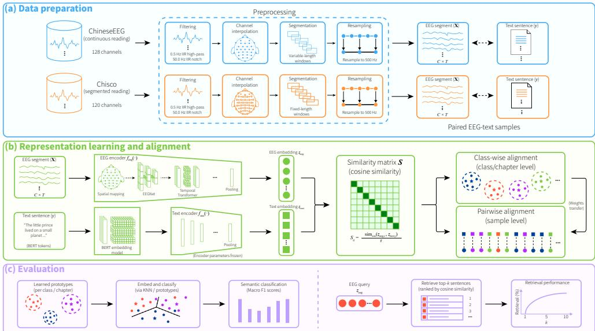
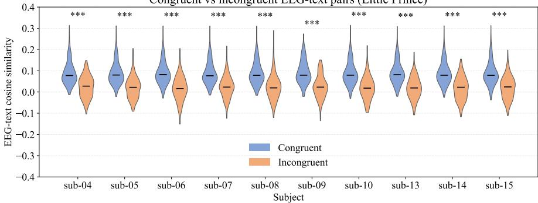
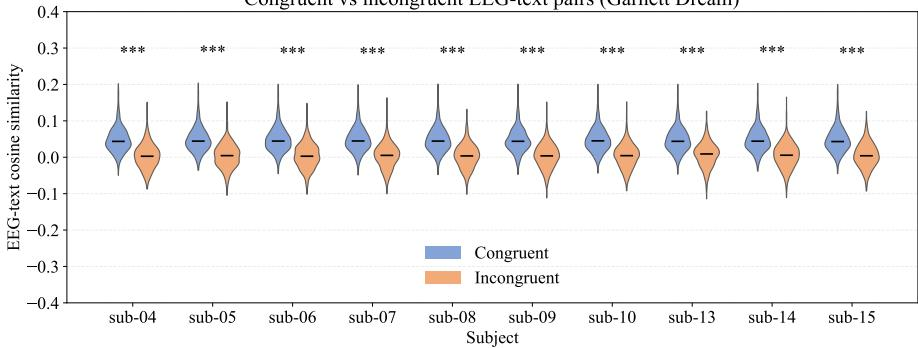
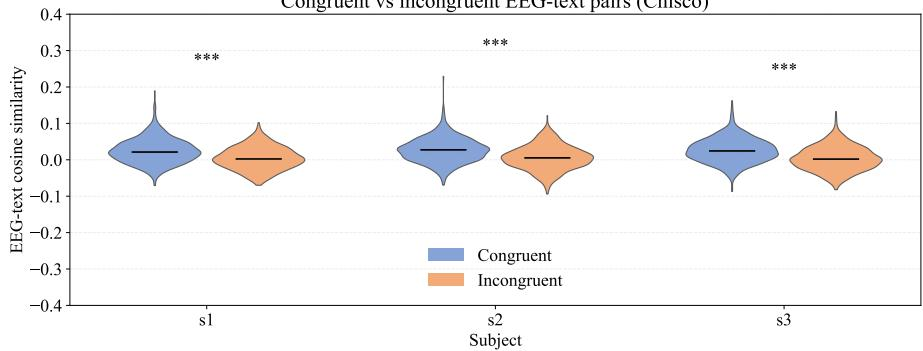
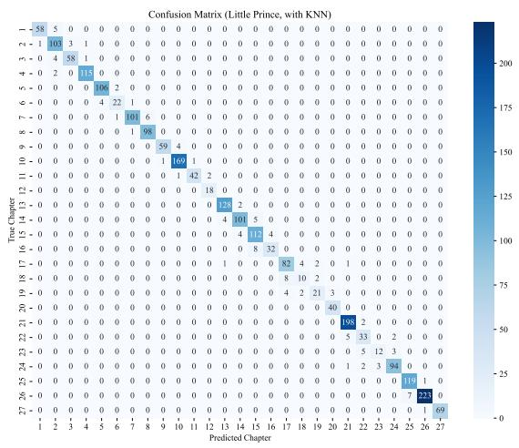
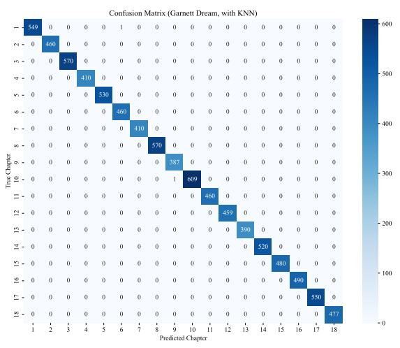
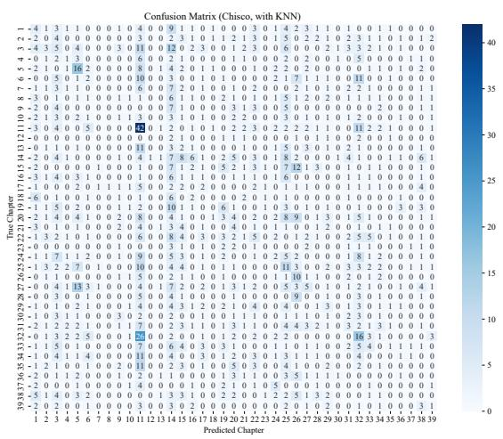
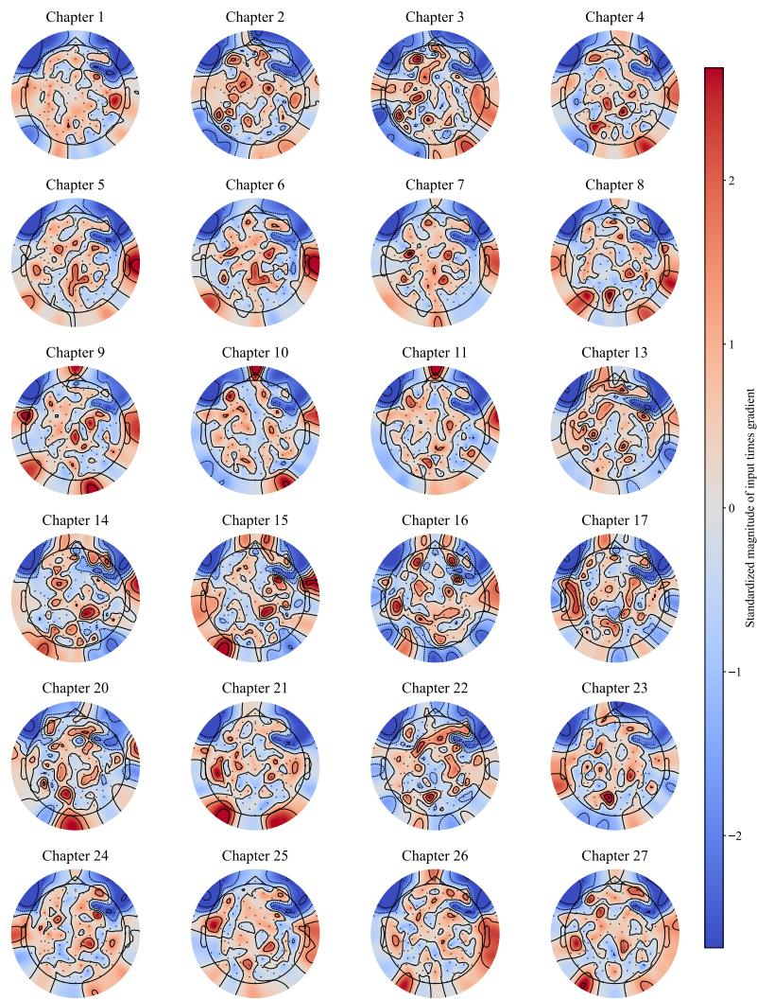

# Thought-deciphering via hierarchical EEG-to-text alignment

Xiaopeng Mao1\*, Morten Mørup2, Xin Xu³, Sang Wan Lee3,4,5,6,7, Sadasivan Puthusserypady1

1\*Department of Health Technology, Technical University of Denmark (DTU), Ørsteds Plads, Kongens Lyngby, 2800, Denmark.

2Department of Applied Mathematics and Computer Science, Technical University of Denmark (DTU), Richard Petersens Plads, Kongens Lyngby, 2800, Denmark.

3Department of Brain and Cognitive Sciences, Korea Advanced Institute of Science and Technology (KAIST), Daejeon, City, 34141, Republic of Korea.

4Center for Neuroscience-inspired AI, Korea Advanced Institute of Science and Technology (KAIST), Daejeon, City, 34141, Republic of Korea.

5Department of Bio and Brain Engineering, Korea Advanced Institute of Science and Technology (KAIST), Daejeon, City, 34141, Republic of Korea.

6Kim Jaechul Graduate School of AI, Korea Advanced Institute of Science and Technology (KAIST), Daejeon, City, 34141, Republic of Korea.

7Graduate School of Data Science, Korea Advanced Institute of Science and Technology (KAIST), Daejeon, City, 34141, Republic of Korea.

\*Corresponding author(s). E-mail(s): xiama@dtu.dk; Contributing authors: mmor@dtu.dk; sarahxu0811@kaist.ac.kr; sangwan@kaist.ac.kr; sapu@dtu.dk;

## Abstract

Communication is important for our well-being, but it can be impaired by disabilities, such as locked-in syndrome (LIS), cerebral palsy (CP), and dysarthria.

Non-invasive brain-to-text brain-computer interfaces (BCIs) offer a promising solution by providing an alternative communication pathway for people with communication disabilities. However, most recent breakthroughs have relied on large, cumbersome, and costly neuroimaging modalities, such as functional magnetic resonance imaging (fMRI) and magnetoencephalography (MEG). Numerous studies have attempted decoding using the lighter and cheaper electroencephalography (EEG), but the results remain inferior compared to the other modalities. More importantly, we do not understand how these modalities are related to text at the letter, word, sentence, and higher semantic levels.

Many prior studies have focused on decoding below the sentence level because it is considerably easier to design an experiment around phonemes, letters, and words. However, during communication, sentences play a much more important role than words and letters. This is because sentences carry information at such a high level that they can be understood even if some words and letters are missing. However, within sentence-level decoding, sentence classification is not as well investigated as sentence generation, making it difficult to decide whether a sentence should be retrieved or generated in the context of EEG-to-text decoding. This paper strives to investigate sentence-level EEG-to-text classification via a novel hierarchical alignment framework, where the main goal is to retrieve a read sentence using its context and EEG as inputs. We hypothesize that higherlevel semantic information, such as the general topic or context of a sentence, can be more easily captured from EEGs than the sentence itself. More specifically, we define a topic or context of related sentences as a semantic class and propose a hierarchical two-stage approach in which semantic class information guides subsequent sentence retrieval. In stage 1, EEG representations are aligned with broader semantic classes, such as topics containing semantically related sentences or story chapters. In stage 2, sentence-level EEG–text alignment is used to identify the corresponding sentence within the predicted semantic class. By narrowing down the semantic search space from classes to sentences, this approach aims to facilitate sentence-level decoding while reducing noise among differentclass sentences. Among over 2,000 unique text samples, the best average top-5 and top-10 retrieval accuracies are $6 2 . 6 \% \pm 1 . 0 \%$ and $8 3 . 5 \% \pm 1 . 0 \%$ respectively, with $6 5 . 4 \% \pm 1 . 0 \%$ and $8 7 . 4 \% \pm 1 . 8 \%$ for the best-performing subjects. On the contrary, a direct and unstaged EEG-sentence alignment only achieved an average top-5 and top-10 retrieval accuracies of 50.3% ± 2.3% and 68.3% ± 2.0%, respectively. A subsequent qualitative analysis shows that decoding effectiveness depends heavily on the context of the text. In short, our study suggests that a hierarchical decoding approach from a higher abstract level to a lower concrete level is promising for establishing an effective EEG-to-text BCI.

Keywords: Thought-deciphering, Brain-computer interface, Representation learning, EEG-to-text alignment

## 1 Introduction

A brain-computer interface (BCI) is a technology that enables communication between the brain and an external device. To date, numerous BCIs have been developed to translate people's thoughts into simple actions such as moving a prosthesis, pressing a button, etc. [1-7]. More recently, the focus has shifted towards direct thought-to-text generation [8-14|. So far, significant success has been achieved in invasive BCIs using either imagined handwriting or speech [15-21]. For example, Willett et al. demonstrated in a single-subject study that efficient communication can be established via imagined handwriting [20]. This is because invasive BCIs benefit from direct access to cortical activity, which enables higher-quality neural recordings [22, 23]. Nevertheless, invasive BCIs require surgical implantation, are costly, and are suitable for only a small subset of individuals with communication disabilities. Consequently, there is a need for non-invasive brain-to-text BCIs that can support people with varying degrees of communication impairment who either cannot or do not wish to undergo surgery. The most common non-invasive options include functional magnetic resonance imaging (fMRI), functional near-infrared spectroscopy (fNIRS), functional ultrasound (fUS). magnetoencephalography (MEG), and electroencephalography (EEG). With the help of fMRI, it becomes clear that thought can be decoded from different brain areas [24- 27]. For example, Huth et al. found using fMRI that different brain areas could be mapped to different semantic categories [24], while Tang et al. showed that the brain produced similar responses when a subject was watching a movie, and when the subject was listening to the story of the movie [27]. Compared to fMRI, there are much fewer brain-to-text studies using fNIRS and fUS. In the case of fNIRS, it has been shown that while fNIRS has limited temporal resolution, it is capable of capturing linguistic information from the brain [28-32]. fUS, on the other hand, has yet to be used on brain-to-text-related tasks, although a combination of fUS and EEG works fairly well on motor imagery-related tasks [33]. The remaining brain-to-text literature has considered MEG and EEG. Notably, several recent MEG-based studies have demonstrated its high effectiveness in brain decoding [34-38]. For example, Défossez et al. reported a maximum top-10 MEG-to-audio classification accuracy of 70.7%, whereas EEG achieved only 25.7% [38]. However, it is well-known that MEG is bulkier and much more expensive than EEG. As for EEG, recent literature has focused mainly on text classification and generation. The text classification tasks mainly involve classifying simple linguistic units, such as phonemes and words [7, 39–47]. On the other hand, the text generation task has focused on using a large language model (LLM), such as a bidirectional and auto-regressive transformer (BART) to output text directly after taking EEG as input [8-14]. However, the so-called teacher forcing has often been used in these studies, meaning ground truth text has been used in both training and test stages [48]. This is because direct text generation depends heavily on the previous generations. If a previous word is wrong, the subsequent generation also more likely will be wrong. Hence, it is still difficult to generate text reliably in the test phase without using teacher forcing. So far, only a few studies have focused on sentence-level classification [49, 50]. For example, Barua et al. have achieved high classification accuracies on 20 common Turkish sentences [49]. However, a corpus of 20 sentences is very limited for daily communication. In another study, Yang et al. reconstructed sentences using retrieval-augmented generation (RAG) by aligning EEG with sentence keywords, but they aligned EEG and text at the word level and not the sentence level [50].

In this study, we define a topic or context of related sentences as a semantic class. We hypothesize that EEGs are much easier to discriminate between semantic classes than sentences, and the class-level information can be used to guide the sentence-level EEG-text alignment and classification. This approach bypasses teacher forcing completely and focuses on retrieving the target sentence, which is much more informative compared to phoneme, letter, or word-level decoding. We have developed and validated our approach on two public EEG-text datasets, namely, the ChineseEEG and Chinese imagined speech corpus (Chisco) datasets [51, 52]. The workflow of the entire study can be viewed in Fig. 1.

  
Fig. 1: Flow diagram of the study. Two different raw reading EEG datasets are used. A simple and fast preprocessing strategy is applied to both datasets (a). An EEG encoder converts an EEG sample into a 256-dimensional embedding, which is contrastively aligned with the corresponding text embedding at a class level. The encoded embeddings are used for semantic classification. Subsequently, a retrieval model is used to align EEG embeddings with text embeddings at a sentence level (b). For evaluation, the semantic classifier is evaluated using macro F1 scores, while the retriever limits its text search within the predicted class to find the target sentence (c).

## 2 Results

## 2.1 Classification and retrieval evaluation

To bridge the gap between EEG and text, we have performed the EEG-to-text alignment at the class- and sentence-level, where different conversation topics and book chapters are treated as classes. This is illustrated in Fig. 1b, right, where both the class-level and the sentence-level alignments are done using contrastive learning. It is important to note that the text encoder is trained alone and frozen to enforce a fixed target (Fig. 1b, left bottom). On the other hand, the class-level alignment precedes the sentence-level alignment, so the weights can be transferred from the classification encoder to the retrieval encoder. Correspondingly, for the evaluation, an EEG sample is first classified into a semantic class, and its sentence is retrieved afterwards (Fig. 1c, from left to right). For the 27-chapter short novel, The Little Prince, from the ChineseEEG dataset, the average classification macro F1 score is $9 0 . 8 \% \pm \ : 0 . 4 \%$ (mean $[ \% ] \pm$ standard deviation [%]). The top-1, top-5, and top-10 retrieval accuracies are $2 0 . 0 \% \pm 1 . 5 \% , 6 2 . 6 \% \pm 1 . 0 \%$ , and $8 3 . 5 \% \pm 1 . 0 \%$ , respectively. For the 19-chapter long novel, Garnett Dream, the average classification macro F1 score is $1 0 0 . 0 \% \pm$ 0.0% with the top-1, top-5, and top-10 retrieval accuracies of $6 . 0 \% \pm 0 . 3 \% , 2 5 . 3 \% \pm$ 0.4%, and $4 2 . 6 \% \pm 0 . 9 \%$ , respectively. Lastly, the best performance achieved on the 39-class Chisco dataset is a macro F1 score of 5.8% ± 1.1%, and top-1, top-5, and top-10 retrieval accuracies of $0 . 9 \% \pm 0 . 1 \%$ , 3.7% ± 0.6%, and 5.9% ± 1.2%, respectively (Table 1). The confusion matrices of these results are shown in Fig. A1. Although the the performance on Chisco is much lower than on ChineseEEG, it still surpasses the model from the Chisco paper [52] (Tables 5 and D4, last row). The low performance on Chisco is mainly due to the low separation between the classes. In Table B1, last column, it can be seen that the top-1, top-5, and top-10 retrieval accuracies on Chisco can be as high as of $1 2 . 2 \% \pm 0 . 3 \%$ $4 7 . 6 \% \pm 0 . 6 \%$ , and $7 5 . 4 \% \pm 1 . 5 \%$ under perfect classification. Please note that the classification results in the original Chisco paper were achieved using an approximately 80/20 deterministic trial-level split, rather than the strictly non-overlapping split used in this study [52]. More importantly, they had used the imagining part of EEG instead of the reading part as done in this study. Hence, we have retrained the model from this paper for a fair comparison (Tables 5 and D4, last row). For this study, every retrieval evaluation is done upon the classification inference in a completely hierarchical manner, meaning that the class predictions are used to retrieve the output sentences. To give an idea of how good these results are, we recall that Défossez et al. achieved top-1 classification accuracies of 5.0% and 5.2% on two EEG-audio datasets and 41.3% and 36.8% on two MEG datasets, while their top-10 classification accuracies are 25.7% and 17.7% for the two EEG datasets and 70.7% and 67.5% for the two MEG datasets [38, 53–56]. Interestingly, while their top-1 results from the MEG datasets remain superior, our top-10 retrieval accuracy of 83.5% ± 1.0% has outperformed them by far. Furthermore, with ChineseEEG, The Little Prince, we have found that the top-10 retrieval accuracy is $8 7 . 4 \% \pm 1 . 8 \%$ for the best-performing subject and $7 2 . 2 \% \pm 1 . 9 \%$ for the worst-performing subject (Table 2). The subject-wise results for Garnett Dream and Chisco can be found in Tables C2 and C3 in the appendix.

## 2.2 Statistical analysis

To assess the effectiveness of EEG-to-text alignment, we have compared the cosine similarities of matched and unmatched EEG-text pairs. For computing the cosine similarity of an unmatched pair, one EEG embedding is paired up with a text embedding from a different class. The statistical comparison is done using the Wilcoxon signedrank test with a one-sided alternative hypothesis and Holm-correction [57, 58]. Here, all the subjects from ChineseEEG and Chisco show significant differences (p-values << 0.05, Tables 3 and 4). This is a huge improvement compared to our previous study, where only 4 out of 9 subjects were significant [58]. Lastly, it is clear that the cosine similarity gaps of The Little Prince are larger than both Garnett Dream and Chisco (Table 3, column 2).

Table 1: Results on ChineseEEG and Chisco. The numbers are means (%) ± standard deviations (%). For ChineseEEG, the book chapters are used as classes. For Chisco, the semantic classes from its publication were reused. Firstly, all the EEG samples are classified by the semantic classifier. Secondly, the corresponding text samples are retrieved within their predicted class by the retriever.
<table><tr><td>Datasets</td><td>ChineseEEG - short novel (Little Prince)</td><td>ChineseEEG - long novel (Garnett Dream)</td><td>Chisco - daily phrases</td></tr><tr><td>Macro F1 (Class labels)</td><td> $9 0 . 8 \pm 0 . 4$ </td><td> ${ \bf 1 0 0 . 0 \ : \pm { \ : 0 . 0 } }$ </td><td> $5 . 8 \pm 1 . 1$ </td></tr><tr><td>Retrieval at 1 (Sentence labels)</td><td> ${ \bf 2 0 . 0 \pm 1 . 5 }$ </td><td> $6 . 0 \pm 0 . 3$ </td><td> $0 . 9 \pm 0 . 1$ </td></tr><tr><td>Retrieval at 5 (Sentence labels)</td><td> ${ \bf 6 2 . 6 \pm 1 . 0 }$ </td><td> $2 5 . 3 \pm 0 . 4$ </td><td> $3 . 7 \pm 0 . 6$ </td></tr><tr><td>Retrieval at 10 (Sentence labels)</td><td> ${ \bf 8 3 . 5 \ \pm 1 . 0 }$ </td><td> $4 2 . 6 \pm 0 . 9$ </td><td> $5 . 9 \pm 1 . 2$ </td></tr></table>

Table 2: Subject-wise results on ChineseEEG, The Little Prince. The numbers are means (%) ± standard deviations (%). The overall best-performing subject is sub-07, while the worst-performing subject is sub-15.
<table><tr><td>Subject</td><td>Macro F1 (Class labels)</td><td>Retrieval at 1 (Sentence labels)</td><td>Retrieval at 5 (Sentence labels)</td><td>Retrieval at 10 (Sentence labels)</td></tr><tr><td>sub-04</td><td> $9 2 . 1 \pm 2 . 5$ </td><td> $1 9 . 8 \pm 1 . 3$ </td><td> $6 4 . 1 \pm 1 . 6$ </td><td> $8 5 . 4 \pm 1 . 2$ </td></tr><tr><td>sub-05</td><td> $9 4 . 8 \pm 1 . 4$ </td><td> $2 0 . 3 \pm 1 . 2$ </td><td> $6 5 . 2 \pm 1 . 1$ </td><td> $8 5 . 4 \pm 2 . 1$ </td></tr><tr><td>sub-06</td><td> $9 2 . 3 \pm 2 . 4$ </td><td> $2 0 . 7 \pm 3 . 0$ </td><td> $6 3 . 6 \pm 1 . 5$ </td><td> $8 5 . 2 \pm 0 . 5$ </td></tr><tr><td>sub-07</td><td> ${ \bf 9 6 . 2 \pm 2 . 8 }$ </td><td> ${ \bf 2 1 . 3 \pm 0 . 8 }$ </td><td> $6 4 . 9 \pm 1 . 0$ </td><td> ${ \bf 8 7 . 4 \pm 1 . 8 }$ </td></tr><tr><td>sub-08</td><td> $9 2 . 4 \pm 2 . 1$ </td><td> $1 9 . 4 \pm 2 . 4$ </td><td> ${ \bf 6 5 . 4 } \pm { \bf 1 . 0 }$ </td><td> $8 6 . 4 \pm 1 . 0$ </td></tr><tr><td>sub-09</td><td> $8 9 . 5 \pm 3 . 5$ </td><td> $2 0 . 8 \pm 1 . 2$ </td><td> $6 2 . 3 \pm 0 . 4$ </td><td> $8 0 . 2 \pm 2 . 7$ </td></tr><tr><td>sub-10</td><td> $8 9 . 3 \pm 2 . 9$ </td><td> $1 9 . 9 \pm 1 . 0$ </td><td> $6 2 . 2 \pm 1 . 7$ </td><td> $8 3 . 1 \pm 2 . 7$ </td></tr><tr><td>sub-13</td><td> $9 2 . 3 \pm 2 . 5$ </td><td> $2 0 . 9 \pm 1 . 3$ </td><td> $6 4 . 6 \pm 1 . 4$ </td><td> $8 4 . 8 \pm 3 . 0$ </td></tr><tr><td>sub-14</td><td> $8 9 . 8 \pm 1 . 3$ </td><td> $2 0 . 3 \pm { 1 . 8 }$ </td><td> $6 2 . 2 \pm 1 . 4$ </td><td> $8 3 . 6 \pm 0 . 8$ </td></tr><tr><td>sub-15</td><td> $7 0 . 6 \pm 4 . 5$ </td><td> $1 6 . 8 \pm 2 . 2$ </td><td> $5 1 . 1 \pm 4 . 3$ </td><td> $7 2 . 2 \pm 1 . 9$ </td></tr></table>

Table 3: Cosine similarity gaps and their significances for ChineseEEG between matched and unmatched EEG-text pairs. The unmatched pairs are constructed using different classes. Wilcoxon signed-rank tests are used with Holm-correction to compute the p-values. All p-values are highly significant p-value << 0.05.
<table><tr><td>ChineseEEG - short novel (Little Prince)</td><td>Mean cosine similarity gap</td><td>p-value</td><td>ChineseEEG - long novel (Garnett Dream)</td><td>Mean cosine similarity gap</td><td>p-value</td></tr><tr><td>sub-04</td><td> $6 . 5 \cdot 1 0 ^ { - 2 }$ </td><td> $4 . 1 \cdot 1 0 ^ { - 2 9 }$ </td><td>sub-04</td><td> $4 . 5 \cdot 1 0 ^ { - 2 }$ </td><td> $7 . 2 \cdot 1 0 ^ { - 1 0 1 }$ </td></tr><tr><td>sub-05</td><td> $6 . 8 \cdot 1 0 ^ { - 2 }$ </td><td> $4 . 1 \cdot 1 0 ^ { - 2 9 }$ </td><td>sub-05</td><td> $4 . 4 \cdot 1 0 ^ { - 2 }$ </td><td>9.4 · 10−100</td></tr><tr><td>sub-06</td><td>7.2 · 10−2</td><td>6.8 · 10−28</td><td>sub-06</td><td>4.5 · 10−2</td><td>5.5· 10-98</td></tr><tr><td>sub-07</td><td>6.4 · 10−2</td><td>4.8· 10−26</td><td>sub-07</td><td>4.5 · 10−2</td><td>7.2· 10−101</td></tr><tr><td>sub-08</td><td>6.6 · 10−2</td><td>4.8· 10−26</td><td>sub-08</td><td>4.5· 10−2</td><td>6.1· 10−101</td></tr><tr><td>sub-09</td><td>6.8 · 10−2</td><td>1.1 · 10−14</td><td>sub-09</td><td>4.5 · 10−2</td><td>1.4· 10−98</td></tr><tr><td>sub-10</td><td>7.0 · 10−2</td><td>1.0 · 10−27</td><td>sub-10</td><td>4.5 · 10−2</td><td>3.1·10−100</td></tr><tr><td>sub-13</td><td>7.1 · 10−2</td><td>2.8 · 10−27</td><td>sub-13</td><td>4.1 · 10−2</td><td>9.0· 10−94</td></tr><tr><td>sub-14</td><td>7.2 · 10−2</td><td>7.0· 10-28</td><td>sub-14</td><td>4.4 · 10−2</td><td>5.5· 10−98</td></tr><tr><td>sub-15</td><td> $6 . 7 \cdot 1 0 ^ { - 2 }$ </td><td>4.4 · 10−27</td><td>sub-15</td><td>4.3 · 10−2</td><td>2.1·10−88</td></tr></table>

## 2.3 Ablation studies

The semantic classification is done using a trained EEG encoder and the k-nearest neighbors algorithm (KNN) [59], where k is estimated on the validation set. We have conducted ablation studies on the most important components, including KNN and pairwise, class-wise, and joint alignment. Without KNN, we perform the classification simply by finding the cosine similarity between the EEG embedding and the mean (prototype) embedding of each class. The macro F1 scores and the top-1 retrieval results are presented in Tables 5, while the remaining results can be seen in Table D4. These results show a substantial performance gap between the models with and without KNN. More specifically, macro F1 scores improve greatly when KNN is used (from 68.8% ± 0.9% to 90.8% ± 0.4% for The Little Prince and from 1.9% ± 0.3% to $4 . 4 \% \pm 0 . 8 \%$ for Chisco). This indicates that smaller clusters are formed within each semantic class. On the other hand, Chisco seems to benefit from the pairwise alignment more than from the hierarchical alignment strategy. Once again, this indicates that there is poor separation between the Chisco classes.

Table 4: Cosine similarity gaps and their significances for Chisco between matched and unmatched EEG-text pairs. The unmatched pairs are constructed using different classes. Wilcoxon signedrank tests are used with Holm-correction to compute the p-values. All p-values are highly significant p-value $< < 0 . 0 5 .$
<table><tr><td>Chisco - daily phrases</td><td>Mean cosine similarity gap</td><td>p-value</td></tr><tr><td>s1</td><td> $2 . 0 \cdot 1 0 ^ { - 2 }$ </td><td> $1 . 5 \cdot 1 0 ^ { - 2 1 }$ </td></tr><tr><td>s2</td><td> $2 . 1 \cdot 1 0 ^ { - 2 }$ </td><td> $1 . 5 \cdot 1 0 ^ { - 2 1 }$ </td></tr><tr><td>s3</td><td> $2 . 2 \cdot 1 0 ^ { - 2 }$ </td><td> $4 . 3 \cdot 1 0 ^ { - 2 3 }$ </td></tr></table>

Table 5: Ablation studies on the short novel of ChineseEEG and the entire Chisco dataset. The parameter k of KNN is estimated using the validation set and tested on the test set. The numbers are means (%) ± standard deviations (%).
<table><tr><td>Dataset</td><td>ChineseEEG - short novel (Little Prince)</td><td></td><td>Chisco - daily phrases</td><td></td></tr><tr><td>Metric</td><td>Macro F1 (Class labels)</td><td>Retrieval at 1 (Sentence labels)</td><td>Macro F1 (Class labels)</td><td>Retrieval at 1 (Sentence labels)</td></tr><tr><td>Chance level for hierarchical framework</td><td> $3 . 4 \pm 0 . 0$ </td><td> $0 . 4 \pm 0 . 0$ </td><td> $2 . 5 \pm 0 . 0$ </td><td> $0 . 2 \pm \ : 0 . 0$ </td></tr><tr><td>Random model</td><td> $0 . 5 \pm 0 . 5$ </td><td> $0 . 3 \pm 0 . 3$ </td><td> $1 . 5 \pm 0 . 6$ </td><td> $0 . 2 \pm 0 . 1$ </td></tr><tr><td>Base model</td><td> $6 8 . 8 \pm 0 . 9$ </td><td> $1 6 . 2 \pm 1 . 3$ </td><td> $1 . 9 \pm 0 . 3$ </td><td> $0 . 4 \pm 0 . 1$ </td></tr><tr><td>+ KNN + Hierarchical alignment</td><td> ${ \bf 9 0 . 8 \ : \pm \ : 0 . 4 }$ </td><td> ${ \bf 2 0 . 0 \pm 1 . 5 }$ </td><td> $4 . 4 \pm 0 . 8$ </td><td> $0 . 5 \pm 0 . 2$ </td></tr><tr><td>+ KNN + Class-wise alignment</td><td> ${ \bf 9 0 . 8 \ : \pm \ : 0 . 4 }$ </td><td> $1 0 . 0 \pm 0 . 4$ </td><td> $4 . 4 \pm 0 . 8$ </td><td> $0 . 4 \pm 0 . 1$ </td></tr><tr><td>+ KNN + Pairwise alignment</td><td> $6 9 . 7 \pm 2 . 6 $ </td><td> $1 6 . 2 \pm 0 . 8$ </td><td> ${ \bf 5 . 8 \pm 1 . 1 }$ </td><td> ${ \bf 0 . 9 \pm 0 . 1 }$ </td></tr><tr><td>+ KNN + Joint alignment</td><td> $7 7 . 0 \pm 1 . 9$ </td><td> $1 5 . 3 \pm 1 . 2$ </td><td> $5 . 1 \pm 1 . 9$ </td><td> $0 . 6 \pm \ : 0 . 2$ </td></tr><tr><td>Zhang et al. [52]</td><td>NA</td><td>NA</td><td> $4 . 8 \pm 0 . 6$ </td><td>NA</td></tr></table>

## 2.4 Qualitative analysis of EEG-to-text alignment

To assess the effectiveness of EEG-to-text alignment, we have visualized the distributions of the matched (congruent) and unmatched (incongruent) EEG-text pairs in Fig. 2. Here, it can be seen that for all subjects, the congruent pairs are significantly different from the incongruent pairs and are skewed toward more positive cosine similarities. On the other hand, we have looked into the class-wise topographic maps for ChineseEEG and Chisco using the input × gradient approach described in [60]. However, it is difficult to interpret these maps because they are noisy and inconsistent. This may be due to the fact that different brain areas contribute heterogeneously to represent different semantics [24]. Nonetheless, the visualization method is described in Section D.1, and the topographic maps are visualized in Fig. D2 using MNE-Python [61].

## 3 Methods

## 3.1 Research questions

In this study, we aim to investigate whether a congruent space can be created between text and EEG, and how such a space contributes to an EEG-to-text translation task. We tackle the EEG-to-text alignment problem using a divide-and-conquer approach: a class-level alignment focusing on distinguishing semantic classes, while a sentence-level alignment focusing on a strict matching between each EEG-text pair, so a sentence can be retrieved using its EEG as input. In short, our main contributions include a two-stage hierarchical EEG-to-text alignment framework, a semantic EEG classifier, and a text retriever.

## 3.2 Datasets

In the literature, there are many different EEG-to-text datasets. However, almost all the datasets were collected using different paradigms or languages. For example, a variety of the datasets were collected while participants were listening to speech in either English, Chinese, or Japanese [53, 54, 62–65]. Another category of datasets records EEG signals while participants view images [66–71]. In contrast, other datasets are collected during reading or imagining tasks [51, 52, 72–76]. After reviewing the available studies, we selected the recently released ChineseEEG and Chisco datasets because of their large scale and categorical structure [51, 52]. ChineseEEG contains continuous EEG-text samples collected from 10 participants while reading a short novel, The Little Prince, with 27 chapters, and a long novel, Garnett Dream, with 19 chapters. The study was approved by the Institutional Review Board of the University of Macau under approval No. BSERE20-APP011-ICI [51]. For this study, we have defined each chapter as a semantic class and removed duplicate sentences across chapters. As for Chisco, EEG-text samples were collected from 3 subjects, while they were reading daily phrases. The data collection was approved by the Ethics Commission of Harbin Institute of Technology under approval number HIT2024035 [52]. In [52], the EEGtext pairs were already divided into 39 semantic classes. Hence, the same class labels are reused. The details regarding these two datasets are summarized in Table 6.

Congruent vs incongruent EEG-text pairs (Little Prince)  
  
(a)

Congruent vs incongruent EEG-text pairs (Garnett Dream)  
  
(b)

Congruent vs incongruent EEG-text pairs (Chisco)  
  
(c)  
Fig. 2: Violing plots comparing congruent and incongruent EEG-text pairs. The comparison has been done on ChineseEEG, The Little Prince, (a), Garnett Dream, (b), and Chisco, (c). For each subject, the congruent pairs are significantly different than the incongruent pairs (marked by three asterisks).

Table 6: Overview of the two datasets. ChineseEEG is further divided into two subsets, a short novel (The Little Prince) and a long novel (Garnett Dream).
<table><tr><td>Dataset</td><td>No. of subjects</td><td>Classes</td><td>Montage</td><td>Text genre</td><td>No. of unique texts</td><td>No. of channels</td><td>Sampling rate (EEG)</td></tr><tr><td>ChineseEEG</td><td>10</td><td>27 and 19</td><td>Geodesic</td><td>Novel sentences</td><td>2,464 (Little Prince) 9,534 (Garnett Dream)</td><td>128</td><td>1,000 Hz</td></tr><tr><td>Chisco</td><td>3</td><td>39</td><td>10-20 system</td><td>Daily phrases</td><td>6,566</td><td>128</td><td>1,000 Hz</td></tr></table>

## 3.3 Preprocessing

We observed that Chisco and ChineseEEG employ different preprocessing pipelines, and studies using the preprocessed ChineseEEG dataset have generally reported modest performance [51, 52, 77-79]. Although both datasets were curated using expert-guided evaluations [51, 52], relying on expert assessment for every EEG recording is impractical and costly in real-world applications. To address this limitation, we developed a simpler and more scalable preprocessing pipeline that can be applied not only to Chisco and ChineseEEG but also to future EEG-text datasets (Fig. 1a, from left to right).

## 3.3.1 Bad channel interpolation

In the Chisco paper, bad channels were detected using the random sample consensus (RANSAC) framework. We have replaced this step without RANSAC using the NoisyChannels module from the pyprep.find\_noisy\_channels framework.

## 3.3.2 Filtering

The raw EEG recordings were first filtered using an 8th-order zero-phase infinite impulse response (IIR) Butterworth high-pass filter with a cutoff frequency of 0.5 Hz. In the original ChineseEEG study, band-pass filtering in the ranges of 0.5-30 Hz and 0.5-80 Hz was applied, thereby removing higher-frequency components of the EEG signal. In contrast, the Chisco dataset employed a substantially higher-order finite impulse response (FIR) high-pass filter, which may increase the risk of filter-induced artifacts. To suppress 50 Hz power-line interference, we applied a 16th-order zerophase IIR Butterworth notch filter with cutoff frequencies of 49.38 Hz and 50.62 Hz. Throughout the preprocessing, we exclusively used IIR filters because they can achieve attenuation characteristics comparable to those of FIR filters while requiring substantially lower filter orders, resulting in greater computational efficiency [80] (Fig. 1a, middle).

## 3.3.3 Segmentation and normalization

For this part, the respective segmentation strategies were applied to the two datasets. For Chisco, every EEG was recorded in a controlled manner with fixed duration of 5.0 s for a reading part and 3.3 s for an imagining part. On the other hand, ChineseEEG was recorded in a continuous way, where multiple sentences were shown to the participant at the same time.

Lastly, each EEG channel has been z-score-normalized and zero-padded to a unit length of 2501 data points (5.0 s), which matches the longest samples from both datasets.

## 3.3.4 Channel consolidation

Although ChineseEEG and Chisco were both recorded using 128 channels, their EEG systems differ in terms of channel layouts (Table 6, column 4). ChineseEEG is based on a geodesic system, which has different channel names and placement compared to the 10-20 convention used by Chisco [51, 52]. After reviewing both layouts, we have chosen the 10-20 system layout from Chisco as the standard layout. After removing 8 non-EEG and abnormal channels, the final input dimensions are $1 2 0 \times T .$ with T being the number of data points. To convert the layout of ChineseEEG into this standard layout, we introduce a trainable mapping matrix, $W \in \mathbb { R } ^ { 1 2 0 \times 1 2 8 }$ . Multiplying W with the ChineseEEG signals projects them into the same dimensional space as the Chisco dataset.

## 3.4 Model

The hierarchical model consists of an EEG classifier and a text retriever. The EEG classifier aims to distinguish the coarse-level semantic categories of EEG, while the text retriever performs a fine-level retrieval by searching for the target sentence within all the samples of the same class. We have used a simple and identical architecture for the classifier and the retriever, which consists of an EEGNet feature extractor and a transformer encoder [81, 82]. The final output is projected onto a 256-dimensional EEG embedding that can be contrastively aligned with the BERT embedding, which is also projected onto a 256-dimensional embedding space [51, 83]. This compressed embedding size is determined empirically and is necessary to save computation. We also experimented with newer architectures and pretrained foundation models, such as the patched brain transformer (PBT), BERT-inspired neural data representations (BENDR), and large brain model (LaBraM) but did not achieve superior performance [84-86]. Therefore, we adopt a simpler architecture to limit the number of trainable parameters. The transformer layer effectively handles variable-length EEG recordings by not paying attention to zero-padded parts. We also investigated attention pooling, in which tokenized temporal features are aggregated using learned attention weights. However, this approach did not yield a meaningful performance improvement. Consequently, we employ mean pooling in the final model. To train the classification and retrieval encoders, we first pretrain a text encoder, which serves as the teacher model during training.

## 3.4.1 Teacher model

To reduce computation, preserve the semantic information contained in the text, and improve training stability, we train a text autoencoder (AE) to compress the text embeddings from 768 to 256 dimensions. We have used the cosine similarity loss as the

reconstruction loss to preserve semantic information [58]. Subsequently, the reconstruction decoder is removed from the trained text AE, and the encoder is frozen to provide semantic guidance for the EEG encoder during class-wise and pairwise alignment.

## 3.4.2 Class-wise alignment

For classification, the training objective is a class-wise contrastive loss between EEG and text embeddings. We have defined the objective, $\mathcal { L } _ { s u p c o n }$ , using the supervised contrastive (SupCon) loss similar to [87]. This means that all EEG-text pairs from the same semantic class are treated as positives, while the EEG-text pairs belonging to other classes are treated as negatives:

$$
\mathcal { L } _ { s u p c o n } ( Z _ { e e g } , Z _ { t e x t } ) = \sum _ { i \in I } \frac { - 1 } { | P ( i ) | } \sum _ { p \in P ( i ) } \log \frac { \exp { \left( \frac { \sin _ { \mathrm { c o } } \left( z _ { e e g , i } , z _ { t e x t , p } \right) } { \tau } \right) } } { \sum _ { a \in A ( i ) } \exp { \left( \frac { \sin _ { \mathrm { c o } } \left( z _ { e e g , i } , z _ { t e x t , a } \right) } { \tau } \right) } } ,\tag{1}
$$

$$
\begin{array} { r } { \sin _ { \mathrm { c o s } } ( z _ { e e g , i } , z _ { t e x t , p } ) = \frac { z _ { e e g , i } \cdot z _ { t e x t , p } } { | | z _ { e e g , i } | | | z _ { t e x t , p } | | } , } \end{array}\tag{2}
$$

where ${ \cal Z } _ { e e g }$ and $\boldsymbol { Z } _ { t e x t }$ are matrices containing all the EEG and text embeddings within a mini-batch. i contains all the indices of the samples. $P ( i )$ denotes all the EEG embeddings within one particular class, while $A ( i )$ denotes all text embeddings regardless of their classes. τ is the temperature. To achieve a congruent EEG-text space, a symmetrical SupCon loss is formulated [88, 89]:

$$
\mathcal { L } _ { s u p c o n } ^ { s y m } ( Z _ { e e g } , Z _ { t e x t } ) = \frac { \mathcal { L } _ { s u p c o n } ( Z _ { e e g } , Z _ { t e x t } ) + \mathcal { L } _ { s u p c o n } ( Z _ { t e x t } , Z _ { e e g } ) } { 2 } .\tag{3}
$$

We denote the pretrained text embeddings as $\tilde { Z } _ { t e x t }$ and define the class-wise alignment objective as $\mathcal { L } _ { c a } \mathrm { : }$

$$
\mathcal { L } _ { c a } = \mathcal { L } _ { s u p c o n } ^ { s y m } ( Z _ { e e g } , \tilde { Z } _ { t e x t } ) .\tag{4}
$$

To avoid the scenario where a batch contains too few samples from a class, a balanced batch sampler is used. If this is not done, some classes may be under-represented, rendering the class-wise loss ineffective. Finally, classification is done using the KNN algorithm upon EEG embeddings. The results are documented as macro F1 scores in Tables 1 and 2.

## 3.4.3 Pairwise alignment and retrieval

A pairwise alignment is performed between each EEG-text pair. Here, each pair is treated as positive, while all other pairs are treated as negative. For this purpose, a symmetric and pairwise alignment objective, $\mathcal { L } _ { p a } .$ has been defined based on the cross-modality information noise contrastive estimation (InfoNCE) [90, 91]. The mathematical formulation builds directly upon the standard InfoNCE loss described in [88, 89, 92, 93]. The important part is to reuse the model trained using $\mathcal { L } _ { c a }$ , so the retriever is fine-tuned upon the class-wise EEG encoder model:

$$
\begin{array} { r } { \mathcal { L } _ { i n f o n c e } ( \hat { \boldsymbol { Z } } _ { e e g } , \tilde { \boldsymbol { Z } } _ { t e x t } ) = - \mathbb { E } \left\{ \log \frac { \exp \Big ( \frac { \sin _ { \mathrm { c o s } } \left( \hat { z } _ { e e g , i } , \tilde { z } _ { t e x t , j } \right) } { \tau } \Big ) } { \sum _ { k \in N ( i ) } \exp \Big ( \frac { \sin _ { \mathrm { c o s } } \left( \hat { z } _ { e e g , i } , \tilde { z } _ { t e x t , k } \right) } { \tau } \Big ) } \right\} , } \end{array}\tag{5}
$$

$$
\mathcal { L } _ { p a } = \mathcal { L } _ { i n f o n c e } ^ { s y m } ( \hat { Z } _ { e e g } , \tilde { Z } _ { t e x t } ) ,\tag{6}
$$

where $\hat { Z } _ { e e g }$ denotes the semantically aligned EEG embeddings, and $N ( i )$ denotes all the negative samples. We have used the same balanced batch sampler to train the retrieval for consistency. To evaluate the retrieval, all test EEG samples are encoded by the classification encoder from Section 3.4.2. Subsequently, these class embeddings are classified using KNN. On the other hand, the retrieval encoder encodes the EEG samples into pairwise EEG embeddings. Within each predicted class, the sentence with the highest cosine similarity to the pairwise EEG embedding is retrieved. The results are shown in Tables 1 and 2.

## 3.5 Cross-validation and training details

Both datasets are split into a 70% training set, 20% validation set, and a 10% test set, where each split contains all subjects [38]. Furthermore, the data splits were constructed in a consistent and stratified manner, with no overlap in sentences. Consequently, each EEG-text pair appears in only one split, ensuring that test samples remain completely unseen throughout all training and validation stages. For ChineseEEG, the short- and long-novel datasets were trained and evaluated separately. The balanced batch sampler samples 4 classes with 32 EEG-text pairs in each class of a mini-batch. Hence, the batch size is 128. Both the hierarchical model and the text AE are trained using AdamW optimizers with a learning rate of $1 \times 1 0 ^ { - 4 }$ and $1 \times 1 0 ^ { - 5 }$ respectively [94]. These models are implemented using the Pytorch framework [95]. Early stopping is used to control the training epochs. The models are regularized using a weight decay of $1 \times 1 0 ^ { - 4 }$ and a dropout rate of $1 \times 1 0 ^ { - 1 } \ [ 9 6 , 9 7 ]$ . For any dataset, the training is repeated three times using different random seeds. An NVIDIA H100 graphics processing unit with 80 gigabytes of memory is used to train the models.

## 4 Discussion

## 4.1 Daily phrases versus coherent stories

For Chisco, EEGs were recorded for around 6,566 daily phrases (Table 6). All the phrases are divided into 39 semantic classes, while the phrases are provided without context and independently. On the other hand, ChineseEEG contains rich EEG-text recordings from two novels: 2,464 unique sentences from the short novel, The Little Prince, and 9,534 unique sentences from the long novel, Garnett Dream. The superior performance observed on both novels indicates that the brain responds more strongly to chapter sentences than daily phrases. This is also reflected in Fig. 2, where the gaps between the cosine similarities of congruent and incongruent EEG-text pairs are largest for ChineseEEG and smallest for Chisco.

Nonetheless, the classification result on Garnett Dream is superior to The Little Prince, while the latter outperforms the former on the retrieval metrics. This can be due to the fact that Garnett Dream contains way more sentences than The Little Prince, thus making the sample-wise identification more difficult.

Overall, this study shows that EEG-to-text decoding depends heavily on the context, which is reasonable. For example, the phrase “The story of Titanic is truly heartbreaking." can refer to both the real historical event and the famous 1997 movie. Without context, a piece of text can be understood ambiguously. In the case of EEG, which has a particularly low SNR, the semantic content may more easily become lost for a random daily greeting than for a famous quote from The Little Prince.

## 4.2 Comparison to the existing EEG-to-text literature

EEG-based brain-to-text BCIs are highly desirable because EEG is inexpensive, noninvasive, and portable. However, the inherently low SNR of EEG presents a significant challenge for brain decoding. Consequently, considerable effort has been devoted to developing EEG-to-text systems capable of generating natural language directly from neural signals [9–13, 98].

These studies are typically evaluated using text-generation metrics such as BLEU and ROUGE, which measure the similarity between generated and target sentences [99, 100]. While these metrics facilitate quantitative comparisons across models, their relationship to semantic comprehension remains unclear. In particular, it is not well understood what level of BLEU or ROUGE performance is required for a generated sentence to reliably convey its intended meaning, nor how the interpretability of the output degrades as these metrics decrease. As a result, improvements in benchmark scores do not necessarily translate into meaningful gains in practical communication.

Furthermore, relatively little attention has been paid to understanding the shared representational space between EEG and text, despite its importance for effective neural decoding. Bridging the modality gap between neural activity and linguistic representations remains a fundamental challenge that extends beyond text generation alone. We argue that progress in EEG-to-text research will require not only robust evaluation frameworks, but also deeper investigations into the representational and physiological mechanisms that link EEG signals to language. Our findings highlight the importance of studying these underlying relationships to enable more reliable and interpretable brain-to-text systems.

## 4.3 Perspective toward an EEG-to-text foundation model

The Little Prince was written by a French author, while Garnett Dream was written by a Chinese author. Therefore, the Chinese participants may be less familiar to the sentences of The Little Prince than to Garnett Dream. In the neuroscience literature, it has been found that unfamiliar and less predictive words increase the cognitive effort [101-105]. Furthermore, it is well documented that cognitive effort can be captured by EEG using either visual or auditory stimulus [106–109]. This difference in cognitive workload may have been the main cause for the high retrieval performance seen on The Little Prince. Nevertheless, when there is a lack of context in the text, like in Chisco, it is very difficult for the brain to even make cognitive effort. During our experimentation, we tried pretraining on ChineseEEG and fine-tuning on Chisco and vice versa. However, the results were worse than training and testing on them individually. As a result of these findings, a future EEG-to-text foundation model is more likely to be developed using coherent stories rather than context-less phrases.

## 5 Data availability

The experiments were conducted using the publicly available ChineseEEG and Chisco datasets, which are detailed in [51] and [52], respectively.

## 6 References

[1] Graimann, B., Allison, B.Z., Pfurtscheller, G.: Brain-computer Interfaces: Revolutionizing Human-computer Interaction. Springer, Berlin (2010)

[2] Wolpaw, J.R.: Brain-computer interfaces. In: Handbook of Clinical Neurology vol. 110, pp. 67–74. Elsevier, Amsterdam (2013)

[3] Allison, B.Z., Dunne, S., Leeb, R., Millán, J.D.R., Nijholt, A.: Towards Practical Brain-computer Interfaces: Bridging the Gap from Research to Real-world Applications. Springer, Berlin (2012)

[4] Rao, R.P.: Brain-computer Interfacing: an Introduction. Cambridge University Press, New York (2013)

[5] Nicolas-Alonso, L.F., Gomez-Gil, J.: Brain computer interfaces, a review. sensors 12(2), 1211–1279 (2012)

[6] Nam, C.S., Nijholt, A., Lotte, F.: Brain-computer Interfaces Handbook: Technological and Theoretical Advances. CRC press, Boca Raton (2018)

[7] Hernández-Del-Toro, T., Reyes-García, C.A., Villaseñor-Pineda, L.: Toward asynchronous eeg-based bci: Detecting imagined words segments in continuous eeg signals. Biomedical Signal Processing and Control 65, 102351 (2021)

[8] Lewis, M., Liu, Y., Goyal, N., Ghazvininejad, M., Mohamed, A., Levy, O., Stoyanov, V., Zettlemoyer, L.: Bart: Denoising sequence-to-sequence pre-training for natural language generation, translation, and comprehension. In: Proceedings of the 58th Annual Meeting of the Association for Computational Linguistics, pp. 7871–7880 (2020)

[9] Duan, Y., Zhou, J., Wang, Z., Wang, Y.-K., Lin, C.-t.: Dewave: Discrete encoding of eeg waves for eeg to text translation. Advances in Neural Information Processing Systems 36, 9907–9918 (2023)

[10] Wang, Z., Ji, H.: Open vocabulary electroencephalography-to-text decoding and zero-shot sentiment classification. In: Proceedings of the AAAI Conference on Artificial Intelligence, vol. 36, pp. 5350–5358 (2022)

[11] Tao, Y., Liang, Y., Wang, L., Li, Y., Yang, Q., Zhang, H.: See: Semantically aligned eeg-to-text translation. In: ICASSP 2025-2025 IEEE International Conference on Acoustics, Speech and Signal Processing (ICASSP), pp. 1–5 (2025). IEEE

[12] Wang, J., Song, Z., Ma, Z., Qiu, X., Zhang, M., Zhang, Z.: Enhancing eeg-totext decoding through transferable representations from pre-trained contrastive eeg-text masked autoencoder. In: Proceedings of the 62nd Annual Meeting of the Association for Computational Linguistics (Volume 1: Long Papers), pp. 7278–7292 (2024)

[13] Liu, H., Hajialigol, D., Antony, B., Han, A., Wang, X.: Eeg2text: Open vocabulary eeg-to-text decoding with eeg pre-training and multi-view transformer. arXiv preprint arXiv:2405.02165 (2024)

[14] Liu, X., Shen, D., Liu, X.: Learning interpretable representations leads to semantically faithful eeg-to-text generation. arXiv preprint arXiv:2505.17099 (2025)

[15] Mugler, E.M., Patton, J.L., Flint, R.D., Wright, Z.A., Schuele, S.U., Rosenow, J., Shih, J.J., Krusienski, D.J., Slutzky, M.W.: Direct classification of all american english phonemes using signals from functional speech motor cortex. Journal of neural engineering 11(3), 035015 (2014)

[16] Martin, S., Brunner, P., Holdgraf, C., Heinze, H.-J., Crone, N.E., Rieger, J., Schalk, G., Knight, R.T., Pasley, B.N.: Decoding spectrotemporal features of overt and covert speech from the human cortex. Frontiers in neuroengineering 7, 14 (2014)

[17] Moses, D.A., Leonard, M.K., Makin, J.G., Chang, E.F.: Real-time decoding of question-and-answer speech dialogue using human cortical activity. Nature communications 10(1), 3096 (2019)

[18] Anumanchipalli, G.K., Chartier, J., Chang, E.F.: Speech synthesis from neural decoding of spoken sentences. Nature 568(7753), 493–498 (2019)

[19] Moses, D.A., Metzger, S.L., Liu, J.R., Anumanchipalli, G.K., Makin, J.G., Sun, P.F., Chartier, J., Dougherty, M.E., Liu, P.M., Abrams, G.M., et al.: Neuroprosthesis for decoding speech in a paralyzed person with anarthria. New England Journal of Medicine 385(3), 217–227 (2021)

[20] Willett, F.R., Avansino, D.T., Hochberg, L.R., Henderson, J.M., Shenoy, K.V.: High-performance brain-to-text communication via handwriting. Nature

[21] Willett, F.R., Kunz, E.M., Fan, C., Avansino, D.T., Wilson, G.H., Choi, E.Y., Kamdar, F., Glasser, M.F., Hochberg, L.R., Druckmann, S., et al.: A highperformance speech neuroprosthesis. Nature 620(7976), 1031–1036 (2023)

[22] Ramon, C., Freeman, W.J., Holmes, M., Ishimaru, A., Haueisen, J., Schimpf, P.H., Rezvanian, E.: Similarities between simulated spatial spectra of scalp eeg, meg and structural mri. Brain topography 22(3), 191–196 (2009)

[23] Mecarelli, O.: Clinical Electroencephalography. Springer, Cham (2019)

[24] Huth, A.G., De Heer, W.A., Griffiths, T.L., Theunissen, F.E., Gallant, J.L.: Natural speech reveals the semantic maps that tile human cerebral cortex. Nature 532(7600), 453–458 (2016)

[25] Caucheteux, C., Gramfort, A., King, J.-R.: Deep language algorithms predict semantic comprehension from brain activity. Scientific reports 12(1), 16327 (2022)

[26] Tang, J., LeBel, A., Jain, S., Huth, A.G.: Semantic reconstruction of continuous language from non-invasive brain recordings. Nature Neuroscience 26(5), 858– 866 (2023)

[27] Tang, J., Du, M., Vo, V., Lal, V., Huth, A.: Brain encoding models based on multimodal transformers can transfer across language and vision. Advances in neural information processing systems 36, 29654–29666 (2023)

[28] Rezazadeh Sereshkeh, A., Yousefi, R., Wong, A.T., Chau, T.: Online classification of imagined speech using functional near-infrared spectroscopy signals. Journal of neural engineering 16(1), 016005 (2019)

[29] Liu, Y., Ayaz, H.: Speech recognition via fnirs based brain signals. Frontiers in neuroscience 12, 695 (2018)

[30] Cao, L., Huang, D., Zhang, Y., Jiang, X., Chen, Y.: Brain decoding using fnirs. In: Proceedings of the AAAI Conference on Artificial Intelligence, vol. 35, pp. 12602–12611 (2021)

[31] Hitomi, T., Gerrits, R., Hartsuiker, R.J.: Using functional near-infrared spectroscopy to study word production in the brain: A picture-word interference study. Journal of Neurolinguistics 57, 100957 (2021)

[32] Butera, I.M., Larson, E.D., DeFreese, A.J., Lee, A.K., Gifford, R.H., Wallace, M.T.: Functional localization of audiovisual speech using near infrared spectroscopy. Brain Topography 35(4), 416–430 (2022)

[33] Khalaf, A., Sejdic, E., Akcakaya, M.: A novel motor imagery hybrid brain computer interface using eeg and functional transcranial doppler ultrasound. Journal of neuroscience methods 313, 44–53 (2019)

[34] Yang, Y., Jo, H., Duan, Y., Zhang, Q., Zhou, J., Hu, X., Lee, W.H., Xu, R., Xiong, H.: Mad: Multi-alignment meg-to-text decoding. arXiv preprint arXiv:2406.01512 (2024)

[35] Wang, B., Xu, X., Xiao, B., Zheng, L., Wu, X., Cheng, H., Chen, J.: Hierarchical decoding of perceived speech from non-invasive brain recordings. IEEE Transactions on Neural Systems and Rehabilitation Engineering (2026)

[36] Zuazo, X., Verbeni, V., Navas, E., Saratxaga, I., Bourguignon, M., Molinaro, N.: Meg-to-meg transfer learning and cross-task speech/silence detection with limited data. arXiv preprint arXiv:2602.18253 (2026)

[37] Maghsoudi, M., Shamma, S.: Zero-shot imagined speech decoding via imaginedto-listened meg mapping. arXiv preprint arXiv:2605.08075 (2026)

[38] Défossez, A., Caucheteux, C., Rapin, J., Kabeli, O., King, J.-R.: Decoding speech perception from non-invasive brain recordings. Nature Machine Intelligence 5(10), 1097–1107 (2023)

[39] Zhao, S., Rudzicz, F.: Classifying phonological categories in imagined and articulated speech. In: 2015 IEEE International Conference on Acoustics, Speech and Signal Processing (ICASSP), pp. 992–996 (2015). IEEE

[40] Balaji, A., Haldar, A., Patil, K., Ruthvik, T.S., Valliappan, C., Jartarkar, M., Baths, V.: Eeg-based classification of bilingual unspoken speech using ann. In: 2017 39th Annual International Conference of the IEEE Engineering in Medicine and Biology Society (EMBC), pp. 1022–1025 (2017). IEEE

[41] Chengaiyan, S., Retnapandian, A., Anandan, K.: Identification of vowels in consonant-vowel-consonant words from speech imagery based EEG signals. Cognitive Neurodynamics, 14 (1) (2020)

[42] Lopez-Bernal, D., Balderas, D., Ponce, P., Molina, A.: A state-of-the-art review of eeg-based imagined speech decoding. Frontiers in human neuroscience 16, 867281 (2022)

[43] Panachakel, J.T., Ganesan, R.A.: Decoding imagined speech from eeg using transfer learning. IEEE Access 9, 135371–135383 (2021)

[44] Park, H.-j., Lee, B.: Multiclass classification of imagined speech eeg using noiseassisted multivariate empirical mode decomposition and multireceptive field convolutional neural network. Frontiers in Human Neuroscience 17 (2023)

[45] Saha, P., Fels, S.: Hierarchical deep feature learning for decoding imagined speech from eeg. In: Proceedings of the AAAI Conference on Artificial Intelligence, vol. 33, pp. 10019–10020 (2019)

[46] Nguyen, C.H., Karavas, G.K., Artemiadis, P.: Inferring imagined speech using eeg signals: a new approach using riemannian manifold features. Journal of neural engineering 15(1), 016002 (2017)

[47] Ma, X., Jiang, Y., Jiang, N.: 3m-cpseed, an eeg-based dataset for chinese pinyin production in overt, mouthed, and imagined speech. Scientific Data 13(1), 34 (2025)

[48] Jo, H., Yang, Y., Han, J., Duan, Y., Xiong, H., Lee, W.H.: Are eeg-to-text models working? arXiv preprint arXiv:2405.06459 (2024)

[49] Barua, P.D., Keles, T., Dogan, S., Baygin, M., Tuncer, T., Demir, C.F., Fujita, H., Tan, R.-S., Ooi, C.P., Acharya, U.R.: Automated eeg sentence classification using novel dynamic-sized binary pattern and multilevel discrete wavelet transform techniques with tseeg database. Biomedical Signal Processing and Control 79, 104055 (2023)

[50] Yang, X., Tian, H., Li, Y., Zhang, J., Li, S., Pan, G.: Brain-cliplm: Semantic compression for eeg-to-text decoding. arXiv preprint arXiv:2604.16370 (2026)

[51] Mou, X., He, C., Tan, L., Yu, J., Liang, H., Zhang, J., Tian, Y., Yang, Y.-F., Xu, T., Wang, Q., et al.: Chineseeeg: A chinese linguistic corpora eeg dataset for semantic alignment and neural decoding. Scientific Data 11(1), 550 (2024)

[52] Zhang, Z., Ding, X., Bao, Y., Zhao, Y., Liang, X., Qin, B., Liu, T.: Chisco: An eeg-based bci dataset for decoding of imagined speech. Scientific Data 11(1), 1265 (2024)

[53] Brennan, J.R., Hale, J.T.: Hierarchical structure guides rapid linguistic predictions during naturalistic listening. PloS one 14(1), 0207741 (2019)

[54] Broderick, M.P., Anderson, A.J., Di Liberto, G.M., Crosse, M.J., Lalor, E.C.: Electrophysiological correlates of semantic dissimilarity reflect the comprehension of natural, narrative speech. Current Biology 28(5), 803–809 (2018)

[55] Gwilliams, L., Flick, G., Marantz, A., Pylkkanen, L., Poeppel, D., King, J.- R.: Meg-masc: a high-quality magneto-encephalography dataset for evaluating natural speech processing. arXiv preprint arXiv:2208.11488 (2022)

[56] Schoffelen, J.-M., Oostenveld, R., Lam, N.H., Uddén, J., Hultén, A., Hagoort, P.: A 204-subject multimodal neuroimaging dataset to study language processing. Scientific data 6(1), 17 (2019)

[57] Gibbons, J.D., Chakraborti, S.: Nonparametric Statistical Inference. CRC press, Boca Raton (2020)

[58] Collautti, E., Mao, X., Tonin, L., Tortora, S., Puthusserypady, S.: Rag-based eeg-to-text translation using deep learning and llms. IEEE Systems, Man, and Cybernetics Society (in press) (2026)

[59] Herlau, T., Schmidt, M.N., Mørup, M.: Introduction to machine learning and data mining. Lecture notes of the course of the same name given at DTU (Technical University of Denmark) 980 (2016)

[60] Sujatha Ravindran, A., Contreras-Vidal, J.: An empirical comparison of deep learning explainability approaches for eeg using simulated ground truth. Scientific Reports 13(1), 17709 (2023)

[61] Gramfort, A., Luessi, M., Larson, E., Engemann, D.A., Strohmeier, D., Brodbeck, C., Goj, R., Jas, M., Brooks, T., Parkkonen, L., et al.: Meg and eeg data analysis with mne-python. Frontiers in Neuroinformatics 7, 267 (2013)

[62] Bhattasali, S., Brennan, J., Luh, W.-M., Franzluebbers, B., Hale, J.: The alice datasets: fmri & eeg observations of natural language comprehension. In: Proceedings of the Twelfth Language Resources and Evaluation Conference, pp. 120–125 (2020)

[63] Sato, M., Horiguchi, I., Inoue, M., Tomeoka, K., Hatakeyama, E., Kita, Y., Yamamoto, A., Fujisawa, I., Sasai, S.: A 1000-hour eeg-emg-audio dataset of japanese speech production. arXiv preprint arXiv:2606.01264 (2026)

[64] Chen, S., Li, B., He, C., Li, D., Wu, M., Shen, X., Wang, S., Wei, X., Wang, X., Wu, H., et al.: Chineseeeg-2: An eeg dataset for multimodal semantic alignment and neural decoding during reading and listening. arXiv preprint arXiv:2508.04240 (2025)

[65] He, S., Li, Z., Dang, J., Luo, Y., Zhang, G.: Cire: A chinese eeg dataset for decoding speech intention modulated by prosodic emotion. Scientific Data 12(1), 1664 (2025)

[66] Mishra, A., Shukla, S., Torres, J., Gwizdka, J., Roychowdhury, S.: Thought2text: Text generation from eeg signal using large language models (llms). arxiv 2024. arXiv preprint arXiv:2410.07507

[67] Spampinato, C., Palazzo, S., Kavasidis, I., Giordano, D., Souly, N., Shah, M.: Deep learning human mind for automated visual classification. In: 2017 IEEE Conference on Computer Vision and Pattern Recognition (CVPR), pp. 4503- 4511 (2017). IEEE

[68] Gallo, I., Corchs, S.: Thinking is like processing a sequence of spatial and temporal words. In: 2024 International Joint Conference on Neural Networks (IJCNN), pp. 1–8 (2024). IEEE

[69] Kumar, P., Saini, R., Roy, P.P., Sahu, P.K., Dogra, D.P.: Envisioned speech recognition using eeg sensors. Personal and Ubiquitous Computing 22(1), 185– 199 (2018)

[70] Kaneshiro, B., Perreau Guimaraes, M., Kim, H.-S., Norcia, A.M., Suppes, P.: A representational similarity analysis of the dynamics of object processing using single-trial eeg classification. Plos one 10(8), 0135697 (2015)

[71] Wilson, H., Golbabaee, M., Proulx, M.J., Charles, S., O'Neill, E.: Eeg-based bci dataset of semantic concepts for imagination and perception tasks. Scientific Data 10(1), 386 (2023)

[72] Torres-García, A.A., Reyes-García, C.A., Villaseñor-Pineda, L., García-Aguilar, G.: Implementing a fuzzy inference system in a multi-objective eeg channel selection model for imagined speech classification. Expert Systems with Applications 59, 1–12 (2016)

[73] Nieto, N., Peterson, V., Rufiner, H.L., Kamienkowski, J.E., Spies, R.: Thinking out loud, an open-access eeg-based bci dataset for inner speech recognition. Scientific data 9(1), 52 (2022)

[74] Merola, N.R., Venkataswamy, N.G., Imtiaz, M.H.: Can machine learning algorithms classify inner speech from eeg brain signals? In: 2023 IEEE World AI IoT Congress (AIIoT), pp. 0466–0470 (2023). IEEE

[75] Hollenstein, N., Rotsztejn, J., Troendle, M., Pedroni, A., Zhang, C., Langer, N.: Zuco, a simultaneous eeg and eye-tracking resource for natural sentence reading. Scientific data 5(1), 180291 (2018)

[76] Hollenstein, N., Troendle, M., Zhang, C., Langer, N.: Zuco 2.0: A dataset of physiological recordings during natural reading and annotation. In: Proceedings of the Twelfth Language Resources and Evaluation Conference, pp. 138-146 (2020)

[77] Huang, S., Wang, Y., Luo, H.: Ccsumsp: A cross-subject chinese speech decoding framework with unified topology and multi-modal semantic pre-training. Information Fusion 119, 103022 (2025)

[78] Lu, J.T.-Y., Chiang, J., Chen, C.-S., Tung, A.N.-Y., Hu, H.W., Cheng, Y.C.: Eeg2text-cn: An exploratory study of open-vocabulary chinese text-eeg alignment via large language model and contrastive learning on chineseeeg. arXiv preprint arXiv:2506.00854 (2025)

[79] Wang, L., Qiu, Z., Jiang, Q., Zhang, L., Tang, X., Luo, X.: Clep-based eeg to text reconstruction. IEEE Access (2026)

[80] Puthusserypady, S.: Applied Signal Processing. Now Publishers, Norwell (2021)

[81] Lawhern, V.J., Solon, A.J., Waytowich, N.R., Gordon, S.M., Hung, C.P., Lance, B.J.: Eegnet: a compact convolutional neural network for eeg-based brain-computer interfaces. Journal of neural engineering 15(5), 056013 (2018)

[82] Vaswani, A., Shazeer, N., Parmar, N., Uszkoreit, J., Jones, L., Gomez, A.N., Kaiser, L., Polosukhin, I.: Attention is all you need. Advances in neural information processing systems 30 (2017)

[83] Devlin, J., Chang, M.-W., Lee, K., Toutanova, K.: Bert: Pre-training of deep bidirectional transformers for language understanding. In: Proceedings of the 2019 Conference of the North American Chapter of the Association for Computational Linguistics: Human Language Technologies, Volume 1 (long and Short Papers), pp. 4171–4186 (2019)

[84] Klein, T., Minakowski, P., Sager, S.: Flexible patched brain transformer model for eeg decoding. Scientific Reports 15(1), 10935 (2025)

[85] Kostas, D., Aroca-Ouellette, S., Rudzicz, F.: Bendr: Using transformers and a contrastive self-supervised learning task to learn from massive amounts of eeg data. Frontiers in Human Neuroscience 15, 653659 (2021)

[86] Jiang, W.-B., Zhao, L., Lu, B.-L.: Large brain model for learning generic representations with tremendous eeg data in bci. In: International Conference on Learning Representations, vol. 2024, pp. 16405–16426 (2024)

[87] Khosla, P., Teterwak, P., Wang, C., Sarna, A., Tian, Y., Isola, P., Maschinot, A., Liu, C., Krishnan, D.: Supervised contrastive learning. Advances in neural information processing systems 33, 18661–18673 (2020)

[88] Chen, T., Kornblith, S., Norouzi, M., Hinton, G.: A simple framework for contrastive learning of visual representations. In: International Conference on Machine Learning, pp. 1597–1607 (2020). PmLR

[89] Radford, A., Kim, J.W., Hallacy, C., Ramesh, A., Goh, G., Agarwal, S., Sastry, G., Askell, A., Mishkin, P., Clark, J., et al.: Learning transferable visual models from natural language supervision. In: International Conference on Machine Learning, pp. 8748–8763 (2021). PmLR

[90] Yang, J., Duan, J., Tran, S., Xu, Y., Chanda, S., Chen, L., Zeng, B., Chilimbi, T., Huang, J.: Vision-language pre-training with triple contrastive learning. In: Proceedings of the IEEE/CVF Conference on Computer Vision and Pattern Recognition, pp. 15671–15680 (2022)

[91] Mager, F., Nassar, H., Hansen, L.K.: On the modality gap and the contrastive loss in multi-modal representation learning. arXiv preprint arXiv:2607.10698 (2026)

[92] Oord, A.v.d., Li, Y., Vinyals, O.: Representation learning with contrastive predictive coding. arXiv preprint arXiv:1807.03748 (2018)

[93] Theodoridis, S.: Machine Learning: From the Classics to Deep Networks, Transformers, and Diffusion Models. Elsevier, Amsterdam (2024)

[94] Loshchilov, I., Hutter, F.: Decoupled weight decay regularization. arXiv preprint arXiv:1711.05101 (2017)

[95] Paszke, A., Gross, S., Massa, F., Lerer, A., Bradbury, J., Chanan, G., Killeen, T., Lin, Z., Gimelshein, N., Antiga, L., et al.: Pytorch: An imperative style, highperformance deep learning library. Advances in neural information processing systems 32 (2019)

[96] Nielsen, M.A.: Neural networks and deep learning (2015)

[97] Heaton, J.: Ian goodfellow, yoshua bengio, and aaron courville: Deep learning: The mit press, 2016, 800 pp, isbn: 0262035618. Genetic programming and evolvable machines 19(1), 305–307 (2018)

[98] Feng, X., Feng, X., Qin, B., Liu, T.: Aligning semantic in brain and language: A curriculum contrastive method for electroencephalography-to-text generation. IEEE Transactions on Neural Systems and Rehabilitation Engineering 31, 3874 3883 (2023)

[99] Papineni, K., Roukos, S., Ward, T., Zhu, W.-J.: Bleu: a method for automatic evaluation of machine translation. In: Proceedings of the 40th Annual Meeting of the Association for Computational Linguistics, pp. 311–318 (2002)

[100] Lin, C.-Y.: Rouge: A package for automatic evaluation of summaries. In: Text Summarization Branches Out, pp. 74–81 (2004)

[101] Rayner, K.: Eye movements in reading and information processing: 20 years of research. Psychological bulletin 124(3), 372 (1998)

[102] Rayner, K.: Eye movements and attention in reading, scene perception, and visual search. The quarterly journal of experimental psychology 62(8), 1457– 1506 (2009)

[103] Wong, R., Reichle, E.D., Veldre, A.: Prediction in reading: A review of predictability effects, their theoretical implications, and beyond. Psychonomic Bulletin & Review 32(3), 973–1006 (2025)

[104] Dolgunsöz, E.: Word familiarity effects in efl reading: An eye tracking study.

[105] Elgort, I., Beyersmann, E.L.: Do reading times predict word learning? an eye tracking study with novel words. Studies in Second Language Acquisition 46(4), 1282–1297 (2024)

[106] Kashiwase, Y., Matsumiya, K., Kuriki, I., Shioiri, S.: Time courses of attentional modulation in neural amplification and synchronization measured with steadystate visual-evoked potentials. Journal of cognitive neuroscience 24(8), 1779 1793 (2012)

[107] Richard, N., Nikolic, M., Mortensen, E.L., Osler, M., Lauritzen, M., Benedek, K.: Steady-state visual evoked potential temporal dynamics reveal correlates of cognitive decline. Clinical Neurophysiology 131(4), 836–846 (2020)

[108] Parciauskaite, V., Voicikas, A., Jurkuvenas, V., Tarailis, P., Kraulaidis, M., Pipinis, E., Griskova-Bulanova, I.: 40-hz auditory steady-state responses and the complex information processing: An exploratory study in healthy young males. PLoS One 14(10), 0223127 (2019)

[109] Mao, X., Shenton, N., Puthusserypady, S., Lauritzen, M.J., Benedek, K.: Auditory steady state response can predict declining ef in healthy elderly individuals. Frontiers in Aging Neuroscience 17, 1516932 (2025)

## Acknowledgements

This research received partial financial support from Elsass Fonden under Grant No. 25-B01-0515. The authors further acknowledge the Pioneer Centre for Artificial Intelligence and DTU Compute for access to the computational facilities and infrastructure used in this work.

## Author contributions

Conceptualization: X.M., M.M., X.X., S.W.L., S.P.; Methodology: X.M., M.M., X.X., S.W.L., S.P.; Investigation: X.M.; Supervision: M.M., X.X., S.W.L., S.P.; Writing - original draft: X.M.; Writing - review & editing: X.M., M.M., X.X., S.W.L., S.P. All authors have read and agreed to the published version of the manuscript.

## Competing interests

The authors declare no competing interests.

## Appendix A Confusion matrices

This section showcases the confusion matrices for ChineseEEG, The Little Prince and Garnett Dream, and Chisco. The confusion matrices in Fig. A1 visualize the classification results in Table 1. Here, it can be seen that both The Little Prince and Garnett Dream show a fine diagonal pattern, while some classes from Chisco seem to dominate the results

  
(a)

  
(b)

  
(c)  
Fig. A1: Confusion matrices of the classification performance on ChineseEEG, The Little Prince (a), Garnett Dream (b), and Chisco daily phrases (c). Both stories show diagonal patterns, while daily phrases are biased toward some classes.

## Appendix B Retrievals via perfect classification

To better understand the limitations of Chisco, we perform retrievals assuming perfect semantic classification (macro F1 score of $1 0 0 . 0 \% \pm 0 . 0 \%$ . Surprisingly, under this assumption, Chisco has outperformed ChineseEEG, Garnett Dream (Table B1, column 3). More specifically, the top-1, top-5, and top-10 retrieval accuracies have improved to $1 2 . 2 \% \pm 0 . 3 \%$ $4 7 . 6 \% \pm 0 . 6 \%$ , and $7 5 . 4 \% \pm 1 . 5 \%$ , respectively, compared to the top-1, top-5, and top-10 retrieval accuracies of $0 . 9 \% \pm 0 . 1 \% , 3 . 7 \% \pm 0 . 6 \%$ , and 5.9% $\pm \ 1 . 2 \%$ from Table 1, column 3.

Table B1: Retrieval evaluation assuming perfect classification. ChineseEEG, The Little Prince achieves the best overall performance, while Chisco outperforms Garnett Dream of ChineseEEG. The numbers are means (%) ± standard deviations (%).
<table><tr><td>Datasets</td><td>ChineseEEG - short novel (Little Prince)</td><td>ChineseEEG - long novel (Garnett Dream)</td><td>Chisco - daily phrases</td></tr><tr><td>Macro F1 (Perfect classifier, class labels)</td><td> $1 0 0 . 0 + 0 . 0$ </td><td> $1 0 0 . 0 + 0 . 0$ </td><td> $1 0 0 . 0 + 0 . 0$ </td></tr><tr><td>Retrieval at 1 (Sentence labels)</td><td> ${ \bf 2 1 . 9 + 1 . 1 }$ </td><td> $6 . 0 + 0 . 3$ </td><td> $1 2 . 2 + 0 . 3 $ </td></tr><tr><td>Retrieval at 5 (Sentence labels)</td><td> ${ \bf 6 7 . 2 + 1 . 1 }$ </td><td> $2 5 . 3 + 0 . 4$ </td><td> $4 7 . 6 + 0 . 6$ </td></tr><tr><td>Retrieval at 10 (Sentence labels)</td><td> ${ \bf 8 8 . 8 \ : + \ : 0 . 9 }$ </td><td> $4 2 . 6 + 0 . 9$ </td><td> $7 5 . 4 + 1 . 5$ </td></tr></table>

## Appendix C Remaining subject-wise results

This section showcases the subject-wise results for ChineseEEG, Garnett Dream (Table C2), and Chisco (Table C3). In summary, all subjects within a dataset perform similarly for the semantic classification and the text retrieval metrics.

Table C2: Subject-wise results for ChineseEEG long novel, Garnett Dream. The numbers are means (%) ± standard deviations (%). Slightly superior performance is seen on sub-06.
<table><tr><td>Subject</td><td>Macro F1 (Class labels)</td><td>Retrieval at 1 (Sentence labels)</td><td>Retrieval at 5 (Sentence labels)</td><td>Retrieval at 10 (Sentence labels)</td></tr><tr><td>sub-04</td><td> ${ \bf 1 0 0 . 0 \ : \pm { \ : 0 . 0 } }$ </td><td> $6 . 2 \pm 0 . 2$ </td><td> $2 5 . 5 \pm 0 . 2$ </td><td> $4 2 . 4 \pm 0 . 8$ </td></tr><tr><td>sub-05</td><td> ${ \bf 1 0 0 . 0 \ : \pm { \ : 0 . 0 } }$ </td><td> $6 . 2 \pm 0 . 5$ </td><td> $2 5 . 5 \pm 0 . 5$ </td><td> $4 3 . 1 \pm 0 . 6$ </td></tr><tr><td>sub-06</td><td> ${ \bf 1 0 0 . 0 \ : \pm { \ : 0 . 0 } }$ </td><td> $6 . 0 \pm 0 . 3$ </td><td> ${ \bf 2 6 . 0 \pm 0 . 6 }$ </td><td> ${ \bf 4 4 . 0 \pm 0 . 3 }$ </td></tr><tr><td>sub-07</td><td> ${ \bf 1 0 0 . 0 \ : \pm { \ : 0 . 0 } }$ </td><td> ${ \bf 6 . 3 \pm 0 . 4 }$ </td><td> $2 5 . 3 \pm 0 . 1$ </td><td> $4 2 . 5 \pm 0 . 5$ </td></tr><tr><td>sub-08</td><td> ${ \bf 1 0 0 . 0 \ : \pm { \ : 0 . 0 } }$ </td><td> $6 . 1 \pm 0 . 3$ </td><td> $2 5 . 9 \pm 0 . 8$ </td><td> $4 3 . 1 \pm 1 . 1$ </td></tr><tr><td>sub-09</td><td>99.8 ± 0.1</td><td> $5 . 8 \pm 0 . 2$ </td><td> $2 5 . 2 \pm 0 . 7$ </td><td>42.6 ± 0.7</td></tr><tr><td>sub-10</td><td> ${ \bf 1 0 0 . 0 \ : \pm { \ : 0 . 0 } }$ </td><td> $5 . 8 \pm 0 . 5$ </td><td> $2 5 . 0 \pm 0 . 7$ </td><td> $4 2 . 4 \pm 1 . 1$ </td></tr><tr><td>sub-13</td><td> ${ \bf 1 0 0 . 0 \ : \pm { \ : 0 . 0 } }$ </td><td> $5 . 9 \pm 0 . 1$ </td><td> $2 4 . 9 \pm 0 . 9$ </td><td> $4 2 . 1 \pm 1 . 2$ </td></tr><tr><td>sub-14</td><td> ${ \bf 1 0 0 . 0 \mathrm { ~ - ~ } 0 . 1 }$ </td><td> $5 . 6 \pm 0 . 1$ </td><td> $2 4 . 7 \pm 0 . 6$ </td><td> $4 2 . 2 \pm 1 . 3$ </td></tr><tr><td>sub-15</td><td> $9 9 . 8 \pm 0 . 1$ </td><td> $5 . 8 \pm 0 . 1$ </td><td> $2 5 . 0 \pm 0 . 8$ </td><td> $4 1 . 7 \pm 1 . 1$ </td></tr></table>

Table C3: Subject-wise results for Chisco. The numbers are means $( \% ) \pm$ standard deviations (%).
<table><tr><td>Subject</td><td>Macro F1 (Class labels)</td><td>Retrieval at 1 (Sentence labels)</td><td>Retrieval at 5 (Sentence labels)</td><td>Retrieval at 10 (Sentence labels)</td></tr><tr><td>s1</td><td> ${ \bf 6 . 2 \pm 1 . 4 }$ </td><td> $0 . 9 \pm 0 . 2$ </td><td> $3 . 8 \pm 0 . 7$ </td><td> ${ \bf 6 . 5 \pm 1 . 7 }$ </td></tr><tr><td> ${ \bf s 2 }$ </td><td> $5 . 4 \pm 0 . 9$ </td><td> ${ \bf 1 . 1 \pm 0 . 2 }$ </td><td> ${ \bf 4 . 0 \pm 0 . 7 }$ </td><td> $6 . 2 \pm 1 . 3$ </td></tr><tr><td> $^ { \mathrm { s 3 } }$ </td><td> $5 . 3 \pm 0 . 4$ </td><td> $0 . 7 \pm 0 . 3$ </td><td> $3 . 3 \pm 0 . 3$ </td><td> $5 . 2 \pm 1 . 0$ </td></tr></table>

## Appendix D Remaining ablation results

Table D4 showcases all the results of the ablation studies. Here, it can be seen even more clearly that ChineseEEG, The Little Prince, benefits from class- and sentence-level alignments, while Chisco benefits from direct sentence-level alignment.

Table D4: Ablation studies on the short novel of ChineseEEG and the entire Chisco dataset. The parameter k of KNN is estimated using the validation set and tested on the test set. The numbers are means (%) ± standard deviations (%). This table is an extended version of Table 5.
<table><tr><td>Dataset</td><td>ChineseEEG - short novel (Little Prince)</td><td colspan="3"></td><td colspan="4">Chisco - daily phrases</td></tr><tr><td>Metric</td><td>Macro F1 (Class labels)</td><td>Retrieval at 1 (Sentence labels)</td><td>Retrieval at 5 (Sentence labels)</td><td>Retrieval at 10 (Sentence labels)</td><td>Macro F1 (Class labels)</td><td>Retrieval at 1 (Sentence labels)</td><td>Retrieval at 5 (Sentence labels)</td><td>Retrieval at 10 (Sentence labels)</td></tr><tr><td>Chance level for hierarchical framework</td><td>3.4 ± 0.0</td><td>0.4 ± 0.0</td><td>1.8 ± 0.0</td><td>2.9 ± 0.0</td><td>2.5 ± 0.0</td><td>0.2 ± 0.0</td><td>0.9 ± 0.0</td><td>1.7 ± 0.0</td></tr><tr><td>Random model</td><td>0.5 ± 0.5</td><td>0.3 ± 0.3</td><td>1.0 ± 0.2</td><td>1.2 ± 0.4</td><td>1.5 ± 0.6</td><td>0.2 ± 0.1</td><td>1.2 ± 0.5</td><td>2.3 ± 0.4</td></tr><tr><td>Base model</td><td>68.8 ± 0.9</td><td>16.2 ± 1.3</td><td>51.9 ± 1.2</td><td>68.7 ± 0.4</td><td>1.9 ± 0.3</td><td>0.4 ± 0.1</td><td>1.7 ± 0.5</td><td>2.4 ± 0.5</td></tr><tr><td>+ KNN + Hierarchical alignment</td><td>90.8 ± 0.4</td><td>20.0 ± 1.5</td><td>62.6 ± 1.0</td><td>83.5 ± 1.0</td><td>4.4 ± 0.8</td><td>0.5 ± 0.2</td><td>2.4 ± 0.4</td><td>3.8 ± 0.8</td></tr><tr><td>+ KNN + Class-wise alignment</td><td>90.8 ± 0.4</td><td>10.0 ± 0.4</td><td>45.6 ± 0.3</td><td>74.8 ± 0.3</td><td>4.4 ± 0.8</td><td>0.4 ± 0.1</td><td>1.9 ± 0.1</td><td>3.4 ± 0.2</td></tr><tr><td>+ KNN + Pairwise alignment</td><td>69.7 ± 2.6</td><td>16.2 ± 0.8</td><td>50.3 ± 2.3</td><td>68.3 ± 2.0</td><td>5.8 ± 1.1</td><td>0.9 ± 0.1</td><td>3.7 ± 0.6</td><td>5.9 ± 1.2</td></tr><tr><td>+ KNN + Joint alignment</td><td>77.0 ± 1.9</td><td>15.3 ± 1.2</td><td>51.6 ± 1.4</td><td>72.3 ± 2.1</td><td>5.1 ± 1.9</td><td>0.6 ± 0.2</td><td>3.0 ± 1.4</td><td>4.7 ± 2.3</td></tr><tr><td>Zhang et al. [52]</td><td>NA</td><td>NA</td><td>NA</td><td>NA</td><td>4.8 ± 0.6</td><td>NA</td><td>NA</td><td>NA</td></tr></table>

## D.1 Topographic maps

To construct the topographic maps, we have used the input × gradient approach described in [60]. In short, for each class, we build a prototype EEG embedding, ${ \pmb p } _ { c } ,$ by calculating the mean of all EEG embeddings within a particular class $c .$ This is done using the training set:

$$
\displaystyle { \pmb { p } } _ { c } = \frac { 1 } { M } \sum _ { i } ^ { M } z _ { e e g , i } ,\tag{D1}
$$

where M denotes the total number of EEG embeddings within a class. Subsequently, the cosine similarity between one test EEG embedding, $z _ { e e g , j }$ , and $\pmb { p _ { c } }$ is calculated:

$$
\begin{array} { r } { s _ { c } = \sin _ { \mathrm { c o s } } ( z _ { e e g , j } , p _ { c } ) . } \end{array}\tag{D2}
$$

The gradient is then found by the partial derivative of $s _ { c }$ with respect to the input EEG sample, $\mathbf { \delta } _ { \mathbf { x } _ { e e g , j } }$ . Hence, the product of the gradient and the EEG input is:

$$
{ \bf { a } } _ { j } = \frac { \partial s _ { c } } { \partial { \bf x } _ { e e g , j } } { \bf x } _ { e e g , j } .\tag{D3}
$$

Note that ${ \pmb a } _ { j }$ is a vector containing all the partial derivatives for all time points of the jth EEG sample, excluding zero-padding. Lastly, the average of $\mathbf { \delta } _ { \mathbf { a } _ { j } }$ is found, and the mean of all the correctly classified EEG samples is used to represent class c:

$$
{ \bar { a } } = { \frac { 1 } { L } } \sum _ { j = 1 } ^ { L } \left[ { \frac { 1 } { T _ { j } } } \sum _ { t = 1 } ^ { T _ { j } } a _ { j , t } \right] ,\tag{D4}
$$

where $T _ { j }$ is the number of valid time points of the jth EEG sample. Hence, each channel is represented using one value. The topographic maps are visualized using MNE-Python [61] in Fig. D2.

  
Fig. D2: Topographic maps of ChineseEEG, The Little Prince. The correctly classified samples from the test set are used to generate the maps. Each chapter is associated with different brain areas. In addition, the strongest responses are seen in the temporal and parietal areas, which are important for understanding word meanings and relationships.