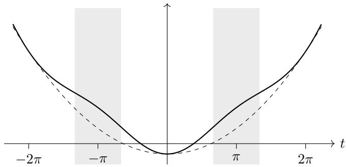
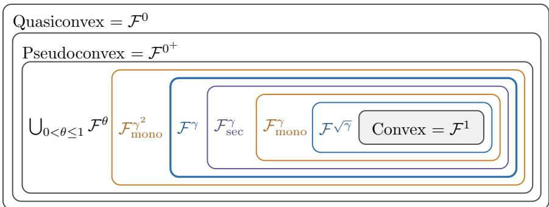

# Tilted Convexity and an Exact Ofline–Online Separation

Mohammad Pedramfar Mila – Quebec AI Institute / McGill University

Rajiv Khanna Purdue University

Christopher John Quinn Iowa State University

Vaneet Aggarwal Purdue University

## Abstract

Convexity has three equivalent descriptions: support by afine functions, monotonicity of the subdiferential, and increasing secant slopes. We weaken all three by one distortion with parameter $\gamma \in \mathsf { \Gamma } ( 0 , 1 ]$ , which multiplies positive changes by γ and divides negative ones by γ. The resulting classes are the convex functions at $\gamma = 1$ and, for $\gamma < 1$ , are distinct and nested, with the parameter dropping by at most a square along the chain. For proper lower semicontinuous functions in these classes, the efective domain is convex, local minimizers are global, and the function is locally Lipschitz on the relative interior of its domain.

The classes separate ofline from online optimization over compact convex sets with eficient projection, with access to function values and bounded support vectors. A smooth member of any class can be minimized to additive accuracy ε with poly $( 1 / \varepsilon )$ first-order queries and projections. Online, with nonpositive losses and α–regret measured against α times the best fixed point, a polynomial-time algorithm achieves γ–regret $O ( \sqrt { T } )$ on the largest class. For every fixed, efectively specified $\gamma \in ( 0 , 1 )$ and every $\alpha \in ( \gamma , 1 ]$ , no randomized polynomial-time algorithm has sublinear expected α–regret unless $\mathbf { N P } = \mathbf { R P }$ already for smooth concave polynomial losses in the smallest class, each minimized by one linear optimization. Thus, unless $\mathbf { N P } = \mathbf { R P } .$ , γ is the exact online coeficient of each class, while the ofline coeficient is one.

Keywords: tilted convexity; tilted monotonicity; generalized convexity; abstract convexity; online optimization; regret minimization; computational hardness

## Contents

1 Introduction 1   
1.1 Main Result 1: The Three Classes: Relations and Structure 2   
1.2 Main Result 2: Ofline–Online Separation 5   
2 Related Work 7   
3 Background and notation 9   
4 The Function Classes 13   
4.1 The gradient inequality: γ–tilted convexity 13   
4.2 Monotone generalized gradients: γ–tilted monotonicity . 14   
4.3 Secant slopes: γ–tilted secant convexity 14   
4.4 Envelope description of the secant class 15   
4.5 Endpoints . 15   
5 Structural Properties 18   
5.1 Properties of γ–tilted convex functions . 18   
5.2 Properties of γ–tilted monotone subdiferentials 22   
5.3 Properties of γ–tilted secant convex functions 25   
5.4 Envelopes of tilted afine functions 29   
5.5 Separations and negative results 29   
5.6 Relations between the classes 33   
6 Examples 34   
6.1 Examples from monotone generalized gradients 35   
6.2 Examples from function values and envelopes 35   
6.3 Increasing transformations of convex costs 37   
7 Polynomial-Time Ofline Optimization 37   
8 γ-Approximate Online Optimization 39   
8.1 Online model and approximate regret 40   
8.2 Lower-linearizability and the reduction to linear losses 40   
8.3 A comparison vector with coeficient γ 41   
8.4 Computing the comparison vector 44   
8.5 Regret bounds 46   
9 Hardness Beyond γ: A Common Framework 47   
9.1 The gap property 47   
9.2 A scalar-profile criterion 48   
9.3 Profiles with a sharp monotonicity parameter 49   
10 Conclusion 51   
A Useful lemmas 52   
B Approximate γ–tilted convexity 54   
B.1 Local boundedness 55   
B.2 Local Lipschitz continuity 56   
B.3 Dense approximate γ–tilted convexity implies exact γ–tilted convexity over the rel  
ative interior 58   
B.4 Continuity along lines 59   
C Proofs for Section 5 61   
C.1 Proof of Theorem 4 . 61   
C.2 Proof of Theorem 5 . 62   
C.3 Proofs of Theorems 6 and 7 63   
C.4 Proof of Theorem 8: Alternative First-order Characterization 63   
C.5 Proof of Theorem 9 . 69   
C.6 Proof of Theorem 10 72   
C.7 Proof of Theorem 11 73   
C.8 Proof of Theorem 12 77   
C.9 Proof of Theorem 13 79   
C.10 Proof of Theorem 14: Alternative First-order Characterization 80   
C.11 Proof of Theorem 15 85   
C.12 Proof of Theorem 16 87   
C.13 Proof of Theorem 17 88   
C.14 Proof of Theorem 18: Characterizations of γ–tilted secant convexity 91   
C.15 Proof of Theorem 19 101   
C.16 Proof of Theorem 20 102   
C.17 Proof of Theorem 21 103   
C.18 Proofs of the separating examples . 104   
C.19 Proof of Example 4 . 111   
C.20 Proof of Theorem 22 . 113   
C.21 Proof of Example 7 . 113   
D Proofs for Section 6 115   
D.1 Proof of Lemma 2 . 115   
D.2 Proof of Example 8 115   
D.3 Proof of Example 9 and Examples 10 and 17 . 116   
D.4 Proofs of Example 11 and Example 12 119   
D.5 Proofs of Example 13 and Example 14 120   
D.6 Proof of the exactness claim in Example 15 121   
D.7 Proof of Example 16 121   
E Proofs for Section 8 122   
E.1 Proof of Lemma 4 . 122   
E.2 Proof of Theorem 25(i) . 124   
E.3 Proof of Theorem 25(ii): inexact oracle . 125   
E.4 Proof of Theorem 25(iii): bit model . 127   
E.5 Proof of Corollary 10 . 129   
F Proofs for Section 9 130   
F.1 Proof of Theorem 26 . 130   
F.2 Proof of Theorem 27 133   
F.3 Proofs of Lemmas 5 and 6 135   
F.4 Proofs of Theorem 28 and Corollary 11 . . 136   
References 140

## 1. Introduction

Convexity makes ofline and online optimization eficient for many problems, but many objectives in learning, statistics, and control are not convex [GL13, ZSS19, BRAK22]. Since convexity has numerous equivalent characterizations, it can be relaxed in several ways, and extensive work has sought relaxations that preserve properties enabling eficient optimization, such as a unique minimizer or monotone slopes [CM09, HKS06].

A convex function can be described in three equivalent ways: by the gradient inequality $f ( \mathbf { y } ) -$ $f ( \mathbf { x } ) \geq \langle \mathbf { v } , \mathbf { y } - \mathbf { x } \rangle$ for a gradient v at x; by monotonicity of the gradient, $\langle { \bf u } - { \bf v } , { \bf y } - { \bf x } \rangle \geq 0$ for gradients v at x and u at $\mathbf { y } .$ which uses only gradients; and by Jensen’s inequality $f ( \lambda \mathbf { y } + ( 1 - \lambda ) \mathbf { z } ) \leq$ $\lambda f ( \mathbf { y } ) + ( 1 - \lambda ) f ( \mathbf { z } )$ , or equivalently by the increase of the slopes of secants, which uses only function values and is equivalent to $f$ being a pointwise supremum of afine functions. The classical relaxations of convexity keep the sign in these inequalities but not their size. Quasiconvexity replaces the right side of Jensen’s inequality by max $\{ f ( \mathbf { y } ) , f ( \mathbf { z } ) \}$ , so that every sublevel set is convex, and pseudoconvexity requires only that $\langle \nabla f ( \mathbf { x } ) , \mathbf { y } - \mathbf { x } \rangle \geq 0$ implies $f ( \mathbf { y } ) \geq f ( \mathbf { x } )$ [Man65]; each of the two also has an equivalent form in terms of gradients alone [HKS06]. Both relaxations sufice for ofline tractability: a quasiconvex function can be minimized by bisection on its value [BV04] and a pseudoconvex function by cutting planes [BTN01].

We study a common multiplicative distortion of the three convexity conditions.<sup>1</sup> For $\gamma \in ( 0 , 1 ]$ 2 put $\psi _ { \gamma } ( s ) = \gamma s$ when $s \geq 0$ and $\psi _ { \gamma } ( s ) = s / \gamma$ when $s < 0$ . At points where the values are finite, the three conditions are

$$
\gamma \mathrm { - t i l t e d ~ c o n v e x i t y : } \qquad \quad f ( \mathbf { y } ) - f ( \mathbf { x } ) \geq \psi _ { \gamma } \big ( \langle \mathbf { v } , \mathbf { y } - \mathbf { x } \rangle \big ) ,\tag{1}
$$

$$
\gamma - \mathrm { t i l t e d ~ m o n o t o n i c i t y : } \qquad \langle \mathbf { u } , \mathbf { y } - \mathbf { x } \rangle \geq \psi _ { \gamma } \big ( \langle \mathbf { v } , \mathbf { y } - \mathbf { x } \rangle \big ) ,\tag{2}
$$

$$
\gamma { \mathrm { - t i l t e d ~ s e c a n t ~ c o n v e x i t y : } } \qquad { \frac { f ( \mathbf { y } ) - f ( \mathbf { x } ) } { \| \mathbf { y } - \mathbf { x } \| } } \geq \psi _ { \gamma } \Big ( { \frac { f ( \mathbf { x } ) - f ( \mathbf { z } ) } { \| \mathbf { x } - \mathbf { z } \| } } \Big ) ,\tag{3}
$$

where in (1) and $( 2 ) \ \overline { { \partial } } f$ is the Clarke subdiferential, $\mathbf { v } \in \overline { { \partial } } f ( \mathbf { x } )$ , and $\mathbf { u } \in \overline { { \partial } } f ( \mathbf { y } )$ , and in $( 3 ) { \textbf { y } } \neq { \textbf { z } }$ lie in dom $( f ) , \lambda \in ( 0 , 1 )$ , and $\mathbf { x } = \lambda \mathbf { y } + ( 1 - \lambda ) \mathbf { z }$ is required to lie in dom(f) as well, so that the two sides compare the slopes of the secants on the two sides of $\mathbf { x } .$ . Condition (3) is equivalent to the Jensen-type inequality $f ( \lambda \mathbf { y } + ( 1 - \lambda ) \mathbf { z } ) \leq M _ { \gamma , \lambda } \big ( f ( \mathbf { y } ) , f ( \mathbf { z } ) \big )$ (Proposition 2), where the mean $M _ { \gamma , \lambda } ( a , b ) = \left( \lambda a + \gamma ( 1 - \lambda ) b \right) / \big ( \lambda + \gamma ( 1 - \lambda ) \big )$ for $a \geq b ,$ , and symmetrically for $a < b .$ , reduces the weight of the smaller value by a factor $\gamma ;$ it is the upper expectile of the two-point distribution at level $1 / ( 1 + \gamma ) \ [ \mathrm { N P 8 7 } , \mathrm { B K M R G 1 4 } ]$

For diferentiable functions, (1) is exactly the equal-parameter case $\gamma _ { n } = \gamma _ { p } = \gamma$ of tilted convexity introduced by Mart´ınez-Rubio [MR22, Eq. (3)]. We write $\mathcal { F } ^ { \gamma } , ~ \mathcal { F } _ { \mathrm { m o n o } } ^ { \gamma }$ , and $\mathcal { F } _ { \mathrm { s e c } } ^ { \gamma }$ for tilted convex functions, functions with tilted monotone subdiferentials, and γ–tilted secant convex functions, respectively (Definitions 3, 4, and 6). To the best of our knowledge, $\mathcal { F } _ { \mathrm { m o n o } } ^ { \gamma }$ and $\mathcal { F } _ { \mathrm { s e c } } ^ { \gamma }$ have not been previously proposed. Our contribution is the proper lower semicontinuous theory, the sharp relations among these formulations, and the exact coeficient that polynomial-time online algorithms can achieve on these classes.

At $\gamma = 1$ all three classes coincide with the proper lower semicontinuous convex functions, and their unions over positive parameters agree and form a strict subclass of the pseudoconvex functions. The support and operator formulations have distinct $0 ^ { + }$ and 0 endpoints, corresponding to pseudoconvexity and quasiconvexity for radially continuous functions, that is, functions whose restriction to every closed segment between points of their domain is continuous. The secant formulation reaches quasiconvexity directly at $\gamma = 0$ . Theorem A and Figure 2 give the precise inclusions.

  
Figure 1: The function $\begin{array} { r } { f ( t ) = \frac { 1 } { 2 } t ^ { 2 } - 2 } \end{array}$ cos t (solid) and the convex function ${ \scriptstyle { \frac { 1 } { 2 } } t ^ { 2 } } - 2$ (dashed). On the shaded intervals $f ^ { \prime \prime } ( t ) = 1 \bar { + } 2$ cos $t < 0$ , so f is not convex. Its only stationary point is the minimizer $t = 0$ , and its subdiferential is $\gamma -$ –tilted monotone, so it lies in all three classes, with $\gamma = ( 4 \pi - 3 \sqrt { 3 } ) / ( 2 \pi + 3 \sqrt { 3 } )$ (Example 10).

In (1), a predicted increase $\langle \mathbf { v } , \mathbf { y } - \mathbf { x } \rangle > 0$ must be realized up to a factor $\gamma _ { : }$ , and an actual decrease may exceed the predicted one by at most a factor $1 / \gamma$ . Since $\psi _ { \gamma }$ preserves signs, a point at which 0 is a generalized gradient is still a global minimizer. Additive relaxations lose this property: $- t ^ { 2 } \mathrm { o n } \left( - 1 , 1 \right)$ becomes convex after $t ^ { 2 }$ is added, which makes it weakly convex in the sense of Davis and Drusvyatskiy [DD19], yet its stationary point 0 is a maximizer. The multiplicative condition is also unchanged when $f$ is multiplied by a positive constant.

Each class contains objectives from applications (Section 6). Concave polynomials of one coordinate with a large enough linear term, radial functions, robust regression losses such as the Cauchy and Geman–McClure losses [BR96, Bar19], and distorted convex functions, which include worst-margin costs on a norm ball [CV95], satisfy the monotonicity condition (2) and therefore lie in all three classes. Ratios of a cost to a positive output, as in fractional programming [CC62, Din67, Sch76], including risk per unit of expected excess return in portfolio selection [Sha66] and energy per transmitted bit in wireless networks [ZJ15], satisfy (3) with a parameter at which they need not satisfy (2), and so do concave quadratics such as $- t ^ { 2 } - c t$ on [0, 1] with $c > 0$ For example, $\begin{array} { r } { f ( t ) = \frac { 1 } { 2 } t ^ { 2 } - 2 } \end{array}$ cos t on $\mathbb { R }$ (Figure 1) is not convex, since $f ^ { \prime \prime } ( t ) = 1 + 2 \cos t < 0$ on $( 2 \pi / 3 , 4 \pi / 3 )$ , but its only stationary point is its minimizer. It is radial and satisfies (2) with $\gamma = ( 4 \pi - 3 \sqrt { 3 } ) / ( 2 \pi + 3 \sqrt { 3 } )$ , so it lies in all three classes with this parameter (Example 10).

Overview of Main Results: Our first main result is that the three classes are nested within a squared parameter of each other, with $\mathcal { F } _ { \mathrm { s e c } } ^ { \gamma }$ equal to the class of proper pointwise suprema of the functions $\mathbf { y } \mapsto c + \psi _ { \sqrt { \gamma } } (  { \langle { \mathbf { z } } , { \mathbf { y } } - { \mathbf { w } } \rangle } )$ , and that they keep the main structural properties of convex functions, without any diferentiability assumption (Theorems A and B). Our second main result separates the (ofline) minimization of one function from the (online) minimization of a sequence of functions revealed one at a time: one smooth function from any of the classes can be minimized to any accuracy with polynomially many queries, while the largest factor α for which a polynomialtime online algorithm can guarantee sublinear regret against α times the best fixed point is exactly $\gamma ,$ unless $\mathbf { N P } = \mathbf { R P }$ (Theorem C).

## 1.1 Main Result 1: The Three Classes: Relations and Structure

How the classes relate. The three characterizations are equivalent for convex functions $( \gamma = 1 )$ but not after relaxation $( \gamma < 1 )$ ; there ${ \mathcal { F } } _ { \mathrm { m o n o } } ^ { \gamma } \subseteq { \mathcal { F } } _ { \mathrm { s e c } } ^ { \gamma } \subseteq { \mathcal { F } } ^ { \gamma }$ , and passing from $\mathcal { F } ^ { \gamma }$ to $\mathcal { F } _ { \mathrm { m o n o } } ^ { \gamma }$ costs at most a square of the parameter. The class $\mathcal { F } _ { \mathrm { s e c } } ^ { \gamma }$ also has a description by envelopes: it consists exactly of the proper pointwise suprema of the functions $\mathbf { y } \mapsto c + \psi _ { \sqrt { \gamma } } (  { \langle { \mathbf { z } } , { \mathbf { y } } - { \mathbf { w } } \rangle } )$ , which we call tilted afine functions, just as lower semicontinuous convex functions are the suprema of afine ones; it is therefore a class of abstract convex functions in the sense of Rubinov [Rub13]. The positiveparameter classes form a strict hierarchy below the pseudoconvex class; the separately defined $0 ^ { + }$ and 0 endpoints give pseudoconvexity and quasiconvexity under radial continuity. Pointwise suprema stay in $\mathcal { F } ^ { \gamma }$ and in $\mathcal { F } _ { \mathrm { s e c } } ^ { \gamma }$ , while the maximum of two members of $\mathcal { F } _ { \mathrm { m o n o } } ^ { \gamma }$ can leave that class. Sums leave all three classes, and sums of their members plus one convex function reach every smooth function whose curvature is bounded below, so minimizing each function individually, as ofline methods do, does not by itself solve the online comparator problem (Section 1.2).

Theorem A (Relations and representation; informal). Let $0 < \gamma ^ { \prime } < \gamma < 1$

(i) The classes are nested,

$$
\mathcal { F } \sqrt { \gamma } \subseteq \mathcal { F } _ { \mathrm { m o n o } } ^ { \gamma } \subseteq \mathcal { F } _ { \mathrm { s e c } } ^ { \gamma } \subseteq \mathcal { F } ^ { \gamma } ,
$$

each inclusion is strict, and some functions lose the $f u l l$ square of the parameter between $\mathcal { F } ^ { \gamma }$ and $\mathcal { F } _ { \mathrm { m o n o } } ^ { \gamma }$ (Corollary 8, Examples 1–3, and Figure 2). The concave quadratic $- t ^ { 2 } - c t$ on [0, 1], with $c > 0$ , has parameter $c / ( c + 1 )$ in $\mathcal { F } _ { \mathrm { s e c } } ^ { \gamma }$ and $\mathcal { F } ^ { \gamma }$ but only $c / ( c + 2 )$ in $\mathcal { F } _ { \mathrm { m o n o } } ^ { \gamma }$ (Example $\it 4 )$

(ii) A proper lower semicontinuous function is γ–tilted secant convex exactly when it is a nonempty pointwise supremum of tilted afine functions $\mathbf { y } \mapsto c + \psi _ { \sqrt { \gamma } } (  { \langle { \mathbf { z } } , { \mathbf { y } } - { \mathbf { w } } \rangle } )$ and exactly when its values satisfy an inequality at every finite set of points (Theorems 21 and 18).

(iii) Let ${ \mathcal { F } } ^ { 0 ^ { + } }$ be defined by (1) with $\psi _ { \gamma }$ replaced by its pointwise limit as $\gamma \downarrow 0$ , and let $\mathcal { F } ^ { \mathrm { 0 } }$ be defined in the same way except that the inequality is not required when $\langle \mathbf { v } , \mathbf { y } - \mathbf { x } \rangle = 0$ (Section $4 . 5 )$ $I f { \mathcal { C } } ^ { \theta }$ stands for $\mathcal { F } _ { \mathrm { m o n o } } ^ { \theta } , \mathcal { F } _ { \mathrm { s e c } } ^ { \theta } ,$ or ${ \mathcal { F } } ^ { \theta }$ for every $\theta ,$ then

$$
{ \mathcal C } ^ { 1 } \subset { \mathcal C } ^ { \gamma } \subset { \mathcal C } ^ { \gamma ^ { \prime } } \subsetneq \bigcup _ { 0 < \theta \leq 1 } { \mathcal C } ^ { \theta } = \bigcup _ { 0 < \theta \leq 1 } { \mathcal F } ^ { \theta } \subset { \mathcal F } ^ { 0 ^ { + } } \subset { \mathcal F } ^ { 0 } ,
$$

where ${ \mathcal { C } } ^ { 1 }$ consists of the convex functions and, among radially continuous functions, ${ \mathcal { F } } ^ { 0 ^ { + } }$ and $\mathcal { F } ^ { 0 }$ consist of the pseudoconvex and the quasiconvex functions (Theorem 23).

(iv) Sums of γ–tilted convex functions need not be $\gamma - t i l t e d$ convex (Example 5), and every twice continuously diferentiable function on $[ 0 , 1 ] ^ { n }$ whose Hessian is bounded below is the sum of a convex function and n concave quadratics that lie in all three classes with parameter γ (Theorem 22).

(v) A proper pointwise supremum of members of $\mathcal { F } ^ { \gamma }$ lies in $\mathcal { F } ^ { \gamma }$ , and the same holds for $\mathcal { F } _ { \mathrm { s e c } } ^ { \gamma }$ . A maximum of two members of $\mathcal { F } _ { \mathrm { m o n o } } ^ { \gamma }$ can lie outside $\mathcal { F } _ { \mathrm { m o n o } } ^ { \gamma }$ , but it always lies in $\mathcal { F } _ { \mathrm { m o n o } } ^ { \gamma ^ { 2 } }$ , and the square is sharp (Theorems 12 and 17, Example 7, and Section $5 . 5 . 4 )$

A convex-like theory. Convex functions have convex sublevel sets and local minima that are global, they are locally Lipschitz on the relative interiors of their efective domains, and convexity can be checked along lines and is preserved under pointwise limits. Theorem B establishes the corresponding properties for all three classes, including nonsmooth extended-valued functions; maxima of tilted afine functions and distorted worst-margin costs are nonsmooth examples (Section 6).

Theorem B (Structure; informal). Let $\gamma \in ( 0 , 1 ]$ and let f belong to $\mathcal { F } _ { \mathrm { s e c } } ^ { \gamma } , \mathcal { F } ^ { \gamma } , o r \mathcal { F } _ { \mathrm { m o n o } } ^ { \gamma }$ (i) The set where f is finite is convex, and f is quasiconvex. Every local minimizer is a global minimizer, and x is a minimizer exactly when 0 is a generalized gradient at x (Theorems 4 and 5, Corollary 7).

  
Figure 2: Nested classes for $0 ~ < ~ \gamma ~ < ~ 1 ;$ ; each class contains the classes drawn inside it. The three families interleave as $\mathcal { F } ^ { \sqrt { \gamma } } \subseteq \mathcal { F } _ { \mathrm { m o n o } } ^ { \gamma } \subseteq \mathcal { F } _ { \mathrm { s e c } } ^ { \gamma } \subseteq \mathcal { F } ^ { \gamma } \subseteq \mathcal { F } _ { \mathrm { m o n o } } ^ { \gamma ^ { 2 } }$ (Corollary 8), and the pattern repeats at each squared parameter. Every inclusion is strict (Examples 1–3 and Theorem 23). The identifications with the pseudoconvex and the quasiconvex functions hold for radially continuous functions.

(ii) The function f is locally Lipschitz on the relative interior of its efective domain, and its values there determine f on the whole domain (Theorems 6 and 10).

(iii) Membership in each class can be checked on the restrictions of f to lines and is preserved under restriction to closed convex sets, and if members of a class converge pointwise to finite values on a dense subset of a convex set, the lower semicontinuous envelope of the limit lies in the class (Theorems 9, 11, 15, 16, 17, and 20, and Corollaries 3 and 5). Membership in F<sup>γ</sup> does not depend on which standard notion of generalized gradient is used in (1) (Theorem 8).

We prove (i) and (ii) for $\mathcal { F } ^ { \gamma }$ only, and they hold for the other two classes by inclusion (Theorem A).

Techniques for the structural results. The proofs rest on a mean-value inequality for nonsmooth functions (Appendix A), which turns the pointwise condition (1) into statements about whole segments, as Jensen’s inequality does for convex functions. The weights in the resulting segment inequality depend on the sign of a directional derivative, and the argument along segments absorbs this dependence. This argument yields the convexity of the domain and both conversions between (1) and (2): (2) implies (1) with the same parameter, and (1) implies (2) with the sharp loss of $\gamma ^ { 2 }$ . Together with Rademacher’s theorem, which gives gradients on a dense subset of the relative interior, and a bound of the horizon subdiferential at boundary points by the normal cone of the domain (Appendix C.4), it also shows that all standard notions of generalized gradient define the same class $\mathcal { F } ^ { \gamma }$ . Regularity and stability under limits come from a weaker notion, approximate γ–tilted convexity (Appendix B), in which the vector in (1) may depend on the desired accuracy and is required only on a dense set of points; such approximate supports force local Lipschitz continuity and become exact on the relative interior. Because these Lipschitz bounds are uniform along a locally bounded sequence, members that converge on a dense set converge uniformly on compact subsets of the relative interior, and the lower semicontinuous envelope of the limit is again in the class. For $\mathcal { F } _ { \mathrm { s e c } } ^ { \gamma } .$ , an equivalent form of (3) applies a distortion with parameter $\sqrt { \gamma }$ to diferences of values and extends to any finite number of points, which gives a membership test that uses function values alone (Theorem 18).

## 1.2 Main Result 2: Ofline–Online Separation

One function versus a sequence. Convexity makes optimization tasks tractable: ofline, gradient or cutting-plane methods minimize a single convex function to any accuracy; online, where a learner picks $\mathbf { x } _ { t }$ in a convex set $\kappa$ in each round $t = 1 , \dots , T$ and an adversary then reveals a convex loss $f _ { t } ,$ gradient descent stays within $O ( \sqrt { T } )$ regret with respect to the best fixed point in hindsight [Zin03, PA26b]. For nonconvex losses the two tasks can difer, because the online benchmark minimizes the sum $\textstyle \sum _ { t } f _ { t }$ and by Theorem A (iv) such sums can encode general smooth nonconvex minimization even when each $f _ { t }$ is easy to minimize. After $f _ { t }$ is revealed, our learner may evaluate $f _ { t }$ and its generalized gradients at points of its choice, and we measure its performance by approximate regret. Losses are nonpositive, so multiplying the benchmark by $\alpha \leq 1$ weakens $\mathrm { i t }$ and for $\alpha \in ( 0 , 1 ]$ the α–regret is

$$
\mathrm { R e g } _ { \alpha } ( T ) = \sum _ { t = 1 } ^ { T } f _ { t } ( \mathbf { x } _ { t } ) - \alpha \operatorname* { m i n } _ { \mathbf { u } \in \mathcal { K } } \sum _ { t = 1 } ^ { T } f _ { t } ( \mathbf { u } ) ,
$$

which is the usual regret when $\alpha = 1$ . A coeficient $\alpha$ is achievable for a class of losses if a possibly randomized algorithm that is given the horizon $T$ and runs in time polynomial in the input size and T keeps the expected $\mathrm { R e g } _ { \alpha } ( T )$ below $P T ^ { 1 - \rho }$ for every horizon and every loss sequence from the class, with $\rho > 0$ a constant and $P$ polynomial in the input size, which bounds the descriptions of K and of a single loss but not the horizon (Section 8.1). The online coeficient is the supremum of the achievable coeficients, with value zero if none is positive; we show that it is attained at γ $\gamma .$ The ofline coeficient of a class is 1 when a single member can be minimized to additive accuracy ε with a number of oracle and projection calls polynomial in $1 / \varepsilon$ and the numerical parameters. We write RP for the class of decision problems solved by randomized polynomial-time algorithms with one-sided error [AB09].

For $\alpha < 1$ the α–regret is not invariant under adding constants to the losses: replacing $f _ { t }$ by $f _ { t } - U _ { t }$ subtracts $\textstyle ( 1 - \alpha ) \sum _ { t = 1 } ^ { T } U _ { t }$ from it, so the sign convention is part of the model. Losses with known upper bounds $U _ { t } \geq \operatorname* { s u p } _ { \mathcal { K } } f _ { t }$ can be shifted to nonpositive losses in the same class, and the choice $U _ { t } = \operatorname* { s u p } _ { \kappa } f _ { t }$ gives the most demanding version. Both the algorithm (Section 8.1) and the lower bound (Section 9) use nonpositive losses, and the hard losses take values in [−1, 0]. Ofline minimization to additive accuracy does not depend on this convention.

Because the classes are nested, an algorithm for the largest class $\mathcal { F } ^ { \gamma }$ runs on all three, a lower bound for the smallest class $\mathcal { F } _ { \mathrm { m o n o } } ^ { \gamma }$ holds for all three, and Theorem C provides both.

Theorem C (Ofline–online separation; informal). Fix an efectively specified $0 < \gamma < 1$ , and let C be one of $\mathcal { F } _ { \mathrm { m o n o } } ^ { \gamma } , \mathcal { F } _ { \mathrm { s e c } } ^ { \gamma }$ , and $\mathcal { F } ^ { \gamma }$ . Use the value-and-support and projection model of Section 7 on a nonempty compact convex set of diameter at most D, with G–Lipschitz functions and, at each query point x, a selected support vector, that is, a vector v satisfying (1) for every feasible y, of norm at most G.

(i) Ofline. An L–smooth member of C can be minimized to additive accuracy ε with $O ( 1 +$ $L D ^ { 2 } / ( \gamma ^ { 2 } \varepsilon ) )$ gradient evaluations and projections by projected gradient descent, and with $\widetilde { O } ( \gamma ^ { - 1 } \sqrt { L D ^ { 2 } / \varepsilon } )$ first-order queries by an accelerated method, where $\widetilde O$ hides logarithmic factors (Corollary 9, based on [MR26]).

(ii) Online, achievability. For a continuous nonpositive loss $f _ { t }$ in the largest class $\mathcal { F } ^ { \gamma }$ and a point $\mathbf { x } _ { t } \in \mathcal { K }$ , some vector $g _ { t }$ with $\| g _ { t } \| \leq G$ satisfies

$$
f _ { t } ( \mathbf { x } _ { t } ) - \gamma f _ { t } ( \mathbf { y } ) \leq \left. g _ { t } , \mathbf { x } _ { t } - \mathbf { y } \right. \qquad ( \mathbf { y } \in \mathcal { K } )
$$

(Theorem 24). A polynomial-time procedure computes such a vector up to an additive error in this inequality that can be made inverse-polynomially small, and passing the computed vectors to a linear online learner gives $O ( D G { \sqrt { T } } )$ static γ–regret. The algorithm makes polynomially many value, support, and projection queries to each revealed loss, and its running time is polynomial under the conventions of Section 8.1 (Theorem 25, Corollary 10). It applies to all three classes.

(iii) Online, hardness. For every fixed $\alpha \in \mathsf { \Gamma } ( \gamma , 1 ]$ , a randomized polynomial-time learner with expected static α–regret at most $P ( N ) T ^ { 1 - \rho }$ , for a fixed polynomial P and constant $\rho > 0$ , on all sequences from $\mathcal { F } _ { \mathrm { m o n o } } ^ { \gamma }$ would imply $\mathbf { N P } = \mathbf { R P }$ . This holds for explicit [−1, 0]–valued, 1– Lipschitz, 1–smooth concave polynomials on products of simplices. Their degree and number of relevant coordinates depend only on $( \gamma , \alpha )$ ; their Hessians have rank at most one, and one linear optimization minimizes each loss exactly. Independent uniform samples from a polynomial-size family sufice. For $\mathcal { F } ^ { \gamma }$ alone, concave quadratics sufice (Theorem 28).

Each class therefore has online coeficient exactly γ, unless $\mathbf { N P } = \mathbf { R P }$ , under the stated model and normalization, and this already holds for its smooth members, whose ofline coeficient is one (Corollary 11, Table 1). For the hard losses of Theorem C(iii), minimizing a single loss is also polynomial in running time, since one linear optimization minimizes each loss exactly, so the lower bound concerns their combination. Convex optimization has a (trivial) approximation coeficient $\alpha = 1$ in both settings; matching $\alpha < 1$ ofline and online coeficients are also known in several submodular settings (Section 2). We determine the exact nontrivial gap for three nested classes. To the best of our knowledge, the classes studied here are the first with an online coeficient α that is determined exactly $( \alpha = \gamma )$ and lies strictly between 0 and the ofline coeficient (i.e. 1), and this coeficient can be any $\gamma \in ( 0 , 1 )$ .

Techniques for the separation. Ofline, smooth members are tilted convex and therefore quasar-convex [MR22, MR26], so known first-order methods apply (Section 7). Online, the comparison must hold against every point, because the best fixed point in hindsight rarely minimizes any single loss, and the vector of Theorem C(ii) provides it. Losses with such vectors are called lower-linearizable, and the reduction of Pedramfar and Aggarwal [PA24] passes the vectors to any online algorithm for linear losses. We obtain the vector by rescaling a generalized gradient v at x to tv with $t \in [ \gamma , 1 ]$ . Each comparator y forces t above or below a threshold according to the sign of $\langle \mathbf { v } , \mathbf { y } - \mathbf { x } \rangle$ . The thresholds are compatible because two comparators of opposite signs can be paired through the point between them at which $\langle \mathbf { v } , \cdot - \mathbf { x } \rangle$ vanishes, and an interpolation inequality for $- f$ applies on their segment (Lemma 3). Since the vector is defined by infinitely many constraints, we find t by bisection and test each candidate with a projected method that searches for a violated comparator, which takes polynomially many value, support, and projection queries (Theorem 25). The number of calls has no inverse-power dependence on γ.

For the lower bound, a class has the online gap property if SAT reduces to finite families of losses whose average equals $- Q$ up to scale, for a score Q that reaches 1 on satisfiable instances and stays below some $\tau < \alpha$ on unsatisfiable ones (Definition 14). Running a learner with coeficient α on random members of such a family decides SAT with one-sided error, so no class with this property admits a polynomial-time algorithm with coeficient α unless $\mathbf { N P } = \mathbf { R P } ;$ this step uses no form of convexity (Theorem 26). We build the families from Label Cover, a constraint satisfaction problem for which the PCP theorem makes it hard to tell instances in which all constraints can be satisfied from instances in which only a small fraction can [MR10]. Each right vertex v and labe b give a loss $- H ( z _ { v , b } )$ , where $z _ { v , b }$ is the mass that a fractional labeling of the left vertices sends to b along the edges at $v ,$ , and H is an increasing convex function with $H ( 0 ) = 0$ and $H ( 1 ) = 1$ . The linear part of H pays for labels whether or not they agree across edges, so on unsatisfiable instances the score is at most $H ^ { \prime } ( 0 )$ plus a term that Label Cover makes small (Theorem 27). Membership of −H in $\mathcal { F } _ { \mathrm { m o n o } } ^ { \gamma }$ forces $H ^ { \prime } ( 0 ) \geq \gamma H ^ { \prime } ( 1 ) \geq \gamma$ , and polynomial choices of H in the class bring $H ^ { \prime } ( 0 )$ arbitrarily close to γ (Lemma 6), so the threshold of the reduction equals the parameter of the class.

## Contributions.

• Three classes from one distortion. We apply one multiplicative distortion to the three standard characterizations of convexity (the support inequality; monotonicity of the subdiferential; and increasing secant slopes or, equivalently, Jensen’s inequality) and study the resulting classes for proper lower semicontinuous functions. The support version extends tilted convexity [MR22] from diferentiable to nonsmooth extended-valued functions; the monotonicity and secant versions are new.

• Convex-like structure without smoothness. For proper lower semicontinuous functions in each class, the domain is convex, local minimizers are global, the function is locally Lipschitz on the relative interior of its domain, and membership can be checked on lines and passes to limits (Theorem B).

• Exact relations among the classes. The classes are nested, ${ \mathcal { F } } { \sqrt { \gamma } } \subseteq { \mathcal { F } } _ { \mathrm { m o n o } } ^ { \gamma } \subseteq { \mathcal { F } } _ { \mathrm { s e c } } ^ { \gamma } \subseteq { \mathcal { F } } ^ { \gamma } .$ every inclusion is strict, and some functions lose the full square of the parameter. The secant class $\mathcal { F } _ { \mathrm { s e c } } ^ { \gamma }$ consists exactly of the proper suprema of tilted afine functions, as the lower semicontinuous convex functions are the suprema of afine ones. None of the classes is closed under addition (Theorem A).

• An exact ofline–online separation. A smooth function from any of the classes can be minimized with polynomially many queries by known methods for quasar-convex functions. Online, a polynomial-time algorithm achieves coeficient γ on the largest class, and unless NP = RP no polynomial-time algorithm achieves a larger coeficient on the smallest class (Theorem C and Table 1).

## 2. Related Work

Generalized convexity and generalized monotonicity. Quasiconvexity, pseudoconvexity, and invexity each keep part of the global geometry of convex functions [Man65, Man75, Cra81, CM09]. Their nonsmooth versions are characterized through generalized monotonicity of subdiferentials, with quasiconvexity corresponding to quasimonotonicity [ACL94] and pseudoconvexity to pseudomonotonicity [PQ97]; see also [HKS06, HS24, SD07, RW98]. These conditions record the sign of a change in value but not its size. Our three classes give a quantitative, sign-dependent version of each standard characterization of convexity, they reduce to convexity at $\gamma = 1$ , and $\mathcal { F } ^ { \gamma }$ reaches pseudoconvexity and quasiconvexity at its endpoints $0 ^ { + }$ and 0. The size bound is what yields local Lipschitz continuity without diferentiability, a hierarchy that is strict at every parameter, and sharp conversions between the classes with a loss of at most a square in the parameter.

Convexity with respect to means, and abstract convexity. Replacing the arithmetic mean in Jensen’s inequality by another mean is a classical way to define convexity classes: $f$ is convex with respect to means P and Q if $f ( P ( x , y ) ) \leq Q ( f ( x ) , f ( y ) )$ [Nic03, AVV07, MP15]. In this language, the Jensen form of γ–tilted secant convexity uses the weighted arithmetic mean on the arguments and the mean $M _ { \gamma , \lambda }$ on the values, where $M _ { \gamma , \lambda }$ is an upper expectile [NP87, BKMRG14].

Table 1: Ofline–online separation. Ofline coeficient 1 means that a single objective can be minimized to arbitrary additive accuracy with polynomially many queries. Online coeficients refer to α–regret bounded by a polynomial times $T ^ { 1 - \rho }$ , achieved in polynomial time, for losses with values in $[ - B , 0 ]$ and B, D, and $G$ polynomial in the input size. The convex and positive-parameter rows use Section 7. The endpoint ofline rows assume the stronger feasibility or cut access specified in their cells, with the usual geometric and encoding conditions. Online lower bounds use explicit smooth individual losses and hold unless $\mathbf { N P } = \mathbf { R P }$
<table><tr><td>Class</td><td>Offline coefficient and individual min- Online coefficient imization</td><td></td></tr><tr><td>Convex</td><td>1; classical cutting-plane or projected 1, with methods [BTN01]</td><td> $O ( D G { \sqrt { T } } )$  regret [Zin03]</td></tr><tr><td> $\mathcal { F } _ { \mathrm { m o n o } } ^ { \gamma } , \mathcal { F } _ { \mathrm { s e c } } ^ { \gamma } , \mathcal { F } ^ { \gamma } .$   $0 < \gamma < 1$ </td><td>1 for L-smooth members; pro- jected gradient descent uses  $O ( 1 +$   $L D ^ { 2 } / ( \gamma ^ { 2 } \varepsilon ) )$  calls, and acceleration uses (36) queries (Section 7).</td><td> $\gamma$  is achievable on  $\mathcal { F } ^ { \gamma }$  every fixed  $\alpha > \gamma$  implies  $\mathbf { N P } = \mathbf { R P }$  already on  $\mathcal { F } _ { \mathrm { m o n o } } ^ { \gamma }$  (Corollary 10, Theorem 28)</td></tr><tr><td>Pseudoconvex</td><td>1 under an efficient valid-cut oracle and the usual cutting-plane assump- tions [BTN01]</td><td>Every fixed  $\alpha > 0$  implies  $\mathbf { N P } = \mathbf { R P }$  (Corollary 11)</td></tr><tr><td>Quasiconvex</td><td>1 under efficient weak feasibility for convex sublevel sets and the usual geometric and encoding assump- tions [BV04]</td><td>Every fixed  $\alpha > 0$  implies  $\mathbf { N P } = \mathbf { R P }$  (Corollary 11)</td></tr></table>

We characterize the resulting function class, including its finite Jensen inequalities and its envelope representation. Abstract convexity represents a function as the upper envelope of a chosen family of elementary functions, generalizing the description of a proper lower semicontinuous convex function as a supremum of afine functions, and closure of the resulting classes under suprema is standard [Rub13, DR90, Pen13]. The two viewpoints meet in $\mathcal { F } _ { \mathrm { s e c } } ^ { \gamma }$ : the upper envelopes of the tilted afine functions $\mathbf { y } \mapsto c + \psi _ { \gamma } (  { \left. { \mathbf { z } } , \mathbf { y } - \mathbf { w } \right. } )$ are exactly the $\gamma ^ { 2 _ { - } }$ –tilted secant convex functions and are characterized by an inequality on finitely many function values, just as the proper upper envelopes of afine functions are exactly the proper lower semicontinuous functions that satisfy Jensen’s inequality.

Additive and multiplicative relaxations. Weak convexity and semiconvexity bound negative curvature by adding a quadratic; prox-regularity gives a local quadratic support property [HUL13, DD19, PN15]. Our distortion rescales slopes instead, so the classes are unchanged when f is multiplied by a positive constant and stationary points remain minimizers, whereas weak convexity with a large modulus contains every twice diferentiable function whose Hessian is bounded below. The tilted condition is distinct from multiplicative, or geometric, convexity, which compares positive function values through geometric means [Nic00].

Tilted convexity and quasar-convexity. For diferentiable functions, the support condition (1) is tilted convexity with $\gamma _ { n } = \gamma _ { p } = \gamma$ , introduced by Mart´ınez-Rubio [MR22] in the analysis of Riemannian acceleration: a geodesically convex function on a subset of hyperbolic or spherical space, mapped to Euclidean space by a geodesic map, satisfies it with constants that depend on the radius of the subset. That work notes that the condition is stronger than quasar-convexity and uses it for accelerated first-order methods on convex sets. We develop the nonsmooth extended-valued theory, sharp relationships with the secant and operator formulations, and an exact polynomialtime online coeficient. Tilted-convex functions are γ–quasar-convex [MR22, MR26], a condition introduced by Hardt, $\mathrm { M a , }$ and Recht and by Hinder, Sidford, and Sohoni [HMR18, HSS20] and studied online by Pun et al. [PS24]. Since quasar-convex functions need not be quasiconvex, they form a strictly larger class; the rates for its constrained form in [MR26] give our ofline bounds.

Ofline and online approximation coeficients. Several established settings have matching ofline and online coeficients under their respective access and constraint models. Convex losses have coeficient 1 in both settings [Zin03]. For monotone submodular maximization, the greedy coeficient $1 - 1 / e$ is attained online [SG08], and ofline greedy algorithms of a general form convert into online algorithms with the same coeficient $\left[ \mathrm { N G W ^ { + } 2 3 } \right]$ . For monotone continuous DR-submodular maximization, the coeficient is $1 - 1 / e$ both ofline and online [CHHK18, ZCHK19, PNQA24], and Mualem and Feldman [MF23] showed that the two coeficients also coincide for non-monotone maximization over general convex sets. Linearizable formulations transfer ofline guarantees of this kind to the online setting across a broad range of up-concave objectives [PA24, PA26a]. For the three classes of this paper the coeficients difer, 1 ofline and exactly $\gamma$ online for every fixed, efectively specified $\gamma \in ( 0 , 1 )$ , unless $\mathbf { N P } = \mathbf { R P }$

Online optimization beyond convexity. For convex losses, projected online gradient descent achieves $O ( \sqrt { T } )$ static regret with first-order full-information feedback [Zin03, Haz16]. The classical one-point bandit method of Flaxman, Kalai, and McMahan has a $\bar { T } ^ { 3 / 4 }$ rate, whereas two-point feedback permits square-root-type regret [FKM05, ADX10]. Separate guarantees concern moving comparators or every time interval [ZLZ18, HS09, DGSS15]. For nonconvex losses, one line of work replaces the global benchmark by a local stationarity criterion [HSZ17] or by per-round minimizers [GLZ18]. Another keeps the global benchmark but assumes an oracle that minimizes the sum of past losses plus a linear perturbation [AGH19, SN20]. We keep the global benchmark and allow access only to individual losses, through their values and generalized gradients. Under this access, Theorem C shows that the benchmark can be approached up to the factor $\gamma$ in polynomial time and, unless $\mathbf { N P } = \mathbf { R P }$ , not beyond it, for each of the three classes.

Linearizable optimization. Pedramfar and Aggarwal [PA24] defined linearizable and quadratizable optimization, in which a comparison inequality that holds for all comparators is passed to an online linear learner. Later work added uniform wrappers, decentralized and projection-free variants, and weakly up-concave classes [PQA25, LPA25, PA26a]. We use this reduction without change; what is new is the existence, for every continuous nonpositive γ–tilted convex loss, of a comparison vector with coeficient exactly γ, and its computation with polynomially many queries.

Computational limits of online learning. Hazan and Koren [HK16] established computational limits on online learning with access to an ofline optimization oracle. Our lower bound has a diferent source: each hard loss is minimized by one linear optimization, and the obstruction lies in their sum, which encodes a Label Cover instance whose gap follows from the PCP theorem [MR10, Mos15]. The hard losses lie in the smallest class $\mathcal { F } _ { \mathrm { m o n o } } ^ { \gamma } ,$ and the threshold of the reduction equals its parameter.

## 3. Background and notation

We use $\overline { { \mathbb { R } } }$ to denote the set of extended real numbers $\mathbb { R } \cup \{ - \infty , + \infty \}$ . For $f : \mathbb { R } ^ { d }  \overline { { \mathbb { R } } } .$ , we define the $( e f f e c t i v e )$ domain of f as the set dom $( f ) : = \{ \mathbf { x } \in \mathbb { R } ^ { d } \mid f ( \mathbf { x } ) \in \mathbb { R } \}$ . We say f is proper if dom $( f ) \neq \emptyset$ and $f > - \infty . ^ { 2 }$ Given a non-empty set $\boldsymbol { \mathcal { X } } \subseteq \mathbb { R } ^ { d }$ and a function $f : \mathcal { X }  \overline { { \mathbb { R } } } .$ , its proper extension $\widetilde { f } :  { \mathbb { R } ^ { d } } \to \overline { { \mathbb { R } } }$ equals $f$ on $\mathcal { X }$ and +∞ on $\mathbb { R } ^ { d } \backslash \mathcal { X }$ , and it is proper if and only if $f$ is proper. With the indicator $\delta _ { X } .$ , which is 0 on $\mathcal { X }$ and +∞ elsewhere, we also write $\widetilde { f } = f + \delta _ { \mathcal { X } }$ . Subdiferentials of $f ,$ and membership of $f$ in the function classes of Section 4, always refer to ${ \dot { f } } .$ For a convex set $\kappa$ , we write af(K) for its afine hull and $\mathrm { r i } ( \kappa )$ for its relative interior, the interior of $\kappa$ relative to af(K). $\operatorname { I f } \ f$ is diferentiable at $\mathbf { x } \in \mathrm { r i } ( \mathcal { K } )$ as a function on af(K), its gradient with respect to af(K) is the vector in the linear subspace parallel to $\mathrm { a f f } ( \kappa )$ that represents this derivative.

We say $f : \mathcal { X } \to \overline { { \mathbb { R } } }$ is lower semi-continuous (lsc) at $\mathbf { x } \in \mathcal { X }$ if

$$
f ( \mathbf { x } ) \leq \operatorname* { l i m } _ { \mathbf { y } \in \mathcal { X } , \mathbf { y } \to \mathbf { x } } f ( \mathbf { y } ) .
$$

The function $f$ is locally lsc at x if it is lsc on an open neighborhood of $\mathbf { x } .$ The function $f$ is lsc at $\mathbf { x } \in \mathcal { X }$ if and only if its proper extension is lsc at x. <sup>3</sup> If f is locally lsc at $\mathbf { x } ,$ its proper extension need not be locally lsc at $\mathbf { x } .$ 4

Given $f : \mathcal { X } \to \overline { { \mathbb { R } } }$ , let $\widetilde { f }$ equal $f$ on $\mathcal { X }$ and $+ \infty$ outside X . Its lower semicontinuous envelope is

$$
\ker ( f ) ( \mathbf { x } ) : = \operatorname* { l i m i n f } _ { \mathbf { y } \to \mathbf { x } } { \widetilde { f } } ( \mathbf { y } ) = \operatorname* { s u p } _ { r > 0 } \operatorname* { i n f } \{ { \widetilde { f } } ( \mathbf { y } ) : \| \mathbf { y } - \mathbf { x } \| < r \} ,
$$

where the lower limit is nonpunctured and inf $\varnothing = + \infty$ . It is the largest lower semicontinuous function below ${ \widetilde { f } } _ { , }$ or equivalently the largest lower semicontinuous function g satisfying $g \leq f$ on $\mathcal { X }$ , so $\operatorname { l s c } ( f ) = \widetilde { f }$ whenever $\widetilde { f }$ is lower semicontinuous. For a proper $f ,$ the envelope equals +∞ outside dom(f), but it need not be proper. For example, $f ( x ) = 1 / x$ for $x \neq 0$ and $f ( 0 ) = 0$ is proper, whereas lsc $( f ) ( 0 ) = - \infty$

Definition 1. A function $f : \mathbb { R } ^ { d }  \overline { { \mathbb { R } } }$ is radially continuous, or continuous on lines, $i f ,$ for all $\mathbf { x } , \mathbf { y } \in \operatorname { d o m } ( f )$ , the restriction of f to the closed line segment $\left[ \mathbf { x } , \mathbf { y } \right]$ is continuous.

Given a sequence $\mathbf { x } _ { k }$ and a point y in $\mathcal { X } _ { : }$ , we say $\mathbf { x } _ { k }$ converges f-attentively to $\mathbf { y } ,$ denoted by ${ \bf x } _ { k } \ \overset { f } {  } { \bf y }$ , when $\mathbf x _ { k } \to \mathbf y$ and $f ( \mathbf { x } _ { k } )  f ( \mathbf { y } )$

For sets A and B, a multi-valued operator $F : A  B$ is a function from A to the power set of $B ,$ so that $F ( a ) \subseteq B$ for each $a \in A$ . The domain of $F$ is

$$
\operatorname { d o m } ( F ) : = \{ a \in A \mid F ( a ) \neq \varnothing \} .
$$

We use the following generalized derivatives [RW98].

Definition 2. Let $f : \mathbb { R } ^ { d }  \overline { { \mathbb { R } } }$ . The Fr´echet subdiferential of f at $\mathbf { x } \in \operatorname { d o m } ( f )$ is

$$
\hat { \partial } f ( \mathbf x ) : = \left\{ \mathbf v \in \mathbb R ^ { d } \left| \operatorname* { l i m i n f } _ { \mathbf y \to \mathbf x } \quad \frac { f ( \mathbf y ) - f ( \mathbf x ) - \langle \mathbf v , \mathbf y - \mathbf x \rangle } { \| \mathbf y - \mathbf x \| } \geq 0 \right. \right\} .
$$

The limiting (Mordukhovich) subdiferential of f at ${ \textbf { x } } \in$ dom(f) is

$$
\partial f ( \mathbf { x } ) : = \left\{ \mathbf { v } \in \mathbb { R } ^ { d } \ \middle | \ \exists \mathbf { x } _ { k } \in \mathrm { d o m } ( f ) , \ \mathbf { x } _ { k } \stackrel { f } { \to } \mathbf { x } , \ \exists \mathbf { v } _ { k } \in \hat { \partial } f ( \mathbf { x } _ { k } ) \ w i t h \ \mathbf { v } _ { k } \to \mathbf { v } \right\} ,
$$

and the horizon limiting (Mordukhovich) subdiferential of f at $\mathbf { x } \in \operatorname { d o m } ( f )$ is

$$
\partial ^ { \infty } f ( \mathbf { x } ) : = \{ \mathbf { v } \in \mathbb { R } ^ { d } | \begin{array} { l } { \exists \mathbf { x } _ { k } \in \mathrm { d o m } f , \exists \lambda _ { k } > 0 , \mathbf { x } _ { k } \xrightarrow { f } \mathbf { x } , \lambda _ { k }  0 , } \\ { \exists \mathbf { v } _ { k } \in \widehat { \partial } f ( \mathbf { x } _ { k } ) \mathit { w i t h } \lambda _ { k } \mathbf { v } _ { k } \xrightarrow { h } \mathbf { v } } \end{array}  \} .
$$

Finally, if f is proper and locally lsc at $\mathbf { x } \in \operatorname { d o m } ( f )$ , then the Clarke–Rockafellar subdiferential (or simply Clarke subdiferential) of f at $\textbf { x } i s ^ { \mathrm { ~ 5 ~ } }$

$$
{ \overline { { \partial } } } f ( \mathbf { x } ) : = { \overline { { \operatorname { c o n v } ( \partial f ( \mathbf { x } ) ) + \operatorname { c o n v } ( \partial ^ { \infty } f ( \mathbf { x } ) ) } } } .
$$

Proposition 1. Let $f , g : \mathbb { R } ^ { d }  \overline { { \mathbb { R } } }$ be proper and $\mathbf { x } \in \operatorname { d o m } ( f ) \cap \operatorname { d o m } ( g )$ . Then the following are true.

(i) If f is locally lsc at x, then

$$
\overline { { { \partial } } } f ( { \bf x } ) \supseteq \partial f ( { \bf x } ) \supseteq \hat { \partial } f ( { \bf x } ) .
$$

Moreover, there is a sequence ${ \bf x } _ { i } \stackrel { f } {  } { \bf x }$ where $\hat { \partial } f ( \mathbf { x } _ { i } )$ is non-empty.

(ii) If f is locally Lipschitz at x, then $\partial f ( \mathbf { x } )$ is non-empty. Specifically, if

$$
\overline { { \nabla } } f ( \mathbf { x } ) : = \left\{ \mathbf { v } \in \mathbb { R } ^ { d } \ \middle | \ \exists \mathbf { x } _ { k } \in \mathrm { d o m } ( f ) , \ \mathbf { x } _ { k } \to \mathbf { x } , \ \nabla f ( \mathbf { x } _ { k } ) \ e x i s t s \ , \ \nabla f ( \mathbf { x } _ { k } ) \to \mathbf { v } \right\} ,
$$

then $\overline { { \nabla } } f ( \mathbf { x } )$ is a non-empty compact set and

$$
\overline { { \nabla } } f ( \mathbf x ) \subseteq \partial f ( \mathbf x ) \subseteq \overline { \partial } f ( \mathbf x ) = \mathrm { c o n v } ( \overline { \nabla } f ( \mathbf x ) ) .
$$

(iii) If f is diferentiable at x, then $\partial f ( \mathbf { x } ) \supseteq { \hat { \partial } } f ( \mathbf { x } ) = \{ \nabla f ( \mathbf { x } ) \}$

(iv) If f is continuously diferentiable on a neighborhood of x, then $\overline { { { \partial } } } f ( { \bf x } ) = \partial f ( { \bf x } ) = \hat { \partial } f ( { \bf x } ) =$ $\{ \nabla f ( \mathbf { x } ) \}$

(v) $\mathit { I f g }$ is continuously diferentiable on a neighborhood of x, then

$$
\hat { \partial } ( f + g ) ( { \bf x } ) = \hat { \partial } f ( { \bf x } ) + \nabla g ( { \bf x } ) .
$$

The same identity holds for the limiting subdiferential. If f is also locally lsc at x, it holds for the Clarke–Rockafellar subdiferential as well. In particular, let $\mathcal { K } \subseteq \mathbb { R } ^ { d }$ be nonempty, closed, and convex, let $\mathbf { x } \in \kappa ,$ , and let ${ \cal N } _ { \sf K } ( { \bf x } ) = \{ { \bf n } \in \mathbb { R } ^ { d } : \langle { \bf n } , { \bf y } - { \bf x } \rangle \leq 0$ for all $\mathbf { y } \in \kappa \}$ be the normal cone of K at x. If f is the indicator $\delta _ { K }$ , then $f + g$ is the proper extension $\widetilde g$ of $g | _ { \mathcal { K } }$ and

$$
\overline { { \partial } } \widetilde { g } ( \mathbf { x } ) = \nabla g ( \mathbf { x } ) + N \kappa ( \mathbf { x } ) .
$$

Since ${ \mathbf 0 } \in N _ { K } ( { \mathbf x } )$ , this gives $\nabla g ( \mathbf { x } ) \in \overline { { \partial } } \widetilde { g } ( \mathbf { x } )$

The inclusions in (i) follow from the definitions: for $\mathbf { v } \in { \hat { \partial } } f ( \mathbf { x } )$ , the constant sequences $\mathbf { x } _ { k } : = \mathbf { x }$ and $\mathbf { v } _ { k } : = \mathbf { v }$ show that $\mathbf { v } \in \partial f ( \mathbf { x } )$ . If $\partial f ( \mathbf { x } ) \neq \emptyset$ , then there are ${ \bf x } _ { k } \ \stackrel { f } { \to } { \bf x }$ and $\mathbf { v } _ { k } \in \hat { \partial } f ( \mathbf { x } _ { k } )$ with $\mathbf { v } _ { k } \to \mathbf { v }$ for some v, and $\lambda _ { k } : = 1 / k$ gives $\lambda _ { k } \mathbf { v } _ { k } \to \mathbf { 0 } , \operatorname { s o } \mathbf { 0 } \in \partial ^ { \infty } f ( \mathbf { x } )$ and $\partial f ( \mathbf { x } ) \subseteq \partial f ( \mathbf { x } ) + \mathbf { 0 } \subseteq { \overline { { \partial } } } f ( \mathbf { x } )$ The second claim in (i) is Corollary 8.10 in [RW98], and parts $( \mathrm { i i } ) { - } ( \mathrm { v } )$ are Theorems 9.13 and 9.61 and Exercise 8.8 in [RW98]. For the indicator in (v), the limiting subdiferential $\partial \delta \kappa ( \mathbf { x } )$ and the horizon subdiferential $\partial ^ { \infty } \delta _ { K } ( \mathbf { x } )$ both equal $N _ { K } ( { \bf x } )$ [RW98, Chapters 6 and 8]. Since $N _ { K } ( { \bf x } )$ is a closed convex cone, the definition of the Clarke subdiferential gives $\overline { { { \partial } } } \delta _ { K } ( { \bf x } ) = \overline { { { N } } } \kappa ( { \bf x } ) + N _ { K } ( { \bf x } ) =$ $N _ { K } ( { \bf x } )$ , and the sum rule in (v) for ∂ gives the formula for $\overline { { { \partial } } } \widetilde { g } ( { \bf x } )$

The tilt function $\psi _ { \gamma }$ . Classical convexity is characterized by the afine support inequality

$$
f ( \mathbf { y } ) - f ( \mathbf { x } ) \geq \langle \mathbf { y } - \mathbf { x } , \mathbf { v } \rangle , \qquad \mathbf { v } \in { \overline { { \partial } } } f ( \mathbf { x } ) .
$$

Scaling the left side of a scalar inequality $a \leq b$ by a factor $\gamma$ relaxes it for only one sign of $a \mathrm { : }$ for $\gamma \in ( 0 , 1 ]$ and $a \geq 0$ , the inequality $\gamma a \leq b$ is weaker than $a \leq b ,$ but for $a < 0$ it is stronger. To relax the inequality for both signs, for $\gamma \in ( 0 , 1 ]$ we define the functions $\psi _ { \gamma }$ and $\overline { { \psi } } _ { \gamma }$ over extended real numbers with

$$
\psi _ { \gamma } ( z ) : = \gamma ^ { \mathrm { s i g n } ( z ) } z = \operatorname* { m i n } \{ \gamma z , \gamma ^ { - 1 } z \} , \qquad { \overline { { \psi } } } _ { \gamma } ( z ) : = \gamma ^ { - \mathrm { s i g n } ( z ) } z = \operatorname* { m a x } \{ \gamma z , \gamma ^ { - 1 } z \} .
$$

For $\gamma = 0$ we set

$$
\psi _ { 0 } ( z ) : = \left\{ \begin{array} { l l } { 0 } & { \mathrm { i f ~ } z > 0 } \\ { \mathrm { u n d e f i n e d ~ } } & { \mathrm { i f ~ } z = 0 , } \\ { - \infty } & { \mathrm { i f ~ } z < 0 } \end{array} \right. \quad \quad \overline { { \psi } } _ { 0 } ( z ) : = \left\{ \begin{array} { l l } { \infty } & { \mathrm { i f ~ } z > 0 } \\ { \mathrm { u n d e f i n e d ~ } } & { \mathrm { i f ~ } z = 0 } \\ { 0 } & { \mathrm { i f ~ } z < 0 } \end{array} \right.
$$

Lemma 1. Let $a , b \in \mathbb { R } , \gamma , \gamma ^ { \prime } \in [ 0 , 1 ]$ . Then the following are true.

1. $I f \gamma > 0$ , then both $\psi _ { \gamma }$ and $\overline { { \psi } } _ { \gamma }$ are continuous, monotone increasing, bijective, and positively homogeneous.

2. Whenever $\psi _ { \gamma } ( a )$ and $\overline { { \psi } } _ { \gamma } ( a )$ are defined, $\psi _ { \gamma } ( a ) \leq a \leq \overline { { \psi } } _ { \gamma } ( a )$

3. ${ \overline { { \psi } } } _ { \gamma } ( a ) = - \psi _ { \gamma } ( - a )$ whenever both sides are defined.

4. $\psi _ { \gamma } ( \psi _ { \gamma ^ { \prime } } ( a ) ) = \psi _ { \gamma \gamma ^ { \prime } } ( a )$ whenever both sides are defined.

5. $I f \gamma > 0 , t h e n \psi _ { \gamma } ( a ) + \psi _ { \gamma } ( b ) \leq \psi _ { \gamma } ( a + b ) a n d \overline { { \psi } } _ { \gamma } ( a ) + \overline { { \psi } } _ { \gamma } ( b ) \geq \overline { { \psi } } _ { \gamma } ( a + b ) .$

6. $I f \gamma > 0$ , then $\overline { { \psi } } _ { \gamma } ( \psi _ { \gamma } ( a ) ) = \psi _ { \gamma } ( \overline { { \psi } } _ { \gamma } ( a ) ) = a .$

7. $I f \gamma ^ { \prime } < \gamma$ and $\psi _ { \gamma ^ { \prime } } ( a )$ is defined, then $\psi _ { \gamma ^ { \prime } } ( a ) \leq \psi _ { \gamma } ( a )$

Proof. For $\gamma \in ( 0 , 1 ]$ the definitions read

$$
\psi _ { \gamma } ( z ) = \left\{ \begin{array} { l l } { \gamma z , } & { z \geq 0 , } \\ { z / \gamma , } & { z < 0 , } \end{array} \right. \quad \overline { { \psi } } _ { \gamma } ( z ) = \left\{ \begin{array} { l l } { z / \gamma , } & { z \geq 0 , } \\ { \gamma z , } & { z < 0 , } \end{array} \right.\tag{4}
$$

and $\psi _ { \gamma } ( \pm \infty ) = \overline { { \psi } } _ { \gamma } ( \pm \infty ) = \pm \infty$ . In particular, for $\gamma > 0$ the numbers $\psi _ { \gamma } ( z ) , \overline { { \psi } } _ { \gamma } ( z )$ , and $z$ have the same sign. For $\gamma = 0$ , both scalar expressions are defined exactly when their argument is nonzero. The calculations below use finite arguments; the same identities extend to infinite arguments whenever all expressions and extended-real sums are defined.

(1) By $( 4 ) , \psi _ { \gamma }$ consists of two linear pieces with positive slopes $\gamma$ and $1 / \gamma$ that both vanish at 0. Hence $\psi _ { \gamma }$ is continuous and strictly increasing, and it maps $[ 0 , \infty )$ onto $[ 0 , \infty )$ and $( - \infty , 0 )$ onto $( - \infty , 0 )$ , so it is bijective. For $t > 0$ we have sign $\begin{array} { r } { \iota ( t z ) = \mathrm { s i g n } ( z ) } \end{array}$ , so $\psi _ { \gamma } ( t z ) = \gamma ^ { \mathrm { s i g n } ( z ) } t z = t \psi _ { \gamma } ( z )$ The same arguments apply to $\overline { { \psi } } _ { \gamma }$

(2) Let $\gamma > 0$ . If $a \geq 0 ,$ then (4) gives $\psi _ { \gamma } ( a ) = \gamma a \leq a \leq a / \gamma = \overline { { \psi } } _ { \gamma } ( a )$ . If $a < 0 ,$ , then it gives $\psi _ { \gamma } ( a ) = a / \gamma \leq a \leq \gamma a = \overline { { \psi } } _ { \gamma } ( a )$ . Let $\gamma = 0 .$ , so that $a \neq 0$ . If $a > 0$ , then $\psi _ { 0 } ( a ) = 0 < a < \infty =$ $\overline { { \psi } } _ { 0 } ( a )$ , and if $a < 0$ , then $\psi _ { 0 } ( a ) = - \infty < a < 0 = \overline { { \psi } } _ { 0 } ( a )$

(3) Let $\gamma > 0$ . Since $\mathrm { s i g n } ( - a ) = - \mathrm { s i g n } ( a )$ , we get $- \psi _ { \gamma } ( - a ) = - \gamma ^ { - \mathrm { s i g n } ( a ) } ( - a ) = \gamma ^ { - \mathrm { s i g n } ( a ) } a =$ $\overline { { \psi } } _ { \gamma } ( a )$ . Let $\gamma = 0$ . If $a ~ > ~ 0$ , then $- \psi _ { 0 } ( - a ) = - ( - \infty ) = \infty = \overline { { \psi } } _ { 0 } ( a )$ , and if $a \ < \ 0$ , then $- \psi _ { 0 } ( - a ) = 0 = \overline { { \psi } } _ { 0 } ( a )$

(4) Let $\gamma , \gamma ^ { \prime } > 0$ . Since $\psi _ { \gamma ^ { \prime } } ( a )$ has the sign of $^ { a , }$ we get $\psi _ { \gamma } ( \psi _ { \gamma ^ { \prime } } ( a ) ) = \gamma ^ { \mathrm { s i g n } ( a ) } \gamma ^ { \prime \mathrm { s i g n } ( a ) } a =$ $( \gamma \gamma ^ { \prime } ) ^ { \mathrm { s i g n } ( a ) } a = \psi _ { \gamma \gamma ^ { \prime } } ( a )$ . Now let $\gamma \gamma ^ { \prime } = 0$ . Then $\psi _ { \gamma \gamma ^ { \prime } } = \psi _ { 0 }$ , and both sides being defined forces $a \neq 0$ . Let $a < 0$ , so that $\psi _ { 0 } ( a ) = - \infty$ . If $\gamma ^ { \prime } = 0$ , then $\psi _ { \gamma ^ { \prime } } ( a ) = - \infty$ and $\psi _ { \gamma } ( - \infty ) = - \infty$ . If $\gamma = 0$ , then $\psi _ { \gamma ^ { \prime } } ( a ) < 0$ and hence $\psi _ { 0 } ( \psi _ { \gamma ^ { \prime } } ( a ) ) = - \infty$ . If $a > 0$ and $\gamma ^ { \prime } = 0$ , then $\psi _ { \gamma ^ { \prime } } ( a ) = 0$ , at which $\psi _ { \gamma }$ is defined only when $\gamma > 0$ , and then $\psi _ { \gamma } ( 0 ) = 0 = \psi _ { 0 } ( a )$ . If $a > 0$ and $\gamma = 0 < \gamma ^ { \prime }$ , then $\psi _ { 0 } ( \gamma ^ { \prime } a ) = 0 = \psi _ { 0 } ( a )$

(5) Let $\gamma ~ > ~ 0$ . By definition $\psi _ { \gamma } ( z ) = \operatorname* { m i n } \{ \gamma z , z / \gamma \}$ . For real numbers $p , q , r , s$ we have min $\{ p , q \} + \operatorname* { m i n } \{ r , s \} \leq \operatorname* { m i n } \{ p + r , q + s \}$ , since the left-hand side is at most $p + r$ and at most $q + s . \ \mathrm { A p p l y } .$ ing this with $p = \gamma a , q = a / \gamma , r = \gamma b , s = b / \gamma$ gives

$$
\psi _ { \gamma } ( a ) + \psi _ { \gamma } ( b ) \leq \operatorname* { m i n } \{ \gamma ( a + b ) , ( a + b ) / \gamma \} = \psi _ { \gamma } ( a + b ) .
$$

The inequality for $\overline { { \psi } } _ { \gamma } ( z ) = \operatorname* { m a x } \{ \gamma z , z / \gamma \} $ follows in the same way from max $\{ p , q \} + \operatorname* { m a x } \{ r , s \} \geq$ max $\{ p + r , q + s \}$

(6) Let $\gamma > 0$ . Since $\psi _ { \gamma } ( a )$ has the sign of $^ { a , }$ we get $\overline { { { \psi } } } _ { \gamma } ( \psi _ { \gamma } ( a ) ) = \gamma ^ { - \mathrm { s i g n } ( a ) } \gamma ^ { \mathrm { s i g n } ( a ) } a = a$ . The identity $\psi _ { \gamma } ( \overline { { \psi } } _ { \gamma } ( a ) ) = a$ follows in the same way.

(7) Let $\gamma ^ { \prime } < \gamma$ , so that $\gamma > 0 . \mathrm { ~ I f ~ } \gamma ^ { \prime } > 0$ and $a \geq 0$ , then $\psi _ { \gamma ^ { \prime } } ( a ) = \gamma ^ { \prime } a \leq \gamma a = \psi _ { \gamma } ( a )$ . If $\gamma ^ { \prime } > 0$ and $a < 0$ , then $1 / \gamma ^ { \prime } > 1 / \gamma$ gives $\psi _ { \gamma ^ { \prime } } ( a ) = a / \gamma ^ { \prime } < a / \gamma = \psi _ { \gamma } ( a )$ . If $\gamma ^ { \prime } = 0$ , then $a \neq 0 ;$ for $a > 0$ we have $\psi _ { 0 } ( a ) = 0 < \gamma a = \psi _ { \gamma } ( a )$ , and for $a < 0$ we have $\psi _ { 0 } ( a ) = - \infty < \psi _ { \gamma } ( a )$ □

## 4. The Function Classes

This section applies the distortion $\psi _ { \gamma }$ of Section 3 to the gradient inequality, to monotonicity of the subdiferential, and to the increase of secant slopes, which is equivalent to Jensen’s inequality (Sections 4.1–4.3). Section 4.4 describes the secant class as the envelopes of tilted afine functions, and Section 4.5 describes the endpoints $\gamma = 1 , 0 ^ { + }$ , and 0. Throughout, $\mathcal { K } \subseteq \mathbb { R } ^ { d }$ denotes a convex set.

## 4.1 The gradient inequality: γ–tilted convexity

Definition 3 (γ–tilted convexity). Let $f : \mathbb { R } ^ { d }  \overline { { \mathbb { R } } }$ be a proper lsc function, and let $F : \mathbb { R } ^ { d } \overset { } { \Longrightarrow } \mathbb { R } ^ { d }$ be a multi-valued operator. $F o r \gamma \in [ 0 , 1 ]$ , we say f is γ–tilted convex with respect to $\textit { F i f , f o r }$ all $\mathbf { x } , \mathbf { y } \in \operatorname { d o m } ( f )$ and $\mathbf { v } \in F ( \mathbf { x } )$ ,

$$
f ( \mathbf { y } ) - f ( \mathbf { x } ) \ \geq \ \psi _ { \gamma } ( \langle \mathbf { y } - \mathbf { x } , \mathbf { v } \rangle )\tag{5}
$$

whenever the right-hand side is well-defined. We say f is γ–tilted convex if it is γ–tilted convex with respect to ${ \overline { { \partial } } } f . \ ^ { \mathrm { ~ 6 ~ } }$ For any such function we define $\gamma ^ { * } ( f ) : = \operatorname* { s u p } \{ \gamma \in [ 0 , 1 ] : f$ is γ–tilted convex}, with sup $\varnothing : = 0$

For a diferentiable function and $\mathbf { v } = \nabla f ( \mathbf { x } )$ , the support inequality is tilted convexity with constants $\gamma _ { n } = \gamma _ { p } = \gamma \ [ \mathrm { M R { 2 2 } } , \mathrm { E q . \ ( 3 ) } ]$ . On a closed convex feasible set, the Clarke subdiferential of a continuously diferentiable ambient function adds normal vectors, whose inner products with feasible directions are nonpositive, so the identification persists. The definition above extends the condition to proper lsc extended-valued functions; convexity of the efective domain and equivalence of the subdiferential formulations are proved in Section 5.

If $F ( \mathbf { x } ) \subseteq G ( \mathbf { x } )$ for every x and $f$ is γ–tilted convex with respect to $G ,$ then $f$ is $\gamma -$ tilted convex with respect to $F ,$ so by Proposition 1(i) a $\gamma { \mathrm { - t i l t e d } }$ convex function is also γ–tilted convex with respect to $\partial f$ and $\hat { \partial } f$

For $\gamma \in [ 0 , 1 ]$ we write $\mathcal { F } ^ { \gamma }$ for the class of proper lsc $\gamma -$ –tilted convex functions $f : \mathbb { R } ^ { d }  \overline { { \mathbb { R } } } .$ . By the convention of Section 3, a function on a set K lies in $\mathcal { F } ^ { \gamma }$ when its proper extension does.

## 4.2 Monotone generalized gradients: γ–tilted monotonicity

Definition 4 (γ–tilted monotone operator). For $\gamma \in [ 0 , 1 ]$ , we say the multi-valued operator $F$ : $\mathbb { R } ^ { d } \overset { } { \Rightarrow } \mathbb { R } ^ { d }$ is γ–tilted monotone if for all $\mathbf { x } , \mathbf { y } \in$ dom $F , \mathbf { x ^ { * } } \in F ( \mathbf { x } )$ , and $\mathbf { y } ^ { * } \in F ( \mathbf { y } )$

$$
\langle \mathbf { y } ^ { * } , \mathbf { y } - \mathbf { x } \rangle \geq \psi _ { \gamma } ( \langle \mathbf { x } ^ { * } , \mathbf { y } - \mathbf { x } \rangle ) = \gamma ^ { \mathrm { s i g n } \left( \langle \mathbf { x } ^ { * } , \mathbf { y } - \mathbf { x } \rangle \right) } \langle \mathbf { x } ^ { * } , \mathbf { y } - \mathbf { x } \rangle ,\tag{6}
$$

whenever both sides are well-defined.

Definition 5. For $\gamma \in [ 0 , 1 ]$ , the class $\mathcal { F } _ { \mathrm { m o n o } } ^ { \gamma }$ consists of the proper lsc functions $f : \mathbb { R } ^ { d }  \overline { { \mathbb { R } } }$ such that $\overline { { \partial } } f$ is $\gamma - t i l t e d$ monotone. For a proper lsc function $f , \ \gamma _ { \mathrm { m o n o } } ^ { * } ( f ) \ : = \ \operatorname* { s u p } \{ \gamma \in \ [ 0 , 1 ]$ $\overline { { \partial } } f$ is γ–tilted monotone}, with sup $\varnothing : = 0$

## 4.3 Secant slopes: γ–tilted secant convexity

A function is convex exactly when the slopes of its secants increase: if x lies strictly between z and y on a line, the slope of the secant over $\left[ \mathbf { x } , \mathbf { y } \right]$ is at least the slope of the secant over $[ \mathbf { z } , \mathbf { x } ]$ , and we apply $\psi _ { \gamma }$ to this latter slope.

Definition 6 (γ–tilted secant convexity). Let $\gamma \in [ 0 , 1 ]$ and $f : \mathcal { K } \to \mathbb { R } \cup \{ + \infty \}$ . We say that $f$ is γ–tilted secant convex $i f ,$ for all $\mathbf { y } \neq \mathbf { z }$ in dom $( f )$ and $\lambda \in ( 0 , 1 )$ , the point $\mathbf { x } : = \lambda \mathbf { y } + ( 1 - \lambda ) \mathbf { z }$ lies in dom(f) and the secant slopes

$$
s _ { - } : = \frac { f ( \mathbf { x } ) - f ( \mathbf { z } ) } { \| \mathbf { x } - \mathbf { z } \| } , \qquad s _ { + } : = \frac { f ( \mathbf { y } ) - f ( \mathbf { x } ) } { \| \mathbf { y } - \mathbf { x } \| }\tag{7}
$$

satisfy

$$
s _ { + } \geq \psi _ { \gamma } ( s _ { - } )\tag{8}
$$

whenever $\psi _ { \gamma } ( s _ { - } )$ is defined. For any such function we define

$$
\gamma _ { \mathrm { s e c } } ^ { * } ( f ) : = \operatorname* { s u p } \{ \gamma \in [ 0 , 1 ] : f \ i s \ \gamma - t i l t e d \ s e c a n t \ c o n v e x \} , \qquad \operatorname* { s u p } \varnothing : = 0 .
$$

For $\gamma = 1$ , (8) is the increase of secant slopes. In general, (8) applies the distortion $\psi _ { \gamma }$ to secant slopes, as (5) applies it to supports and (6) to subdiferentials. Requiring $\psi _ { \gamma } ( s _ { - } )$ to be defined excludes only the case $\gamma = 0$ and $s _ { - } = 0$ . An equivalent form in terms of function values, which weakens Jensen’s inequality, is given in Section 5.3 (Proposition 2).

The three suprema $\gamma ^ { * } , \ \gamma _ { \mathrm { m o n o } } ^ { * } ,$ and $\gamma _ { \mathrm { s e c } } ^ { \ast }$ are attained whenever they are positive. Each of the three conditions (5), (6), and (8) with parameter $\gamma$ implies the same condition with every smaller parameter, by Lemma 1(7). For fixed z, the value $\psi _ { \gamma } ( z ) = \gamma ^ { \mathrm { s i g n } ( z ) } z$ depends continuously on $\gamma \in \mathsf { \Gamma } ( 0 , 1 ]$ , so a condition that holds for every $\gamma < \gamma _ { 0 }$ with $\gamma _ { 0 } > 0$ also holds at $\gamma _ { 0 }$ . Hence, if $\gamma ^ { * } ( f ) > 0$ , then f is γ–tilted convex exactly for $\gamma \in [ 0 , \gamma ^ { * } ( f ) ]$ , and the same holds for $\gamma _ { \mathrm { m o n o } } ^ { * }$ and $\gamma _ { \mathrm { s e c } } ^ { \ast } .$

For $\gamma \in [ 0 , 1 ]$ we write $\mathcal { F } _ { \mathrm { s e c } } ^ { \gamma }$ for the class of proper lsc γ–tilted secant convex functions $f : \mathbb { R } ^ { d }  \overline { { \mathbb { R } } }$

## 4.4 Envelope description of the secant class

Proper lower semicontinuous convex functions have a fourth description: they are the pointwise suprema of afine functions. Applying the same distortion to the generators gives the tilted afine functions $\mathbf { y } \mapsto c + \psi _ { \gamma } ( \langle \mathbf { y } - \mathbf { w } , \mathbf { z } \rangle )$ ) and their suprema, the $\mathcal { H } _ { \gamma }$ –convex functions defined below. This produces no new class: Theorem 21 shows that the proper $\mathcal { H } _ { \gamma }$ –convex functions are exactly the members of $\mathcal { F } _ { \mathrm { s e c } } ^ { \gamma ^ { 2 } }$ . The envelope form makes closure under suprema immediate, and it produces the nonsmooth examples of Section 6.2. We use the following standard notion of abstract convexity.

Definition 7. Let X be a set and let H be a family of functions $h : \mathcal { X }  \overline { { \mathbb { R } } }$ . A function $f : \mathcal { X } \to \overline { { \mathbb { R } } }$ is called H–convex if there exists a non-empty set $\mathcal { U } \subseteq \mathcal { H }$ such that

$$
f ( \mathbf { x } ) = \operatorname* { s u p } _ { h \in \mathcal { U } } h ( \mathbf { x } ) , \qquad \forall \mathbf { x } \in \mathcal { X } .
$$

Among proper functions on $\mathbb { R } ^ { d }$ , H–convexity for the family of afine functions is exactly lower semicontinuous convexity.

Definition 8. Fix $\gamma \in ( 0 , 1 ]$ . Define

$$
\begin{array} { r } { \mathcal { H } _ { \gamma } : = \{ \mathbf { y } \mapsto c + \psi _ { \gamma } (  \mathbf { y } - \mathbf { w } , \mathbf { z }  ) : \mathbb { R } ^ { d }  \mathbb { R } \mid c \in \mathbb { R } , \mathbf { z } , \mathbf { w } \in \mathbb { R } ^ { d } \} . } \end{array}
$$

A function $f :  { \mathbb { R } ^ { d } } \to  { \overline { { \mathbb { R } } } }$ is thus $\mathcal { H } _ { \gamma }$ –convex $i f f ( \mathbf { x } ) = \operatorname* { s u p } _ { h \in \mathcal { U } } h ( \mathbf { x } )$ for all $\mathbf { x } \in \mathbb { R } ^ { d }$ and some non-empty $\mathcal { U } \subseteq \mathcal { H } _ { \gamma }$

Each element of $\mathcal { H } _ { \gamma }$ is piecewise afine, with gradient $\gamma \mathbf { z }$ on one side of the hyperplane $\{ \mathbf { y } : \mathbf { \sigma } \}$ $\langle \mathbf { y } - \mathbf { w } , \mathbf { z } \rangle = 0 \}$ and gradient $\mathbf { z } / \gamma$ on the other. The family $\mathcal { H } _ { 1 }$ consists of the afine functions, so its proper suprema are exactly the proper lower semicontinuous convex functions. The parameter is squared because the two slopes of a member of $\mathcal { H } _ { \gamma }$ along z difer by the factor $\gamma ^ { 2 }$ , and Example 15 shows that $\gamma ^ { 2 }$ is then the exact secant parameter. Equivalently, $\mathcal { F } _ { \mathrm { s e c } } ^ { \gamma }$ consists of the proper suprema of members of $\mathcal { H } _ { \sqrt { \gamma } }$

## 4.5 Endpoints

At $\gamma = 1$ , the support, monotonicity, and secant conditions of Sections 4.1–4.3 all characterize convexity, and $\mathcal { H } _ { 1 }$ is the family of afine functions; at $\gamma = 0$ , the secant condition characterizes quasiconvexity. For the support and monotonicity conditions, retaining or omitting the inequality at a zero inner product gives the distinct endpoints $0 ^ { + }$ and 0, which under radial continuity characterize pseudoconvexity and quasiconvexity, respectively. The union of the positive-parameter classes is a strict subset of the pseudoconvex class (Theorem 23). Theorems 1, 2, and 3 restate the corresponding classical characterizations in terms of $\psi _ { \gamma }$

For the secant condition, both endpoints follow from Definition 6. $\mathrm { A t } \ \gamma = 1 , \psi _ { 1 }$ is the identity, so (8) is the increase of secant slopes, which characterizes convexity. $\mathrm { A t } ~ \gamma = 0 , ~ \psi _ { 0 } ( s _ { - } )$ equals 0 for $s _ { - } > 0$ and −∞ for $s _ { - } < 0 .$ , so (8) says that $f ( \mathbf { x } ) > f ( \mathbf { z } )$ implies $f ( \mathbf { y } ) \geq f ( \mathbf { x } )$ , that is, $f ( \mathbf { x } ) \leq \operatorname* { m a x } \{ f ( \mathbf { y } ) , f ( \mathbf { z } ) \}$ }. Together with the requirement $\mathbf { x } \in \operatorname { d o m } ( f )$ , this is quasiconvexity.

Theorem 1. Let $f : \mathbb { R } ^ { d }  \overline { { \mathbb { R } } }$ be a proper lsc function. Then the following are equivalent.

(i) For all $\mathbf { x } , \mathbf { y } \in \operatorname { d o m } ( f )$ and $\mathbf { v } \in \overline { { \partial } } f ( \mathbf { x } )$ , we have $f ( \mathbf { y } ) - f ( \mathbf { x } ) \geq \langle \mathbf { y } - \mathbf { x } , \mathbf { v } \rangle$

(ii) The function f is 1–tilted convex.

(iii) The function f is convex.

(iv) The operator $\overline { { \partial } } f$ is 1–tilted monotone.

(v) The operator $\overline { { \partial } } f$ is monotone.

Proof. For every $z \in \mathbb { R }$ we have $\psi _ { 1 } ( z ) = 1 ^ { \mathrm { s i g n } ( z ) } z = z ,$ and this value is always defined. Hence (5) with $\gamma = 1$ and $F = { \overline { { \partial } } } f$ reads

$$
f ( \mathbf { y } ) - f ( \mathbf { x } ) \geq \langle \mathbf { y } - \mathbf { x } , \mathbf { v } \rangle , \qquad \mathbf { x } , \mathbf { y } \in \mathrm { d o m } ( f ) , \mathbf { v } \in { \overline { { \partial } } } f ( \mathbf { x } ) ,
$$

which is condition (i), so (i) and (ii) are equivalent. Likewise, (6) with $\gamma = 1$ and $F = { \overline { { \partial } } } f$ reads $\langle \mathbf { y } ^ { * } , \mathbf { y } - \mathbf { x } \rangle \geq \langle \mathbf { x } ^ { * } , \mathbf { y } - \mathbf { x } \rangle$ , that is,

$$
\langle \mathbf { y } ^ { * } - \mathbf { x } ^ { * } , \mathbf { y } - \mathbf { x } \rangle \geq 0 , \qquad \mathbf { x } , \mathbf { y } \in \operatorname { d o m } ( \overline { { \partial } } f ) , \ \mathbf { x } ^ { * } \in \overline { { \partial } } f ( \mathbf { x } ) , \ \mathbf { y } ^ { * } \in \overline { { \partial } } f ( \mathbf { y } ) ,
$$

which is monotonicity of ${ \overline { { \partial } } } f .$ , so (iv) and (v) are equivalent. For a proper lsc convex function, the Clarke subdiferential is the usual convex subdiferential, so (iii) implies (i). Adding the inequalities in (i) with the two points interchanged shows that (i) implies (v). Finally, (v) implies (iii) by the classical monotonicity characterization of convexity; see [DH99, Theorem 2.1(i)]. □

Definition 9 (Quasimonotonicity). A set-valued operator $F : \mathbb { R } ^ { d } \overset { } { \Longrightarrow } \mathbb { R } ^ { d }$ is quasimonotone $i f , f o r$ all $\mathbf { x } , \mathbf { y } \in \mathrm { d o m } ( F ) , \mathbf { x } ^ { * } \in F ( \mathbf { x } )$ , and $\mathbf { y } ^ { * } \in F ( \mathbf { y } )$ 2

$$
\langle \mathbf { x } ^ { * } , \mathbf { y } - \mathbf { x } \rangle > 0 \quad \Longrightarrow \quad \langle \mathbf { y } ^ { * } , \mathbf { y } - \mathbf { x } \rangle \geq 0 .
$$

Theorem 2. Let $f :  { \mathbb { R } ^ { d } } \to  { \overline { { \mathbb { R } } } }$ be a proper, lsc, and radially continuous function. Then the following are equivalent.

(i) For all $\mathbf { x } , \mathbf { y } \in \operatorname { d o m } ( f )$ and $\mathbf { v } \in \overline { { \partial } } f ( \mathbf { x } )$ such that $\langle \mathbf { y } - \mathbf { x } , \mathbf { v } \rangle > 0$ , we have $f ( \mathbf { y } ) \geq f ( \mathbf { x } )$

(ii) The function f is 0–tilted convex.

(iii) The function f is quasiconvex.

(iv) The operator $\overline { { \partial } } f$ is 0–tilted monotone.

(v) The operator ∂f is quasimonotone.

Proof. By definition, $\psi _ { 0 } ( z ) = 0$ for $z > 0 , \psi _ { 0 } ( z ) = - \infty$ for $z < 0$ , while $\psi _ { 0 } ( 0 )$ is undefined. Fix $\mathbf { x } , \mathbf { y } \in \operatorname { d o m } ( f )$ and $\mathbf { v } \in \overline { { \partial } } f ( \mathbf { x } )$ , and put $z : = \langle \mathbf { y } - \mathbf { x } , \mathbf { v } \rangle$ . Condition (ii) imposes $f ( \mathbf { y } ) - f ( \mathbf { x } ) \geq \psi _ { 0 } ( z )$ only when $z \neq 0 . \ \mathrm { H } z < 0 .$ , this reads $f ( \mathbf { y } ) { - } f ( \mathbf { x } ) \geq - \infty$ , which always holds because $f ( \mathbf { x } ) , f ( \mathbf { y } ) \in \mathbb { R }$ $\mathrm { ~ I f ~ } z > 0$ , it reads $f ( \mathbf { y } ) - f ( \mathbf { x } ) \geq 0$ . Consequently, condition (ii) is equivalent to requiring that $f ( \mathbf { y } ) \geq f ( \mathbf { x } )$ whenever $\langle \mathbf { y } - \mathbf { x } , \mathbf { v } \rangle > 0$ , which is condition (i), so (i) and (ii) are equivalent.

Similarly, fix $\mathbf { x } , \mathbf { y } \in \mathsf { d o m } ( \overline { { \partial } } f ) , \ \mathbf { x } ^ { * } \in \overline { { \partial } } f ( \mathbf { x } )$ , and $\mathbf { y } ^ { * } \in \overline { { \partial } } f ( \mathbf { y } )$ . With $\gamma = 0$ , inequality (6) is imposed only when $\langle \mathbf { x } ^ { * } , \mathbf { y } - \mathbf { x } \rangle \neq 0$ . It always holds when $\langle \mathbf { x } ^ { * } , \mathbf { y } - \mathbf { x } \rangle < 0$ , since its right-hand side is then −∞; when $\langle \mathbf { x } ^ { * } , \mathbf { y } - \mathbf { x } \rangle > 0$ , its right-hand side is 0. So Definition 4 with $\gamma = 0$ reduces to the implication

$$
\langle \mathbf { x } ^ { * } , \mathbf { y } - \mathbf { x } \rangle > 0 \implies ~ \langle \mathbf { y } ^ { * } , \mathbf { y } - \mathbf { x } \rangle \geq 0 ,
$$

which is exactly quasimonotonicity, so (iv) and (v) are equivalent.

Under radial continuity, (i) and (iii) are equivalent by [Aus98, Theorem 2.1 and Proposition 2.1]. The equivalence of (iii) and (v) is the classical quasimonotonicity characterization of quasiconvexity; see [DH99, Theorem 2.1(ii)]. □

Remark 1. Under stronger regularity, similar results hold for ∂f: if f is locally Lipschitz, then [SD07] shows that

$$
( i ) \Leftrightarrow ( i i ) \Leftrightarrow ( i i i ) \Rightarrow ( i v ) \Leftrightarrow ( v ) .
$$

Definition 10 (Pseudoconvexity). A diferentiable function $f : { \mathcal { K } }  \mathbb { R }$ is pseudoconvex if, for all $\mathbf { x } , \mathbf { y } \in \mathcal { K } ,$

$$
\langle \mathbf { y } - \mathbf { x } , \nabla f ( \mathbf { x } ) \rangle \geq 0 \quad \Longrightarrow \quad f ( \mathbf { y } ) \geq f ( \mathbf { x } ) .
$$

More generally [HKS06], a proper, lsc, and radially continuous function $f : \mathbb { R } ^ { d }  \overline { { \mathbb { R } } }$ is pseudoconvex if, for all $\mathbf { x } , \mathbf { y } \in \operatorname { d o m } ( f )$ and $\mathbf { v } \in \overline { { \partial } } f ( \mathbf { x } )$ , we have

$$
\langle \mathbf { y } - \mathbf { x } , \mathbf { v } \rangle \geq 0 \quad \Longrightarrow \quad f ( \mathbf { y } ) \geq f ( \mathbf { x } ) .
$$

If radial continuity is omitted, pseudoconvexity has several inequivalent definitions [HKS06].

Definition 11 (Pseudomonotonicity). A set-valued operator $F : \mathbb { R } ^ { d } \overset { } { \Longrightarrow } \mathbb { R } ^ { d }$ is pseudomonotone if, for all $\mathbf { x } , \mathbf { y } \in \mathrm { d o m } ( F ) , \mathbf { x } ^ { * } \in F ( \mathbf { x } )$ , and $\mathbf { y } ^ { * } \in F ( \mathbf { y } )$

$$
\langle \mathbf { x } ^ { * } , \mathbf { y } - \mathbf { x } \rangle \geq 0 \quad \Longrightarrow \quad \langle \mathbf { y } ^ { * } , \mathbf { y } - \mathbf { x } \rangle \geq 0 .
$$

Define

$$
\psi _ { 0 ^ { + } } ( z ) : = { \left\{ \begin{array} { l l } { 0 } & { { \mathrm { ~ i f ~ } } z \geq 0 ; } \\ { - \infty } & { { \mathrm { ~ i f ~ } } z < 0 . } \end{array} \right. }
$$

The functions $\psi _ { 0 }$ and $\psi _ { 0 ^ { + } }$ difer only at $z = 0$ , where $\psi _ { 0 }$ is undefined.

Definition 12. Let $f : \mathbb { R } ^ { d }  \overline { { \mathbb { R } } }$ be a proper lsc function. We say $f$ is $0 ^ { + } - t i l t e d$ convex $i f ,$ for all $\mathbf { x } , \mathbf { y } \in \operatorname { d o m } ( f )$ and $\mathbf { v } \in \overline { { \partial } } f ( \mathbf { x } )$ , we have

$$
f ( \mathbf { y } ) - f ( \mathbf { x } ) \ \geq \ \psi _ { 0 ^ { + } } ( \langle \mathbf { y } - \mathbf { x } , \mathbf { v } \rangle ) .
$$

A set-valued operator $F : \mathbb { R } ^ { d } \implies \mathbb { R } ^ { d } \mathrm { ~ } i s \mathrm { ~ } 0 ^ { + } - t i l t \epsilon$ d monotone $i f ,$ for all $\mathbf { x } , \mathbf { y } \in \mathrm { d o m } ( F ) , \mathbf { x } ^ { * } \in F ( \mathbf { x } )$ and $\mathbf { y } ^ { * } \in F ( \mathbf { y } )$

$$
\langle \mathbf { y } ^ { * } , \mathbf { y } - \mathbf { x } \rangle \geq \psi _ { 0 ^ { + } } ( \langle \mathbf { x } ^ { * } , \mathbf { y } - \mathbf { x } \rangle ) .
$$

We write ${ \mathcal { F } } ^ { 0 ^ { + } }$ for the class of proper lsc 0<sup>+</sup>–tilted convex functions.

Theorem 3. Let $f : \mathbb { R } ^ { d }  \overline { { \mathbb { R } } }$ be a proper, lsc, and radially continuous function. Then the following are equivalent.

(i) For all $\mathbf { x } , \mathbf { y } \in \operatorname { d o m } ( f )$ and $\mathbf { v } \in \overline { { \partial } } f ( \mathbf { x } )$ such that $\langle \mathbf { y } - \mathbf { x } , \mathbf { v } \rangle \geq 0$ , we have $f ( \mathbf { y } ) \geq f ( \mathbf { x } )$

(ii) The function f is 0<sup>+</sup>–tilted convex.

(iii) The function f is pseudoconvex.

(iv) The operator $\overline { { \partial } } f$ is 0<sup>+</sup>–tilted monotone.

(v) The operator $\overline { { \partial } } f$ is pseudomonotone.

Proof. Fix $\mathbf { x } , \mathbf { y } \in \operatorname { d o m } ( f )$ and $\mathbf { v } \in \overline { { \partial } } f ( \mathbf { x } )$ , and put $z : = \langle \mathbf { y } - \mathbf { x } , \mathbf { v } \rangle$ . If $z < 0$ , then $\psi _ { 0 ^ { + } } ( z ) = - \infty ,$ , and the inequality $f ( \mathbf { y } ) - f ( \mathbf { x } ) \geq \psi _ { 0 ^ { + } } ( z )$ always holds. $\mathrm { I f } ~ z \ge 0$ , then $\psi _ { 0 ^ { + } } ( z ) = 0$ , and the inequality reads $f ( \mathbf { y } ) - f ( \mathbf { x } ) \geq 0$ . Hence condition (ii) is equivalent to requiring that $f ( \mathbf { y } ) \geq f ( \mathbf { x } )$ whenever $\langle \mathbf { y } - \mathbf { x } , \mathbf { v } \rangle \geq 0 .$ , which is condition (i), and condition (i) is the definition of pseudoconvexity of a proper, lsc, and radially continuous function, that is, condition (iii). Therefore, (i), (ii), and (iii) are equivalent.

Similarly, fix $\mathbf { x } , \mathbf { y } \in \mathsf { d o m } ( \overline { { \partial } } f ) , \ \mathbf { x } ^ { * } \in \overline { { \partial } } f ( \mathbf { x } )$ , and $\mathbf { y } ^ { * } \in \overline { { \partial } } f ( \mathbf { y } )$ . The inequality $\left. \mathbf { y } ^ { * } , \mathbf { y } - \mathbf { x } \right. \geq$ $\psi _ { 0 ^ { + } } \big ( \langle \mathbf { x } ^ { * } , \mathbf { y } - \mathbf { x } \rangle \big )$ always holds when $\langle \mathbf { x } ^ { * } , \mathbf { y } - \mathbf { x } \rangle < 0$ , and it reads $\langle \mathbf { y } ^ { * } , \mathbf { y } - \mathbf { x } \rangle \geq 0$ when $\langle \mathbf { x } ^ { * } , \mathbf { y } - \mathbf { x } \rangle \geq 0$ So 0<sup>+</sup>–tilted monotonicity in Definition 12 is equivalent to the implication

$$
\langle \mathbf { x } ^ { * } , \mathbf { y } - \mathbf { x } \rangle \geq 0 \Longrightarrow \quad \langle \mathbf { y } ^ { * } , \mathbf { y } - \mathbf { x } \rangle \geq 0 ,
$$

which is exactly pseudomonotonicity, so (iv) and (v) are equivalent.

The equivalence of (iii) and (v) under radial continuity is the classical pseudomonotonicity characterization of pseudoconvexity; see [DH99, Theorem 2.1(iii)]. □

Smaller parameters give weaker conditions: for all $\gamma ^ { \prime } , \gamma \in ( 0 , 1 ]$ with $\gamma ^ { \prime } < \gamma$

$$
\psi _ { 0 } ( z ) \leq \psi _ { 0 ^ { + } } ( z ) \leq \psi _ { \gamma ^ { \prime } } ( z ) \leq \psi _ { \gamma } ( z )\tag{9}
$$

for all $z \in \mathbb { R }$ at which both sides of each inequality are defined. The last inequality is Lemma $1 ( 7 )$ The middle one holds because $\psi _ { 0 ^ { + } } ( z ) = 0 \leq \gamma ^ { \prime } z = \psi _ { \gamma ^ { \prime } } ( z )$ for $z \geq 0$ and $\psi _ { 0 ^ { + } } ( z ) = - \infty$ for $z < 0$ and the first holds with equality because ψ<sub>0</sub> and $\psi _ { 0 ^ { + } }$ agree wherever ψ<sub>0</sub> is defined.

Hence an inequality $f ( \mathbf { y } ) - f ( \mathbf { x } ) \geq \psi _ { \boldsymbol \theta } ( \langle \mathbf { y } - \mathbf { x } , \mathbf { v } \rangle )$ implies the same inequality for every smaller parameter in (9), and

$$
\mathcal { F } ^ { 1 } \subseteq \mathcal { F } ^ { \gamma } \subseteq \mathcal { F } ^ { \gamma ^ { \prime } } \subseteq \mathcal { F } ^ { 0 ^ { + } } \subseteq \mathcal { F } ^ { 0 } , \qquad 0 < \gamma ^ { \prime } < \gamma \leq 1 .\tag{10}
$$

By Theorem $1 , { \mathcal { F } } ^ { 1 }$ is the class of proper lsc convex functions. By Theorems 3 and 2, a proper, lsc, and radially continuous function lies in ${ \mathcal { F } } ^ { 0 ^ { + } }$ exactly when it is pseudoconvex, and in $\mathcal { F } ^ { \mathrm { 0 } }$ exactly when it is quasiconvex. Theorem 23 in Section 5.6 shows that every inclusion in (10) is strict when $\gamma < 1$

## 5. Structural Properties

Section 5.1 shows that, like convex functions, members of $\mathcal { F } ^ { \gamma }$ have convex domains, are locally Lipschitz on the relative interior of their domains, are radially continuous, and their local minimizers are global. Sections 5.2 and 5.3 compare $\mathcal { F } _ { \mathrm { m o n o } } ^ { \gamma }$ and $\mathcal { F } _ { \mathrm { s e c } } ^ { \gamma }$ with $\mathcal { F } ^ { \gamma }$ and transfer these properties to them, and Section 5.4 identifies the $\mathcal { H } _ { \gamma } \mathrm { - c o n v e x }$ functions with $\mathcal { F } _ { \mathrm { s e c } } ^ { \gamma ^ { 2 } }$ . Section 5.5 separates the classes and collects properties of convex functions that they lack, and Section 5.6 combines the comparisons into one chain of inclusions and orders each class strictly in its parameter.

## 5.1 Properties of γ–tilted convex functions

## 5.1.1 Convex domains and global minimizers

Convexity of the domain is a consequence of γ–tilted convexity rather than an assumption.

Theorem 4. Let $f : \mathbb { R } ^ { d }  \overline { { \mathbb { R } } }$ be proper, lsc, and γ–tilted convex for some $\gamma \in ( 0 , 1 ]$ . Then dom(f) is convex and f is quasiconvex.

The proof is in Appendix C.1. For convex functions every local minimizer is a global minimizer; Theorem 5, proved in Appendix C.2, extends this to γ–tilted convex functions and characterizes their minimizers by $\mathbf { 0 } \in \hat { \partial } f ( \mathbf { x } )$

Theorem 5. Let $f : \mathbb { R } ^ { d }  \overline { { \mathbb { R } } }$ be proper, lsc, and $\gamma - t i l t e d$ convex for some $\gamma \in ( 0 , 1 ]$ . Then, for every $\mathbf { x } \in \operatorname { d o m } ( f )$ , the following are equivalent.

(i) x is a global minimizer of $f .$

(ii) x is a local minimizer of $f$

(iii) $\mathbf { 0 } \in \hat { \partial } f ( \mathbf { x } )$

(iv) $\mathbf { 0 } \in \overline { { \partial } } f ( \mathbf { x } )$

## 5.1.2 Regularity

The regularity and limit results of this section rest on one tool, proved in Appendix B. A proper lsc function f is approximately $\gamma - t i l t e d$ convex with respect to an operator F (Definition 15) if, for every $\varepsilon > 0$ , each $\mathbf { x } \in \operatorname { d o m } ( f ) \cap \operatorname { d o m } ( F )$ has a vector $\mathbf { v } \in F ( \mathbf { x } )$ with $f ( \mathbf { y } ) - f ( \mathbf { x } ) \geq \psi _ { \gamma } ( \langle \mathbf { v } , \mathbf { y } - \mathbf { x } \rangle ) - \varepsilon$ for all $\mathbf { y } \in \operatorname { d o m } ( f )$ ; the vector may depend on ε. Every member of $\mathcal { F } ^ { \gamma }$ has this property with $\varepsilon = 0$ and F the Fr´echet subdiferential, whose domain is dense in dom(f). When ${ \mathcal { K } } : = \operatorname { d o m } ( f )$ is convex and dom(F) is dense in $\kappa ,$ approximate supports already force local Lipschitz continuity on $\mathrm { r i } ( \kappa )$ with a constant that depends only on a local bound for $f ,$ and continuity along every line through $\mathrm { r i } ( \kappa )$ . This gives Theorems 6 and 7 below and the characterizations of Theorem 8; since the constant is uniform along a locally bounded sequence, it also gives the line and limit results of Section 5.1.4.

Convex functions are locally Lipschitz on the relative interior of their domains, and so are γ–tilted convex functions.

Theorem 6. Let $f : \mathbb { R } ^ { d }  \overline { { \mathbb { R } } }$ be proper, lsc, and $\gamma - t i l t e d$ convex for some $\gamma \in \mathsf { \Gamma } ( 0 , 1 ]$ , and set $\mathcal { K } : = \mathrm { d o m } ( f )$ . Then $f | _ { \mathrm { r i } ( \mathcal { K } ) }$ is locally Lipschitz.

The proof is in Appendix C.3. Such a function need not be locally Lipschitz at the boundary, even when it is continuous: the convex function $f ( x ) = - \sqrt { x } \mathrm { o n } [ 0 , 1 ]$ has $f ^ { \prime } ( x ) = - 1 / ( 2 \sqrt { x } ) \to - \infty$ as $x \to 0 ^ { + }$ , so it is not locally Lipschitz at 0.

A proper lsc convex function need not even be continuous on the boundary of its domain. For example, take $f : \mathbb { R } ^ { 2 } \to \overline { { \mathbb { R } } }$ defined by

$$
f ( x , y ) : = { \left\{ \begin{array} { l l } { x ^ { 2 } / y } & { { \mathrm { ~ i f ~ } } y > 0 ; } \\ { 0 } & { { \mathrm { ~ i f ~ } } x = y = 0 ; } \\ { \infty } & { { \mathrm { ~ o t h e r w i s e . } } } \end{array} \right. }
$$

This function is convex and lsc but not continuous at (0, 0). It is, however, radially continuous (Definition 1), as is every proper lsc convex function. Theorem 7 proves this property for γ–tilted convex functions on R, and Section 5.1.4 extends it to $\mathbb { R } ^ { d }$

Theorem 7. Let $f : \mathbb { R } \to \overline { { \mathbb { R } } }$ be proper, lsc, and γ–tilted convex for some $\gamma \in \mathsf { \Gamma } ( 0 , 1 ]$ , and set $\mathcal { K } : = \mathrm { d o m } ( f )$ . Then $f | _ { \mathcal { K } }$ is continuous.

The proof is in Appendix C.3.

## 5.1.3 E<sub>q</sub>uivalent characterizations

For $\gamma \in \mathsf { ( 0 , 1 ] }$ , the Clarke subdiferential in the definition of γ–tilted convexity can be replaced by the limiting or the Fr´echet subdiferential, or by gradients at the points of the relative interior where they exist.

Theorem 8. Let $\gamma \in \mathsf { ( 0 , 1 ] }$ and let $f : \mathbb { R } ^ { d }  \overline { { \mathbb { R } } }$ be a proper lsc function with efective domain $\mathcal { K } : = \mathrm { d o m } ( f )$ . Then the following are equivalent.

(i) f is γ–tilted convex.

(ii) f is γ–tilted convex with respect to $\partial f .$

(iii) f is γ–tilted convex with respect to $\hat { \partial } f$

(iv) K is convex and f is γ–tilted convex with respect to ${ \hat { \partial } } f | _ { \mathrm { r i } ( \mathcal { K } ) } , i . e .$ , we have

$$
f ( \mathbf { y } ) - f ( \mathbf { x } ) \geq \psi _ { \gamma } ( \langle \mathbf { v } , \mathbf { y } - \mathbf { x } \rangle ) ,
$$

for all $\mathbf { y } \in \mathcal { K } , \mathbf { x } \in \mathrm { r i } ( \mathcal { K } )$ , and $\mathbf { v } \in { \hat { \partial } } f ( \mathbf { x } )$

(v) K is convex, the set of points $\mathbf { x } \in \mathrm { r i } ( \mathcal { K } )$ where $\nabla f ( \mathbf { x } )$ exists is dense in K and f is $\gamma - t i l t e d$ convex with respect to $\mathbf { x } \mapsto \{ \nabla f ( \mathbf { x } ) \} : \mathrm { r i } ( \mathcal { K } ) \preceq \mathbb { R } ^ { d }$ , i.e., we have

$$
f ( \mathbf { y } ) - f ( \mathbf { x } ) \geq \psi _ { \gamma } ( \langle \nabla f ( \mathbf { x } ) , \mathbf { y } - \mathbf { x } \rangle ) ,
$$

for all $\mathbf { y } \in \mathcal { K } , \mathbf { x } \in \mathrm { r i } ( \mathcal { K } )$ where $\nabla f ( \mathbf { x } )$ exists. Here $\nabla f ( \mathbf { x } )$ is considered with respect to the afine hull of K.

The proof is in Appendix C.4. For functions that are continuously diferentiable on the relative interior, the equivalence of (i) and (v) gives the following test.

Corollary 1. Let $\gamma \in ( 0 , 1 ]$ and let $f : \mathbb { R } ^ { d }  \overline { { \mathbb { R } } }$ be a proper, lsc, and radially continuous function with a convex efective domain ${ \mathcal { K } } : = \operatorname { d o m } ( f )$ such that $f | _ { \mathrm { r i } ( \mathcal { K } ) }$ is continuously diferentiable. Then f is γ–tilted convex $i f$ and only if

$$
f ( \mathbf { y } ) - f ( \mathbf { x } ) \geq \psi _ { \gamma } ( \langle \nabla f ( \mathbf { x } ) , \mathbf { y } - \mathbf { x } \rangle ) ,
$$

for all $\mathbf x , \mathbf y \in \mathrm { r i } ( { \cal K } )$ . Here $\nabla f ( \mathbf { x } )$ is considered with respect to the afine hull of K.

Proof. Since K is non-empty and convex, ri(K) is non-empty and ${ \overline { { \operatorname { r i } ( { \mathcal { K } } ) } } } = { \overline { { \mathcal { K } } } }$ (Theorems 6.2 and 6.3 in [Roc15]), so ri(K) is dense in K. By assumption, $\nabla f ( \mathbf { x } )$ exists at every $\mathbf { x } \in \mathrm { r i } ( \mathcal { K } )$

Suppose that f is γ–tilted convex. By Theorem 8, (i) implies (v), so the inequality of the corollary holds for all $\mathbf { x } \in \mathrm { r i } ( \mathcal { K } )$ and $\mathbf { y } \in \mathcal { K }$ , and in particular for $\mathbf { y } \in \mathrm { r i } ( { \cal K } )$

Conversely, suppose that the inequality holds for all $\mathbf { x } , \mathbf { y } \in \operatorname { r i } ( K )$ . Fix $\mathbf { x } \in \mathrm { r i } ( \mathcal { K } )$ and $\mathbf { y } \in \mathcal { K }$ and for $t \in ( 0 , 1 ]$ put $\mathbf { y } _ { t } : = ( 1 - t ) \mathbf { y } + t \mathbf { x }$ . Then $\mathbf { y } _ { t } \in \mathrm { r i } ( \mathcal { K } )$ by Theorem 6.1 in [Roc15], and $\mathbf { y } _ { t } - \mathbf { x } = ( 1 - t ) ( \mathbf { y } - \mathbf { x } )$ . The assumed inequality at the pair $\mathbf x , \mathbf y _ { t }$ therefore reads

$$
f ( \mathbf { y } _ { t } ) - f ( \mathbf { x } ) \geq \psi _ { \gamma } { \big ( } ( 1 - t ) \langle \nabla f ( \mathbf { x } ) , \mathbf { y } - \mathbf { x } \rangle { \big ) } , \qquad t \in ( 0 , 1 ] .\tag{11}
$$

As $t \to 0 ^ { + }$ , the points $\mathbf { y } _ { t }$ on the segment $\left[ \mathbf { x } , \mathbf { y } \right]$ converge to ${ \bf y } ;$ since $\mathbf { x } , \mathbf { y } \in \mathcal { K }$ , radial continuity gives $f ( \mathbf { y } _ { t } ) \to f ( \mathbf { y } )$ . The function $\psi _ { \gamma }$ is continuous by Lemma 1(1), so the right-hand side of (11) converges to $\psi _ { \gamma } ( \langle \nabla f ( \mathbf { x } ) , \mathbf { y } - \mathbf { x } \rangle )$ . Passing to the limit in (11) gives

$$
f ( \mathbf { y } ) - f ( \mathbf { x } ) \geq \psi _ { \gamma } ( \langle \nabla f ( \mathbf { x } ) , \mathbf { y } - \mathbf { x } \rangle ) , \qquad \mathbf { x } \in \mathrm { r i } ( K ) , \ \mathbf { y } \in K .
$$

Together with the convexity of K and the density of $\mathrm { r i } ( \kappa )$ in $\kappa ,$ this is condition (v) of Theorem $^ { 8 , }$ so $f$ is γ–tilted convex. □

## 5.1.4 Lines and limits

A function is convex if and only if its restriction to every line is convex, and the same holds for γ–tilted convexity.

Theorem 9. Let $\gamma \in ( 0 , 1 ]$ and let $f : \mathbb { R } ^ { d }  \overline { { \mathbb { R } } }$ be a proper lsc function. Then f is $\gamma - t i l t e d$ convex $i f$ and only if, for every line ℓ that intersects dom(f), the restriction

$$
f | _ { \ell } : \ell \to \overline { { \mathbb { R } } }
$$

is $\gamma - t i l t e d$ convex, where ℓ is regarded as a one-dimensional Euclidean space.

The proof is in Appendix C.5. Together with Theorem 7, it gives radial continuity in $\mathbb { R } ^ { d }$

Corollary 2. Let $f : \mathbb { R } ^ { d }  \overline { { \mathbb { R } } }$ be a proper lsc function that is γ–tilted convex for some $\gamma \in ( 0 , 1 ]$ Then it is radially continuous.

Proof. Fix $\mathbf { x } , \mathbf { y } \in \operatorname { d o m } ( f )$ . If $\mathbf x = \mathbf y$ , the segment $\left[ \mathbf { x } , \mathbf { y } \right]$ is a single point and there is nothing to prove. Otherwise put $\mathbf { d } : = ( \mathbf { y } - \mathbf { x } ) / \| \mathbf { y } - \mathbf { x } \|$ and $g ( t ) : = f ( \mathbf { x } + t \mathbf { d } )$ for $t \in \mathbb { R }$ . The map $t \mapsto \mathbf { x } +$ td is an isometry from R onto the line ℓ through x and y, so g is the restriction $f | _ { \ell }$ written in this coordinate. The function $g$ is proper, since $g ( 0 ) = f ( \mathbf { x } ) \in \mathbb { R }$ and $g > - \infty ,$ , and it is lsc as the composition of the lsc function f with a continuous map. By Theorem 9, $g$ is γ–tilted convex, and hence, by Theorem $7 , g$ is continuous on dom(g). The set dom(f) is convex by Theorem $^ { 4 , }$ so $[ \mathbf { x } , \mathbf { y } ] \subseteq \mathrm { d o m } ( f )$ and $[ 0 , \| \mathbf { y } - \mathbf { x } \| ] \subseteq \mathrm { d o m } ( g )$ . Hence $t \mapsto f ( \mathbf { x } + t \mathbf { d } )$ is continuous on $[ 0 , \| \mathbf { y } - \mathbf { x } \| ]$ , i.e., f is continuous on $\left[ \mathbf { x } , \mathbf { y } \right]$ □

The values of a proper lsc convex function on the relative interior of its domain determine its values on the closure. Theorem 10 extends this to $\gamma { \mathrm { - t i l t e d } }$ convex functions, and its proof in Appendix C.6 uses continuity on lines for the finite boundary values and lower semicontinuity for the infinite ones.

Theorem 10. Let $\gamma \in \mathsf { \Gamma } ( 0 , 1 ]$ , and let $f , g : \mathbb { R } ^ { d }  \overline { { \mathbb { R } } }$ be proper, lsc, and γ–tilted convex. Set $\mathcal { K } : = \mathrm { d o m } ( f )$ . If

$$
f = g \qquad o n \ \mathrm { \ r i } ( \mathcal { K } ) ,
$$

then

$$
f = g \qquad o n \overline { { { \mathcal { K } } } } .
$$

Moreover, we have

$$
f = \operatorname { l s c } \left( f | _ { \operatorname { r i } ( K ) } \right) .
$$

If convex functions converge pointwise on a dense set, then they converge uniformly on compact subsets of the relative interior, and the limit is convex. Theorem 11, proved in Appendix C.7, gives the same for γ–tilted convex functions.

Theorem 11. Let $\mathcal { K } \subseteq \mathbb { R } ^ { d }$ be a non-empty convex set and $\gamma \in ( 0 , 1 ]$ . Let $f _ { n } : \mathbb { R } ^ { d }  \overline { { \mathbb { R } } }$ be proper, lsc, and γ–tilted convex functions that converge pointwise to finite values on a dense subset $\mathcal { D } \subseteq \mathcal { K }$ Then there is a continuous function $f : \mathrm { r i } ( \mathcal { K } )  \mathbb { R }$ such that

(i) $f _ { n }  f$ uniformly on compact subsets of $\mathrm { r i } ( \kappa )$

(ii) the function lsc $( f ) : \mathbb { R } ^ { d }  \overline { { \mathbb { R } } }$ is γ–tilted convex.

Moreover, if there is an lsc function $g : { \mathcal { K } }  { \overline { { \mathbb { R } } } }$ such that $f _ { n }  g$ pointwise, then $\operatorname { l s c } ( g ) = \operatorname { l s c } ( f )$ and so it is γ–tilted convex.

Applied to a constant sequence, Theorem 11 shows that restrictions to convex sets stay in the class.

Corollary 3 (Stability under convex restrictions). Let $\gamma \in ( 0 , 1 ]$ , let $f : \mathbb { R } ^ { d }  \overline { { \mathbb { R } } }$ be proper, lsc, and $\gamma - t i l t e d$ convex, and let $\mathcal { C } \subseteq \mathbb { R } ^ { d }$ be a convex set such that $\mathcal { C } \cap \mathop { \mathrm { d o m } } ( f ) \neq \emptyset$ . Then

$$
\mathrm { l s c } ( f | _ { \mathcal { C } } ) : \mathbb { R } ^ { d }  \overline { { \mathbb { R } } }
$$

is proper, lsc, and γ–tilted convex. In particular, $i f { \mathcal { C } }$ is closed, then the function

$$
f c ( \mathbf { x } ) : = \left\{ \begin{array} { l l } { f ( \mathbf { x } ) , } & { \mathbf { x } \in \mathcal { C } , } \\ { + \infty , } & { \mathbf { x } \notin \mathcal { C } , } \end{array} \right.
$$

is proper, lsc, and γ–tilted convex.

Proof. The set $K : = \mathcal { C } \cap \mathrm { d o m } ( f )$ is non-empty, and it is convex because dom(f) is convex by Theorem 4. The constant sequence $f _ { n } : = f$ converges pointwise on $\kappa$ to the finite-valued function $g : =$ $f | _ { \mathcal { K } } .$ , which is lsc on K because for $\mathbf { x } \in \kappa$ the lower semicontinuity of $f$ gives lim in $\operatorname { \tilde { \rho } } _ { \mathbf { y } \in \mathcal { K } , \mathbf { y } \to \mathbf { x } } f ( \mathbf { y } ) \geq$ lim in $\operatorname { f } _ { \mathbf { y } \to \mathbf { x } } f ( \mathbf { y } ) \geq f ( \mathbf { x } )$ . The final assertion of Theorem 11, applied with the dense set $\mathcal { D } : = \mathcal { K }$ therefore shows that lsc(g) is γ–tilted convex.

We next show that $\operatorname { l s c } ( g ) = \operatorname { l s c } ( f | c )$ . The efective domains of $g$ and $f | _ { \mathcal { C } }$ are both $\kappa ,$ so both envelopes equal +∞ outside $\overline { { \kappa } }$ . For $\mathbf { x } \in \overline { { \kappa } }$ , the points $\mathbf { y } \in \mathcal { C } \setminus \mathcal { K }$ satisfy $f ( \mathbf { y } ) = + \infty$ and do not lower the lim inf, so

$$
\operatorname { l s c } ( f | c ) ( \mathbf { x } ) = \operatorname* { l i m } _ { \mathbf { y } \in { \mathcal { C } } , \mathbf { y } \to \mathbf { x } } f ( \mathbf { y } ) = \operatorname* { l i m } _ { \mathbf { y } \in K , \mathbf { y } \to \mathbf { x } } f ( \mathbf { y } ) = \operatorname { l s c } ( g ) ( \mathbf { x } ) .\tag{12}
$$

Hence lsc(f| ) is γ–tilted convex, and it is lsc as an lsc envelope. It never takes the value $- \infty$ because for $\mathbf { x } \in \overline { { \mathcal { K } } } , ( 1 2 )$ and the lower semicontinuity of $f$ give lsc $( f | _ { \mathcal { C } } ) ( \mathbf { x } ) \geq$ lim $\operatorname* { i n f } _ { \mathbf { y } \to \mathbf { x } } f ( \mathbf { y } ) \geq$ $f ( \mathbf { x } ) > - \infty$ , while outside $\overline { { \mathcal { K } } }$ it equals +∞. Since the envelope lies below $f | _ { \mathcal { C } }$ , which is finite on the non-empty set $\kappa .$ , it is proper, and the first assertion follows.

Let C be closed, so that $f _ { \mathcal { C } }$ is the proper extension of $f | _ { \mathcal { C } }$ . It is lsc at every $\mathbf { x } \in { \mathcal { C } }$ , since $f c \geq f$ gives lim in ${ \mathfrak { f } } _ { \mathbf { y } \to \mathbf { x } } ~ f _ { \mathcal { C } } ( \mathbf { y } ) \geq \operatorname* { l i m } \operatorname* { i n f } _ { \mathbf { y } \to \mathbf { x } } f ( \mathbf { y } ) \geq f ( \mathbf { x } ) = f _ { \mathcal { C } } ( \mathbf { x } )$ , and at every ${ \textbf { x } } \notin { \mathcal { C } }$ , since $\mathbb { R } ^ { d } \setminus \mathcal { C }$ is open and $f _ { \mathcal { C } } = + \infty$ on it. As noted after the definition of the lsc envelope, an lsc proper extension coincides with the lsc envelope, so $f c = \operatorname { l s c } ( f | c )$ , and the second assertion follows from the first.

## 5.1.5 Closure under supremum

A pointwise supremum of convex functions is convex, and the same holds in $\mathcal { F } ^ { \gamma }$

Theorem 12 (Closure under supremum). Let $\gamma \in ( 0 , 1 ]$ , let $\{ f _ { i } \} _ { i \in I } \subseteq { \mathcal { F } } ^ { \gamma }$ be a non-empty family, and suppose that $s : = \operatorname* { s u p } _ { i \in I } f _ { i }$ is proper. Then $s \in \mathcal { F } ^ { \gamma }$

The proof in Appendix C.8 treats the maximum of two functions on each line with Lebourg’s mean value theorem, passes from finite maxima to countable suprema with Theorem 11, and replaces an arbitrary family by a countable subfamily with the same supremum.

## 5.2 Properties of γ–tilted monotone subdiferentials

γ–tilted monotonicity of the subdiferential implies γ–tilted convexity, and γ–tilted convexity implies $\gamma ^ { 2 . }$ –tilted monotonicity. The proof is in Appendix C.9.

Theorem 13. Assume $f : \mathbb { R } ^ { d }  \overline { { \mathbb { R } } }$ is a proper lsc function and $F : \mathbb { R } ^ { d } \overset { } { \Rightarrow } \mathbb { R } ^ { d }$ is a multi-valued operator where dom $( F ) \subseteq \operatorname { d o m } ( f )$ . Let $\gamma \in ( 0 , 1 ]$

(i) $I f \hat { \partial } f$ is γ–tilted monotone, then f is $\gamma - t i l t e d$ convex.

(ii) If f is γ–tilted convex with respect to F, then F is γ<sup>2</sup>–tilted monotone.

In particular,

$$
\gamma _ { \mathrm { m o n o } } ^ { \ast } ( f ) \leq \gamma ^ { \ast } ( f ) \leq ( \gamma _ { \mathrm { m o n o } } ^ { \ast } ( f ) ) ^ { 1 / 2 } .
$$

The class $\mathcal { F } _ { \mathrm { m o n o } } ^ { \gamma }$ has characterizations analogous to Theorem 8, proved in Appendix C.10.

Theorem 14. Assume $f : \mathbb { R } ^ { d }  \overline { { \mathbb { R } } }$ is a proper lsc function with efective domain ${ \mathcal { K } } : = \operatorname { d o m } ( f )$ and $\gamma \in ( 0 , 1 ]$ . Then the following are equivalent.

(i) $\overline { { \partial } } f$ is γ–tilted monotone.

(ii) $\partial f$ is γ–tilted monotone.

(iii) $\hat { \partial } f$ is γ–tilted monotone.

(iv) K is convex, f is radially continuous, $f | _ { \mathrm { r i } ( \mathcal { K } ) }$ is locally Lipschitz, and $\hat { \partial } f | _ { \mathrm { r i } ( \mathcal { K } ) }$ is γ–tilted monotone.

(v) K is convex, f is radially continuous, $f | _ { \mathrm { r i } ( \mathcal { K } ) }$ is locally Lipschitz, and $\mathbf { x } \mapsto \{ \nabla f ( \mathbf { x } ) \} : \mathrm { r i } ( \mathcal { K } ) \preceq$ $\mathbb { R } ^ { d }$ is γ–tilted monotone, i.e., we have

$$
\langle \nabla f ( \mathbf { y } ) , \mathbf { y } - \mathbf { x } \rangle \geq \psi _ { \gamma } ( \langle \nabla f ( \mathbf { x } ) , \mathbf { y } - \mathbf { x } \rangle ) ,
$$

for all $\mathbf x , \mathbf y \in \mathrm { r i } ( { \cal K } )$ where $\nabla f ( \mathbf { x } )$ and $\nabla f ( \mathbf { y } )$ exist. Here $\nabla f$ is considered with respect to the afine hull $o f \mathcal { K }$

For functions that are continuously diferentiable on the relative interior of their domain, the equivalence of (i) and (v) gives a first-order test.

Corollary 4. Let $\gamma \in ( 0 , 1 ]$ and let $f : \mathbb { R } ^ { d }  \overline { { \mathbb { R } } }$ be a proper, lsc, and radially continuous function with a convex efective domain ${ \mathcal { K } } : = \operatorname { d o m } ( f )$ such that $f | _ { \mathrm { r i } ( \mathcal { K } ) }$ is continuously diferentiable. Then $\overline { { \partial } } f$ is γ–tilted monotone if and only if

$$
\langle \nabla f ( \mathbf { y } ) , \mathbf { y } - \mathbf { x } \rangle \geq \psi _ { \gamma } ( \langle \nabla f ( \mathbf { x } ) , \mathbf { y } - \mathbf { x } \rangle ) ,
$$

for all $\mathbf x , \mathbf y \in \mathrm { r i } ( { \cal K } )$ . Here ∇f is considered with respect to the $a f f i n e$ hull of K.

Proof. By assumption, K is convex and f is radially continuous. The function $f | _ { \mathrm { r i } ( \mathcal { K } ) }$ is locally Lipschitz, because every $\mathbf { x } \in \mathrm { r i } ( \mathcal { K } )$ has a closed ball B of the afine hull of K centered at x with $B \subseteq { \mathrm { r i } } ( K )$ . The continuous map ∇f is bounded on the compact set B, say by $L ,$ and the mean value theorem on the segment between any two points of the convex set B gives $| f ( \mathbf { u } ) - f ( \mathbf { w } ) | \leq L \| \mathbf { u - w } \|$ for all u, $\mathbf { w } \in B$ . Finally, $\nabla f ( \mathbf { x } )$ exists at every $\mathbf { x } \in \mathrm { r i } ( \mathcal { K } )$ , so the inequality in condition (v) of Theorem 14 is required for all $\mathbf x , \mathbf y \in \mathrm { r i } ( { \cal K } )$ and coincides with the inequality of the corollary. Hence the inequality of the corollary is equivalent to condition (v), and by that theorem it is equivalent to condition (i), i.e., to $\gamma -$ –tilted monotonicity of $\overline { { \partial } } f$ □

Remark 2. By Theorems 13, 8, and $^ { 1 \downarrow , }$ conditions $( i ) - ( v )$ of Theorem 1 remain equivalent when $\overline { { \partial } } f$ is replaced by ∂f or $\hat { \partial } f _ { \hphantom { } }$ , which is also classical [RW98, Theorem 12.17].

Membership in $\mathcal { F } _ { \mathrm { m o n o } } ^ { \gamma }$ can also be checked on lines, where a restriction to a line is regarded as a function on a one-dimensional Euclidean space, extended by +∞ outside its efective domain. The proof in Appendix C.11, like that of Theorem 16 below, uses the approximate supports of Section 5.1.2, which members of $\mathcal { F } _ { \mathrm { m o n o } } ^ { \gamma }$ have because they lie in $\mathcal { F } ^ { \gamma }$ (Theorem 13).

Theorem 15 (Line restrictions of γ–tilted monotone subdiferentials). Let $\gamma \in ( 0 , 1 ]$ and let $f$ : $\mathbb { R } ^ { d } \to \overline { { \mathbb { R } } }$ be proper and lsc. Then $\overline { { \partial } } f$ is γ–tilted monotone if and only if, for every line ℓ meeting dom(f), the operator

$$
\overline { { \partial } } ( f | _ { \ell } )
$$

is $\gamma - t i l t e d$ monotone on ℓ. Moreover, when these equivalent conditions hold, the same conclusion is true for the restriction of f to any nonempty closed interval contained in ℓ and meeting dom(f).

For closed convex sets, the line criterion also gives stability under restriction.

Corollary 5 (Stability of γ–tilted monotone subdiferentials under closed convex restrictions). Let $\gamma \in ( 0 , 1 ]$ , let $f : \mathbb { R } ^ { d }  \overline { { \mathbb { R } } }$ be proper and lsc with $\overline { { { \partial } } } f \ \gamma - t i l t e d$ monotone, and let $\mathcal { C } \subseteq \mathbb { R } ^ { d }$ be a closed convex set such that $\mathcal { C } \cap \mathop { \mathrm { d o m } } ( f ) \neq \emptyset$ . Then the function $f _ { \mathcal { C } }$ that equals f on $\mathcal { C }$ and $+ \infty$ outside C is proper and lsc, and $\overline { { \partial } } f _ { \mathcal { C } }$ is $\gamma - t i l t e d$ monotone.

Proof. The function $f _ { \mathcal { C } }$ is finite on the non-empty set ${ \mathcal { C } } \cap \operatorname { d o m } ( f )$ and never equals −∞, so it is proper, and it is lsc by the argument in the last paragraph of the proof of Corollary 3. Let ℓ be a line meeting dom $( f c ) = \mathcal { C } \cap \mathrm { d o m } ( f )$ . Then $\ell \cap \mathcal { C }$ is a nonempty closed interval contained in ℓ and meeting dom(f), and $f _ { C } | _ { \ell }$ is the restriction of $f$ to this interval, so the final assertion of Theorem 15 shows that $\overline { { { \partial } } } ( f c | _ { \ell } )$ is γ–tilted monotone. Since ℓ was arbitrary, Theorem 15, applied to $f _ { \mathcal { C } } .$ , shows that $\overline { { \partial } } f _ { \mathcal { C } }$ is γ–tilted monotone. □

The class $\mathcal { F } _ { \mathrm { m o n o } } ^ { \gamma }$ has the same stability under limits as $\mathcal { F } ^ { \gamma }$ , with proof in Appendix C.12.

Theorem 16 (Stability of γ–tilted monotone subdiferentials). Let $\mathcal { K } \subseteq \mathbb { R } ^ { d }$ be a nonempty convex set and let $\gamma \in ( 0 , 1 ]$ . Let $f _ { n } : \mathbb { R } ^ { d }  \overline { { \mathbb { R } } }$ be proper lsc functions such that ${ \overline { { \partial } } } f _ { n }$ is $\gamma - t i l t e d$ monotone for every n. Suppose that $f _ { n }$ converges pointwise to finite values on a dense subset $\mathcal { D } \subseteq \mathcal { K }$ . Then there is a continuous function $f : \mathrm { r i } ( \mathcal { K } )  \mathbb { R }$ such that

(i) $f _ { n }  f$ uniformly on compact subsets of $\mathrm { r i } ( \kappa )$ ;

(ii) $i f \bar { f } : = \operatorname { l s c } ( f )$ , then $\overline { { \partial } } \bar { f }$ is γ–tilted monotone.

Moreover, if there is an lsc function $g : { \mathcal { K } }  { \overline { { \mathbb { R } } } }$ such that $f _ { n }  g$ pointwise on $\kappa ,$ , then $\begin{array} { r } { \mathrm { l s c } ( g ) = \bar { f } . } \end{array}$ and hence ${ \overline { { \partial } } } ( \operatorname { l s c } ( g ) )$ is γ–tilted monotone.

The class $\mathcal { F } _ { \mathrm { m o n o } } ^ { \gamma }$ inherits the properties of Sections 5.1.1–5.1.4 through Theorem 13(i).

Corollary 6. Let $\gamma \in ( 0 , 1 ]$ and let $f : \mathbb { R } ^ { d }  \overline { { \mathbb { R } } }$ be proper and lsc. Suppose that $\overline { { \partial } } f$ is γ–tilted monotone, and set $\mathcal { K } : = \mathrm { d o m } ( f )$ . Then:

(i) f is γ–tilted convex, K is convex, and f is quasiconvex;

(ii) $f | _ { \mathrm { r i } ( \mathcal { K } ) }$ is locally Lipschitz, and f is radially continuous;

(iii) for every $\mathbf { x } \in \kappa$ , the following are equivalent: x is a global minimizer of $f , \textbf { x }$ is a local minimizer of $f , \ \mathbf { 0 } \in { \hat { \partial } } f ( \mathbf { x } )$ , and $\mathbf { 0 } \in \overline { { \partial } } f ( \mathbf { x } )$ ;

(iv) $f = \ker \left( f | _ { \operatorname { r i } ( \mathcal { K } ) } \right)$

Proof. Since f is lsc on $\mathbb { R } ^ { d } .$ , it is locally lsc at every point of $\kappa ,$ and Proposition 1(i) gives ${ \hat { \partial } } f ( \mathbf { x } ) \subseteq$ $\overline { { { \partial } } } f ( \mathbf { x } )$ for every $\mathbf { x } \in \kappa$ . Inequality (6) for $\overline { { \partial } } f$ therefore holds in particular for all $\mathbf { x } ^ { * } \in \hat { \partial } f ( \mathbf { x } )$ and $\mathbf { y } ^ { * } \in \hat { \partial } f ( \mathbf { y } )$ , so $\hat { \partial } f$ is γ–tilted monotone. Theorem 13(i) now shows that $f$ is γ–tilted convex, so Theorem 4 gives that K is convex and f is quasiconvex, which proves (i). Assertion (ii) follows from Theorem 6 and Corollary 2, assertion (iii) from Theorem 5, and assertion (iv) from Theorem 10.

## 5.3 Properties of γ–tilted secant convex functions

Convexity can be stated through increasing secant slopes or through Jensen’s inequality, which bounds the value at a convex combination by the weighted arithmetic mean of the two values. Tilted secant convexity also has a Jensen form, in which the arithmetic mean is replaced by a mean that multiplies by γ the weight of the smaller value (Proposition 2). The right side of this form is nondecreasing in both values, which makes it the convenient form for suprema and lower semicontinuous envelopes (Theorem 17), and it extends to convex combinations of any finite number of points (Theorem 18).

For $\gamma \in ( 0 , 1 ] , \lambda \in [ 0 , 1 ]$ , and $a , b \in \mathbb { R }$ , define the mean

$$
M _ { \gamma , \lambda } ( a , b ) : = \left\{ \begin{array} { l l } { \displaystyle \frac { \gamma \lambda a + ( 1 - \lambda ) b } { \gamma \lambda + ( 1 - \lambda ) } , } & { a \leq b , } \\ { \displaystyle \frac { \lambda a + \gamma ( 1 - \lambda ) b } { \lambda + \gamma ( 1 - \lambda ) } , } & { a > b . } \end{array} \right.\tag{13}
$$

We extend this definition to $\gamma = 0$ by setting

$$
M _ { 0 , \lambda } ( a , b ) : = \operatorname* { m a x } \{ a , b \} , \qquad \lambda \in [ 0 , 1 ] .\tag{14}
$$

Thus, $M _ { 1 , \lambda } ( a , b ) = \lambda a + ( 1 - \lambda ) b$ , whereas $M _ { 0 , \lambda } ( a , b ) = { \operatorname* { m a x } } \{ a , b \}$

For $\gamma > 0$ , this mean is the upper expectile of a random variable taking a and b with probabilities λ and $1 - \lambda$ , at level $1 / ( 1 + \gamma )$ [NP87, BKMRG14]. Equivalently, it uniquely minimizes

$$
\lambda \big [ ( a - t ) _ { + } ^ { 2 } + \gamma ( a - t ) _ { - } ^ { 2 } \big ] + ( 1 - \lambda ) \big [ ( b - t ) _ { + } ^ { 2 } + \gamma ( b - t ) _ { - } ^ { 2 } \big ]
$$

over $t \in \mathbb { R }$ , where $u _ { + } : = \operatorname* { m a x } \{ u , 0 \}$ and $u _ { - } : = \operatorname* { m a x } \{ - u , 0 \}$

Proposition 2 (Jensen form). Let $\gamma \in [ 0 , 1 ]$ and $f : K \to \mathbb { R } \cup \{ + \infty \}$ . Then f is γ–tilted secant convex if and only if

$$
f ( \lambda \mathbf { y } + ( 1 - \lambda ) \mathbf { z } ) \leq M _ { \gamma , \lambda } { \big ( } f ( \mathbf { y } ) , f ( \mathbf { z } ) { \big ) } \qquad f o r { \ a l l \ \mathbf { y } } , \mathbf { z } \in \operatorname { d o m } ( f ) { \ } a n d \ \lambda \in [ 0 , 1 ] .\tag{15}
$$

Proof. We write $a : = f ( \mathbf { y } )$ and $b : = f ( \mathbf { z } )$ whenever $\mathbf { y } , \mathbf { z } \in \operatorname { d o m } ( f )$ , so that $a , b \in \mathbb { R }$

For $\gamma \in ( 0 , 1 ]$ , the denominators in (13) are positive, since $\gamma \lambda + ( 1 - \lambda ) \geq \gamma \lambda + \gamma ( 1 - \lambda ) = \gamma$ and likewise $\lambda + \gamma ( 1 - \lambda ) \geq \gamma .$ . So each branch of (13) is a weighted average of a and b with nonnegative weights that sum to one. Hence

$$
M _ { \gamma , \lambda } ( a , a ) = a , \qquad M _ { \gamma , 1 } ( a , b ) = a , \qquad M _ { \gamma , 0 } ( a , b ) = b .\tag{16}
$$

For $\lambda = 1$ , the first branch is $\gamma a / \gamma = a$ and the second is $a / 1 = a ;$ for $\lambda = 0$ the first branch is $b / 1 = b$ and the second is $\gamma b / \gamma = b$ . For $\gamma = 0$ , (14) gives $M _ { 0 , \lambda } ( a , b ) = { \operatorname* { m a x } } \{ a , b \}$ , which equals a when $a = b$ and is at least a and at least b. In all cases, $M _ { \gamma , \lambda } ( a , a ) = a , M _ { \gamma , 1 } ( a , b ) \geq a$ , and $M _ { \gamma , 0 } ( a , b ) \geq b$

Let $\mathbf { y } , \mathbf { z } \in \mathrm { d o m } ( f )$ and $\lambda \in [ 0 , 1 ]$ . If $\textbf { y } = \textbf { z }$ , then $\lambda \mathbf { y } + ( 1 - \lambda ) \mathbf { z } = \mathbf { y }$ , and (15) reads $a \ \leq$ $M _ { \gamma , \lambda } ( a , a ) = a . { \mathrm { ~ I f ~ } } \lambda = 1$ , it reads $a \leq M _ { \gamma , 1 } ( a , b )$ , and if $\lambda = 0$ , it reads $b \leq M _ { \gamma , 0 } ( a , b )$ . By the facts above, all three hold, and Definition 6 imposes nothing on these degenerate triples. So it sufices to fix $\mathbf y \neq \mathbf z$ in $\operatorname { d o m } ( f )$ and $\lambda \in ( 0 , 1 )$ , put $\mathbf { x } : = \lambda \mathbf { y } + ( 1 - \lambda ) \mathbf { z }$ , and show that

$$
\left[ \mathbf { x } \in \mathrm { d o m } ( f ) \mathrm { ~ a n d ~ } ( 8 ) \mathrm { ~ h o l d s ~ w h e n e v e r ~ } \psi _ { \gamma } ( s _ { - } ) \mathrm { ~ i s ~ d e f i n e d } \right] \iff f ( \mathbf { x } ) \leq M _ { \gamma , \lambda } ( a , b ) .\tag{17}
$$

The right side $M _ { \gamma , \lambda } ( \boldsymbol { a } , \boldsymbol { b } )$ of (17) is a real number, since a and b are real. $\operatorname { I f } \mathbf { x } \notin$ dom(f), then $f ( \mathbf { x } ) = + \infty$ , so the right side of (17) fails; the left side fails as well, so both sides of (17) are false and the equivalence holds. From now on let $\mathbf { x } \in \operatorname { d o m } ( f )$ , and put $m : = f ( \mathbf { x } ) \in \mathbb { R }$ . It remains to show that (8), required whenever $\psi _ { \gamma } ( s _ { - } )$ is defined, is equivalent to $m \leq M _ { \gamma , \lambda } ( a , b )$

Since $\mathbf { y } - \mathbf { x } = ( 1 - \lambda ) ( \mathbf { y } - \mathbf { z } )$ and ${ \bf x } - { \bf z } = \lambda ( { \bf y } - { \bf z } )$ , we have $\| \mathbf { y } - \mathbf { x } \| = ( 1 - \lambda ) \| \mathbf { y } - \mathbf { z } \|$ and $\| \mathbf { x } - \mathbf { z } \| = \lambda \| \mathbf { y } - \mathbf { z } \|$ . Put $c : = \lambda ( 1 - \lambda ) \| \mathbf { y } - \mathbf { z } \| > 0$ . Multiplying the definitions (7) of $s _ { + }$ and s<sub>−</sub> by c gives

$$
c s _ { + } = \lambda ( a - m ) , \qquad c s _ { - } = ( 1 - \lambda ) ( m - b ) .\tag{18}
$$

In particular, $s _ { + }$ has the sign of $a - m$ , and s<sub>−</sub> has the sign of $m - b$

Suppose first that $\gamma > 0$ and $a > b$ , so that the second branch of (13) applies. Multiplying $m \leq M _ { \gamma , \lambda } ( a , b )$ by the positive denominator $\lambda + \gamma ( 1 - \lambda )$ and rearranging, we get

$$
m \leq M _ { \gamma , \lambda } ( a , b ) \iff \lambda ( a - m ) \geq \gamma ( 1 - \lambda ) ( m - b ) \iff s _ { + } \geq \gamma s _ { - } ,
$$

where the last step uses (18) and divides by $c > 0$ . If $s _ { - } \geq 0$ , then $\psi _ { \gamma } ( s _ { - } ) = \gamma s _ { - } , \mathrm { s o } s _ { + } \geq \gamma s _ { - }$ is exactly (8). If $s _ { - } < 0$ , then $m < b < a , \mathrm { s o } \ s _ { + } > 0$ by (18). Then $s _ { + } > 0 > \gamma s$ <sub>−</sub>, so $m \leq M _ { \gamma , \lambda } ( a , b )$ holds, and $s _ { + } > 0 > s _ { - } / \gamma = \psi _ { \gamma } ( s _ { - } )$ , so (8) holds. In both cases the two conditions agree.

Suppose next that $\gamma > 0$ and $a \leq b$ , so that the first branch of (13) applies. Multiplying by the positive denominator $\gamma \lambda + ( 1 - \lambda )$ and rearranging, we get

$$
m \leq M _ { \gamma , \lambda } ( a , b ) \iff \gamma \lambda ( a - m ) \geq ( 1 - \lambda ) ( m - b ) \iff \gamma s _ { + } \geq s _ { - } \iff s _ { + } \geq s _ { - } / \gamma .
$$

$\mathrm { I f } \ s _ { - } \le 0$ , then $\psi _ { \gamma } ( s _ { - } ) = s _ { - } / \gamma _ { \gamma }$ , so $s _ { + } \geq s _ { - } / \gamma$ is exactly (8). If $s _ { - } > 0$ , then m $> b \geq a .$ , so $s _ { + } < 0$ by (18). Then $s _ { + } < 0 < s _ { - } / \gamma$ , so $m \leq M _ { \gamma , \lambda } ( a , b )$ fails, and $s _ { + } < 0 < \gamma s _ { - } = \psi _ { \gamma } ( s _ { - } )$ , so (8) fails. In both cases the two conditions agree.

Finally, let $\gamma = 0$ . Then $M _ { 0 , \lambda } ( a , b ) = { \operatorname* { m a x } } \{ a , b \}$ , and $\psi _ { 0 } ( s _ { - } )$ equals 0 if $s _ { - } > 0$ , equals −∞ if $s _ { - } < 0 ,$ , and is undefined if $s _ { - } = 0$ . We use the signs of $s _ { \pm }$ from (18). If $s _ { - } > 0$ , then $m > b ,$ so $m \leq \operatorname* { m a x } \{ a , b \}$ holds exactly when $m \leq a$ , that is, when $s _ { + } \geq 0 = \psi _ { 0 } ( s _ { - } )$ ; the two conditions agree. If $s _ { - } < 0$ , then m $< b \leq \operatorname* { m a x } \{ a , b \}$ , and $s _ { + } \geq - \infty = \psi _ { 0 } ( s _ { - } )$ ; both conditions hold. If $s _ { - } = 0$ , then $m = b \leq \operatorname* { m a x } \{ a , b \}$ , and (8) is not required because $\psi _ { 0 } ( 0 )$ is undefined; both conditions hold.

These three cases cover all possibilities, which proves (17) and hence the proposition. □

The next theorem collects basic properties of $\gamma -$ –tilted secant convex functions, including closure under suprema in item (iii) and a reduction to lines in item (vi).

Theorem 17. Let $\gamma \in [ 0 , 1 ] , \mathcal { X } \subseteq \mathbb { R } ^ { d }$ be a convex set, and $f : \mathcal { X } \to \mathbb { R } \cup \{ + \infty \}$ with efective domain $\mathcal { K } : = \mathrm { d o m } ( f )$ . Then the following are true.

(i) If f is γ–tilted secant convex, then it is quasiconvex, and K is convex.

(ii) If f is convex, then it is γ–tilted secant convex.

(iii) The set of $\gamma - t i l t e d$ secant convex functions over X is closed under arbitrary non-empty suprema.

(iv) If f is $\gamma - t i l t e d$ secant convex and ${ \mathcal { C } } \subseteq { \mathcal { X } }$ is convex, the function

$$
f | _ { \mathcal { C } } : \mathcal { C } \to \mathbb { R } \cup \{ + \infty \}
$$

is $\gamma - t i l t e d$ secant convex.

(v) $I f \gamma \in ( 0 , 1 ]$ and f is γ–tilted secant convex, then

$$
\operatorname { l s c } ( f ) : \mathbb { R } ^ { d } \to \mathbb { R } \cup \{ + \infty \}
$$

is $\gamma - t i l t e d$ secant convex and $f = \ker ( f ) \ o n \ \operatorname { r i } ( \mathcal { K } )$

(vi) f is $\gamma - t i l t e d$ secant convex $i f$ and only if, for every line ℓ that intersects $\mathcal { X }$ , the restriction

$$
f | _ { \ell } : \ell \cap \mathcal { X } \to \mathbb { R } \cup \{ + \infty \}
$$

is $\gamma - t i l t e d$ secant convex.

The proof is in Appendix C.13. A supremum of lsc functions is lsc, so by item (iii) a proper supremum of members of $\mathcal { F } _ { \mathrm { s e c } } ^ { \gamma }$ lies in $\mathcal { F } _ { \mathrm { s e c } } ^ { \gamma }$ .

The binary mean in (13) extends to m values. For an integer $m \geq 2$ , let

$$
\Delta _ { m } : = \left\{ \lambda = ( \lambda _ { 1 } , \ldots , \lambda _ { m } ) \in [ 0 , 1 ] ^ { m } \left| \sum _ { i = 1 } ^ { m } \lambda _ { i } = 1 \right. \right\}
$$

denote the probability simplex.

Definition 13 (Mean of m values; upper expectile). Fix $m \ge 2 , \lambda \in \Delta _ { m }$ , and $\gamma \in \left( 0 , 1 \right]$ . For $\mathbf { a } = ( a _ { 1 } , \ldots , a _ { m } ) \in \mathbb { R } ^ { m }$ , define

$$
M _ { \gamma , \lambda } ^ { ( m ) } ( \mathbf { a } ) : = \operatorname* { m a x } _ { S \subseteq \{ 1 , \ldots , m \} } \frac { \sum _ { i \in S } \lambda _ { i } a _ { i } + \gamma \sum _ { i \notin S } \lambda _ { i } a _ { i } } { \sum _ { i \in S } \lambda _ { i } + \gamma \sum _ { i \notin S } \lambda _ { i } } .\tag{19}
$$

For $\gamma = 0$ , define

$$
M _ { 0 , \lambda } ^ { ( m ) } ( \mathbf { a } ) : = \operatorname* { m a x } _ { 1 \leq i \leq m } a _ { i } .\tag{20}
$$

For $\gamma > 0$ , this is the expectile at level $1 / ( 1 + \gamma )$ of the finite distribution assigning mass $\lambda _ { i }$ to $a _ { i } ~ [ \mathrm { N P 8 7 }$ , BKMRG14]. Equivalently, it is the unique minimizer over $t \in \mathbb { R }$ of

$$
\sum _ { i = 1 } ^ { m } \lambda _ { i } \big [ ( a _ { i } - t ) _ { + } ^ { 2 } + \gamma ( t - a _ { i } ) _ { + } ^ { 2 } \big ] , \qquad r _ { + } : = \operatorname* { m a x } \{ r , 0 \} ;
$$

see Lemma 11. Although (19) maximizes over subsets, the threshold characterization in that lemma computes the mean in $O ( m \log m )$ arithmetic and comparison operations by sorting the values and scanning the resulting intervals. $\mathrm { A t } ~ \gamma = 0$ , (20) is a separate convention: it takes the maximum over all coordinates, whereas the positive-parameter limit ignores coordinates of weight zero.

For $m = 2$ and $\pmb { \lambda } = ( \lambda , 1 - \lambda )$ , this definition recovers the binary mean (by Lemma 11 for $\gamma > 0$ and by the definitions for $\gamma = 0 )$ :

$$
M _ { \gamma , ( \lambda , 1 - \lambda ) } ^ { ( 2 ) } ( a , b ) = M _ { \gamma , \lambda } ( a , b ) , \qquad \gamma \in [ 0 , 1 ] .\tag{21}
$$

Moreover, $M _ { 1 , \lambda } ^ { ( m ) }$ is the weighted arithmetic mean, and $M _ { 0 , \lambda } ^ { ( m ) }$ is the maximum.

Theorem 18 (Characterizations of γ–tilted secant convexity). Let $f : \mathbb { R } ^ { d }  \overline { { \mathbb { R } } }$ be a proper lsc function with efective domain ${ \mathcal { K } } : = \operatorname { d o m } ( f )$ , and let $\gamma \in ( 0 , 1 ]$ . Then the following are equivalent.

(i) The function f is γ–tilted secant convex.

(ii) For every $\mathbf { y } , \mathbf { z } \in \mathcal { K }$ and $\lambda \in ( 0 , 1 )$ , one has

$$
\begin{array} { r l r l } & { \lambda \overline { { \psi } } _ { \sqrt { \gamma } } \big ( f ( \mathbf { y } ) - f ( \mathbf { x } ) \big ) + ( 1 - \lambda ) \overline { { \psi } } _ { \sqrt { \gamma } } \big ( f ( \mathbf { z } ) - f ( \mathbf { x } ) \big ) \geq 0 , } & & { \mathbf { x } = \lambda \mathbf { y } + ( 1 - \lambda ) \mathbf { z } . } \end{array}\tag{22}
$$

(iii) For every $m \geq 2$ , every $\mathbf { y } _ { 1 } , \ldots , \mathbf { y } _ { m } \in \mathcal { K }$ , and every $\lambda \in \Delta _ { m }$ , one has

$$
f \left( \sum _ { i = 1 } ^ { m } \lambda _ { i } \mathbf { y } _ { i } \right) \leq M _ { \gamma , \mathbf { A } } ^ { ( m ) } \big ( f ( \mathbf { y } _ { 1 } ) , \dots , f ( \mathbf { y } _ { m } ) \big ) .\tag{23}
$$

(iv) For every $m \geq 2 ,$ , every $\mathbf { y } _ { 1 } , \hdots , \mathbf { y } _ { m } \in \kappa$ , and every $\lambda _ { 1 } , \ldots , \lambda _ { m } > 0$ where $\Sigma _ { i = 1 } ^ { m } \lambda _ { i } = 1$ , one has

$$
\sum _ { i = 1 } ^ { m } \lambda _ { i } \overline { { \psi } } _ { \sqrt { \gamma } } \left( f ( \mathbf { y } _ { i } ) - f ( \mathbf { x } ) \right) \geq 0 , \qquad \mathbf { x } = \sum _ { i = 1 } ^ { m } \lambda _ { i } \mathbf { y } _ { i } .\tag{24}
$$

(v) K is convex and there is a multi-valued operator $F : \mathbb { R } ^ { d } \Longrightarrow \mathbb { R } ^ { d }$ such that $\operatorname { r i } ( K ) \subseteq \operatorname { d o m } ( F )$ and f is $\sqrt { \gamma } - t i l t e d$ convex with respect to F.

Furthermore, the equivalence of (i), (ii), (iii), and (iv) holds even if we do not assume f is lsc.

The proof is in Appendix C.14.

The next theorem, proved in Appendix C.15, places γ–tilted secant convexity between the other two notions: it implies γ–tilted convexity and follows from γ–tilted monotonicity of the subdiferential.

Theorem 19. Let $f : \mathbb { R } ^ { d }  \overline { { \mathbb { R } } }$ be a proper lsc function and let $\gamma \in ( 0 , 1 ]$

(i) If f is γ–tilted secant convex, then f is γ–tilted convex.

(ii) $I f \overline { { \partial } } f$ is γ–tilted monotone, then f is γ–tilted secant convex.

In particular,

$$
\gamma _ { \mathrm { m o n o } } ^ { \ast } ( f ) \leq \gamma _ { \mathrm { s e c } } ^ { \ast } ( f ) \leq \gamma ^ { \ast } ( f ) .
$$

The class $\mathcal { F } _ { \mathrm { s e c } } ^ { \gamma }$ inherits the properties of Sections 5.1.1–5.1.4 through Theorem 19(i).

Corollary 7. Let $\gamma \in ( 0 , 1 ]$ and let $f : \mathbb { R } ^ { d }  \overline { { \mathbb { R } } }$ be a proper lsc γ–tilted secant convex function with efective domain $\mathcal { K } : = \mathrm { d o m } ( f )$ . Then the following assertions hold:

(i) $f | _ { \mathrm { r i } ( \mathcal { K } ) }$ is locally Lipschitz, and f is radially continuous;

(ii) for every $\mathbf { x } \in \kappa$ , the following are equivalent: x is a global minimizer of $f , \textbf { x }$ is a local minimizer of f, $\mathbf { 0 } \in \hat { \partial } f ( \mathbf { x } )$ , and $\mathbf { 0 } \in \overline { { \partial } } f ( \mathbf { x } )$ ;

(iii) $f = \ker \left( f | _ { \operatorname { r i } ( \mathcal { K } ) } \right)$

Moreover, $f | _ { \mathrm { r i } ( \mathcal { K } ) }$ is locally Lipschitz even if we do not assume that f is lsc.

Proof. By Theorem 19(i), f is γ–tilted convex. Assertion (i) follows from Theorem 6 and Corollary 2; assertion (ii) follows from Theorem $5 ;$ and assertion (iii) follows from Theorem 10. For the final claim, assume only that $f$ is proper and γ–tilted secant convex, so that $\kappa$ is convex by Theorem $1 7 ( \mathrm { i } )$ and $\operatorname { r i } ( K ) \neq \varnothing$ . By Theorem $1 7 ( \mathrm { v } )$ , the envelope $g : = \ker ( f )$ , a function from $\mathbb { R } ^ { d }$ to R ∪ {+∞}, is γ–tilted secant convex and

$$
g = f \qquad \mathrm { o n ~ } \operatorname { r i } ( \mathcal { K } ) .\tag{25}
$$

It is lsc, and it is proper because it never takes the value $- \infty$ and is finite on $\mathrm { r i } ( \kappa )$ by (25). Its efective domain $\mathcal { K } ^ { \prime } : = \mathrm { d o m } ( g )$ satisfies $\kappa \subseteq \mathcal { K } ^ { \prime } \subseteq \overline { { \mathcal { K } } }$ , because $g \leq f$ on $\kappa$ and $g = + \infty$ outside ${ \overline { { \kappa } } } ,$ so $\overline { { \mathcal { K } ^ { \prime } } } = \overline { { \mathcal { K } } }$ . The set $\kappa ^ { \prime }$ is convex by Theorem $1 7 ( \mathrm { i } )$ applied to $^ { g , }$ and two convex sets with the same closure have the same relative interior (Corollary 6.3.1 in [Roc15]), so r $\mathrm { i } ( \mathcal { K } ^ { \prime } ) = \mathrm { r i } ( \mathcal { K } )$ . Assertion (i), applied to the proper lsc $\gamma -$ –tilted secant convex function g, shows that $g | _ { \mathrm { r i } ( \mathcal { K } ) }$ is locally Lipschitz, and by (25) so is $f | _ { \mathrm { r i } ( \mathcal { K } ) }$ □

The class $\mathcal { F } _ { \mathrm { s e c } } ^ { \gamma }$ is stable under limits as well, with proof in Appendix C.16.

Theorem 20 (Stability of γ–tilted secant convexity under limits). Let ${ \mathcal { K } } \subseteq \mathbb { R } ^ { d }$ be a non-empty convex set and let $\gamma \in \mathsf { \Gamma } ( 0 , 1 ]$ . Let $f _ { n } : \mathbb { R } ^ { d }  \overline { { \mathbb { R } } }$ be proper γ–tilted secant convex functions that converge pointwise to finite values on a dense subset $\mathcal { D } \subseteq \mathcal { K }$ . Then there is a continuous function $f : \mathrm { r i } ( \mathcal { K } )  \mathbb { R }$ such that

(i) $f _ { n }  f$ uniformly on compact subsets of $\mathrm { r i } ( \kappa )$ ;

(ii) $f$ is γ–tilted secant convex.

Moreover, if there is a function $g : { \mathcal { K } }  { \overline { { \mathbb { R } } } }$ such that $f _ { n }  g$ pointwise on $\kappa$ , then g never takes the value −∞ and is γ–tilted secant convex.

## 5.4 Envelopes of tilted afine functions

The tilted afine functions of $\mathcal { H } _ { \gamma }$ play the role for $\gamma ^ { 2 . }$ –tilted secant convexity that afine functions play for convexity.

Theorem 21. Let $f : \mathbb { R } ^ { d }  \overline { { \mathbb { R } } }$ be a proper lsc function and let $\gamma \in ( 0 , 1 ]$ . Then f is $\mathcal { H } _ { \gamma }$ –convex if and only $i f$ it is $\gamma ^ { 2 }$ –tilted secant convex.

The proof is in Appendix C.17. Each member of $\mathcal { H } _ { \gamma }$ is γ–tilted convex with respect to a constant operator, hence $\gamma ^ { 2 } { \mathrm { - t i l t e d } }$ secant convex by Theorem $1 8 ( \mathrm { v } )$ , and Theorem $1 7 ( \mathrm { i i i } )$ passes to suprema. Conversely, at each x in the relative interior of the domain, the operator of Theorem $1 8 ( \mathrm { v } )$ gives a member of $\mathcal { H } _ { \gamma }$ that minorizes $f$ and equals $f ( \mathbf { x } )$ at $\mathbf { x } ,$ and $f$ is determined by its values on the relative interior (Corollary 7(iii)).

## 5.5 Separations and negative results

Three functions separate the classes from one another, and three properties of convex functions fai in them: closure under addition, classical second-order regularity, and, for $\mathcal { F } _ { \mathrm { m o n o } } ^ { \gamma }$ , closure under maxima.

## 5.5.1 Separating the three classes

For $\gamma \in ( 0 , 1 )$ , three functions separate the classes $\mathcal { F } \sqrt { \gamma } , \mathcal { F } _ { \mathrm { m o n o } } ^ { \gamma } , \mathcal { F } _ { \mathrm { s e c } } ^ { \gamma }$ , and $\mathcal { F } ^ { \gamma }$ . Example 1 attains $\gamma _ { \mathrm { m o n o } } ^ { * } = \gamma ^ { * }$ , Example 2 attains $\gamma ^ { * } = ( \gamma _ { \mathrm { m o n o } } ^ { * } ) ^ { 1 / 2 }$ , and Example 3 gives $\gamma _ { \mathrm { s e c } } ^ { \ast } < \gamma ^ { \ast }$ . Their proofs are in Appendices C.18.1, C.18.2, and C.18.3.

Example 1. Fix $\gamma \in ( 0 , 1 )$ and define $f : \mathbb { R } \to \overline { { \mathbb { R } } }$ by

$$
f ( x ) : = \left\{ { \begin{array} { l l } { x , } & { - 1 \leq x \leq 0 , } \\ { \gamma x , } & { 0 \leq x \leq 1 , } \\ { + \infty , } & { x \not \in [ - 1 , 1 ] . } \end{array} } \right.
$$

Then f is proper and lsc, and

$$
\gamma _ { \mathrm { m o n o } } ^ { * } ( f ) = \gamma _ { \mathrm { s e c } } ^ { * } ( f ) = \gamma ^ { * } ( f ) = \gamma .
$$

Therefore

$$
f \notin \mathcal { F } ^ { \sqrt { \gamma } } , \qquad f \in \mathcal { F } _ { \mathrm { m o n o } } ^ { \gamma } \subseteq \mathcal { F } _ { \mathrm { s e c } } ^ { \gamma } \subseteq \mathcal { F } ^ { \gamma } .
$$

Example 2. Fix $\gamma \in ( 0 , 1 )$ and define $\begin{array} { r } { c : = \frac { 1 - \gamma } { \gamma } } \end{array}$ . Define $f : \mathbb { R } \to \overline { { \mathbb { R } } }$ by

$$
f ( x ) : = { \frac { x } { 1 + c x } }
$$

for $x \in [ 0 , 1 ]$ and $f ( x ) = + \infty$ elsewhere. Then f is proper and lsc, its restriction to [0, 1] is continuously diferentiable, and

$$
\gamma _ { \mathrm { s e c } } ^ { * } ( f ) = \gamma ^ { * } ( f ) = \left( \gamma _ { \mathrm { m o n o } } ^ { * } ( f ) \right) ^ { 1 / 2 } = \gamma .
$$

Therefore

$$
f \notin \mathcal { F } _ { \mathrm { m o n o } } ^ { \gamma } , \qquad f \in \mathcal { F } _ { \mathrm { s e c } } ^ { \gamma } \subseteq \mathcal { F } ^ { \gamma } \subseteq \mathcal { F } _ { \mathrm { m o n o } } ^ { \gamma ^ { 2 } } .
$$

Example 3. Fix $\gamma \in ( 0 , 1 )$ and set $s : = \gamma$ and $a : = { \frac { s } { 2 - s } }$ . Define the continuous function $q : [ 0 , 1 ] $ $( 0 , \infty )$ by

$$
q ( x ) : = \left\{ \begin{array} { l l } { 1 - \displaystyle \frac { 2 ( 1 - s ) } { s ( 2 - s ) } x , } & { 0 \leq x \leq s , } \\ { a , } & { s \leq x \leq 1 , } \end{array} \right.
$$

and define $f : \mathbb { R } \to \overline { { \mathbb { R } } } \ b y$

$$
f ( x ) : = \int _ { 0 } ^ { x } q ( t ) d t
$$

for $x \in [ 0 , 1 ]$ and $f ( x ) = + \infty$ elsewhere. Then f is proper and lsc, its restriction to [0, 1] is continuously diferentiable, and

$$
\gamma ^ { * } ( f ) = \gamma , \quad \gamma _ { \mathrm { m o n o } } ^ { * } ( f ) = \frac { \gamma } { 2 - \gamma } , \quad \gamma _ { \mathrm { s e c } } ^ { * } ( f ) = \gamma \left[ 1 - \left( \frac { 1 - \gamma } { 1 + \sqrt { ( 1 - \gamma ) ( 2 - \gamma ) } } \right) ^ { 2 } \right] < \gamma .
$$

In particular,

$$
f \notin \mathcal { F } _ { \mathrm { s e c } } ^ { \gamma } , \qquad f \in \mathcal { F } ^ { \gamma } \subseteq \mathcal { F } _ { \mathrm { s e c } } ^ { \gamma ^ { 2 } } .
$$

## 5.5.2 Closure under sums

For every $0 < \gamma < 1$ , none of the three classes is closed under addition. Both results below use the concave quadratic $h _ { c } ( t ) = - t ^ { 2 } - c t$ , whose parameters in the three classes are explicit.

Example 4 (A concave quadratic). For $c > 0$ , the function $h _ { c } ( t ) = - t ^ { 2 } - c t ~ o n ~ [ 0 , 1 ]$ satisfies

$$
\gamma ^ { * } ( h _ { c } ) = \gamma _ { \mathrm { s e c } } ^ { * } ( h _ { c } ) = \frac { c } { c + 1 } , \qquad \gamma _ { \mathrm { m o n o } } ^ { * } ( h _ { c } ) = \frac { c } { c + 2 } .
$$

Equivalently, for $\gamma \in \left( 0 , 1 \right)$ , h<sub>c</sub> is γ–tilted convex, and also $\gamma - t i l t e d$ secant convex, if and only if $c \geq \gamma / ( 1 - \gamma )$ , and its Clarke subdiferential is γ–tilted monotone if and only if $c \geq 2 \gamma / ( 1 - \gamma )$ .

The proof is in Appendix C.19. The parameter of $h _ { c }$ in $\mathcal { F } _ { \mathrm { m o n o } } ^ { \gamma }$ is smaller than in the other two classes, so $h _ { c }$ also separates $\mathcal { F } _ { \mathrm { m o n o } } ^ { \gamma }$ from $\mathcal { F } _ { \mathrm { s e c } } ^ { \gamma }$

Example 5 (Non-closure under addition). For any $\gamma \in \mathsf { \Gamma } ( 0 , 1 )$ , there exist two functions $f _ { 1 } , f _ { 2 }$ $[ 0 , 1 ] \to \mathbb { R }$ that lie in $\mathcal { F } _ { \mathrm { m o n o } } ^ { \gamma } , \mathcal { F } _ { \mathrm { s e c } } ^ { \gamma } ,$ , and $\mathcal { F } ^ { \gamma }$ , whose sum is not quasiconvex and therefore lies in none of the three classes for any positive parameter.

Proof. Let $c = 2 \gamma / ( 1 - \gamma )$ , and let $f _ { 1 } = h _ { c }$ and $f _ { 2 } ( t ) = h _ { c } ( 1 - t )$ on $[ 0 , 1 ]$ , so that $f _ { 1 } \in \mathcal { F } _ { \mathrm { m o n o } } ^ { \gamma }$ by Example 4. Both defining formulas are polynomials on R, so their restrictions to [0, 1] have proper, lsc, and radially continuous extensions. For $s , t \in ( 0 , 1 )$ , Corollary 4 applied to $f _ { 1 }$ gives

$$
h _ { c } ^ { \prime } ( t ) ( t - s ) \geq \psi _ { \gamma } \big ( h _ { c } ^ { \prime } ( s ) ( t - s ) \big ) .\tag{26}
$$

Let $x , y \in ( 0 , 1 )$ , and put $s = 1 - x$ and $t = 1 - y$ . Since $f _ { 2 } ^ { \prime } ( r ) = - h _ { c } ^ { \prime } ( 1 - r )$ and $y - x = - ( t - s )$

$$
f _ { 2 } ^ { \prime } ( y ) ( y - x ) = h _ { c } ^ { \prime } ( t ) ( t - s ) , \qquad f _ { 2 } ^ { \prime } ( x ) ( y - x ) = h _ { c } ^ { \prime } ( s ) ( t - s ) .
$$

By (26), $f _ { 2 } ^ { \prime } ( y ) ( y - x ) \geq \psi _ { \gamma } { \big ( } f _ { 2 } ^ { \prime } ( x ) ( y - x ) { \big ) }$ , and Corollary 4 gives $f _ { 2 } \in \mathcal { F } _ { \mathrm { m o n o } } ^ { \gamma }$ . Theorem 19 then gives $f _ { 1 } , f _ { 2 } \in \mathcal { F } _ { \mathrm { s e c } } ^ { \gamma } \subseteq \mathcal { F } ^ { \gamma }$

The linear terms −ct and $- c ( 1 - t )$ add up $\mathrm { t o } \ - c ,$ so

$$
f _ { 1 } ( t ) + f _ { 2 } ( t ) = - t ^ { 2 } - ( 1 - t ) ^ { 2 } - c \qquad ( t \in [ 0 , 1 ] ) .\tag{27}
$$

By (27), $f _ { 1 } + f _ { 2 }$ equals $- 1 - c$ at $t = 0$ and at $t = 1$ , and it equals $- { \frac { 1 } { 2 } } - c > - 1 - c$ at $\begin{array} { r } { t = \frac { 1 } { 2 } } \end{array}$ The sublevel set $\{ t : f _ { 1 } ( t ) + f _ { 2 } ( t ) \leq - 1 - c \}$ thus contains 0 and 1 but not their midpoint, so $f _ { 1 } + f _ { 2 }$ is not quasiconvex. For $\eta \in ( 0 , 1 ]$ , every member of $\mathcal { F } ^ { \eta }$ is quasiconvex by Theorem 4, and ${ \mathcal { F } } _ { \mathrm { m o n o } } ^ { \eta } \subseteq { \mathcal { F } } _ { \mathrm { s e c } } ^ { \eta } \subseteq { \mathcal { F } } ^ { \eta }$ by Theorem 19. Hence $f _ { 1 } + f _ { 2 }$ lies in none of the three classes with parameter η. □

Every smooth function on the cube whose curvature is bounded below is a convex function plus n concave quadratics that lie in all three classes. In Theorem 22, 1 denotes the all-ones vector.

Theorem 22 (Decomposition with controlled negative curvature). Fix $0 ~ < ~ \gamma ~ < ~ 1$ and $c =$ $2 \gamma / ( 1 - \gamma )$ . Suppose that f is twice continuously diferentiable on a neighborhood of $[ 0 , 1 ] ^ { n }$ and that $\nabla ^ { 2 } f ( \mathbf { x } ) \succeq - \tau I$ on the cube for some $\tau \geq 0$ . Then

$$
f = q + \sum _ { i = 1 } ^ { n } p _ { i } , \qquad p _ { i } ( \mathbf { x } ) = - \frac { \tau } { 2 } \big ( x _ { i } ^ { 2 } + c x _ { i } \big ) , \qquad q ( \mathbf { x } ) = f ( \mathbf { x } ) + \frac { \tau } { 2 } \| \mathbf { x } \| ^ { 2 } + \frac { \tau c } { 2 } \mathbf { 1 } ^ { \top } \mathbf { x } ,\tag{28}
$$

where q is convex and every $p _ { i }$ on $[ 0 , 1 ] ^ { n }$ lies in $\mathcal { F } _ { \mathrm { m o n o } } ^ { \gamma } , \mathcal { F } _ { \mathrm { s e c } } ^ { \gamma }$ , and F<sup>γ</sup>. $I f \| \nabla f \| \leq L$ and $| f | \le B$ on the cube, then

$$
\begin{array} { r } { \| \nabla p _ { i } \| \leq \frac { \tau } { 2 } ( c + 2 ) , \quad | p _ { i } | \leq \frac { \tau } { 2 } ( c + 1 ) , \quad \| \nabla q \| \leq L + \frac { \tau } { 2 } ( c + 2 ) \sqrt { n } , \quad | q | \leq B + \frac { \tau n } { 2 } ( c + 1 ) . } \end{array}
$$

The proof is in Appendix C.20. Given an evaluation oracle for f and a bound $\nabla ^ { 2 } f \succeq - \tau I$ , the theorem reduces minimizing f on the cube to minimizing a sum of $n + 1$ members of any of the three classes, whose terms are evaluated with one evaluation of $f$ and $O ( n )$ arithmetic operations. Minimizing such sums is therefore as hard as minimizing a general smooth function on the cube with curvature bounded below.

## 5.5.3 Second-order conditions and their limitations

For a $C ^ { 2 }$ function on an open convex set, the classical second-order characterization of convexity is

$$
f { \mathrm { ~ i s ~ c o n v e x } } \quad \iff \quad \nabla ^ { 2 } f ( \mathbf { x } ) \succeq 0 \quad { \mathrm { f o r ~ e v e r y ~ } } \mathbf { x } .
$$

For a $C ^ { 1 }$ convex function on an open interval, the first derivative is monotone and therefore diferentiable almost everywhere. More generally, Alexandrov’s theorem gives a second-order expansion almost everywhere for a finite convex function on an open convex set [RW98, Theorem 13.51]. An almost-everywhere condition on the classical Hessian alone does not characterize convexity: for example, −|x| has classical second derivative zero almost everywhere but is not convex.

The next example shows that the one-dimensional $C ^ { 1 }$ assertion fails for every $\gamma < 1$ , even in the smallest of the three classes; “second derivative” there means the classical derivative of the first derivative.

Example 6 (Failure of classical second-order regularity). For every $\gamma \in [ 0 , 1 )$ there is a proper lsc function $f _ { \gamma } : \mathbb { R } \to \overline { { \mathbb { R } } }$ with efective domain [0, 1] such that

$$
f _ { \gamma } \in \mathcal { F } _ { \mathrm { m o n o } } ^ { \gamma } \cap \mathcal { F } _ { \mathrm { s e c } } ^ { \gamma } \cap \mathcal { F } ^ { \gamma } ,
$$

and $f _ { \gamma } | _ { ( 0 , 1 ) }$ is continuously diferentiable but its classical second derivative exists at no point of $( 0 , 1 )$ . In fact, all three memberships hold with $\kappa _ { \gamma } = ( 1 + 3 \gamma ) / ( 3 + \gamma ) > \gamma$

Proof. Let $w : [ 0 , 1 ] \to [ - 1 , 1 ]$ be continuous and nowhere diferentiable. Set

$$
\delta _ { \gamma } : = \frac { 1 - \gamma } { 2 ( 1 + \gamma ) } , \qquad h _ { \gamma } : = 1 + \delta _ { \gamma } w ,
$$

and define

$$
f _ { \gamma } ( x ) : = \left\{ \begin{array} { l l } { \displaystyle \int _ { 0 } ^ { x } h _ { \gamma } ( t ) d t , } & { x \in [ 0 , 1 ] , } \\ { + \infty , } & { x \not \in [ 0 , 1 ] . } \end{array} \right.
$$

Extend $h _ { \gamma }$ continuously to R by keeping it constant on each of $( - \infty , 0 ]$ and $\lbrack 1 , \infty )$ . Its antiderivative is $C ^ { 1 }$ on R, and on [0, 1] its derivative satisfies

$$
0 < m : = 1 - \delta _ { \gamma } \leq h _ { \gamma } \leq M : = 1 + \delta _ { \gamma } .
$$

Let $\kappa = m / M$ . For $x , y \in ( 0 , 1 )$ put $d = y - x , u = f _ { \gamma } ^ { \prime } ( x ) d _ { \ i }$ and $v = f _ { \gamma } ^ { \prime } ( y ) d$ . If $d \geq 0$ , then $v \geq m d = \kappa M d \geq \kappa u = \psi _ { \kappa } ( u )$ . If $d < 0$ , then $u \leq m d < 0$ and $v \geq M d = \dot { m } d / \kappa \geq u / \kappa = \psi _ { \kappa } ( u )$ The proper extension of $f _ { \gamma }$ is proper, lsc, and radially continuous, because $f _ { \gamma }$ is continuous on $[ 0 , 1 ]$ so Corollary 4 gives $f _ { \gamma } \in \mathcal { F } _ { \mathrm { m o n o } } ^ { m / M }$ . Since

$$
\frac { m } { M } = \frac { 1 + 3 \gamma } { 3 + \gamma } , \qquad \frac { m } { M } - \gamma = \frac { 1 - \gamma ^ { 2 } } { 3 + \gamma } > 0 ,
$$

Theorem 19 at the positive parameter $m / M$ , followed by nesting in the parameter, gives the asserted memberships, including those at $\gamma = 0$ . The function is proper and lsc because it is continuous on its closed efective domain. $\mathrm { O n ~ } ( 0 , 1 )$ its first derivative is $1 + \delta _ { \gamma } w$ , which is nowhere diferentiable because $\delta _ { \gamma } > 0 ;$ ; this proves the final assertion. □

Example 6 concerns classical second derivatives of $C ^ { 1 }$ functions. $\mathrm { A t } \ \gamma = 0$ , second-order characterizations of quasiconvexity are classical [CM09].

## 5.5.4 Maxima in $\mathcal { F } _ { \mathrm { m o n o } } ^ { \gamma }$

For every $0 < \gamma < 1$ , the class $\mathcal { F } _ { \mathrm { m o n o } } ^ { \gamma }$ is not closed under maxima, whereas $\mathcal { F } ^ { \gamma }$ and $\mathcal { F } _ { \mathrm { s e c } } ^ { \gamma }$ are closed under proper suprema.

Example 7 (A maximum outside $\mathcal { F } _ { \mathrm { m o n o } } ^ { \gamma } )$ . Let $\gamma \in ( 0 , 1 )$ and $\sigma \in ( \gamma , 1 )$ , put $\delta : = \sigma - \gamma$ , and let $\mathcal { K } : = [ L , U ]$ with

$$
L : = - \frac { \delta } { 2 ( 1 - \sigma ) } , \qquad U : = 2 + \frac { \delta } { 2 \gamma ( 1 - \sigma ) } .
$$

The functions

$$
\begin{array} { r } { f _ { 1 } ( t ) : = \operatorname* { m i n } \{ \sigma t - \delta , \ \gamma \sigma ( t - 2 ) + 2 \sigma - \delta \} , \qquad f _ { 2 } ( t ) : = \operatorname* { m i n } \{ t , \ \gamma t \} } \end{array}
$$

on K belong to $\mathcal { F } _ { \mathrm { m o n o } } ^ { \gamma }$ , while $h : = \operatorname* { m a x } \{ f _ { 1 } , f _ { 2 } \}$ on K satisfies

$$
\gamma _ { \mathrm { m o n o } } ^ { * } ( h ) = \gamma \sigma < \gamma , \qquad \gamma _ { \mathrm { s e c } } ^ { * } ( h ) = \gamma ^ { * } ( h ) = \gamma .
$$

In particular, $h \not \in \mathcal { F } _ { \mathrm { m o n o } } ^ { \gamma }$

Each of $f _ { 1 }$ and $f _ { 2 }$ is concave with one kink, at which its slope drops by the factor $\gamma$ . Their maximum has slope 1 near the left endpoint and slope γσ near the right endpoint, and this drop by the factor $\gamma \sigma < \gamma$ violates (6). The proof is in Appendix C.21.

Theorem 13 bounds how far the monotonicity parameter can drop under suprema in $\mathcal { F } _ { \mathrm { m o n o } } ^ { \gamma }$ Let $\{ f _ { i } \} _ { i \in I } \subseteq { \mathcal { F } } _ { \mathrm { m o n o } } ^ { \gamma }$ have a proper supremum s. Each $\hat { \partial } f _ { i }$ is γ–tilted monotone, since $\hat { \partial } f _ { i } \subseteq \overline { { \partial } } f _ { i }$ by Proposition 1(i), so Theorem 13(i) gives $f _ { i } \in \mathcal { F } ^ { \gamma }$ , Theorem 12 gives $s \in { \mathcal { F } } ^ { \gamma }$ , and Theorem $1 3 ( \mathrm { i i } )$ with $F = \overline { { \partial } } s$ gives $s \in \mathcal { F } _ { \mathrm { m o n o } } ^ { \gamma ^ { 2 } }$ . The exponent 2 cannot be lowered: as $\sigma \downarrow \gamma$ , the maximum h in Example 7 has $\gamma _ { \mathrm { m o n o } } ^ { * } ( h ) = \gamma \sigma$ , which tends to $\gamma ^ { 2 }$

## 5.6 Relations between the classes

Theorems 13 and 19 combine into one chain, in which the parameter drops by at most a square.

Corollary 8. For $\gamma \in ( 0 , 1 ]$

$$
{ \mathcal { F } } ^ { \sqrt { \gamma } } \subseteq { \mathcal { F } } _ { \mathrm { m o n o } } ^ { \gamma } \subseteq { \mathcal { F } } _ { \mathrm { s e c } } ^ { \gamma } \subseteq { \mathcal { F } } ^ { \gamma } .
$$

Equivalently, $\ i f \ f : \mathbb { R } ^ { d } \to \overline { { \mathbb { R } } }$ is a proper lsc function, then

$$
( \gamma ^ { * } ( f ) ) ^ { 2 } \leq \gamma _ { \mathrm { m o n o } } ^ { * } ( f ) \leq \gamma _ { \mathrm { s e c } } ^ { * } ( f ) \leq \gamma ^ { * } ( f ) .
$$

Proof. If $f \in \mathcal { F } \sqrt { \gamma }$ , then applying Theorem 13(ii) to $F = { \overline { { \partial } } } f$ gives $f \in \mathcal { F } _ { \mathrm { m o n o } } ^ { \gamma }$ . Theorem 19(ii) gives the next inclusion, and part (i) of that theorem gives the last one. Thus

$$
\mathcal { F } ^ { \sqrt { \gamma } } \subseteq \mathcal { F } _ { \mathrm { m o n o } } ^ { \gamma } \subseteq \mathcal { F } _ { \mathrm { s e c } } ^ { \gamma } \subseteq \mathcal { F } ^ { \gamma } , \qquad \gamma \in ( 0 , 1 ] .\tag{29}
$$

For a fixed proper lsc function $f ,$ the same-parameter inclusions imply $\gamma _ { \mathrm { m o n o } } ^ { \ast } ( f ) \leq \gamma _ { \mathrm { s e c } } ^ { \ast } ( f ) \leq \gamma ^ { \ast } ( f )$ by taking suprema over admissible positive parameters. The first inclusion, applied with $\gamma = \theta ^ { 2 }$ gives $f \in \hat { \mathcal { F } } _ { \mathrm { m o n o } } ^ { \theta ^ { 2 } }$ whenever $f ~ \in ~ \mathcal { F } ^ { \theta }$ and $\theta > 0$ . Taking suprema and using continuity of the increasing map $\theta \mapsto \theta ^ { 2 }$ yields $( \gamma ^ { * } ( f ) ) ^ { 2 } \ \leq \ \gamma _ { \mathrm { m o n o } } ^ { * } ( f )$ . If an admissible positive-parameter set is empty, its parameter is zero by definition and the corresponding inequality is immediate. □

By Theorem 21, the class $\mathcal { F } _ { \mathrm { s e c } } ^ { \gamma }$ in the chain is also the class of proper suprema of members of $\mathcal { H } _ { \sqrt { \gamma } }$

When $\gamma = 1$ , all classes in the chain equal the class of proper lsc convex functions by Theorem 1. For $\gamma \in ( 0 , 1 )$ , Examples 1, 2, and 3 show that each inclusion in the chain is strict.

Each of the three families is also strictly ordered in its parameter, and all of them lie strictly between the convex and the pseudoconvex functions.

Theorem 23 (Strict hierarchy). Let $0 < \gamma ^ { \prime } < \gamma < 1$ , and let ${ \mathcal { C } } ^ { \theta }$ stand for $\mathcal { F } _ { \mathrm { m o n o } } ^ { \theta }$ for every θ, for $\mathcal { F } _ { \mathrm { s e c } } ^ { \theta }$ for every θ, or for ${ \mathcal { F } } ^ { \theta }$ for every θ. Then ${ \mathcal { C } } ^ { 1 }$ is the class of proper lsc convex functions, and

$$
{ \mathcal { C } } ^ { 1 } \subset { \mathcal { C } } ^ { \gamma } \subset { \mathcal { C } } ^ { \gamma ^ { \prime } } \subsetneq \bigcup _ { 0 < \theta \leq 1 } { \mathcal { C } } ^ { \theta } = \bigcup _ { 0 < \theta \leq 1 } { \mathcal { F } } ^ { \theta } \subset { \mathcal { F } } ^ { 0 ^ { + } } \subset { \mathcal { F } } ^ { 0 } .\tag{30}
$$

Proof. By Theorem $1 , { \mathcal { F } } ^ { 1 }$ and $\mathcal { F } _ { \mathrm { m o n o } } ^ { 1 }$ consist of the proper lsc convex functions, and so does $\mathcal { F } _ { \mathrm { s e c } } ^ { 1 } ,$ because 1–tilted secant convexity is convexity. Each of the three defining conditions with parameter θ implies the same condition with every smaller parameter (Section 4.3), so ${ \mathcal { C } } ^ { \theta } \subseteq { \mathcal { C } } ^ { \theta ^ { \prime } }$ for $\theta ^ { \prime } < \theta$ Corollary 8 gives ${ \mathcal { F } } ^ { { \sqrt { \theta } } } \subseteq { \mathcal { C } } ^ { \theta } \subseteq { \mathcal { F } } ^ { \theta }$ for $\theta \in ( 0 , 1 ]$ , so the two unions in (30) agree, and (10) gives $\textstyle \bigcup _ { \theta } { \mathcal { F } } ^ { \theta } \subseteq { \mathcal { F } } ^ { 0 ^ { + } } \subseteq { \mathcal { F } } ^ { 0 }$

For $\theta \in ( 0 , 1 )$ , let $f _ { \theta }$ be the function of Example 1 with parameter θ. Its three parameters equal θ and are attained (Section 4.3), so $f _ { \theta } \in { \mathcal { C } } ^ { \theta }$ and $f _ { \boldsymbol { \theta } } \not \in \mathcal { C } ^ { \eta }$ for $\eta > \theta$ . Hence $f _ { \gamma } \in \mathcal { C } ^ { \gamma } \backslash \mathcal { C } ^ { 1 } , f _ { \gamma ^ { \prime } } \in \mathcal { C } ^ { \gamma ^ { \prime } } \backslash \mathcal { C } ^ { \gamma }$ and $f _ { \gamma ^ { \prime } / 2 } \in \mathcal { C } ^ { \gamma ^ { \prime } / 2 } \backslash \overset { \cdot } { \mathcal { C } } ^ { \gamma ^ { \prime } }$ , which proves the first three strict inclusions.

Let $s ( t ) = \sqrt t \mathrm { o n } [ 0 , 1 ]$ . Its proper extension is proper and lsc, and s is continuous on [0, 1], hence radially continuous. For $x \in ( 0 , 1 )$ , s is continuously diferentiable near $x ,$ so $\overline { { { \partial } } } s ( x ) = \{ 1 / ( 2 \sqrt { x } ) \} $ by Proposition 1(iv). Since $\sqrt { t }$ is continuously diferentiable near 1, Proposition 1(v) with $\mathcal { K } = [ 0 , 1 ]$ gives $\overline { { { \partial } } } s ( 1 ) = 1 / 2 + N _ { \lbrack 0 , 1 \rbrack } ( 1 ) = [ 1 / 2 , \infty )$ . Every $v \in \overline { { \partial } } s ( x )$ with $x \in ( 0 , 1 ]$ is therefore positive, so $v ( y - x ) \geq 0$ forces $y \geq x$ and $s ( y ) \geq s ( x )$ , while $s ( y ) \geq 0 = s ( 0 )$ for every $y \in [ 0 , 1 ]$ . This is condition (i) of Theorem 3, so $s \in \mathcal { F } ^ { 0 ^ { + } }$ . For $\theta \in \mathsf { ( 0 , 1 ] }$ and $x \in \mathsf { \Gamma } ( 0 , 1 )$ , inequality (5) with $v = 1 / ( 2 \sqrt { x } )$ and $y = 1$ reads

$$
1 - { \sqrt { x } } \geq { \frac { \theta ( 1 - x ) } { 2 { \sqrt { x } } } } ,\tag{31}
$$

which fails for small $x ,$ because its right side tends to $+ \infty$ as x $\downarrow 0$ . Hence s $\notin \mathcal { F } ^ { \theta }$ for every $\theta \in ( 0 , 1 ]$

Let $g ( t ) = ( t - 1 / 2 ) ^ { 3 }$ on [0, 1]. Its proper extension is proper and lsc, and g is continuous and nondecreasing, so it is radially continuous and quasiconvex, and Theorem 2 gives $g \in { \mathcal { F } } ^ { 0 }$ Proposition $1 ( \mathrm { i v } )$ gives $\overline { { \partial } } g ( 1 / 2 ) = \{ 0 \}$ , and with $x = 1 / 2 , v = 0$ , and $y = 1 / 4$ we have $v ( y - x ) = 0$ but $g ( y ) = - 1 / 6 4 < 0 = g ( x )$ . So condition (i) of Theorem 3 fails, and $g \notin \mathcal { F } ^ { 0 ^ { + } }$ □

## 6. Examples

Throughout this section, every feasible set is nonempty. We group the examples by the result that establishes their membership: Lemma 2 and Example 9 in Section 6.1, function values and envelopes in Section 6.2, and increasing transformations of convex costs in Section 6.3. Several examples of the last two subsections also have γ–tilted monotone generalized gradients and therefore lie in all three classes by Corollary 8, whereas membership through function values can hold at a larger parameter than monotonicity, as the function $t / ( 1 + c t )$ of Example 2 shows. Table 2 lists the parameters of the examples by subsection, together with those of the separating functions of Section 5.5, and the proofs are in Appendix D. Algorithmic uses of these examples rely on the access model of Section 7.

## 6.1 Examples from monotone generalized gradients

A function of one linear coordinate lies in $\mathcal { F } _ { \mathrm { m o n o } } ^ { \theta }$ when its slope changes by a bounded factor, with θ the ratio of the smallest to the largest slope. The proof is in Appendix D.1.

Lemma 2 (Slope ratios). Let $\mathcal { K } \subseteq \mathbb { R } ^ { d }$ be nonempty, closed, and convex, let $\textbf { a } \in \mathbb { R } ^ { d }$ , and let $J = \{ \langle \mathbf { a } , \mathbf { x } \rangle : \mathbf { x } \in \mathcal { K } \}$ . Let H be continuously diferentiable on an open interval containing $J ,$ and suppose that $H ^ { \prime }$ has constant sign on J with $0 < A \leq | H ^ { \prime } ( s ) | \leq B f o r s \in J$ . Then $f ( \mathbf { x } ) = H ( \left. \mathbf { a } , \mathbf { x } \right. )$ on K belongs to $\mathcal { F } _ { \mathrm { m o n o } } ^ { A / B }$

A concave polynomial in one coordinate with a large enough linear term is an example.

Example 8. Let $k \geq 2$ be an integer, $a > 0$ , and $1 \leq i \leq n$ . The function $f ( \mathbf { x } ) = - x _ { i } ^ { k } - a x _ { i }$ on $[ 0 , 1 ] ^ { n }$ has exact monotonicity parameter $\gamma _ { \mathrm { m o n o } } ^ { * } ( f ) = a / ( a + k )$ . In particular, $f o r \ \gamma \in ( 0 , 1 )$ and $a \ge k \gamma / ( 1 - \gamma )$ , it lies in all three classes with parameter $\gamma .$

Radial functions give nonconvex examples with a single minimizer surrounded by regions of negative curvature. Composing with an afine map covers functions of a residual.

Example 9 (Radial functions). Let $\varphi : [ 0 , \infty ) \to { \mathbb R }$ be continuously diferentiable with $\varphi ^ { \prime } ( 0 ) = 0$ let $R \in ( 0 , \infty ]$ , suppose that $\varphi ^ { \prime } ( r ) > 0 ~ f o r$ every real $r \in ( 0 , R ]$ , and let

$$
\delta = \operatorname* { i n f } \Big \{ \frac { \varphi ^ { \prime } ( s ) } { \varphi ^ { \prime } ( r ) } : 0 < r \leq s \leq R \Big \} .
$$

Let ${ \mathcal { K } } \subseteq \mathbb { R } ^ { d }$ be closed and convex, let $A \in \mathbb { R } ^ { m \times d }$ and $\mathbf { b } \in \mathbb { R } ^ { m }$ , and suppose that $\| A \mathbf { x } - \mathbf { b } \| \leq R$ on K. $I f \delta > 0$ , then $f ( \mathbf { x } ) = \varphi ( \| A \mathbf { x } - \mathbf { b } \| )$ on K belongs to $\mathcal { F } _ { \mathrm { m o n o } } ^ { \delta }$ . In particular, if $R = \infty$ , then $\varphi ( \| \mathbf { x } \| )$ lies in all three classes on $\mathbb { R } ^ { d }$ with parameter δ.

The number δ measures how far the radial slope can drop when moving outward, and it equals 1 when $\varphi ^ { \prime }$ is nondecreasing, that is, when $\varphi ( \| \mathbf { x } \| )$ is convex.

Example 10 (A quadratic bowl with a radial oscillation). Let $b , \omega > 0$ , let $\kappa = b \omega ^ { 2 }$ , and let $\begin{array} { r } { f ( \mathbf { x } ) = \frac { 1 } { 2 } \| \mathbf { x } \| ^ { 2 } - l } \end{array}$ cos $\left( \omega \| \mathbf { x } \| \right)$ on $\mathbb { R } ^ { d } . ~ f f \kappa \leq 1$ , then f is convex. Let $\kappa _ { 0 } > 1$ be the unique solution $o f 2 \pi - \operatorname { a r c c o s } ( - 1 / \kappa ) = { \sqrt { \kappa ^ { 2 } - 1 } } . \ I f 1 < \kappa < \kappa _ { 0 }$ , then f is not convex, because along a line through the origin $f ^ { \prime \prime } ( t ) = 1 + \kappa \cos ( \omega t )$ is negative at $t = \pi / \omega$ , and f belongs to $\mathcal { F } _ { \mathrm { m o n o } } ^ { \gamma _ { \kappa } }$ , and hence to all three classes, with

$$
\gamma _ { \kappa } = \frac { 2 \pi - s _ { \kappa } - \sqrt { \kappa ^ { 2 } - 1 } } { s _ { \kappa } + \sqrt { \kappa ^ { 2 } - 1 } } , \qquad s _ { \kappa } = \operatorname { a r c c o s } ( - 1 / \kappa ) .
$$

The monotonicity parameter is exact: $\gamma _ { \mathrm { m o n o } } ^ { * } ( f ) = \gamma _ { \kappa }$ . For $\kappa = 2 , s _ { \kappa } = 2 \pi / 3$ and $\gamma _ { 2 } = ( 4 \pi -$ $3 { \sqrt { 3 } } ) / ( 2 \pi + 3 { \sqrt { 3 } } )$ . This covers $\begin{array} { r } { f ( t ) = \frac { 1 } { 2 } t ^ { 2 } - 2 \cos t } \end{array}$ of Figure 1, for which $d = 1 , b = 2$ , and $\omega = 1$

## 6.2 Examples from function values and envelopes

By Theorem 21, a proper lsc function is γ–tilted secant convex exactly when it is a pointwise supremum of members of $\mathcal { H } _ { \sqrt { \gamma } } .$ , the tilted afine functions $\mathbf { x } \mapsto c + \psi _ { \sqrt { \gamma } } ( \langle \mathbf { x } - \mathbf { w } , \mathbf { z } \rangle )$ ). Membership in $\mathcal { F } _ { \mathrm { s e c } } ^ { \gamma }$ can therefore be shown either through an inequality on function values, as in the first examples below, or by writing the function as such a supremum.

Ratios of a cost to a positive output, such as cost per unit of throughput, are classical nonconvex objectives [CC62, Din67, Sch76]. Their parameter is the ratio of the smallest to the largest value of the denominator.

Example 11 (Fractional objectives). Let K be compact and convex, and let W and Z be continuously diferentiable on an open set containing $\kappa ,$ with $Z > 0$ on $\kappa$ and $\gamma =$ min<sub>K</sub> Z/ max<sub>K</sub> Z. Suppose that W is convex and Z is afine, or that $W \geq 0$ is convex and Z is concave. Then $f = W / Z$ on K is γ–tilted secant convex, hence γ–tilted convex, with a $\gamma ^ { 2 } \mathrm { . }$ –tilted monotone Clarke subdiferential, and for all $\mathbf { x } , \mathbf { y } \in \kappa$

$$
f ( \mathbf { y } ) - f ( \mathbf { x } ) \ \geq \ { \frac { Z ( \mathbf { x } ) } { Z ( \mathbf { y } ) } } \langle \nabla f ( \mathbf { x } ) , \mathbf { y } - \mathbf { x } \rangle ,\tag{32}
$$

with equality when W and Z are both afine.

The bound can be exact: $t \mapsto t / ( 1 + c t )$ on [0, 1] with $c = ( 1 - \gamma ) / \gamma$ has $\gamma ^ { * } = \gamma _ { \mathrm { s e c } } ^ { * } = \gamma$ and $\gamma _ { \mathrm { m o n o } } ^ { * } = \gamma ^ { 2 } .$ , and here $\operatorname* { m i n } _ { [ 0 , 1 ] } Z / \operatorname* { m a x } _ { [ 0 , 1 ] } Z = \gamma$ for $Z ( t ) = 1 +$ ct (Example 2 in Section 5.5.1).

Example 12 (Risk per unit of return and energy per bit). (a) Let $\Sigma \succ 0$ be a covariance matrix, and let $\mu _ { i } > 0$ denote expected excess returns relative to a deterministic risk-free benchmark. On the probability simplex

$$
\begin{array} { r } { \Delta _ { n } = \big \{ \mathbf { x } \in \mathbb { R } _ { + } ^ { n } : \sum _ { i } x _ { i } = 1 \big \} , } \end{array}
$$

the inverse Sharpe ratio $f ( \mathbf { x } ) = \sqrt { \mathbf { x } ^ { \top } \Sigma \mathbf { x } } / \langle \mu , \mathbf { x } \rangle$ is γ–tilted secant convex with $\gamma = \operatorname* { m i n } _ { i } \mu _ { i } / \operatorname* { m a x } _ { i } \mu _ { i }$ (b) Let $\mathcal { K } \subseteq \mathbb { R } _ { + } ^ { n }$ be compact and convex, let $\mathbf { c } \geq \mathbf { 0 }$ and $P _ { 0 } > 0$ , and let R be concave and continuously diferentiable on an open convex neighborhood $o f \mathcal { K } ,$ , with $R > 0$ on K. The energy per bit $f ( \mathbf { x } ) = ( \langle \mathbf { c } , \mathbf { x } \rangle + P _ { 0 } ) / R ( \mathbf { x } )$ is γ–tilted secant convex with $\gamma = \operatorname* { m i n } _ { \mathcal { K } } R /$ max<sub>K</sub> R [ZJ15]. Examples include sums of log $\left( 1 + \mathrm { S N R } _ { j } ( \mathbf { x } ) \right)$ with afine $\mathrm { S N R } _ { j }$ on a neighborhood where the logarithms are defined, provided the feasible set ensures a positive total rate.

For sequences of either type, the hindsight objective is a sum of ratios and need not retain the structure of a single fractional objective. General sum-of-ratios optimization is NP-hard [SS03].

The remaining examples are suprema of members of $\mathcal { H } _ { \gamma }$ , much as convex functions arise as suprema of afine functions.

Example 13. Let ∅ $\neq \{ h _ { i } \} _ { i \in I } \subseteq \mathcal { H } _ { \gamma }$ , let $f = \operatorname* { s u p } _ { i \in I } h _ { i }$ , and suppose that f is finite at some point.   
Then $f$ is $\mathcal { H } _ { \gamma }$ –convex, hence $\gamma ^ { 2 } - t i l t e d$ secant convex and $\gamma ^ { 2 } .$ –tilted convex.

Example 14 (Distorted convex functions and worst-margin costs). Let $\phi : \mathbb { R } ^ { d }  \mathbb { R }$ be convex. For each $\mathbf { x } _ { \mathrm { 0 } }$ and $\mathbf { g } _ { 0 } \in \partial \phi ( \mathbf { x } _ { 0 } )$ , superadditivity and monotonicity of $\psi _ { \gamma }$ (Lemma 1) give $\psi _ { \gamma } ( \phi ( \mathbf { x } ) ) \geq$ $\psi _ { \gamma } ( \phi ( \mathbf { x } _ { 0 } ) ) + \psi _ { \gamma } ( \langle \mathbf { g } _ { 0 } , \mathbf { x } - \mathbf { x } _ { 0 } \rangle )$ for all x, with equality at $\mathbf { x } = \mathbf { x } _ { 0 }$ . Hence $\psi _ { \gamma } \circ \phi$ is a supremum $o f$ members of $\mathcal { H } _ { \gamma }$ and is $\gamma ^ { 2 } - t i l t e d$ secant convex. Its Clarke subdiferential is also $\gamma ^ { 2 } - t i l t e d$ monotone, so it lies in all three classes with parameter $\gamma ^ { 2 }$ . For a nonempty closed convex set $C$ and $r _ { 0 } > 0$ the choice $\phi = \mathrm { d i s t } ( \cdot , C ) - r _ { 0 }$ penalizes distance at rate $1 / \gamma$ within distance $r _ { 0 }$ of C and at rate γ beyond it.

For labeled data $( \mathbf { a } _ { i } , b _ { i } )$ with $b _ { i } \in \{ - 1 , 1 \}$ , let $\ell ( { \bf { x } } ) = { \mathrm { { m a x } } _ { i } } \{ - b _ { i } \langle { \bf { a } } _ { i } , { \bf { x } } \rangle \}$ . This function is convex, and monotonicity of $\psi _ { \gamma }$ gives

$$
\psi _ { \gamma } ( \ell ( { \bf x } ) ) = \operatorname* { m a x } _ { i } \psi _ { \gamma } ( - b _ { i } \langle { \bf a } _ { i } , { \bf x } \rangle ) .
$$

Thus the displayed distortion has the class memberships proved above. For minimization, fix a bounded feasible set such as $K = \{ \mathbf { x } : \| \mathbf { x } \| \leq 1 \}$ , on which minimizing ℓ is equivalent to maximizing the minimum signed margin. The distortion has slope $1 / \gamma$ at negative arguments and slope γ at positive arguments, and since it is strictly increasing, it preserves the set of minimizers of ℓ on every fixed K. Restricting to K keeps the three memberships: for $\mathcal { F } _ { \mathrm { s e c } }$ by the definition, for $\mathcal { F }$ by Corollary 3, and for $\mathcal { F } _ { \mathrm { m o n o } }$ by Corollary 5.

Example 15 (Two-slope costs). Let $0 < b \leq a$ and $f ( t ) = a t f o r t \le 0$ and $f ( t ) = b t f o r t \geq 0$ . With $\theta = \sqrt { b / a }$ and $\nu = { \sqrt { a b } } , f ( t ) = \psi _ { \theta } ( \nu t )$ , so $f \in \mathcal { H } _ { \theta }$ , and Example 14 with $\phi ( t ) = \nu t$ shows that $\overline { { \partial } } f$ is $( b / a ) - t i l t e d$ monotone. $O n \mathbb { R } , \gamma ^ { * } ( f ) = b / a \ ( A$ ppendix D), so $\gamma _ { \mathrm { m o n o } } ^ { * } ( f ) = \gamma _ { \mathrm { s e c } } ^ { * } ( f ) = \gamma ^ { * } ( f ) = b / a$ Such a function models a marginal cost that drops from a to b beyond a threshold, as in a quantity discount. It is convex only when $a = b$ , and because its derivative drops at 0, adding a quadratic does not make it convex either, in contrast with the additive relaxation of weak convexity [DD19].

## 6.3 Increasing transformations of convex costs

Robust estimation applies an increasing transformation to a convex cost, which keeps its minimizers and bounds the influence of large residuals. Example 16 bounds $\gamma ^ { * }$ of such a composition through secants of the transformation relative to its derivative.

Example 16 (Increasing transformations of convex costs). Let K be closed and convex, let $g$ be convex and continuously diferentiable on an open set containing K with $g ( { \cal { K } } ) \subseteq J _ { : }$ and let $\phi$ be continuously diferentiable with $\phi ^ { \prime } > 0$ on an open interval containing J. Suppose that $0 < a \le 1 \le b$ and, for all $u , v \in J$

$$
\phi ( v ) - \phi ( u ) ~ \geq ~ \left\{ \begin{array} { l l } { a \phi ^ { \prime } ( u ) ( v - u ) , ~ v \geq u , } \\ { b \phi ^ { \prime } ( u ) ( v - u ) , ~ v < u . } \end{array} \right.\tag{33}
$$

Then $\phi \circ g$ is θ–tilted convex on K with $\theta = \operatorname* { m i n } \{ a , 1 / b \}$

Examples 9 and 16 apply to two standard robust regression losses, which are radial functions of a residual.

Example 17 (Cauchy and Geman–McClure losses). Let $r ( \mathbf { x } ) = \langle \mathbf { a } , \mathbf { x } \rangle - \beta$ be an afine residual with $| r | \leq R$ on a closed convex set $\kappa$ , let $\sigma > 0$ , and let $q = R ^ { 2 } / \sigma ^ { 2 }$

(a) The Cauchy loss log $( 1 + r ( \mathbf { x } ) ^ { 2 } / \sigma ^ { 2 } )$ is convex $i f q \leq 1$ and belongs to $\mathcal { F } _ { \mathrm { m o n o } } ^ { \theta }$ with $\theta = 2 \sqrt { q } / ( 1 { + } q )$ $i f q \ge 1$

(b) The Geman–McClure loss $r ( \mathbf { x } ) ^ { 2 } / ( \sigma ^ { 2 } + r ( \mathbf { x } ) ^ { 2 } )$ is convex if $q \leq 1 / 3$ and belongs to $\mathcal { F } _ { \mathrm { m o n o } } ^ { \theta }$ with $\theta = 1 6 \sqrt { q } / ( 3 \sqrt { 3 } ( 1 + q ) ^ { 2 } )$ if $q \geq 1 / 3$ . It is also $1 / ( 1 + q )$ –tilted convex (Example 16). For $q \geq 1 / 3 .$ , this second bound is at least θ exactly when $q \geq ( 1 0 1 + 1 6 { \sqrt { 3 7 } } ) / 2 7$

As functions of the scalar residual r, the Cauchy and Geman–McClure profiles have negative second derivative for $| r | > \sigma$ and $| r | > \sigma / \sqrt { 3 }$ , respectively. Their afine compositions therefore have negative curvature along any feasible line segment on which the residual varies and remains beyond the corresponding threshold. Both are standard bounded-influence losses in robust regression and vision [BR96, Bar19], and summing them over data points gives the robust M-estimation objective.

## 7. Polynomial-Time Ofline Optimization

An L–smooth function from any of the three classes can be minimized to additive accuracy ε with a number of gradient and projection calls polynomial in $L , D , 1 / \gamma$ , and $1 / \varepsilon$ . We work with the largest class $\mathcal { F } ^ { \gamma }$ , and Corollary 8 transfers the results to the two smaller classes. Smooth members are tilted convex in the sense of Mart´ınez-Rubio [MR22], hence quasar-convex [MR26], and the bounds of this section are those of known first-order methods for quasar-convex functions. The access model is shared with the online problem in Sections 8 and 9.

Table 2: Parameters of the examples and of the separating functions of Section 5.5. Each entry is a lower bound on the parameter of its column, and the entries marked exact are equalities. By Corollary 8, a lower bound θ on $\gamma _ { \mathrm { m o n o } } ^ { * }$ is also a lower bound on $\gamma _ { \mathrm { s e c } } ^ { \ast }$ and $\gamma ^ { * }$ , and a lower bound θ on $\gamma ^ { * }$ gives the lower bound $\theta ^ { 2 }$ on the other two. Here $\theta _ { \mathrm { C } } = 2 \sqrt { q } / ( 1 + q )$ and $\theta _ { \mathrm { G M } } = 1 6 \sqrt { q } / ( 3 \sqrt { 3 } ( 1 + q ) ^ { 2 } )$
<table><tr><td>Function</td><td> $\gamma _ { \mathrm { m o n o } } ^ { * }$ </td><td> $\gamma _ { \mathrm { s e c } } ^ { \ast }$ </td><td> $\gamma ^ { * }$ </td><td>Reference</td></tr><tr><td>Section 6.1</td><td></td><td></td><td></td><td></td></tr><tr><td> $- x _ { i } ^ { k } - a x _ { i } \mathrm { o n } [ 0 , 1 ] ^ { n }$ </td><td> $a / ( a + k ) ,$  exact</td><td> $a / ( a + k )$ </td><td> $a / ( a + k )$ </td><td>Ex. 8</td></tr><tr><td> $\varphi ( \| A \mathbf { x } - \mathbf { b } \| )$ </td><td> $\delta$ </td><td>δ</td><td> $\delta$ </td><td>Ex. 9</td></tr><tr><td> $\begin{array} { r } { \frac 1 2 \| \mathbf { x } \| ^ { 2 } - b \cos ( \omega \| \mathbf { x } \| ) , 1 < \kappa < \kappa _ { 0 } } \end{array}$ </td><td> $\gamma _ { \kappa } ,$  exact</td><td> $\gamma _ { \kappa }$ </td><td> $\gamma _ { \kappa }$ </td><td>Ex. 10</td></tr><tr><td>Section 6.2</td><td></td><td></td><td></td><td></td></tr><tr><td> $W / Z ,$  convex over affine,  $\gamma =$  min  $Z /$  max Z</td><td> $\gamma ^ { 2 }$ </td><td>γ</td><td>γ</td><td>Ex. 11</td></tr><tr><td>Inverse Sharpe ratio; energy per bit</td><td> $\gamma ^ { 2 }$ </td><td>γ</td><td> $\gamma$ </td><td>Ex. 12</td></tr><tr><td>Supremum of members of  $\mathcal { H } _ { \gamma }$ </td><td> $\gamma ^ { 4 }$ </td><td> $\gamma ^ { 2 }$ </td><td> $\gamma ^ { 2 }$ </td><td>Ex. 13</td></tr><tr><td> $\psi _ { \gamma } \circ \phi ,$  φ convex; worst-margin costs</td><td> $\gamma ^ { 2 }$ </td><td> $\gamma ^ { 2 }$ </td><td> $\gamma ^ { 2 }$ </td><td>Ex. 14</td></tr><tr><td>Two-slope cost, slopes  $a \geq b$ </td><td> $b / a ,$  exact</td><td> $b / a ,$  exact</td><td> $b / a ,$  exact</td><td>Ex. 15</td></tr><tr><td>Section 6.3  $\phi \circ g$  as in Ex. 16</td><td> $\theta ^ { 2 }$ </td><td> $\theta ^ { 2 }$ </td><td> $\theta \quad =$ </td><td>Ex. 16</td></tr><tr><td>Cauchy loss,  $q \geq 1$ </td><td> $\theta _ { \mathrm { C } }$ </td><td> $\theta _ { \mathrm { C } }$ </td><td> $\operatorname* { m i n } \{ a , 1 / b \}$   $\theta _ { \mathrm { C } }$ </td><td>Ex. 17</td></tr><tr><td>Geman-McClure loss,  $q \geq 1 / 3$ </td><td> $\theta _ { \mathrm { G M } }$ </td><td> $\theta _ { \mathrm { G M } }$ </td><td>larger of  $\theta _ { \mathrm { G M } }$  and  $1 / ( 1 + q )$ </td><td>Ex. 17</td></tr><tr><td>Separating functions, Section 5.5</td><td></td><td></td><td></td><td></td></tr><tr><td>x on [−1, 0], γx on [0, 1]  $- t ^ { 2 } - c t \mathrm { o n } [ 0 , 1 ]$ </td><td>γ, exact  $c / ( c + 2 )$ </td><td>γ, exact  $c / ( c + 1 )$ </td><td>γ, exact  $c / ( c + 1 )$ </td><td>Ex. 1 Ex. 4</td></tr><tr><td> $t / ( 1 + c t ) \mathrm { o n } [ 0 , 1 ] , c = ( 1 - \gamma ) / \gamma$ </td><td>exact  $\gamma ^ { 2 } .$  exact</td><td>exact γ, exact</td><td>2 exact γ, exact</td><td>Ex. 2</td></tr><tr><td>Function of Example 3</td><td> $\gamma / ( 2 - \gamma )$  exact</td><td> $\gamma ( 1 - r ^ { 2 } ) < \gamma ,$  exact,</td><td>γ, exact</td><td>Ex. 3</td></tr><tr><td></td><td></td><td>where r =</td><td></td><td></td></tr><tr><td>Maximum h of Example 7,  $\sigma \in \mathcal { V } _ { \mathbf { \Sigma } } \mathcal { \tau } _ { \mathbf { \Sigma } } $ </td><td></td><td> $\frac { 1 - \gamma } { 1 + \sqrt { ( 1 - \gamma ) ( 2 - \gamma ) } }$ </td><td></td><td></td></tr></table>

Let $\mathcal { K } \subseteq \mathbb { R } ^ { d }$ be a nonempty compact convex set of diameter at most a known bound D, with a known feasible rational starting point, and we assume eficient Euclidean projection onto K. A value-and-support oracle returns, at a query point $\mathbf { z } \in { \mathcal { K } } .$

$$
\begin{array} { r } { \mathcal { Q } _ { f } ( \mathbf { z } ) = \big ( f ( \mathbf { z } ) , q _ { f } ( \mathbf { z } ) \big ) . } \end{array}\tag{34}
$$

The vector $q _ { f } ( \mathbf { z } )$ is a support vector: inequality (5) holds at $\mathbf x = \mathbf z$ with $\mathbf { v } = q _ { f } ( \mathbf { z } )$ for every $\mathbf { y } \in \mathcal { K } ,$ as it does for every element of ${ \overline { { \partial } } } f ( \mathbf { z } )$ . We assume that f is G–Lipschitz on $\kappa$ and that $\left\| q _ { f } ( \mathbf { z } ) \right\| \leq G$ at every feasible point. If $f$ is diferentiable on an open set containing K, then $\nabla f ( \mathbf { z } )$ is a Fr´echet subgradient of the proper extension of $f | _ { \mathcal { K } } .$ , hence a Clarke subgradient by Proposition 1(i), and we use $q _ { f } = \nabla f$ , so that (34) is a first-order oracle. We call f L–smooth on $\kappa$ when $\nabla f$ is L–Lipschitz on K. A linear minimization oracle returns, for a query vector c, a point of arg min $\mathbf { \sigma } _ { \mathbf { y } \in \mathcal { K } } \langle \mathbf { c } , \mathbf { y } \rangle$ ; it is used only by the Frank–Wolfe method below. Query complexity counts oracle and projection calls.

Write $f ^ { \star } = \operatorname* { m i n } _ { K } f ;$ an ε–minimizer is a feasible point $\widehat { \mathbf { x } }$ with $f ( { \widehat { \mathbf { x } } } ) \leq f ^ { \star } + \varepsilon$ . For smooth objectives, the results of Mart´ınez-Rubio [MR26] apply directly.

Corollary 9 (Query Complexity). Suppose that f is diferentiable on an open set containing $\kappa ,$ that $\nabla f$ is L–Lipschitz on $\kappa ,$ and that $f | _ { \mathcal { K } } \in \mathcal { F } ^ { \gamma }$

(i) Let $\mathbf { x } _ { 0 } \in \mathcal { K }$ , and let $D _ { 0 } \leq D$ be the diameter of $\{ \mathbf { x } \in \mathcal { K } : f ( \mathbf { x } ) \leq f ( \mathbf { x } _ { 0 } ) \}$ . The projected gradient iterates $\mathbf { x } _ { t + 1 } = \Pi _ { K } \big ( \mathbf { x } _ { t } - L ^ { - 1 } \nabla f ( \mathbf { x } _ { t } ) \big )$ satisfy

$$
f ( \mathbf { x } _ { t } ) - f ^ { \star } \leq \frac { 2 0 L D _ { 0 } ^ { 2 } } { ( t + 1 ) \gamma ^ { 2 } } \qquad ( t \geq 1 ) ,\tag{35}
$$

so ${ \cal O } ( 1 + L D ^ { 2 } / ( \gamma ^ { 2 } \varepsilon ) )$ gradient evaluations and projections give an ε–minimizer. The step size does not depend on $\gamma$

(ii) With a linear minimization oracle, the Frank–Wolfe iterates of [MR26, Theorem 9] satisfy $f ( \mathbf { x } _ { t } ) - f ^ { \star } \leq 6 L D ^ { 2 } / \big ( ( t + 1 ) \gamma ^ { 2 } \big )$ for $t \geq 1$

(iii) The accelerated method of [MR26, Theorem $5 ]$ finds an ε–minimizer with

$$
\widetilde { \cal O } \Bigl ( \frac { 1 } { \gamma } \sqrt { \frac { L D ^ { 2 } } { \varepsilon } } \Bigr )\tag{36}
$$

first-order queries, where $\widetilde O$ hides logarithmic factors.

Proof. Since f is continuous and K is compact, f attains its minimum on $\kappa$ at some $\mathbf { x } ^ { \star }$ . As noted above, $\nabla f ( \mathbf { x } )$ is a support vector at every $\mathbf { x } \in \kappa ,$ so $f ( \mathbf { y } ) - f ( \mathbf { x } ) \geq \psi _ { \gamma } ( \langle \nabla f ( \mathbf { x } ) , \mathbf { y } - \mathbf { x } \rangle )$ for all $\mathbf { x } , \mathbf { y } \in \mathcal { K }$ . This is tilted convexity on K with $\gamma _ { n } = \gamma _ { p } = \gamma$ [MR22, Eq. (3)], and tilted-convex functions are γ–quasar-convex in $\kappa$ with center $\mathbf { x } ^ { \star } ~ \mathrm { [ M R 2 6 }$ , Section 2]. The other hypotheses of Theorems 5, 8, and 9 of [MR26], namely L–smoothness on $\kappa$ and compactness and convexity of $\kappa ,$ hold by assumption. Theorem 8 gives (35), Theorem 9 gives (ii), and Theorem 5 gives (iii). The right side of (35) is at most ε once $t + 1 \geq 2 0 L D ^ { 2 } / ( \gamma ^ { 2 } \varepsilon )$ , and each iteration in (i) uses one gradient evaluation and one projection. □

## 8. γ-Approximate Online Optimization

We give a polynomial-time online algorithm for nonpositive γ–tilted convex losses whose γ–regret is $O ( D G { \sqrt { T } } )$ ; as in Section 7, results stated for $\mathcal { F } ^ { \gamma }$ apply to the two smaller classes. The algo rithm passes one vector per round to an online learner for linear losses, following the reduction of Pedramfar and Aggarwal [PA24] (Section 8.2). We prove that a suitable vector with coeficient $\gamma$ exists for every continuous nonpositive loss in $\mathcal { F } ^ { \gamma }$ at every point with a support vector (Theorem 24), compute it with polynomially many oracle calls (Theorem 25), and derive the regret bound (Corollary 10).

## 8.1 Online model and approximate regret

A learner and an adversary interact for T rounds on $\kappa .$ . In round t the learner chooses $\mathbf { x } _ { t } \in \mathcal { K }$ from its past observations and incurs the loss $f _ { t } ( \mathbf { x } _ { t } )$ ; it then receives the oracle (34) for $f _ { t } .$ , which it may query at any points of K before choosing $\mathbf { x } _ { t + 1 }$ . Our upper bounds hold for every realized loss sequence, including sequences that the adversary adapts to the learner’s past actions, whereas the lower bound of Section 9 uses independent losses drawn from a fixed distribution.

The losses satisfy $- B \leq f _ { t } \leq 0$ on K for some $B > 0$ . Under this normalization, multiplying the benchmark min<sub>u</sub> $\textstyle \sum _ { t } f _ { t } ( \mathbf { u } ) \leq 0$ by a coeficient $\alpha < 1$ raises it, so a smaller α gives a weaker benchmark. For $\alpha \in ( 0 , 1 ]$ , an interval $I = [ s , e ]$ of rounds, and comparators $\mathbf { u } _ { s } , \ldots , \mathbf { u } _ { e } \in \mathcal { K }$ , let

$$
\mathrm { R e g } _ { \alpha } ( I ; \mathbf { u } _ { s : e } ) = \sum _ { t = s } ^ { e } \big [ f _ { t } ( \mathbf { x } _ { t } ) - \alpha f _ { t } ( \mathbf { u } _ { t } ) \big ] .\tag{37}
$$

The static α–regret on I is

$$
\mathrm { S R e g } _ { \alpha } ( I ) = \sum _ { t \in I } f _ { t } ( \mathbf { x } _ { t } ) - \alpha \operatorname* { m i n } _ { \mathbf { u } \in \mathcal { K } } \sum _ { t \in I } f _ { t } ( \mathbf { u } ) ,\tag{38}
$$

and we write $\operatorname { S R e g } _ { \alpha } ( T )$ for $\operatorname { S R e g } _ { \alpha } ( [ 1 , T ] )$ , which is the α–regret $\mathrm { R e g } _ { \alpha } ( T )$ of Section 1.

Since the lower bound of Section 9 concerns computation, the online results are stated in the bit model. Query points are rational, and values, support vectors, and feasible approximate projections are available to any requested accuracy in time polynomial in the input length and the requested number of bits. Numerical parameters are rational or are given by procedures that output certified rational intervals of width at most $2 ^ { - b }$ in time polynomial in the input length and $b ,$ and a nonrational $\gamma$ also comes with a rational lower bound $0 < \gamma _ { \mathrm { l b } } \le \gamma$ of polynomial encoding length; we then call $\gamma$ efectively specified. Running times are polynomial in the numerical quantities $D _ { : }$ $G ,$ , and $1 / \gamma$ , not only in their encoding lengths. If $D = 0$ or $G = 0$ , every feasible point has the same value; otherwise D and G are positive rational upper bounds.

A coeficient $\alpha \in ( 0 , 1 ]$ is achievable for a class of losses if an online algorithm, possibly randomized, that is given the horizon T and runs in time polynomial in N and T satisfies

$$
\mathbb { E } \left[ \operatorname { S R e g } _ { \alpha } ( T ) \right] \leq P ( N ) T ^ { 1 - \rho }\tag{39}
$$

for every horizon $T$ and every sequence of losses from the class. Here $P$ is a fixed polynomial and $\rho > 0$ is a fixed constant. The number N bounds the encoding length of K and of a single loss, the descriptions of the parameter-approximation procedures, the encoding lengths of all numerica bounds, and the numerical values B, D, G of the normalization and of Section $7 .$ It does not depend on $T$ or on the number of losses, and the oracle (34) answers to any requested accuracy, as in the bit model above. The online coeficient is sup( $\{ 0 \} \cup \{ \alpha \in ( 0 , 1 ]$ : α is achievable}).

## 8.2 Lower-linearizability and the reduction to linear losses

Pedramfar and Aggarwal [PA24] reduce online optimization of nonlinear losses to online linear optimization whenever each loss admits a comparison vector that is valid against all comparators. In the minimization form, a class $\mathcal { F }$ of functions on K is lower-linearizable if there are maps $\boldsymbol { g } : \mathcal { F } \times \mathcal { K }  \mathbb { R } ^ { d }$ and $\chi : { \mathcal { K } } \to { \mathcal { K } }$ and constants $\alpha \in ( 0 , 1 ]$ and $\beta > 0$ such that

$$
f ( \chi ( \mathbf { x } ) ) - \alpha f ( \mathbf { y } ) \leq \beta \left. g ( f , \mathbf { x } ) , \mathbf { x } - \mathbf { y } \right. \qquad { \mathrm { f o r ~ a l l ~ } } f \in { \mathcal { F } } { \mathrm { ~ a n d ~ } } \mathbf { x } , \mathbf { y } \in K .\tag{40}
$$

Algorithm 1 Reduction to online linear optimization (minimization form of OMBQ [PA24])   
Require: Online algorithm A for linear losses on $\kappa ;$ procedure $\mathcal { G }$ that maps a loss oracle and a   
point to a vector   
1: for $t = 1 , 2 , \dots , T$ do   
2: Play the action $\mathbf { x } _ { t }$ proposed by $\mathcal { A }$ and incur $f _ { t } ( \mathbf { x } _ { t } )$   
3: Compute $\mathbf { a } _ { t } = \mathcal { G } ( \mathcal { Q } _ { f _ { t } } , \mathbf { x } _ { t } )$   
4: Feed the linear loss $\mathbf { z } \mapsto \langle \mathbf { a } _ { t } , \mathbf { z } \rangle$ to ${ \mathcal { A } } .$   
5: end for

The map $\chi$ transforms the point proposed by the linear learner into the point that is played. We use the special case $\chi = \mathrm { i d }$ and $\beta = 1$ , and call F lower-linearizable with coeficient α if

$$
f ( \mathbf { x } ) - \alpha f ( \mathbf { y } ) \leq \langle g ( f , \mathbf { x } ) , \mathbf { x } - \mathbf { y } \rangle \qquad { \mathrm { f o r ~ a l l ~ } } f \in { \mathcal { F } } { \mathrm { ~ a n d ~ } } \mathbf { x } , \mathbf { y } \in K .\tag{41}
$$

Convex functions satisfy (41) with $\alpha = 1$ and $g ( f , \mathbf { x } ) \in \partial f ( \mathbf { x } )$

Let A be a deterministic online algorithm for linear losses $\mathbf { z } \mapsto \langle \mathbf { a } _ { t } , \mathbf { z } \rangle$ on K with $\| \mathbf { a } _ { t } \| \leq G$ . A pathwise regret bound for A is a function $B _ { A }$ such that

$$
\sum _ { t \in I } \langle \mathbf { a } _ { t } , \mathbf { x } _ { t } - \mathbf { u } _ { t } \rangle \leq { \mathcal { B } } _ { A } ( I ; \mathbf { u } _ { s : e } )\tag{42}
$$

for every realized sequence $\mathbf { a } _ { 1 } , \mathbf { a } _ { 2 } , \dots ,$ every interval $I = [ s , e ]$ , and every comparator path. The vector $\mathbf { a } _ { t }$ may depend on the action $\mathbf { x } _ { t }$ that A plays in round t; Algorithm 1 implements this reduction.

If ${ \bf a } _ { t } = g ( f _ { t } , { \bf x } _ { t } )$ for a map g satisfying (41), then applying (41) with $\mathbf { x } = \mathbf { x } _ { t }$ and $\mathbf { y } = \mathbf { u } _ { t }$ and summing over $t \in I$ gives $\mathrm { R e g } _ { \alpha } ( I ; { \mathbf { u } } _ { s : e } ) \leq { \mathcal { B } } _ { \mathcal { A } } ( I ; { \mathbf { u } } _ { s : e } )$ . Every regret bound of $\mathcal { A }$ for linear losses thus becomes an α–regret bound for $\mathcal { F }$ with the same rate. For nonpositive losses in $\mathcal { F } ^ { \gamma }$ we show that $\alpha = \gamma$ is possible with $\| g \| \leq G$ , and that an additive approximation of $g$ can be computed from the oracle.

## 8.3 A comparison vector with coeficient $\gamma$

In this subsection $\kappa$ is any convex set, $f : { \mathcal { K } }  \mathbb { R }$ is continuous and nonpositive with $f \in \mathcal { F } ^ { \gamma } , q _ { f } ( \mathbf { x } )$ is a support vector at the base point x, and $r = - f \geq 0$ . Lemma $^ { 3 , }$ which integrates (5) along a segment, is the source of the coeficient $\gamma$

Lemma 3 (Interpolation for nonnegative rewards). For $\mathbf { y } _ { 0 } , \mathbf { y } _ { 1 } \in \mathcal { K }$ and $t \in [ 0 , 1 ]$

$$
r \big ( ( 1 - t ) \mathbf { y } _ { 0 } + t \mathbf { y } _ { 1 } \big ) \geq \gamma \big ( ( 1 - t ) r ( \mathbf { y } _ { 0 } ) + t r ( \mathbf { y } _ { 1 } ) \big ) .\tag{43}
$$

More precisely, i $f A = r ( \mathbf { y } _ { 0 } ) \leq r ( \mathbf { y } _ { 1 } ) = B _ { 0 }$ , then

$$
r \big ( ( 1 - t ) \mathbf { y } _ { 0 } + t \mathbf { y } _ { 1 } \big ) \geq B _ { 0 } - ( B _ { 0 } - A ) ( 1 - t ) ^ { \gamma } .\tag{44}
$$

Proof. If $\mathbf { y } _ { 0 } = \mathbf { y } _ { 1 }$ , inequality (43) reads $r ( \mathbf { y } _ { 0 } ) \geq \gamma r ( \mathbf { y } _ { 0 } )$ , which holds because $r \geq 0$ and $\gamma \leq 1$ and (44) reads $r ( \mathbf { y } _ { 0 } ) \geq r ( \mathbf { y } _ { 0 } )$ . Assume $\mathbf { y } _ { 0 } \neq \mathbf { y } _ { 1 }$ . Let fe be the proper extension of $f ,$ let ${ \widehat { g } } ( t ) =$ $\widetilde { f } ( \mathbf { y } _ { 0 } + t ( \mathbf { y } _ { 1 } - \mathbf { y } _ { 0 } ) )$ for $t \in \mathbb { R }$ , and let $\phi ( t ) = r ( ( 1 - t ) \mathbf { y } _ { 0 } + t \mathbf { y } _ { 1 } )$ for $t \in [ 0 , 1 ]$ , so that ${ \widehat { \boldsymbol { g } } } = - { \boldsymbol { \phi } }$ on $[ 0 , 1 ]$ By Theorem 9, the restriction of $\scriptstyle { \dot { f } }$ to the line through $\mathbf { y } _ { 0 }$ and y is γ–tilted convex. Let $c = \| \mathbf { y } _ { 1 } - \mathbf { y } _ { 0 } \| > 0$ . We identify this line with R through the isometry $\tau \mapsto \mathbf { y } _ { 0 } + \tau ( \mathbf { y } _ { 1 } - \mathbf { y } _ { 0 } ) / c ,$ so that $k ( \tau ) = \bar { f } ( \mathbf { y } _ { 0 } + \tau ( \mathbf { y } _ { 1 } - \mathbf { y } _ { 0 } ) / c )$ is γ–tilted convex on $\mathbb { R }$ and ${ \widehat { \boldsymbol { g } } } ( t ) = \boldsymbol { k } ( \boldsymbol { c t } )$ . The map $t \mapsto c t$ is a linear bijection of R, so the definitions of the subdiferentials give $\overline { { { \partial } } } \widehat { g } ( t ) = c \overline { { { \partial } } } k ( c t )$ . Let $t , t ^ { \prime }$ lie in the domain of $\widehat g$ and let $w \in \overline { { \partial } } \widehat { g } ( t )$ , so that $w = c u$ with $u \in \overline { { \partial } } k ( c t )$ . Inequality (5) for k gives

$$
{ \widehat { g } } ( t ^ { \prime } ) - { \widehat { g } } ( t ) = k ( c t ^ { \prime } ) - k ( c t ) \geq \psi _ { \gamma } { \big ( } ( c t ^ { \prime } - c t ) u { \big ) } = \psi _ { \gamma } { \big ( } ( t ^ { \prime } - t ) w { \big ) } .\tag{45}
$$

By (45), $\widehat g$ is $\gamma -$ –tilted convex on R. Its domain $\{ t : \mathbf { y } _ { 0 } + t ( \mathbf { y } _ { 1 } - \mathbf { y } _ { 0 } ) \in \mathcal { K } \}$ is an interval containing [0, 1], because K is convex. By Theorem $6 , \widehat { g }$ is locally Lipschitz on the interior of its domain, which contains $( 0 , 1 )$ . A locally Lipschitz function is Lipschitz on each compact subset, so $\phi = - { \widehat { g } }$ is Lipschitz on every interval $[ t _ { 0 } , t _ { 1 } ] \subset ( 0 , 1 )$ and, by Rademacher’s theorem, diferentiable at almost every $t \in ( 0 , 1 )$ . Since $f$ is continuous on K, ϕ is continuous on [0, 1].

Let $t \in ( 0 , 1 )$ be a point where $\phi$ is diferentiable. Then ${ \widehat { \boldsymbol { g } } } = - \phi$ on a neighborhood of $t ,$ so $\widehat g$ is diferentiable at t with derivative $- \phi ^ { \prime } ( t )$ . Proposition 1(iii) gives $- \phi ^ { \prime } ( t ) \ \in \ \partial { \widehat { g } } ( t )$ , and Proposition 1(i) gives $- \phi ^ { \prime } ( t ) \in \overline { { \partial } } \widehat { g } ( t )$ . We apply (45) at t with $t ^ { \prime } = 1$ and $w = - \phi ^ { \prime } ( t )$ . Since $\widehat { g } ( 1 ) = - \phi ( 1 ) = - B _ { 0 }$ and ${ \widehat { g } } ( t ) = - \phi ( t )$ , it reads

$$
\psi _ { \gamma } \big ( - ( 1 - t ) \phi ^ { \prime } ( t ) \big ) \leq \phi ( t ) - B _ { 0 } .\tag{46}
$$

If $\phi ( t ) < B _ { 0 }$ , the right side of (46) is negative. Since $\psi _ { \gamma } \geq 0 \mathrm { o n } \left[ 0 , \infty \right)$ , this forces − ${ ( 1 - t ) \phi ^ { \prime } ( t ) < 0 }$ On negative arguments $\psi _ { \gamma } ( z ) = z / \gamma$ , so the left side of (46) equals $- ( 1 - t ) \phi ^ { \prime } ( t ) / \gamma$ . Multiplying (46) by $- \gamma / ( 1 - t ) < 0$ gives

$$
\phi ^ { \prime } ( t ) \geq { \frac { \gamma \left( B _ { 0 } - \phi ( t ) \right) } { 1 - t } } \qquad { \mathrm { w h e n e v e r ~ } } \phi ( t ) < B _ { 0 } .\tag{47}
$$

Let $w ( t ) = \operatorname* { m a x } \{ B _ { 0 } - \phi ( t ) , 0 \}$ . It is continuous on [0, 1], Lipschitz on every $[ t _ { 0 } , t _ { 1 } ] \subset ( 0 , 1 )$ , and $w ( 0 ) = B _ { 0 } - A$ . At every $t \in ( 0 , 1 )$ where $\phi$ and w are both diferentiable,

$$
w ^ { \prime } ( t ) \leq - \frac { \gamma w ( t ) } { 1 - t } .\tag{48}
$$

Indeed, if $w ( t ) > 0$ , then $\phi ( t ) < B _ { 0 }$ and, by continuity, $w = B _ { 0 } - \phi$ near $t ,$ so (47) gives $w ^ { \prime } ( t ) =$ $- \phi ^ { \prime } ( t ) \leq - \gamma w ( t ) / ( 1 - t )$ . If $w ( t ) = 0$ , then t is an interior minimizer of the nonnegative function $w ,$ so $w ^ { \prime } ( t ) = 0$ , which equals the right side of (48). Since $\phi$ and w are Lipschitz on every $[ t _ { 0 } , t _ { 1 } ] \subset ( 0 , 1 )$ , both are diferentiable almost everywhere, so (48) holds at almost every $t \in ( 0 , 1 )$ The function $u ( t ) = w ( t ) ( 1 - t ) ^ { - \gamma }$ is a product of two Lipschitz functions on every $[ t _ { 0 } , t _ { 1 } ] \subset ( 0 , 1 )$ hence absolutely continuous there. By the product rule and (48),

$$
u ^ { \prime } ( t ) = ( 1 - t ) ^ { - \gamma } w ^ { \prime } ( t ) + \gamma ( 1 - t ) ^ { - \gamma - 1 } w ( t ) = ( 1 - t ) ^ { - \gamma } \Big ( w ^ { \prime } ( t ) + \frac { \gamma w ( t ) } { 1 - t } \Big ) \leq 0\tag{49}
$$

almost everywhere. For $0 ~ < ~ t _ { 0 } ~ < ~ t ~ < ~ 1$ , absolute continuity and (49) give $u ( t ) - u ( t _ { 0 } ) ~ =$ $\begin{array} { r } { \int _ { t _ { 0 } } ^ { t } u ^ { \prime } ( \sigma ) d \sigma \leq 0 } \end{array}$ , that is,

$$
w ( t ) ( 1 - t ) ^ { - \gamma } \leq w ( t _ { 0 } ) ( 1 - t _ { 0 } ) ^ { - \gamma } .\tag{50}
$$

The right side of (50) tends to $w ( 0 ) = B _ { 0 } - A$ as $t _ { 0 } ~ \downarrow ~ 0$ , because w is continuous at 0. Hence $w ( t ) \leq ( B _ { 0 } - A ) ( 1 - t ) ^ { \gamma }$ . Since $w \geq B _ { 0 } - \phi$ , we obtain $\phi ( t ) \geq B _ { 0 } - ( B _ { 0 } - A ) ( 1 - t ) ^ { \gamma }$ for $t \in ( 0 , 1 )$ $\mathrm { A t } ~ t = 0$ and $t = 1$ the right side equals $\phi ( 0 ) = A$ and $\phi ( 1 ) = B _ { 0 }$ , which proves (44).

The function $\sigma \mapsto \sigma ^ { \gamma }$ is concave on [0, ∞) because $\gamma \in \mathsf { \Gamma } ( 0 , 1 ]$ , so it lies below its tangent $1 + \gamma ( \sigma - 1 )$ at $\sigma = 1$ . With $\sigma = 1 - t$ this gives

$$
( 1 - t ) ^ { \gamma } \leq 1 - \gamma t .\tag{51}
$$

Since $B _ { 0 } - A \geq 0$ , substituting (51) into (44) gives

$$
\begin{array} { r } { \phi ( t ) \geq B _ { 0 } - ( B _ { 0 } - A ) ( 1 - \gamma t ) = A + \gamma t ( B _ { 0 } - A ) = \gamma \big ( ( 1 - t ) A + t B _ { 0 } \big ) + ( 1 - \gamma ) A \geq \gamma \big ( ( 1 - t ) A + t B _ { 0 } \big ) , } \end{array}
$$

where the last step uses $A \geq 0$ and $\gamma \leq 1$ . This is (43) when $r ( \mathbf { y } _ { 0 } ) \leq r ( \mathbf { y } _ { 1 } )$ . If $r ( \mathbf { y } _ { 0 } ) > r ( \mathbf { y } _ { 1 } )$ applying this case to the pair $\left( \mathbf { y } _ { 1 } , \mathbf { y } _ { 0 } \right)$ with parameter $1 - t$ gives the same point $( 1 - t ) \mathbf { y } _ { 0 } + t \mathbf { y } _ { 1 }$ and the bound $\gamma ( t r ( \mathbf { y } _ { 1 } ) + ( 1 - t ) r ( \mathbf { y } _ { 0 } ) )$ . □

For vectors $p$ and $p ^ { \prime }$ , let $[ p , p ^ { \prime } ]$ denote the closed segment between them. The comparison vector is a rescaling of the support vector $q _ { f } ( \mathbf { x } )$ by a factor in [γ, 1].

Theorem 24 (Comparison vector with coeficient $\gamma )$ . Let $f : { \mathcal { K } }  \mathbb { R }$ be continuous and nonpositive with $f \in { \mathcal { F } } ^ { \gamma }$ , and let $\mathbf { x } \in \kappa$ . The set

$$
\big \{ \mathbf { v } \in [ \gamma q _ { f } ( \mathbf { x } ) , q _ { f } ( \mathbf { x } ) ] : \ f ( \mathbf { x } ) - \gamma f ( \mathbf { y } ) \leq \langle \mathbf { v } , \mathbf { x } - \mathbf { y } \rangle \ f o r \ e v e r y \ \mathbf { y } \in \mathcal { K } \big \}\tag{52}
$$

is nonempty, convex, and compact. Let $g ( f , \mathbf { x } )$ be its element of minimum norm. Then

$$
f ( \mathbf { x } ) - \gamma f ( \mathbf { y } ) \leq \langle g ( f , \mathbf { x } ) , \mathbf { x } - \mathbf { y } \rangle \quad ( \mathbf { y } \in K ) , \qquad \left\| g ( f , \mathbf { x } ) \right\| \leq \left\| q _ { f } ( \mathbf { x } ) \right\| .\tag{53}
$$

In particular, the continuous nonpositive functions on $\kappa$ in $\mathcal { F } ^ { \gamma }$ form a lower-linearizable class with coeficient $\gamma ,$ and $\left\| g ( f , \mathbf { x } ) \right\| \leq G$ under the oracle bound of Section 7.

Proof. Write $q = q _ { f } ( { \bf x } ) , p = - q$ , and $r = - f \geq 0 .$ , and for $\textbf { y } \in \kappa$ let $s _ { \mathbf { y } } ~ = ~ \langle p , \mathbf { y } - \mathbf { x } \rangle$ and $c _ { \mathbf { y } } = \gamma r ( \mathbf { y } ) - r ( \mathbf { x } )$ . Since $\langle \mathbf { y } - \mathbf { x } , q \rangle = - s _ { \mathbf { y } }$ , inequality (5) at x with the vector q reads $f ( \mathbf { y } ) - f ( \mathbf { x } ) \geq$ $\psi _ { \gamma } ( - s _ { \mathbf { y } } )$ , that is, $r ( \mathbf { y } ) - r ( \mathbf { x } ) \leq - \psi _ { \gamma } ( - s _ { \mathbf { y } } )$ . If $s _ { \mathbf { y } } \geq 0$ , then $- s _ { \mathbf { y } } \leq 0$ and $- \psi _ { \gamma } ( - s _ { \mathbf { y } } ) = s _ { \mathbf { y } } / \gamma$ . If $s _ { \mathbf { y } } < 0$ , then $- s _ { \mathbf { y } } > 0$ and $- \psi _ { \gamma } ( - s _ { \mathbf { y } } ) = \gamma s _ { \mathbf { y } }$ . Hence

$$
r ( \mathbf { y } ) - r ( \mathbf { x } ) \leq \left\{ \begin{array} { l l } { s _ { \mathbf { y } } / \gamma , } & { s _ { \mathbf { y } } \geq 0 , } \\ { \gamma s _ { \mathbf { y } } , } & { s _ { \mathbf { y } } < 0 . } \end{array} \right.\tag{54}
$$

For a real number t, the identities $f = - r$ and $\langle q , \mathbf { x } - \mathbf { y } \rangle = s _ { \mathbf { y } }$ give

$$
f ( \mathbf x ) - \gamma f ( \mathbf y ) - \langle t q , \mathbf x - \mathbf y \rangle = - r ( \mathbf x ) + \gamma r ( \mathbf y ) - t s _ { \mathbf y } = c _ { \mathbf y } - t s _ { \mathbf y } ,\tag{55}
$$

so $t q$ satisfies the constraint of (52) for y exactly when $c _ { \mathbf { y } } \leq t s _ { \mathbf { y } }$

If $q = \mathbf { 0 }$ , then $s _ { \mathbf { y } } = 0$ for all y, (54) gives $r ( \mathbf { y } ) \leq r ( \mathbf { x } )$ , and $c _ { \mathbf { y } } \leq \gamma r ( \mathbf { x } ) - r ( \mathbf { x } ) = - ( 1 - \gamma ) r ( \mathbf { x } ) \leq 0$ So (52) equals $\{ \mathbf { 0 } \} = [ \gamma q , q ]$ , and all claims hold with $g ( f , \mathbf { x } ) = \mathbf { 0 }$ . Assume from now on that $q \neq \mathbf { 0 }$ so that $[ \gamma q , q ] = \{ t q : t \in [ \gamma , 1 ] \}$ , and sort the comparators by the sign of $s _ { \mathbf { y } }$ , using (54) in each case.

• If $s _ { \mathbf { y } } = 0$ , then $r ( \mathbf { y } ) \leq r ( \mathbf { x } )$ , so $c _ { \mathbf { y } } \leq - ( 1 - \gamma ) r ( \mathbf { x } ) \leq 0 = t s _ { \mathbf { y } }$ , and the constraint holds for every t.

• If $s _ { \mathbf { y } } ~ > ~ 0$ , dividing $c _ { \mathbf { y } } ~ \leq ~ t s _ { \mathbf { y } }$ by $s _ { \mathbf { y } }$ shows that the constraint reads $t \ge c _ { \bf y } / s _ { \bf y }$ . Since $r ( \mathbf { y } ) \leq r ( \mathbf { x } ) + s _ { \mathbf { y } } / \gamma$ and $r ( \mathbf { x } ) \geq 0$

$$
c _ { \mathbf { y } } \leq \gamma r ( \mathbf { x } ) + s _ { \mathbf { y } } - r ( \mathbf { x } ) = s _ { \mathbf { y } } - ( 1 - \gamma ) r ( \mathbf { x } ) \leq s _ { \mathbf { y } } , \qquad \mathrm { s o } \qquad { \frac { c _ { \mathbf { y } } } { s _ { \mathbf { y } } } } \leq 1 .\tag{56}
$$

• If $s _ { \mathbf { y } } ~ < ~ 0$ , dividing $c _ { \mathbf { y } } \leq t s _ { \mathbf { y } }$ by $s _ { \mathbf { y } } ~ < ~ 0$ shows that the constraint reads $t \leq c _ { \mathbf { y } } / s _ { \mathbf { y } }$ . Since $r ( \mathbf { y } ) - r ( \mathbf { x } ) \leq \gamma s _ { \mathbf { y } }$ and $r ( \mathbf { y } ) \geq 0$

$$
c _ { \mathbf { y } } = \big ( r ( \mathbf { y } ) - r ( \mathbf { x } ) \big ) - ( 1 - \gamma ) r ( \mathbf { y } ) \leq \gamma s _ { \mathbf { y } } , \qquad \mathrm { s o } \qquad \frac { c _ { \mathbf { y } } } { s _ { \mathbf { y } } } \geq \gamma .\tag{57}
$$

To compare lower and upper bounds, let $\mathbf { y } _ { + } , \mathbf { y } _ { - } \in \mathcal { K }$ with $s _ { + } = s _ { { \bf y } _ { + } } > 0 > s _ { - } = s _ { { \bf y } _ { - } }$ , let $\lambda = - s _ { - } / ( s _ { + } - s _ { - } ) \in ( 0 , 1 )$ , and let $\mathbf { z } = \lambda \mathbf { y } _ { + } + ( 1 - \lambda ) \mathbf { y } _ { - } \in \mathcal { K }$ . Since ${ \bf y } \mapsto s _ { \bf y }$ is afine and $1 - \lambda = s _ { + } / ( s _ { + } - s _ { - } )$ 2

$$
s _ { { \bf z } } = \lambda s _ { + } + ( 1 - \lambda ) s _ { - } = \frac { - s _ { - } s _ { + } + s _ { + } s _ { - } } { s _ { + } - s _ { - } } = 0 ,
$$

so $r ( \mathbf { z } ) \leq r ( \mathbf { x } )$ by the first case. Lemma 3 with ${ \bf y } _ { 0 } = { \bf y } _ { - } , { \bf y } _ { 1 } = { \bf y } _ { + }$ , and $t = \lambda$ gives $r ( \mathbf { z } ) \geq $ $\gamma ( \lambda r ( \mathbf { y } _ { + } ) + ( 1 - \lambda ) r ( \mathbf { y } _ { - } ) )$ . Combining the two bounds on $r ( \mathbf { z } )$ with the definition of $c _ { \mathbf { y } }$

$$
\begin{array} { r } { \lambda c _ { \mathbf { y } _ { + } } + ( 1 - \lambda ) c _ { \mathbf { y } _ { - } } = \gamma \big ( \lambda r ( \mathbf { y } _ { + } ) + ( 1 - \lambda ) r ( \mathbf { y } _ { - } ) \big ) - r ( \mathbf { x } ) \le r ( \mathbf { z } ) - r ( \mathbf { x } ) \le 0 . } \end{array}\tag{58}
$$

Multiplying (58) by $s _ { + } - s _ { - } > 0$ and using $\lambda ( s _ { + } - s _ { - } ) = - s _ { - }$ and $( 1 - \lambda ) ( s _ { + } - s _ { - } ) = s _ { + }$ gives $- s _ { - } c _ { { \bf y } _ { + } } + s _ { + } c _ { { \bf y } _ { - } } \le 0$ , that is, $s _ { + } c _ { \mathbf { y } _ { - } } \leq s _ { - } c _ { \mathbf { y } _ { + } }$ . Dividing by $s _ { + } s _ { - } < 0$ reverses the inequality and gives

$$
\frac { c _ { { \bf y } + } } { s _ { + } } \leq \frac { c _ { { \bf y } - } } { s _ { - } } .\tag{59}
$$

So every lower bound is at most every upper bound. Let

$$
t ^ { * } = \operatorname* { m a x } \biggr \{ \gamma , \ \operatorname* { s u p } _ { s _ { \mathbf { y } } > 0 } \frac { c _ { \mathbf { y } } } { s _ { \mathbf { y } } } \biggr \} ,\tag{60}
$$

with the supremum over the empty set equal to −∞. By (56), $t ^ { * } \in [ \gamma , 1 ]$ , and by (60), $t ^ { * }$ is at least every lower bound. By (57) and (59), both $\gamma$ and every lower bound are at most every upper bound, so $t ^ { * }$ is at most every upper bound. Since the first case imposes no restriction, (55) shows that $t ^ { * } q$ lies in (52).

The set (52) is the intersection of the compact segment $[ \gamma q , q ]$ with the closed half-spaces $\{ \mathbf { v } : c _ { \mathbf { y } } \leq \langle \mathbf { v } , \mathbf { x } - \mathbf { y } \rangle \}$ , which are all of $\mathbb { R } ^ { d }$ when $\mathbf { y } = \mathbf { x }$ because $c _ { \mathbf { x } } \leq 0$ . So it is convex and compact. The continuous function $\| \cdot \| ^ { 2 }$ attains its minimum on it, and the minimizer is unique: if $\mathbf { v } _ { 1 } \neq \mathbf { v } _ { 2 }$ both attain the minimum $m ,$ then $\begin{array} { r } { \big \| ( { \mathbf { v } } _ { 1 } + { \mathbf { v } } _ { 2 } ) / 2 \big \| ^ { 2 } = \frac 1 2 \| { \mathbf { v } } _ { 1 } \| ^ { 2 } + \frac 1 2 \| { \mathbf { v } } _ { 2 } \| ^ { 2 } - \frac 1 4 \| { \mathbf { v } } _ { 1 } - { \mathbf { v } } _ { 2 } \| ^ { 2 } < m } \end{array}$ . This defines $g ( f , \mathbf { x } )$ , and its membership in (52) is the first part of (53). Every $t q$ with $t \in [ \gamma , 1 ]$ has norm $t \| q \| \leq \| q \|$ , which gives the second part. The final sentence of the theorem follows from (41) with $\alpha = \gamma$ and $\left| \left| q _ { f } ( \mathbf { x } ) \right| \right| \leq G$ □

The factor in [γ, 1] that defines $g ( f , \mathbf { x } )$ depends on the values of $f$ on all of $\kappa ,$ so in general it cannot be read of from the oracle at x. Because one vector serves every comparator, it can be passed to the linear learner before the comparator is known.

## 8.4 Computing the comparison vector

The set (52) is cut out by one constraint for each comparator $\mathbf { y } \in \kappa .$ so we search the segment $[ \gamma q _ { f } ( \mathbf { x } ) , q _ { f } ( \mathbf { x } ) ]$ by bisection on the scale factor and test each candidate by approximately maximizing its constraint violation over y. In this subsection K is compact with diameter at most D, and $f : \mathcal { K } $ R is nonpositive and G–Lipschitz with $f \in { \mathcal { F } } ^ { \gamma }$ , with the access of Section 7. For a base point x and a vector v, the violation of $\mathbf { v }$ is

$$
\Phi _ { \mathbf { x } } ( \mathbf { v } ) = \operatorname* { m a x } _ { \mathbf { y } \in { \cal K } } \big [ f ( \mathbf { x } ) - \gamma f ( \mathbf { y } ) - \langle \mathbf { v } , \mathbf { x } - \mathbf { y } \rangle \big ] .\tag{61}
$$

It is convex and D–Lipschitz in $\mathbf { v } ,$ and a vector $\mathbf { v } \in \mathsf { \Gamma } [ \gamma q _ { f } ( \mathbf { x } ) , q _ { f } ( \mathbf { x } ) ]$ lies in (52) exactly when $\Phi _ { \mathbf { x } } ( \mathbf { v } ) \leq 0$ . The function maximized in (61) is not concave in y, so convex optimization does not evaluate $\Phi _ { \mathbf { x } }$ directly. Lemma 4 instead splits the range of f into levels and, on each level $^ { a , }$ maximizes the linear function $\langle \mathbf { v } , \mathbf { y } - \mathbf { x } \rangle$ over the sublevel set $\{ \mathbf { y } \in { \mathcal { K } } : f ( \mathbf { y } ) \leq a \}$

```latex
Algorithm 2 Computing a comparison vector with coeficient γ
Require: Oracle $\mathcal { Q } _ { f } ,$ , point $\mathbf { x } \in \kappa .$ , parameter $\gamma \in ( 0 , 1 ]$ , tolerance $\varepsilon > 0$ , bounds $D , G > 0$
1: Query $f ( \mathbf { x } )$ and $q _ { f } ( \mathbf { x } )$ . Return 0 if $q _ { f } ( \mathbf { x } ) = \mathbf { 0 }$ , and return $q _ { f } ( \mathbf { x } ) { \mathrm { ~ i f ~ } } \gamma = 1$
2: Set $\underline { { t } } = \gamma , \bar { t } = 1 ,$ , and $h = \varepsilon / 1 6 .$
3: while $D G ( \bar { t } - \underline { { t } } ) > \varepsilon / 4$ do
4: Set $t = ( \underline { { t } } + \bar { t } ) / 2$ and $\mathbf { v } = t q _ { f } ( \mathbf { x } )$
5: Obtain $\mathbf { y _ { v } }$ and $V _ { \mathbf { v } }$ from Lemma 4 with accuracy h.
6: if $V _ { \mathbf { v } } \le \varepsilon / 2$ then
7: return v.
8: end if
9: if $\langle q _ { f } ( { \bf x } ) , { \bf x } - { \bf y _ { v } } \rangle > 0$ then
10: Set $\underline { { t } } = t .$
11: else
12: Set $\bar { t } = t .$
13: end if
14: end while
15: return $\begin{array} { r } { \frac { t + \bar { t } } { 2 } q _ { f } ( \mathbf { x } ) } \end{array}$
```

Lemma 4 (Evaluating the violation). Let $\mathbf { x } \in \mathcal { K } , \| \mathbf { v } \| \leq G$ , and $h > 0$ . A deterministic procedure returns a point $\mathbf { y _ { v } } \in \mathcal { K }$ whose value $V _ { \mathbf { v } } = f ( \mathbf { x } ) - \gamma f ( \mathbf { y } _ { \mathbf { v } } ) - \langle \mathbf { v } , \mathbf { x } - \mathbf { y } _ { \mathbf { v } } \rangle$ satisfies

$$
\Phi _ { \mathbf { x } } ( \mathbf { v } ) - 4 h \leq V _ { \mathbf { v } } \leq \Phi _ { \mathbf { x } } ( \mathbf { v } ) ,\tag{62}
$$

using

$$
O \big ( ( 1 + \gamma D G / h ) \big [ 1 + ( D G / h ) ^ { 2 } \big ] \big )\tag{63}
$$

value, support, and projection calls.

In the proof, given in Appendix E.1, a projected method at level a moves against $q _ { f } ( \mathbf { z } _ { j } )$ when $f ( \mathbf { z } _ { j } )$ exceeds $a + h / \gamma$ and along v otherwise. Inequality (5) shows that either move makes progress at least h toward a maximizer of $\langle \mathbf { v } , \mathbf { y } \rangle$ on $\left\{ f \ \leq \ a \right\}$ , and the projected-subgradient potential [BTN01] bounds the number of steps. The levels are spaced $h / \gamma$ apart because $f ( \mathbf { y } )$ enters (61) with weight γ, and this spacing keeps inverse powers of $\gamma$ out of (63).

Algorithm 2 combines Lemma 4 with bisection on the scale factor. It maintains an interval of scale factors that contains a feasible one, which exists initially by Theorem 24. When a candidate $t q _ { f } ( \mathbf { x } )$ has a large violation, the witness $\mathbf { y _ { v } }$ gives a constraint that every feasible scale factor satisfies and t violates, and the sign of $\langle q _ { f } ( \mathbf { x } ) , \mathbf { x } - \mathbf { y _ { v } } \rangle$ determines on which side of t the feasible scale factors lie.

Theorem 25 (Computing the comparison vector). Let $\mathbf { x } \in \kappa$ and $\varepsilon > 0$ , and let $f : { \mathcal { K } }  \mathbb { R }$ be nonpositive and G–Lipschitz with $f \in { \mathcal { F } } ^ { \gamma }$

(i) Exact oracle. Algorithm 2 returns $\widehat { g } \in [ \gamma q _ { f } ( \mathbf { x } ) , q _ { f } ( \mathbf { x } ) ]$ with

$$
f ( \mathbf { x } ) - \gamma f ( \mathbf { y } ) \leq \langle { \widehat { g } } , \mathbf { x } - \mathbf { y } \rangle + \varepsilon \qquad ( \mathbf { y } \in \mathcal { K } ) ,\tag{64}
$$

using

$$
O \big ( ( 1 + \gamma D G / \varepsilon ) \log ( 2 + D G / \varepsilon ) \big [ 1 + ( D G / \varepsilon ) ^ { 2 } \big ] \big )\tag{65}
$$

oracle calls.

(ii) Inexact oracle. Suppose that the oracle returns values ${ \widehat { f } } ( \mathbf { z } )$ with $| { \widehat { f } } ( \mathbf { z } ) - f ( \mathbf { z } ) | \leq \zeta$ and vectors $\mathbf { a } _ { \mathbf { z } }$ with $\| \mathbf { a } _ { \mathbf { z } } \| \leq G$ and

$$
f ( \mathbf { y } ) - f ( \mathbf { z } ) \geq \psi _ { \gamma } \big ( \langle \mathbf { a } \mathbf { z } , \mathbf { y } - \mathbf { z } \rangle \big ) - \xi \qquad ( \mathbf { y } , \mathbf { z } \in \mathcal { K } ) ,\tag{66}
$$

where $\xi , \zeta \geq 0$ are known. A variant of Algorithm 2 with the same number of calls returns $\widehat { g } \in [ \gamma \mathbf { a } _ { \mathbf { x } } , \mathbf { a } _ { \mathbf { x } } ]$ with

$$
f ( \mathbf { x } ) - \gamma f ( \mathbf { y } ) \leq \langle \hat { g } , \mathbf { x } - \mathbf { y } \rangle + \varepsilon + ( 1 + \gamma ) \xi + ( 2 + 4 \gamma ) \zeta \qquad ( \mathbf { y } \in K ) .\tag{67}
$$

(iii) Bit model. Suppose that $B \geq \operatorname* { s u p } \kappa | f |$ is known. For rational γ, part (ii) has a rational implementation returning $\widehat { \boldsymbol { g } } \in [ \gamma \mathbf { a } , \mathbf { a } ]$ , where a is rational, $\| \mathbf { a } - \mathbf { a } _ { \mathbf { x } } \| \leq \gamma \varepsilon / ( 1 6 D ) , \| \mathbf { a } \| \leq G ,$ and the output satisfies (67). For an efectively specified γ (Section 8.1), the implementation returns a rational vector satisfying (67) at the original $\gamma _ { i }$ , with $\| { \widehat { g } } \| \leq G$ . If $B > 0$ , it uses a rational $\gamma ^ { \prime } \in [ \gamma / 2 , \gamma ]$ and guarantees $\widehat { \boldsymbol { g } } \in [ \gamma ^ { \prime } \mathbf { a } , \mathbf { a } ] ; \ i f \boldsymbol { B } = 0$ , it may return zero. Running time is polynomial when $1 / \varepsilon , D , G$ are polynomially bounded and the required numerical bounds and precisions have polynomial encoding length.

The number of oracle calls has no inverse-power dependence on $\gamma$ . For $\gamma = 1$ , the support vector $q _ { f } ( \mathbf { x } )$ itself satisfies (64) with $\varepsilon = 0$

The proof is in Appendix E.2. In part (ii), the defect ξ measures how far $\mathbf { a } _ { \mathbf { z } }$ is from satisfying the support inequality: if $\mathbf { a } _ { \mathbf { z } }$ lies within distance ν of a support vector, then (66) holds with $\xi = D \nu / \gamma$ because $\psi _ { \gamma }$ is $( 1 / \gamma )$ –Lipschitz, and the rational implementation in part (iii) relies on this conversion.

## 8.5 Regret bounds

We run Algorithm 1 with the procedure $\mathcal { G }$ of Theorem 25 at tolerance $\varepsilon _ { t }$ in round t. If the oracle for $f _ { t }$ has support defect $\xi _ { t }$ and value error $\zeta _ { t }$ as in Theorem 25(ii), let

$$
\operatorname { e r r } _ { t } = \varepsilon _ { t } + ( 1 + \gamma ) \xi _ { t } + ( 2 + 4 \gamma ) \zeta _ { t } , \qquad \operatorname { E r r } ( I ) = \sum _ { t \in I } \operatorname { e r r } _ { t } .\tag{68}
$$

Errors from rational arithmetic are included in $\varepsilon _ { t }$ and in the bound $B _ { A }$ of the linear learner.

Corollary 10 (Static γ–regret). Let $f _ { 1 } , \dots , f _ { T } : \mathcal { K } \to \mathbb { R }$ be nonpositive and G–Lipschitz with $f _ { t } \in \mathcal { F } ^ { \gamma }$ . For every interval $I = [ s , e ]$ and every comparator path, Algorithm 1 with the vectors of Theorem 25 satisfies

$$
\mathrm { R e g } _ { \gamma } ( I ; \mathbf { u } _ { s : e } ) \leq \mathcal { B } _ { A } ( I ; \mathbf { u } _ { s : e } ) + \mathrm { E r r } ( I ) .\tag{69}
$$

With projected online gradient descent with step size $D / ( G { \sqrt { T } } )$ as A, this gives $\mathrm { S R e g } _ { \gamma } ( T ) \ \leq$ $D G { \sqrt { T } } + \operatorname { E r r } ( [ 1 , T ] )$ . If $\mathrm { e r r } _ { t } \leq c / \sqrt { t }$ for every t, then every interval $I = [ s , e ]$ satisfies

$$
\mathop { \mathrm { E r r } } ( I ) \leq 2 c \bigl ( \sqrt { e } - \sqrt { s - 1 } \bigr ) \leq 2 c \sqrt { | I | } ,\tag{70}
$$

and with an exact oracle the tolerances $\varepsilon _ { t } = c / \sqrt { t }$ satisfy this condition. Round t uses the number of oracle calls in (65) with $\varepsilon ~ = ~ \varepsilon _ { t }$ . With inverse-polynomial tolerances, the algorithm runs in polynomial time in the bit model.

Inequality (69), proved in Appendix E.5, follows by summing (67) with $\mathbf { x } = \mathbf { x } _ { t }$ and $\mathbf { y } = \mathbf { u } _ { t }$ over $t \in I$ and applying (42). For a known horizon and $D G > 0$ , choose rational per-round comparison errors with $\mathrm { e r r } _ { t } \leq D G / ( 2 \sqrt { T } )$ and charge at most another $D G \sqrt { T } / 2$ to rational updates of the linear learner, so that $\mathrm { S R e g } _ { \gamma } ( T ) \leq 2 D G \sqrt { T }$ . The required precisions have polynomial encoding length under Section 8.1, so $\gamma$ is achievable on $\mathcal { F } ^ { \gamma }$ . If $D = 0$ or $G = 0$ , every feasible point has the same loss and the approximate regret is nonpositive.

Remark 3 (Moving comparators and intervals). Since inequality (69) holds for every interval and every comparator path, every deterministic linear learner whose regret bound holds for all realized sequences of vectors gives the same bound on γ–regret, up to Err(I). Projected online gradient descent with a step size tuned to a known bound P on the path length $\textstyle \sum _ { t } \lVert \mathbf { u } _ { t + 1 } - \mathbf { u } _ { t } \rVert$ gives $O \big ( G \sqrt { T ( D ^ { 2 } + D P ) } \big )$ against all such paths [Zin03]. The strongly adaptive learner of Daniely, Gonen, and Shalev-Shwartz [DGSS15], played at the weighted average of its experts’ points, gives $O \big ( D G \sqrt { | I | } \log T \big )$ on every interval I against a fixed comparator, because the loss of a linear function at the weighted average equals the weighted average of the losses.

## 9. Hardness Beyond γ: A Common Framework

We give a class-independent criterion for hardness of approximate online optimization and verify it for the smallest of our three classes at a fixed parameter. By Corollary 8,

$$
{ \mathcal { F } } _ { \mathrm { m o n o } } ^ { \gamma } \subseteq { \mathcal { F } } _ { \mathrm { s e c } } ^ { \gamma } \subseteq { \mathcal { F } } ^ { \gamma } .\tag{71}
$$

For every fixed $\gamma \in ( 0 , 1 )$ , we prove that no coeficient $\alpha > \gamma$ is achievable on any of these classes unless $\mathbf { N P } = \mathbf { R P }$ . The proof has two parts: a gap property that does not mention generalized convexity, and a scalar-profile criterion that places the same hard family in all three classes. Each loss in this family is smooth and can be minimized by one linear optimization.

## 9.1 The gap property

The losses are continuous functions $f _ { t } : \mathcal { K }  [ - 1 , 0 ]$ on a compact rational convex set K, and regret is the static α–regret (38). Computations use the bit model of Section 8.1, with rational actions of polynomial bit length, and $P , \rho ,$ and N are as in (39). Lipschitz continuity and smoothness of a loss refer to its restriction to K. $\kappa$

Definition 14 (Online gap property). Let $\beta \in [ 0 , 1 )$ , and let $\mathcal { L } ( \kappa )$ be a class of continuous losses $f : \mathcal { K }  [ - 1 , 0 ]$ for each compact rational convex set K. The class has the β–online gap property if, for every fixed $\alpha \in \left( \beta , 1 \right]$ , a deterministic polynomial-time reduction from SAT produces the following data:

(i) a set $\kappa ,$ a nonempty polynomial-size index set I, and explicit losses $f _ { i } \in \mathcal { L } ( \boldsymbol { \mathcal { K } } ) ~ f o r ~ i \in I ,$

(ii) rational numbers $\Lambda > 0$ and $0 \leq \tau < \alpha ,$ and a score $Q : { \mathcal { K } }  [ 0 , 1 ]$ , such that

$$
{ \frac { 1 } { | I | } } \sum _ { i \in I } f _ { i } ( \mathbf { x } ) = - { \frac { Q ( \mathbf { x } ) } { \Lambda } } ;\tag{72}
$$

(iii) on a satisfiable formula, a point $\mathbf { x } ^ { \ast } \in \mathcal { K }$ exists with $Q ( \mathbf { x } ^ { * } ) = 1$ ;

(iv) on an unsatisfiable formula, $Q ( \mathbf { x } ) \leq \tau$ for every rational $\mathbf { x } \in \kappa$

All descriptions have polynomial encoding length; the numerical quantities Λ and $( \alpha - \tau ) ^ { - 1 }$ are polynomially bounded in the SAT input size. The score is rational and exactly computable in polynomial time at rational points, so comparison with τ is exact. Loss evaluation and every stipulated feasibility or loss oracle are polynomial-time rational computations. Uniform indices from I can be sampled in expected polynomial time, with a polynomially bounded implementation obtained by capping rejection sampling.

Theorem 26 (Class-independent hardness criterion). Suppose L has the β–online gap property. Fix $\alpha \in \left( \beta , 1 \right]$ . If a randomized polynomial-time online algorithm with rational actions satisfies either

$$
\begin{array} { r } { \mathbb { E } [ \mathrm { S R e g } _ { \alpha } ( T ) ] \le P ( N ) T ^ { 1 - \rho } , } \end{array}\tag{73}
$$

which says that α is achievable, or

$$
\begin{array} { r } { \mathbb { P } \{ \mathrm { S R e g } _ { \alpha } ( T ) \le P ( N ) T ^ { 1 - \rho } \} \ge 8 / 9 , } \end{array}\tag{74}
$$

for every horizon and every admissible loss sequence, then NP = RP. It sufices to assume the guarantee for independent uniform samples from each finite family produced by the reduction.

In the proof (Appendix F.1), independent samples on a satisfiable instance satisfy

$$
\mathbb { E } \big [ f _ { I _ { t } } ( \mathbf { x } _ { t } ) - \alpha f _ { J _ { t } } ( \mathbf { x } ^ { * } ) \big | \mathrm { p a s t ~ a n d ~ l e a r n e r ' s ~ r a n d o m ~ t a p e } \big ] = \frac { \alpha - Q ( \mathbf { x } _ { t } ) } { \Lambda } .
$$

Summed over the rounds, this identity shows that a low-regret guarantee forces some iterate to have score above τ with inverse-polynomial probability after polynomially many rounds. An unsatisfiable instance never produces such an iterate, so testing the scores of the iterates gives a one-sided randomized algorithm for SAT. The argument uses no property of generalized convexity.

## 9.2 A scalar-profile criterion

Theorem 27 reduces the gap property to a one-dimensional inequality and to membership of lifted losses in the class. For $p , q \geq 1$ , let

$$
{ \mathcal { K } } _ { p , q } = \prod _ { u = 1 } ^ { p } \left\{ \mathbf { x } _ { u } \in \mathbb { R } _ { + } ^ { q } : \sum _ { a = 1 } ^ { q } x _ { u , a } \leq 1 \right\} .\tag{75}
$$

For $\ell \geq 1$ , block indices $u _ { j } \in [ p ]$ , and subsets $R _ { j } \subseteq [ q ]$ , define

$$
z _ { u , R } ( { \bf x } ) = \frac { 1 } { \ell } \sum _ { j = 1 } ^ { \ell } \sum _ { a \in R _ { j } } x _ { u _ { j } , a } .\tag{76}
$$

Repeated indices are allowed, and $0 \leq z \leq 1$ on $\mathcal { K } _ { p , q }$ . Writing $z ( \mathbf { x } ) = \langle \mathbf { a } , \mathbf { x } \rangle$ , we have ${ \bf a } \geq 0$ and $\| \mathbf { a } \| _ { 2 } ^ { 2 } \leq q$

Theorem 27 (Direct hard-profile criterion). Let $\beta \in [ 0 , 1 )$ . Suppose that for each rational $\theta \in ( \beta , 1 )$ there are a nondecreasing Lipschitz function $H _ { \theta } : [ 0 , 1 ] \to [ 0 , 1 ]$ and rational constants $0 \leq a _ { \theta } < \theta$ and $b _ { \theta } > 0$ such that

$$
H _ { \theta } ( 0 ) = 0 , \quad H _ { \theta } ( 1 ) = 1 , \quad H _ { \theta } ( s ) \leq s , \quad H _ { \theta } ( s ) \leq a _ { \theta } s + b _ { \theta } s ^ { 2 } \quad ( 0 \leq s \leq 1 ) .\tag{77}
$$

Suppose also that for every $p , q , \ell$ there is a rational scale $S _ { \theta , p , q , \ell } ~ \geq ~ 1$ , polynomially bounded in $p + q + \ell$ for fixed θ, such that all losses

$$
f _ { u , R } ( \mathbf { x } ) = - \frac { H _ { \theta } ( z _ { u , R } ( \mathbf { x } ) ) } { S _ { \theta , p , q , \ell } }\tag{78}
$$

belong to $\mathcal { L } ( K _ { p , q } )$ . The profiles, scales, losses, and stipulated oracles must have polynomial-time rational implementations, including exact profile evaluation on rational inputs. Then L has the β–online gap property.

The proof in Appendix F.2 reduces from Label Cover. An instance Γ of Label Cover consists of a bipartite graph with left vertices $V _ { L }$ , right vertices $V _ { R } ,$ and edges $E ,$ finite label sets $\Sigma _ { L }$ and $\Sigma _ { R } ,$ , and a map $\pi _ { e } : \Sigma _ { L } \to \Sigma _ { R }$ for each edge e. A labeling assigns a label in $\Sigma _ { L }$ to each left vertex and a label in $\Sigma _ { R }$ to each right vertex, and it satisfies an edge $\boldsymbol { e } = ( u , v )$ when $\pi _ { e }$ sends the label of u to the label of v. The value val(Γ) is the largest fraction of edges that one labeling satisfies. For every fixed $\delta \in ( 0 , 1 )$ , a polynomial-time reduction maps satisfiable SAT formulas to instances of value 1 and unsatisfiable ones to instances of value at most δ [MR10, Mos15].

The feasible set $\kappa _ { \Gamma }$ is a product of simplices, with one block $\{ \mathbf { x } _ { u } \in \mathbb { R } _ { + } ^ { \Sigma _ { L } } : \sum _ { a } x _ { u , a } \leq 1 \}$ for each left vertex $u ,$ and a labeling of the left vertices corresponds to the one-hot point that puts weight one on the label of each u. For a right vertex v and a label $b \in \Sigma _ { R }$ , the projected mass $z _ { v , b } ( { \bf x } )$ averages, over the edges $\boldsymbol { e } = ( u , v )$ at v, the weight that $\mathbf { x } _ { u }$ places on labels sent to $b$ by $\pi _ { e } ,$ so that $\textstyle \sum _ { b } z _ { v , b } \leq 1$ . With $w _ { v }$ the fraction of edges incident to $v ,$ the score is

$$
Q _ { \Gamma } ( { \bf x } ) = \sum _ { v } w _ { v } \sum _ { b } H _ { \theta } ( z _ { v , b } ( { \bf x } ) ) .
$$

It equals one at the one-hot point of a labeling that satisfies every edge, and rounding x deterministically to a labeling (Appendix F.2) gives

$$
Q _ { \Gamma } ( \mathbf { x } ) \leq a _ { \theta } + b _ { \theta } \mathrm { v a l } ( \Gamma ) .
$$

On an unsatisfiable instance, the linear term $a _ { \theta } s$ of (77) still contributes up to $a _ { \theta }$ , since it does not depend on whether labels agree across edges; the quadratic term contributes only through agreement, and rounding bounds that contribution by $b _ { \theta } \operatorname { v a l } ( \Gamma )$ . Choosing $\delta$ small enough that $a _ { \theta } + b _ { \theta } \delta < \alpha$ establishes the gap for any $\alpha > \theta$ , and $\theta$ can be taken arbitrarily close to $\beta .$ The only class-specific step is membership of (78).

## 9.3 Profiles with a sharp monotonicity parameter

The quadratic profile $h _ { \theta } ( s ) = \theta s + ( 1 - \theta ) s ^ { 2 }$ satisfies $- h _ { \theta } = ( 1 - \theta ) h _ { c }$ with $c = \theta / ( 1 - \theta )$ . Multiplying a function by a positive constant does not change its parameters, so Example 4 gives

$$
\gamma _ { \mathrm { m o n o } } ^ { * } ( - h _ { \theta } + \delta _ { [ 0 , 1 ] } ) = \frac { c } { c + 2 } = \frac { \theta } { 2 - \theta } .\tag{79}
$$

Consequently, requiring this quadratic to belong to $\mathcal { F } _ { \mathrm { m o n o } } ^ { \gamma }$ forces $\theta \geq 2 \gamma / ( 1 + \gamma )$ , which is too large for a gap approaching $\gamma .$ . The score gap is controlled by the initial slope of the profile, whereas membership in the monotonicity class is controlled by the ratio of its smallest and largest slopes; for the quadratic these quantities difer by the factor $2 - \theta$ . We choose a polynomial profile whose largest slope approaches one while its smallest-to-largest slope ratio remains fixed at $\kappa ,$ so its initial slope approaches κ and the score threshold can approach $\gamma$ from above. When the extreme slopes occur at the endpoints, the slope-ratio criterion is exact:

Lemma 5 (Derivative ratios determine $\gamma _ { \mathrm { m o n o } } ^ { * } )$ . Let H be $C ^ { 1 }$ on a neighborhood of $[ 0 , 1 ]$ , and suppose $0 < A \leq H ^ { \prime } ( s ) \leq B$ on [0, 1] with $H ^ { \prime } ( 0 ) = A$ and $H ^ { \prime } ( 1 ) = B$ . Then $\Psi = - H + \delta _ { [ 0 , 1 ] }$ has $\gamma _ { \mathrm { m o n o } } ^ { * } ( \Psi ) = A / B$

Within the normalized convex-profile construction considered here, the threshold cannot fall below $\gamma .$ . Let H be a convex profile that is $C ^ { 1 }$ near $[ 0 , 1 ]$ , with $H ( 0 ) = 0 , H ( 1 ) = 1$ , and $H ^ { \prime } ( 0 ) > 0$ Convexity makes $H ^ { \prime }$ nondecreasing, so Lemma 5 gives $\gamma _ { \mathrm { m o n o } } ^ { \ast } ( - H + \delta _ { [ 0 , 1 ] } ) = H ^ { \prime } ( 0 ) / H ^ { \prime } ( 1 )$ . Convexity also gives $1 = H ( 1 ) - H ( 0 ) \leq H ^ { \prime } ( 1 )$ and $H ( s ) \geq H ( 0 ) + H ^ { \prime } ( 0 ) s = H ^ { \prime } ( 0 ) s$ . Membership in $\mathcal { F } _ { \mathrm { m o n o } } ^ { \gamma }$ means $H ^ { \prime } ( 0 ) \geq \gamma H ^ { \prime } ( 1 ) \geq \gamma$ , and therefore

$$
H ( s ) \geq \gamma s \qquad ( 0 \leq s \leq 1 ) .\tag{80}
$$

At a point whose blocks each carry total weight one, $\begin{array} { r } { \sum _ { b } z _ { v , b } ( \mathbf x ) = 1 } \end{array}$ for every v, so (80) gives $\begin{array} { r } { Q _ { \Gamma } ( \mathbf { x } ) \ge \gamma \sum _ { v } w _ { v } \sum _ { b } z _ { v , b } ( \mathbf { x } ) = \gamma } \end{array}$ , on satisfiable and unsatisfiable instances alike. The reduction can lower the unsatisfiable score to just above $\gamma$ but no further, which matches the coeficient $\gamma$ achieved by Corollary 10.

For rational $\kappa \in ( 0 , 1 )$ and a positive odd integer m, define

$$
H _ { \kappa , m } ( s ) = { \frac { ( m + 1 ) s - ( 1 - \kappa ) \bigl [ 1 - ( 1 - s ) ^ { m + 1 } \bigr ] } { m + \kappa } } , \qquad s \in [ 0 , 1 ] ,\tag{81}
$$

and set

$$
B = \frac { m + 1 } { m + \kappa } , \qquad A = \kappa B , \qquad C = \frac { m ( 1 - \kappa ) B } { 2 } .\tag{82}
$$

Lemma 6 (A polynomial hard profile). The profile (81) is increasing and convex on [0, 1], satisfies

$$
H ( 0 ) = 0 , \quad H ( 1 ) = 1 , \quad 0 \leq H ( s ) \leq s , \quad H ( s ) \leq A s + C s ^ { 2 } ,\tag{83}
$$

and has $A \leq H ^ { \prime } ( s ) \leq B$ and $0 \leq H ^ { \prime \prime } ( s ) \leq 2 C$ there. For $\Psi = - H + \delta _ { [ 0 , 1 ] } ,$

$$
\gamma _ { \mathrm { m o n o } } ^ { * } ( \Psi ) = \kappa .\tag{84}
$$

Moreover, A ↓ κ as $m \to \infty$ through odd integers. The polynomial H is convex on all of R.

The proof is in Appendix F.3. To apply Theorem 27 with $\beta = \gamma$ , fix a rational $\theta \in ( \gamma , 1 )$ , choose rational $\kappa \in ( \gamma , \theta )$ , and choose an odd integer

$$
m > \frac { \kappa ( 1 - \theta ) } { \theta - \kappa } .\tag{85}
$$

Since $A = \kappa ( m + 1 ) / ( m + \kappa )$ , the inequality $A < \theta$ is equivalent to $m ( \theta - \kappa ) > \kappa ( 1 - \theta )$ , so (85) gives $A < \theta$ . Use $H _ { \theta } = H _ { \kappa , m } , a _ { \theta } = A , b _ { \theta } = C$ , and

$$
S _ { \theta , p , q , \ell } = 1 + q ( B + 2 C ) .\tag{86}
$$

The lifted losses are 1–Lipschitz and 1–smooth on ${ \mathit { { K } } } _ { p , q } ,$ and their proper extensions have κ–tilted monotone Clarke subdiferentials, including at the boundary, and therefore belong to $\mathcal { F } _ { \mathrm { m o n o } } ^ { \gamma }$

Theorem 28 (The common hardness threshold). Fix $\gamma \in ( 0 , 1 )$ and $\alpha = \gamma + \varepsilon \leq 1$ , where $\varepsilon > 0$ is fixed. Consider the classes

$$
\mathcal { F } _ { \mathrm { m o n o } } ^ { \gamma } , \qquad \mathcal { F } _ { \mathrm { s e c } } ^ { \gamma } , \qquad \mathcal { F } ^ { \gamma } .
$$

For any one of them, suppose a randomized polynomial-time algorithm satisfies either (73) or (74) for all sequences of nonpositive losses with Lipschitz constant at most one. Then $\mathbf { N P } = \mathbf { R P }$

The conclusion already holds on products of simplices for restrictions of rational, $C ^ { \infty }$ , concave polynomials whose Hessians have rank at most one. On the feasible set, each loss is [−1, 0]-valued, 1–Lipschitz, 1–smooth, and coordinatewise nonincreasing. Its degree and number of relevant coordinates are bounded by constants depending only on $( \gamma , \alpha )$ , and one linear optimization gives an exact minimizer. The losses may be independent uniform samples from a polynomial-size family.

For $\mathcal { F } ^ { \gamma }$ alone, the same hardness conclusion holds even when every loss is a single concave quadratic.

The proof is in Appendix F.4. The profile and its lifted losses verify the common criterion for $\mathcal { F } _ { \mathrm { m o n o } } ^ { \gamma } \mathrm { ; }$ ; inclusion (71) transfers it to the other two classes. The final assertion follows from the same criterion using $h _ { \theta } ( s ) = \theta s + ( 1 - \theta ) s ^ { 2 }$ . All parameters are fixed before the SAT reduction: the polynomial degree and the Label Cover alphabet and degree bounds may depend on $( \gamma , \alpha )$ , but not on the SAT input size.

Corollary 11 (Exact coeficients and the endpoint classes). Under the oracle assumptions of Corollary 10, the online coeficient of each of the three classes is $\gamma ,$ , unless $\mathbf { N P } \ = \ \mathbf { R P }$ . For pseudoconvex and for quasiconvex nonpositive smooth losses, no positive coeficient is achievable unless $\mathbf { N P } = \mathbf { R P }$

For the first claim, Corollary 10 achieves the coeficient γ on $\mathcal { F } ^ { \gamma }$ , and by (71) the same algorithm applies to the two subclasses, while Theorem 28 excludes every larger coeficient on each of the three classes. The products of simplices used by the reduction meet the domain assumptions of Section 8: projection decomposes over the blocks, and the diameter is at most $\sqrt { p q }$ (Appendix F.4). For the second claim, given any proposed positive coeficient on pseudoconvex or quasiconvex losses, choose $0 < \gamma < \alpha ;$ the constructed losses also belong to these endpoint classes, as verified directly in Appendix F.4. All lower bounds are for fixed $( \gamma , \alpha ) ;$ ; no uniform polynomial dependence on $1 / ( \alpha - \gamma )$ is asserted. At $\gamma = 1$ there is no coeficient in $( \gamma , 1 ]$ to exclude.

## 10. Conclusion

For every fixed, efectively specified $0 ~ < ~ \gamma ~ < ~ 1$ , the three formulations define distinct classes with the same optimal polynomial-time online coeficient: an online algorithm on the largest class achieves coeficient $\gamma _ { : }$ and the hardness result on the smallest class rules out every larger coeficient unless $\mathbf { N P } = \mathbf { R P }$ , already for smooth losses, whereas known methods for constrained quasarconvex functions minimize smooth members to any accuracy. The smooth support inequality is the equal-parameter tilted-convex condition, and its proper lower semicontinuous extension has convex efective domains, local regularity on relative interiors, and equivalent formulations through diferent generalized gradients. The secant class is exactly the class of proper $\mathcal { H } _ { \sqrt { \gamma } }$ –convex functions, and the examples show that the parameter losses in the inclusions are sharp and that none of the classes is closed under addition.

The online algorithm uses polynomially many queries to each revealed loss, and whether coefficient $\gamma$ can be achieved with one gradient query per round, or with only a value at the played point, remains open. Ofline, it is open whether the accelerated rate of [MR26] is optimal on the three classes, since the lower bound for quasar-convex functions [HSS20] need not apply to them.

## Use of AI Tools

ChatGPT (OpenAI) assisted with checking the proofs, reviewing the manuscript, and proposing revisions. Claude Opus (Anthropic) assisted with exposition. The authors take full responsibility for the statements, proofs, references, and other content of the submitted paper.

## Appendix A. Useful lemmas

We use the following chain rule for subdiferentials; see, e.g., Theorem 10.6 in [RW98].

Theorem 29. Let $\mathcal { X } \subseteq \mathbb { R } ^ { m }$ . Suppose $g = f ( F ( \mathbf { x } ) )$ for a proper lsc function $f : \mathcal { X } \to \overline { { \mathbb { R } } }$ and a continuously diferentiable function $F : \mathbb { R } ^ { n }  \mathbb { R } ^ { m }$ . Then, at any point $\mathbf { x } \in \mathrm { d o m } ( g ) = F ^ { - 1 } ( \mathrm { d o m } ( f ) )$ we have

$$
\hat { \partial } g ( \mathbf { x } ) \supseteq \nabla F ( \mathbf { x } ) ^ { \top } \hat { \partial } f ( F ( \mathbf { x } ) ) .
$$

Moreover, $i f f$ is locally Lipschitz <sup>7</sup> at $F ( \mathbf { x } )$ , then

$$
\partial g ( \mathbf { x } ) \subseteq \nabla F ( \mathbf { x } ) ^ { \top } \partial f ( F ( \mathbf { x } ) ) .
$$

A common Lipschitz constant turns pointwise convergence on a dense set into uniform convergence on bounded sets; see, e.g., Proposition 9.59 in [RW98].

Theorem 30. Let $\mathcal { X } \subseteq \mathbb { R } ^ { m }$ . Suppose that the functions $f _ { k } : \mathcal { X } \to \mathbb { R } , \ k \geq 1$ , are Lipschitz continuous with the same constant $L \geq 0$ and converge pointwise on a dense subset $\mathcal { D } \subseteq \mathcal { X }$ . Then they converge uniformly on bounded subsets of X to a function $f : \mathcal { X }  \mathbb { R }$ which is Lipschitz continuous on X with the same constant L. Moreover, for any point $\mathbf x \in \mathrm { i n t } ( \mathcal X )$ and $\mathbf { v } \in \partial f ( \mathbf { x } )$ there are sequences $\mathbf { x } _ { k } \to \mathbf { x }$ and $\mathbf { v } _ { k } \in \partial f _ { k } ( \mathbf { x } _ { k } )$ such that $\mathbf { v } _ { k } \to \mathbf { v }$

We also use Lebourg’s mean value theorem for Lipschitz functions; see, $\mathrm { e . g . }$ , Theorem 2.3.7 in [Cla90].

Theorem 31 (Lebourg’s mean value theorem for Lipschitz functions). Let $\mathcal { K } \subseteq \mathbb { R } ^ { d }$ be convex, let $\mathbf { x } , \mathbf { y } \in \mathcal { K }$ be distinct, and let $f : { \mathcal { K } }  \mathbb { R }$ be Lipschitz on an open neighborhood of the line segment $\left[ \mathbf { x } , \mathbf { y } \right]$ . Then there is a point $\mathbf { z } \in ( \mathbf { x } , \mathbf { y } )$ and $\mathbf { v } \in \overline { { \partial } } f ( \mathbf { z } ) = \mathrm { c o n v } ( \partial f ( \mathbf { z } ) )$ such that <sup>8</sup>

$$
f ( \mathbf { y } ) - f ( \mathbf { x } ) = \langle \mathbf { v } , \mathbf { y } - \mathbf { x } \rangle .
$$

Lebourg’s theorem extends to the case where f is only continuous at the end-points.

Corollary 12. Let $\mathcal { K } \subseteq \mathbb { R } ^ { d }$ be convex, let $\mathbf { x } , \mathbf { y } \in \kappa$ be distinct, and let $f : { \mathcal { K } }  \mathbb { R }$ be continuous on $\left[ \mathbf { x } , \mathbf { y } \right]$ and locally Lipschitz on an open set containing $\displaystyle ( \mathbf { x } , \mathbf { y } )$ . Then there is a point $\mathbf { z } \in ( \mathbf { x } , \mathbf { y } )$ and $\mathbf { v } \in \overline { { \partial } } f ( \mathbf { z } ) = \mathrm { c o n v } ( \partial f ( \mathbf { z } ) )$ such that

$$
f ( \mathbf { y } ) - f ( \mathbf { x } ) = \langle \mathbf { v } , \mathbf { y } - \mathbf { x } \rangle .
$$

Proof. For $\lambda \in [ 0 , 1 ]$ , let $\mathbf { z } _ { \lambda } : = ( 1 - \lambda ) \mathbf { x } + \lambda \mathbf { y }$ . Define the function $\phi : [ 0 , 1 ]  \mathbb { R }$ by

$$
\phi ( \lambda ) : = f ( \mathbf { z } _ { \lambda } ) - ( 1 - \lambda ) f ( \mathbf { x } ) - \lambda f ( \mathbf { y } ) .
$$

Then $\phi$ is continuous because $f$ is continuous on $\left[ \mathbf { x } , \mathbf { y } \right]$ , and $\phi ( 0 ) = \phi ( 1 ) = 0$ . We claim that there are real numbers $a , b$ with

$$
0 < a < b < 1 , \qquad \phi ( a ) = \phi ( b ) .\tag{87}
$$

If $\phi \equiv 0$ , any $0 < a < b < 1$ satisfies $( 8 7 )$ . Otherwise, choose $c \in ( 0 , 1 )$ with $\phi ( c ) \neq 0$ . The value $\phi ( c ) / 2$ lies strictly between $\phi ( 0 ) = 0$ and $\phi ( c )$ , and also strictly between $\phi ( c )$ and $\phi ( 1 ) = 0$ . By

<sup>7</sup>The statement of Theorem 10.6 in [RW98] uses the assumption that the only vector $\mathbf { v } \in \partial ^ { \infty } f ( F ( \mathbf { x } ) )$ with $\nabla F ( \mathbf { x } ) ^ { \top } \mathbf { v } = 0 { \mathrm { ~ i s ~ } } \mathbf { v } = 0$ . However, if f is locally Lipschitz at $F ( \mathbf { x } )$ , then $\partial ^ { \infty } f ( F ( \mathbf { x } ) ) = \{ 0 \} \ ( \mathrm { e . g . }$ , see Theorem 9.13 in the same book) and this condition is trivially satisfied.

the intermediate value theorem there are $a \in ( 0 , c )$ and $b \in \left( c , 1 \right)$ with $\phi ( a ) = \phi ( b ) = \phi ( c ) / 2$ , which gives (87).

Writing out $\phi ( a ) = \phi ( b )$ gives

$$
f ( \mathbf { z } _ { a } ) - ( 1 - a ) f ( \mathbf { x } ) - a f ( \mathbf { y } ) = f ( \mathbf { z } _ { b } ) - ( 1 - b ) f ( \mathbf { x } ) - b f ( \mathbf { y } ) .
$$

Rearranging, $f ( \mathbf { z } _ { b } ) - f ( \mathbf { z } _ { a } ) = ( b - a ) \big ( f ( \mathbf { y } ) - f ( \mathbf { x } ) \big )$ , that is,

$$
f ( \mathbf { y } ) - f ( \mathbf { x } ) = { \frac { f ( \mathbf { z } _ { b } ) - f ( \mathbf { z } _ { a } ) } { b - a } } .\tag{88}
$$

Because $[ { \bf z } _ { a } , { \bf z } _ { b } ]$ is compact and lies in $\displaystyle ( \mathbf { x } , \mathbf { y } )$ , there is $r > 0$ such that its closed r–neighborhood $C _ { r }$ lies in the open set on which $f$ is locally Lipschitz. The set $C _ { r }$ is compact and convex, so covering it by finitely many balls on which $f$ is Lipschitz and splitting each segment in $C _ { r }$ at the boundaries of these balls shows that $f$ is Lipschitz on $C _ { r }$ , and hence on the open r–neighborhood of $[ { \bf z } _ { a } , { \bf z } _ { b } ]$ Lebourg’s theorem (Theorem 31) applied to $f$ on $[ { \bf z } _ { a } , { \bf z } _ { b } ]$ therefore gives $\mathbf { z } \in ( \mathbf { z } _ { a } , \mathbf { z } _ { b } ) \subseteq ( \mathbf { x } , \mathbf { y } )$ and $\mathbf { v } \in \mathrm { c o n v } ( \partial f ( \mathbf { z } ) )$ such that

$$
f ( \mathbf { z } _ { b } ) - f ( \mathbf { z } _ { a } ) = \langle \mathbf { v } , \mathbf { z } _ { b } - \mathbf { z } _ { a } \rangle .\tag{89}
$$

By definition of $\mathbf { z } _ { \lambda }$ , we have ${ \bf z } _ { b } - { \bf z } _ { a } = ( b - a ) ( { \bf y } - { \bf x } )$ . Substituting (89) into (88) gives

$$
f ( \mathbf { y } ) - f ( \mathbf { x } ) = { \frac { f ( \mathbf { z } _ { b } ) - f ( \mathbf { z } _ { a } ) } { b - a } } = \left. \mathbf { v } , { \frac { \mathbf { z } _ { b } - \mathbf { z } _ { a } } { b - a } } \right. = \langle \mathbf { v } , \mathbf { y } - \mathbf { x } \rangle .
$$

For general lsc functions, an approximate mean-value theorem holds [Mor06]; we include a finite-dimensional proof.

Theorem 32 (Approximate mean values for lsc functions). Let $f : \mathbb { R } ^ { d }  \overline { { \mathbb { R } } }$ be a proper lsc function. Let $\mathbf x \neq \mathbf y$ in $\mathcal { X } : = \mathrm { d o m } ( f )$ and, for $\lambda \in [ 0 , 1 ]$ , let $\mathbf { z } _ { \lambda } = \lambda \mathbf { x } + ( 1 - \lambda ) \mathbf { y }$ . Then there is $\lambda \in [ 0 , 1 )$ with $\mathbf { z } _ { \lambda } \in \operatorname { d o m } ( f )$ and sequences ${ \bf x } _ { k } \ \xrightarrow { f } { \bf z } _ { \lambda }$ and $\mathbf { v } _ { k } \in \hat { \partial } f ( \mathbf { x } _ { k } )$ such that

$$
{ \frac { 1 } { 1 - \lambda } } \operatorname* { l i m } _ { k \to \infty } \langle \mathbf { v } _ { k } , \mathbf { x } _ { k } - \mathbf { x } \rangle \leq f ( \mathbf { y } ) - f ( \mathbf { x } ) ,
$$

and

$$
\operatorname* { l i m } _ { k \to \infty } \langle \mathbf { v } _ { k } , \mathbf { y } - \mathbf { x } \rangle \leq f ( \mathbf { y } ) - f ( \mathbf { x } ) .
$$

Similarly, there is $\lambda ^ { \prime } \in ( 0 , 1 ]$ with $\mathbf { z } _ { \lambda ^ { \prime } } \in \operatorname { d o m } ( f )$ and sequences $\mathbf { x } _ { k } ^ { \prime } \overset { f } { \to } \mathbf { z } _ { \lambda ^ { \prime } }$ and $\mathbf { v } _ { k } ^ { \prime } \in \hat { \partial } f ( \mathbf { x } _ { k } ^ { \prime } )$ such that

$$
f ( \mathbf { y } ) - f ( \mathbf { x } ) \leq \frac { 1 } { \lambda ^ { \prime } } \operatorname* { l i m } _ { k \to \infty } \operatorname* { i n f } _ { \mathbf { \omega } } \langle \mathbf { v } _ { k } ^ { \prime } , \mathbf { y } - \mathbf { x } _ { k } ^ { \prime } \rangle ,
$$

and

$$
f ( \mathbf { y } ) - f ( \mathbf { x } ) \leq \operatorname* { l i m } _ { k \to \infty } \langle \mathbf { v } _ { k } ^ { \prime } , \mathbf { y } - \mathbf { x } \rangle .
$$

Proof. Put d $\mathbf { \xi } : = \mathbf { y } - \mathbf { x } , S : = [ \mathbf { x } , \mathbf { y } ]$ , and $q : = ( f ( \mathbf { y } ) - f ( \mathbf { x } ) ) / \| \mathbf { d } \| ^ { 2 }$ . Define

$$
\varphi ( \mathbf { u } ) : = f ( \mathbf { u } ) - f ( \mathbf { x } ) - q \langle \mathbf { d } , \mathbf { u } - \mathbf { x } \rangle ,
$$

so that $\varphi ( \mathbf { x } ) = \varphi ( \mathbf { y } ) = 0$ . The function $\varphi$ is proper and lsc. It therefore has a finite minimum $m \leq 0$ on the compact segment S. For $\epsilon > 0$ , write

$$
\varphi _ { \epsilon } ( \mathbf u ) : = \varphi ( \mathbf u ) - \epsilon \langle \mathbf d , \mathbf u - \mathbf x \rangle .
$$

For all suficiently small ϵ, the minimizers of $\varphi _ { \epsilon }$ on $S$ stay a fixed positive distance from x. Indeed, if $m < 0$ , lower semicontinuity at x gives a neighborhood where $\varphi > m / 2$ , while min $\varphi _ { \epsilon } \leq m ;$ the afine perturbation is uniformly smaller than $- m / 4$ on S for small enough ϵ. If $m = 0$ , the unique minimizer of $\varphi _ { \epsilon }$ on $S$ is y, since $\varphi \geq 0$ there and $\langle \mathbf { d } , \mathbf { u } - \mathbf { x } \rangle \leq \| \mathbf { d } \| ^ { 2 }$ , with equality only at y.

Let $C : = \{ \mathbf { u } : \mathrm { d i s t } ( \mathbf { u } , S ) \leq 1 \}$ , a compact neighborhood of S. For fixed $\epsilon > 0$ and each integer $n \geq 1$ , choose a minimizer $\mathbf { u } _ { \epsilon , n }$ over C of

$$
\varphi _ { \epsilon } ( { \mathbf { u } } ) + n \operatorname { d i s t } ( { \mathbf { u } } , S ) ^ { 2 } .
$$

These minimizers exist because the objective is lsc, bounded below on $C ,$ and finite at $\mathbf { y }$ . Comparison with a minimizer on S shows dist $( \mathbf { u } _ { \epsilon , n } , S ) \to 0 { \mathrm { ~ a s ~ } } n \to \infty$ . Every cluster point minimizes $\varphi _ { \epsilon }$ on S: lower semicontinuity and the nonnegative penalty give this after passing to the limit in the same comparison.

Choose $\epsilon _ { k } \downarrow 0$ . By the preceding two paragraphs, we can choose $n _ { k } \to \infty$ so that $\mathbf { u } _ { k } : = \mathbf { u } _ { \epsilon _ { k } , n _ { k } }$ lies in the interior of $C , \mathrm { d i s t } ( { \mathbf { u } } _ { k } , S )  0$ , and $\mathbf { u } _ { k }$ stays a fixed positive distance from x. Passing to a subsequence, assume $\mathbf { u } _ { k }  \mathbf { z } \in S \setminus \{ \mathbf { x } \}$ . The minimizing inequality and min<sub>S</sub> $\varphi _ { \epsilon _ { k } } \le m$ imply

$$
\varphi ( \mathbf { u } _ { k } ) \leq m + \epsilon _ { k } \langle \mathbf { d } , \mathbf { u } _ { k } - \mathbf { x } \rangle .
$$

Since $\varphi ( \mathbf { z } ) \geq m$ and $\varphi$ is lsc, it follows that $\varphi ( { \mathbf { u } } _ { k } )  \varphi ( { \mathbf { z } } ) = m$ and hence ${ \bf u } _ { k } \stackrel { f } {  } { \bf z }$

Let ${ \bf p } _ { k } : = \Pi _ { S } ( { \bf u } _ { k } )$ . For large $k , \mathbf { p } _ { k } \neq \mathbf { x } .$ . The squared distance to a nonempty closed convex set is continuously diferentiable, with gradient $2 ( \mathbf { u } - \Pi _ { S } ( \mathbf { u } ) )$ . The necessary condition for the local minimum at $\mathbf { u } _ { k }$ , followed by the smooth-sum rule in Proposition 1(v), gives

$$
\mathbf { r } _ { k } : = \epsilon _ { k } \mathbf { d } - 2 n _ { k } ( \mathbf { u } _ { k } - \mathbf { p } _ { k } ) \in \hat { \partial } \varphi ( \mathbf { u } _ { k } ) .
$$

Projection onto the segment gives

$$
\langle \mathbf { u } _ { k } - \mathbf { p } _ { k } , \mathbf { d } \rangle \geq 0 , \qquad \langle \mathbf { u } _ { k } - \mathbf { p } _ { k } , \mathbf { p } _ { k } - \mathbf { x } \rangle \geq 0 .
$$

Both inner products vanish if $\mathbf { p } _ { k }$ lies in the open segment; if $\mathbf { p } _ { k } = \mathbf { y }$ , they are nonnegative by the projection inequality. Consequently,

$$
\begin{array} { r } { \langle \mathbf { r } _ { k } , \mathbf { d } \rangle \leq \epsilon _ { k } \| \mathbf { d } \| ^ { 2 } , \qquad \langle \mathbf { r } _ { k } , \mathbf { u } _ { k } - \mathbf { x } \rangle \leq \epsilon _ { k } \langle \mathbf { d } , \mathbf { u } _ { k } - \mathbf { x } \rangle . } \end{array}
$$

Writing $\mathbf { z } = \lambda \mathbf { x } + ( 1 - \lambda ) \mathbf { y }$ with $\lambda \in [ 0 , 1 )$ and setting $\mathbf { v } _ { k } : = \mathbf { r } _ { k } + q \mathbf { d } \in \hat { \partial } f ( \mathbf { u } _ { k } )$ therefore gives

$$
\operatorname* { l i m } _ { k } \operatorname* { s u p } \langle \mathbf { v } _ { k } , \mathbf { d } \rangle \leq f ( \mathbf { y } ) - f ( \mathbf { x } ) , \qquad \operatorname* { l i m } _ { k } \operatorname* { s u p } _ { } \langle \mathbf { v } _ { k } , \mathbf { u } _ { k } - \mathbf { x } \rangle \leq ( 1 - \lambda ) ( f ( \mathbf { y } ) - f ( \mathbf { x } ) ) .
$$

Taking $\mathbf { x } _ { k } : = \mathbf { u } _ { k }$ proves the first pair of inequalities. Interchanging x and y proves the second pair. □

The lim sup and lim inf versions are equivalent: each follows from the other by swapping x and y.

## Appendix B. Approximate γ–tilted convexity

This appendix studies a weaker notion than γ–tilted convexity. Its results use only Section $^ { 3 , }$ and the proofs in Appendix C rely on them: those of Theorems 6, 7, 8, 9, 11, 15, 16, and 18, and through them the rest of Section 5. Section 5.1.2 summarizes the notion and its role in the main text.

Definition 15 (Approximate γ–tilted convexity). Let $\gamma \in ( 0 , 1 ]$ , let $f : \mathbb { R } ^ { d }  \overline { { \mathbb { R } } }$ be a proper lsc function, and let $F : \mathbb { R } ^ { d } \Longrightarrow \mathbb { R } ^ { d }$ be a multivalued operator. We say that f is approximately γ–tilted convex with respect to ${ \textit { F i f } } _ { \ l }$ for every $\mathbf { x } \in \operatorname { d o m } ( f ) \cap \operatorname { d o m } ( F )$ and every $\epsilon > 0$ , there exists $\mathbf { v } \in F ( \mathbf { x } )$ such that

$$
f ( \mathbf { y } ) - f ( \mathbf { x } ) \geq \psi _ { \gamma } ( \langle \mathbf { y } - \mathbf { x } , \mathbf { v } \rangle ) - \epsilon \qquad \forall \mathbf { y } \in \operatorname { d o m } ( f ) .
$$

Here the operator F need not be a subdiferential, and the supporting vector may depend on $\epsilon ;$ in particular, exact γ–tilted convexity with respect to F implies approximate $\gamma -$ –tilted convexity with respect to F. If the domain is convex and approximate supports exist on a dense subset of it, then the function is locally Lipschitz on the relative interior of its domain and continuous along every line meeting that relative interior.

## B.1 Local boundedness

Approximately γ–tilted convex functions are bounded above on finitely generated subsets of their domain.

Lemma 7. Let $\gamma \in ( 0 , 1 ]$ , let $f : \mathbb { R } ^ { d }  \overline { { \mathbb { R } } }$ be proper and lsc, and set ${ \mathcal { K } } : = \operatorname { d o m } ( f )$ . Assume that K is convex. Let $F : \mathbb { R } ^ { d } \overset { } { \Rightarrow } \mathbb { R } ^ { d }$ be such that $\mathcal { K } \cap \mathop { \mathrm { d o m } } ( F )$ is dense in $\kappa ,$ and suppose that f is approximately $\gamma - t i l t e d$ convex with respect to F in the sense of Definition 15. $I f \mathbf { y } _ { 1 } , \ldots , \mathbf { y } _ { m } \in { \boldsymbol { \kappa } }$ satisfy

$$
\mathrm { a f f } \left\{ \mathbf { y } _ { 1 } , \ldots , \mathbf { y } _ { m } \right\} = \mathrm { a f f } ( \boldsymbol { K } ) ,
$$

then

$$
f ( \mathbf { x } ) \leq \operatorname* { m a x } _ { 1 \leq i \leq m } f ( \mathbf { y } _ { i } ) \qquad \forall \mathbf { x } \in \operatorname { c o n v } \{ \mathbf { y } _ { 1 } , \dots , \mathbf { y } _ { m } \} .
$$

Proof. Let

$$
C : = \mathrm { c o n v } \{ { \bf y } _ { 1 } , \ldots , { \bf y } _ { m } \} , \qquad M ^ { + } : = \operatorname * { m a x } _ { 1 \leq i \leq m } f ( { \bf y } _ { i } ) .
$$

Each $\mathbf { y } _ { i }$ lies in $\kappa .$ , so $M ^ { + } \in \mathbb { R }$ . Convexity of $\kappa$ gives $C \subseteq \kappa$ . We first prove that

$$
f ( \mathbf { x } ) \leq M ^ { + } \qquad \forall \mathbf { x } \in K \cap \mathrm { d o m } ( F ) \cap \mathrm { r i } ( C ) .\tag{90}
$$

Fix such an x and write $\begin{array} { r } { \mathbf { x } = \sum _ { i = 1 } ^ { m } \lambda _ { i } \mathbf { y } _ { i } } \end{array}$ , where $\lambda _ { i } \geq 0$ and $\textstyle \sum _ { i } \lambda _ { i } = 1$ . Suppose that $f ( \mathbf { x } ) > M ^ { + }$ Choose $0 < \epsilon < f ( { \bf x } ) - M ^ { + }$ . Definition 15, applied at $\mathbf { x } \in \operatorname { d o m } ( f ) \cap \operatorname { d o m } ( F )$ , gives a vector $\mathbf { v } \in F ( \mathbf { x } )$ with $f ( \mathbf { y } ) - f ( \mathbf { x } ) \geq \psi _ { \gamma } ( \langle \mathbf { y } - \mathbf { x } , \mathbf { v } \rangle ) - \epsilon$ for all $\mathbf { y } \in \mathcal { K }$ . Taking $\mathbf { y } = \mathbf { y } _ { i }$ and using $f ( \mathbf { y } _ { i } ) \leq M ^ { + } < f ( \mathbf { x } ) - \epsilon$ gives

$$
\psi _ { \gamma } ( \langle \mathbf { y } _ { i } - \mathbf { x } , \mathbf { v } \rangle ) \leq f ( \mathbf { y } _ { i } ) - f ( \mathbf { x } ) + \epsilon < 0 \qquad ( 1 \leq i \leq m ) .\tag{91}
$$

Applying the increasing inverse $\overline { { \psi } } _ { \gamma }$ to (91) and using $\overline { { \psi } } _ { \gamma } ( t ) = \gamma t$ for $t < 0$ , we obtain

$$
\langle \mathbf { y } _ { i } - \mathbf { x } , \mathbf { v } \rangle \leq \gamma { \big ( } f ( \mathbf { y } _ { i } ) - f ( \mathbf { x } ) + \epsilon { \big ) } \qquad ( 1 \leq i \leq m ) .\tag{92}
$$

Multiply (92) by $\lambda _ { i }$ and sum over i. The left-hand sides add up to $\begin{array} { r } { \langle \sum _ { i } \lambda _ { i } \mathbf { y } _ { i } - \mathbf { x } , \mathbf { v } \rangle = 0 } \end{array}$ , and using $\textstyle \sum _ { i } \lambda _ { i } = 1$ and $f ( \mathbf { y } _ { i } ) \leq M ^ { + }$ on the right gives

$$
0 \leq \gamma \left( \sum _ { i = 1 } ^ { m } \lambda _ { i } f ( \mathbf { y } _ { i } ) - f ( \mathbf { x } ) + \epsilon \right) \leq \gamma { \big ( } M ^ { + } - f ( \mathbf { x } ) + \epsilon { \big ) } < 0 ,
$$

where the last inequality is the choice of ϵ. This contradiction proves (90).

Next we show that $D : = { \boldsymbol { \mathcal { K } } } \cap \operatorname { d o m } ( F ) \cap \operatorname { r i } ( C )$ is dense in C. The set C is nonempty and convex, so $\operatorname { r i } ( C )$ is dense in C (Theorem 6.3 in [Roc15]). It therefore sufices to show that every $\mathbf { r } \in \mathrm { r i } ( C )$ lies in the closure of D. By the definition of the relative interior, there is $\delta > 0$ with $\mathbb { B } ( \mathbf { r } , \delta ) \cap \mathrm { a f f } ( C ) \subseteq C$ . If $\mathbf { w } \in \mathbb { B } ( \mathbf { r } , \delta / 2 ) \cap \mathrm { a f f } ( C )$ , then $\mathbb { B } ( \mathbf { w } , \delta / 2 ) \cap \mathrm { a f f } ( C ) \subseteq C$ , so $\mathbf { w } \in \mathrm { r i } ( C )$ . By hypothesis, af $\dot { \mathbf { \rho } } ( C ) = \operatorname { a f f } ( K ) \supseteq \mathcal { K }$ , and hence

$$
\mathbb { B } ( \mathbf { r } , \delta / 2 ) \cap \mathcal { K } \subseteq \operatorname { r i } ( C ) .\tag{93}
$$

Let $0 < \eta < \delta / 2$ . Since $\mathbf { r } \in C \subseteq \kappa$ and $\mathcal { K } \cap \mathop { \mathrm { d o m } } ( F )$ is dense in $\kappa ,$ , the ball $\mathbb { B } ( \mathbf { r } , \eta )$ contains a point of $\mathcal { K } \cap \mathop { \mathrm { d o m } } ( F )$ . By (93), this point lies in D. As η was arbitrary, r lies in the closure of D.

Finally, the sublevel set $\{ \mathbf { y } \in \mathbb { R } ^ { d } : f ( \mathbf { y } ) \leq M ^ { + } \}$ is closed by lower semicontinuity. By (90) it contains D, so it contains the closure of D, which contains C. □

## B.2 Local Lipschitz continuity

The local Lipschitz constant depends only on a local bound for f and on the local geometry of its efective domain.

Theorem 33 (Local Lipschitz regularity from approximate γ–tilted convexity). Let $\gamma \in ( 0 , 1 ]$ , let $f : \mathbb { R } ^ { d }  \overline { { \mathbb { R } } }$ be proper and lsc, and set ${ \mathcal { K } } : = \operatorname { d o m } ( f )$ . Assume that K is convex. Let $F : \mathbb { R } ^ { d } \overset { } { \Longrightarrow } \mathbb { R } ^ { d }$ be such that $\mathcal { K } \cap \mathop { \mathrm { d o m } } ( F )$ is dense in K, and suppose that f is approximately γ–tilted convex with respect to F in the sense of Definition 15. Then f is locally Lipschitz on $\mathrm { r i } ( \kappa )$ . More precisely, put $A : = \mathrm { a f f } ( { \mathcal { K } } ) . \ I f \mathbf { x } _ { 0 } \in \mathrm { r i } ( { \mathcal { K } } )$ and $R > 0$ satisfy $\overline { { \mathbb { B } ( \mathbf { x } _ { 0 } , 3 R ) } } \cap A \subseteq { \mathcal { K } }$ , then

$$
M : = \operatorname* { s u p } \Big \{ | f ( \mathbf { x } ) | : \mathbf { x } \in \overline { { \mathbb { B } ( \mathbf { x } _ { 0 } , 2 R ) } } \cap A \Big \} < \infty ,
$$

and

$$
| f ( \mathbf { x } ) - f ( \mathbf { y } ) | \leq { \frac { 2 M } { \gamma ^ { 2 } R } } \| \mathbf { x } - \mathbf { y } \| \qquad \forall \mathbf { x } , \mathbf { y } \in \mathbb { B } ( \mathbf { x } _ { 0 } , R ) \cap A .\tag{94}
$$

The translation-invariant form is

$$
| f ( \mathbf { x } ) - f ( \mathbf { y } ) | \leq { \frac { \Delta } { \gamma ^ { 2 } R } } \| \mathbf { x } - \mathbf { y } \| , \qquad \mathbf { x } , \mathbf { y } \in \mathbb { B } ( \mathbf { x } _ { 0 } , R ) \cap A ,\tag{95}
$$

where

$$
\Delta : = \operatorname* { s u p } _ { \mathbb { B } ( \mathbf { x } _ { 0 } , 2 R ) \cap A } f - \operatorname* { i n f } _ { \mathbb { B } ( \mathbf { x } _ { 0 } , 2 R ) \cap A } f .
$$

Proof. If dim $A = 0$ , then $A = \{ \mathbf { x } _ { 0 } \}$ , so $M = | f ( \mathbf { x } _ { 0 } ) | < \infty$ and (94) only concerns $\mathbf x = \mathbf y = \mathbf x _ { 0 }$ Suppose therefore that $k : = \dim A \geq 1$ . Let $V : = A - A$ , a linear subspace of dimension $k ,$ and fix an orthonormal basis $\mathbf { e } _ { 1 } , \ldots , \mathbf { e } _ { k }$ of V.

First we verify that f is bounded on $\overline { { \mathbb { B } ( { \bf x } _ { 0 } , 2 R ) } } \cap A$ . Choose finitely many points $\mathbf { y } _ { 1 } , \ldots , \mathbf { y } _ { m } \in$ $\overline { { \mathbb { B } ( { \bf x } _ { 0 } , 3 R ) } } \cap A$ such that the polytope

$$
C : = \operatorname { c o n v } \{ \mathbf { y } _ { 1 } , \ldots , \mathbf { y } _ { m } \}
$$

has afine hull A and contains $\overline { { \mathbb { B } ( \mathbf { x } _ { 0 } , 2 R ) } } \cap A ;$ we build them from cubes. For $\mathbf { p } \in A$ , consider the cube

$$
Q _ { \mathbf { p } } : = \left\{ \mathbf { p } + \sum _ { i = 1 } ^ { k } s _ { i } \mathbf { e } _ { i } : | s _ { i } | \leq R / \sqrt { k } \left( 1 \leq i \leq k \right) \right\} \subseteq A .\tag{96}
$$

It is the convex hull of its $2 ^ { k }$ vertices $\textstyle \mathbf { p } + ( R / { \sqrt { k } } ) \sum _ { i } \sigma _ { i } \mathbf { e } _ { i }$ with $\sigma _ { i } \in \{ - 1 , 1 \}$ . By orthonormality, each vertex has distance exactly R from p. The vertices have afine hull A, because the diference of two vertices that difer only in $\sigma _ { i }$ is $\pm ( 2 R / \sqrt { k } ) \mathbf { e } _ { i }$ . The cube $Q _ { \mathbf { p } }$ contains the set $O _ { \mathbf { p } } : = \{ \mathbf { x } \in$ $A : | \langle \mathbf { x } - \mathbf { p } , \mathbf { e } _ { i } \rangle | < R / \sqrt { k } \ ( 1 \leq i \leq k ) \}$ , which is open relative to A and contains p. The sets $O _ { \mathbf { p } }$ with $\mathbf { p } \in \overline { { \mathbb { B } ( \mathbf { x } _ { 0 } , 2 R ) } } \cap A$ cover the compact set ${ \overline { { \mathbb { B } ( \mathbf { x } _ { 0 } , 2 R ) } } } \cap A .$ , so finitely many of them, say for $\mathbf { p } _ { 1 } , \ldots , \mathbf { p } _ { N }$ , already cover it. Let $\mathbf { y } _ { 1 } , \ldots , \mathbf { y } _ { m }$ be the vertices of $Q _ { \mathbf { p } _ { 1 } } , \dotsc , Q _ { \mathbf { p } _ { N } }$ . Every such vertex y of $Q _ { \mathbf { p } _ { j } }$ lies in A and satisfies $\| \mathbf { y } - \mathbf { x } _ { 0 } \| \leq \| \mathbf { y } - \mathbf { p } _ { j } \| + \| \mathbf { p } _ { j } - \mathbf { x } _ { 0 } \| \leq R + 2 R = 3 R$ . The hull $C$ contains every $Q _ { \mathbf { p } _ { j } }$ , and hence $\overline { { \mathbb { B } ( \mathbf { x } _ { 0 } , 2 R ) } } \cap A$ . Its afine hull lies in A and contains the afine hull A of the vertices of $Q _ { \mathbf { p } _ { 1 } }$ . Since $\mathbf { y } _ { i } \in \overline { { \mathbb { B } ( \mathbf { x } _ { 0 } , 3 R ) } } \cap A \subseteq { \mathcal { K } }$ and af $\{ \mathbf { y } _ { 1 } , \dots , \mathbf { y } _ { m } \} = A = \operatorname { a f f } ( K )$ , Lemma 7 gives

$$
f ( \mathbf { x } ) \leq \operatorname* { m a x } _ { 1 \leq i \leq m } f ( \mathbf { y } _ { i } ) \qquad \forall \mathbf { x } \in C .
$$

Thus $f$ is bounded above on $\overline { { \mathbb { B } ( { \bf x } _ { 0 } , 2 R ) } } \cap A$ . On the other hand, this set is compact and contained in $\kappa ,$ and f is finite and lsc on K, so f attains a finite minimum on it and is bounded below there. Consequently, $M < \infty$

Next, fix $\mathbf { x } \in \operatorname { d o m } ( F ) \cap \mathbb { B } ( \mathbf { x } _ { 0 } , R ) \cap A$ , and let $\epsilon > 0$ . The point x lies in $\kappa .$ . Choose $\mathbf { v } \in F ( \mathbf { x } )$ as in Definition 15, so that

$$
f ( \mathbf { y } ) - f ( \mathbf { x } ) \geq \psi _ { \gamma } ( \langle \mathbf { y } - \mathbf { x } , \mathbf { v } \rangle ) - \epsilon \qquad \forall \mathbf { y } \in \mathcal { K } .\tag{97}
$$

For $\mathbf { y } \in \mathcal { K } \subseteq A$ we have $\mathbf { y } - \mathbf { x } \in V$ . Hence replacing v by its orthogonal projection onto V does not change any inner product in (97), and we may assume $\mathbf { v } \in V . \ \mathrm { I f } \ \mathbf { v } \neq 0$ , then let

$$
\mathbf { w } : = \mathbf { x } + R { \frac { \mathbf { v } } { \lVert \mathbf { v } \rVert } } \in { \overline { { \mathbb { B } ( \mathbf { x } _ { 0 } , 2 R ) } } } \cap A ;
$$

indeed $\mathbf { w _ { \lambda } } \in \mathbf { \mathcal { A } }$ because $\textbf { v } \in \ { V }$ , and $\| \mathbf { w } - \mathbf { x } _ { 0 } \| \leq \| \mathbf { x } - \mathbf { x } _ { 0 } \| + R < 2 R$ . The point x also lies in $\overline { { \mathbb { B } ( \mathbf { x } _ { 0 } , 2 R ) } } \cap A$ , so $| f ( \mathbf { w } ) | , | f ( \mathbf { x } ) | \leq M$ . Since $\langle \mathbf { w } - \mathbf { x } , \mathbf { v } \rangle = R \| \mathbf { v } \| > 0$ and $\psi _ { \gamma } ( s ) = \gamma s$ for $s > 0$ applying (97) with $\mathbf { y } = \mathbf { w }$ yields

$$
2 M \geq f ( \mathbf { w } ) - f ( \mathbf { x } ) \geq \psi _ { \gamma } ( R \Vert \mathbf { v } \Vert ) - \epsilon = \gamma R \Vert \mathbf { v } \Vert - \epsilon .
$$

The same bound on $\| \mathbf { v } \|$ is automatic when $\mathbf { v } = 0$ , and therefore

$$
\| \mathbf { v } \| \leq \frac { 2 M + \epsilon } { \gamma R } .\tag{98}
$$

We also use the elementary estimate

$$
\psi _ { \gamma } ( s ) \geq - \gamma ^ { - 1 } | s | \qquad \forall s \in \mathbb { R } ,\tag{99}
$$

which holds because $\psi _ { \gamma } ( s ) = \gamma s \geq 0$ for $s \geq 0$ and $\psi _ { \gamma } ( s ) = \gamma ^ { - 1 } s = - \gamma ^ { - 1 } | s |$ for $s \ < \ 0$ . Let $\mathbf { y } \in \mathbb { B } ( \mathbf { x } _ { 0 } , R ) \cap A$ . Then $\mathbf { y } \in \kappa$ . By (97), (99), the Cauchy–Schwarz inequality, and (98),

$$
f ( \mathbf { y } ) - f ( \mathbf { x } ) \geq - \frac { 1 } { \gamma } \| \mathbf { v } \| \left\| \mathbf { y } - \mathbf { x } \right\| - \epsilon \geq - \frac { 2 M + \epsilon } { \gamma ^ { 2 } R } \| \mathbf { y } - \mathbf { x } \| - \epsilon .
$$

The right-hand side no longer depends on v. Letting $\epsilon \downarrow 0$ , we conclude that

$$
f ( \mathbf { y } ) - f ( \mathbf { x } ) \geq - \frac { 2 M } { \gamma ^ { 2 } R } \| \mathbf { y } - \mathbf { x } \|\tag{100}
$$

whenever $\mathbf { x } \in \operatorname { d o m } ( F ) \cap \mathbb { B } ( \mathbf { x } _ { 0 } , R ) \cap A$ and $\mathbf { y } \in \mathbb { B } ( \mathbf { x } _ { 0 } , R ) \cap A$

Finally, take arbitrary $\mathbf { x } , \mathbf { y } \in \mathbb { B } ( \mathbf { x } _ { 0 } , R ) \cap A$ . Because B ${ } ^ { 3 } ( \mathbf { x } _ { 0 } , R ) \cap A \subseteq { } ^ { K } \subseteq A$ , we have $\mathbb { B } ( \mathbf { x } _ { 0 } , R ) \cap$ ${ \mathcal { K } } = \mathbb { B } ( \mathbf { x } _ { 0 } , R ) \cap A$ . For each $n ,$ the open set $\mathbb { B } ( \mathbf { x } , 1 / n ) \cap \mathbb { B } ( \mathbf { x } _ { 0 } , R )$ contains $\mathbf { x } \in \kappa$ , so by density it contains a point ${ \bf x } _ { n }$ of $\mathcal { K } \cap \mathop { \mathrm { d o m } } ( F )$ . Then ${ \bf x } _ { n } \in { \bf \Xi }$ dom(F) ∩ B(x , R) ∩ A and ${ \bf x } _ { n }  { \bf x }$ . By lower semicontinuity, $f ( \mathbf { x } ) \leq \operatorname* { l i m } \operatorname* { i n f } _ { n } f ( \mathbf { x } _ { n } )$ . Applying (100) to $\mathbf { x } _ { n }$ and y gives

$$
f ( \mathbf { y } ) - f ( \mathbf { x } ) \geq f ( \mathbf { y } ) - \operatorname* { l i m i n f } _ { n \to \infty } f ( \mathbf { x } _ { n } ) = \operatorname* { l i m } _ { n \to \infty } \left( f ( \mathbf { y } ) - f ( \mathbf { x } _ { n } ) \right) \geq - \frac { 2 M } { \gamma ^ { 2 } R } \operatorname* { l i m } _ { n \to \infty } \| \mathbf { y } - \mathbf { x } _ { n } \| = - \frac { 2 M } { \gamma ^ { 2 } R } \| \mathbf { y } - \mathbf { x } \| .
$$

Interchanging x and y proves (94).

For every $\mathbf { x } _ { 0 } \in \mathrm { r i } ( \mathcal { K } )$ there is $\varepsilon > 0$ with $\mathbb { B } ( \mathbf { x } _ { 0 } , \varepsilon ) \cap A \subseteq { \mathcal { K } }$ , and $R : = \varepsilon / 4$ satisfies ${ \overline { { \mathbb { B } ( \mathbf { x } _ { 0 } , 3 R ) } } } \cap A \subseteq$ K. So (94) holds on a neighborhood of $\mathbf { x } _ { \mathrm { 0 } }$ relative to A. Since $\mathbf { x } _ { \mathrm { 0 } }$ was arbitrary, $f$ is locally Lipschitz on $\mathrm { r i } ( \kappa )$

Approximate tilted convexity is unchanged by adding a constant, so we may apply (94) to $f - c ,$ where c is the midpoint of the supremum and infimum of $f$ on $\overline { { \mathbb { B } ( { \bf x } _ { 0 } , 2 R ) } } \cap A$ . The corresponding absolute-value bound is $\Delta / 2$ , which proves (95). □

## B.3 Dense approximate γ–tilted convexity implies exact γ–tilted convexity over the relative interior

Proposition 3. Let $\gamma \in ( 0 , 1 ]$ , let $f : \mathbb { R } ^ { d }  \overline { { \mathbb { R } } }$ be proper and lsc, and set ${ \mathcal { K } } : = \operatorname { d o m } ( f )$ . Assume that K is convex. Let $F : \mathbb { R } ^ { d } \overset { } { \Longrightarrow } \mathbb { R } ^ { d }$ be such that $\kappa \cap$ dom(F) is dense in K, and suppose that f is approximately γ–tilted convex with respect to $F$ in the sense of Definition 15. Then there is an operator $\widetilde { F } : \mathbb { R } ^ { d } \Longrightarrow \mathbb { R } ^ { d }$ with

$$
\mathrm { d o m } ( \widetilde { F } ) = \mathrm { r i } ( \mathcal { K } )
$$

such that f is γ–tilted convex with respect to $\widetilde { F }$

Proof. Put $A : = \arg ( { \mathcal { K } } )$ and $V : = A - A$ . By Theorem 33, f is locally Lipschitz, and hence continuous, on $\mathrm { r i } ( \kappa )$

Fix $\mathbf { z } \in \mathrm { { r i } } ( { \cal K } )$ , and choose $R > 0$ such that ${ \overline { { \mathbb { B } ( \mathbf { z } , 3 R ) } } } \cap A \subseteq { \mathcal { K } } ;$ this is possible by the definition of the relative interior. For each $j ,$ the open ball B(z, min $\{ R , 1 / j \} )$ contains $\mathbf { z } \in { \mathcal { K } }$ . Since $\mathcal { K } \cap \mathrm { d o m } ( F )$ is dense in $\kappa ,$ this ball contains a point $\mathbf { z } _ { j } \in \mathcal { K } \cap$ dom(F). Then $\mathbf { z } _ { j }  \mathbf { z }$ and $\mathbf { z } _ { j } \in \mathbb { B } ( \mathbf { z } , R ) \cap A$ Moreover B $\mathfrak { s } ( \mathbf { z } _ { j } , 2 R ) \cap A \subseteq \mathbb { B } ( \mathbf { z } , 3 R ) \cap A \subseteq \mathcal { K } , \mathrm { s o } \mathbf { z } _ { j } \in \mathrm { r i } ( \mathcal { K } )$ . Choose a sequence $\epsilon _ { j } \downarrow 0$ . Definition 15, applied at $\mathbf { z } _ { j }$ with ϵ<sub>j</sub>, gives vectors $\mathbf { u } _ { j } \in F ( \mathbf { z } _ { j } )$ such that

$$
f ( \mathbf { y } ) - f ( \mathbf { z } _ { j } ) \geq \psi _ { \gamma } ( \langle \mathbf { y } - \mathbf { z } _ { j } , \mathbf { u } _ { j } \rangle ) - \epsilon _ { j } \qquad \forall \mathbf { y } \in \mathcal { K } .
$$

Let $\mathbf { v } _ { j }$ be the orthogonal projection of $\mathbf { u } _ { j }$ onto V . Since $\mathbf { y } - \mathbf { z } _ { j } \in V$ for every $\mathbf { y } \in \mathcal { K } .$ , we have $\left. \mathbf { y } - \mathbf { z } _ { j } , \mathbf { u } _ { j } \right. = \left. \mathbf { y } - \mathbf { z } _ { j } , \mathbf { v } _ { j } \right.$ , and therefore

$$
f ( \mathbf { y } ) - f ( \mathbf { z } _ { j } ) \geq \psi _ { \gamma } ( \langle \mathbf { y } - \mathbf { z } _ { j } , \mathbf { v } _ { j } \rangle ) - \epsilon _ { j } \qquad \forall \mathbf { y } \in \mathcal { K } .\tag{101}
$$

By Theorem 33, applied with $\mathbf { x } _ { 0 } : = \mathbf { z }$

$$
M : = \operatorname* { s u p } \{ | f ( \mathbf { w } ) | : \mathbf { w } \in \overline { { \mathbb { B } ( \mathbf { z } , 2 R ) } } \cap A \} < \infty .
$$

If $\mathbf { v } _ { j } \neq 0$ , then

$$
\mathbf { w } _ { j } : = \mathbf { z } _ { j } + R { \frac { \mathbf { v } _ { j } } { \lVert \mathbf { v } _ { j } \rVert } } \in { \overline { { \mathbb { B } ( \mathbf { z } , 2 R ) } } } \cap A ,
$$

because $\mathbf { v } _ { j } ~ \in ~ V$ and $\| \mathbf { w } _ { j } - \mathbf { z } \| \leq \| \mathbf { z } _ { j } - \mathbf { z } \| + R < 2 R$ . The point $\mathbf { z } _ { j }$ lies in the same set, so $f ( \mathbf { w } _ { j } ) - f ( \mathbf { z } _ { j } ) \leq 2 M$ . Since $\langle \mathbf { w } _ { j } - \mathbf { z } _ { j } , \mathbf { v } _ { j } \rangle = R \| \mathbf { v } _ { j } \| > 0$ and $\psi _ { \gamma } ( s ) = \gamma s$ for $s > 0$ , inequality (101) with $\mathbf { y } = \mathbf { w } _ { j }$ gives

$$
2 M \geq f ( \mathbf { w } _ { j } ) - f ( \mathbf { z } _ { j } ) \geq \gamma R \Vert \mathbf { v } _ { j } \Vert - \epsilon _ { j } .
$$

Hence $\| \mathbf { v } _ { j } \| \leq ( 2 M + \epsilon _ { j } ) / ( \gamma R ) \leq ( 2 M + \epsilon _ { 1 } ) / ( \gamma R )$ . This bound is automatic when $\mathbf { v } _ { j } = 0 , \mathrm { s o } \ ( \mathbf { v } _ { j } )$ is bounded. After passing to a subsequence, $\mathbf { v } _ { j } \to \mathbf { v _ { z } }$ for some $\mathbf { v _ { z } } \in \mathbb { R } ^ { d }$

Fix $\mathbf { y } \in \mathcal { K }$ and let $j \to \infty$ in (101) along this subsequence. Since f is continuous on $\mathrm { r i } ( \kappa )$ and $\mathbf { z } _ { j } , \mathbf { z } \in \mathrm { r i } ( \mathcal { K } )$ , we have $f ( \mathbf { z } _ { j } ) \to f ( \mathbf { z } )$ . Also $\langle \mathbf { y } - \mathbf { z } _ { j } , \mathbf { v } _ { j } \rangle \to \langle \mathbf { y } - \mathbf { z } , \mathbf { v } _ { \mathbf { z } } \rangle ,$ ψ<sub>γ</sub> is continuous, and $\epsilon _ { j } \to 0$ Therefore

$$
f ( \mathbf { y } ) - f ( \mathbf { z } ) \geq \psi _ { \gamma } ( \langle \mathbf { y } - \mathbf { z } , \mathbf { v } _ { \mathbf { z } } \rangle ) \qquad \forall \mathbf { y } \in \mathcal { K } .\tag{102}
$$

Define $\widetilde F ( \mathbf { z } ) : = \{ \mathbf { v _ { z } } \}$ on $\mathrm { r i } ( \kappa )$ and $\widetilde { F } ( \mathbf { z } ) : = \emptyset$ otherwise. Then $\mathrm { d o m } ( \widetilde { F } ) = \mathrm { r i } ( \mathcal { K } )$ . If x, $\mathbf { y } \in \operatorname { d o m } ( f )$ and $\mathbf { v } \in { \widetilde { F } } ( \mathbf { x } )$ , then $\mathbf { x } \in \mathrm { r i } ( \mathcal { K } )$ and $\mathbf { v } = \mathbf { v _ { x } }$ , so (102) with $\mathbf { z } = \mathbf { x }$ is inequality (5). Thus f is exactly $\gamma { \mathrm { - t i l t e d } }$ convex with respect to $\widetilde { F } .$ □

## B.4 Continuity along lines

Theorem 34. Let $\gamma \in ( 0 , 1 ]$ , let $f : \mathbb { R } ^ { d }  \overline { { \mathbb { R } } }$ be proper and lsc, and set ${ \mathcal { K } } : = \operatorname { d o m } ( f )$ . Assume that K is convex. Let $F : \mathbb { R } ^ { d } \overset { } { \underset { } {  } } \mathbb { R } ^ { d }$ be such that K ∩ dom(F) is dense in K, and suppose that f is approximately $\gamma - t i l t e d$ convex with respect to F in the sense of Definition 15. Then, for every line ℓ that intersects $\mathrm { r i } ( \kappa )$ , the restriction

## f|<sub>ℓ∩K</sub>

is continuous.

Proof. By Theorem 33, f is locally Lipschitz, and hence continuous, on $\mathrm { r i } ( \kappa )$ . By Proposition 3, there is an operator $\widetilde { F } : \dot { \mathbb { R } ^ { d } } \overset {  } { \Longrightarrow } \mathbb { R } ^ { d }$ with $\mathrm { d o m } ( \widetilde { F } ) = \mathrm { r i } ( \mathcal { K } )$ such that $f$ is $\gamma { \mathrm { - t i l t e d } }$ convex with respect to ${ \widetilde { \boldsymbol { F } } } ,$ that is,

$$
f ( \mathbf { u } ) - f ( \mathbf { w } ) \geq \psi _ { \gamma } ( \langle \mathbf { u } - \mathbf { w } , \mathbf { v } \rangle ) \qquad \forall \mathbf { w } \in \mathrm { r i } ( K ) , \mathbf { v } \in \widetilde { F } ( \mathbf { w } ) , \mathbf { u } \in K .\tag{103}
$$

We also use the line segment principle (Theorem 6.1 in [Roc15]):

$$
\mathbf { w } \in \mathrm { r i } ( K ) , \ \mathbf { u } \in \overline { { K } } \quad \Longrightarrow \quad ( 1 - t ) \mathbf { u } + t \mathbf { w } \in \mathrm { r i } ( K ) \quad \forall t \in ( 0 , 1 ] .\tag{104}
$$

Now fix a line ℓ meeting $\mathrm { r i } ( \kappa )$ at a point p. The set $\ell \cap \kappa$ is a convex subset of $\ell ,$ that is, an interval. If it is a singleton, there is nothing to prove. Otherwise, let $\mathbf { q } \in \ell \cap \mathcal { K }$ be a point that is not an endpoint of this interval. If $\mathbf { q } \neq \mathbf { p } ,$ , the interval contains a point r such that q lies strictly between p and r, so $\mathbf { q } = ( 1 - t ) \mathbf { r } + t \mathbf { p }$ for some $t \in ( 0 , 1 )$ . By $( 1 0 4 ) , \mathbf { q } \in \mathrm { r i } ( \mathcal { K } )$ . Thus all non-endpoint points of $\ell \cap \kappa$ belong to ri(K). Near such a point q, all points of $\ell \cap \kappa$ are non-endpoint points, so the restriction of f is continuous at q by continuity of f on $\mathrm { r i } ( \kappa )$ . Now let x be an endpoint of this interval that belongs to $\kappa .$ $\mathrm { I f } \ \mathbf { x } \in \mathrm { r i } ( { \cal K } )$ , continuity at x is again known. Otherwise $\mathbf { x } \neq \mathbf { p } ;$ put $\mathbf { y } : = \mathbf { p } \in \ell \cap \mathrm { r i } ( \mathcal { K } )$ and

$$
\mathbf { z } _ { t } : = ( 1 - t ) \mathbf { x } + t \mathbf { y } , \qquad g ( t ) : = f ( \mathbf { z } _ { t } ) .
$$

Since x is an endpoint, $\ell \cap \mathcal { K } \subseteq \left\{ \mathbf { z } _ { t } : t \geq 0 \right\}$ , so continuity of $f | _ { \ell \cap \mathcal { K } }$ at x means $g ( t )  g ( 0 )$ as $t \downarrow 0$ By $( 1 0 4 ) , \mathbf { z } _ { t } \in \mathrm { r i } ( \mathcal { K } )$ for $t \in ( 0 , 1 ]$ , so $g$ is finite and continuous on $( 0 , 1 ]$ . Lower semicontinuity of f at $\mathbf { x } \ { \mathrm { g i v e s } }$ , in the extended real sense,

$$
a : = \operatorname* { l i m } _ { t \downarrow 0 } \operatorname* { s u p } g ( t ) \geq b : = \operatorname* { l i m } _ { t \downarrow 0 } \operatorname* { i n f } g ( t ) \geq g ( 0 ) .
$$

Here $g ( 0 ) = f ( \mathbf { x } ) \in \mathbb { R }$ . We show that both inequalities are equalities.

First suppose that $a > b$ . Then b is finite. Choose a strictly decreasing sequence $t _ { n } \downarrow 0$ in (0, 1) such that $g ( t _ { n } )  b$ . We claim that, for every n,

$$
\begin{array} { r } { g ( s ) \leq \operatorname* { m a x } \{ g ( t _ { n + 1 } ) , g ( t _ { n } ) \} \qquad \forall s \in [ t _ { n + 1 } , t _ { n } ] . } \end{array}\tag{105}
$$

This is immediate at the endpoints. Suppose that it fails at some $s \in ( t _ { n + 1 } , t _ { n } )$ , and choose $\mathbf { v } _ { \mathbf { z } _ { s } } \in \widetilde { F } ( \mathbf { z } _ { s } )$ , which is possible because ${ \bf z } _ { s } \in \mathrm { r i } ( \mathcal { K } )$ . By (103) with ${ \bf w } = { \bf z } _ { s }$ and $\mathbf { u } = \mathbf { z } _ { t _ { i } }$

$$
\psi _ { \gamma } ( \langle \mathbf { z } _ { t _ { i } } - \mathbf { z } _ { s } , \mathbf { v } _ { \mathbf { z } _ { s } } \rangle ) \leq g ( t _ { i } ) - g ( s ) < 0 \qquad ( i \in \{ n , n + 1 \} ) .\tag{106}
$$

Since $\psi _ { \gamma } ( r )$ has the sign of $^ { r , }$ both inner products in (106) are negative. Put $\lambda : = ( s - t _ { n + 1 } ) / ( t _ { n } -$ $t _ { n + 1 } ) \in ( 0 , 1 )$ , so that $s = ( 1 - \lambda ) t _ { n + 1 } + \lambda t _ { n }$ . The map $t \mapsto \mathbf { z } _ { t }$ is afine, so ${ \bf z } _ { s } = ( 1 - \lambda ) { \bf z } _ { t _ { n + 1 } } + \lambda { \bf z } _ { t _ { n } } .$ and hence

$$
0 = \left. ( 1 - \lambda ) ( \mathbf { z } _ { t _ { n + 1 } } - \mathbf { z } _ { s } ) + \lambda ( \mathbf { z } _ { t _ { n } } - \mathbf { z } _ { s } ) , \mathbf { v } _ { \mathbf { z } _ { s } } \right. < 0 ,
$$

a contradiction. This proves (105).

On the other hand, choose $s _ { n } \downarrow 0$ in $( 0 , t _ { 1 } ]$ such that $g ( s _ { n } ) \to a$ . The intervals $[ t _ { k + 1 } , t _ { k } ] , k \geq 1$ cover $( 0 , t _ { 1 } ]$ because $t _ { k } \downarrow 0$ . So for each n there is an index $k ( n ) \geq 1$ such that $s _ { n } \in [ t _ { k ( n ) + 1 } , t _ { k ( n ) } ]$ Since $t _ { k ( n ) + 1 } \leq s _ { n } \to 0$ and every $t _ { k }$ is positive, $k ( n ) \to \infty$ . Equation (105), with n replaced by $k ( n )$ , then yields

$$
g ( s _ { n } ) \leq \operatorname* { m a x } \{ g ( t _ { k ( n ) + 1 } ) , g ( t _ { k ( n ) } ) \} \longrightarrow b .
$$

Hence $a = \operatorname* { l i m } _ { n } g ( s _ { n } ) \leq b$ , contradicting $a > b ,$ so $a = b$

Finally, suppose that $a ~ = ~ b ~ > ~ g ( 0 )$ , so that $g ( t )  a \in ( g ( 0 ) , + \infty ]$ as $t \downarrow 0$ . Put $\rho : =$ $\gamma ^ { 2 } / ( 1 + \gamma ^ { 2 } ) \in ( 0 , 1 )$ , and choose $t _ { 0 } \in ( 0 , 1 )$ such that $g ( t ) > g ( 0 )$ for all $t \in ( 0 , t _ { 0 } ]$ . Let $t _ { n } : = \rho ^ { n } t _ { 0 }$ Then $t _ { n } \in ( 0 , t _ { 0 } ]$ , so

$$
g ( t _ { n } ) > g ( 0 ) \qquad \forall n \geq 0 .\tag{107}
$$

The definition of ρ gives $( 1 + \gamma ^ { 2 } ) t _ { n + 1 } = \gamma ^ { 2 } t _ { n }$ , that is,

$$
\frac { t _ { n + 1 } } { \gamma } = \gamma ( t _ { n } - t _ { n + 1 } ) .\tag{108}
$$

For each $n ,$ , choose $\mathbf { v } _ { n + 1 } \in \widetilde { F } ( \mathbf { z } _ { t _ { n + 1 } } )$ and put $q _ { n + 1 } : = \langle \mathbf { y } - \mathbf { x } , \mathbf { v } _ { n + 1 } \rangle$ . We have ${ \bf x } { - } { \bf z } _ { t _ { n + 1 } } = { - { t _ { n + 1 } } } ( { \bf y } - { \bf x } )$ and ${ \bf z } _ { t _ { n } } - { \bf z } _ { t _ { n + 1 } } = ( t _ { n } - t _ { n + 1 } ) ( { \bf y } - { \bf x } )$ . So (103) with ${ \bf w } = { \bf z } _ { t _ { n + 1 } }$ , and with $\mathbf { u } = \mathbf { x }$ or $\mathbf { u } = \mathbf { z } _ { t _ { n } }$ , gives

$$
g ( 0 ) - g ( t _ { n + 1 } ) \geq \psi _ { \gamma } ( - t _ { n + 1 } q _ { n + 1 } ) ,\tag{109}
$$

$$
g ( t _ { n } ) - g ( t _ { n + 1 } ) \geq \psi _ { \gamma } { \big ( } ( t _ { n } - t _ { n + 1 } ) q _ { n + 1 } { \big ) } .\tag{110}
$$

By (107), the left-hand side of (109) is negative. Hence $\psi _ { \gamma } ( - t _ { n + 1 } q _ { n + 1 } ) < 0$ , which implies $q _ { n + 1 } > 0$ So the argument of $\psi _ { \gamma }$ is negative in (109) and positive in (110). Using $\psi _ { \gamma } ( r ) = r / \gamma$ for $r < 0$ and $\psi _ { \gamma } ( r ) = \gamma r$ for $r > 0$ , we get

$$
\begin{array} { l } { \displaystyle g ( 0 ) - g ( t _ { n + 1 } ) \geq - \frac { t _ { n + 1 } } { \gamma } q _ { n + 1 } , } \\ { \displaystyle g ( t _ { n } ) - g ( t _ { n + 1 } ) \geq \gamma ( t _ { n } - t _ { n + 1 } ) q _ { n + 1 } . } \end{array}
$$

When the last two inequalities are added, the terms with $q _ { n + 1 }$ cancel by (108), which yields $g ( 0 ) +$ $g ( t _ { n } ) - 2 g ( t _ { n + 1 } ) \geq 0$ , that is,

$$
g ( t _ { n + 1 } ) - g ( 0 ) \leq { \frac { 1 } { 2 } } { \big ( } g ( t _ { n } ) - g ( 0 ) { \big ) } .\tag{111}
$$

All values here are finite because $\mathbf { z } _ { t _ { n } } \in \mathcal { K }$ . Induction on n with (111) and (107) gives

$$
0 < g ( t _ { n } ) - g ( 0 ) \leq 2 ^ { - n } { \bigl ( } g ( t _ { 0 } ) - g ( 0 ) { \bigr ) } \qquad \forall n \geq 0 .
$$

So $g ( t _ { n } ) \to g ( 0 )$ , contrary to $g ( t _ { n } ) \to a > g ( 0 )$ . Thus $a = b = g ( 0 )$ , proving continuity at x. Applying the same argument to each endpoint of $\ell \cap \kappa$ completes the proof. □

## Appendix C. Proofs for Section 5

## C.1 Proof of Theorem 4

Each point of the domain is approximated by points with controlled regular subgradients.

Lemma 8. Let $f : \mathbb { R } ^ { d }  \overline { { \mathbb { R } } }$ be proper and lsc. For every $\mathbf { z } \in \operatorname { d o m } ( f )$ , there are sequences

$$
\begin{array} { r } { \mathbf { z } _ { k } \stackrel { f } {  } \mathbf { z } , \qquad \mathbf { v } _ { k } \in \widehat { \partial } f ( \mathbf { z } _ { k } ) , \qquad \langle \mathbf { v } _ { k } , \mathbf { z } _ { k } - \mathbf { z } \rangle \longrightarrow 0 . } \end{array}\tag{112}
$$

Proof. For each integer $k \geq 1$ , minimize $f ( \mathbf { w } ) + k \| \mathbf { w } - \mathbf { z } \| ^ { 2 }$ over $\overline { { \mathbb { B } ( \mathbf { z } , 1 ) } }$ , and let $\mathbf { z } _ { k }$ be a minimizer. A minimizer exists because the objective is lsc on a compact set and finite at z. The function $f$ is bounded below on that set, so comparison with z gives $\mathbf { z } _ { k } \to \mathbf { z }$ . The same comparison gives

$$
f ( \mathbf { z } _ { k } ) + k \| \mathbf { z } _ { k } - \mathbf { z } \| ^ { 2 } \leq f ( \mathbf { z } ) .
$$

Lower semicontinuity at z now implies $f ( \mathbf { z } _ { k } ) \to f ( \mathbf { z } )$ and $k \| \mathbf { z } _ { k } - \mathbf { z } \| ^ { 2 } \to 0$ . For all suficiently large $k ,$ the point $\mathbf { z } _ { k }$ is in the interior of the ball and hence is an unconstrained local minimizer of the regularized objective. The Fr´echet necessary condition and the smooth-sum rule give

$$
\begin{array} { r } { \mathbf { v } _ { k } : = - 2 k ( \mathbf { z } _ { k } - \mathbf { z } ) \in \widehat { \partial } f ( \mathbf { z } _ { k } ) . } \end{array}
$$

Discarding the finitely many initial indices, we obtain $\langle \mathbf { v } _ { k } , \mathbf { z } _ { k } - \mathbf { z } \rangle = - 2 k \| \mathbf { z } _ { k } - \mathbf { z } \| ^ { 2 } \to 0 .$ , which proves the claim. □

By Proposition $1 - ( \mathrm { i } ) , \widehat { \partial } f \subseteq \overline { { \partial } } f$ . Hence every γ–tilted convex function in the sense of Definition 3 is γ–tilted convex with respect to $\widehat { \partial } f$ . It therefore sufices to prove the following slightly stronger version of Theorem 4.

Theorem 35. Let $f : \mathbb { R } ^ { d }  \overline { { \mathbb { R } } }$ be proper, lsc, and $\gamma - t i l t e d$ convex with respect to $\hat { \partial } f$ for some $\gamma \in ( 0 , 1 ]$ . Then dom(f) is convex and f is quasiconvex.

Proof. Fix distinct $\mathbf { x } , \mathbf { y } \in \operatorname { d o m } ( f )$ , and put $\mathbf { z } _ { t } : = t \mathbf { x } + ( 1 - t ) \mathbf { y }$ and $M : = \operatorname* { m a x } \{ f ( \mathbf { x } ) , f ( \mathbf { y } ) \}$ . First we show that

$$
f ( \mathbf { z } _ { t } ) \leq M \qquad \mathrm { w h e n e v e r } \ \mathbf { z } _ { t } \in \operatorname { d o m } ( f ) .\tag{113}
$$

Suppose $f ( \mathbf { z } _ { t } ) > M$ , which forces $0 < t < 1$ . Lemma 8 gives $\mathbf { w } _ { k } \ \xrightarrow { f } \ \mathbf { z } _ { t }$ and $\mathbf { v } _ { k } \in \hat { \partial } f ( \mathbf { w } _ { k } )$ with $\langle \mathbf { v } _ { k } , \mathbf { w } _ { k } - \mathbf { z } _ { t } \rangle \to 0$ . Apply the support inequality at $\mathbf { w } _ { k }$ with targets x and y, and then apply the increasing inverse $\overline { { \psi } } _ { \gamma }$ of $\psi _ { \gamma }$ . Taking the corresponding convex combination gives

$$
\begin{array} { r } { \langle \mathbf { v } _ { k } , \mathbf { z } _ { t } - \mathbf { w } _ { k } \rangle \leq t \overline { { \psi } } _ { \gamma } ( f ( \mathbf { x } ) - f ( \mathbf { w } _ { k } ) ) + ( 1 - t ) \overline { { \psi } } _ { \gamma } ( f ( \mathbf { y } ) - f ( \mathbf { w } _ { k } ) ) . } \end{array}
$$

The left-hand side tends to zero, whereas the right-hand side tends to a strictly negative number, because both value diferences at $\mathbf { z } _ { t }$ are negative. This proves (113).

Set $I : = \{ t \in [ 0 , 1 ] : \mathbf { z } _ { t } \in \operatorname { d o m } ( f ) \}$ . By (113), $I = \{ t \in [ 0 , 1 ] \colon f ( \mathbf { z } _ { t } ) \leq M \}$ , so lower semicontinuity makes I closed. It contains 0 and 1. If $I \neq [ 0 , 1 ]$ , choose a component $( a , b )$ of its

complement. Then $\mathbf { z } _ { a } , \mathbf { z } _ { b } \in \mathrm { d o m } ( f )$ , while $\left( \mathbf { z } _ { a } , \mathbf { z } _ { b } \right)$ contains no point of dom(f). Put $\mathbf { d } : = \mathbf { z } _ { b } - \mathbf { z } _ { a } \neq \mathbf { 0 }$ and $\Delta : = f ( \mathbf { z } _ { b } ) - f ( \mathbf { z } _ { a } )$ . Choose $A \in \mathbb { R }$ so large that

$$
\psi _ { \gamma } ( A - \Delta ) > - \Delta .\tag{114}
$$

Define

$$
\tau ( \mathbf { w } ) : = \frac { \langle \mathbf { w } - \mathbf { z } _ { a } , \mathbf { d } \rangle } { \| \mathbf { d } \| ^ { 2 } } , \qquad q ( \mathbf { w } ) : = A \tau ( \mathbf { w } ) ( \tau ( \mathbf { w } ) - 1 ) , \qquad g : = f + q .
$$

The function g is proper and lsc, has the same domain as $f ,$ and satisfies $g ( \mathbf { z } _ { a } ) ~ = ~ f ( \mathbf { z } _ { a } )$ and $g ( { \mathbf z } _ { b } ) = f ( { \mathbf z } _ { b } )$ . Apply Theorem 32 to g with endpoints $\mathbf { z } _ { a } , \mathbf { z } _ { b }$ . Its intermediate point belongs to dom $[ { \cal g } ) \cap ( { \bf z } _ { a } , { \bf z } _ { b } ]$ , so it must be $\mathbf { z } _ { b }$ . Thus there are ${ \mathbf w } _ { k } \ \xrightarrow { g } { \mathbf z } _ { b }$ and $\mathbf { u } _ { k } \in \hat { \partial } g ( \mathbf { w } _ { k } )$ such that

$$
\operatorname* { l i m } _ { k } \operatorname* { s u p } _ { \mathbf { \epsilon } } \langle \mathbf { u } _ { k } , \mathbf { w } _ { k } - \mathbf { z } _ { a } \rangle \leq \Delta .
$$

The smooth-sum rule gives $\mathbf { v } _ { k } : = \mathbf { u } _ { k } - \nabla q ( \mathbf { w } _ { k } ) \in \hat { \partial } f ( \mathbf { w } _ { k } )$ . Since q is continuously diferentiable, $\mathbf { w } _ { k } \ \overset { f } { \to } \mathbf { z } _ { b }$ and

$$
\begin{array} { r } { \langle \nabla q ( { \mathbf w } _ { k } ) , { \mathbf w } _ { k } - { \mathbf z } _ { a } \rangle \longrightarrow \langle \nabla q ( { \mathbf z } _ { b } ) , \mathbf { d } \rangle = A . } \end{array}
$$

Consequently,

$$
\operatorname* { l i m } _ { k } \operatorname* { i n f } \langle \mathbf { v } _ { k } , \mathbf { z } _ { a } - \mathbf { w } _ { k } \rangle \geq A - \Delta .
$$

The support inequality for f at $\mathbf { w } _ { k }$ with target ${ \bf z } _ { a }$ now yields

$$
- \Delta = \operatorname* { l i m } _ { k } ( f ( \mathbf { z } _ { a } ) - f ( \mathbf { w } _ { k } ) ) \geq \operatorname* { l i m } _ { k } \operatorname* { i n f } _ { \mathbf { \Theta } } \psi _ { \gamma } ( \langle \mathbf { v } _ { k } , \mathbf { z } _ { a } - \mathbf { w } _ { k } \rangle ) \geq \psi _ { \gamma } ( A - \Delta ) ,
$$

contrary to (114). Therefore $I = [ 0 , 1 ]$ . Together with (113), this proves that the efective domain and every sublevel set are convex. The equal-endpoint case is immediate. □

## C.2 Proof of Theorem 5

Proof. A global minimizer is a local minimizer, so (i) implies (ii). Since f is lsc, Proposition 1-(i) gives ${ \hat { \partial } } f ( \mathbf { x } ) \subseteq { \overline { { \partial } } } f ( \mathbf { x } )$ , so (iii) implies (iv).

$( \mathbf { i i } ) \Rightarrow ( \mathbf { i i i } )$ . If x is a local minimizer of the extended-real-valued function f, then there is $\delta > 0$ such that $f ( \mathbf { y } ) \geq f ( \mathbf { x } )$ whenever $\| \mathbf { y } - \mathbf { x } \| < \delta$ . Hence, for every $\mathbf { y } \in \operatorname { d o m } ( f )$ with $0 < \| \mathbf { y } - \mathbf { x } \| < \delta$

$$
{ \frac { f ( \mathbf { y } ) - f ( \mathbf { x } ) - \langle \mathbf { 0 } , \mathbf { y } - \mathbf { x } \rangle } { \| \mathbf { y } - \mathbf { x } \| } } = { \frac { f ( \mathbf { y } ) - f ( \mathbf { x } ) } { \| \mathbf { y } - \mathbf { x } \| } } \geq 0 .
$$

Consequently,

$$
\operatorname* { l i m } _ { \mathbf { y } \to \mathbf { x } } \operatorname* { i n f } _ { \mathbf { y } \neq \mathbf { x } } { \frac { f ( \mathbf { y } ) - f ( \mathbf { x } ) - \langle \mathbf { 0 } , \mathbf { y } - \mathbf { x } \rangle } { \| \mathbf { y } - \mathbf { x } \| } } \geq 0 .
$$

By the definition of the Fr´echet subdiferential, $\mathbf { 0 } \in \hat { \partial } f ( \mathbf { x } )$

$( \mathbf { i v } ) \Rightarrow ( \mathbf { i } )$ . Assume $\mathbf { 0 } \in \overline { { \partial } } f ( \mathbf { x } )$ . Then the γ–tilted convexity of f, applied at x with $\mathbf { v } = \mathbf { 0 }$ , yields

$$
f ( \mathbf { y } ) - f ( \mathbf { x } ) \geq \psi _ { \gamma } ( \langle \mathbf { y } - \mathbf { x } , \mathbf { 0 } \rangle ) = \psi _ { \gamma } ( 0 ) = 0 \qquad \forall \mathbf { y } \in \operatorname { d o m } ( f ) .
$$

If $\mathbf { y } \not \in \operatorname { d o m } ( f )$ , then $f ( \mathbf { y } ) = + \infty \geq f ( \mathbf { x } )$ because f is proper. Thus x is a global minimizer of f.

## C.3 Proofs of Theorems 6 and 7

Both theorems are special cases of the results of Appendix B.

Proof of Theorem 6. Let f be as in the theorem and take $F : = { \overline { { \partial } } } f$ . The set K is convex by Theorem 4. By Proposition 1-(i), every point of K is a limit of points where $\hat { \partial } f$ , and hence $F _ { ; }$ is nonempty, so $\mathcal { K } \cap \mathop { \mathrm { d o m } } ( F )$ is dense in $\kappa .$ . Exact γ–tilted convexity with respect to F implies approximate γ–tilted convexity with respect to $F _ { ; }$ with the same v for every ϵ. Theorem 33 therefore shows that f is locally Lipschitz on ri(K). □

Proof of Theorem 7. Let f be as in the theorem. Its domain K is convex by Theorem 4. The γ–tilted convexity of $f$ implies exact, and hence approximate, γ–tilted convexity with respect to $\widehat { \partial } f$ , whose domain is dense in K by Proposition 1-(i). For $d = 1$ the only line is $\ell = \mathbb { R }$ , which meets $\mathrm { r i } ( \kappa )$ because K is nonempty and convex, and $f | _ { \ell \cap \mathcal { K } } = f | _ { \mathcal { K } }$ . Theorem 34 therefore shows that $f | _ { \mathcal { K } }$ is continuous. □

## C.4 Proof of Theorem 8: Alternative First-order Characterization

Since f is lsc, Proposition 1-(i) gives

$$
{ \widehat { \partial } } f ( \mathbf { x } ) \subseteq { \partial } f ( \mathbf { x } ) \subseteq { \overline { { \partial } } } f ( \mathbf { x } ) , \qquad \mathbf { x } \in { \mathcal { K } } .\tag{115}
$$

If f is γ–tilted convex with respect to an operator, then it is γ–tilted convex with respect to every operator whose values are subsets of the values of the first one. Hence (115) gives the implications ${ \mathrm { ( i ) } } \implies { \mathrm { ( i i ) } } \implies { \mathrm { ( i i i ) } }$ . If (iii) holds, then Theorem 35 shows that K is convex, and the inequality in (iv) is the inequality of (iii) restricted to $\mathbf { x } \in \mathrm { r i } ( \mathcal { K } )$ . This proves $( \mathrm { i i i } ) \implies ( \mathrm { i v } )$

To see that $\mathrm { ( i ) \implies ( v ) }$ , assume (i) and put $A : = \mathrm { a f f } ( \mathcal { K } )$ . Theorem 4 shows that K is convex, and Theorem 6 shows that $f | _ { \mathrm { r i } ( \mathcal { K } ) }$ is locally Lipschitz. By Rademacher’s theorem in the Euclidean space A, the points of $\mathrm { r i } ( \kappa )$ where the relative gradient $\nabla f$ exists have full measure in the relatively open set $\mathrm { r i } ( \kappa )$ , so they are dense in $\mathrm { r i } ( \kappa )$ . Since K is convex, ri(K) is dense in K (Theorem 6.3 in [Roc15]), and hence these points are dense in $\kappa$ . Let $\mathbf { x } \in \mathrm { r i } ( \mathcal { K } )$ be such a point. Every $\mathbf { y } \in \operatorname { d o m } ( f ) = \mathcal { K }$ lies in $A ,$ so the diferentiability of $f | _ { A }$ at x gives

$$
\operatorname* { l i m } _ { \mathbf { y } \to \mathbf { x } } \quad { \frac { f ( \mathbf { y } ) - f ( \mathbf { x } ) - \langle \nabla f ( \mathbf { x } ) , \mathbf { y } - \mathbf { x } \rangle } { \| \mathbf { y } - \mathbf { x } \| } } = 0 .
$$

By the definition of $\widehat { \partial } f$ and by (115), this yields

$$
\nabla f ( \mathbf { x } ) \in { \widehat { \partial } } f ( \mathbf { x } ) \subseteq { \overline { { \partial } } } f ( \mathbf { x } ) .\tag{116}
$$

Condition (i) with $\mathbf { v } = \nabla f ( \mathbf { x } )$ now gives the inequality in (v). It remains to prove $( \mathrm { i i } ) \implies \ ( \mathrm { i } )$ $( \mathrm { i v } ) \implies ( \mathrm { i i } )$ , and $( \mathrm { v } ) \implies ( \mathrm { i v } )$

## C.4.1 Horizon subdifferentials and normal cones

We use normal cones to control the horizon subgradients of γ–tilted convex functions.

Definition 16. Let $\boldsymbol { \mathcal { X } } \subseteq \mathbb { R } ^ { d }$ and $\textbf { x } \in { \mathcal { X } }$ . A vector $\textbf { v } \in \mathbb { R } ^ { d }$ is regular normal to $x ,$ written $\mathbf { v } \in \hat { N } _ { \mathcal { X } } ( \mathbf { x } )$ , if

$$
\operatorname* { l i m } _ { \mathbf { y } \to \mathbf { x } \atop \mathbf { y } \in \mathscr { X } , \ \mathbf { y } \neq \mathbf { x } } \frac { \langle \mathbf { v } , \mathbf { y } - \mathbf { x } \rangle } { \| \mathbf { y } - \mathbf { x } \| } \leq 0 .
$$

Furthermore, a vector $\mathbf { v } \in \mathbb { R } ^ { d }$ is normal to $\mathcal { X } ,$ , written $\mathbf { v } \in N _ { \mathcal { X } } ( \mathbf { x } )$ , if there are sequences $\mathbf { x } _ { k } \in \mathcal { X }$ and $\mathbf { v } _ { k } \in \mathbb { R } ^ { d }$ such that

$$
\mathbf { x } _ { k } \to \mathbf { x } , \qquad \mathbf { v } _ { k } \to \mathbf { v } , \qquad \mathbf { v } _ { k } \in { \hat { N } } _ { \mathcal { X } } ( \mathbf { x } _ { k } ) .
$$

For functions that are γ–tilted convex with respect to their regular subdiferentials, horizon subgradients are normal to the efective domain.

Lemma 9. Let $f : \mathbb { R } ^ { d }  \overline { { \mathbb { R } } }$ be proper, lsc, and γ–tilted convex with respect to $\widehat { \partial } f$ for some $\gamma \in ( 0 , 1 ]$ and set ${ \mathcal { K } } : = \operatorname { d o m } ( f )$ . Then, for any $\mathbf { x } \in \kappa$ , we have

$$
\partial ^ { \infty } f ( \mathbf { x } ) \subseteq \{ \mathbf { v } ~ | ~ \forall \mathbf { y } \in \mathcal { K } , \langle \mathbf { v } , \mathbf { y } - \mathbf { x } \rangle \leq 0 \} = \hat { N } _ { K } ( \mathbf { x } ) = N _ { K } ( \mathbf { x } ) .
$$

In particular, if $V = \operatorname { a f f } ( K ) - \operatorname { a f f } ( K )$ , then

$$
V \cap \partial ^ { \infty } f ( \mathbf { x } ) \cap - N _ { K } ( \mathbf { x } ) = \{ \mathbf { 0 } \} .
$$

Proof. Theorem 35 shows that K is convex. Let $\mathbf { v } \in \partial ^ { \infty } f ( \mathbf { x } )$ . By the definition of the horizon subdiferential, there are sequences

$$
\begin{array} { r } { \mathbf { x } _ { k } \overset { f } { \longrightarrow } \mathbf { x } , \qquad \lambda _ { k } > 0 , \qquad \lambda _ { k } \to 0 , \qquad \mathbf { v } _ { k } \in \widehat { \partial } f ( \mathbf { x } _ { k } ) , \qquad \lambda _ { k } \mathbf { v } _ { k } \to \mathbf { v } . } \end{array}\tag{117}
$$

Fix $\mathbf { y } \in \kappa$ . Each $\mathbf { x } _ { k }$ lies in dom $( f ) = \kappa ,$ , so the γ–tilted convexity of f with respect to $\widehat { \partial } f$ gives

$$
f ( \mathbf { y } ) - f ( \mathbf { x } _ { k } ) \geq \psi _ { \gamma } ( \langle \mathbf { v } _ { k } , \mathbf { y } - \mathbf { x } _ { k } \rangle ) .
$$

By Lemma $1 , \overline { { \psi } } _ { \gamma }$ is increasing and $\overline { { \psi } } _ { \gamma } ( \psi _ { \gamma } ( a ) ) = a$ . Applying $\overline { { \psi } } _ { \gamma }$ to both sides and multiplying by $\lambda _ { k } > 0$ yields

$$
\begin{array} { r } { \langle \lambda _ { k } { \bf v } _ { k } , { \bf y } - { \bf x } _ { k } \rangle \leq \lambda _ { k } \overline { { \psi } } _ { \gamma } \big ( f ( { \bf y } ) - f ( { \bf x } _ { k } ) \big ) . } \end{array}\tag{118}
$$

Since $f ( \mathbf { x } _ { k } )  f ( \mathbf { x } )$ and $\overline { { \psi } } _ { \gamma }$ is continuous, $\overline { { \psi } } _ { \gamma } ( f ( \mathbf { y } ) - f ( \mathbf { x } _ { k } ) )$ converges to the real number $\overline { { \psi } } _ { \gamma } ( f ( \mathbf { y } ) -$ $f ( \mathbf { x } ) )$ . As $\lambda _ { k } \to 0$ , the right-hand side of (118) tends to zero, while by (117) the left-hand side tends to $\langle \mathbf { v } , \mathbf { y } - \mathbf { x } \rangle$ . Hence

$$
\langle \mathbf { v } , \mathbf { y } - \mathbf { x } \rangle \leq 0 \qquad \forall \mathbf { y } \in \mathcal { K } .\tag{119}
$$

For $\mathbf { x } ^ { \prime } \in \mathcal { K }$ , put

$$
P ( \mathbf { x } ^ { \prime } ) : = \{ \mathbf { v } : \langle \mathbf { v } , \mathbf { y } - \mathbf { x } ^ { \prime } \rangle \leq 0 \forall \mathbf { y } \in \mathcal { K } \} .
$$

By (119), $\partial ^ { \infty } f ( \mathbf { x } ) \subseteq P ( \mathbf { x } )$ . According to Theorem 6.9 in [RW98], we have

$$
P ( \mathbf { x } ) = \widehat { N } _ { \mathcal { K } } ( \mathbf { x } ) = N _ { \mathcal { K } } ( \mathbf { x } ) .
$$

These equalities also follow directly from the definitions and the convexity of $\kappa$ . If $\mathbf { v } \in P ( \mathbf { x } ^ { \prime } )$ , then every quotient in the definition of $\widehat { N } _ { K } ( \mathbf { x } ^ { \prime } )$ is nonpositive, so $\mathbf { v } \in \widehat { N } _ { \kappa } ( \mathbf { x } ^ { \prime } )$ . Conversely, let $\mathbf { v } \in \widehat { N } _ { \kappa } ( \mathbf { x } ^ { \prime } )$ and $\mathbf { y } \in \mathcal { K } \setminus \{ \mathbf { x } ^ { \prime } \}$ . By convexity, the points $\mathbf { y } _ { t } : = \mathbf { x } ^ { \prime } + t ( \mathbf { y } - \mathbf { x } ^ { \prime } )$ with $t \in ( 0 , 1 ]$ lie in $\kappa ,$ they tend to $\mathbf { x } ^ { \prime }$ as $t \downarrow 0$ , and

$$
\frac { \langle \mathbf { v } , \mathbf { y } _ { t } - \mathbf { x } ^ { \prime } \rangle } { \| \mathbf { y } _ { t } - \mathbf { x } ^ { \prime } \| } = \frac { \langle \mathbf { v } , \mathbf { y } - \mathbf { x } ^ { \prime } \rangle } { \| \mathbf { y } - \mathbf { x } ^ { \prime } \| } .
$$

The limit superior in the definition of $\widehat { N } _ { \mathcal { K } } ( \mathbf { x } ^ { \prime } )$ is at least this constant, so $\langle \mathbf { v } , \mathbf { y } - \mathbf { x } ^ { \prime } \rangle \leq 0$ . Thus $\widehat { N } _ { K } ( { \bf x } ^ { \prime } ) = \bar { P ( { \bf x } ^ { \prime } ) }$ for every $\mathbf { x } ^ { \prime } \in { \mathcal { K } }$ . Constant sequences show that $\widehat { N } _ { \mathcal { K } } ( \mathbf { x } ) \ \stackrel { \cdot } { \subseteq } \ N _ { \mathcal { K } } ( \mathbf { x } )$ . Finally, let $\mathbf { v } \in N _ { \mathcal { K } } ( \mathbf { x } )$ , with $\mathbf x _ { k } \to \mathbf x$ and $\mathbf { v } _ { k } \to \mathbf { v }$ as in the definition. Since $\mathbf { v } _ { k } \in \hat { N } _ { K } ( \mathbf { x } _ { k } ) = P ( \mathbf { x } _ { k } )$ , we have $\left. \mathbf { v } _ { k } , \mathbf { y } - \mathbf { x } _ { k } \right. \leq 0$ for every $\mathbf { y } \in \mathcal { K }$ , and letting $k  \infty$ gives $\mathbf { v } \in P ( \mathbf { x } )$ . This completes the proof of the first claim.

For the second claim, let $\mathbf { v } \in V \cap \partial ^ { \infty } f ( \mathbf { x } ) \cap ( - N _ { K } ( \mathbf { x } ) )$ . The first claim gives $\langle \mathbf { v } , \mathbf { y } - \mathbf { x } \rangle \leq 0$ for all $\mathbf { y } \in \mathcal { K }$ . Since $- \mathbf { v } \in N _ { K } ( \mathbf { x } ) = P ( \mathbf { x } )$ , we also have $\left. - \mathbf { v } , \mathbf { y } - \mathbf { x } \right. \leq 0$ for all $\mathbf { y } \in \mathcal { K }$ . Hence

$$
\langle \mathbf { v } , \mathbf { y } - \mathbf { x } \rangle = 0 \qquad \forall \mathbf { y } \in \mathcal { K } .
$$

Because $\mathbf { x } \in \kappa$ , the vectors $\mathbf y - \mathbf x$ with $\mathbf { y } \in \kappa$ span V. Thus $\mathbf { v } \in V ^ { \perp }$ . Since also $\mathbf { v } \in V$ , we obtain $\langle \mathbf { v } , \mathbf { v } \rangle = 0$ , that is, $\mathbf { v } = \mathbf { 0 }$ . Conversely, 0 lies in V , in the cone $N _ { K } ( { \bf x } )$ , and in the closed cone $\partial ^ { \infty } f ( \mathbf { x } )$ (Theorem 8.6 in [RW98]), which proves the equality. □

## C.4.2 Proof of $( \mathrm { I I } ) \implies \ ( \mathrm { I } )$

Proof. Assume (ii). By (115), f is also γ–tilted convex with respect to $\widehat { \partial } f$ , so Lemma 9 applies to $f .$ Fix $\mathbf { x } \in \kappa$ . Let $V \subseteq \mathbb { R } ^ { d }$ be the set of vectors v such that

$$
f ( \mathbf { y } ) - f ( \mathbf { x } ) \geq \psi _ { \gamma } ( \langle \mathbf { y } - \mathbf { x } , \mathbf { v } \rangle ) , \qquad \forall \mathbf { y } \in \mathcal { K } .
$$

By Lemma $1 , \psi _ { \gamma }$ and $\overline { { \psi } } _ { \gamma }$ are increasing bijections that are inverse to each other. Hence $\psi _ { \gamma } ( a ) \leq b$ holds if and only if $a \leq \overline { { \psi } } _ { \gamma } ( b )$ , and

$$
\begin{array} { r l } & { V = \left\{ \mathbf v \in \mathbb { R } ^ { d } \vert \overline { { \psi } } _ { \gamma } ( f ( \mathbf y ) - f ( \mathbf x ) ) \geq \langle \mathbf y - \mathbf x , \mathbf v \rangle , \ \forall \mathbf y \in K \right\} } \\ & { \quad = \displaystyle \bigcap _ { \mathbf y \in K } \left\{ \mathbf v \in \mathbb { R } ^ { d } \vert \overline { { \psi } } _ { \gamma } ( f ( \mathbf y ) - f ( \mathbf x ) ) \geq \langle \mathbf y - \mathbf x , \mathbf v \rangle \right\} . } \end{array}\tag{120}
$$

For each $\mathbf { y } \neq \mathbf { x } .$ , the set on the right of (120) is a closed half-space, and for $\mathbf { y } = \mathbf { x }$ it is $\mathbb { R } ^ { d } .$ . So V is convex and closed. Condition (ii) states that $\partial f ( \mathbf { x } ) \subseteq V$ , so the convexity of V gives

$$
\operatorname { c o n v } ( \partial f ( \mathbf { x } ) ) \subseteq V .\tag{121}
$$

Now let $\mathbf { v } \in V$ and $\mathbf { n } \in \hat { N } _ { \mathcal { K } } ( \mathbf { x } )$ . Lemma 9 gives $\langle \mathbf { y } - \mathbf { x } , \mathbf { n } \rangle \leq 0$ for every $\mathbf { y } \in \mathcal { K } ,$ , and therefore

$$
\langle \mathbf { y } - \mathbf { x } , \mathbf { v } + \mathbf { n } \rangle \leq \langle \mathbf { y } - \mathbf { x } , \mathbf { v } \rangle \leq { \overline { { \psi } } } _ { \gamma } ( f ( \mathbf { y } ) - f ( \mathbf { x } ) ) , \qquad \forall \mathbf { y } \in { \mathcal { K } } .
$$

Thus $V + \hat { N } _ { K } ( \mathbf { x } ) \subseteq V$ . Together with (121), this gives conv $( \partial f ( \mathbf { x } ) ) + \hat { N } _ { K } ( \mathbf { x } ) \subseteq V$ . Since V is closed, we obtain

$$
\begin{array} { r } { \overline { { \mathrm { c o n v } ( \partial f ( \mathbf x ) ) + \hat { N } _ { K } ( \mathbf x ) } } \subseteq V . } \end{array}\tag{122}
$$

Lemma 9 also gives $\partial ^ { \infty } f ( \mathbf { x } ) \subseteq { \hat { N } } _ { K } ( \mathbf { x } )$ , and $\hat { N } _ { K } ( { \bf x } )$ is convex, being an intersection of closed halfspaces. Hence conv $( \partial ^ { \infty } f ( \mathbf { x } ) ) \subseteq { \hat { N } } _ { K } ( \mathbf { x } )$ . By the definition of $\overline { { \partial } } f$ and by (122),

$$
{ \overline { { \partial } } } f ( \mathbf { x } ) = { \overline { { \operatorname { c o n v } ( \partial f ( \mathbf { x } ) ) + \operatorname { c o n v } ( \partial ^ { \infty } f ( \mathbf { x } ) ) } } } \subseteq \operatorname { c o n v } ( \partial f ( \mathbf { x } ) ) + { \hat { N } } _ { K } ( \mathbf { x } ) \subseteq V .
$$

Hence, by the definition of V, for all $\mathbf { v } \in \overline { { \partial } } f ( \mathbf { x } )$ we have

$$
f ( \mathbf { y } ) - f ( \mathbf { x } ) \geq \psi _ { \gamma } ( \langle \mathbf { y } - \mathbf { x } , \mathbf { v } \rangle ) , \qquad \forall \mathbf { y } \in \mathcal { K } .
$$

Since $\mathbf { x } \in \kappa$ was arbitrary, f is γ–tilted convex.

## C.4.3 Proof of $\mathrm { ( I V ) \Longrightarrow \Omega ( I I ) }$

We first approximate regular subgradients at points of the domain by limiting subgradients at nearby points of the relative interior.

Lemma 10. Under the assumptions of Theorem ${ \delta } \mathrm { - } ( i v )$ , for any $\mathbf { x } \in \mathcal { K } , \mathbf { v } \in \hat { \partial } f ( \mathbf { x } )$ , and $\mathbf { y } \in \mathrm { r i } ( { \cal K } )$ there exist sequences ${ \bf z } _ { n } \in \mathrm { r i } ( \cal { K } )$ and $\mathbf { v } _ { n } \in \partial f ( \mathbf { z } _ { n } )$ such that ${ \bf z } _ { n } \stackrel { f } {  } { \bf x }$ and

$$
\langle \mathbf { v } , \mathbf { y } - \mathbf { x } \rangle \leq \operatorname* { l i m } _ { n \to \infty } \langle \mathbf { v } _ { n } , \mathbf { y } - \mathbf { x } \rangle .
$$

Proof. If $\mathbf x = \mathbf y$ , then $\mathbf { x } \in \mathrm { r i } ( \mathcal { K } )$ , and $\mathbf { v } \in { \hat { \partial } } f ( \mathbf { x } ) \subseteq { \partial } f ( \mathbf { x } )$ by (115). Choosing $\mathbf { z } _ { n } = \mathbf { x }$ and $\mathbf { v } _ { n } = \mathbf { v }$ for all $n \geq 1$ makes both sides of the required inequality zero. Assume $\mathbf x \neq \mathbf y$ , and put $A : = \mathrm { a f f } ( \mathcal { K } )$ For $t \in ( 0 , 1 ]$ , define

$$
\mathbf { y } _ { t } : = \mathbf { x } + t ( \mathbf { y } - \mathbf { x } ) .
$$

Since $\mathbf { x } \in \kappa$ and $\mathbf { y } \in \mathrm { r i } ( { \cal K } )$ , Theorem 6.1 in [Roc15] shows that

$$
( 1 - s ) \mathbf x + s \mathbf y \in \mathrm { r i } ( \mathcal K ) , \qquad s \in ( 0 , 1 ] .\tag{123}
$$

Let $\mathbf { x } ^ { \prime } \in \mathrm { r i } ( \mathcal { K } )$ . Proposition $1 \mathrm { - } ( \mathrm { i } )$ gives points $\mathbf { x } _ { i }  \mathbf { x } ^ { \prime }$ in dom $( f ) = \kappa$ with $\hat { \partial } f ( \mathbf { x } _ { i } ) \neq \varnothing$ . Since $\mathrm { r i } ( \kappa )$ is open in A and $\kappa \subseteq A$ , these points lie in $\mathrm { r i } ( \kappa )$ for all large i. Therefore the set of points of $\mathrm { r i } ( \kappa )$ where $\hat { \partial } f$ is non-empty is dense in $\mathrm { r i } ( \kappa )$ . Since K is convex, $\mathrm { r i } ( \kappa )$ is dense in $\kappa .$ , so this set is dense in $\kappa$ . Put $\boldsymbol { F } : = \widehat { \partial } f | _ { \mathrm { r i } ( \boldsymbol { K } ) }$ . Then $\mathcal { K } \cap \mathrm { d o m } ( F )$ is dense in $\kappa .$ , and condition $( \mathrm { i v } )$ states that $f$ is γ–tilted convex, hence approximately γ–tilted convex, with respect to $F .$ Thus the hypotheses of Theorems 33 and 34 hold, and they give

## f is locally Lipschitz on $\mathrm { r i } ( \kappa )$

## f|<sub>ℓ∩K</sub> is continuous for every line ℓ that meets $\mathrm { r i } ( \kappa )$

(124)

The line through x and y meets $\mathrm { r i } ( \kappa )$ at ${ \mathbf { y } } ,$ so f is continuous on $\left[ \mathbf { x } , \mathbf { y } \right]$

Fix $t \in ( 0 , 1 ]$ . By (123), the open segment $\left( \mathbf { x } , \mathbf { y } _ { t } \right)$ lies in ri(K), where f is locally Lipschitz, and $f$ is continuous on $[ \mathbf { x } , \mathbf { y } _ { t } ] \subseteq [ \mathbf { x } , \mathbf { y } ]$ . We apply Corollary 12 to $f | _ { A }$ in the Euclidean space $A _ { i }$ at the points x and $\mathbf { y } _ { t } .$ . It gives a point ${ \mathbf z } _ { t } \in ( { \mathbf x } , { \mathbf y } _ { t } ) \subseteq \mathrm { r i } ( { \mathcal K } )$ and a vector $\overline { { \mathbf { v } } } _ { t }$ in the convex hull of the limiting subdiferential of $f | _ { A }$ at $\mathbf { z } _ { t }$ such that

$$
f ( \mathbf { y } _ { t } ) - f ( \mathbf { x } ) = \langle \overline { { \mathbf { v } } } _ { t } , \mathbf { y } _ { t } - \mathbf { x } \rangle .\tag{125}
$$

Since dom $( f ) = { \mathcal { K } } \subseteq A$ , the quotients defining the regular subdiferentials of $f$ and of $f | _ { A }$ at a point of K are the same. Hence every regular subgradient of $f | _ { A }$ is a regular subgradient of $f ,$ and, passing to limits, every limiting subgradient of $f | _ { A }$ is a limiting subgradient of $f .$ In particular, $\overline { { \mathbf { v } } } _ { t } \in \mathrm { c o n v } ( \partial f ( \mathbf { z } _ { t } ) )$

Since $\mathbf { v } \in \partial f ( \mathbf { x } )$ , we have

$$
\operatorname* { l i m } _ { \mathbf { z } \in \mathcal { K } , \mathbf { \ z } \neq \mathbf { x } } \frac { f ( \mathbf { z } ) - f ( \mathbf { x } ) - \langle \mathbf { v } , \mathbf { z } - \mathbf { x } \rangle } { \| \mathbf { z } - \mathbf { x } \| } \geq 0 .\tag{126}
$$

The points $\mathbf { y } _ { t }$ lie in ${ \boldsymbol { \kappa } } \setminus \{ { \bf x } \}$ and tend to x as $t \downarrow 0$ , so the lower limit along $\mathbf { y } _ { t }$ is at least the left-hand side of (126). Using (125) and $\mathbf { y } _ { t } - \mathbf { x } = t ( \mathbf { y } - \mathbf { x } )$ , we see that

$$
0 \leq \operatorname* { l i m i n f } _ { t \downarrow 0 } \frac { f ( \mathbf { y } _ { t } ) - f ( \mathbf { x } ) - \langle \mathbf { v } , \mathbf { y } _ { t } - \mathbf { x } \rangle } { \| \mathbf { y } _ { t } - \mathbf { x } \| } = \operatorname* { l i m i n f } _ { t \downarrow 0 } \frac { \langle \overline { { \mathbf { v } } } _ { t } - \mathbf { v } , \mathbf { y } _ { t } - \mathbf { x } \rangle } { \| \mathbf { y } _ { t } - \mathbf { x } \| } = \operatorname* { l i m i n f } _ { t \downarrow 0 } \frac { \langle \overline { { \mathbf { v } } } _ { t } - \mathbf { v } , \mathbf { y } - \mathbf { x } \rangle } { \| \mathbf { y } - \mathbf { x } \| } .
$$

Multiplying by $\| \mathbf { y } - \mathbf { x } \| > 0$ and adding $\langle \mathbf { v } , \mathbf { y } - \mathbf { x } \rangle$ gives

$$
\langle \mathbf { v } , \mathbf { y } - \mathbf { x } \rangle \leq \operatorname* { l i m } _ { t \downarrow 0 } \operatorname { i n f } \langle { \overline { { \mathbf { v } } } } _ { t } , \mathbf { y } - \mathbf { x } \rangle .\tag{127}
$$

Fix $t \in ( 0 , 1 ]$ again. Since $\overline { { \mathbf { v } } } _ { t } \in \mathrm { c o n v } ( \partial f ( \mathbf { z } _ { t } ) )$ , write $\begin{array} { r } { \overline { { \mathbf { v } } } _ { t } = \sum _ { i = 1 } ^ { m } \theta _ { i } \mathbf { v } _ { t , i } . } \end{array}$ , where $\mathbf { v } _ { t , i } \in \partial f ( \mathbf { z } _ { t } ) , \theta _ { i } > 0$ and $\begin{array} { r } { \sum _ { i = 1 } ^ { m } \theta _ { i } = 1 } \end{array}$ . Then

$$
\langle \overline { { \mathbf { v } } } _ { t } , \mathbf { y } - \mathbf { x } \rangle = \sum _ { i = 1 } ^ { m } \theta _ { i } \langle \mathbf { v } _ { t , i } , \mathbf { y } - \mathbf { x } \rangle .
$$

If every $\mathbf { v } _ { t , i }$ satisfied $\left. \mathbf { v } _ { t , i } , \mathbf { y } - \mathbf { x } \right. < \left. \overline { { \mathbf { v } } } _ { t } , \mathbf { y } - \mathbf { x } \right.$ , then multiplying these inequalities by $\theta _ { i }$ and summing would give $\left. \overline { { \mathbf { v } } } _ { t } , \mathbf { y } - \mathbf { x } \right. < \left. \overline { { \mathbf { v } } } _ { t } , \mathbf { y } - \mathbf { x } \right.$ . Hence we can choose one of the $\mathbf { v } _ { t , i }$ , denoted by $\mathbf { v } _ { t } \in \partial f ( \mathbf { z } _ { t } )$ such that

$$
\begin{array} { r } { \langle \mathbf { v } _ { t } , \mathbf { y } - \mathbf { x } \rangle \geq \langle \overline { { \mathbf { v } } } _ { t } , \mathbf { y } - \mathbf { x } \rangle . } \end{array}\tag{128}
$$

Combining (127) and (128) gives

$$
\langle \mathbf { v } , \mathbf { y } - \mathbf { x } \rangle \leq \operatorname* { l i m } _ { t \downarrow 0 } \operatorname { i n f } \langle \overline { { \mathbf { v } } } _ { t } , \mathbf { y } - \mathbf { x } \rangle \leq \operatorname* { l i m } _ { t \downarrow 0 } \operatorname* { i n f } \langle \mathbf { v } _ { t } , \mathbf { y } - \mathbf { x } \rangle .
$$

Choose any sequence $t _ { n } \downarrow 0$ and set ${ \mathbf z } _ { n } : = { \mathbf z } _ { t _ { n } } \in \mathrm { r i } ( \mathcal { K } )$ and $\mathbf { v } _ { n } : = \mathbf { v } _ { t _ { n } } \in \partial f ( \mathbf { z } _ { n } )$ . The lower limit along the sequence $t _ { n }$ is at least the lower limit as $t \downarrow 0$ , so the last display gives the required inequality for $\left( \mathbf { v } _ { n } \right)$ . Moreover, $\| \mathbf { z } _ { n } - \mathbf { x } \| \leq \| \mathbf { y } _ { t _ { n } } - \mathbf { x } \| = t _ { n } \| \mathbf { y } - \mathbf { x } \| \to 0$ , and the continuity of $f$ on [x, y] gives $f ( \mathbf { z } _ { n } ) \to f ( \mathbf { x } )$ . Thus ${ \bf z } _ { n } \stackrel { f } {  } { \bf x } .$ □

Proof of $( i v ) \implies ( i i )$ . Assume (iv). We show that

$$
f ( \mathbf { y } ) - f ( \mathbf { x } ) \ \geq \ \psi _ { \gamma } ( \langle \mathbf { v } , \mathbf { y } - \mathbf { x } \rangle ) ,
$$

for all $\mathbf { x } , \mathbf { y } \in \kappa$ and $\mathbf { v } \in \partial f ( \mathbf { x } )$ . Put $A : = \mathrm { a f f } ( K )$ . The proof of Lemma 10 shows that condition (iv) implies (124).

Case $1 \colon \mathbf { x } , \mathbf { y } \in \mathrm { r i } ( \mathcal { K } )$ and $\mathbf { v } \in \partial f ( \mathbf { x } )$

By definition of the limiting subdiferential, there exist

$$
\mathbf { x } _ { k } \to \mathbf { x } , \qquad f ( \mathbf { x } _ { k } ) \to f ( \mathbf { x } ) , \qquad \mathbf { v } _ { k } \in { \hat { \partial } } f ( \mathbf { x } _ { k } ) , \qquad \mathbf { v } _ { k } \to \mathbf { v } .
$$

Each $\mathbf { x } _ { k }$ lies in dom $( f ) = { \mathcal { K } } \subseteq A$ . Since $\mathbf { x } \in \mathrm { r i } ( \mathcal { K } )$ and $\mathrm { r i } ( \kappa )$ is open in A, after discarding finitely many terms we have $\mathbf { x } _ { k } \in \mathrm { r i } ( \mathcal { K } )$ . Condition (iv), applied at $\mathbf { x } _ { k }$ with $\mathbf { v } _ { k } \in \hat { \partial } f ( \mathbf { x } _ { k } )$ , gives

$$
f ( \mathbf { y } ) - f ( \mathbf { x } _ { k } ) \geq \psi _ { \gamma } ( \langle \mathbf { v } _ { k } , \mathbf { y } - \mathbf { x } _ { k } \rangle ) .
$$

As $k  \infty$ , we have $f ( \mathbf { x } _ { k } )  f ( \mathbf { x } )$ and $\left. \mathbf { v } _ { k } , \mathbf { y } - \mathbf { x } _ { k } \right. \to \left. \mathbf { v } , \mathbf { y } - \mathbf { x } \right.$ . Since $\psi _ { \gamma }$ is continuous, we obtain

$$
f ( \mathbf { y } ) - f ( \mathbf { x } ) \geq \psi _ { \gamma } ( \langle \mathbf { v } , \mathbf { y } - \mathbf { x } \rangle ) .
$$

Case $\mathcal { Q } \mathbf { : } ~ \mathbf { x } \in \mathcal { K } , \mathbf { y } \in \mathrm { r i } ( \mathcal { K } )$ and $\mathbf { v } \in { \hat { \partial } } f ( \mathbf { x } )$

Set d $\mathbf { : = y - x }$ . By Lemma 10, there exist $\mathbf { z } _ { n } \in \mathrm { r i } ( \mathcal { K } )$ and $\mathbf { v } _ { n } \in \partial f ( \mathbf { z } _ { n } )$ such that ${ \bf z } _ { n } \stackrel { f } {  } { \bf x }$ and

$$
\langle \mathbf { v } , \mathbf { d } \rangle \leq \operatorname* { l i m } _ { n \to \infty } \langle \mathbf { v } _ { n } , \mathbf { d } \rangle .\tag{129}
$$

Define ${ \bf y } _ { n } : = { \bf z } _ { n } + { \bf d }$ . Since $\mathbf { z } _ { n } \in A$ and $\mathbf { d } \in A - A .$ , we have $\mathbf { y } _ { n } \in \ A$ , and ${ \bf y } _ { n }  { \bf x } + { \bf d } = { \bf y }$ Since $\mathbf { y } \in \mathrm { r i } ( { \cal K } )$ and $\mathrm { r i } ( \kappa )$ is open in A, after discarding finitely many terms we may assume that ${ \bf y } _ { n } \in \mathrm { r i } ( \mathcal { K } )$ . Case 1, applied to ${ \bf z } _ { n } , { \bf y } _ { n } \in \mathrm { r i } ( { \cal K } )$ and $\mathbf { v } _ { n } \in \partial f ( \mathbf { z } _ { n } )$ , together with ${ \bf y } _ { n } - { \bf z } _ { n } = { \bf d }$ , gives

$$
f ( \mathbf { y } _ { n } ) - f ( \mathbf { z } _ { n } ) \geq \psi _ { \gamma } ( \langle \mathbf { v } _ { n } , \mathbf { d } \rangle ) .\tag{130}
$$

By (124), f is continuous on $\mathrm { r i } ( \kappa )$ , so $f ( \mathbf { y } _ { n } ) \to f ( \mathbf { y } )$ . Also $f ( \mathbf { z } _ { n } ) \to f ( \mathbf { x } )$ , because ${ \bf z } _ { n } \stackrel { f } {  } { \bf x }$ . Hence the left-hand side of (130) converges to the real number $f ( \mathbf { y } ) - f ( \mathbf { x } )$ . Let $L : =$ lim in $\dot { \mathbf { \rho } } _ { n  \infty } \langle \mathbf { v } _ { n } , \mathbf { d } \rangle$ By (129), $L \geq \langle \mathbf { v } , \mathbf { d } \rangle$ . If $L = + \infty$ , then $\psi _ { \gamma } ( \left. \mathbf { v } _ { n } , \mathbf { d } \right. ) \to + \infty .$ , which contradicts (130). So L is finite. Choose a subsequence along which $\langle \mathbf { v } _ { n } , \mathbf { d } \rangle \to L$ . Passing to the limit in (130) along it, and using that $\psi _ { \gamma }$ is continuous and increasing, we get

$$
f ( \mathbf { y } ) - f ( \mathbf { x } ) \ \geq \ \psi _ { \gamma } ( L ) \ \geq \ \psi _ { \gamma } ( \langle \mathbf { v } , \mathbf { d } \rangle ) = \psi _ { \gamma } ( \langle \mathbf { v } , \mathbf { y } - \mathbf { x } \rangle ) .
$$

Thus the desired inequality holds for all $\mathbf { v } \in { \hat { \partial } } f ( \mathbf { x } )$ whenever $\mathbf { y } \in \mathrm { r i } ( { \cal K } )$

Case ${ \mathcal { S } } \colon \mathbf { x } \in { \mathcal { K } } , \mathbf { y } \in \operatorname { r i } ( { \mathcal { K } } )$ and $\mathbf { v } \in \partial f ( \mathbf { x } )$

By definition of the limiting subdiferential, there exist

$$
\mathbf { x } _ { k } \to \mathbf { x } , \qquad f ( \mathbf { x } _ { k } ) \to f ( \mathbf { x } ) , \qquad \mathbf { v } _ { k } \in { \hat { \partial } } f ( \mathbf { x } _ { k } ) , \qquad \mathbf { v } _ { k } \to \mathbf { v } .
$$

Each $\mathbf { x } _ { k }$ lies in dom $( f ) = \mathcal { K }$ . Applying Case 2 to each $\left( \mathbf { x } _ { k } , \mathbf { v } _ { k } \right)$ and the fixed $\mathbf { y } \in \mathrm { r i } ( { \cal K } )$ yields

$$
f ( \mathbf { y } ) - f ( \mathbf { x } _ { k } ) \geq \psi _ { \gamma } ( \langle \mathbf { v } _ { k } , \mathbf { y } - \mathbf { x } _ { k } \rangle ) .
$$

Letting $k  \infty$ and using continuity of $\psi _ { \gamma }$ , we obtain

$$
f ( \mathbf { y } ) - f ( \mathbf { x } ) \geq \psi _ { \gamma } ( \langle \mathbf { v } , \mathbf { y } - \mathbf { x } \rangle ) .
$$

Case $\begin{array} { r } { { \bf \nabla } \psi : { \bf x } , { \bf y } \in \mathcal { K } } \end{array}$ and $\mathbf { v } \in \partial f ( \mathbf { x } )$

Fix $\mathbf { y } _ { 0 } \in \mathrm { r i } ( \mathcal { K } )$ ; this set is non-empty because K is non-empty and convex. If $\mathbf { y } = \mathbf { y } _ { 0 }$ , Case 3 applies. Otherwise, set $\mathbf { y } _ { k } : = ( 1 - k ^ { - 1 } ) \mathbf { y } + k ^ { - 1 } \mathbf { y } _ { 0 }$ for $k \geq 1$ . By Theorem 6.1 in [Roc15], $\mathbf { y } _ { k } \in \mathrm { r i } ( \mathcal { K } )$ All $\mathbf { y } _ { k }$ lie on the line through y and $\mathbf { y } _ { 0 } ,$ which meets $\mathrm { r i } ( \kappa )$ at $\mathbf { y } _ { 0 }$ . By (124), f is continuous on the intersection of this line with $\kappa ,$ so $f ( \mathbf { y } _ { k } ) \to f ( \mathbf { y } )$ . Case 3, applied to $\mathbf x , \mathbf y _ { k }$ , and v, gives

$$
f ( \mathbf { y } _ { k } ) - f ( \mathbf { x } ) \geq \psi _ { \gamma } ( \langle \mathbf { v } , \mathbf { y } _ { k } - \mathbf { x } \rangle ) .
$$

Letting $k  \infty$ and using continuity of $\psi _ { \gamma }$ gives

$$
f ( \mathbf { y } ) - f ( \mathbf { x } ) \geq \psi _ { \gamma } ( \langle \mathbf { v } , \mathbf { y } - \mathbf { x } \rangle ) .
$$

Thus f is γ–tilted convex with respect to $\partial f ,$ , proving (ii).

## C.4.4 Proof of $( \mathrm { v } ) \implies \ ( \mathrm { I V } )$

Proof. Assume (v). Put $A : = \mathrm { a f f } ( \mathcal { K } )$ and $W : = A - A$ , and interpret gradients relative to A. Let G be the operator $\mathbf { x } \mapsto \{ \nabla _ { A } f ( \mathbf { x } ) \}$ , defined at the points $\mathbf { x } \in \mathrm { r i } ( \mathcal { K } )$ where $\nabla _ { A } f ( \mathbf { x } )$ exists. By condition (v), K is convex, K∩dom(G) is dense in $\kappa .$ , and f is γ–tilted convex, hence approximately γ–tilted convex, with respect to G. Theorem 33 therefore shows that f is locally Lipschitz on $\mathrm { r i } ( \kappa )$

Fix $\mathbf { x } \in \mathrm { r i } ( { \mathcal { K } } ) , \mathbf { y } \in { \mathcal { K } }$ , and $\mathbf { v } \in { \widehat { \partial } } f ( \mathbf { x } )$ , and let $\mathbf { v } _ { A }$ be the orthogonal projection of v onto W. Every $\mathbf { z } \in \mathrm { d o m } ( f ) = \mathcal { K }$ satisfies $\mathbf { z } - \mathbf { x } \in W$ , so

$$
\langle \mathbf { v } , \mathbf { z } - \mathbf { x } \rangle = \langle \mathbf { v } _ { A } , \mathbf { z } - \mathbf { x } \rangle , \qquad \mathbf { z } \in { \mathcal { K } } .\tag{131}
$$

Hence the quotients in the definition of the regular subdiferential do not change when v is replaced by $\mathbf { v } _ { A }$ , and $\mathbf { v } _ { A } \in \widehat { \partial } _ { A } f ( \mathbf { x } )$ , where the subdiferential is taken relative to $A .$

Let $\overline { { \nabla } } _ { A } f ( \mathbf { x } )$ be the set of Proposition $\mathrm { 1 - ( i i ) }$ for $f | _ { A }$ in the Euclidean space A, and let ${ \textbf { w } } \in$ $\overline { { \nabla } } _ { A } f ( \mathbf { x } )$ . Then there is a sequence $\mathbf { x } _ { k } \to \mathbf { x }$ in A such that the relative gradients $\nabla _ { \boldsymbol { A } } f ( \mathbf { x } _ { k } )$ exist and converge to w. Since $\mathrm { r i } ( \kappa )$ is open in $A$ , we have ${ \bf x } _ { k } \in \mathrm { r i } ( { \cal K } )$ for all large k. Condition (v) gives

$$
f ( \mathbf { y } ) - f ( \mathbf { x } _ { k } ) \geq \psi _ { \gamma } ( \langle \nabla _ { A } f ( \mathbf { x } _ { k } ) , \mathbf { y } - \mathbf { x } _ { k } \rangle ) .
$$

Since $f$ is continuous at x and $\psi _ { \gamma }$ is continuous, letting $k \to \infty$ gives

$$
f ( \mathbf { y } ) - f ( \mathbf { x } ) \geq \psi _ { \gamma } ( \langle \mathbf { w } , \mathbf { y } - \mathbf { x } \rangle ) .
$$

Applying the increasing inverse $\overline { { \psi } } _ { \gamma }$ (Lemma 1) yields

$$
\overline { { \psi } } _ { \gamma } ( f ( \mathbf { y } ) - f ( \mathbf { x } ) ) \geq \langle \mathbf { w } , \mathbf { y } - \mathbf { x } \rangle , \qquad \mathbf { w } \in \overline { { \nabla } } _ { A } f ( \mathbf { x } ) .\tag{132}
$$

The set of $\mathbf { w } \in W$ satisfying (132) is a closed half-space of W or all of W, hence convex. It contains $\overline { { \nabla } } _ { A } f ( \mathbf { x } )$ , so it contains conv $( { \overline { { \nabla } } } _ { A } f ( \mathbf { x } ) )$ . Since $f | _ { A }$ is locally Lipschitz at x, Proposition 1-(i) and (ii), applied in the Euclidean space A, give

$$
\mathbf { v } _ { A } \in \widehat { \partial } _ { A } f ( \mathbf { x } ) \subseteq \overline { { \partial } } _ { A } f ( \mathbf { x } ) = \mathrm { c o n v } \big ( \overline { { \nabla } } _ { A } f ( \mathbf { x } ) \big ) .
$$

Therefore (132) holds with $\mathbf { w } = \mathbf { v } _ { A }$ . By (131) with $\mathbf { z } = \mathbf { y } .$ , we have $\langle \mathbf { v } _ { A } , \mathbf { y } - \mathbf { x } \rangle = \langle \mathbf { v } , \mathbf { y } - \mathbf { x } \rangle$ , and hence $\overline { { \psi } } _ { \gamma } ( f ( \mathbf { y } ) - f ( \mathbf { x } ) ) \geq \langle \mathbf { v } , \mathbf { y } - \mathbf { x } \rangle$ . Applying the increasing function $\psi _ { \gamma }$ to this inequality gives

$$
f ( \mathbf { y } ) - f ( \mathbf { x } ) \geq \psi _ { \gamma } ( \langle \mathbf { v } , \mathbf { y } - \mathbf { x } \rangle ) .
$$

Together with the convexity of $\kappa ,$ , this proves (iv).

## C.5 Proof of Theorem 9

Proof. Forward direction. Suppose first that $f$ is γ–tilted convex, and put ${ \mathcal { K } } : = \operatorname { d o m } ( f )$ . By Theorem 4, the set K is convex. Fix a line ℓ meeting $\kappa ,$ write

$$
\ell = \{ { \mathbf b } + t { \mathbf d } : t \in \mathbb { R } \} , \qquad \| { \mathbf d } \| = 1 ,
$$

and set

$$
I : = \{ t \in \mathbb { R } : \mathbf { b } + t \mathbf { d } \in K \} , \qquad g ( t ) : = f ( \mathbf { b } + t \mathbf { d } ) .
$$

Since $\| \mathbf { d } \| = 1$ , the map $t \mapsto \mathbf { b } + t \mathbf { d }$ is an isometry of R onto $\ell ,$ and $g$ is $f | _ { \ell }$ written in this coordinate; so it sufices to show that $g$ is $\gamma -$ –tilted convex. The function $g : \mathbb { R }  \overline { { \mathbb { R } } }$ is proper and lsc, because it is the composition of $f$ with a continuous afine map, and $I = \operatorname { d o m } ( g )$ is an interval, because it is the preimage of the convex set $\kappa$ under an afine map. If $I = \{ t _ { 0 } \}$ is a singleton, the only instance of (5) for $g$ compares $t _ { 0 }$ with itself, and both sides vanish; so $g$ is γ–tilted convex. Suppose therefore that I is nondegenerate. Then ℓ contains two distinct points of $\kappa ,$ , so $\ell \subseteq \mathrm { a f f } ( \mathcal { K } )$ In what follows we identify af $( \kappa )$ with a Euclidean space and take subdiferentials of f relative to this space. The representative of a relative subgradient in the direction space of $\operatorname { a f f } ( K )$ is also an ambient subgradient, because $f = + \infty$ outside af(K). Conversely, any normal component of an ambient subgradient is orthogonal to diferences of points in K and hence does not afect the support inequalities below.

Choose $\mathbf { a } \in \mathrm { { r i } } ( { \cal K } )$ . For $\epsilon \in ( 0 , 1 )$ define

$$
\tau _ { \epsilon } ( t ) : = ( 1 - \epsilon ) ( { \bf b } + t { \bf d } ) + \epsilon { \bf a } , \qquad g _ { \epsilon } ( t ) : = f ( \tau _ { \epsilon } ( t ) ) \quad ( t \in \overline { { I } } ) ,
$$

and extend $g _ { \epsilon }$ by $+ \infty$ outside ${ \overline { { I } } } .$ . We use the standard relative-interior property of the convex set $\kappa \mathrm { : }$

$$
( 1 - \epsilon ) { \mathbf z } + \epsilon { \mathbf a } \in \mathrm { r i } ( { \cal K } ) \qquad \mathrm { f o r ~ a l l ~ } { \mathbf z } \in \overline { { { \cal K } } } \mathrm { ~ a n d ~ } \epsilon \in ( 0 , 1 ] .\tag{133}
$$

For $t \in { \overline { { I } } }$ the point ${ \bf b } + t { \bf d }$ is a limit of points of $\kappa ,$ so it lies in ${ \overline { { \kappa } } } .$ . Hence (133) gives

$$
\tau _ { \epsilon } ( \overline { { I } } ) \subseteq \mathrm { r i } ( \mathcal { K } ) .
$$

Theorem 6 shows that $f$ is locally Lipschitz, and hence continuous, on $\mathrm { r i } ( \kappa )$ . Thus $g _ { \epsilon }$ is continuous on the closed interval ${ \overline { { I } } } ,$ and its extension by +∞ is proper and lsc, with dom $\left( g _ { \epsilon } \right) = \overline { { I } }$ $\operatorname { I f } t \in \operatorname { i n t } ( I )$ this extension agrees near t with the composition $f \circ \tau _ { \epsilon } .$ , and $f$ is locally Lipschitz at $\tau _ { \epsilon } ( t )$ . The derivative of $\tau _ { \epsilon }$ is $( 1 - \epsilon ) { \bf d }$ . Hence the second part of Theorem 29 shows that every $p \in \partial g _ { \epsilon } ( t )$ has the form

$$
p = ( 1 - \epsilon ) \langle \mathbf { v } , \mathbf { d } \rangle \qquad { \mathrm { f o r ~ s o m e ~ } } \mathbf { v } \in \partial f ( \tau _ { \epsilon } ( t ) ) .\tag{134}
$$

For every $s \in { \overline { { I } } }$ we have

$$
\tau _ { \epsilon } ( s ) - \tau _ { \epsilon } ( t ) = ( 1 - \epsilon ) ( s - t ) \mathbf { d } ,\tag{135}
$$

and both $\tau _ { \epsilon } ( s )$ and $\tau _ { \epsilon } ( t )$ lie in $\operatorname { i } ( K ) \subseteq \operatorname { d o m } ( f )$ . The vector v in (134) belongs to $\partial f ( \tau _ { \epsilon } ( t ) ) \subseteq$ $\overline { { \partial } } f ( \tau _ { \epsilon } ( t ) )$ by Proposition 1-(i). Consequently, the $\gamma -$ –tilted convexity of $f _ { : }$ , followed by (135) and (134), gives

$$
g _ { \epsilon } ( s ) - g _ { \epsilon } ( t ) \geq \psi _ { \gamma } { \Bigl ( } \left. \mathbf { v } , \tau _ { \epsilon } ( s ) - \tau _ { \epsilon } ( t ) \right. { \Bigr ) } = \psi _ { \gamma } ( ( s - t ) p ) \qquad ( t \in \operatorname* { i n t } ( I ) , p \in \partial g _ { \epsilon } ( t ) , ~ s \in \overline { { I } } ) .\tag{136}
$$

The efective domain $\overline { I }$ of $g _ { \epsilon }$ is convex, $\operatorname { r i } ( \operatorname { d o m } ( g _ { \epsilon } ) ) = \operatorname { i n t } ( I )$ , and $\hat { \partial } g _ { \epsilon } ( t ) \subseteq \partial g _ { \epsilon } ( t )$ by Proposition 1- (i). Thus (136) is condition (iv) of Theorem 8 for $g _ { \epsilon } ,$ , and $g _ { \epsilon }$ is γ–tilted convex.

Local uniform convergence. Fix $t \in I$ and put $\mathbf { x } : = \mathbf { b } +$ td. If ${ \bf x } = { \bf a }$ , then $\boldsymbol { \tau } _ { \epsilon } ( t ) = \mathbf { a }$ and $g _ { \epsilon } ( t ) = g ( t )$ for every ϵ. Otherwise, $\tau _ { \epsilon } ( t ) = ( 1 - \epsilon ) \mathbf { x } + \epsilon \mathbf { a }$ lies on the segment $[ \mathbf { x } , \mathbf { a } ] \subseteq \kappa$ and tends to x as $\epsilon \downarrow 0$ . The line through x and a meets $\mathrm { r i } ( \kappa )$ at a, and $f$ is $\gamma -$ –tilted convex with respect to $\hat { \partial } f$ whose domain is dense in K by Proposition 1-(i). So Theorem 34 shows that $f$ is continuous on the intersection of this line with K. In both cases,

$$
g _ { \epsilon } ( t ) \longrightarrow g ( t ) \qquad ( \epsilon \downarrow 0 , t \in I ) .\tag{137}
$$

We next show directly that this convergence is locally uniform on int(I). Fix $t _ { 0 } \in \mathrm { i n t } ( I )$ and $R > 0$ such that

$$
[ t _ { 0 } - 3 R , t _ { 0 } + 3 R ] \subseteq I .
$$

Pointwise convergence (137) at $t _ { 0 }$ and $t _ { 0 } \pm 2 R$ gives $U > 0$ such that, for all suficiently small $\epsilon ,$

$$
| g _ { \epsilon } ( t _ { 0 } ) | \le U , \qquad | g _ { \epsilon } ( t _ { 0 } - 2 R ) | , | g _ { \epsilon } ( t _ { 0 } + 2 R ) | \le U .\tag{138}
$$

By Theorem $4 , \ g _ { \epsilon }$ is quasiconvex. Every point of $[ t _ { 0 } - 2 R , t _ { 0 } + 2 R ]$ is a convex combination of $t _ { 0 } - 2 R$ and $t _ { 0 } + 2 R$ , so (138) gives

$$
\begin{array} { r } { g _ { \epsilon } ( t ) \leq \operatorname* { m a x } \{ g _ { \epsilon } ( t _ { 0 } - 2 R ) , g _ { \epsilon } ( t _ { 0 } + 2 R ) \} \leq U \qquad ( t \in [ t _ { 0 } - 2 R , t _ { 0 } + 2 R ] ) . } \end{array}\tag{139}
$$

Choose $p _ { \epsilon } \in \partial g _ { \epsilon } ( t _ { 0 } )$ . Such a subgradient exists by Proposition 1-(ii), because $g _ { \epsilon }$ is locally Lipschitz at $t _ { 0 } \in \mathrm { r i } ( \mathrm { d o m } ( g _ { \epsilon } ) )$ by Theorem 6. If $p _ { \epsilon } \neq 0$ , put

$$
w _ { \epsilon } : = t _ { 0 } + R \frac { p _ { \epsilon } } { | p _ { \epsilon } | } .
$$

Then $( w _ { \epsilon } - t _ { 0 } ) p _ { \epsilon } = R | p _ { \epsilon } | > 0$ , so $\psi _ { \gamma } ( ( w _ { \epsilon } - t _ { 0 } ) p _ { \epsilon } ) = \gamma R | p _ { \epsilon } |$ . Since $w _ { \epsilon } \in [ t _ { 0 } - R , t _ { 0 } + R ]$ , (139) gives $g _ { \epsilon } ( w _ { \epsilon } ) \leq U$ , and (138) gives $g _ { \epsilon } ( t _ { 0 } ) \geq - U$ . Combining these bounds with (136) at $t = t _ { 0 }$ and $s = w _ { \epsilon }$ gives

$$
2 U \geq g _ { \epsilon } ( w _ { \epsilon } ) - g _ { \epsilon } ( t _ { 0 } ) \geq \gamma R | p _ { \epsilon } | ,
$$

that is,

$$
\left| p _ { \epsilon } \right| \leq \frac { 2 U } { \gamma R } .\tag{140}
$$

This bound is automatic if $p _ { \epsilon } = 0$ . Next, the definition of $\psi _ { \gamma }$ gives $\psi _ { \gamma } ( z ) = z / \gamma$ for $z \le 0$ and $\psi _ { \gamma } ( z ) = \gamma z \geq 0$ for $z > 0$ , hence

$$
\psi _ { \gamma } ( z ) \geq - { \frac { | z | } { \gamma } } \qquad ( z \in \mathbb { R } ) .\tag{141}
$$

Let $t \in [ t _ { 0 } - 2 R , t _ { 0 } + 2 R ]$ , so that $| t - t _ { 0 } | \leq 2 R$ . By (136) with $s = t ,$ then (141), then (138) and (140),

$$
g _ { \epsilon } ( t ) \geq g _ { \epsilon } ( t _ { 0 } ) - \frac 1 \gamma | p _ { \epsilon } | | t - t _ { 0 } | \geq - U - \frac 1 \gamma \cdot \frac { 2 U } { \gamma R } \cdot 2 R = - U - \frac { 4 U } { \gamma ^ { 2 } } .
$$

Together with (139), and with $M _ { 0 } : = U + 4 U / \gamma ^ { 2 }$ , this gives

$$
| g _ { \epsilon } ( t ) | \le M _ { 0 } \qquad ( t \in [ t _ { 0 } - 2 R , t _ { 0 } + 2 R ] )\tag{142}
$$

for all suficiently small $\epsilon .$ Theorem 33 applies to $g _ { \epsilon }$ at $t _ { 0 }$ with radius $R ,$ because the domain $\overline { I }$ is convex and contains $[ t _ { 0 } - 3 R , t _ { 0 } + 3 R ]$ , and $g _ { \epsilon }$ is γ–tilted convex with respect to $\hat { \partial } g _ { \epsilon }$ , whose domain is dense in I by Proposition 1-(i). By (142), the bound M in that theorem is at most $M _ { 0 }$ Therefore, with $L : = 2 M _ { 0 } / ( \gamma ^ { 2 } R )$ ，

$$
| g _ { \epsilon } ( t ) - g _ { \epsilon } ( t ^ { \prime } ) | \le L | t - t ^ { \prime } | \qquad ( t , t ^ { \prime } \in X : = ( t _ { 0 } - R , t _ { 0 } + R ) )\tag{143}
$$

for all suficiently small ϵ.

Let $\epsilon _ { k } \downarrow 0$ . By (143) and (137), the restrictions of $g _ { \epsilon _ { k } }$ to the bounded interval X are L–Lipschitz for large k and converge pointwise on X to g. Theorem 30 therefore shows that g is L–Lipschitz on X and

$$
\operatorname* { s u p } _ { t \in X } | g _ { \epsilon _ { k } } ( t ) - g ( t ) | \longrightarrow 0 \qquad ( k \to \infty ) .\tag{144}
$$

The whole family converges in the same way: if $\dot { \operatorname { s u p } } _ { X } | g _ { \epsilon } - g |$ did not tend to 0 as $\epsilon \downarrow 0$ , there would be $\eta > 0$ and $\epsilon _ { k } \downarrow 0$ with $\operatorname* { s u p } _ { X } | g _ { \epsilon _ { k } } - g | \geq \eta$ for all $k ,$ contradicting (144). Every compact subset of int(I) is covered by finitely many intervals X of this form. Hence $g _ { \epsilon }  g$ locally uniformly on int(I).

Passing to the limit. Fix $t \in \operatorname { i n t } ( I ) , s \in I$ , and $p \in \partial g ( t )$ . Take $t _ { 0 } : = t$ in the previous paragraph, with the corresponding R, L, and $X = ( t - R , t + R )$ , and fix a sequence $\epsilon _ { k } \downarrow 0$ . Since X is open, the subdiferentials of the restrictions to X agree with those of $g _ { \epsilon _ { k } }$ and $g$ at points of X. The last part of Theorem 30, applied on X, gives

$$
t _ { k } \to t , \qquad p _ { k } \in \partial g _ { \epsilon _ { k } } ( t _ { k } ) , \qquad p _ { k } \to p .\tag{145}
$$

After discarding finitely many terms, $t _ { k } \in X \subseteq \operatorname { i n t } ( I )$ , so (136) gives

$$
g _ { \epsilon _ { k } } ( s ) - g _ { \epsilon _ { k } } ( t _ { k } ) \geq \psi _ { \gamma } ( ( s - t _ { k } ) p _ { k } ) .\tag{146}
$$

We let $k \to \infty$ in (146). At the fixed point s we have $g _ { \epsilon _ { k } } ( s ) \to g ( s )$ by (137). Since $g$ is L–Lipschitz on $X$

$$
| g _ { \epsilon _ { k } } ( t _ { k } ) - g ( t ) | \leq \operatorname* { s u p } _ { X } | g _ { \epsilon _ { k } } - g | + L | t _ { k } - t | ,
$$

and the right-hand side tends to 0 by (144) and (145). The right-hand side of (146) tends to $\psi _ { \gamma } ( ( s - t ) p )$ by (145) and the continuity of $\psi _ { \gamma }$ (Lemma 1). We obtain

$$
g ( s ) - g ( t ) \geq \psi _ { \gamma } ( ( s - t ) p ) .\tag{147}
$$

The function g is proper and lsc, and its efective domain I is convex with $\operatorname { r i } ( I ) = \operatorname { i n t } ( I )$ . By Proposition $\mathrm { 1 - ( i ) } , \hat { \partial } g ( t ) \subseteq \partial g ( t )$ , so (147) holds for every $\boldsymbol { p } \in \hat { \partial } \boldsymbol { g } ( t )$ with $t \in \mathrm { r i } ( I )$ and every $s \in I$ This is condition (iv) of Theorem 8, which shows that $g$ is γ–tilted convex.

Reverse direction. Suppose every line restriction of f meeting its efective domain is γ–tilted convex. The efective domain of each such restriction is convex by Theorem 4. Thus, for any two points of dom(f), the line through them contains the entire segment between them in its efective domain; hence dom(f) is convex. Fix $\mathbf { x } \in \operatorname { r i } ( \operatorname { d o m } ( f ) ) , \mathbf { y } \in \operatorname { d o m } ( f )$ , and $\mathbf { v } \in { \hat { \partial } } f ( \mathbf { x } )$ . If $\mathbf x = \mathbf y$ , the required inequality reads $0 \geq \psi _ { \gamma } ( 0 ) = 0$ . Otherwise, define

$$
\mathbf { d } : = { \frac { \mathbf { y } - \mathbf { x } } { \| \mathbf { y } - \mathbf { x } \| } } , \qquad q ( t ) : = f ( \mathbf { x } + t \mathbf { d } ) .
$$

The function $q$ is the restriction of $f$ to the line through x and $\mathbf { y }$ in a unit-speed parametrization, so it is γ–tilted convex by assumption. The first part of Theorem 29, applied with $F ( t ) : = \mathbf { x } +$ td and $\nabla F ( 0 ) = \mathbf { d }$ , gives

$$
\langle \mathbf { v } , \mathbf { d } \rangle \in \hat { \partial } q ( 0 ) .
$$

Since $\hat { \partial } q ( 0 ) \subseteq \overline { { \partial } } q ( 0 )$ by Proposition 1-(i), the γ–tilted convexity of $q$ between the points 0 and $\| \mathbf { y } - \mathbf { x } \|$ of its domain gives

$$
f ( \mathbf { y } ) - f ( \mathbf { x } ) = q ( \| \mathbf { y } - \mathbf { x } \| ) - q ( 0 ) \geq \psi _ { \gamma } \big ( \| \mathbf { y } - \mathbf { x } \| \langle \mathbf { v } , \mathbf { d } \rangle \big ) = \psi _ { \gamma } ( \langle \mathbf { v } , \mathbf { y } - \mathbf { x } \rangle ) .
$$

This is condition (iv) of Theorem 8, which proves that $f$ is $\gamma { \mathrm { - t i l t e d } }$ convex.

## C.6 Proof of Theorem 10

Proof. By Theorem 4, K is convex. It is nonempty because $f$ is proper, so $\operatorname { r i } ( K ) \neq \varnothing$ . Fix $\mathbf { x } \in \overline { { \kappa } }$ $\mathrm { I f } \ \mathbf { x } \in \mathrm { r i } ( \mathcal { K } )$ , then $f ( \mathbf { x } ) = g ( \mathbf { x } )$ by assumption. Otherwise, choose $\mathbf { y } \in \mathrm { r i } ( { \cal K } )$ and define

$$
\mathbf { z } _ { t } : = ( 1 - t ) \mathbf { x } + t \mathbf { y } , \qquad t \in ( 0 , 1 ] .
$$

By the line segment principle (104), $\mathbf { z } _ { t } \in \mathrm { r i } ( \mathcal { K } )$ for every $t \in ( 0 , 1 ]$ , and hence

$$
f ( \mathbf { z } _ { t } ) = g ( \mathbf { z } _ { t } ) \qquad \forall t \in ( 0 , 1 ] .\tag{148}
$$

We claim that

$$
\operatorname* { l i m } _ { t \downarrow 0 } f ( \mathbf { z } _ { t } ) = f ( \mathbf { x } ) \qquad \mathrm { a n d } \qquad \operatorname* { l i m } _ { t \downarrow 0 } g ( \mathbf { z } _ { t } ) = g ( \mathbf { x } ) .\tag{149}
$$

We give the argument for $f ;$ the one for $g$ is the same, since $g$ is also proper, lsc, and γ–tilted convex, and $g ( \mathbf { y } ) = f ( \mathbf { y } ) \in \mathbb { R }$ . Let ℓ be the line through x and ${ \bf y } ;$ note that $\mathbf x \neq \mathbf y$ since x $\notin \mathrm { r i } ( \kappa )$ . The line meets dom(f) at y. By Theorem $^ { 9 , }$ the restriction $f | _ { \ell } ,$ , regarded as a function on a one-dimensional Euclidean space, is γ–tilted convex. It is also proper and lsc. Theorem $7$ therefore shows that $f | _ { \ell }$ is continuous on its efective domain $\ell \cap \mathop { \mathrm { d o m } } ( f )$ . If $\mathbf { x } \in \operatorname { d o m } ( f )$ , the points $\mathbf { z } _ { t }$ belong to $\ell \cap \mathop { \mathrm { d o m } } ( f )$ and tend to $\mathbf { x } ,$ so $f ( \mathbf { z } _ { t } ) \to f ( \mathbf { x } )$ . If x ∈/ dom(f), then $f ( \mathbf { x } ) = + \infty$ , and lower semicontinuity of $f$ at x gives lim $\operatorname* { i n f } _ { t \downarrow 0 } f ( \mathbf { z } _ { t } ) \geq f ( \mathbf { x } ) = + \infty$ , so again $f ( \mathbf { z } _ { t } ) \to f ( \mathbf { x } )$ . This proves (149). By (149) and (148),

$$
f ( \mathbf { x } ) = \operatorname* { l i m } _ { t \downarrow 0 } f ( \mathbf { z } _ { t } ) = \operatorname* { l i m } _ { t \downarrow 0 } g ( \mathbf { z } _ { t } ) = g ( \mathbf { x } ) .
$$

Since $\mathbf { x } \in \overline { { \mathcal { K } } }$ was arbitrary, this proves $f = g$ on ${ \overline { { \kappa } } } .$

For the final assertion, set

$$
h : = \operatorname { l s c } \left( f | _ { \operatorname { r i } ( \mathcal { K } ) } \right) .
$$

The domain of $f | _ { \mathrm { r i } ( \mathcal { K } ) }$ is $\mathrm { r i } ( \kappa )$ , and its closure is $\overline { { \mathcal { K } } }$ (Theorem 6.3 in [Roc15]). By the definition of the lsc envelope,

$$
h ( \mathbf { x } ) = \operatorname* { l i m } _ { \mathbf { w } \in \mathrm { r i } ( \mathcal { K } ) , \mathbf { w } \to \mathbf { x } } f ( \mathbf { w } ) \quad ( \mathbf { x } \in \overline { { \mathcal { K } } } ) , \qquad h ( \mathbf { x } ) = + \infty \quad ( \mathbf { x } \notin \overline { { \mathcal { K } } } ) .\tag{150}
$$

Let $\mathbf { x } \in \overline { { \mathcal { K } } }$ . The lower limit in (150) is taken over the subset $\mathrm { r i } ( \kappa )$ , so it is at least lim inf $\dot { \mathbf { \dot { \mathbf { \rho } } } } _ { \mathbf { w } \to \mathbf { x } } f ( \mathbf { w } )$ ， which is at least $f ( \mathbf { x } )$ by lower semicontinuity of $f .$ Hence

$$
f ( \mathbf { x } ) \leq h ( \mathbf { x } ) \qquad \forall \mathbf { x } \in \overline { { \mathcal { K } } } .\tag{151}
$$

Now let $\mathbf { x } \in \kappa$ , choose $\mathbf { y } \in \mathrm { r i } ( { \cal K } )$ , and set ${ \bf z } _ { t } = ( 1 - t ) { \bf x } + t { \bf y }$ . The points $\mathbf { z } _ { t }$ lie in $\mathrm { r i } ( \kappa )$ for $t \in ( 0 , 1 ]$ by (104), and $\mathbf { z } _ { t } \to \mathbf { x }$ as $t \downarrow 0 . { \mathrm { ~ I f ~ } } \mathbf { x } \notin { \mathrm { r i } } ( { \mathcal { K } } )$ , then (149) gives $f ( \mathbf { z } _ { t } )  f ( \mathbf { x } ) . \ \mathrm { I f } \ \mathbf { x } \in \mathrm { r i } ( \mathcal { K } )$ , the same limit holds because f is continuous on ri(K) by Theorem 6. By (150), in both cases

$$
h ( \mathbf x ) \leq \operatorname* { l i m } _ { t \downarrow 0 } f ( \mathbf z _ { t } ) = f ( \mathbf x ) .
$$

Together with (151), this gives $h = f$ on K. If $\mathbf { x } \in \overline { { \mathcal { K } } } \setminus \mathcal { K }$ , then $f ( \mathbf { x } ) = + \infty$ , and (151) gives $h ( \mathbf { x } ) = + \infty$ . Finally, both $f$ and h equal +∞ outside ${ \overline { { \kappa } } } { : }$ the function f because these points lie outside $\kappa ,$ and h by (150). Hence

$$
f = \operatorname { l s c } \left( f | _ { \operatorname { r i } ( K ) } \right) .
$$

## C.7 Proof of Theorem 11

Proof. Local uniform convergence. Put $A : = \mathrm { a f f } ( \mathcal { K } )$ and $V : = \operatorname { s p a n } ( \mathcal { K } - \mathcal { K } )$ , and identify A with a Euclidean space. For $\mathbf { x } _ { 0 } \in A$ and $r > 0$ we write

$$
\mathbb { B } _ { V } ( \mathbf { x } _ { 0 } , r ) : = \left\{ \mathbf { x } _ { 0 } + \mathbf { w } : \mathbf { w } \in V , ~ \| \mathbf { w } \| < r \right\} = \mathbb { B } ( \mathbf { x } _ { 0 } , r ) \cap A
$$

for the open ball of A, and $\overline { { \mathbb { B } _ { V } ( \mathbf { x } _ { 0 } , r ) } }$ for its closure. Choose $\mathbf { d } _ { 0 } \in \mathcal { D }$ . Since $f _ { n } ( \mathbf { d } _ { 0 } )$ converges to a finite value, ${ \bf d } _ { 0 }$ belongs to dom $\left( f _ { n } \right)$ for all suficiently large n. Thus, after discarding finitely many terms, every restriction $f _ { n } | _ { A }$ is proper and lsc. To see that it is γ–tilted convex, consider any line in A meeting $\operatorname { d o m } ( f _ { n } )$ . The forward implication of Theorem 9 shows that the restriction of $f _ { n }$ to this line is $\gamma -$ tilted convex. These are precisely the line restrictions of $f _ { n } | _ { A }$ , so the reverse implication of the same theorem, applied in the Euclidean space A, shows that $f _ { n } | _ { A }$ is γ–tilted convex. We continue to denote these restrictions by $f _ { n }$

Fix a compact set $C \subseteq \operatorname { r i } ( { \mathcal { K } } )$ and a point $\mathbf { x } _ { 0 } \in C$ . Since $\mathrm { r i } ( \kappa )$ is open relative to A, there is $R > 0$ with

$$
\overline { { \mathbb { B } _ { V } ( \mathbf { x } _ { 0 } , 4 R ) } } \subseteq \mathrm { r i } ( \mathcal { K } ) .\tag{152}
$$

We use the density of D to choose points $\mathbf { y } _ { 1 } , \dots , \mathbf { y } _ { m } \in \mathcal { D }$ and $\mathbf { a } \in \mathcal { D } \cap \mathbb { B } _ { V } ( \mathbf { x } _ { 0 } , R / 2 )$ such that

$$
{ \overline { { \mathbb { B } _ { V } ( \mathbf { x } _ { 0 } , 3 R ) } } } \subseteq P : = \operatorname { c o n v } \{ \mathbf { y } _ { 1 } , \dots , \mathbf { y } _ { m } \} .\tag{153}
$$

If $V = \{ \mathbf { 0 } \}$ , then ${ \mathcal K } = { \mathcal D } = \{ { \bf x } _ { 0 } \}$ , and we take $m = 1$ and ${ \bf y } _ { 1 } = { \bf a } = { \bf x } _ { 0 }$ . Otherwise, the relative sphere $S : = \{ \mathbf { x } _ { 0 } + \mathbf { w } : \mathbf { w } \in V , \ \| \mathbf { w } \| = 4 R \}$ is compact and lies in K by (152). Cover S by finitely many open balls of radius $R / 4$ centered at points $\mathbf { q } _ { 1 } , \dots , \mathbf { q } _ { m } \in S .$ , and choose $\mathbf { y } _ { i } \in \mathcal { D }$ with $\| \mathbf { y } _ { i } - \mathbf { q } _ { i } \| < R / 4$ . Choose $\mathbf { a } \in \mathcal { D } \cap \mathbb { B } _ { V } ( \mathbf { x } _ { 0 } , R / 2 )$ , which is possible because $\mathbf { x } _ { 0 } \in \kappa$ . Let $\mathbf { u } \in V$ with $\| \mathbf { u } \| = 1$ . The point $\mathbf { x } _ { 0 } + 4 R \mathbf { u } \in S$ lies within $R / 4$ of some ${ \bf q } _ { i } .$ , hence within $R / 2$ of ${ \bf y } _ { i }$ , and therefore

$$
\operatorname* { m a x } _ { 1 \leq i \leq m } \langle { \bf y } _ { i } - { \bf x } _ { 0 } , { \bf u } \rangle > 4 R - \frac { R } { 2 } > 3 R .\tag{154}
$$

If some $\mathbf { z } \in \mathbb { B } _ { V } ( \mathbf { x } _ { 0 } , 3 R )$ were not in the compact convex set $P \subseteq A$ , separation in A would give a unit vector $\mathbf { u } \in V$ with $\langle \mathbf { z } - \mathbf { x } _ { 0 } , \mathbf { u } \rangle > \mathrm { m a x } _ { i } \langle \mathbf { y } _ { i } - \mathbf { x } _ { 0 } , \mathbf { u } \rangle$ . By (154) this would force $\| \mathbf { z } - \mathbf { x } _ { 0 } \| > 3 R .$ which is impossible. This proves (153).

The relatively open balls $\mathbb { B } _ { V } ( \mathbf { x } _ { 0 } , R ) , \mathbf { x } _ { 0 } \in C$ , cover $C ,$ and a finite subcollection still covers C. It therefore sufices to work on one such ball

$$
B : = \mathbb { B } _ { V } ( \mathbf { x } _ { 0 } , R ) , \qquad K _ { 0 } : = \overline { { \mathbb { B } _ { V } ( \mathbf { x } _ { 0 } , 2 R ) } } .
$$

Since $f _ { n }$ converges to finite values at the selected points, after discarding finitely many terms there is $M > 0$ such that

$$
| f _ { n } ( \mathbf { a } ) | \leq M , \qquad | f _ { n } ( \mathbf { y } _ { i } ) | \leq M \quad ( 1 \leq i \leq m ) .\tag{155}
$$

For these indices, the points $\mathbf { y } _ { i }$ lie in $\operatorname { d o m } ( f _ { n } )$ , which is convex by Theorem 4, so $P \subseteq \operatorname { d o m } ( f _ { n } )$ The same theorem shows that $f _ { n }$ is quasiconvex. Applying quasiconvexity repeatedly to a convex combination of $\mathbf { y } _ { 1 } , \ldots , \mathbf { y } _ { m }$ and using (155) gives

$$
f _ { n } ( \mathbf { z } ) \leq \operatorname* { m a x } _ { 1 \leq i \leq m } f _ { n } ( \mathbf { y } _ { i } ) \leq M \qquad \forall \mathbf { z } \in P .\tag{156}
$$

By (153), the set dom $( f _ { n } ) \subseteq A$ contains the ball $\mathbb { B } _ { V } ( \mathbf { x } _ { 0 } , 3 R )$ , which is open in A. Hence A is the afine hull of $\operatorname { d o m } ( f _ { n } )$ , and the point a lies in $\operatorname { r i } ( \operatorname { d o m } ( f _ { n } ) )$ . The function $f _ { n }$ is locally Lipschitz at a by Theorem 6, so Proposition 1-(ii) provides $\mathbf { p } _ { n } \in \partial f _ { n } ( \mathbf { a } ) \subseteq V$ . If $ { \mathbf { p } } _ { n } \neq 0$ , put

$$
\mathbf { w } _ { n } : = \mathbf { a } + R \frac { \mathbf { p } _ { n } } { \| \mathbf { p } _ { n } \| } .
$$

Then $\| \mathbf { w } _ { n } - \mathbf { x } _ { 0 } \| \leq \| \mathbf { a } - \mathbf { x } _ { 0 } \| + R < 3 R / 2$ , so ${ \bf w } _ { n } \in P$ by (153). Moreover, $\langle \mathbf { p } _ { n } , \mathbf { w } _ { n } - \mathbf { a } \rangle = R \| \mathbf { p } _ { n } \| > 0$ , so $\psi _ { \gamma } ( \langle \mathbf { p } _ { n } , \mathbf { w } _ { n } - \mathbf { a } \rangle ) = \gamma R \| \mathbf { p } _ { n } \|$ . The support inequality at a, together with (156) at $\mathbf z = \mathbf w _ { n }$ and (155), gives

$$
2 M \geq f _ { n } ( \mathbf { w } _ { n } ) - f _ { n } ( \mathbf { a } ) \geq \gamma R \Vert \mathbf { p } _ { n } \Vert ,
$$

that is,

$$
\| \mathbf { p } _ { n } \| \leq { \frac { 2 M } { \gamma R } } .\tag{157}
$$

This bound is automatic when $ { \mathbf { p } } _ { n } ~ = ~ 0$ . Let $\textbf { z } \in \ K _ { 0 }$ . Then $\textbf { z } \in \textbf { \textit { P } }$ by (153), and $\| { \mathbf { z } } - { \mathbf { a } } \| ~ \leq$ $\| \mathbf { z } - \mathbf { x } _ { 0 } \| + \| \mathbf { x } _ { 0 } - \mathbf { a } \| \leq 5 R / 2$ . The support inequality at a, followed by (141), the Cauchy–Schwarz inequality, (155), and (157), gives

$$
f _ { n } ( \mathbf { z } ) \geq f _ { n } ( \mathbf { a } ) + \psi _ { \gamma } ( \langle \mathbf { p } _ { n } , \mathbf { z } - \mathbf { a } \rangle ) \geq f _ { n } ( \mathbf { a } ) - \frac { 1 } { \gamma } \| \mathbf { p } _ { n } \| \left\| \mathbf { z } - \mathbf { a } \right\| \geq - M - \frac { 1 } { \gamma } \cdot \frac { 2 M } { \gamma R } \cdot \frac { 5 R } { 2 } = - M - \frac { 5 M } { \gamma ^ { 2 } } .
$$

Combining this with (156), and with $M _ { 0 } : = M + 5 M / \gamma ^ { 2 }$ , we get

$$
\operatorname* { s u p } _ { \mathbf { z } \in K _ { 0 } } | f _ { n } ( \mathbf { z } ) | \leq M _ { 0 } .\tag{158}
$$

Because $\mathbb { B } _ { V } ( \mathbf { x } _ { 0 } , 3 R )$ is contained in the efective domain of $f _ { n } .$ , and $f _ { n }$ is γ–tilted convex with respect to $\hat { \partial } f _ { n }$ , whose domain is dense in $\operatorname { d o m } ( f _ { n } )$ by Proposition 1-(i), Theorem 33 applies with center $\mathbf { x } _ { \mathrm { 0 } }$ and radius R. By (158), the bound M in that theorem is at most $M _ { 0 } ,$ so it gives the common Lipschitz bound

$$
| f _ { n } ( \mathbf { x } ) - f _ { n } ( \mathbf { y } ) | \leq \frac { 2 M _ { 0 } } { \gamma ^ { 2 } R } \| \mathbf { x } - \mathbf { y } \| \qquad \forall \mathbf { x } , \mathbf { y } \in B .\tag{159}
$$

The ball B is open in A and contained in K, and $\mathcal { D }$ is dense in $\kappa ;$ hence $\mathcal { D } \cap B$ is dense in B. Since $f _ { n }$ converges on $\mathcal { D } \cap B ,$ , Theorem 30 gives a function $f _ { B }$ on B, Lipschitz with the constant in (159), such that

$$
f _ { n } \to f _ { B } \quad \mathrm { u n i f o r m l y ~ o n } ~ B .\tag{160}
$$

Every $\mathbf { x } \in \mathrm { r i } ( \mathcal { K } )$ lies in such a ball (take $C = \{ \mathbf { x } \} )$ , and pointwise limits are unique. Hence $f ( \mathbf { x } ) : = \operatorname* { l i m } _ { n } f _ { n } ( \mathbf { x } )$ defines a function $f : \mathrm { r i } ( \mathcal { K } )  \mathbb { R }$ with $f = f _ { B }$ on each ball B constructed above. In particular, $f$ is Lipschitz on a neighborhood in A of each point, and so it is continuous. Applying (160) to the finite collection of balls covering $C$ proves uniform convergence of $f _ { n }$ to $f$ on C. This proves (i).

γ–tilted convexity of $\operatorname { l s c } ( f )$ . Extend f by $+ \infty$ outside $\mathrm { r i } ( \kappa )$ and set

$$
{ \bar { f } } : = \operatorname { l s c } ( f ) .
$$

At $\mathbf { x } \in \mathrm { r i } ( \mathcal { K } )$ , only points of $\mathrm { r i } ( \kappa )$ contribute finite values to lim $\operatorname { i n f } _ { \mathbf { y } \to \mathbf { x } } f ( \mathbf { y } )$ , and $f$ is continuous there; hence ${ \bar { f } } = f$ on $\mathrm { r i } ( \kappa )$ . We first verify the support inequality on $\mathrm { r i } ( \kappa )$ , taking all subdiferentials relative to A until stated otherwise. Fix

$$
\begin{array} { r } { \mathbf { x } , \mathbf { y } \in \mathrm { r i } ( \mathcal { K } ) , \qquad \mathbf { v } \in \partial \bar { f } ( \mathbf { x } ) = \partial f ( \mathbf { x } ) , } \end{array}
$$

where the equality holds because ${ \bar { f } } = f$ on the set $\mathrm { r i } ( \kappa )$ , which is open in A. Apply the construction of the first part with $\mathbf { x } _ { 0 } : = \mathbf { x }$ . It gives a ball $B = \mathbb { B } _ { V } ( \mathbf { x } , R )$ on which, after discarding finitely many terms, the functions $f _ { n }$ share the Lipschitz constant in (159) and converge uniformly to f by (160). By the last part of Theorem 30, applied on $B ,$ there exist

$$
\mathbf { x } _ { n } \to \mathbf { x } , \qquad \mathbf { v } _ { n } \in \partial f _ { n } ( \mathbf { x } _ { n } ) , \qquad \mathbf { v } _ { n } \to \mathbf { v } .\tag{161}
$$

For large n we have $\mathbf { x } _ { n } \in B$ and $\mathbf { y } \in \operatorname { d o m } ( f _ { n } )$ , because $f _ { n } ( \mathbf { y } ) \to f ( \mathbf { y } ) \in \mathbb { R }$ . Moreover, $\mathbf { v } _ { n } \in \overline { { \partial } } f _ { n } ( \mathbf { x } _ { n } )$ by Proposition 1-(i). Since each $f _ { n }$ is γ–tilted convex,

$$
f _ { n } ( \mathbf { y } ) - f _ { n } ( \mathbf { x } _ { n } ) \geq \psi _ { \gamma } { \big ( } \langle \mathbf { v } _ { n } , \mathbf { y } - \mathbf { x } _ { n } \rangle { \big ) } ~ .\tag{162}
$$

We let $n \to \infty$ in (162). First, $f _ { n } ( \mathbf { y } ) \to f ( \mathbf { y } )$ . Second,

$$
| f _ { n } ( \mathbf { x } _ { n } ) - f ( \mathbf { x } ) | \leq \operatorname* { s u p } _ { B } | f _ { n } - f | + | f ( \mathbf { x } _ { n } ) - f ( \mathbf { x } ) | \longrightarrow 0
$$

by (160), (161), and the continuity of $f .$ . Third, the right-hand side converges by (161) and the continuity of $\psi _ { \gamma }$ . This yields

$$
f ( \mathbf { y } ) - f ( \mathbf { x } ) \geq \psi _ { \gamma } { \big ( } \langle \mathbf { v } , \mathbf { y } - \mathbf { x } \rangle { \big ) } \qquad ( \mathbf { x } , \mathbf { y } \in \operatorname { r i } ( \mathcal { K } ) , \mathbf { \ v } \in \partial f ( \mathbf { x } ) ) .\tag{163}
$$

This inequality also shows that $\bar { f }$ does not take the value $- \infty$ . Fix $\mathbf { x } \in \mathrm { r i } ( \mathcal { K } )$ and $\mathbf { v } \in \partial f ( \mathbf { x } )$ ; such v exists by Proposition 1-(ii), since f is Lipschitz near x. Let $\mathbf { z } \in \mathbb { R } ^ { d }$ . If $\mathbf { z } \not \in { \overline { { \mathcal { K } } } } ,$ , some neighborhood of z misses $\mathrm { r i } ( \kappa )$ , so $\bar { f } ( { \bf z } ) = + \infty$ . If $\mathbf { z } \in { \overline { { \mathcal { K } } } } .$ , then ${ \bar { f } } ( \mathbf { z } )$ is the lim inf of $f ( \mathbf { y } )$ as $\mathbf y \to \mathbf z$ with $\mathbf { y } \in \mathrm { r i } ( { \cal K } )$ and (163) together with the continuity of $\psi _ { \gamma }$ gives

$$
\bar { f } ( \mathbf { z } ) \geq f ( \mathbf { x } ) + \psi _ { \gamma } ( \langle \mathbf { v } , \mathbf { z } - \mathbf { x } \rangle ) > - \infty .
$$

Hence $\bar { f }$ is proper, since it is finite on the nonempty set $\mathrm { r i } ( \kappa )$ , and it is lsc by construction.

Each $f _ { n }$ is quasiconvex by Theorem 4. If $\mathbf { x } ^ { \prime } , \mathbf { y } ^ { \prime } \in \mathrm { r i } ( \mathcal { K } )$ and $t \in [ 0 , 1 ]$ , then $( 1 - t ) \mathbf { x } ^ { \prime } + t \mathbf { y } ^ { \prime } \in \mathrm { r i } ( \mathcal { K } )$ and letting $n \to \infty$ in $f _ { n } ( ( 1 - t ) \mathbf { x } ^ { \prime } + t \mathbf { y } ^ { \prime } ) \leq$ max $\{ f _ { n } ( \mathbf { x } ^ { \prime } ) , f _ { n } ( \mathbf { y } ^ { \prime } ) \}$ gives

$$
f ( ( 1 - t ) \mathbf { x } ^ { \prime } + t \mathbf { y } ^ { \prime } ) \leq \operatorname* { m a x } \{ f ( \mathbf { x } ^ { \prime } ) , f ( \mathbf { y } ^ { \prime } ) \} .\tag{164}
$$

Thus f is quasiconvex on $\mathrm { r i } ( \kappa )$ . Consequently, $\operatorname { d o m } ( \bar { f } )$ is convex: if $\mathbf { a } , \mathbf { b } \in \mathrm { d o m } ( \bar { f } )$ , then, since $f = + \infty$ outside ri(K), we can choose sequences ${ \bf a } _ { k } , { \bf b } _ { k } \in \mathrm { r i } ( { \cal K } )$ such that

$$
\mathbf { a } _ { k } \to \mathbf { a } , \quad f ( \mathbf { a } _ { k } ) \to { \bar { f } } ( \mathbf { a } ) , \qquad \mathbf { b } _ { k } \to \mathbf { b } , \quad f ( \mathbf { b } _ { k } ) \to { \bar { f } } ( \mathbf { b } ) .
$$

Then, for $t \in [ 0 , 1 ]$ , the points $( 1 - t ) { \bf a } _ { k } + t { \bf b } _ { k }$ converge to $( 1 - t ) \mathbf { a } + t \mathbf { b }$ . The lsc envelope is bounded by the lim inf along any convergent sequence, so (164) gives

$$
\tilde { f } ( ( 1 - t ) \mathbf { a } + t \mathbf { b } ) \leq \operatorname* { l i m i n f } _ { k  \infty } f ( ( 1 - t ) \mathbf { a } _ { k } + t \mathbf { b } _ { k } ) \leq \operatorname* { l i m i n f } _ { k  \infty } \operatorname* { m a x } \{ f ( \mathbf { a } _ { k } ) , f ( \mathbf { b } _ { k } ) \} = \operatorname* { m a x } \{ \tilde { f } ( \mathbf { a } ) , \tilde { f } ( \mathbf { b } ) \} < + \infty .
$$

Moreover, if $\mathbf { y } \in \operatorname { d o m } ( \bar { f } )$ , choose $\mathbf { y } _ { k } \in \operatorname { r i } ( K )$ such that $\mathbf y _ { k } \to \mathbf y$ and $f ( \mathbf { y } _ { k } ) \to { \bar { f } } ( \mathbf { y } )$ . Applying (163) at $\mathbf { y } _ { k }$ , letting $k \to \infty$ , and using ${ \bar { f } } ( \mathbf { x } ) = f ( \mathbf { x } )$ gives

$$
{ \bar { f } } ( \mathbf { y } ) - { \bar { f } } ( \mathbf { x } ) \geq \psi _ { \gamma } { \big ( } \langle \mathbf { v } , \mathbf { y } - \mathbf { x } \rangle { \big ) }\tag{165}
$$

for every $\mathbf { x } \in \mathrm { r i } ( \mathcal { K } )$ and $\mathbf { v } \in \partial { \bar { f } } ( \mathbf { x } )$ . We have $\operatorname { r i } ( K ) \subseteq \operatorname { d o m } ( { \bar { f } } ) \subseteq { \overline { { K } } } .$ , and $\operatorname { d o m } ( \bar { f } )$ is convex. A convex set lying between a convex set and its closure has the same relative interior, so ri(dom $( \bar { f } ) ) = \mathrm { r i } ( \mathcal { K } )$ Therefore (165) also verifies the ambient support inequality in Theorem $8 \mathrm { - } \big ( \mathrm { i v } \big )$ . To check this, let $\mathbf { u } \in \hat { \partial } \bar { f } ( \mathbf { x } )$ be an ambient regular subgradient and $\mathbf { y } \in \mathrm { d o m } ( \bar { f } )$ . Since dom $( { \bar { f } } ) \subseteq A$ , we have $\mathbf { y } - \mathbf { x } \in V$ , and hence

$$
\langle { \bf u } , { \bf y } - { \bf x } \rangle = \langle P _ { V } { \bf u } , { \bf y } - { \bf x } \rangle .\tag{166}
$$

The definition of ${ \hat { \partial } } { \bar { f } } ( \mathbf { x } )$ involves only points of dom $( { \bar { f } } ) , \operatorname { s o } { ( 1 6 6 ) }$ shows that $P _ { V } \mathbf { u }$ is a relative regular subgradient, and it lies in $\partial { \bar { f } } ( \mathbf { x } )$ by Proposition 1-(i). Then (165) with $\mathbf { v } = P _ { V } \mathbf { u }$ and (166) give $\bar { f } ( \mathbf { y } ) - \bar { f } ( \mathbf { x } ) \geq \psi _ { \gamma } ( \langle \mathbf { u } , \mathbf { y } - \mathbf { x } \rangle )$ . Theorem 8 shows that $\bar { f }$ is γ–tilted convex. This proves (ii).

The additional pointwise limit. Finally, consider the case where $f _ { n } ( \mathbf { x } )  g ( \mathbf { x } )$ for all $\mathbf { x } \in \kappa$ for some lsc function $g .$ Both g and $f$ are pointwise limits of $f _ { n }$ on $\mathrm { r i } ( \kappa )$ , so $g = f$ on ri(K). Extend g by +∞ outside K and set

$$
\bar { g } : = \operatorname { l s c } ( g ) .
$$

Because $g$ is lsc on $\kappa .$ we have ${ \bar { g } } = g$ on $\kappa ;$ in particular, ${ \bar { g } } = f = { \bar { f } }$ on $\mathrm { r i } ( \kappa )$ .

γ–tilted convexity of lsc(g). Fix

$$
\begin{array} { r } { \mathbf { x } \in \mathrm { r i } ( \mathcal { K } ) , \qquad \mathbf { v } \in \partial \bar { g } ( \mathbf { x } ) = \partial f ( \mathbf { x } ) , } \end{array}
$$

where the equality holds because $\bar { g } = f$ on the set $\mathrm { r i } ( \kappa )$ , which is open in A. The sequences ${ \bf x } _ { n }$ and $\mathbf { v } _ { n }$ in (161) depend only on x, on $\mathbf { v } \in \partial f ( \mathbf { x } )$ , and on the convergence $f _ { n }  f$ near x, so they are available here. For any $\mathbf { y } \in \mathcal { K }$ with $g ( \mathbf { y } ) < + \infty$ , we have $f _ { n } ( \mathbf { y } ) \to g ( \mathbf { y } ) < + \infty , \textnormal { s o } \mathbf { y } \in \operatorname { d o m } ( f _ { n } )$ for all suficiently large n. For these n, the γ–tilted convexity of $f _ { n }$ gives (162). We let $n \to \infty$ in (162), using pointwise convergence at ${ \mathbf { y } } ,$ the limit $f _ { n } ( \mathbf { x } _ { n } )  f ( \mathbf { x } ) = g ( \mathbf { x } )$ obtained above, (161), and the continuity of $\psi _ { \gamma }$ . This yields

$$
g ( \mathbf { y } ) - g ( \mathbf { x } ) \geq \psi _ { \gamma } { \big ( } \langle \mathbf { v } , \mathbf { y } - \mathbf { x } \rangle { \big ) } ,\tag{167}
$$

which in particular rules out $g ( \mathbf { y } ) = - \infty ,$ since the right-hand side is finite. Here $g ( \mathbf { x } ) = f ( \mathbf { x } ) =$ $\bar { g } ( { \bf x } )$ . If $\textbf { y } \in$ dom(¯g), then, since $g = + \infty$ outside dom(g), we can choose $\mathbf { y } _ { k } \in \operatorname { d o m } ( g )$ such that $\mathbf y _ { k } \to \mathbf y$ and $g ( \mathbf { y } _ { k } ) \to \bar { g } ( \mathbf { y } )$ . Applying (167) at $\mathbf { y } _ { k }$ and letting $k \to \infty$ , we obtain

$$
\bar { g } ( \mathbf { y } ) - \bar { g } ( \mathbf { x } ) \geq \psi _ { \gamma } \big ( \langle \mathbf { v } , \mathbf { y } - \mathbf { x } \rangle \big ) .\tag{168}
$$

Next we verify the domain condition in Theorem 8. Let $\mathbf { y } ^ { \prime } , \mathbf { z } ^ { \prime } \in \mathrm { d o m } ( g )$ and $t \in [ 0 , 1 ]$ , and put w $: = ( 1 - t ) \mathbf { y } ^ { \prime } + t \mathbf { z } ^ { \prime } \in \mathcal { K }$ . Letting $n  \infty$ in $f _ { n } ( \mathbf { w } ) \leq$ max $\{ f _ { n } ( \mathbf { y } ^ { \prime } ) , f _ { n } ( \mathbf { z } ^ { \prime } ) \}$ gives $g ( \mathbf { w } ) \leq$ max $\{ g ( \mathbf { y } ^ { \prime } ) , g ( \mathbf { z } ^ { \prime } ) \} < + \infty$ . Thus $g$ is quasiconvex and dom(g) is convex. The sequence argument used for ${ \bar { f } } ,$ with $\mathrm { r i } ( \kappa )$ replaced by $\operatorname { d o m } ( g )$ , then shows that dom(¯g) is convex. The function ¯g cannot take the value −∞: for fixed x and v as above, (167) bounds $g ( \mathbf { y } )$ below by $g ( \mathbf { x } ) + \psi _ { \gamma } ( \langle \mathbf { v } , \mathbf { y } - \mathbf { x } \rangle )$ and this bound stays bounded below as $\mathbf { y }$ approaches any fixed point of ${ \overline { { \kappa } } } ;$ outside $\overline { { \mathcal { K } } }$ we have $\bar { g } = + \infty$ . Thus $\bar { g }$ is proper and lsc. Moreover,

$$
\operatorname { r i } ( \operatorname { d o m } ( { \bar { g } } ) ) = \operatorname { r i } ( K ) ,
$$

because $\operatorname { r i } ( K ) \subseteq \operatorname { d o m } ( { \bar { g } } ) \subseteq { \overline { { K } } }$ and dom(¯g) is convex. As for ${ \bar { f } } ,$ projecting ambient regular subgradients onto $V$ as in (166) shows that (168) verifies condition (iv) of Theorem 8. Hence $\bar { g }$ is $\gamma -$ –tilted convex.

Equality of the lsc envelopes. The functions $\bar { f }$ and $\bar { g }$ are therefore proper, lsc, γ–tilted convex, and agree on $\mathrm { r i } ( \kappa )$ . Since $\operatorname { r i } ( K ) \subseteq \operatorname { d o m } ( { \bar { f } } ) \subseteq { \overline { { K } } }$ , we have

$$
\operatorname { r i } ( \operatorname { d o m } ( { \bar { f } } ) ) = \operatorname { r i } ( K ) , \qquad { \overline { { \operatorname { d o m } ( { \bar { f } } ) } } } = { \overline { { K } } } .
$$

Theorem 10, applied to the pair $f , { \bar { g } } .$ therefore gives $\bar { g } = f$ on ${ \overline { { \kappa } } } .$ . Moreover, both ${ \bar { f } } = \operatorname { l s c } ( f )$ and $\bar { g } = \operatorname { l s c } ( g )$ equal +∞ outside ${ \overline { { \kappa } } } ,$ because $f$ and $g$ equal +∞ outside $\kappa$ . Hence

$$
\begin{array} { r } { \operatorname { l s c } ( g ) = \bar { g } = \bar { f } = \operatorname { l s c } ( f ) \qquad \mathrm { o n } \mathbb { R } ^ { d } , } \end{array}
$$

as claimed.

## C.8 Proof of Theorem 12

Proof. Two functions on the real line. Let $f , g : \mathbb { R } \to \overline { { \mathbb { R } } }$ belong to $\mathcal { F } ^ { \gamma }$ and suppose that $h : = \operatorname* { m a x } \{ f , g \}$ is proper. The epigraph of h is the intersection of the closed epigraphs of $f$ and $^ { g , }$ so h is lsc. Its domain $I : = \mathrm { d o m } ( h ) = \mathrm { d o m } ( f ) \cap \mathrm { d o m } ( g )$ is non-empty, and it is an interval because dom(f) and dom(g) are intervals by Theorem 4. If $I = \{ x \}$ is a single point, then the only pair in (5) is $y = x$ , for which both sides vanish, so $h \in { \mathcal { F } } ^ { \gamma }$

Assume that I has non-empty interior. Then $\operatorname { r i } ( I ) = \operatorname { i n t } ( I ) = \operatorname { i n t } ( \operatorname { d o m } ( f ) ) \cap \operatorname { i n t } ( \operatorname { d o m } ( g ) )$ . By Theorem $6 , f$ and $g$ are locally Lipschitz on the interiors of their domains, so h is locally Lipschitz on int(I). A locally Lipschitz function on an open interval is diferentiable almost everywhere, so the points of int(I) at which $h ^ { \prime }$ exists are dense in int(I) and hence in $I .$

Fix $x \in \operatorname { i n t } ( I )$ at which $h ^ { \prime } ( x )$ exists, and fix $y \in I$ . Choose $\tau > 0$ with $[ x , x + \tau ] \subseteq \operatorname { i n t } ( I )$ and put $t _ { n } : = \tau / n$ . For each $n ,$ the value $h ( x + t _ { n } )$ equals $f ( x + t _ { n } ) { \mathrm { ~ o r ~ } } g ( x + t _ { n } )$ . After exchanging $f$ and $g$ and passing to a subsequence, we may assume that

$$
h ( x + t _ { n } ) = f ( x + t _ { n } ) \qquad { \mathrm { f o r ~ a l l ~ } } n .\tag{169}
$$

The functions $f$ and h are continuous at $x ,$ so letting $n \to \infty$ in (169) gives $h ( x ) = f ( x )$ . Together with (169), this gives

$$
{ \frac { f ( x + t _ { n } ) - f ( x ) } { t _ { n } } } = { \frac { h ( x + t _ { n } ) - h ( x ) } { t _ { n } } } \longrightarrow h ^ { \prime } ( x ) ( n  \infty ) .\tag{170}
$$

The compact segment $[ x , x + \tau ]$ lies in the open interval int $\left( \operatorname { d o m } ( f ) \right)$ , on which $f$ is locally Lipschitz, so $f$ is Lipschitz on an open neighborhood of $[ x , x + \tau ]$ . Theorem 31 on $[ x , x + t _ { n } ] \mathrm { g i v e s } \xi _ { n } \in ( x , x + t _ { n } )$ and $w _ { n } \in \overline { { \partial } } f ( \xi _ { n } )$ with

$$
f ( x + t _ { n } ) - f ( x ) = w _ { n } t _ { n } ,\tag{171}
$$

where we use that the Clarke subdiferential at an interior point of the domain depends only on the values of f near that point. Since f is γ–tilted convex and $\xi _ { n } , y \in \operatorname { d o m } ( f )$ 2

$$
f ( y ) - f ( \xi _ { n } ) ~ \geq ~ \psi _ { \gamma } \big ( w _ { n } ( y - \xi _ { n } ) \big ) .\tag{172}
$$

By (170) and (171), $w _ { n }  h ^ { \prime } ( x )$ . Moreover $\xi _ { n } \to x , f ( \xi _ { n } ) \to f ( x )$ by continuity of f at x, and $\psi _ { \gamma }$ is continuous by Lemma 1. Letting $n \to \infty$ in (172) and using $h \geq f$ and $h ( x ) = f ( x )$ , we obtain

$$
h ( y ) - h ( x ) \ \geq \ f ( y ) - f ( x ) \ \geq \ \psi _ { \gamma } { \big ( } h ^ { \prime } ( x ) ( y - x ) { \big ) } .\tag{173}
$$

The domain I is convex, the points of $\mathrm { r i } ( I )$ at which $h ^ { \prime }$ exists are dense in I, and (173) holds for each such point x and every $y \in I$ . This is condition (v) of Theorem 8, so $h \in { \mathcal { F } } ^ { \gamma }$

Finitely many functions on $\mathbb { R } ^ { d }$ . Let $f , g \in { \mathcal { F } } ^ { \gamma }$ be functions on $\mathbb { R } ^ { d }$ such that $h : = \operatorname* { m a x } \{ f , g \}$ is proper. As before, h is lsc. Let ℓ be a line that meets dom $( h ) = \operatorname { d o m } ( f ) ~$ ∩ dom $( g )$ . Then ℓ meets dom $( f )$ and $\operatorname { d o m } ( g )$ , and the forward implication of Theorem 9 shows that $f | _ { \ell }$ and $g | _ { \ell }$ are γ–tilted convex. Both restrictions are proper and lsc, so they belong to $\mathcal { F } ^ { \gamma }$ on the line ℓ. Their maximum $h | _ { \ell }$ is finite at a point of $\ell ,$ so it is proper, and the previous paragraphs show that $h | _ { \ell }$ is γ–tilted convex. The reverse implication of Theorem 9 then gives $h \in { \mathcal { F } } ^ { \gamma }$ . Let $f _ { 1 } , \ldots , f _ { m } \in { \mathcal { F } } ^ { \gamma }$ have a proper maximum. For $k \leq m$ , the maximum max $\{ f _ { 1 } , \ldots , f _ { k } \}$ lies between $f _ { 1 } > - \infty$ and max $\langle f _ { 1 } , \ldots , f _ { m } \rangle$ , so it is also proper, and induction on k shows that

$$
\operatorname* { m a x } \{ f _ { 1 } , \dots , f _ { m } \} \in \mathcal { F } ^ { \gamma } .\tag{174}
$$

Countable families. Let $( f _ { n } ) _ { n \geq 1 } \subseteq { \mathcal { F } } ^ { \gamma }$ have a proper supremum s. Set $s _ { n } : = \operatorname* { m a x } \{ f _ { 1 } , \ldots , f _ { n } \}$ Each $s _ { n }$ is proper, since $f _ { 1 } \leq s _ { n } \leq s _ { }$ , so $s _ { n } \in \mathcal { F } ^ { \gamma }$ by (174). Let $\mathcal { K } : = \mathrm { d o m } ( s )$ , which is non-empty. To see that K is convex, let $\mathbf { y } , \mathbf { z } \in \mathcal { K }$ and $\mathbf { w } \in [ \mathbf { y } , \mathbf { z } ]$ . Each $s _ { n }$ is quasiconvex by Theorem 4, so

$$
s _ { n } ( \mathbf { w } ) \leq \operatorname* { m a x } \{ s _ { n } ( \mathbf { y } ) , s _ { n } ( \mathbf { z } ) \} \leq \operatorname* { m a x } \{ s ( \mathbf { y } ) , s ( \mathbf { z } ) \} < + \infty ,\tag{175}
$$

and taking the supremum over n in (175) gives $s ( \mathbf { w } ) < + \infty$ . For $\mathbf { x } \in \kappa$ we have $f _ { 1 } ( \mathbf { x } ) \leq s _ { n } ( \mathbf { x } ) \leq$ $s ( \mathbf { x } ) < + \infty$ , so the values $s _ { n } ( \mathbf { x } )$ are finite and increase to $s ( \mathbf { x } )$ . The function $g : = s | _ { \mathcal { K } }$ is lsc on $\kappa ,$ because s is lsc as a supremum of lsc functions. Theorem 11, applied to the sequence $\left( { \boldsymbol { s } } _ { n } \right)$ with the convex set K and the dense subset $\mathcal { D } : = \mathcal { K }$ , shows in its final assertion that lsc(g) is γ–tilted convex. The proper extension of g is $s ,$ which is lsc, so $\operatorname { l s c } ( g ) = s$ . Hence $s \in \mathcal { F } ^ { \gamma }$

Arbitrary families. Let $\{ f _ { i } \} _ { i \in I } \subseteq { \mathcal { F } } ^ { \gamma }$ have a proper supremum s. For each i the set $U _ { i } : =$ $\mathbb { R } ^ { d + 1 } \setminus \mathrm { e p i } ( f _ { i } )$ is open, because $f _ { i }$ is lsc, and

$$
\mathbb { R } ^ { d + 1 } \setminus \mathrm { e p i } ( s ) = \bigcup _ { i \in I } U _ { i } ,\tag{176}
$$

because $\begin{array} { r } { \operatorname { e p i } ( s ) = \bigcap _ { i \in I } \operatorname { e p i } ( f _ { i } ) } \end{array}$ . Let B be the countable collection of open balls in $\mathbb { R } ^ { d + 1 }$ with rational centers and rational radii. For each ball $B \in B$ that lies in some $U _ { i }$ , choose one such index $i _ { B }$ Every point of an open set $U _ { i }$ lies in a ball of B contained in $U _ { i }$ , so the countably many sets $U _ { i _ { B } }$ also cover the set in (176). This set is non-empty, since it contains $( \mathbf { x } , s ( \mathbf { x } ) - 1 )$ for any $\mathbf { x } \in \operatorname { d o m } ( s )$ so at least one index $i _ { B }$ is chosen. Enumerate the chosen indices as $i _ { 1 } , i _ { 2 } , . . . ,$ repeating one index if there are only finitely many. Then $\begin{array} { r } { \mathrm { e p i } ( s ) = \bigcap _ { n } \mathrm { e p i } ( f _ { i _ { n } } ) = \mathrm { e p i } ( \operatorname* { s u p } _ { n } f _ { i _ { n } } ) } \end{array}$ , so $s = \operatorname* { s u p } _ { n } f _ { i _ { n } }$ , and the countable case gives $s \in \mathcal { F } ^ { \gamma }$ □

## C.9 Proof of Theorem 13

Proof. (i): Assume that $\hat { \partial } f$ is γ–tilted monotone. Fix $\mathbf { x } , \mathbf { y } \in \operatorname { d o m } ( f )$ and $\mathbf { x } ^ { * } \in \hat { \partial } f ( \mathbf { x } )$ . If $\mathbf x = \mathbf y$ both sides of (5) are 0, so suppose $\mathbf x \neq \mathbf y$ . By Theorem 32, there exist $\lambda \in [ 0 , 1 )$ and sequences $\mathbf { x } _ { k }  \lambda \mathbf { x } + ( 1 - \lambda ) \mathbf { y }$ and $\mathbf { v } _ { k } \in \hat { \partial } f ( \mathbf { x } _ { k } )$ such that

$$
f ( \mathbf { y } ) - f ( \mathbf { x } ) \geq \frac { 1 } { 1 - \lambda } \operatorname* { l i m s u p } _ { k \to \infty } \langle \mathbf { v } _ { k } , \mathbf { x } _ { k } - \mathbf { x } \rangle .\tag{177}
$$

Since $\mathbf { x } ^ { * } \in \hat { \partial } f ( \mathbf { x } )$ and $\mathbf { v } _ { k } \in \hat { \partial } f ( \mathbf { x } _ { k } )$ , inequality (6) for $\hat { \partial } f$ with $\left( \mathbf { y } , \mathbf { y } ^ { * } \right)$ replaced by $\left( \mathbf { x } _ { k } , \mathbf { v } _ { k } \right)$ gives

$$
\langle \mathbf { v } _ { k } , \mathbf { x } _ { k } - \mathbf { x } \rangle \geq \psi _ { \gamma } \big ( \langle \mathbf { x } ^ { * } , \mathbf { x } _ { k } - \mathbf { x } \rangle \big ) \qquad \forall k .\tag{178}
$$

The limit of $\mathbf { x } _ { k }$ is $\lambda { \mathbf x } + ( 1 - \lambda ) { \mathbf y } = { \mathbf x } + ( 1 - \lambda ) ( { \mathbf y } - { \mathbf x } ) , \mathrm { s o } \langle { \mathbf x } ^ { * } , { \mathbf x } _ { k } - { \mathbf x } \rangle  ( 1 - \lambda ) \langle { \mathbf x } ^ { * } , { \mathbf y } - { \mathbf x } \rangle$ . Since $\psi _ { \gamma }$ is continuous (Lemma 1(1)), the right-hand side of (178) converges to $\psi _ { \gamma } \big ( ( 1 - \lambda ) \langle \mathbf { x } ^ { * } , \mathbf { y } - \mathbf { x } \rangle \big )$ Combining (177) and (178), we obtain

$$
\begin{array} { r l } & { f ( \mathbf { y } ) - f ( \mathbf { x } ) \geq \displaystyle \frac { 1 } { 1 - \lambda } \operatorname* { l i m } _ { k \to \infty } \langle \mathbf { v } _ { k } , \mathbf { x } _ { k } - \mathbf { x } \rangle } \\ & { \qquad \geq \displaystyle \frac { 1 } { 1 - \lambda } \operatorname* { l i m } _ { k \to \infty } \psi _ { \gamma } ( \langle \mathbf { x } ^ { * } , \mathbf { x } _ { k } - \mathbf { x } \rangle ) } \\ & { \qquad = \displaystyle \frac { 1 } { 1 - \lambda } \psi _ { \gamma } ( \langle \mathbf { x } ^ { * } , ( 1 - \lambda ) ( \mathbf { y } - \mathbf { x } ) \rangle ) } \\ & { \qquad = \psi _ { \gamma } ( \langle \mathbf { x } ^ { * } , \mathbf { y } - \mathbf { x } \rangle ) . } \end{array}
$$

The last equality holds because $1 - \lambda > 0$ and $\psi _ { \gamma }$ is positively homogeneous (Lemma $1 ( 1 ) )$ . Since $\mathbf { x } , \mathbf { y } \in \operatorname { d o m } ( f )$ and $\mathbf { x } ^ { * } \in \hat { \partial } f ( \mathbf { x } )$ were arbitrary, f is γ–tilted convex with respect to $\hat { \partial } f$ . Thus, by the implication $( \mathrm { i i i } ) { \Rightarrow } ( \mathrm { i } )$ of Theorem 8, it is γ–tilted convex.

(ii): Assume that f is γ–tilted convex with respect to F. Fix $\mathbf { x } , \mathbf { y } \in \mathrm { d o m } ( F ) , \mathbf { x } ^ { * } \in F ( \mathbf { x } )$ , and $\mathbf { y } ^ { * } \in F ( \mathbf { y } )$ . Since dom $( F ) \subseteq \operatorname { d o m } ( f )$ , we may apply (5) at the pair $\displaystyle ( \mathbf { x } , \mathbf { y } )$ with $\mathbf { v } = \mathbf { x } ^ { * }$ and at the pair $\displaystyle ( \mathbf { y } , \mathbf { x } )$ with $\mathbf { v } = \mathbf { y } ^ { * }$ . This gives

$$
f ( \mathbf { y } ) - f ( \mathbf { x } ) \geq \psi _ { \gamma } ( \langle \mathbf { x } ^ { * } , \mathbf { y } - \mathbf { x } \rangle )\tag{179}
$$

and

$$
f ( \mathbf { x } ) - f ( \mathbf { y } ) \geq \psi _ { \gamma } ( \langle \mathbf { y } ^ { * } , \mathbf { x } - \mathbf { y } \rangle ) .\tag{180}
$$

Multiplying (180) by −1 and using Lemma 1(3) gives

$$
f ( \mathbf { y } ) - f ( \mathbf { x } ) \leq - \psi _ { \gamma } ( - \langle \mathbf { y } ^ { * } , \mathbf { y } - \mathbf { x } \rangle ) = \overline { { \psi } } _ { \gamma } ( \langle \mathbf { y } ^ { * } , \mathbf { y } - \mathbf { x } \rangle ) .
$$

Together with (179), this yields

$$
\overline { { \psi } } _ { \gamma } ( \langle \mathbf { y } ^ { * } , \mathbf { y } - \mathbf { x } \rangle ) \geq \psi _ { \gamma } ( \langle \mathbf { x } ^ { * } , \mathbf { y } - \mathbf { x } \rangle ) .\tag{181}
$$

Applying the increasing function $\psi _ { \gamma }$ to both sides of (181), and using $\psi _ { \gamma } \circ \overline { { \psi } } _ { \gamma } = \mathrm { i d }$ (Lemma 1(6)) on the left and $\psi _ { \gamma } \circ \psi _ { \gamma } = \psi _ { \gamma ^ { 2 } }$ (Lemma 1(4)) on the right, gives

$$
\langle \mathbf { y } ^ { * } , \mathbf { y } - \mathbf { x } \rangle = \psi _ { \gamma } ( \overline { { \psi } } _ { \gamma } ( \langle \mathbf { y } ^ { * } , \mathbf { y } - \mathbf { x } \rangle ) ) \geq \psi _ { \gamma } ( \psi _ { \gamma } ( \langle \mathbf { x } ^ { * } , \mathbf { y } - \mathbf { x } \rangle ) ) = \psi _ { \gamma ^ { 2 } } ( \langle \mathbf { x } ^ { * } , \mathbf { y } - \mathbf { x } \rangle ) ,
$$

which is (6) with parameter $\gamma ^ { 2 }$ . Hence F is $\gamma ^ { 2 . }$ –tilted monotone.

For the inequalities between the optimal parameters, let $\gamma _ { 0 } : = \gamma _ { \mathrm { m o n o } } ^ { \ast } ( f )$ . If $\gamma _ { 0 } > 0 ,$ then $\overline { { \partial } } f$ is γ<sub>0</sub>–tilted monotone. By Proposition 1(i), ${ \hat { \partial } } f ( \mathbf { x } ) \subseteq { \overline { { \partial } } } f ( \mathbf { x } )$ at every ${ \textbf { x } } \in$ dom(f), so $\hat { \partial } f$ is also γ<sub>0</sub>–tilted monotone. Part (i) then shows that f is γ<sub>0</sub>–tilted convex, so $\gamma _ { \mathrm { m o n o } } ^ { * } ( f ) \leq \gamma ^ { * } ( f )$ . This inequality is trivial if $\gamma _ { 0 } = 0$ . Next let $\gamma _ { 1 } : = \gamma ^ { * } ( f )$ . If $\gamma _ { 1 } > 0$ , then part (ii) with $F = \overline { { \partial } } f$ , whose domain is contained in dom(f), shows that $\overline { { \partial } } f$ is γ<sup>2</sup>–tilted monotone. Hence $\gamma ^ { * } ( f ) ^ { 2 } \leq \gamma _ { \mathrm { m o n o } } ^ { * } ( f )$ and this is again trivial $\mathrm { i f } \ \gamma _ { 1 } = 0$ . Taking square roots gives $\gamma ^ { * } ( f ) \leq ( \gamma _ { \mathrm { m o n o } } ^ { * } ( f ) ) ^ { 1 / 2 }$ □

## C.10 Proof of Theorem 14: Alternative First-order Characterization

If an operator is γ–tilted monotone, then so is every operator whose values are subsets of its values. Since f is lsc, (115) holds, and it gives the implications $( \mathrm { i } ) \implies \ ( \mathrm { i i } ) \implies \ ( \mathrm { i i i } )$ . If (iii) holds, Theorem 13(i) shows that f is γ–tilted convex. Hence K is convex by Theorem $4 , f | _ { \operatorname { r i } ( K ) }$ is locally Lipschitz by Theorem $6 ,$ and $f$ is radially continuous by Corollary 2. The restriction $\hat { \partial } f | _ { \mathrm { r i } ( \mathcal { K } ) }$ is γ–tilted monotone because $\hat { \partial } f$ is. Thus condition (iv) holds. For $( \mathrm { i v } ) \ \Longrightarrow \ \mathrm { ( v ) }$ , let $\mathbf { x } \in \mathrm { r i } ( \mathcal { K } )$ be a point where the relative gradient $\nabla f ( \mathbf { x } )$ exists. The argument that gave (116) uses only dom $( f ) \subseteq \mathrm { a f f } ( \mathcal { K } )$ , so it shows that $\nabla f ( \mathbf { x } ) \in { \hat { \partial } } f ( \mathbf { x } )$ . Hence the inequality in (v) is a special case of the γ–tilted monotonicity of $\hat { \partial } f \vert _ { \mathrm { r i } ( \mathcal { K } ) }$ in (iv), and the other requirements in (v) are part of (iv).

It remains to prove $\mathrm { ( i i ) } \implies \mathrm { ( i ) } , \mathrm { ( i i i ) } \implies \mathrm { ( i i ) } , \mathrm { ( i v ) } \implies \mathrm { ( i i i ) }$ , and $( \mathrm { v } ) \implies ( \mathrm { i v } )$

## C.10.1 Proof of $( \mathrm { I I } ) \implies \ ( \mathrm { I } )$

Proof. Assume $\partial f$ is γ–tilted monotone. By (115), $\hat { \partial } f$ is γ–tilted monotone, so Theorem 13(i) shows that $f$ is γ–tilted convex. By (115) again, $f$ is γ–tilted convex with respect to $\hat { \partial } f$ , and Theorem 4 shows that K is convex. Thus Lemma 9 applies to f and gives, for every $\mathbf { x } ^ { \prime } \in \mathcal { K }$

$$
\partial ^ { \infty } f ( \mathbf { x } ^ { \prime } ) \subseteq { \hat { N } } _ { K } ( \mathbf { x } ^ { \prime } ) = \{ \mathbf { n } : \langle \mathbf { n } , \mathbf { y } - \mathbf { x } ^ { \prime } \rangle \leq 0 \forall \mathbf { y } \in { \mathcal { K } } \} .\tag{182}
$$

The set $\hat { N } \kappa ( { \bf x } ^ { \prime } )$ is an intersection of closed half-spaces, hence convex, so conv $( \partial ^ { \infty } f ( \mathbf { x } ^ { \prime } ) ) \subseteq \hat { N } \kappa ( \mathbf { x } ^ { \prime } )$ By the definition of $\overline { { \partial } } f$ , this gives

$$
\overline { { \partial } } f ( \mathbf { x } ^ { \prime } ) = \overline { { \mathrm { c o n v } ( \partial f ( \mathbf { x } ^ { \prime } ) ) + \mathrm { c o n v } ( \partial ^ { \infty } f ( \mathbf { x } ^ { \prime } ) ) } } \subseteq \mathrm { c o n v } ( \partial f ( \mathbf { x } ^ { \prime } ) ) + \hat { N } _ { K } ( \mathbf { x } ^ { \prime } ) , \qquad \mathbf { x } ^ { \prime } \in K .\tag{183}
$$

Fix $\mathbf { x } \in \kappa$ and define

$$
\begin{array} { r l } & { V : = \left. \mathbf { v } \in \mathbb { R } ^ { d } \mid \langle \mathbf { y } - \mathbf { x } , \mathbf { u } \rangle \geq \psi _ { \gamma } ( \langle \mathbf { y } - \mathbf { x } , \mathbf { v } \rangle ) , \ \forall \mathbf { y } \in \mathcal { K } , \mathbf { u } \in \partial f ( \mathbf { y } ) \right. } \\ & { \quad = \left. \mathbf { v } \in \mathbb { R } ^ { d } \mid \overline { { \psi } } _ { \gamma } ( \langle \mathbf { y } - \mathbf { x } , \mathbf { u } \rangle ) \geq \langle \mathbf { y } - \mathbf { x } , \mathbf { v } \rangle , \ \forall \mathbf { y } \in \mathcal { K } , \mathbf { u } \in \partial f ( \mathbf { y } ) \right. } \\ & { \quad = \underset { \mathbf { y } \in \mathcal { K } , \mathbf { u } \in \partial f ( \mathbf { y } ) } { \bigcap } \left. \mathbf { v } \in \mathbb { R } ^ { d } \mid \overline { { \psi } } _ { \gamma } ( \langle \mathbf { y } - \mathbf { x } , \mathbf { u } \rangle ) \geq \langle \mathbf { y } - \mathbf { x } , \mathbf { v } \rangle \right. , } \end{array}
$$

where the second equality follows from Lemma 1: $\psi _ { \gamma }$ and $\overline { { \psi } } _ { \gamma }$ are increasing and inverse to each other. Each set in the last intersection is a closed half-space or $\mathbb { R } ^ { d } .$ , so V is closed and convex. The γ–tilted monotonicity of $\partial f$ , applied to the pairs $( \mathbf { x } , \mathbf { v } )$ with $\mathbf { v } \in \partial f ( \mathbf { x } )$ and $( \mathbf { y } , \mathbf { u } )$ , gives $\partial f ( \mathbf { x } ) \subseteq V$ and hence conv $( \partial f ( \mathbf { x } ) ) \subseteq V$ . Now let $\mathbf { v } \in V$ and $\mathbf { n } \in \hat { N } \kappa ( \mathbf { x } )$ . By (182), $\langle \mathbf { y } - \mathbf { x } , \mathbf { n } \rangle \leq 0$ for every $\mathbf { y } \in \mathcal { K }$ . Since $\psi _ { \gamma }$ is increasing,

$$
\psi _ { \gamma } ( \langle \mathbf { y } - \mathbf { x } , \mathbf { v } + \mathbf { n } \rangle ) \leq \psi _ { \gamma } ( \langle \mathbf { y } - \mathbf { x } , \mathbf { v } \rangle ) \leq \langle \mathbf { y } - \mathbf { x } , \mathbf { u } \rangle , \qquad \mathbf { y } \in K , \ \mathbf { u } \in \partial f ( \mathbf { y } ) ,
$$

so $\mathbf { v } + \mathbf { n } \in V$ . Consequently conv $( \partial f ( \mathbf { x } ) ) + \hat { N } _ { K } ( \mathbf { x } ) \subseteq V$ , and since V is closed,

$$
\mathrm { c o n v } ( \partial f ( \mathbf { x } ) ) + \hat { N } _ { \mathsf { K } } ( \mathbf { x } ) \subseteq V .
$$

By (183) with $\mathbf { x } ^ { \prime } = \mathbf { x }$ , this gives ${ \overline { { \partial } } } f ( \mathbf { x } ) \subseteq V$ . Since $\mathbf { x } \in \kappa$ was arbitrary, we have shown

$$
\langle \mathbf { y } - \mathbf { x } , \mathbf { u } \rangle \geq \psi _ { \gamma } ( \langle \mathbf { y } - \mathbf { x } , \mathbf { v } \rangle ) , \qquad \forall \mathbf { x } , \mathbf { y } \in K , \ \mathbf { v } \in \overline { { \partial } } f ( \mathbf { x } ) , \ \mathbf { u } \in \partial f ( \mathbf { y } ) .\tag{184}
$$

Next, fix $\mathbf { y } \in \mathcal { K }$ and define

$$
\begin{array} { r l } & { U : = \left\{ \mathbf { u } \in \mathbb { R } ^ { d } \mid \langle \mathbf { y } - \mathbf { x } , \mathbf { u } \rangle \geq \psi _ { \gamma } ( \langle \mathbf { y } - \mathbf { x } , \mathbf { v } \rangle ) , \ \forall \mathbf { x } \in \mathcal { K } , \mathbf { v } \in \overline { { \partial } } f ( \mathbf { x } ) \right\} } \\ & { \quad = \underset { \mathbf { x } \in K , \mathbf { v } \in \overline { { \partial } } f ( \mathbf { x } ) } { \bigcap } \left\{ \mathbf { u } \in \mathbb { R } ^ { d } \mid \langle \mathbf { y } - \mathbf { x } , \mathbf { u } \rangle \geq \psi _ { \gamma } ( \langle \mathbf { y } - \mathbf { x } , \mathbf { v } \rangle ) \right\} . } \end{array}
$$

Each set in the intersection is a closed half-space or $\mathbb { R } ^ { d } .$ , so $U$ is closed and convex. By (184), $\partial f ( \mathbf { y } ) \subseteq U$ , and hence conv $( \partial f ( \mathbf { y } ) ) \subseteq U$ . Now let $\mathbf { u } \in U$ and $\mathbf { n } \in \hat { N } _ { K } ( \mathbf { y } )$ . By (182) with $\mathbf { x } ^ { \prime } = \mathbf { y }$ we have $\langle \mathbf { x } - \mathbf { y } , \mathbf { n } \rangle \leq 0$ , that is, $\langle \mathbf { y } - \mathbf { x } , \mathbf { n } \rangle \geq 0$ , for every $\mathbf { x } \in \kappa$ . Hence $\langle \mathbf { y } - \mathbf { x } , \mathbf { u } + \mathbf { n } \rangle \geq \langle \mathbf { y } - \mathbf { x } , \mathbf { u } \rangle$ for every $\mathbf { x } \in \kappa$ , and $\mathbf { u } + \mathbf { n } \in U$ . Since $U$ is closed, it follows that

$$
\mathrm { c o n v } ( \partial f ( \mathbf { y } ) ) + \hat { N } _ { K } ( \mathbf { y } ) \subseteq U ,
$$

and (183) with $\mathbf { x } ^ { \prime } = \mathbf { y }$ gives ${ \overline { { \partial } } } f ( \mathbf { y } ) \subseteq U$ . Hence, for all $\mathbf { y } \in \mathcal { K }$ and $\mathbf { u } \in \overline { { \partial } } f ( \mathbf { y } )$ , we have

$$
\langle \mathbf { y } - \mathbf { x } , \mathbf { u } \rangle \geq \psi _ { \gamma } ( \langle \mathbf { y } - \mathbf { x } , \mathbf { v } \rangle ) , \qquad \forall \mathbf { x } \in K , \mathbf { v } \in \overline { { \partial } } f ( \mathbf { x } ) .
$$

This is the γ–tilted monotonicity of $\overline { { \partial } } f$

## C.10.2 Proof of $( \mathrm { I I I } ) \implies \ ( \mathrm { I I } )$

Proof. Assume (iii). Fix $\mathbf { x } , \mathbf { y } \in { \mathcal { K } } , \mathbf { v } \in \partial f ( \mathbf { x } )$ , and $\mathbf { u } \in \partial f ( \mathbf { y } )$ . By the definition of the limiting subdiferential, there are sequences

$$
\mathbf { x } _ { k } \overset { f } { \to } \mathbf { x } , \quad \mathbf { v } _ { k } \in \hat { \partial } f ( \mathbf { x } _ { k } ) , \quad \mathbf { v } _ { k } \to \mathbf { v } , \qquad \mathbf { y } _ { k } \overset { f } { \to } \mathbf { y } , \quad \mathbf { u } _ { k } \in \hat { \partial } f ( \mathbf { y } _ { k } ) , \quad \mathbf { u } _ { k } \to \mathbf { u } .
$$

Applying (iii) to the pairs $\left( \mathbf { x } _ { k } , \mathbf { v } _ { k } \right)$ and $\left( \mathbf { y } _ { k } , \mathbf { u } _ { k } \right)$ gives

$$
\langle \mathbf { u } _ { k } , \mathbf { y } _ { k } - \mathbf { x } _ { k } \rangle \geq \psi _ { \gamma } ( \langle \mathbf { v } _ { k } , \mathbf { y } _ { k } - \mathbf { x } _ { k } \rangle ) .\tag{185}
$$

As $k \to \infty$ , we have $\mathbf { u } _ { k } \to \mathbf { u } , \mathbf { v } _ { k } \to \mathbf { v }$ , and $\mathbf { y } _ { k } - \mathbf { x } _ { k }  \mathbf { y } - \mathbf { x } .$ . Since $\psi _ { \gamma }$ is continuous, passing to the limit in (185) gives

$$
\langle \mathbf { u } , \mathbf { y } - \mathbf { x } \rangle \geq \psi _ { \gamma } ( \langle \mathbf { v } , \mathbf { y } - \mathbf { x } \rangle ) ,
$$

which proves that $\partial f$ is γ–tilted monotone.

## C.10.3 Proof of $\mathrm { ( I V ) \Longrightarrow \partial \Omega } \left( \mathrm { I I I } \right)$

Proof. Assume (iv). Put $A : = \mathrm { a f f } ( \mathcal { K } )$ and $W : = A - A$ , and work in the Euclidean space A. This does not change any of the inner products below, because all diferences of points of K lie in W. We write $f | _ { \mathrm { r i } ( \mathcal { K } ) }$ for the restriction of $f$ to the relatively open set $\mathrm { r i } ( \kappa )$ ; its subdiferentials are taken in A and consist of vectors of $W$

Let $\mathbf { x } ^ { \prime } \in \mathrm { r i } ( \mathcal { K } )$ and let a be a regular subgradient of $f | _ { \mathrm { r i } ( \mathcal { K } ) }$ at $\mathbf { x } ^ { \prime }$ . Since $\mathrm { r i } ( \kappa )$ is open in A and $\kappa \subseteq A$ , all points of K close to $\mathbf { x } ^ { \prime }$ lie in $\mathrm { r i } ( \kappa )$ . So the quotients in the definitions of the regular subdiferentials of $f | _ { \mathrm { r i } ( \mathcal { K } ) }$ and of $f$ at $\mathbf { x } ^ { \prime }$ agree near $\mathbf { x } ^ { \prime }$ , and $\mathbf { a } \in \hat { \partial } f ( \mathbf { x } ^ { \prime } )$ . Thus the monotonicity assumed in (iv) also holds for the regular subdiferential of $f | _ { \mathrm { r i } ( \mathcal { K } ) }$ . The proof of $( \mathrm { i i i } ) \implies ( \mathrm { i i } )$ above uses only the definitions of the regular and limiting subdiferentials and the continuity of $\psi _ { \gamma }$ Applied to $f | _ { \mathrm { r i } ( \mathcal { K } ) }$ in A, it shows that

$$
\langle { \bf b } , { \bf y } ^ { \prime } - { \bf x } ^ { \prime } \rangle \geq \psi _ { \gamma } ( \langle { \bf a } , { \bf y } ^ { \prime } - { \bf x } ^ { \prime } \rangle )\tag{186}
$$

for all $\mathbf { x } ^ { \prime } , \mathbf { y } ^ { \prime } \in \mathrm { r i } ( \mathcal { K } ) , \mathbf { a } \in \partial ( f | _ { \mathrm { r i } ( \mathcal { K } ) } ) ( \mathbf { x } ^ { \prime } )$ , and b $\in \partial ( f | _ { \mathrm { r i } ( \mathcal { K } ) } ) ( \mathbf { y } ^ { \prime } )$

By condition (iv), f is locally Lipschitz on $\mathrm { r i } ( \kappa )$ and radially continuous. In particular, f is continuous on every line segment joining two points of $\kappa$

Fix $\mathbf { x } , \mathbf { y } \in \mathcal { K } , \mathbf { v } \in \hat { \partial } f ( \mathbf { x } )$ , and $\mathbf { u } \in \partial f ( \mathbf { y } )$ . If $\mathbf x = \mathbf y$ , both sides of the required inequality are zero. So assume $\mathbf x \neq \mathbf y$ and set $\mathbf { d } : = \mathbf { y } - \mathbf { x } \neq 0$ . Choose $\mathbf { z } \in \mathrm { { r i } } ( \mathcal { K } )$ and, for $\epsilon \in ( 0 , 1 )$ , define

$$
\mathbf { p } _ { \epsilon } ( t ) : = ( 1 - \epsilon ) ( \mathbf { x } + t \mathbf { d } ) + \epsilon \mathbf { z } , \qquad t \in \mathbb { R } .
$$

For $t \in [ 0 , 1 ]$ , the point $\mathbf { x } + t \mathbf { d }$ lies in $\kappa ,$ so Theorem 6.1 in [Roc15] gives ${ \bf p } _ { \epsilon } ( t ) \in \mathrm { r i } ( \mathcal { K } )$ . Thus the segment $\mathbf { p } _ { \epsilon } ( [ 0 , 1 ] )$ is contained in $\mathrm { r i } ( \kappa )$ . The set $\{ t \in \mathbb { R } : \mathbf { p } _ { \epsilon } ( t ) \in \mathrm { r i } ( \mathcal { K } ) \}$ is open, because $\mathbf { p } _ { \epsilon }$ is continuous and $\mathrm { r i } ( \kappa )$ is open in $A$ . It contains $[ 0 , 1 ]$ , so its connected component containing [0, 1] is an open interval $J _ { \epsilon } \supseteq [ 0 , 1 ]$ with $\mathbf { p } _ { \epsilon } ( J _ { \epsilon } ) \subseteq \mathrm { r i } ( \mathcal { K } )$ . Define

$$
h _ { \epsilon } ( t ) : = f ( \mathbf { p } _ { \epsilon } ( t ) ) , \qquad t \in J _ { \epsilon } .
$$

We now verify the assumptions of Theorem 29. The function $f | _ { \mathrm { r i } ( \mathcal { K } ) }$ is proper and lsc on $\mathrm { r i } ( \kappa )$ (indeed continuous), while $\mathbf { p } _ { \epsilon } : \mathbb { R } \to A$ is afine, and hence continuously diferentiable, with

$$
\nabla { \bf p } _ { \epsilon } ( s ) a = ( 1 - \epsilon ) a \mathbf { d } \qquad ( a \in \mathbb { R } ) .
$$

On the open interval $J _ { \epsilon } ,$ the function $h _ { \epsilon }$ coincides with $f | _ { \mathrm { r i } ( \mathcal { K } ) } \circ \mathbf { p } _ { \epsilon } .$ , so the two functions have the same subdiferentials there. Moreover, the local Lipschitz property in condition $( \mathrm { i v } )$ shows that $f | _ { \mathrm { r i } ( \mathcal { K } ) }$ is locally Lipschitz at $\mathbf { p } _ { \epsilon } ( s )$ for every $s \in J _ { \epsilon }$ . Thus the limiting subdiferential part of Theorem 29 applies and gives the inclusion

$$
\partial h _ { \epsilon } ( s ) \subseteq \nabla \mathbf { p } _ { \epsilon } ( s ) ^ { \top } \partial ( f | _ { \mathrm { r i } ( K ) } ) ( \mathbf { p } _ { \epsilon } ( s ) ) = \left\{ \langle \mathbf { a } , ( 1 - \epsilon ) \mathbf { d } \rangle \left. \mathbf { a } \in \partial ( f | _ { \mathrm { r i } ( K ) } ) ( \mathbf { p } _ { \epsilon } ( s ) ) \right. \right\} , \qquad s \in J _ { \epsilon } .\tag{187}
$$

Also, since a composition of a locally Lipschitz function with an afine map is locally Lipschitz, $h _ { \epsilon }$ is locally Lipschitz on $J _ { \epsilon }$

We claim that $\partial h _ { \epsilon }$ is γ–tilted monotone on $J _ { \epsilon }$ . Fix $s , t \in J _ { \epsilon } , a \in \partial h _ { \epsilon } ( s )$ , and $b \in \partial h _ { \epsilon } ( t )$ . By (187),

$$
a = \langle \mathbf { a } _ { s } , ( 1 - \epsilon ) \mathbf { d } \rangle , \qquad b = \langle \mathbf { a } _ { t } , ( 1 - \epsilon ) \mathbf { d } \rangle
$$

for suitable $\mathbf { a } _ { s } \in \partial ( f | _ { \operatorname { r i } ( \mathcal { K } ) } ) ( \mathbf { p } _ { \epsilon } ( s ) )$ and $\mathbf { a } _ { t } \in \partial ( f | _ { \mathrm { r i } ( \mathcal { K } ) } ) ( \mathbf { p } _ { \epsilon } ( t ) )$ . Since $\mathbf { p } _ { \epsilon } ( t ) - \mathbf { p } _ { \epsilon } ( s ) = ( t - s ) ( 1 - \epsilon ) \mathbf { d }$ the inequality (186) with $\mathbf { x } ^ { \prime } = \mathbf { p } _ { \epsilon } ( s )$ and $\mathbf { y } ^ { \prime } = \mathbf { p } _ { \epsilon } ( t )$ reads

$$
\begin{array} { r } { \langle \mathbf { a } _ { t } , ( t - s ) ( 1 - \epsilon ) \mathbf { d } \rangle \geq \psi _ { \gamma } \big ( \langle \mathbf { a } _ { s } , ( t - s ) ( 1 - \epsilon ) \mathbf { d } \rangle \big ) , } \end{array}
$$

that is,

$$
( t - s ) b \geq \psi _ { \gamma } ( ( t - s ) a ) .\tag{188}
$$

This is precisely the required monotonicity inequality for $\partial h _ { \epsilon }$

Because $h _ { \epsilon }$ is locally Lipschitz on $J _ { \epsilon } { _ { \it \Psi } }$ , Proposition 1-(ii) gives $\overline { { \nabla } } h _ { \epsilon } \subseteq \partial h _ { \epsilon } \subseteq \overline { { \partial } } h _ { \epsilon } = \mathrm { c o n v } ( \overline { { \nabla } } h _ { \epsilon } )$ and therefore $\overline { { \partial } } h _ { \epsilon } = \mathrm { c o n v } ( \partial h _ { \epsilon } )$ on $J _ { \epsilon }$ . Fix $s , t \in J _ { \epsilon }$ . For fixed $b \in \partial h _ { \epsilon } ( t )$ , by Lemma 1 the set of $a \in \mathbb { R }$ satisfying (188) is $\{ a : ( t - s ) a \leq \overline { { \psi } } _ { \gamma } ( ( t - s ) b ) \}$ , a closed half-line or R. It is convex and contains $\partial h _ { \epsilon } ( s )$ , so it contains $\overline { { \partial } } h _ { \epsilon } ( s )$ . Next, for fixed $a \in \overline { { \partial } } h _ { \epsilon } ( s )$ , the set of $b \in \mathbb { R }$ satisfying (188) is again a closed half-line or R. It contains $\partial h _ { \epsilon } ( t )$ , so it contains $\overline { { \partial } } h _ { \epsilon } ( t )$ . Hence (188) holds for all $a \in \overline { { \partial } } h _ { \epsilon } ( s )$ and $b \in \overline { { \partial } } h _ { \epsilon } ( t )$ , that is, $\overline { { \partial } } h _ { \epsilon }$ is also γ–tilted monotone on $J _ { \epsilon }$

Fix $0 < r < s < 1$ . The function h<sub>ϵ</sub> is continuous on [0, 1] and locally Lipschitz on $J _ { \epsilon } \supseteq [ 0 , 1 ]$ Applying Corollary 12 on [0, r] and [s, 1], respectively, gives points $c _ { \epsilon } \in ( 0 , r )$ and $e _ { \epsilon } \in ( s , 1 )$ and numbers $a _ { \epsilon } \in \overline { { \partial } } h _ { \epsilon } ( c _ { \epsilon } )$ and $b _ { \epsilon } \in \overline { { \partial } } h _ { \epsilon } ( e _ { \epsilon } )$ such that

$$
a _ { \epsilon } = \frac { h _ { \epsilon } ( r ) - h _ { \epsilon } ( 0 ) } { r } , \qquad b _ { \epsilon } = \frac { h _ { \epsilon } ( 1 ) - h _ { \epsilon } ( s ) } { 1 - s } .
$$

Since $c _ { \epsilon } < r < s < e _ { \epsilon } ,$ , the monotonicity of $\overline { { \partial } } h _ { \epsilon }$ , applied to $\left( c _ { \epsilon } , a _ { \epsilon } \right)$ and $( e _ { \epsilon } , b _ { \epsilon } )$ , and the positive homogeneity of $\psi _ { \gamma }$ give

$$
( e _ { \epsilon } - c _ { \epsilon } ) b _ { \epsilon } \geq \psi _ { \gamma } \big ( ( e _ { \epsilon } - c _ { \epsilon } ) a _ { \epsilon } \big ) = ( e _ { \epsilon } - c _ { \epsilon } ) \psi _ { \gamma } ( a _ { \epsilon } ) .
$$

Dividing by $e _ { \epsilon } - c _ { \epsilon } > 0$ and substituting the values of $a _ { \epsilon }$ and $b _ { \epsilon }$ yields

$$
\frac { h _ { \epsilon } ( 1 ) - h _ { \epsilon } ( s ) } { 1 - s } \geq \psi _ { \gamma } \bigg ( \frac { h _ { \epsilon } ( r ) - h _ { \epsilon } ( 0 ) } { r } \bigg ) .\tag{189}
$$

For every fixed $t \in [ 0 , 1 ]$ , the point ${ \bf p } _ { \epsilon } ( t )$ lies on the segment joining $\mathbf { x } + t \mathbf { d } \in K$ to $\mathbf { z } \in \mathcal { K }$ , and it tends to $\mathbf { x } + t \mathbf { d }$ as $\epsilon \downarrow 0$ . Continuity of f on this segment gives

$$
h _ { \epsilon } ( t ) \longrightarrow f ( { \bf x } + t { \bf d } ) \qquad \mathrm { a s ~ } \epsilon \downarrow 0 .
$$

Applying this with $t \in \{ 0 , r , s , 1 \}$ , letting $\epsilon \downarrow 0$ in (189), and using the continuity of $\psi _ { \gamma } ,$ we obtain

$$
{ \frac { f ( \mathbf { y } ) - f ( \mathbf { x } + s \mathbf { d } ) } { 1 - s } } \geq \psi _ { \gamma } { \Biggl ( } { \frac { f ( \mathbf { x } + r \mathbf { d } ) - f ( \mathbf { x } ) } { r } } { \Biggr ) } \qquad ( 0 < r < s < 1 ) .\tag{190}
$$

Set

$$
a : = \langle { \bf v } , { \bf d } \rangle , \qquad b : = \langle { \bf u } , { \bf d } \rangle .
$$

Since $\mathbf { v } \in { \hat { \partial } } f ( \mathbf { x } )$ , the definition of the regular subdiferential gives

$$
\operatorname* { l i m i n f } _ { \mathbf { w } \in K , \mathbf { \ w } \neq \mathbf { x } } \frac { f ( \mathbf { w } ) - f ( \mathbf { x } ) - \langle \mathbf { v } , \mathbf { w } - \mathbf { x } \rangle } { \| \mathbf { w } - \mathbf { x } \| } \geq 0 .
$$

The points ${ \bf w } = { \bf x } + { \bf \partial }$ rd with $r \in ( 0 , 1 ]$ lie in ${ \boldsymbol { \kappa } } \setminus \{ { \bf x } \}$ . Evaluating this lower limit along them as $r \downarrow 0$ yields

$$
{ \begin{array} { r l } & { 0 \leq \operatorname* { l i m } _ { r \downarrow 0 } { \frac { f ( \mathbf { x } + r \mathbf { d } ) - f ( \mathbf { x } ) - r \langle \mathbf { v } , \mathbf { d } \rangle } { r \| \mathbf { d } \| } } } \\ & { = { \frac { 1 } { \| \mathbf { d } \| } } \left( \operatorname* { l i m } _ { r \downarrow 0 } { \frac { f ( \mathbf { x } + r \mathbf { d } ) - f ( \mathbf { x } ) } { r } } - a \right) . } \end{array} }
$$

Consequently,

$$
a \leq \operatorname* { l i m } _ { r \downarrow 0 } \operatorname* { i n f } { \frac { f ( \mathbf { x } + r \mathbf { d } ) - f ( \mathbf { x } ) } { r } } .\tag{191}
$$

Similarly, $\mathbf { u } \in \hat { \partial } f ( \mathbf { y } )$ means that

$$
\operatorname* { l i m i n f } _ { \mathbf { w } \to \mathbf { y } } { \frac { f ( \mathbf { w } ) - f ( \mathbf { y } ) - \langle \mathbf { u } , \mathbf { w } - \mathbf { y } \rangle } { \| \mathbf { w } - \mathbf { y } \| } } \geq 0 .
$$

This time, evaluating along $\mathbf { w } = \mathbf { x } + s \mathbf { d } = \mathbf { y } - ( 1 - s ) \mathbf { d }$ as s ↑ 1 gives

$$
\begin{array} { r l } & { 0 \leq \operatorname* { l i m i n f } \frac { f ( \mathbf { x } + s \mathbf { d } ) - f ( \mathbf { y } ) + ( 1 - s ) \langle \mathbf { u } , \mathbf { d } \rangle } { ( 1 - s ) \| \mathbf { d } \| } } \\ & { = \frac { 1 } { \| \mathbf { d } \| } \left( b - \operatorname* { l i m } _ { s \uparrow 1 } \frac { f ( \mathbf { y } ) - f ( \mathbf { x } + s \mathbf { d } ) } { 1 - s } \right) , } \end{array}
$$

$$
b \geq \operatorname* { l i m } _ { s \uparrow 1 } \operatorname* { s u p } \frac { f ( \mathbf { y } ) - f ( \mathbf { x } + s \mathbf { d } ) } { 1 - s } .\tag{192}
$$

Fix $r \in ( 0 , 1 )$ . By (190), every quotient in (192) with $s \in ( r , 1 )$ is at least $\psi _ { \gamma } ( ( f ( \mathbf { x } + r \mathbf { d } ) - f ( \mathbf { x } ) ) / r )$ Hence (192) gives

$$
b \geq \psi _ { \gamma } \left( { \frac { f ( \mathbf { x } + r \mathbf { d } ) - f ( \mathbf { x } ) } { r } } \right) , \qquad r \in ( 0 , 1 ) .\tag{193}
$$

Let L be the lower limit in (191), so that $L \geq a$ , and choose $r _ { n } \downarrow 0$ such that $( f ( \mathbf { x } + r _ { n } \mathbf { d } ) - f ( \mathbf { x } ) ) / r _ { n } \to$ L. If $L = + \infty$ , then the right-hand side of (193) with $\boldsymbol { r } = \boldsymbol { r } _ { n }$ tends to $+ \infty$ , which is impossible. So L is finite. Letting $n \to \infty$ in (193) with $\boldsymbol { r } = \boldsymbol { r } _ { n }$ , and using the continuity and monotonicity of $\psi _ { \gamma } ,$ gives

$$
\langle \mathbf { u } , \mathbf { y } - \mathbf { x } \rangle = b \geq \psi _ { \gamma } ( L ) \geq \psi _ { \gamma } ( a ) = \psi _ { \gamma } ( \langle \mathbf { v } , \mathbf { y } - \mathbf { x } \rangle ) .
$$

Thus $\hat { \partial } f$ is $\gamma - 1$ ilted monotone.

## C.10.4 Proof of $( \mathrm { v } ) \ \Longrightarrow \ ( \mathrm { I V } )$

Proof. Condition (v) includes all requirements of condition (iv) except the monotonicity assertion, so we prove only that assertion. Put $A : = \mathrm { a f f } ( \mathcal { K } )$ and $W : = A - A$ , and interpret gradients relative to A. Fix $\mathbf { x } , \mathbf { y } \in \mathrm { r i } ( \mathcal { K } ) , \mathbf { v } \in \widehat { \partial } f ( \mathbf { x } )$ , and $\mathbf { u } \in { \widehat { \partial } } f ( \mathbf { y } )$ . Let $\mathbf { v } _ { A }$ and $\mathbf { u } _ { A }$ be the orthogonal projections of v and u, respectively, onto W. Every point of dom $( f ) = \mathcal { K }$ difers from x and from y by a vector of W. Hence the quotients in the definition of the regular subdiferential do not change when v and u are replaced by $\mathbf { v } _ { A }$ and $\mathbf { u } _ { A }$ , which gives

$$
\mathbf { v } _ { A } \in \widehat { \partial } _ { A } f ( \mathbf { x } ) , \qquad \mathbf { u } _ { A } \in \widehat { \partial } _ { A } f ( \mathbf { y } ) ,
$$

where the subdiferentials are taken relative to A. For the same reason, since $\mathbf { y } - \mathbf { x } \in W$

$$
{ \bf \langle v , y - x \rangle } = { \big \langle } { \bf v } _ { A } , { \bf y - x } { \big \rangle } , \qquad { \bf \langle u , y - x \rangle } = { \big \langle } { \bf u } _ { A } , { \bf y - x } { \big \rangle } .\tag{194}
$$

Let $\overline { { \nabla } } _ { A } f$ denote the set of Proposition 1-(ii) for $f | _ { A }$ in the Euclidean space A. Let $\mathbf { w } \in \overline { { \nabla } } _ { A } f ( \mathbf { x } )$ and $\mathbf { z } \in \overline { { \nabla } } _ { A } f ( \mathbf { y } )$ . Then there are sequences $\mathbf x _ { k } \ \to \ \mathbf x$ and ${ \bf y } _ { k }  { \bf y }$ in A such that the relative gradients $\nabla _ { \boldsymbol { A } } f ( \mathbf { x } _ { k } )$ and $\nabla _ { A } f ( \mathbf { y } _ { k } )$ exist and converge to w and z, respectively. Since $\mathrm { r i } ( \kappa )$ is open in A, the points $\mathbf { x } _ { k }$ and $\mathbf { y } _ { k }$ lie in $\mathrm { r i } ( \kappa )$ for all large k. Condition (v) gives

$$
\begin{array} { r } { \langle \nabla _ { A } f ( { \mathbf y } _ { k } ) , { \mathbf y } _ { k } - { \mathbf x } _ { k } \rangle \geq \psi _ { \gamma } \big ( \langle \nabla _ { A } f ( { \mathbf x } _ { k } ) , { \mathbf y } _ { k } - { \mathbf x } _ { k } \rangle \big ) . } \end{array}
$$

Letting $k  \infty$ and using the continuity of $\psi _ { \gamma }$ yields

$$
\langle \mathbf { z } , \mathbf { y } - \mathbf { x } \rangle \geq \psi _ { \gamma } \big ( \langle \mathbf { w } , \mathbf { y } - \mathbf { x } \rangle \big ) ,
$$

and applying the increasing inverse $\psi _ { \gamma }$ (Lemma 1) gives

$$
\begin{array} { r } { \psi _ { \gamma } \big ( \langle \mathbf { z } , \mathbf { y } - \mathbf { x } \rangle \big ) \geq \langle \mathbf { w } , \mathbf { y } - \mathbf { x } \rangle , \qquad \mathbf { w } \in \overline { { \nabla } } _ { A } f ( \mathbf { x } ) , \ \mathbf { z } \in \overline { { \nabla } } _ { A } f ( \mathbf { y } ) . } \end{array}\tag{195}
$$

Since $f | _ { A }$ is locally Lipschitz at x and at $\mathbf { y } ,$ , Proposition 1-(i) and (ii), applied in the Euclidean space A, give

$$
\mathbf { v } _ { A } \in \widehat { \partial } _ { A } f ( \mathbf { x } ) \subseteq \mathrm { c o n v } \big ( \overline { { \nabla } } _ { A } f ( \mathbf { x } ) \big ) , \qquad \mathbf { u } _ { A } \in \widehat { \partial } _ { A } f ( \mathbf { y } ) \subseteq \mathrm { c o n v } \big ( \overline { { \nabla } } _ { A } f ( \mathbf { y } ) \big ) .\tag{196}
$$

Fix $\mathbf { z } \in \overline { { \nabla } } _ { A } f ( \mathbf { y } )$ . The set of $\mathbf { w } \in W$ satisfying (195) is a closed half-space of $W$ or all of $W$ , hence convex. It contains $\overline { { \nabla } } _ { A } f ( \mathbf { x } )$ , so by (196) it contains $\mathbf { v } _ { A }$ . Applying the increasing function $\psi _ { \gamma }$ gives

$$
\begin{array} { r } { \langle \mathbf { z } , \mathbf { y } - \mathbf { x } \rangle \geq \psi _ { \gamma } \big ( \langle \mathbf { v } _ { A } , \mathbf { y } - \mathbf { x } \rangle \big ) , \qquad \mathbf { z } \in \overline { { \nabla } } _ { A } f ( \mathbf { y } ) . } \end{array}
$$

The set of $\mathbf { z } \in W$ satisfying this inequality is again a closed half-space of W or all of W. It contains ${ \overline { { \nabla } } } _ { A } f ( \mathbf { y } )$ , so by (196) it contains $\mathbf { u } _ { A }$ . Combining this with (194), we obtain

$$
\langle \mathbf { u } , \mathbf { y } - \mathbf { x } \rangle = \langle \mathbf { u } _ { A } , \mathbf { y } - \mathbf { x } \rangle \geq \psi _ { \gamma } \big ( \langle \mathbf { v } _ { A } , \mathbf { y } - \mathbf { x } \rangle \big ) = \psi _ { \gamma } \big ( \langle \mathbf { v } , \mathbf { y } - \mathbf { x } \rangle \big ) .
$$

Thus $\widehat { \partial } f | _ { \mathrm { r i } ( \kappa ) }$ is γ–tilted monotone, proving condition (iv).

## C.11 Proof of Theorem 15

Proof. Forward direction. Assume that $\overline { { \partial } } f$ is γ–tilted monotone and put ${ \mathcal { K } } : = \operatorname { d o m } ( f )$ . Since $\hat { \partial } f \subseteq \overline { { \partial } } f$ by Proposition 1-(i), the operator $\hat { \partial } f$ is γ–tilted monotone, and Theorem 13-(i) shows that f is γ–tilted convex. Hence K is convex by Theorem 4. Fix a line ℓ meeting $\kappa ,$ write

$$
\ell = \{ { \mathbf b } + t { \mathbf d } : t \in \mathbb { R } \} , \qquad \| { \mathbf d } \| = 1 ,
$$

and set

$$
I : = \{ t \in \mathbb { R } : { \mathbf b } + t { \mathbf d } \in K \} , \qquad h ( t ) : = f ( { \mathbf b } + t { \mathbf d } ) .
$$

If I is a singleton, the only instance of (6) for $\overline { { \partial } } h$ compares a point with itself, and both sides vanish; so $\overline { { \partial } } h$ is γ–tilted monotone. Suppose, therefore, that I is nondegenerate. Then $\ell \subseteq \mathrm { a f f } ( \mathcal { K } )$ We work relative to af $( \kappa )$ ; relative limiting subgradients embed as ambient limiting subgradients because $f = + \infty$ outside this afine hull. Thus the relative limiting subdiferential of $f$ is also γ–tilted monotone.

Choose $\mathbf { a } \in \mathrm { { r i } } ( { \cal K } )$ and a sequence $\epsilon _ { n } \downarrow 0$ . Define

$$
\tau _ { n } ( t ) : = ( 1 - \epsilon _ { n } ) ( { \bf b } + t { \bf d } ) + \epsilon _ { n } { \bf a } , \qquad h _ { n } ( t ) : = f ( \tau _ { n } ( t ) ) .
$$

For $t \in I .$ , the point $\tau _ { n } ( t )$ belongs to $\mathrm { r i } ( \kappa )$ by (133). Let $s , t \in \mathrm { i n t } ( I )$ . The function f is locally Lipschitz at $\tau _ { n } ( s )$ and $\tau _ { n } ( t )$ by Theorem 6, and the derivative of $\tau _ { n }$ is $( 1 - \epsilon _ { n } ) \mathbf { d }$ . Hence the second part of Theorem 29 shows that every $p \in \partial h _ { n } ( s )$ and $q \in \partial h _ { n } ( t )$ have the form

$$
p = ( 1 - \epsilon _ { n } ) \langle { \bf v } , { \bf d } \rangle , \qquad q = ( 1 - \epsilon _ { n } ) \langle { \bf u } , { \bf d } \rangle
$$

for some $\mathbf { v } \in \partial f ( \tau _ { n } ( s ) )$ and ${ \mathbf u } \in \partial f ( \tau _ { n } ( t ) )$ , where the subdiferentials of f are relative to af(K). Since $\tau _ { n } ( t ) - \tau _ { n } ( s ) = ( 1 - \epsilon _ { n } ) ( t - s ) \mathbf { d }$ , the relative γ–tilted monotonicity of $\partial f$ gives

$$
( t - s ) q = \langle \mathbf { u } , \tau _ { n } ( t ) - \tau _ { n } ( s ) \rangle \geq \psi _ { \gamma } \big ( \langle \mathbf { v } , \tau _ { n } ( t ) - \tau _ { n } ( s ) \rangle \big ) = \psi _ { \gamma } ( ( t - s ) p ) .\tag{197}
$$

Thus $\partial h _ { n } | _ { \mathrm { i n t } ( I ) }$ is γ–tilted monotone.

Each $h _ { n }$ is a reparametrized line restriction of $f ,$ and it is γ–tilted convex. To see this, put $c _ { n } : = 1 - \epsilon _ { n }$ and $\tilde { h } _ { n } ( r ) : = f ( \tau _ { n } ( 0 ) + r { \bf d } )$ , so that

$$
\begin{array} { r } { h _ { n } ( t ) = \tilde { h } _ { n } ( c _ { n } t ) \qquad ( t \in \mathbb { R } ) . } \end{array}\tag{198}
$$

The function $\tilde { h } _ { n }$ is the restriction of $f$ to the line $\tau _ { n } ( \mathbb { R } )$ in a unit-speed parametrization, and this line meets $\kappa ;$ so Theorem 9 shows that $\tilde { h } _ { n }$ is γ–tilted convex. The first part of Theorem 29, applied

to the inverse relation $\tilde { h } _ { n } ( r ) = h _ { n } ( r / c _ { n } )$ , gives $\hat { \partial } h _ { n } ( t ) \subseteq c _ { n } \hat { \partial } \tilde { h } _ { n } ( c _ { n } t )$ . Hence, if $t , t ^ { \prime } \in \mathrm { d o m } ( h _ { n } )$ and $p \in \hat { \partial } h _ { n } ( t )$ , then $p = c _ { n } w$ with $w \in \hat { \partial } \tilde { h } _ { n } ( c _ { n } t ) \subseteq \overline { { \partial } } \tilde { h } _ { n } ( c _ { n } t )$ , and

$$
h _ { n } ( t ^ { \prime } ) - h _ { n } ( t ) = \tilde { h } _ { n } ( c _ { n } t ^ { \prime } ) - \tilde { h } _ { n } ( c _ { n } t ) \geq \psi _ { \gamma } ( c _ { n } ( t ^ { \prime } - t ) w ) = \psi _ { \gamma } ( ( t ^ { \prime } - t ) p ) .
$$

By Theorem $8 – ( \mathrm { i i i } ) , h _ { n }$ is $\gamma -$ –tilted convex. Moreover, for $t \in I$ the value $h _ { n } ( t )$ equals $g _ { \epsilon _ { n } } ( t )$ in the proof of Theorem 9 (with the same b, d, a), and $h ( t )$ equals $g ( t )$ there. So (137), which was derived from Theorem 34, gives

$$
h _ { n } ( t ) \longrightarrow h ( t ) ( t \in I ) .
$$

Applying Theorem 11 in one dimension, with the convex set I and the dense subset I, shows that $h _ { n }  h$ locally uniformly on int(I) and that h is continuous there. This local uniform convergence gives a common bound for the $h _ { n }$ on compact subintervals, and hence a common local Lipschitz constant. To see this, fix $t _ { 0 } \in \mathrm { i n t } ( I )$ and $R > 0$ with $[ t _ { 0 } - 3 R , t _ { 0 } + 3 R ] \subseteq I \subseteq \operatorname { d o m } ( h _ { n } )$ . Since $[ t _ { 0 } - 2 R , t _ { 0 } + 2 R ]$ is a compact subset of int(I), after discarding finitely many terms,

$$
\operatorname* { s u p } _ { | t - t _ { 0 } | \leq 2 R } | h _ { n } ( t ) | \leq M : = 1 + \operatorname* { m a x } _ { | t - t _ { 0 } | \leq 2 R } | h ( t ) | .\tag{199}
$$

Each $h _ { n }$ is γ–tilted convex with respect to $\hat { \partial } h _ { n }$ , whose domain is dense in $\mathrm { d o m } ( h _ { n } )$ by Proposition 1- (i). So Theorem 33 and (199) give

$$
| h _ { n } ( t ) - h _ { n } ( t ^ { \prime } ) | \leq \frac { 2 M } { \gamma ^ { 2 } R } | t - t ^ { \prime } | \qquad ( t , t ^ { \prime } \in ( t _ { 0 } - R , t _ { 0 } + R ) ) .\tag{200}
$$

Fix $s , t \in \mathrm { i n t } ( I ) , p \in \partial h ( s )$ , and $q \in \partial h ( t )$ . By (200) with $t _ { 0 } = s$ and with $t _ { 0 } = t$ , the functions $h _ { n }$ are equi-Lipschitz on small open intervals around s and around t, and they converge pointwise there to h. Applying the last part of Theorem 30 on these intervals gives

$$
s _ { n } \to s , \qquad p _ { n } \in \partial h _ { n } ( s _ { n } ) , \qquad p _ { n } \to p ,
$$

and

$$
t _ { n } \to t , \qquad q _ { n } \in \partial h _ { n } ( t _ { n } ) , \qquad q _ { n } \to q .
$$

After discarding finitely many terms, $s _ { n } , t _ { n } \in \operatorname { i n t } ( I )$ , and hence (197) gives

$$
( t _ { n } - s _ { n } ) q _ { n } \geq \psi _ { \gamma } ( ( t _ { n } - s _ { n } ) p _ { n } ) .
$$

Passing to the limit, using the continuity of $\psi _ { \gamma }$ , shows that

$$
( t - s ) q \geq \psi _ { \gamma } ( ( t - s ) p ) .\tag{201}
$$

Thus $\partial h | _ { \mathrm { i n t } ( I ) }$ is γ–tilted monotone.

Finally, h is γ–tilted convex by Theorem 9, and we check condition (iv) of Theorem 14 for h. The domain I is convex and $\operatorname { r i } ( \operatorname { d o m } ( h ) ) = \operatorname { i n t } ( I )$ . The restriction $h | _ { I }$ is continuous by Theorem $^ { 7 , }$ so h is radially continuous. The function h is locally Lipschitz on int(I) by Theorem 6. Since $\hat { \partial } h \subseteq \partial h$ , (201) shows that $\hat { \partial } h | _ { \mathrm { i n t } ( I ) }$ is γ–tilted monotone. Theorem 14 now shows that $\overline { { \partial } } h$ is γ–tilted monotone.

Now let $J \subseteq \mathbb { R }$ be a nonempty closed interval such that $J \cap I \neq \emptyset ,$ , and restrict h to $J ,$ with the value +∞ outside J. The function $h | _ { J }$ is proper and lsc, because J is closed, and its domain $J \cap I$ is convex. If $J \cap I$ is a singleton, $\overline { { { \partial } } } ( h | _ { J } )$ is $\gamma -$ –tilted monotone, because the only instance of the inequality compares a point with itself. Otherwise,

$$
\operatorname { r i } ( J \cap I ) \subseteq \operatorname { r i } ( I ) ,
$$

and $h | _ { J }$ agrees locally with h at every point of $\operatorname { r i } ( J \cap I )$ . Thus $\hat { \partial } ( h | _ { J } ) = \hat { \partial } h$ on $\operatorname { r i } ( J \cap I )$ , and (201) shows that the regular subdiferential of $h | _ { J }$ is γ–tilted monotone on the relative interior of its domain. For $t \in \mathrm { r i } ( J \cap I ) , p \in \hat { \partial } ( h | _ { J } ) ( t )$ , and $s \in J \cap I$ , we have $p \in \hat { \partial } h ( t ) \subseteq \overline { { \partial } } h ( t )$ , so the γ–tilted convexity of h gives $h ( s ) - h ( t ) \geq \psi _ { \gamma } ( ( s - t ) p )$ . So the support characterization in Theorem $8 \mathrm { - } \big ( \mathrm { i v } \big )$ shows that $h | _ { J }$ is γ–tilted convex. Moreover, $h | _ { J }$ is continuous on $J \cap I$ because h is continuous on I, and it is locally Lipschitz on $\operatorname { r i } ( J \cap I )$ because h is. Hence Theorem $1 4 \mathrm { - ( i v ) }$ shows that $\overline { { { \partial } } } ( h | _ { J } )$ is γ–tilted monotone. This also proves the additional assertion and completes the forward direction.

Reverse direction. Assume that $\overline { { \partial } } ( f | _ { \ell } )$ is γ–tilted monotone for every line ℓ meeting dom(f). Fix $\mathbf { x } , \mathbf { y } \in \mathrm { d o m } ( f ) , \mathbf { v } \in { \hat { \partial } } f ( \mathbf { x } )$ , and $\mathbf { u } \in \hat { \partial } f ( \mathbf { y } )$ . If $\mathbf x = \mathbf y$ , both sides of the required inequality vanish. Otherwise, put

$$
\mathbf { d } : = { \frac { \mathbf { y } - \mathbf { x } } { \left\| \mathbf { y } - \mathbf { x } \right\| } } , \qquad q ( t ) : = f ( \mathbf { x } + t \mathbf { d } ) ,
$$

which is $f | _ { \ell }$ for the line ℓ through x and ${ \mathbf { y } } ,$ in a unit-speed parametrization. The first part of Theorem 29, applied with $F ( t ) : = \mathbf { x } + $ td at $t = 0$ and at $t = \lVert \mathbf { y } - \mathbf { x } \rVert$ , gives

$$
\langle \mathbf { v } , \mathbf { d } \rangle \in \hat { \partial } q ( 0 ) , \qquad \langle \mathbf { u } , \mathbf { d } \rangle \in \hat { \partial } q ( \| \mathbf { y } - \mathbf { x } \| ) .
$$

These sets are contained in $\overline { { \partial } } q ( 0 )$ and $\overline { { \partial } } q ( \| \mathbf { y } - \mathbf { x } \| )$ by Proposition $\mathrm { 1 - ( i ) }$ . Since $\overline { { \partial } } q$ is γ–tilted monotone, applying (6) to the points 0 and $\| \mathbf { y } - \mathbf { x } \|$ and multiplying out $\| \mathbf { y } - \mathbf { x } \| \mathbf { d } = \mathbf { y } - \mathbf { x }$ gives

$$
\begin{array} { r } { \langle { \bf u } , { \bf y } - { \bf x } \rangle \ge \psi _ { \gamma } \big ( \langle { \bf v } , { \bf y } - { \bf x } \rangle \big ) . } \end{array}
$$

Thus $\hat { \partial } f$ is γ–tilted monotone, and Theorem 14 shows that $\overline { { \partial } } f$ is γ–tilted monotone.

## C.12 Proof of Theorem 16

Proof. Since $\hat { \partial } f _ { n } \subseteq \overline { { \partial } } f _ { n }$ , the operator $\hat { \partial } f _ { n }$ is γ–tilted monotone, and Theorem 13-(i) shows that each $f _ { n }$ is γ–tilted convex. Theorem 11 therefore gives a continuous function $f$ satisfying (i), and it shows that ${ \bar { f } } : = \operatorname { l s c } ( f )$ is γ–tilted convex.

For the monotonicity in (ii), put

$$
A : = \operatorname { a f f } ( K ) , \qquad V : = A - A ,
$$

and work in the Euclidean space A, with the balls $\mathbb { B } _ { V }$ of A as in the proof of Theorem 11. Choose $\mathbf { d } _ { 0 } \in \mathcal { D }$ . After discarding finitely many terms, $\mathbf { d } _ { 0 } \in \mathrm { d o m } ( f _ { n } )$ , so $f _ { n } | _ { A }$ is proper and lsc. For every line $\ell \subseteq A$ meeting its efective domain, the forward direction of Theorem 15 shows that $\overline { { { \partial } } } ( f _ { n } | _ { \ell } )$ is γ–tilted monotone. The reverse direction, now applied in the Euclidean space $A ,$ shows that the relative Clarke subdiferential ${ \overline { { \partial } } } ( f _ { n } | _ { A } )$ is γ–tilted monotone. Hence, by Theorem 14, the relative limiting subdiferential $\partial ( f _ { n } | _ { A } )$ is also γ–tilted monotone. By Theorem 13, these restrictions, which we continue to denote by $f _ { n }$ , are also γ–tilted convex.

On $O : = \mathrm { r i } ( \mathcal { K } )$ , the convergence $f _ { n }  f$ is locally uniform and locally equi-Lipschitz. To see the latter, fix $\mathbf { x } _ { 0 } \in O$ and choose $R > 0$ such that

$$
{ \overline { { \mathbb { B } _ { V } ( \mathbf { x } _ { 0 } , 3 R ) } } } \subseteq O .
$$

The function $f$ is continuous on this compact ball, and $f _ { n }  f$ uniformly on it. Hence, after discarding finitely many terms,

$$
\begin{array} { r } { | f _ { n } | \leq M : = 1 + \frac { \operatorname* { m a x } } { \mathbb { B } _ { V } ( \mathbf { x } _ { 0 } , 3 R ) } | f | \qquad \mathrm { o n } ~ \overline { { \mathbb { B } _ { V } ( \mathbf { x } _ { 0 } , 3 R ) } } . } \end{array}
$$

In particular, this ball is contained in dom $\left( f _ { n } \right)$ , so af $\dot { \left( \mathrm { d o m } ( f _ { n } ) \right) } = A$ , and M bounds $\left| f _ { n } \right|$ on $\overline { { \mathbb { B } _ { V } ( \mathbf { x } _ { 0 } , 2 R ) } }$ . Since each $f _ { n }$ is γ–tilted convex with respect to $\hat { \partial } f _ { n } .$ , whose domain is dense in dom $\left( f _ { n } \right)$ by Proposition $\mathrm { 1 - ( i ) }$ , Theorem 33 gives the common Lipschitz constant $2 M / ( \gamma ^ { 2 } R )$ on $\mathbb { B } _ { V } ( \mathbf { x } _ { 0 } , R )$

Fix x, $\mathbf { y } \in O , \mathbf { v } \in \partial f ( \mathbf { x } )$ , and u $\in \partial f ( \mathbf { y } )$ , where these subdiferentials are relative to A. Applying the last part of Theorem 30 on balls $\mathbb { B } _ { V } ( \mathbf { x } , R )$ and $\mathbb { B } _ { V } ( \mathbf { y } , R ^ { \prime } )$ of the kind just constructed gives

$$
\mathbf { x } _ { n } \to \mathbf { x } , \qquad \mathbf { v } _ { n } \in \partial f _ { n } ( \mathbf { x } _ { n } ) , \qquad \mathbf { v } _ { n } \to \mathbf { v } ,
$$

and

$$
{ \bf y } _ { n } \to { \bf y } , \qquad { \bf u } _ { n } \in \partial f _ { n } ( { \bf y } _ { n } ) , \qquad { \bf u } _ { n } \to { \bf u } .
$$

After discarding finitely many terms, ${ \mathbf x } _ { n } , { \mathbf y } _ { n } \in O$ , so the relative γ–tilted monotonicity of $\partial f _ { n }$ gives

$$
\langle \mathbf { u } _ { n } , \mathbf { y } _ { n } - \mathbf { x } _ { n } \rangle \geq \psi _ { \gamma } \big ( \langle \mathbf { v } _ { n } , \mathbf { y } _ { n } - \mathbf { x } _ { n } \rangle \big ) .
$$

Passing to the limit and using the continuity of $\psi _ { \gamma }$ yields

$$
\begin{array} { r } { \langle { \bf u } , { \bf y } - { \bf x } \rangle \ge \psi _ { \gamma } \big ( \langle { \bf v } , { \bf y } - { \bf x } \rangle \big ) . } \end{array}\tag{202}
$$

Thus the relative subdiferential $\partial f | _ { O }$ is γ–tilted monotone.

The functions f and $\bar { f }$ agree on O. If $\mathbf { x } \in O$ and $\mathbf { v } \in { \hat { \partial } } { \bar { f } } ( \mathbf { x } )$ , then the orthogonal projection $P _ { V } \mathbf { v }$ belongs to the relative regular subdiferential of f at x, as in (166), and hence to the relative subdiferential $\partial f ( \mathbf { x } )$ by Proposition $1 \mathrm { - } \mathrm { ( i ) }$ . Let $\mathbf { x } , \mathbf { y } \in O , \mathbf { v } \in { \hat { \partial } } { \bar { f } } ( \mathbf { x } )$ , and $\mathbf { u } \in \partial { \bar { f } } ( \mathbf { y } )$ . Since $\mathbf { y } - \mathbf { x } \in V$ , (202) applied to $P _ { V } \mathbf { v }$ and $P _ { V } \mathbf { u }$ gives

$$
\begin{array} { r } { \langle \mathbf { u } , \mathbf { y } - \mathbf { x } \rangle = \langle P _ { V } \mathbf { u } , \mathbf { y } - \mathbf { x } \rangle \geq \psi _ { \gamma } ( \langle P _ { V } \mathbf { v } , \mathbf { y } - \mathbf { x } \rangle ) = \psi _ { \gamma } ( \langle \mathbf { v } , \mathbf { y } - \mathbf { x } \rangle ) . } \end{array}
$$

So $\hat { \partial } \bar { f } | _ { O }$ is γ–tilted monotone. Moreover,

$$
\mathrm { r i } ( \mathrm { d o m } ( \bar { f } ) ) = { \cal O } ,
$$

because $O \subseteq \operatorname { d o m } ( { \bar { f } } ) \subseteq { \overline { { \mathcal { K } } } }$ and $\operatorname { d o m } ( \bar { f } )$ is convex by Theorem 4. The γ–tilted convex function $\bar { f }$ is radially continuous by Corollary 2 and locally Lipschitz on O by Theorem 6. Hence condition (iv) of Theorem 14 holds for ${ \bar { f } } ,$ and that theorem proves that $\overline { { \partial } } \bar { f }$ is γ–tilted monotone.

Finally, under the additional pointwise-convergence assumption, Theorem 11 gives $\operatorname { l s c } ( g ) = { \bar { f } }$ Hence $\overline { { \partial } } ( \ker ( g ) ) = \overline { { \partial } } \bar { f }$ is γ–tilted monotone. □

## C.13 Proof of Theorem 17

Proof. Throughout, for $\mathbf y \neq \mathbf z$ in K and $\lambda \in ( 0 , 1 )$ we put $\mathbf { x } : = \lambda \mathbf { y } + ( 1 - \lambda ) \mathbf { z }$ and use the slopes $s _ { \pm }$ of (7). Since $\| { \bf x } - { \bf z } \|$ and $\| \mathbf { y } - \mathbf { x } \|$ are positive, $s _ { - } > 0$ exactly when $f ( \mathbf { x } ) > f ( \mathbf { z } )$ , and $s _ { + } \geq 0$ exactly when $f ( \mathbf { y } ) \geq f ( \mathbf { x } )$

(i): Quasiconvexity and convexity of the efective domain. Suppose that f is γ–tilted secant convex. The definition requires $\mathbf { x } \in \kappa$ for all $\mathbf y \neq \mathbf z$ in $\kappa$ and $\lambda \in ( 0 , 1 )$ , so $\kappa$ is convex. If $f ( \mathbf { x } ) > f ( \mathbf { z } )$ , then $s _ { - } > 0$ , so $\psi _ { \gamma } ( s _ { - } ) \geq 0$ is defined, and (8) gives $s _ { + } \geq 0$ , that is, $f ( \mathbf { y } ) \geq f ( \mathbf { x } )$ Hence $f ( \mathbf { x } ) \leq \operatorname* { m a x } \{ f ( \mathbf { y } ) , f ( \mathbf { z } ) \}$ . This inequality is immediate when $\mathbf { y } = \mathbf { z }$ , when $\lambda \in \{ 0 , 1 \}$ , and when y or z lies in $\mathcal { X } \backslash \mathcal { K }$ , so f is quasiconvex.

(ii): Convex functions. Let f be convex. Then K is convex, and the slopes of the secants of $f$ increase, so $s _ { + } \geq s _ { - }$ . By Lemma $1 ( 2 ) , s _ { - } \geq \psi _ { \gamma } ( s _ { - } )$ whenever $\psi _ { \gamma } ( s _ { - } )$ is defined. Hence (8) holds, and $f$ is γ–tilted secant convex.

(iii): Suprema. Here and in (v) we use the Jensen form of Proposition 2, whose right side is nondecreasing in the values. For every $\gamma \in [ 0 , 1 ]$ and $\lambda \in [ 0 , 1 ]$ , the map $( a , b ) \mapsto M _ { \gamma , \lambda } ( a , b )$ is nondecreasing in each argument and satisfies

$$
M _ { \gamma , \lambda } ( a , b ) \leq \operatorname* { m a x } \{ a , b \} .\tag{203}
$$

For $\gamma = 0$ , these facts follow immediately from (14). Now let $\gamma \in ( 0 , 1 ]$ , and put $D _ { 1 } : = \gamma \lambda + ( 1 - \lambda )$ and $D _ { 2 } : = \lambda + \gamma ( 1 - \lambda )$ . Since $\gamma \leq 1$ , we have $D _ { 1 } \geq \gamma \lambda + \gamma ( 1 - \lambda ) = \gamma$ and likewise $D _ { 2 } \geq \gamma ,$ so

$$
D _ { 1 } \geq \gamma > 0 , \qquad D _ { 2 } \geq \gamma > 0 .\tag{204}
$$

By (13), with $\omega : = \gamma \lambda / D _ { 1 }$ and $\nu : = \lambda / D _ { 2 }$

$$
M _ { \gamma , \lambda } ( a , b ) = \left\{ \begin{array} { l l } { \omega a + ( 1 - \omega ) b , } & { a \leq b , } \\ { \nu a + ( 1 - \nu ) b , } & { a > b , } \end{array} \right. \quad 1 - \omega = \frac { 1 - \lambda } { D _ { 1 } } , \quad 1 - \nu = \frac { \gamma ( 1 - \lambda ) } { D _ { 2 } } ,\tag{205}
$$

and $\omega , \nu \in [ 0 , 1 ]$ . Each case of (205) is a weighted arithmetic mean of a and b with nonnegative coeficients, so it is at most max{a, b}. Both cases give ${ \cal M } _ { \gamma , \lambda } ( a , a ) = a$

For monotonicity in a, fix b and let $a _ { 1 } < a _ { 2 }$ . If $a _ { 1 }$ and a<sub>2</sub> fall in the same case of (205), then $M _ { \gamma , \lambda } ( a _ { 1 } , b ) \leq M _ { \gamma , \lambda } ( a _ { 2 } , b )$ because ω, $\nu \geq 0 . \mathrm { ~ I f ~ } a _ { 1 } \leq b < a _ { 2 }$ , then $M _ { \gamma , \lambda } ( a _ { 1 } , b ) \leq \operatorname* { m a x } \{ a _ { 1 } , b \} = b$ , while $M _ { \gamma , \lambda } ( a _ { 2 } , b ) = \nu a _ { 2 } + ( 1 - \nu ) b \geq b$ . For monotonicity in b, fix a and let $b _ { 1 } < b _ { 2 }$ . If $b _ { 1 }$ and b fall in the same case, the claim follows from $1 - \omega , 1 - \nu \geq 0$ . If $b _ { 1 } < a \le b _ { 2 }$ , then $M _ { \gamma , \lambda } ( a , b _ { 1 } ) \leq \operatorname* { m a x } \{ a , b _ { 1 } \} = a$ while $M _ { \gamma , \lambda } ( a , b _ { 2 } ) = \omega a + ( 1 - \omega ) b _ { 2 } \geq a$ . Hence $M _ { \gamma , \lambda }$ is nondecreasing in each variable.

Let $\{ f _ { i } : \mathcal { X } \to \mathbb { R } \cup \{ + \infty \} \} _ { i \in I }$ be a non-empty family of γ–tilted secant convex functions and $g : = \operatorname* { s u p } _ { i \in I } f _ { i }$ . Since $I \neq \emptyset$ and each $f _ { i } > - \infty , g$ takes values in $\mathbb { R } \cup \{ + \infty \}$ . Let $\mathbf { y } , \mathbf { z } \in \operatorname { d o m } ( g )$ and $\lambda \in [ 0 , 1 ]$ . Since $- \infty < f _ { i } \le g _ { : }$ , the values $f _ { i } ( \mathbf { y } )$ and $f _ { i } ( \mathbf { z } )$ are finite for every $i \in I$ . The γ–tilted secant convexity of $f _ { i }$ and the monotonicity in (203), applied with $f _ { i } ( \mathbf { y } ) \leq g ( \mathbf { y } )$ and $f _ { i } ( \mathbf { z } ) \leq g ( \mathbf { z } )$ 2 give

$$
f _ { i } ( \lambda \mathbf { y } + ( 1 - \lambda ) \mathbf { z } ) \leq M _ { \gamma , \lambda } { \big ( } f _ { i } ( \mathbf { y } ) , f _ { i } ( \mathbf { z } ) { \big ) } \leq M _ { \gamma , \lambda } { \big ( } g ( \mathbf { y } ) , g ( \mathbf { z } ) { \big ) } \qquad ( i \in I ) .
$$

Taking the supremum over i proves that $g$ is $\gamma -$ –tilted secant convex.

(iv): Convex restrictions. Now let $f$ be $\gamma -$ –tilted secant convex and let ${ \mathcal { C } } \subseteq { \mathcal { X } }$ be convex. If $\mathbf { y } , \mathbf { z } \in \mathrm { d o m } ( f | c ) = \mathcal { C } \cap \mathcal { K }$ , then their convex combinations belong to ${ \mathcal { C } } ,$ and the defining condition for $f$ is exactly the defining condition for $f | _ { \mathcal { C } }$ . Thus $f | _ { C }$ is γ–tilted secant convex.

(v): The lsc envelope. Assume that $\gamma \in \mathsf { ( 0 , 1 ] }$ and that $f$ is $\gamma -$ –tilted secant convex. By (i), K is convex. If $\mathcal { K } = \varnothing .$ , then $f \equiv + \infty , \operatorname { l s c } ( f ) \equiv + \infty$ , and both claims are immediate. So assume $\kappa \neq \emptyset$ , and put $A : = \mathrm { a f f } ( \mathcal { K } )$ and $k : = \dim A$ . We use two more properties of $M _ { \gamma , \lambda }$ . First, by (205), $M _ { \gamma , \lambda } ( a , b ) - a$ equals $( 1 - \omega ) ( b - a ) { \mathrm { ~ o r ~ } } ( 1 - \nu ) ( b - a )$ . By (205) and (204), $1 - \omega \leq ( 1 - \lambda ) / \gamma$ and $1 - \nu \le 1 - \lambda \le ( 1 - \lambda ) / \gamma$ . Hence

$$
\left| M _ { \gamma , \lambda } ( a , b ) - a \right| \leq \frac { 1 - \lambda } { \gamma } \left| b - a \right| \qquad \forall a , b \in \mathbb { R } .\tag{206}
$$

Second, for fixed $\lambda ,$ the map $( a , b ) \mapsto M _ { \gamma , \lambda } ( a , b )$ is continuous, because both cases in (205) are continuous and they agree when $a = b$

We first show a local upper bound: for every $\mathbf { w } \in \mathrm { r i } ( \mathcal { K } )$ there are $r > 0$ and $C \in \mathbb { R }$ such that

$$
\mathbb { B } ( \mathbf { w } , r ) \cap A \subseteq { \mathcal { K } } \qquad { \mathrm { a n d } } \qquad f \leq C { \mathrm { o n ~ } } \mathbb { B } ( \mathbf { w } , r ) \cap A .\tag{207}
$$

$\mathrm { ~ I f ~ } k = 0$ , then $A = \{ \mathbf { w } \}$ , and $r : = 1$ and $C : = f ( \mathbf { w } )$ work. Let $k \geq 1$ Choose $\delta > 0$ with $\mathbb { B } ( \mathbf { w } , \delta ) \cap A \subseteq { \boldsymbol { \kappa } }$ , choose an orthonormal basis $\mathbf { e } _ { 1 } , \ldots , \mathbf { e } _ { k }$ of $A - A$ , and put $r : = \delta / ( 2 \sqrt { k } )$ . The $2 ^ { k }$ points $\mathbf { w } + r \sum _ { i } \sigma _ { i } \mathbf { e } _ { i }$ with $\sigma _ { i } \in \{ - 1 , 1 \}$ lie in A at distance $r \sqrt { k } = \delta / 2$ from w, so they lie in K. Their convex hull is the cube $\begin{array} { r } { \left\{ \mathbf { w } + \sum _ { i } s _ { i } \mathbf { e } _ { i } : | s _ { i } | \leq r \right\} } \end{array}$ , which contains $\mathbb { B } ( \mathbf { w } , r ) \cap A$ . Quasiconvexity from (i) extends to finite convex combinations by induction on the number of points: if $\mu _ { m } < 1$ , then $\begin{array} { r } { \sum _ { j = 1 } ^ { m } \mu _ { j } \mathbf { p } _ { j } = ( 1 - \mu _ { m } ) \mathbf { q } + \mu _ { m } \mathbf { p } _ { m } } \end{array}$ with $\begin{array} { r } { \mathbf q : = \sum _ { i < m } \mu _ { j } \mathbf p _ { j } / ( 1 - \mu _ { m } ) } \end{array}$ . Hence $f \leq C$ on the cube, where C is the largest value of $f$ at its vertices. This proves (207), since $\mathbb { B } ( \mathbf { w } , r ) \cap A \subseteq \mathbb { B } ( \mathbf { w } , \delta ) \cap A \subseteq \mathcal { K }$

To show that f is lsc on $\mathrm { r i } ( \kappa )$ , fix $\mathbf { x } \in \mathrm { r i } ( \mathcal { K } )$ , and take r and C from (207) with $\mathbf { w } = \mathbf { x }$ . Let $\mathbf { u } \in \mathbb { B } ( \mathbf { x } , r ) \cap A$ . The reflected point $\mathbf { v } : = 2 \mathbf { x } - \mathbf { u }$ lies in A and satisfies $\left\| \mathbf { v } - \mathbf { x } \right\| = \left\| \mathbf { u } - \mathbf { x } \right\| < r ,$ so $f ( \mathbf { u } ) \leq C$ and $f ( \mathbf { v } ) \leq C$ . Since $\mathbf { x } = { \frac { 1 } { 2 } } \mathbf { u } + { \frac { 1 } { 2 } } \mathbf { v }$ , the inequality (15) and monotonicity of $M _ { \gamma , 1 / 2 }$ in its second argument give

$$
f ( \mathbf { x } ) \leq M _ { \gamma , 1 / 2 } \big ( f ( \mathbf { u } ) , f ( \mathbf { v } ) \big ) \leq M _ { \gamma , 1 / 2 } \big ( f ( \mathbf { u } ) , C \big ) = \frac { \gamma f ( \mathbf { u } ) + C } { \gamma + 1 } ,
$$

where the equality is the case $a \leq b$ of (13) with $\lambda = 1 / 2$ . Solving for $f ( \mathbf { u } )$ gives

$$
L \leq f ( \mathbf { u } ) \leq C \qquad \forall \mathbf { u } \in \mathbb { B } ( \mathbf { x } , r ) \cap A , \qquad L : = \frac { ( 1 + \gamma ) f ( \mathbf { x } ) - C } { \gamma } .\tag{208}
$$

Let ${ \mathbf { u } } _ { n } \in \mathcal { K }$ tend to x. Since $\kappa \subseteq A .$ , after discarding finitely many terms we have ${ \mathbf { u } } _ { n } \in$ $\mathbb { B } ( \mathbf { x } , r ) \cap A$ . Put $\tau _ { n } : = \sqrt { \| \mathbf { u } _ { n } - \mathbf { x } \| } + 1 / n$ . For all suficiently large $n , \tau _ { n } \in ( 0 , 1 )$ ; moreover $\tau _ { n }  0$ and $\| \mathbf { u } _ { n } - \mathbf { x } \| / \tau _ { n } \leq \sqrt { \| \mathbf { u } _ { n } - \mathbf { x } \| }  0$ . Define

$$
\mathbf { v } _ { n } : = \frac { \mathbf { x } - ( 1 - \tau _ { n } ) \mathbf { u } _ { n } } { \tau _ { n } } = \mathbf { x } + \frac { 1 - \tau _ { n } } { \tau _ { n } } ( \mathbf { x } - \mathbf { u } _ { n } ) .
$$

Then $\mathbf { v } _ { n } \in A$ and $\| \mathbf { v } _ { n } - \mathbf { x } \| \leq \| \mathbf { u } _ { n } - \mathbf { x } \| / \tau _ { n } \to 0$ . So for all suficiently large $n , \mathbf { v } _ { n } \in \mathbb { B } ( \mathbf { x } , r ) \cap A$ , and by (208) both $f ( { \mathbf { u } } _ { n } )$ and $f ( \mathbf { v } _ { n } )$ lie in $[ L , C ]$ . Since $\mathbf { x } = ( 1 - \tau _ { n } ) \mathbf { u } _ { n } + \tau _ { n } \mathbf { v } _ { n }$ , inequality (15) and (206) with $\lambda = 1 - \tau _ { n }$ give

$$
f ( \mathbf { x } ) \leq M _ { \gamma , 1 - \tau _ { n } } \big ( f ( \mathbf { u } _ { n } ) , f ( \mathbf { v } _ { n } ) \big ) \leq f ( \mathbf { u } _ { n } ) + \frac { \tau _ { n } } { \gamma } \big | f ( \mathbf { v } _ { n } ) - f ( \mathbf { u } _ { n } ) \big | \leq f ( \mathbf { u } _ { n } ) + \frac { \tau _ { n } } { \gamma } ( C - L ) .
$$

Since $\tau _ { n } \to 0$ , taking the lower limit gives

$$
f ( \mathbf { x } ) \leq \operatorname* { l i m } _ { n \to \infty } f ( \mathbf { u } _ { n } ) .
$$

Now choose ${ \bf w } _ { n } \in \mathcal X$ with $\mathbf { w } _ { n } \ \to \ \mathbf { x }$ and $f ( \mathbf { w } _ { n } ) \to \operatorname { l s c } ( f ) ( \mathbf { x } )$ . Since lsc $( f ) ( \mathbf { x } ) \leq f ( \mathbf { x } ) < + \infty ,$ eventually ${ \bf w } _ { n } \in \kappa$ , and the last display, applied to $\mathbf { u } _ { n } : = \mathbf { w } _ { n }$ , gives $f ( \mathbf { x } ) \leq \operatorname { l s c } ( f ) ( \mathbf { x } )$ . This proves

$$
f = \ker ( f ) \qquad { \mathrm { o n ~ } } \operatorname { r i } ( \mathcal { K } ) .\tag{209}
$$

Set ${ \bar { f } } : = \operatorname { l s c } ( f )$ . We next show that <sup>¯</sup>f never takes the value $- \infty$ . Outside $\textstyle { \overline { { \mathcal { K } } } } ,$ the function <sup>¯</sup>f equals +∞ by definition. Fix $\mathbf { x } \in \mathrm { r i } ( \mathcal { K } )$ and $\mathbf { y } \in \overline { { \mathcal { K } } }$ . Choose $\delta > 0$ with $\mathbb { B } ( \mathbf { x } , \delta ) \cap A \subseteq \mathcal { K }$ , and choose $\theta \in ( 0 , 1 )$ so small that $\theta \| \mathbf { x } - \mathbf { y } \| / ( 1 - \theta ) < \delta / 2$ . Then

$$
\mathbf { z } : = \frac { \mathbf { x } - \theta \mathbf { y } } { 1 - \theta } = \mathbf { x } + \frac { \theta } { 1 - \theta } ( \mathbf { x } - \mathbf { y } ) \in A , \qquad \| \mathbf { z } - \mathbf { x } \| < \delta / 2 ,
$$

so $\mathbb { B } ( \mathbf { z } , \delta / 2 ) \cap A \subseteq \mathbb { B } ( \mathbf { x } , \delta ) \cap A \subseteq \mathcal { K }$ and $\mathbf { z } \in \mathrm { { r i } } ( { \cal K } )$ . Take $r _ { \mathbf { z } }$ and C from (207) with ${ \bf w } = { \bf z }$ . Choose $\mathbf { y } _ { n } \in \mathcal { X }$ with ${ \bf y } _ { n }  { \bf y }$ and $f ( \mathbf { y } _ { n } ) \to { \bar { f } } ( \mathbf { y } )$ . If $\bar { f } ( { \bf y } ) = + \infty$ , there is nothing to prove. Otherwise $\mathbf { y } _ { n } \in \mathcal { K }$ for all large n. The points

$$
\mathbf { z } _ { n } : = { \frac { \mathbf { x } - \theta \mathbf { y } _ { n } } { 1 - \theta } }
$$

lie in A and tend to $\mathbf { z } ,$ so for large n they lie in $\mathbb { B } ( \mathbf { z } , r _ { \mathbf { z } } ) \cap A$ and satisfy $f ( \mathbf { z } _ { n } ) ~ \leq ~ C$ . Since ${ \bf x } = \theta { \bf y } _ { n } + ( 1 - \theta ) { \bf z } _ { n }$ , inequality (15) and monotonicity give

$$
f ( \mathbf { x } ) \leq M _ { \gamma , \theta } \big ( f ( \mathbf { y } _ { n } ) , f ( \mathbf { z } _ { n } ) \big ) \leq M _ { \gamma , \theta } \big ( f ( \mathbf { y } _ { n } ) , C \big ) .
$$

If $f ( \mathbf { y } _ { n } ) \leq C$ , the case $a \leq b$ of (13) turns this into $f ( \mathbf { x } ) \leq \left( \gamma \theta f ( \mathbf { y } _ { n } ) + ( 1 - \theta ) C \right) / ( \gamma \theta + 1 - \theta )$ Solving for $f ( \mathbf { y } _ { n } )$ shows that, for all large $n .$

$$
f ( \mathbf { y } _ { n } ) \geq \operatorname* { m i n } \left\{ C , \ { \frac { ( \gamma \theta + 1 - \theta ) f ( \mathbf { x } ) - ( 1 - \theta ) C } { \gamma \theta } } \right\} .
$$

Letting $n \to \infty$ gives $\bar { f } ( \mathbf { y } ) > - \infty$ . Thus $\bar { f } : \mathbb { R } ^ { d }  \mathbb { R } \cup \{ + \infty \}$

For the γ–tilted secant convexity of ${ \bar { f } } ,$ fix $\mathbf { y } , \mathbf { z } \in \operatorname { d o m } ( \bar { f } )$ and $\lambda \in [ 0 , 1 ]$ . By the definition of $\bar { f }$ as a lower limit, there are sequences in $x ,$ , which lie in K for large n because ${ \bar { f } } ( \mathbf { y } ) , { \bar { f } } ( \mathbf { z } )$ are finite, such that

$$
\mathbf { y } _ { n } \to \mathbf { y } , \qquad f ( \mathbf { y } _ { n } ) \to { \bar { f } } ( \mathbf { y } ) , \qquad \mathbf { z } _ { n } \to \mathbf { z } , \qquad f ( \mathbf { z } _ { n } ) \to { \bar { f } } ( \mathbf { z } ) .
$$

The points $\lambda { \bf y } _ { n } + ( 1 - \lambda ) { \bf z } _ { n }$ lie in $\kappa$ and tend to $\lambda \mathbf { y } + ( 1 - \lambda ) \mathbf { z }$ . The definition of ${ \bar { f } } .$ , inequality (15) for $f ,$ and the continuity of $M _ { \gamma , \lambda }$ give

$$
\begin{array} { r l r } {  { \bar { f } ( \lambda \mathbf { y } + ( 1 - \lambda ) \mathbf { z } ) \le \operatorname* { l i m i n f } _ { n \to \infty } f ( \lambda \mathbf { y } _ { n } + ( 1 - \lambda ) \mathbf { z } _ { n } ) } } \\ & { } & { \quad \le \operatorname* { l i m } _ { n \to \infty } M _ { \gamma , \lambda } \big ( f ( \mathbf { y } _ { n } ) , f ( \mathbf { z } _ { n } ) \big ) = M _ { \gamma , \lambda } \big ( \bar { f } ( \mathbf { y } ) , \bar { f } ( \mathbf { z } ) \big ) . } \end{array}
$$

Thus $\bar { f }$ is γ–tilted secant convex, and (209) proves the remaining claim about the relative interior.

(vi): Restrictions to lines. Finally, suppose that f is γ–tilted secant convex and let ℓ be a line intersecting X . The set $\ell \cap \mathcal { X }$ is convex, so $f | _ { \ell }$ is γ–tilted secant convex by (iv). Conversely, suppose all the stated line restrictions are γ–tilted secant convex. Any two distinct points $\mathbf { y } , \mathbf { z } \in \mathcal { K }$ lie on a line $\ell ,$ and the condition for $f | _ { \ell }$ at $\mathbf { y }$ and z is the condition for $f$ at $\mathbf { y }$ and $\mathbf { z } ,$ so $f$ is γ–tilted secant convex. □

## C.14 Proof of Theorem 18: Characterizations of γ–tilted secant convexity

## C.14.1 A Scalar Characterization of the Finite-dimensional Mean

We collect the sublevel, balance, threshold, max, and variational descriptions of the mean $M _ { \gamma , \lambda } ^ { ( m ) }$ together with its binary specialization and its limit as $\gamma \downarrow 0$

Lemma 11 (Equivalent formulations of the finite-dimensional mean). Let $m \geq 2 , \lambda \in \Delta _ { m } , \mathbf { a } \in \mathbb { R } ^ { m }$ and $\gamma \in ( 0 , 1 ]$ . Set

$$
\mu : = { \cal M } _ { \gamma , \lambda } ^ { ( m ) } ( { \bf a } ) .
$$

For $r \in \mathbb { R }$ , write $r _ { + } : = \operatorname* { m a x } \{ r , 0 \}$ and $r _ { - } : = \operatorname* { m a x } \{ - r , 0 \}$ . Then the following equivalent characterizations hold.

(i) For every $c \in \mathbb { R }$

$$
c \leq \mu \quad \Longleftrightarrow \quad \sum _ { i = 1 } ^ { m } \lambda _ { i } \overline { { \psi } } _ { \sqrt { \gamma } } ( a _ { i } - c ) \geq 0 .\tag{210}
$$

(ii) The number $\mu$ is the unique $t \in \mathbb { R }$ satisfying

$$
\sum _ { i = 1 } ^ { m } \lambda _ { i } \overline { { \psi } } _ { \sqrt { \gamma } } ( a _ { i } - t ) = 0 .
$$

(iii) The number $\mu$ is the unique $t \in \mathbb { R }$ such that, upon setting

$$
I _ { - } ( t ) : = \{ i : a _ { i } < t \} , \qquad I _ { + } ( t ) : = \{ i : a _ { i } \geq t \} ,
$$

one has

$$
t = \frac { \gamma \sum _ { i \in I _ { - } ( t ) } \lambda _ { i } a _ { i } + \sum _ { i \in I _ { + } ( t ) } \lambda _ { i } a _ { i } } { \gamma \sum _ { i \in I _ { - } ( t ) } \lambda _ { i } + \sum _ { i \in I _ { + } ( t ) } \lambda _ { i } } .
$$

(iv) One has

$$
\mu = \operatorname* { m a x } _ { \mathbf { w } \in [ \gamma , 1 ] ^ { m } } \frac { \sum _ { i = 1 } ^ { m } \lambda _ { i } w _ { i } a _ { i } } { \sum _ { i = 1 } ^ { m } \lambda _ { i } w _ { i } } .
$$

(v) One has

$$
\mu = \underset { t \in \mathbb { R } } { \mathrm { a r g m i n } } \sum _ { i = 1 } ^ { m } \lambda _ { i } \left( ( a _ { i } - t ) _ { + } ^ { 2 } + \gamma ( a _ { i } - t ) _ { - } ^ { 2 } \right) ,
$$

where the minimizer is unique.

The sets in (iii) can be identified by sorting the coordinates of a and selecting the interval containing the corresponding value on the right-hand side.

In the binary case, with $m = 2$ and $\pmb { \lambda } = ( \lambda , 1 - \lambda )$ ),

$$
{ \cal M } _ { \gamma , \lambda } ( a , b ) = { \operatorname * { m a x } \left\{ \frac { \gamma \lambda a + ( 1 - \lambda ) b } { \gamma \lambda + ( 1 - \lambda ) } , \frac { \lambda a + \gamma ( 1 - \lambda ) b } { \lambda + \gamma ( 1 - \lambda ) } \right\} } .
$$

Finally,

$$
\operatorname* { l i m } _ { \eta \downarrow 0 } M _ { \eta , \lambda } ^ { ( m ) } ( \mathbf { a } ) = \operatorname* { m a x } \{ a _ { i } : \lambda _ { i } > 0 \} \leq \operatorname* { m a x } _ { i } a _ { i } .
$$

Thus this limit is max $a _ { i }$ when every $\lambda _ { i }$ is positive; in particular, for $m = 2$ and $\lambda \in ( 0 , 1 )$ , it is max $\{ a , b \}$

Proof. Since $\gamma > 0$ and $\Sigma _ { i = 1 } ^ { m } \lambda _ { i } = 1$ , every $\mathbf { w } \in [ \gamma , 1 ] ^ { m }$ satisfies

$$
\sum _ { i = 1 } ^ { m } \lambda _ { i } w _ { i } \geq \gamma \sum _ { i = 1 } ^ { m } \lambda _ { i } = \gamma > 0 .\tag{211}
$$

For $S \subseteq \{ 1 , \dots , m \}$ , let $R _ { S }$ denote the corresponding ratio in (19), and for $c \in \mathbb { R }$ put

$$
G _ { S } ( \boldsymbol { c } ) : = \sum _ { i \in S } \lambda _ { i } ( a _ { i } - \boldsymbol { c } ) + \gamma \sum _ { i \notin S } \lambda _ { i } ( a _ { i } - \boldsymbol { c } ) .
$$

The denominator of $R _ { S }$ is the sum in (211) with $w _ { i } = 1$ for $i \in S$ and $w _ { i } = \gamma$ otherwise, so it is positive. Multiplying the inequality $c \leq R _ { S }$ by this denominator shows that $c \leq R _ { S }$ if and only if $G _ { S } ( c ) \geq 0$ . Since $\mu = \operatorname* { m a x } _ { S } R _ { S }$ , we get

$$
c \leq \mu \quad \Longleftrightarrow \quad \operatorname* { m a x } _ { S \subseteq \{ 1 , \dots , m \} } G _ { S } ( c ) \geq 0 .\tag{212}
$$

The term of index i in $G _ { S } ( c )$ is $\lambda _ { i } ( a _ { i } - c ) { \mathrm { ~ i f ~ } } i \in S$ and $\gamma \lambda _ { i } ( a _ { i } - c ) { \mathrm { ~ i f ~ } } i \notin S .$ . Since $\lambda _ { i } \geq 0$ , the choice $S = \{ i : a _ { i } \geq c \}$ maximizes every term at once, and the maximal term is $\lambda _ { i }$ max $\{ a _ { i } - c , \gamma ( a _ { i } - c ) \}$ By the definition of $\overline { { \psi } } _ { \sqrt { \gamma } } .$

$$
\operatorname* { m a x } \{ r , \gamma r \} = \sqrt { \gamma } \overline { { \psi } } _ { \sqrt { \gamma } } ( r ) = \left\{ \begin{array} { l l } { \gamma r , } & { r < 0 , } \\ { r , } & { r \geq 0 , } \end{array} \right. \quad r \in \mathbb { R } .\tag{213}
$$

Consequently,

$$
\operatorname* { m a x } _ { S \subseteq \{ 1 , \ldots , m \} } G _ { S } ( c ) = \sqrt { \gamma } \sum _ { i = 1 } ^ { m } \lambda _ { i } \overline { { \psi } } _ { \sqrt { \gamma } } ( a _ { i } - c ) .
$$

Since $\sqrt { \gamma } > 0$ , substituting this into (212) proves (210).

Let

$$
Q ( t ) : = \sum _ { i = 1 } ^ { m } \lambda _ { i } \overline { { { \psi } } } _ { \sqrt { \gamma } } ( a _ { i } - t ) .
$$

Each function $t \mapsto \overline { { \psi } } _ { \sqrt { \gamma } } ( a _ { i } - t )$ is continuous and strictly decreasing, with limits $+ \infty$ and $- \infty$ as t tends to $- \infty$ and $+ \infty$ , respectively. The weights are nonnegative and at least one of them is positive. Hence $Q$ is continuous and strictly decreasing, with the same limits, and it has a unique root $t _ { 0 }$ . By (210),

$$
Q ( c ) \geq 0 \quad \Longleftrightarrow \quad c \leq \mu .
$$

Since $Q ( t _ { 0 } ) = 0$ , this gives $t _ { 0 } ~ \le ~ \mu$ . For every $t > t _ { 0 }$ we have $Q ( t ) < 0$ , so this gives $t > \mu ;$ hence $\mu \le t _ { 0 }$ . Thus $\mu = t _ { 0 }$ is the unique root of $Q .$ This proves the equivalence of the sublevel characterization (i) and the balance characterization (ii).

By (213), for every $t \in \mathbb { R }$

$$
\sqrt { \gamma } Q ( t ) = \gamma \sum _ { i \in I - ( t ) } \lambda _ { i } ( a _ { i } - t ) + \sum _ { i \in I + ( t ) } \lambda _ { i } ( a _ { i } - t ) .
$$

Rearranging, $Q ( t ) = 0$ holds if and only if

$$
t \left( { \gamma \sum _ { i \in I _ { - } ( t ) } { \lambda _ { i } } + \sum _ { i \in I _ { + } ( t ) } { \lambda _ { i } } } \right) = \gamma \sum _ { i \in I _ { - } ( t ) } { \lambda _ { i } a _ { i } } + \sum _ { i \in I _ { + } ( t ) } { \lambda _ { i } a _ { i } } .
$$

The factor multiplying t is positive by (211). So $Q ( t ) = 0$ if and only if t satisfies the identity in (iii). Since $\mu$ is the unique root of $Q .$ , it is the unique t satisfying (iii).

For the box-max representation, set $S _ { * } : = \{ i : a _ { i } \geq \mu \}$ . The balance equation $Q ( \mu ) = 0$ multiplied by $\sqrt { \gamma }$ and rewritten with (213), gives

$$
\sum _ { i \in S _ { * } } \lambda _ { i } ( a _ { i } - \mu ) + \gamma \sum _ { i \notin S _ { * } } \lambda _ { i } ( a _ { i } - \mu ) = 0 .\tag{214}
$$

For $\mathbf { w } \in [ \gamma , 1 ] ^ { m }$ , let $\begin{array} { r } { N _ { \mathbf { w } } : = \sum _ { i = 1 } ^ { m } \lambda _ { i } w _ { i } a _ { i } } \end{array}$ and $\begin{array} { r } { D _ { \mathbf { w } } : = \sum _ { i = 1 } ^ { m } \lambda _ { i } w _ { i } } \end{array}$ denote the numerator and denomi nator of the ratio in $( \mathrm { i v } )$ , so that $\begin{array} { r } { N _ { \mathbf { w } } - \mu D _ { \mathbf { w } } = \sum _ { i = 1 } ^ { m } \lambda _ { i } w _ { i } ( a _ { i } - \mu ) } \end{array}$ . Choose $w _ { i } = 1$ for $i \in S ,$ and $w _ { i } = \gamma$ otherwise. Then (214) states that $N _ { \mathbf { w } } - \mu D _ { \mathbf { w } } = 0 .$ so the corresponding ratio equals $\mu .$

Now let $\mathbf { w } \in [ \gamma , 1 ] ^ { m }$ be arbitrary. For $i \in S _ { * }$ , we have $a _ { i } - \mu \geq 0$ and $w _ { i } \leq 1$ , so $\lambda _ { i } w _ { i } ( a _ { i } - \mu ) \leq$ $\lambda _ { i } ( a _ { i } - \mu )$ . For $i \notin S _ { * } ,$ we have $a _ { i } - \mu < 0$ and $w _ { i } \geq \gamma ,$ so $\lambda _ { i } w _ { i } ( a _ { i } - \mu ) \leq \gamma \lambda _ { i } ( a _ { i } - \mu )$ . Summing and using (214) gives

$$
N _ { \mathbf { w } } - \mu D _ { \mathbf { w } } \leq \sum _ { i \in S _ { \ast } } \lambda _ { i } ( a _ { i } - \mu ) + \gamma \sum _ { i \notin S _ { \ast } } \lambda _ { i } ( a _ { i } - \mu ) = 0 .
$$

Since $D _ { \mathbf { w } } > 0$ by (211), every ratio is at most $\mu .$ Thus its maximum is $\mu ,$ proving $( \mathrm { i v } )$

Denote by $\Phi ( t )$ the objective in condition $\mathrm { ( v ) }$ . For every $a \in \mathbb { R }$ , the functions $t \mapsto ( a - t ) _ { + } ^ { 2 }$ and $t \mapsto ( a - t ) _ { - } ^ { 2 }$ are continuously diferentiable, with derivatives $- 2 ( a - t ) .$ <sub>+</sub> and $2 ( a - t ) _ { - }$ . Hence Φ is continuously diferentiable, and (213) gives

$$
\Phi ^ { \prime } ( t ) = - 2 \left( \sum _ { i : a _ { i } \geq t } \lambda _ { i } ( a _ { i } - t ) + \gamma \sum _ { i : a _ { i } < t } \lambda _ { i } ( a _ { i } - t ) \right) = - 2 \sqrt { \gamma } Q ( t ) .
$$

Since $Q$ is strictly decreasing with unique root $\mu ,$ we have $\Phi ^ { \prime } < 0$ on $( - \infty , \mu )$ and $\Phi ^ { \prime } > 0$ on $( \mu , \infty )$ . So $\Phi$ is strictly decreasing on $( - \infty , \mu ]$ and strictly increasing on $\lbrack \mu , \infty )$ , and $\mu$ is its unique minimizer. This proves (v).

For $m = 2 .$ , write

$$
R _ { 1 } : = \frac { \gamma \lambda a + ( 1 - \lambda ) b } { D _ { 1 } } , \quad D _ { 1 } : = \gamma \lambda + ( 1 - \lambda ) , \qquad R _ { 2 } : = \frac { \lambda a + \gamma ( 1 - \lambda ) b } { D _ { 2 } } , \quad D _ { 2 } : = \lambda + \gamma ( 1 - \lambda )
$$

for the two ratios in the displayed single-max formula. Both denominators are positive by (211). Since the weights of a and b in each ratio sum to one,

$$
R _ { 1 } = a + \beta _ { 1 } ( b - a ) , \quad \beta _ { 1 } : = \frac { 1 - \lambda } { D _ { 1 } } , \qquad R _ { 2 } = a + \beta _ { 2 } ( b - a ) , \quad \beta _ { 2 } : = \frac { \gamma ( 1 - \lambda ) } { D _ { 2 } } .
$$

A direct computation gives $D _ { 2 } - \gamma D _ { 1 } = \lambda ( 1 - \gamma ^ { 2 } )$ , and therefore

$$
R _ { 1 } - R _ { 2 } = ( \beta _ { 1 } - \beta _ { 2 } ) ( b - a ) = \frac { ( 1 - \lambda ) ( D _ { 2 } - \gamma D _ { 1 } ) } { D _ { 1 } D _ { 2 } } ( b - a ) = \frac { \lambda ( 1 - \lambda ) ( 1 - \gamma ^ { 2 } ) } { D _ { 1 } D _ { 2 } } ( b - a ) .
$$

The coeficient of $b - a$ is nonnegative. Hence $R _ { 1 } \geq R _ { 2 }$ when $a \leq b$ , and $R _ { 2 } \geq R _ { 1 }$ when $a > b$ . By (13), $M _ { \gamma , \lambda } ( \boldsymbol { a } , \boldsymbol { b } )$ equals $R _ { 1 }$ when $a \leq b$ and $R _ { 2 }$ when $a > b$ , so in both cases it equals max $\{ R _ { 1 } , R _ { 2 } \}$ The subset-max (19) for $m \ = \ 2$ has four ratios: $S \ = \ \{ 1 \}$ gives $R _ { 2 } , ~ S ~ = ~ \{ 2 \}$ gives $R _ { 1 }$ , and $S = \emptyset$ and $S \ = \ \{ 1 , 2 \}$ both give the arithmetic mean $a + ( 1 - \lambda ) ( b - a )$ Since $D _ { 1 } \ \leq \ 1$ and $D _ { 2 } \geq \gamma$ , we have $\beta _ { 1 } \ \geq \ 1 - \ \lambda \ \geq \ \beta _ { 2 }$ , so the arithmetic mean lies between $R _ { 1 }$ and $R _ { 2 }$ . Hence ${ \cal M } _ { \gamma , ( \lambda , 1 - \lambda ) } ^ { ( 2 ) } ( a , b ) = \operatorname* { m a x } \{ R _ { 1 } , R _ { 2 } \} = { \cal M } _ { \gamma , \lambda } ( a , b )$

For the limit as $\eta \downarrow 0$ , let $P : = \{ i : \lambda _ { i } > 0 \}$ , which is non-empty, and $a ^ { * } : = \operatorname* { m a x } \{ a _ { i } : i \in P \}$ . For $S \subseteq \{ 1 , \dots , m \}$ and $\eta \in ( 0 , 1 ]$ , let $R _ { S } ( \eta )$ be the ratio in (19) with η in place of $\gamma .$ . If $\textstyle \sum _ { i \in S } \lambda _ { i } > 0$ ， then, as $\eta \downarrow 0$

$$
R _ { S } ( \eta ) \longrightarrow \frac { \sum _ { i \in S } \lambda _ { i } a _ { i } } { \sum _ { i \in S } \lambda _ { i } } ,
$$

which is a weighted average of the $a _ { i }$ with $i \in S \cap P$ and hence at most $a ^ { * } . \mathrm { ~ I f ~ } \sum _ { i \in S } \lambda _ { i } = 0$ , then the factor $\eta$ cancels and $\begin{array} { r } { R _ { S } ( \eta ) = \sum _ { i \notin S } \lambda _ { i } a _ { i } } \end{array}$ , a weighted average of the $a _ { i }$ with $i \in P$ that does not depend on η and is at most $a ^ { * }$ . Thus every ratio has a limit bounded above by $a ^ { * }$ . Choose $j \in P$ with $a _ { j } = a ^ { * }$ . Then $R _ { \{ j \} } ( \eta )  a _ { j } = a ^ { * }$ . The maximum of finitely many convergent functions converges to the maximum of their limits, so $M _ { \eta , \lambda } ^ { ( m ) } ( \mathbf { a } ) \to a ^ { * }$ . Finally, $a ^ { * } \leq \operatorname* { m a x } _ { i } a _ { i }$ , with equality when $P = \{ 1 , \ldots , m \}$ □

## C.14.2 Equivalence of (i) and (ii)

Proof. Fix $\mathbf { y } , \mathbf { z } \in \mathcal { K }$ and $\lambda \in \mathsf { \Gamma } ( 0 , 1 )$ , and set $\mathbf { x } : = \lambda \mathbf { y } + ( 1 - \lambda ) \mathbf { z }$ . If $\textbf { y } = \textbf { z }$ , then $\mathbf { x } \ = \mathbf { y } _ { \mathrm { : } }$ , and (22) holds with equality, so let $\mathbf { y } \neq \mathbf { z } .$ . We first show that $\mathbf { x } \in \kappa$ under either condition. Under condition (i), this is part of Definition 6. Under condition (ii), suppose that $f ( \mathbf { x } ) = + \infty$ . Then

$f ( \mathbf { y } ) - f ( \mathbf { x } ) = f ( \mathbf { z } ) - f ( \mathbf { x } ) = - \infty$ , both transformed diferences in (22) equal $- \infty$ , and the left-hand side of (22) is −∞. This contradicts the asserted inequality, so again $\mathbf { x } \in \kappa$

Therefore $a : = f ( \mathbf { y } ) , b : = f ( \mathbf { z } )$ , and $m : = f ( \mathbf { x } )$ are real, and the slopes (7) satisfy (18). Put $\rho : = \sqrt { \gamma } > 0$ and $c : = \lambda ( 1 - \lambda ) \| \mathbf { y } - \mathbf { z } \| > 0$ . By (18), $\lambda ( a - m ) = c s _ { + }$ and $( 1 - \lambda ) ( b - m ) = - c s _ { - }$ Positive homogeneity of $\overline { { \psi } } _ { \rho }$ and Lemma 1(3) give

$$
\lambda \overline { { { \psi } } } _ { \rho } ( a - m ) + \left( 1 - \lambda \right) \overline { { { \psi } } } _ { \rho } ( b - m ) = c \big [ \overline { { { \psi } } } _ { \rho } ( s _ { + } ) + \overline { { { \psi } } } _ { \rho } ( - s _ { - } ) \big ] = c \big [ \overline { { { \psi } } } _ { \rho } ( s _ { + } ) - \psi _ { \rho } ( s _ { - } ) \big ] .
$$

So (22) holds if and only if $\overline { { \psi } } _ { \rho } ( s _ { + } ) \geq \psi _ { \rho } ( s _ { - } )$ . Since $\psi _ { \rho }$ is increasing and inverts $\overline { { \psi } } _ { \rho } ,$ this is equivalent to $s _ { + } \geq \psi _ { \rho } ( \psi _ { \rho } ( s _ { - } ) ) = \psi _ { \gamma } ( s _ { - } )$ by Lemma $1 ( 1 ) , ( 4 )$ , and (6), which is (8). □

## C.14.3 Equivalence of (iii) and (iv)

Proof. Assume condition (iii). Let $m \geq 2$ , let $\mathbf { y } _ { 1 } , \ldots , \mathbf { y } _ { m } \in { \mathcal { K } } .$ , and let $\lambda _ { 1 } , \ldots , \lambda _ { m } > 0$ satisfy $\Sigma _ { i = 1 } ^ { m } \lambda _ { i } = 1$ . Put $\begin{array} { r } { \mathbf { x } : = \sum _ { i = 1 } ^ { m } \lambda _ { i } \mathbf { y } _ { i } } \end{array}$ . Every $f ( \mathbf { y } _ { i } )$ is real, and every ratio in (19) has a positive denominator, so the right-hand side of (23) is a real number. Hence $f ( \mathbf { x } ) < + \infty$ , and properness implies that $\mathbf { x } \in \kappa$ . Lemma 11–(i), applied with

$$
a _ { i } = f ( \mathbf { y } _ { i } ) , \qquad c = f \left( \sum _ { i = 1 } ^ { m } \lambda _ { i } \mathbf { y } _ { i } \right) , \qquad 
$$

shows that (23) is equivalent to (24). Thus condition (iii) implies condition (iv).

Conversely, assume condition (iv), fix the data in condition (iii), and put $\begin{array} { r } { \mathbf { x } : = \sum _ { i = 1 } ^ { m } \lambda _ { i } \mathbf { y } _ { i } } \end{array}$ and $P : = \{ i : \lambda _ { i } > 0 \}$ . A zero-weight index contributes nothing to the numerator and to the denominator of any ratio in (19). So each ratio for $S \subseteq \{ 1 , \dots , m \}$ equals the ratio for $S \cap P$ formed with the indices in P only, and zero-weight coordinates do not afect $M _ { \gamma , \lambda } ^ { ( m ) }$ . If $P = \{ j \}$ , then $\lambda _ { j } = 1$ , the barycenter is $\mathbf { y } _ { j }$ , and every ratio in (19) equals $f ( \mathbf { y } _ { j } )$ . So $M _ { \gamma , \lambda } ^ { ( m ) } ( f ( \mathbf { y } _ { 1 } ) , \ldots , f ( \mathbf { y } _ { m } ) ) = f ( \mathbf { y } _ { j } ) = f ( \mathbf { x } )$ and the desired inequality is an equality. If P has at least two elements, we apply condition (iv) to the points $\mathbf { y } _ { i } , i \in P$ , with the positive weights $\lambda _ { i } , i \in P$ , whose barycenter is x. It first implies that $\mathbf { x } \in \kappa \colon$ otherwise $f ( \mathbf { x } ) = + \infty$ , all the transformed diferences would equal $- \infty ,$ , and (24) would fail. Lemma $1 1 \mathrm { - } ( \mathrm { i } )$ , applied to the indices in P with $c = f ( \mathbf { x } )$ , then gives $f ( \mathbf { x } ) \leq M _ { \gamma , ( \lambda _ { i } ) _ { i \in P } } ^ { ( | P | ) } ( ( f ( \mathbf { y } _ { i } ) ) _ { i \in P } )$ By the observation on zero-weight indices, the right-hand side equals $M _ { \gamma , \lambda } ^ { ( m ) } ( f ( \mathbf { y } _ { 1 } ) , \ldots , f ( \mathbf { y } _ { m } ) )$ which is the desired inequality. □

## C.14.4 Equivalence of (ii) and (iv)

Proof. The implication $( \mathrm { i v } ) \ \Longrightarrow \ ( \mathrm { i i } )$ follows by taking $m = 2$ . Conversely, assume condition (ii) holds, and recall that ${ \mathcal { K } } = \operatorname { d o m } ( f )$ . By the definition of $\overline { { \psi } } _ { \sqrt { \gamma } } ,$ the function $\overline { { \psi } } _ { \sqrt { \gamma } }$ is strictly increasing, $\overline { { \psi } } _ { \sqrt { \gamma } } ( 0 ) = 0$ , and $\overline { { \psi } } _ { \sqrt { \gamma } } ( u )$ has the same sign as u.

Fix $\mathbf { u } , \mathbf { v } \in \mathcal { K }$ and $t \in ( 0 , 1 )$ , and set

$$
\mathbf { w } : = ( 1 - t ) \mathbf { u } + t \mathbf { v } .
$$

Condition (ii), applied with $\mathbf { y } = \mathbf { u } , \mathbf { z } = \mathbf { v } ,$ , and $\lambda = 1 - t .$ , entails that $\mathbf { w } \in \mathcal { K } ,$ since otherwise properness would give $f ( \mathbf { w } ) = + \infty ,$ so both transformed diferences in (ii) would equal $- \infty$ contradicting the asserted inequality. Since u, v, and t were arbitrary, K is convex. Condition (ii) also gives

$$
( 1 - t ) \overline { { \psi } } _ { \sqrt { \gamma } } \big ( f ( \mathbf { u } ) - f ( \mathbf { w } ) \big ) + t \overline { { \psi } } _ { \sqrt { \gamma } } \big ( f ( \mathbf { v } ) - f ( \mathbf { w } ) \big ) \geq 0 .\tag{215}
$$

Since the same inequality is automatic for $t \in \{ 0 , 1 \}$ , (215) holds for every $\mathbf { u } , \mathbf { v } \in \mathcal { K }$ and every $t \in [ 0 , 1 ]$

The inequality (215) has a strict consequence. Let $c \in \mathbb { R }$ , and suppose that

$$
f ( \mathbf { u } ) \leq c , \qquad f ( \mathbf { v } ) \leq c ,
$$

at least one of these inequalities is strict, and $0 < t < 1$ . We claim that

$$
f ( ( 1 - t ) \mathbf { u } + t \mathbf { v } ) < c .\tag{216}
$$

Suppose to the contrary that $f ( \mathbf { w } ) \geq c ,$ , where ${ \bf w } = ( 1 - t ) { \bf u } + t { \bf v }$ . Then

$$
f ( \mathbf { u } ) - f ( \mathbf { w } ) \leq 0 , \qquad f ( \mathbf { v } ) - f ( \mathbf { w } ) \leq 0 .
$$

At least one of these two inequalities is strict: if, for example, $f ( \mathbf { u } ) < c ,$ then $f ( \mathbf { u } ) < c \leq f ( \mathbf { w } )$ and hence $f ( \mathbf { u } ) - f ( \mathbf { w } ) < 0 ;$ the argument is identical if $f ( \mathbf { v } ) < c$ . Since $\psi _ { \sqrt { \gamma } }$ is strictly increasing and vanishes at zero, it follows that

$$
\overline { { \psi } } _ { \sqrt { \gamma } } ( f ( \mathbf { u } ) - f ( \mathbf { w } ) ) \leq 0 , \qquad \overline { { \psi } } _ { \sqrt { \gamma } } ( f ( \mathbf { v } ) - f ( \mathbf { w } ) ) \leq 0 ,
$$

with at least one strict inequality. The weights $1 - t$ and t are both positive, so the left-hand side of (215) is strictly negative. This contradicts (215), and proves (216).

This strict conclusion extends to finitely many points: if $\mathbf { v } _ { 1 } , \dotsc , \mathbf { v } _ { N } \in { \mathcal { K } }$ and

$$
\begin{array} { r l r } { \mu _ { r } > 0 , } & { } & { \displaystyle \sum _ { r = 1 } ^ { N } \mu _ { r } = 1 , \qquad f ( \mathbf { v } _ { r } ) \leq c \quad ( 1 \leq r \leq N ) , } \\ & { } & { f ( \mathbf { v } _ { r _ { 0 } } ) < c \quad \mathrm { f o r ~ a t ~ l e a s t ~ o n e ~ } r _ { 0 } , } \end{array}\tag{217}
$$

then

$$
f \left( \sum _ { r = 1 } ^ { N } \mu _ { r } \mathbf { v } _ { r } \right) < c .\tag{218}
$$

To prove this implication, relabel the points so that $r _ { 0 } = 1$ , and define

$$
M _ { k } : = \sum _ { r = 1 } ^ { k } \mu _ { r } , \qquad \mathbf { z } _ { k } : = { \frac { 1 } { M _ { k } } } \sum _ { r = 1 } ^ { k } \mu _ { r } \mathbf { v } _ { r } \qquad ( 1 \leq k \leq N ) .
$$

Each $\mathbf { z } _ { k }$ belongs to K because it is a convex combination of points in the convex set $\kappa .$ . Since $M _ { 1 } = \mu _ { 1 }$ , we have $\mathbf { z } _ { 1 } = \mathbf { v } _ { 1 }$ , and hence $f ( \mathbf { z } _ { 1 } ) < c$ . Suppose inductively that $f ( \mathbf { z } _ { k } ) < c$ for some $k < N$ . The identities

$$
M _ { k + 1 } = M _ { k } + \mu _ { k + 1 }
$$

and

$$
\mathbf { z } _ { k + 1 } = { \frac { M _ { k } } { M _ { k + 1 } } } \mathbf { z } _ { k } + { \frac { \mu _ { k + 1 } } { M _ { k + 1 } } } \mathbf { v } _ { k + 1 }
$$

show that ${ \mathbf z } _ { k + 1 }$ is a convex combination of $\mathbf { z } _ { k }$ and $\mathbf { v } _ { k + 1 }$ : both coeficients are strictly positive, and their sum is $( M _ { k } + \mu _ { k + 1 } ) / M _ { k + 1 } = 1$ . Since $f ( \mathbf { z } _ { k } ) < c$ and $f ( \mathbf { v } _ { k + 1 } ) \leq c ,$ (216) implies that $f ( \mathbf { z } _ { k + 1 } ) < c$ . Induction gives $f ( { \bf z } _ { N } ) < c .$ . Finally, $M _ { N } = 1$ , so $\begin{array} { r } { \mathbf { z } _ { N } = \sum _ { r = 1 } ^ { N } \mu _ { r } \mathbf { v } _ { r } } \end{array}$ . This proves (218).

For the finite-point inequality in condition (iv), let $m \ \geq \ 2 ,$ , let $\mathbf { y } _ { 1 } , \ldots , \mathbf { y } _ { m } \in \ K$ , and let $\lambda _ { 1 } , \ldots , \lambda _ { m } > 0$ satisfy $\Sigma _ { i = 1 } ^ { m } \lambda _ { i } = 1$ . Put

$$
\mathbf { x } : = \sum _ { i = 1 } ^ { m } \lambda _ { i } \mathbf { y } _ { i } , \qquad c : = f ( \mathbf { x } ) .
$$

The convexity of K proved above implies that $\mathbf { x } \in \kappa$ , so c is finite.

Suppose, toward a contradiction, that

$$
\sum _ { i = 1 } ^ { m } \lambda _ { i } \overline { { { \psi } } } _ { \sqrt { { \gamma } } } ( f ( { \bf y } _ { i } ) - c ) < 0 .\tag{219}
$$

Define

$$
\begin{array} { r } { a _ { i } : = \overline { { \psi } } _ { \sqrt { \gamma } } ( f ( \mathbf { y } _ { i } ) - c ) , \qquad L : = \{ i : a _ { i } < 0 \} , \qquad H : = \{ j : a _ { j } \geq 0 \} , } \end{array}
$$

and

$$
A : = \sum _ { i \in L } \lambda _ { i } ( - a _ { i } ) , \qquad B : = \sum _ { j \in H } \lambda _ { j } a _ { j } .
$$

Since the sets L and H partition $\{ 1 , \ldots , m \}$ , the left-hand side of (219) equals

$$
\sum _ { i \in L } \lambda _ { i } a _ { i } + \sum _ { j \in H } \lambda _ { j } a _ { j } = - A + B .
$$

Consequently, (219) implies that $- A + B < 0$ , or equivalently,

$$
A > B \ge 0 .\tag{220}
$$

Here $B \geq 0$ because $a _ { j } \ \geq \ 0$ for every $j \in H$ and all the weights are positive. The inequality $A > B \ge 0$ gives $A > 0 ;$ since the sum defining A would equal zero if L were empty, L is nonempty. $\operatorname { I f } i \in L$ , then $a _ { i } < 0$ . Since $\overline { { \psi } } _ { \sqrt { \gamma } }$ has the same sign as its argument, $a _ { i } < 0$ implies that $f ( \mathbf { y } _ { i } ) - c < 0$ and hence $f ( \mathbf { y } _ { i } ) < c$

If H were empty, then every ${ \bf y } _ { i }$ would satisfy $f ( \mathbf { y } _ { i } ) < c$ . The positive weights $\lambda _ { i }$ sum to one and have barycenter x, so (218) would imply that $f ( \mathbf { x } ) < c ,$ contradicting the definition $c = f ( \mathbf { x } )$ Therefore H is nonempty.

For $i \in L$ and $j \in H$ , define

$$
p _ { i j } : = \frac { \lambda _ { i } \lambda _ { j } a _ { j } } { A } , \qquad q _ { i j } : = \frac { \lambda _ { i } ( - a _ { i } ) \lambda _ { j } } { A } , \qquad s _ { i j } : = p _ { i j } + q _ { i j } ,
$$

and set

$$
\mathbf { z } _ { i j } : = \frac { p _ { i j } \mathbf { y } _ { i } + q _ { i j } \mathbf { y } _ { j } } { s _ { i j } } .
$$

These quantities are well defined: since $A > 0 , \lambda _ { i } > 0 , \lambda _ { j } > 0 , a _ { j } \geq 0$ , and $- a _ { i } > 0$ , we have $p _ { i j } \geq 0$ and $q _ { i j } > 0$ , and hence $s _ { i j } > 0$ . Thus

$$
\frac { p _ { i j } } { s _ { i j } } \geq 0 , \qquad \frac { q _ { i j } } { s _ { i j } } > 0 , \qquad \frac { p _ { i j } } { s _ { i j } } + \frac { q _ { i j } } { s _ { i j } } = 1 .
$$

It follows from the convexity of K that $\mathbf { z } _ { i j } \in \mathcal { K }$ . Direct substitution also gives

$$
p _ { i j } a _ { i } + q _ { i j } a _ { j } = \frac { \lambda _ { i } \lambda _ { j } } { A } \big ( a _ { j } a _ { i } + ( - a _ { i } ) a _ { j } \big ) = 0 .\tag{221}
$$

We claim that $f ( \mathbf { z } _ { i j } ) \leq c .$ . Suppose instead that $f ( \mathbf { z } _ { i j } ) > c .$ For $h \in \{ i , j \}$ , this strict inequality implies that

$$
f ( \mathbf { y } _ { h } ) - f ( \mathbf { z } _ { i j } ) < f ( \mathbf { y } _ { h } ) - c .
$$

Strict monotonicity of $\overline { { \psi } } _ { \sqrt { \gamma } }$ and the definition of $a _ { h }$ therefore give

$$
\overline { { \psi } } _ { \sqrt { \gamma } } ( f ( \mathbf { y } _ { i } ) - f ( \mathbf { z } _ { i j } ) ) < a _ { i } , \qquad \overline { { \psi } } _ { \sqrt { \gamma } } ( f ( \mathbf { y } _ { j } ) - f ( \mathbf { z } _ { i j } ) ) < a _ { j } .
$$

Multiplication of the first inequality by $p _ { i j } / s _ { i j } \ge 0$ gives a weak inequality, which is strict when $p _ { i j } > 0$ . Multiplication of the second inequality by $q _ { i j } / s _ { i j } > 0$ gives a strict inequality. Adding the resulting inequalities and using (221) therefore yields

$$
\frac { p _ { i j } } { s _ { i j } } \overline { { \psi } } _ { \sqrt { \gamma } } ( f ( \mathbf { y } _ { i } ) - f ( \mathbf { z } _ { i j } ) ) + \frac { q _ { i j } } { s _ { i j } } \overline { { \psi } } _ { \sqrt { \gamma } } ( f ( \mathbf { y } _ { j } ) - f ( \mathbf { z } _ { i j } ) ) < \frac { p _ { i j } a _ { i } + q _ { i j } a _ { j } } { s _ { i j } } = 0 .
$$

On the other hand,

$$
{ \bf z } _ { i j } = \frac { p _ { i j } } { s _ { i j } } { \bf y } _ { i } + \frac { q _ { i j } } { s _ { i j } } { \bf y } _ { j } .
$$

Applying (215) to the endpoints ${ \bf y } _ { i } , { \bf y } _ { j }$ with $t = q _ { i j } / s _ { i j }$ shows that the left-hand side of the preceding strict inequality is nonnegative, a contradiction. Hence

$$
f ( \mathbf { z } _ { i j } ) \leq c , \qquad i \in L , \ j \in H .\tag{222}
$$

For $i \in L ,$ set

$$
r _ { i } : = \left( 1 - \frac { B } { A } \right) \lambda _ { i } > 0 .
$$

The asserted inequality $r _ { i } > 0$ holds because $\lambda _ { i } > 0$ and the strict inequality (220) implies $0 \leq$ $B / A < 1$ . For each $i \in L .$ , the definition of $p _ { i j }$ gives

$$
\sum _ { j \in H } p _ { i j } = \frac { \lambda _ { i } } { A } \sum _ { j \in H } \lambda _ { j } a _ { j } = \frac { B } { A } \lambda _ { i } .
$$

Similarly, for each $j \in H$ , the definition of $q _ { i j }$ gives

$$
\sum _ { i \in L } q _ { i j } = { \frac { \lambda _ { j } } { A } } \sum _ { i \in L } \lambda _ { i } ( - a _ { i } ) = \lambda _ { j } .
$$

Using these two identities and $s _ { i j } = p _ { i j } + q _ { i j }$ , we obtain

$$
\begin{array} { l } { { \displaystyle { \sum _ { i \in L } \sum _ { j \in H } s _ { i j } } + \sum _ { i \in L } r _ { i } = \frac { B } { A } \sum _ { i \in L } \lambda _ { i } + \sum _ { j \in H } \lambda _ { j } + \left( 1 - \frac { B } { A } \right) \sum _ { i \in L } \lambda _ { i } } } \\ { { \displaystyle { \phantom { \sum _ { i \in L } \sum _ { i \in L } \lambda _ { i } } } = \sum _ { i \in L } \lambda _ { i } + \sum _ { j \in H } \lambda _ { j } } } \\ { { \displaystyle { \phantom { \sum _ { i \in L } \sum _ { i \in L } \lambda _ { i } } } = \sum _ { i = 1 } ^ { m } \lambda _ { i } = 1 } . } \end{array}\tag{223}
$$

Furthermore, $s _ { i j } \mathbf { z } _ { i j } = p _ { i j } \mathbf { y } _ { i } + q _ { i j } \mathbf { y } _ { j }$ . Hence, by the same two identities and the definition of $r _ { i } .$

$$
\begin{array} { l } { \displaystyle \sum _ { i \in L } \displaystyle \sum _ { j \in H } s _ { i j } \mathbf { z } _ { i j } + \displaystyle \sum _ { i \in L } r _ { i } \mathbf { y } _ { i } = \displaystyle \sum _ { i \in L } \displaystyle \sum _ { j \in H } \bigl ( p _ { i j } \mathbf { y } _ { i } + q _ { i j } \mathbf { y } _ { j } \bigr ) + \displaystyle \sum _ { i \in L } r _ { i } \mathbf { y } _ { i } } \\ { = \displaystyle \sum _ { i \in L } \left( \frac { B } { A } \lambda _ { i } + r _ { i } \right) \mathbf { y } _ { i } + \displaystyle \sum _ { j \in H } \lambda _ { j } \mathbf { y } _ { j } } \\ { = \displaystyle \sum _ { i = 1 } ^ { m } \lambda _ { i } \mathbf { y } _ { i } = \mathbf { x } . } \end{array}\tag{224}
$$

By (223) and (224), x is a convex combination of the finitely many points ${ \bf z } _ { i j } .$ , for $i \in L$ and $j \in H$ and ${ \bf y } _ { i } ,$ for $i \in L .$ , with respective coeficients $s _ { i j } > 0$ and $r _ { i } > 0$ . By (222), every $\mathbf { z } _ { i j }$ has value at most $c .$ Every ${ \bf y } _ { i }$ in this combination has $i \in L$ and hence value strictly less than $c ;$ since $L$ is nonempty, at least one point in the combination has value strictly less than $c .$ Therefore the implication $( 2 1 7 ) \Rightarrow ( 2 1 8 )$ gives $f ( \mathbf { x } ) < c ,$ which again contradicts $c = f ( \mathbf { x } )$

Hence (219) is impossible, and since the points and weights were arbitrary, for every finite convex combination,

$$
\sum _ { i = 1 } ^ { m } \lambda _ { i } \overline { { \psi } } _ { \sqrt { \gamma } } \big ( f ( \mathbf { y } _ { i } ) - f ( \mathbf { x } ) \big ) \geq 0 , \qquad \mathbf { x } = \sum _ { i = 1 } ^ { m } \lambda _ { i } \mathbf { y } _ { i } .
$$

Thus condition $( \mathrm { i v } )$ holds, which together with the preceding two subsections proves the equivalence of conditions $( \mathrm { i } ) { - } ( \mathrm { i } \mathrm { v } )$ ; none of these arguments uses lower semicontinuity. □

$$
\mathrm { C } . 1 4 . 5 \ : \ : \mathrm { ~ ( v ) ~ \Longrightarrow ~ ( I V ) }
$$

Proof. Assume (v). Let $\mathbf { y } _ { 1 } , \ldots , \mathbf { y } _ { m } \in \mathcal { K }$ and $\lambda _ { 1 } , \ldots , \lambda _ { m } \in [ 0 , 1 ]$ satisfy

$$
\sum _ { i = 1 } ^ { m } \lambda _ { i } = 1 , \qquad { \bf x } : = \sum _ { i = 1 } ^ { m } \lambda _ { i } { \bf y } _ { i } .
$$

Since $\kappa$ is convex, $\mathbf { x } \in \kappa .$ , so $f ( \mathbf { x } )$ is real. First suppose that $\mathbf { x } \in \mathrm { r i } ( \mathcal { K } )$ and choose $\mathbf { v } \in F ( \mathbf { x } )$ , which is possible because $\operatorname { r i } ( K ) \subseteq \operatorname { d o m } ( F )$ . For every $i ,$ the $\sqrt { \gamma }$ –tilted convexity of $f$ with respect to $F$ gives

$$
f ( \mathbf { y } _ { i } ) - f ( \mathbf { x } ) \geq \psi _ { \sqrt { \gamma } } ( \langle \mathbf { y } _ { i } - \mathbf { x } , \mathbf { v } \rangle ) .
$$

By Lemma 1, $\overline { { \psi } } _ { \sqrt { \gamma } }$ is increasing and inverse to $\psi _ { \sqrt { \gamma } }$ , so

$$
\langle \mathbf { y } _ { i } - \mathbf { x } , \mathbf { v } \rangle \leq { \overline { { \psi } } } { \sqrt { \gamma } } { \big ( } f ( \mathbf { y } _ { i } ) - f ( \mathbf { x } ) { \big ) } .
$$

Multiplying by $\lambda _ { i } \geq 0$ , summing over $i ,$ and using $\begin{array} { r } { \sum _ { i = 1 } ^ { m } \lambda _ { i } ( \mathbf { y } _ { i } - \mathbf { x } ) = \mathbf { x } - \mathbf { x } = \mathbf { 0 } } \end{array}$ , we obtain

$$
0 = \left. \sum _ { i = 1 } ^ { m } \lambda _ { i } ( \mathbf { y } _ { i } - \mathbf { x } ) , \mathbf { v } \right. \leq \sum _ { i = 1 } ^ { m } \lambda _ { i } \overline { { \psi } } _ { \sqrt { \gamma } } \big ( f ( \mathbf { y } _ { i } ) - f ( \mathbf { x } ) \big ) .\tag{225}
$$

To remove the assumption that x belongs to the relative interior, choose $\mathbf { z } \in \mathrm { r i } ( \mathcal { K } )$ and, for $t \in ( 0 , 1 ]$ , set

$$
\mathbf { y } _ { i , t } : = ( 1 - t ) \mathbf { y } _ { i } + t \mathbf { z } , \qquad \mathbf { x } _ { t } : = \sum _ { i = 1 } ^ { m } \lambda _ { i } \mathbf { y } _ { i , t } = ( 1 - t ) \mathbf { x } + t \mathbf { z } .
$$

By Theorem 6.1 in [Roc15], all these points belong to $\mathrm { r i } ( \kappa )$ . So (225), applied to the points ${ \bf y } _ { i , t }$ with barycenter $\mathbf { x } _ { t } ,$ gives

$$
\sum _ { i = 1 } ^ { m } \lambda _ { i } \overline { { \psi } } _ { \sqrt { \gamma } } \big ( f ( \mathbf { y } _ { i , t } ) - f ( \mathbf { x } _ { t } ) \big ) \geq 0 .\tag{226}
$$

The hypotheses of Theorem 34 are satisfied by $f \colon$ it is proper and lsc, its domain K is convex, exact $\sqrt { \gamma }$ –tilted convexity implies approximate $\sqrt { \gamma }$ –tilted convexity, and $\mathcal { K } \cap \mathrm { d o m } ( F )$ is dense in $\kappa$ because it contains $\mathrm { r i } ( \kappa )$ . For each $i ,$ the points ${ \bf y } _ { i , t }$ lie on the line through ${ \bf y } _ { i }$ and z, which meets $\mathrm { r i } ( \kappa )$ at $\mathbf { z } ;$ the same holds for $\mathbf { x } _ { t } , \ \mathbf { x } ,$ and z. (If $\mathbf { y } _ { i } = \mathbf { z }$ , then $\mathbf { y } _ { i , t } = \mathbf { y } _ { i }$ for all $t ,$ and likewise for x.) Hence the theorem gives

$$
f ( \mathbf { y } _ { i , t } ) \longrightarrow f ( \mathbf { y } _ { i } ) , \qquad f ( \mathbf { x } _ { t } ) \longrightarrow f ( \mathbf { x } ) \qquad ( t \downarrow 0 ) .
$$

Letting $t \downarrow 0$ in (226) and using the continuity of $\overline { { \psi } } _ { \sqrt { \gamma } }$ gives the finite-point inequality (24), and hence condition (iv). □

$$
\mathrm { C . 1 4 . 6 ~ \ : \left( I V \right) \ : \Longrightarrow ~ \ : ( V ) }
$$

Proof. Assume condition $( \mathrm { i v } )$ . Let $\mathbf { y } , \mathbf { z } \in \mathcal { K }$ and $\lambda \in ( 0 , 1 )$ , and set $\mathbf { x } : = \lambda \mathbf { y } + ( 1 - \lambda ) \mathbf { z } . { \mathrm { ~ I f ~ } } \mathbf { x } \not \in K .$ then properness gives $f ( \mathbf { x } ) = + \infty .$ , so both transformed diferences in condition (iv) with $m = 2$ equal $- \infty ,$ contradicting its asserted inequality. So $\mathbf { x } \in \kappa$ for every $\lambda \in ( 0 , 1 )$ , and for $\lambda \in \{ 0 , 1 \}$ the point x is z or y. Hence $\kappa$ is convex. Set $k : = \dim ( { \mathcal { K } } )$ and

$$
V : = \operatorname { s p a n } ( { \mathcal { K } } - { \mathcal { K } } ) ,
$$

a k–dimensional subspace. For every $\mathbf { x } \in \kappa$ , the afine hull of K is $\mathbf { x } + V$

Define a multi-valued operator $F : \mathbb { R } ^ { d } \overset { } { \Rightarrow } \mathbb { R } ^ { d }$ as follows. For $\mathbf { x } \notin \mathrm { r i } ( \mathcal { K } )$ , set $F ( \mathbf { x } ) : = \emptyset$ . For $\mathbf { x } \in \mathrm { r i } ( \mathcal { K } )$ , define the closed halfspaces in the k–dimensional space V by

$$
H _ { \mathbf { y } } : = \left\{ \mathbf { v } \in V : \langle \mathbf { y } - \mathbf { x } , \mathbf { v } \rangle \leq \overline { { \psi } } _ { \sqrt { \gamma } } \big ( f ( \mathbf { y } ) - f ( \mathbf { x } ) \big ) \right\} , \qquad \mathbf { y } \in K ,
$$

where $H _ { \mathbf { x } } = V$ , and set

$$
F ( \mathbf { x } ) : = \bigcap _ { \mathbf { y } \in K } H _ { \mathbf { y } } .
$$

We show that this intersection is nonempty. If $k = 0$ , then $\mathcal { K } = \{ { \bf x } \} , V = \{ { \bf 0 } \}$ , and $F ( \mathbf { x } ) = H _ { \mathbf { x } } =$ {0}. Assume $k \geq 1$

Consider any finite family $H _ { \mathbf { y } _ { 1 } } , \hdots , H _ { \mathbf { y } _ { m } }$ . By Farkas’ lemma in the space $V ,$ its intersection is nonempty provided that

$$
\theta _ { i } \geq 0 , \quad \sum _ { i = 1 } ^ { m } \theta _ { i } ( \mathbf { y } _ { i } - \mathbf { x } ) = 0 \quad \Longrightarrow \quad \sum _ { i = 1 } ^ { m } \theta _ { i } \overline { { \psi } } _ { \sqrt { \gamma } } \big ( f ( \mathbf { y } _ { i } ) - f ( \mathbf { x } ) \big ) \geq 0 .\tag{227}
$$

If $\begin{array} { r } { A : = \sum _ { i } \theta _ { i } = 0 } \end{array}$ , every coeficient vanishes and the implication is immediate. Otherwise discard zero coeficients and put $\lambda _ { i } : = \theta _ { i } / A$ on the remaining indices. Then $\mathbf { x } = \textstyle \sum _ { i } \lambda _ { i } \mathbf { y } _ { i }$ , and condition (iv) proves the required inequality after multiplication by A. If only one coeficient is positive, its point is x and the inequality follows from $\overline { { { \psi } } } _ { \sqrt { \gamma } } ( 0 ) ~ = ~ 0$ Thus every finite subfamily has nonempty intersection.

Choose an orthonormal basis $\mathbf { e } _ { 1 } , \ldots , \mathbf { e } _ { k }$ of $V .$ Since ${ \bf x } \in \mathrm { \ r { r i } } ( \mathcal { K } )$ , there is $\varepsilon \ > \ 0$ such that $\mathbf { x } \pm \varepsilon \mathbf { e } _ { j } \in \mathcal { K }$ for every $j .$ . The finite intersection

$$
P : = \bigcap _ { j = 1 } ^ { k } \left( H _ { \mathbf { x } + \varepsilon { \mathbf { e } _ { j } } } \cap H _ { \mathbf { x } - \varepsilon { \mathbf { e } _ { j } } } \right)
$$

is nonempty by the preceding paragraph and is compact: these inequalities bound every coordinate $\langle \mathbf { v } , \mathbf { e } _ { j } \rangle$ above and below by finite numbers. The closed subsets $P \cap H _ { \mathbf { y } } , \mathbf { y } \in \mathcal { K }$ , have the finiteintersection property, again by the preceding paragraph. Compactness of P therefore gives

$$
\bigcap _ { \mathbf { y } \in \mathcal { K } } H _ { \mathbf { y } } \neq \varnothing .
$$

Hence ri $( { \boldsymbol { \mathcal { K } } } ) \subseteq \operatorname { d o m } ( { \boldsymbol { F } } )$ . Let $\mathbf { x } \in \mathrm { r i } ( \mathcal { K } ) , \mathbf { v } \in F ( \mathbf { x } )$ , and $\mathbf { y } \in \kappa$ . By the definition of $H _ { \mathbf { y } } , \left. \mathbf { y } - \mathbf { x } , \mathbf { v } \right. \leq$ ${ \overline { { \psi } } } _ { \sqrt { \gamma } } ( f ( \mathbf { y } ) - f ( \mathbf { x } ) )$ . Since $\psi _ { \sqrt { \gamma } }$ is increasing and $\psi _ { \sqrt { \gamma } } \circ \overline { { \psi } } _ { \sqrt { \gamma } }$ is the identity (Lemma 1), applying $\psi _ { \sqrt { \gamma } }$ gives

$$
f ( \mathbf { y } ) - f ( \mathbf { x } ) \geq \psi _ { \sqrt { \gamma } } ( \langle \mathbf { y } - \mathbf { x } , \mathbf { v } \rangle ) .
$$

This holds for every $\mathbf { x } \in \mathrm { r i } ( \mathcal { K } ) , \mathbf { v } \in F ( \mathbf { x } )$ , and $\mathbf { y } \in \mathcal { K }$ , and $F ( \mathbf { x } ) = \varnothing$ for all other x. Thus f is $\sqrt { \gamma } \mathrm { - t i l t e d }$ convex with respect to F, and condition (v) holds. □

## C.15 Proof of Theorem 19

C.15.1 (i)

Proof. Suppose that f is γ–tilted secant convex and put ${ \mathcal { K } } : = \operatorname { d o m } ( f )$ . The set K is convex by Theorem $1 7 ( \mathrm { i } )$ . Fix $\mathbf { x } , \mathbf { y } \in \kappa$ and $\mathbf { v } \in { \widehat { \partial } } f ( \mathbf { x } )$ , and write d $\mathbf { : = y - x }$ and $\Delta : = f ( \mathbf { y } ) - f ( \mathbf { x } )$ . The case $\mathbf { d } = 0$ is immediate. For $0 < t < 1$ , put $\mathbf { x } _ { t } : = \mathbf { x } + t \mathbf { d } = t \mathbf { y } + ( 1 - t ) \mathbf { x }$ . Definition 6, applied to the points y and x with weight t on y, gives $\mathbf { x } _ { t } \in \mathcal { K }$ and

$$
{ \frac { f ( \mathbf { y } ) - f ( \mathbf { x } _ { t } ) } { ( 1 - t ) \| \mathbf { d } \| } } \geq \psi _ { \gamma } { \Big ( } { \frac { f ( \mathbf { x } _ { t } ) - f ( \mathbf { x } ) } { t \| \mathbf { d } \| } } { \Big ) } .
$$

Applying the increasing inverse $\overline { { \psi } } _ { \gamma }$ of $\psi _ { \gamma }$ (Lemma 1(1) and (6)) and multiplying by $\lVert \mathbf d \rVert$ , which commutes with $\overline { { \psi } } _ { \gamma }$ by positive homogeneity, gives

$$
\frac { f ( \mathbf { x } _ { t } ) - f ( \mathbf { x } ) } { t } \leq \overline { { \psi } } _ { \gamma } \Big ( \frac { f ( \mathbf { y } ) - f ( \mathbf { x } _ { t } ) } { 1 - t } \Big ) .\tag{228}
$$

Regular subdiferentiability gives $f ( \mathbf { x } _ { t } ) \geq f ( \mathbf { x } ) + t \langle \mathbf { v } , \mathbf { d } \rangle + o ( t )$ as $t \downarrow 0$ . Hence lim in $\mathrm { f } _ { t \downarrow 0 } f ( \mathbf { x } _ { t } ) \geq f ( \mathbf { x } )$ and

$$
\langle \mathbf { v } , \mathbf { d } \rangle \leq \operatorname* { l i m } _ { t \downarrow 0 } \operatorname* { i n f } { \frac { f ( \mathbf { x } _ { t } ) - f ( \mathbf { x } ) } { t } } .
$$

Since $\overline { { \psi } } _ { \gamma }$ is continuous and increasing, the right side of (228) has limit superior at most $\overline { { \psi } } _ { \gamma } ( \Delta )$ as $t \downarrow 0 .$ . Therefore $\langle \mathbf { v } , \mathbf { d } \rangle \leq \overline { { \psi } } _ { \gamma } ( \Delta )$ . Since $\psi _ { \gamma }$ is the increasing inverse of $\overline { { \psi } } _ { \gamma } .$ , this is

$$
f ( \mathbf { y } ) - f ( \mathbf { x } ) \geq \psi _ { \gamma } ( \langle \mathbf { v } , \mathbf { y } - \mathbf { x } \rangle ) .
$$

Thus $f$ is γ–tilted convex with respect to $\widehat { \partial } f$ . The equivalence of (iii) and (i) in Theorem 8 proves the assertion. □

C.15.2 (ii)

Proof. Suppose that $\overline { { \partial } } f$ is $\gamma { \mathrm { - t i l t e d } }$ monotone. Put ${ \mathcal { K } } : = \operatorname { d o m } ( f )$ ; it is convex by Corollary 6. Fix distinct $\mathbf { y } _ { 0 } , \mathbf { y } _ { 1 } \in \mathcal { K }$ , put $\boldsymbol { \ell } : = \| \mathbf { y } _ { 1 } - \mathbf { y } _ { 0 } \|$ and $\mathbf { e } : = ( \mathbf { y } _ { 1 } - \mathbf { y } _ { 0 } ) / \ell$ , and define

$$
g ( t ) : = \left\{ { \begin{array} { l l } { f ( \mathbf { y } _ { 0 } + t \mathbf { e } ) , } & { 0 \leq t \leq \ell , } \\ { + \infty , } & { { \mathrm { o t h e r w i s e } } . } \end{array} } \right.
$$

Convexity of $\kappa$ gives dom $\mathbf { \boldsymbol { \mathbf { \ell } } } ( g ) = [ 0 , \ell ] ,$ , and $g$ is proper and lsc. The closed-interval assertion of Theorem 15, in the unit-speed coordinate $t ,$ shows that $\overline { { \partial } } g$ is γ–tilted monotone. Corollary 6(ii) gives continuity on $[ 0 , \ell ]$ and local Lipschitz continuity on $( 0 , \ell )$ . Fix $t \in ( 0 , \ell )$ and set

$$
A : = \frac { g ( t ) - g ( 0 ) } { t } , \qquad B : = \frac { g ( \ell ) - g ( t ) } { \ell - t } .
$$

Applying Corollary 12 to $g$ on [0, t] and $[ t , \ell ]$ gives points $u \in ( 0 , t )$ and $v \in ( t , \ell )$ with $A \in \overline { { \partial } } g ( u )$ and $B \in \overline { { \partial } } g ( v )$ . Tilted monotonicity and positive homogeneity imply

$$
( v - u ) B \geq \psi _ { \gamma } { \big ( } ( v - u ) A { \big ) } = ( v - u ) \psi _ { \gamma } ( A ) , \qquad B \geq \psi _ { \gamma } ( A ) .
$$

The point $\mathbf { x } : = \mathbf { y } _ { 0 } + t \mathbf { e } = \lambda \mathbf { y } _ { 1 } + ( 1 - \lambda ) \mathbf { y } _ { 0 }$ , where $\lambda : = t / \ell$ , lies in $\kappa ,$ , and A and B are the slopes $s _ { - }$ and $s _ { + }$ of (7) for $\mathbf { y } = \mathbf { y } _ { 1 }$ and $\mathbf z = \mathbf y _ { 0 }$ . So $B \geq \psi _ { \gamma } ( A )$ is (8). Since $\mathbf { y } _ { 0 } , \mathbf { y } _ { 1 }$ , and t were arbitrary, f is γ–tilted secant convex. □

## C.16 Proof of Theorem 20

Proof. Set

$$
\begin{array} { r } { \mathcal { K } _ { 0 } : = \mathrm { r i } ( \mathcal { K } ) , \qquad \mathcal { D } _ { 0 } : = \mathcal { D } \cap \mathcal { K } _ { 0 } . } \end{array}
$$

Then $\mathcal { D } _ { 0 }$ is dense in $\kappa _ { 0 }$ , because $\kappa _ { 0 }$ is open relative to af $( \kappa )$ and ${ \mathcal { D } } \subseteq { \mathcal { K } } \subseteq \operatorname { a f f } ( { \mathcal { K } } )$ is dense in $\kappa .$ Choose a point of $\mathcal { D } _ { 0 } \mathbf { ; }$ ; the values of $f _ { n }$ there are finite for large n. So, after discarding finitely many terms, the restrictions

$$
h _ { n } : = f _ { n } | _ { \mathcal { K } _ { 0 } }
$$

are proper. By Theorem $1 7 ( \mathrm { i v } )$ , each $h _ { n }$ is γ–tilted secant convex. By Theorem $1 7 ( \mathrm { v } )$ , so is its lsc envelope

$$
\bar { h } _ { n } : = \mathrm { l s c } ( h _ { n } ) : \mathbb { R } ^ { d } \to \mathbb { R } \cup \{ + \infty \} ,
$$

and

$$
h _ { n } = \bar { h } _ { n } \qquad \mathrm { o n ~ r i } ( \mathrm { d o m } ( h _ { n } ) ) .\tag{229}
$$

Thus $h _ { n }$ is lsc, never equal to −∞, and finite on the nonempty set $\operatorname { r i } ( \operatorname { d o m } ( h _ { n } ) )$ ; hence it is proper.   
Theorem 19(i) shows that it is γ–tilted convex.

For every compact set $C \subseteq { \cal K } _ { 0 }$ , one can choose finitely many points $ { \mathbf { d } } _ { 1 } , \dots ,  { \mathbf { d } } _ { m } \in  { \mathcal { D } } _ { 0 }$ such that

$$
C \subseteq \mathrm { r i } { \big ( } \mathrm { c o n v } \{ \mathbf { d } _ { 1 } , \ldots , \mathbf { d } _ { m } \} { \big ) } \subseteq K _ { 0 } , \qquad \mathrm { a f f } \{ \mathbf { d } _ { 1 } , \ldots , \mathbf { d } _ { m } \} = \mathrm { a f f } ( K ) .\tag{230}
$$

To see this, let $V : = \operatorname { s p a n } ( \mathcal { K } - \mathcal { K } )$ and use the balls $\mathbb { B } _ { V }$ of the proof of Theorem 11. For $\mathbf { x } _ { 0 } \in C$ choose $R > 0$ with $\overline { { \mathbb { B } _ { V } ( \mathbf { x } _ { 0 } , 5 R ) } } \subseteq { \mathcal { K } } _ { 0 }$ . The construction leading to (153) gives points $\mathbf { y } _ { 1 } , \dots , \mathbf { y } _ { k } \in \mathcal { D }$ with $\| \mathbf { y } _ { i } - \mathbf { x } _ { 0 } \| < 4 R + R / 4$ , hence $\mathbf { y } _ { i } \in \mathcal { D } _ { 0 }$ , whose convex hull contains $\overline { { \mathbb { B } _ { V } ( \mathbf { x } _ { 0 } , 3 R ) } }$ . Finitely many balls $\mathbb { B } _ { V } ( \mathbf { x } _ { 0 } , R )$ with $\mathbf { x } _ { 0 } \in C$ cover C. Let $\mathbf { d } _ { 1 } , \hdots , \mathbf { d } _ { m }$ be all the points ${ \bf y } _ { i }$ obtained for these finitely many centers, and put $Q : = \mathrm { c o n v } \{ \mathbf { d } _ { 1 } , \dots , \mathbf { d } _ { m } \}$ . Then $Q \subseteq { \mathcal { K } } _ { 0 }$ because $\kappa _ { 0 }$ is convex. The set $Q$ contains a ball of af $( \kappa )$ , so af $( Q ) = \operatorname { a f f } ( K )$ , and each covering ball is open in af $( \kappa )$ and contained in Q, hence contained in $\operatorname { r i } ( Q )$ . This proves (230).

Since $f _ { n } ( \mathbf { d } _ { i } )$ converges to a finite value for each i, all these points belong to dom $\left( h _ { n } \right)$ for suficiently large n. That domain is convex by Theorem $1 7 ( \mathrm { i } )$ , so $Q \subseteq \operatorname { d o m } ( h _ { n } ) \subseteq \operatorname { a f f } ( K )$ . As af $( Q ) =$ af $( \kappa )$ , the two convex sets $Q$ and dom $\left( h _ { n } \right)$ have the same afine hull, so r $\left( Q \right) \subseteq \operatorname { r i } ( \operatorname { d o m } ( h _ { n } ) )$ . By (230), $C \subseteq \operatorname { r i } ( \operatorname { d o m } ( h _ { n } ) )$ , and (229) then gives

$$
f _ { n } = h _ { n } = \bar { h } _ { n } \qquad \mathrm { o n } ~ C\tag{231}
$$

for all suficiently large n.

Taking C to be a singleton in (231) shows that $\bar { h } _ { n }$ converges to finite values on the dense set $\mathcal { D } _ { 0 }$ . Theorem 11, applied to $h _ { n }$ with parameter $\gamma$ and convex set $\kappa _ { 0 }$ , therefore gives a continuous function $f : \mathrm { r i } ( \mathcal { K } _ { 0 } ) = \mathcal { K } _ { 0 }  \mathbb { { K } }$ such that $\bar { h } _ { n }  f$ uniformly on compact subsets of $\kappa _ { 0 }$ . Applying (231) once more, now to an arbitrary compact $C \subseteq { \cal K } _ { 0 }$ , proves that $f _ { n }  f$ uniformly on C. This proves (i).

Let $\mathbf y \neq \mathbf z$ in $\kappa _ { 0 }$ and $\lambda \in ( 0 , 1 )$ , and put $\mathbf { x } : = \lambda \mathbf { y } + ( 1 - \lambda ) \mathbf { z } \in \mathcal { K } _ { 0 }$ . By (i), $f _ { n }$ converges to the finite values of f at $\mathbf { x } , \mathbf { y } .$ , and z, so the slopes (7) of $f _ { n }$ converge to those of $f$ . Since $\gamma > 0 , \psi _ { \gamma }$ is continuous, and passing to the limit in (8) for $f _ { n }$ gives (8) for f. Hence f is γ–tilted secant convex, proving (ii).

Now suppose that $f _ { n }  g$ pointwise on K. The function g cannot take the value $- \infty$ . To see this, observe that $g = f$ on $\mathrm { r i } ( \kappa )$ , since both are pointwise limits of $f _ { n }$ there, and suppose that $g ( \mathbf { y } ) = - \infty$ for some $\mathbf { y } \in \kappa$ . Choose $\mathbf { x } \in \mathrm { r i } ( \mathcal { K } )$ ; then $\mathbf x \neq \mathbf y$ because $g ( \mathbf { x } ) = f ( \mathbf { x } )$ is finite. As $\theta \downarrow 0$ the point $( { \bf x } - \theta { \bf y } ) / ( 1 - \theta )$ of $\mathrm { a f f } ( \kappa )$ tends to x, so one may choose $\theta \in ( 0 , 1 )$ such that

$$
\mathbf { z } : = { \frac { \mathbf { x } - \theta \mathbf { y } } { 1 - \theta } } \in \operatorname { r i } ( { \mathcal { K } } ) .
$$

Then ${ \bf x } = \theta { \bf y } + ( 1 - \theta ) { \bf z }$ and $\mathbf { y } \neq \mathbf { z } .$ . For large $n , f _ { n } ( \mathbf { y } )$ is finite because $f _ { n } ( \mathbf { y } ) \to - \infty$ and $f _ { n }$ is proper, while $f _ { n } ( \mathbf { x } ) \to f ( \mathbf { x } )$ and $f _ { n } ( \mathbf { z } ) \to f ( \mathbf { z } )$ . The slope $s _ { - }$ of $f _ { n }$ over $[ \mathbf { z } , \mathbf { x } ]$ therefore converges to a finite limit, so $\psi _ { \gamma } ( s _ { - } )$ stays bounded, while the slope $s _ { + } = ( f _ { n } ( \mathbf { y } ) - f _ { n } ( \mathbf { x } ) ) / \| \mathbf { y } - \mathbf { x } \|$ tends to $- \infty$ . This contradicts (8) for $f _ { n } .$

Finally, let $\mathbf y \neq \mathbf z$ in dom(g) and $\lambda \in ( 0 , 1 )$ , and put $\mathbf { x } : = \lambda \mathbf { y } + ( 1 - \lambda ) \mathbf { z } \in \mathcal { K }$ . Since $g ( \mathbf { y } )$ and $g ( \mathbf { z } )$ are finite, $\mathbf { y } , \mathbf { z } \in \mathrm { d o m } ( f _ { n } )$ for large n, and Theorem 17(i) gives $f _ { n } ( \mathbf { x } ) \leq \operatorname* { m a x } \{ f _ { n } ( \mathbf { y } ) , f _ { n } ( \mathbf { z } ) \}$ Passing to the limit, $g ( \mathbf { x } ) \leq \operatorname* { m a x } \{ g ( \mathbf { y } ) , g ( \mathbf { z } ) \} < + \infty .$ , and $g ( \mathbf { x } ) > - \infty$ by the previous paragraph, so $\mathbf { x } \in \operatorname { d o m } ( g )$ . The slopes of $f _ { n }$ then converge to those of $g ,$ and the continuity of $\psi _ { \gamma }$ gives (8) for $g .$ Hence g is γ–tilted secant convex. □

## C.17 Proof of Theorem 21

Proof. First let $h ( \mathbf { y } ) = c + \psi _ { \gamma } ( \left. \mathbf { y } - \mathbf { w } , \mathbf { z } \right. )$ be a member of $\mathcal { H } _ { \gamma }$ . Superadditivity of $\psi _ { \gamma }$ gives, for every $\mathbf { x } , \mathbf { y } \in \mathbb { R } ^ { d }$

$$
h ( \mathbf { y } ) - h ( \mathbf { x } ) \geq \psi _ { \gamma } ( \langle \mathbf { y } - \mathbf { x } , \mathbf { z } \rangle ) .
$$

Thus h is $\gamma - 1$ tilted convex with respect to the constant operator $F ( \mathbf { x } ) = \{ \mathbf { z } \}$ , so Theorem $1 8 ( \mathrm { v } )$ applied with parameter $\gamma ^ { 2 }$ , shows that h is $\gamma ^ { 2 . }$ –tilted secant convex. By Theorem $1 7 ( \mathrm { i i i } )$ , every proper nonempty pointwise supremum of members of $\mathcal { H } _ { \gamma }$ is $\gamma ^ { 2 . }$ –tilted secant convex, which proves the forward implication.

Conversely, let $f$ be proper, lsc, and $\gamma ^ { 2 . }$ –tilted secant convex, and put ${ \mathcal { K } } : = \operatorname { d o m } ( f )$ . Theorem 18 gives an operator $F$ whose domain contains $\mathrm { r i } ( \kappa )$ and with respect to which $f$ is $\gamma -$ tilted convex. Define

$$
\mathcal { V } : = \{ h \in \mathcal { H } _ { \gamma } : h \leq f \mathrm { ~ o n ~ } \mathbb { R } ^ { d } \} , \qquad q : = \operatorname* { s u p } _ { h \in \mathcal { V } } h .
$$

For each $\mathbf { x } \in \mathrm { r i } ( \mathcal { K } )$ and $\mathbf { z } \in F ( \mathbf { x } )$ , the function $\mathbf { y } \mapsto f ( \mathbf { x } ) + \psi _ { \gamma } ( \langle \mathbf { y } - \mathbf { x } , \mathbf { z } \rangle )$ belongs to V. Since K is nonempty and convex, its relative interior is nonempty. Hence $\nu \neq \emptyset$ , and

$$
q \leq f \quad \mathrm { o n } \mathbb { R } ^ { d } , \qquad q = f \quad \mathrm { o n } \ \mathrm { r i } ( \mathcal { K } ) .\tag{232}
$$

A fixed member of V bounds q below everywhere, and $q$ is finite on $\mathrm { r i } ( \kappa )$ , so $q$ is proper; it is lsc as a supremum of continuous functions. By the forward implication, q is $\gamma ^ { 2 . }$ –tilted secant convex.

We claim that

$$
{ \mathcal { K } } \subseteq \operatorname { d o m } ( q ) \subseteq { \overline { { \mathcal { K } } } } .\tag{233}
$$

The first inclusion follows from $q \leq f$ and $q > - \infty$ . For the second, fix $\mathbf { y } \not \in { \overline { { \mathcal { K } } } }$ . Strict separation gives an afine function a such that $a \leq 0$ on K and $a ( \mathbf { y } ) > 0$ . Choose $h _ { 0 } = c + \psi _ { \gamma } \circ L \in \mathcal { V }$ , with L afine, and for $r > 0$ set $h _ { r } : = c + \psi _ { \gamma } \circ ( L + r a )$ . Every such function belongs to $\mathcal { H } _ { \gamma } \colon$ : an afine function with nonzero linear part can be written as $\langle \mathbf { \nabla } \cdot \mathbf { \Gamma } - \mathbf { w } , \mathbf { z } \rangle$ , and a constant argument can be absorbed into the outer constant. On $\kappa ,$ , monotonicity of $\psi _ { \gamma }$ gives $h _ { r } \leq h _ { 0 } \leq f ;$ outside K the inequality $h _ { r } \leq f$ is automatic. Thus $h _ { r } \in \mathcal { V }$ . Because $a ( \mathbf { y } ) > 0$ and $\gamma > 0 , h _ { r } ( { \bf y } ) \to + \infty$ as $r \to \infty , \operatorname { s o } q ( \mathbf { y } ) = + \infty$ , proving the second inclusion.

Both K and dom(q) are convex, so the inclusions in (233) show that their closures, and hence their relative interiors, coincide. Corollary 7(iii), applied to f and q, gives

$$
q = \operatorname { l s c } \left( q | _ { \operatorname { r i } ( \operatorname { d o m } ( q ) ) } \right) = \operatorname { l s c } \left( f | _ { \operatorname { r i } ( K ) } \right) = f .
$$

Thus f is H<sub>γ</sub>–convex.

## C.18 Proofs of the separating examples

## C.18.1 Proof of Example 1

Proof. The function f is continuous on [−1, 1] and equals $+ \infty$ outside this closed interval, so it is proper and lsc. For $- 1 \leq x < y \leq 1$ we write

$$
A _ { x , y } : = { \frac { f ( y ) - f ( x ) } { y - x } }
$$

for the secant slopes of $f .$

The following three one-dimensional reductions are also used in the proofs of Example 2 and Lemma 12. Let $g : \mathbb { R } \to \overline { { \mathbb { R } } }$ be proper and lsc with dom(g) an interval, let $\eta \in ( 0 , 1 ]$ , and write $A _ { x , y }$ for the secant slopes of g. Fix $a < b$ in dom $( g ) , u \in \overline { { \partial } } g ( a )$ , and $w \in \overline { { \partial } } g ( b )$ . By positive homogeneity and Lemma 1(3), $\psi _ { \eta } ( - s r ) = - s \overline { { \psi } } _ { \eta } ( r )$ for $s > 0 .$

For monotonicity, inequality (6) with $( \mathbf { x } , \mathbf { x } ^ { * } , \mathbf { y } , \mathbf { y } ^ { * } ) = ( a , u , b , w )$ reads $( b - a ) w \geq \psi _ { \eta } ( ( b - a ) u ) =$ $( b - a ) \psi _ { \eta } ( u )$ , that is, $w \geq \psi _ { \eta } ( u )$ . With $( { \bf x } , { \bf x } ^ { * } , { \bf y } , { \bf y } ^ { * } ) = ( b , w , a , u )$ it reads $( a - b ) u \geq \psi _ { \eta } ( ( a - b ) w ) =$ $- ( b - a ) \overline { { \psi } } _ { \eta } ( w )$ , that is, $u \leq \overline { { \psi } } _ { \eta } ( w )$ . Applying the increasing function $\psi _ { \eta }$ and using Lemma 1(6) turns the second condition into $w \geq \psi _ { \eta } ( u )$ as well. For $a = b$ both sides of (6) vanish. Hence

$$
\bar { \partial } g \mathrm { ~ i s ~ } \eta \mathrm { - t i l t e d ~ m o n o t o n e } \iff w \geq \psi _ { \eta } ( u ) \quad \forall a < b \mathrm { ~ i n ~ } \operatorname { d o m } ( g ) , \ u \in \overline { { \partial } } g ( a ) , \ w \in \overline { { \partial } } g ( b ) .\tag{234}
$$

For η–tilted convexity, inequality (5) with $( \mathbf { x } , \mathbf { y } , \mathbf { v } ) = ( a , b , u )$ reads $g ( b ) - g ( a ) \geq ( b - a ) \psi _ { \eta } ( u )$ With $( { \bf x } , { \bf y } , { \bf v } ) = ( b , a , w )$ it reads $g ( a ) - g ( b ) \geq - ( b - a ) \overline { { \psi } } _ { \eta } ( w )$ . Dividing both by $b - a > 0$ , we obtain

$$
g { \mathrm { ~ i s ~ } } \eta \mathrm { - t i l t e d ~ c o n v e x } \ \Longleftrightarrow \ \psi _ { \eta } ( u ) \leq A _ { a , b } \leq { \overline { { \psi } } } _ { \eta } ( w ) \quad \forall a < b { \mathrm { ~ i n ~ } } \deg ( g ) , \ u \in { \overline { { \partial } } } g ( a ) , \ w \in { \overline { { \partial } } } g ( b ) .\tag{235}
$$

For η–tilted secant convexity, assume in addition that g is nondecreasing on dom(g), and let $a < x < b$ in $\operatorname { d o m } ( g )$ With ${ \bf z } = a$ and $\mathbf { y } = b$ in Definition 6, the slopes (7) are $s _ { - } = A _ { a , x } \geq 0$ and $s _ { + } = A _ { x , b }$ , so (8) reads $A _ { x , b } \geq \eta A _ { a , x }$ . With $\mathbf { z } = b$ and $\mathbf { y } = a $ , they are $s _ { - } = - A _ { x , b } \leq 0$ and $s _ { + } = - A _ { a , x }$ , so (8) reads − $\cdot A _ { a , x } \geq - A _ { x , b } / \eta$ , which is the same inequality. Since dom(g) is an interval, every point between two points of the domain lies in it. Therefore

$$
g { \mathrm { ~ i s ~ } } \eta \mathrm { - t i l t e d ~ s e c a n t ~ c o n v e x } \iff A _ { x , b } \geq \eta A _ { a , x } \quad \forall a < x < b { \mathrm { ~ i n ~ } } \operatorname { d o m } ( g ) .\tag{236}
$$

We return to f. The Clarke subdiferential of f is

$$
\overline { { \partial } } f ( x ) = \left\{ \begin{array} { l l } { ( - \infty , 1 ] , } & { x = - 1 , } \\ { \{ 1 \} , } & { - 1 < x < 0 , } \\ { \{ \gamma , 1 ] , } & { x = 0 , } \\ { \{ \gamma \} , } & { 0 < x < 1 , } \\ { \{ \gamma , + \infty ) , } & { x = 1 . } \end{array} \right.\tag{237}
$$

On (−1, 0) and (0, 1) the function is diferentiable on a neighborhood of each point, so Proposition 1(iv) applies. Near 0, f is Lipschitz with gradients 1 on the left and $\gamma$ on the right, so Proposition 1(ii) gives $\overline { { { \partial } } } f ( 0 ) = \mathrm { c o n v } \{ 1 , \gamma \} = [ \gamma , 1 ]$ . At $x = \pm 1$ , write $f = \delta _ { [ - 1 , 1 ] } + f _ { 0 }$ , where $f _ { 0 } ( x ) = x$ for $x \leq 0$ and $f _ { 0 } ( x ) = \gamma x$ for $x \geq 0$ . The function $f _ { 0 }$ is continuously diferentiable near ±1, with $f _ { 0 } ^ { \prime } ( - 1 ) = 1$ and $f _ { 0 } ^ { \prime } ( 1 ) = \gamma$ . By Proposition 1(v), $\overline { { { \partial } } } f ( \pm 1 ) = f _ { 0 } ^ { \prime } ( \pm 1 ) + N _ { [ - 1 , 1 ] } ( \pm 1 )$ , where the normal cone $N _ { [ - 1 , 1 ] } ( \pm 1 )$ is $( - \infty , 0 ]$ at −1 and $[ 0 , + \infty )$ at 1.

By (237), every point $a \ < \ 1$ satisfies $\overline { { \partial } } f ( a ) \subseteq ( - \infty , 1 ]$ , and every point $b \ > \ - 1$ satisfies ${ \overline { { \partial } } } f ( b ) \subseteq [ \gamma , + \infty )$ . So for $a < b , u \in { \overline { { \partial } } } f ( a )$ , and $w \in { \overline { { \partial } } } f ( b )$ , we have

$$
u \leq 1 , \qquad w \geq \gamma .\tag{238}
$$

Since $\psi _ { \gamma }$ is increasing, (238) gives $w \ge \gamma = \psi _ { \gamma } ( 1 ) \ge \psi _ { \gamma } ( u )$ , so $\overline { { \partial } } f$ is $\gamma -$ –tilted monotone by (234). For $\eta > \gamma ,$ take $a = - 1 / 2 , u = 1 , b = 1 / 2$ , and $w = \gamma$ . Then $\psi _ { \eta } ( u ) = \eta > \gamma = w$ , so (234) fails and $\overline { { \partial } } f$ is not η–tilted monotone. Hence

$$
\gamma _ { \mathrm { m o n o } } ^ { * } ( f ) = \gamma .
$$

Since f is piecewise linear with slopes 1 and $\gamma ,$ every secant slope $A _ { x , y }$ is a weighted average of these slopes, so

$$
\gamma \leq A _ { x , y } \leq 1 \qquad \forall - 1 \leq x < y \leq 1 .\tag{239}
$$

For $a < b , u \in { \overline { { \partial } } } f ( a )$ , and $w \in { \overline { { \partial } } } f ( b )$ , the bounds (238) and the monotonicity of $\psi _ { \gamma }$ and $\overline { { \psi } } _ { \gamma }$ give

$$
\psi _ { \gamma } ( u ) \leq \psi _ { \gamma } ( 1 ) = \gamma , \qquad \overline { { { \psi } } } _ { \gamma } ( w ) \geq \overline { { { \psi } } } _ { \gamma } ( \gamma ) = 1 .
$$

Combined with (239), this gives $\psi _ { \gamma } ( u ) \leq A _ { a , b } \leq \overline { { \psi } } _ { \gamma } ( w )$ , so f is γ–tilted convex by (235). On the other hand, take $a = 0 , u = 1 \in \overline { { \partial } } f ( 0 )$ , and $b > 0$ . Then $A _ { 0 , b } = \gamma$ , and (235) with parameter η would require $\gamma \geq \psi _ { \eta } ( 1 ) = \eta$ . So $f$ is not η–tilted convex for $\eta > \gamma$ . Consequently,

$$
\gamma ^ { * } ( f ) = \gamma .
$$

Finally, f is nondecreasing, so (236) applies. For $- 1 \leq a < x < b \leq 1$ , (239) gives $A _ { x , b } \geq$ $\gamma \geq \gamma A _ { a , x } ,$ so $f$ is γ–tilted secant convex. Choosing $a < 0 , x = 0$ , and $b > 0$ gives $A _ { a , 0 } = 1$ and $A _ { 0 , b } = \gamma$ . Then (236) with parameter η would require $\gamma \geq \eta$ , so no larger parameter is possible. Therefore

$$
\gamma _ { \mathrm { s e c } } ^ { \ast } ( f ) = \gamma .
$$

Since $\gamma ^ { * } ( f ) = \gamma < \sqrt { \gamma }$ , we have $f \notin \mathcal { F } \sqrt { \gamma }$ . Since $\gamma _ { \mathrm { m o n o } } ^ { * } ( f ) = \gamma$ , we have $f \in \mathcal { F } _ { \mathrm { m o n o } } ^ { \gamma }$ , and the remaining inclusions are parts (ii) and (i) of Theorem 19. □

## C.18.2 Proof of Example 2

Proof. Note that $1 + c = 1 / \gamma$ . The formula $x / ( 1 + c x )$ defines a continuously diferentiable function on the open set $\left( - 1 / c , + \infty \right) \supseteq \left[ 0 , 1 \right]$ , so $f$ is proper and lsc. On [0, 1], the quotient rule gives

$$
f ^ { \prime } ( x ) = { \frac { ( 1 + c x ) - c x } { ( 1 + c x ) ^ { 2 } } } = { \frac { 1 } { ( 1 + c x ) ^ { 2 } } } .
$$

For $0 \leq x < y \leq 1$

$$
f ( y ) - f ( x ) = \frac { y ( 1 + c x ) - x ( 1 + c y ) } { ( 1 + c x ) ( 1 + c y ) } = \frac { y - x } { ( 1 + c x ) ( 1 + c y ) } ,
$$

and hence

$$
A _ { x , y } : = { \frac { f ( y ) - f ( x ) } { y - x } } = { \frac { 1 } { ( 1 + c x ) ( 1 + c y ) } } .\tag{240}
$$

By Proposition $1 ( \mathrm { v } )$ , the Clarke subdiferential of the proper extension is $f ^ { \prime } ( x )$ plus the normal cone of [0, 1] at x:

$$
\begin{array} { r } { \overline { { \partial } } f ( x ) = \left\{ \begin{array} { l l } { ( - \infty , 1 ] , } & { x = 0 , } \\ { \{ f ^ { \prime } ( x ) \} , } & { x \in ( 0 , 1 ) , } \\ { [ \gamma ^ { 2 } , + \infty ) , } & { x = 1 . } \end{array} \right. } \end{array}\tag{241}
$$

Here $f ^ { \prime } ( 0 ) = 1$ and $f ^ { \prime } ( 1 ) = ( 1 + c ) ^ { - 2 } = \gamma ^ { 2 }$ . Since $f ^ { \prime }$ is positive on [0, 1], (241) shows that, for $a < b$ in [0, 1],

$$
\operatorname* { m a x } \overline { { \partial } } f ( a ) = f ^ { \prime } ( a ) > 0 , \qquad \operatorname* { m i n } \overline { { \partial } } f ( b ) = f ^ { \prime } ( b ) > 0 .\tag{242}
$$

To compute $\gamma ^ { * } ( f )$ , let $\eta \in ( 0 , 1 ]$ and $0 \leq x < y \leq 1$ . Since $\psi _ { \eta }$ and $\psi _ { \eta }$ are increasing, (242) shows that the two inequalities in (235) hold for all $u \in { \overline { { \partial } } } f ( x )$ and $w \in \overline { { \partial } } f ( y )$ if and only if they hold for $u = f ^ { \prime } ( x )$ and $w = f ^ { \prime } ( y )$ . Because $f ^ { \prime } ( x ) , f ^ { \prime } ( y ) > 0$ , these two inequalities are $A _ { x , y } \geq \eta f ^ { \prime } ( x )$ and $A _ { x , y } \leq f ^ { \prime } ( y ) / \eta$ . By (240), they are equivalent to

$$
\eta \leq { \frac { A _ { x , y } } { f ^ { \prime } ( x ) } } = { \frac { 1 + c x } { 1 + c y } } \qquad { \mathrm { a n d } } \qquad \eta \leq { \frac { f ^ { \prime } ( y ) } { A _ { x , y } } } = { \frac { 1 + c x } { 1 + c y } } ,
$$

respectively. Consequently, f is η–tilted convex if and only if

$$
\eta \leq \operatorname* { i n f } _ { 0 \leq x < y \leq 1 } { \frac { 1 + c x } { 1 + c y } } = { \frac { 1 } { 1 + c } } = \gamma .
$$

The infimum is attained at $x = 0$ and $y = 1$ , because the ratio increases in x and decreases in y. Thus $\gamma ^ { * } ( f ) = \gamma$

To compute $\gamma _ { \mathrm { m o n o } } ^ { * } ( f )$ , let $x < y$ in [0, 1]. Since $\psi _ { \eta }$ is increasing, (242) shows that the condition in (234) holds for all $u \in { \overline { { \partial } } } f ( x )$ and $w \in \overline { { \partial } } f ( y )$ if and only if $f ^ { \prime } ( y ) \geq \psi _ { \eta } ( f ^ { \prime } ( x ) ) = \eta f ^ { \prime } ( x )$ . This is equivalent to

$$
\eta \leq { \frac { f ^ { \prime } ( y ) } { f ^ { \prime } ( x ) } } = \left( { \frac { 1 + c x } { 1 + c y } } \right) ^ { 2 } .
$$

It follows that

$$
\gamma _ { \mathrm { m o n o } } ^ { * } ( f ) = \operatorname* { i n f } _ { 0 \leq x < y \leq 1 } \left( { \frac { 1 + c x } { 1 + c y } } \right) ^ { 2 } = { \frac { 1 } { ( 1 + c ) ^ { 2 } } } = \gamma ^ { 2 } .
$$

For $\gamma _ { \mathrm { s e c } } ^ { * } ( f )$ , we use (236), which applies because f is increasing on $[ 0 , 1 ]$ . For $0 \leq a < x < b \leq 1$ (240) gives

$$
{ \frac { A _ { x , b } } { A _ { a , x } } } = { \frac { ( 1 + c a ) ( 1 + c x ) } { ( 1 + c x ) ( 1 + c b ) } } = { \frac { 1 + c a } { 1 + c b } } .
$$

So the condition $A _ { x , b } \geq \eta A _ { a , x }$ in (236) is equivalent to

$$
\eta \leq { \frac { 1 + c a } { 1 + c b } } .
$$

Therefore

$$
\gamma _ { \mathrm { s e c } } ^ { * } ( f ) = \operatorname* { i n f } _ { 0 \leq a < b \leq 1 } { \frac { 1 + c a } { 1 + c b } } = { \frac { 1 } { 1 + c } } = \gamma .
$$

Combining the three computations proves the claimed equalities. Since $\gamma _ { \mathrm { m o n o } } ^ { \ast } ( f ) = \gamma ^ { 2 } < \gamma =$ $\gamma _ { \mathrm { s e c } } ^ { * } ( f )$ , we also obtain $f \in \mathcal { F } _ { \mathrm { s e c } } ^ { \gamma }$ and $f \notin \mathcal { F } _ { \mathrm { m o n o } } ^ { \gamma }$ . The remaining inclusions are Theorem 19(i) and Theorem 13(ii) with $F = { \overline { { \partial } } } f$ □

## C.18.3 Proof of Example 3

The following lemma is tailored to the two-piece, piecewise-linear derivative used in the next example.

Lemma 12 (Two-piece afine integral test). Let $\boldsymbol { I } ~ = ~ [ \boldsymbol { \ell } , \boldsymbol { r } ]$ with $\ell < r _ { i }$ fix m $\in \mathsf { \Gamma } ( \ell , r )$ , and let $q : I  ( 0 , \infty )$ be continuous and nonincreasing. Suppose that q is $a f f i n e$ on each $o f \left[ \ell , m \right]$ and [m, r]. For $c \in \mathbb { R }$ , define $f : \mathbb { R } \to \overline { { \mathbb { R } } }$ by

$$
f ( x ) : = \left\{ { \begin{array} { l l } { c + \displaystyle \int _ { \ell } ^ { x } q ( t ) d t , } & { x \in I , } \\ { + \infty , } & { x \not \in I . } \end{array} } \right.
$$

For $\ell \leq x < y \leq r$ , write

$$
A _ { x , y } : = { \frac { f ( y ) - f ( x ) } { y - x } } .
$$

Then

$$
\gamma ^ { * } ( f ) = \operatorname* { m i n } \left\{ \operatorname* { i n f } _ { \ell \leq x < r } \frac { A _ { x , r } } { q ( x ) } , \operatorname* { i n f } _ { \ell < y \leq r } \frac { q ( y ) } { A _ { \ell , y } } \right\} ,\tag{243}
$$

$$
\gamma _ { \mathrm { m o n o } } ^ { * } ( f ) = { \frac { q ( r ) } { q ( \ell ) } } ,\tag{244}
$$

$$
\gamma _ { \mathrm { s e c } } ^ { * } ( f ) = \operatorname* { i n f } _ { \ell < x < r } \frac { A _ { x , r } } { A _ { \ell , x } } .\tag{245}
$$

The secants in these formulas are explicit:

$$
A _ { \ell , x } = { \frac { q ( \ell ) + q ( x ) } { 2 } } ,
$$

$$
\ell < x \le m ,
$$

$$
A _ { x , r } = { \frac { q ( x ) + q ( r ) } { 2 } } ,
$$

$$
m \leq x < r ,
$$

$$
A _ { x , r } = \frac { ( m - x ) ( q ( x ) + q ( m ) ) + ( r - m ) ( q ( m ) + q ( r ) ) } { 2 ( r - x ) } ,
$$

$$
\ell \leq x \leq m ,
$$

$$
A _ { \ell , y } = \frac { ( m - \ell ) ( q ( \ell ) + q ( m ) ) + ( y - m ) ( q ( m ) + q ( y ) ) } { 2 ( y - \ell ) } ,
$$

$$
m \leq y \leq r .
$$

Proof. Extend q to R by $q ( \ell )$ on $( - \infty , \ell )$ and by $q ( r )$ on $( r , + \infty )$ . The extension is continuous, so $\textstyle x \mapsto c + \int _ { \ell } ^ { x } q ( t ) d t$ is continuously diferentiable on R and agrees with f on I. Hence f is proper and lsc. By Proposition $1 ( \mathrm { v } )$ , its Clarke subdiferential is $q ( x )$ plus the normal cone of I at x:

$$
\begin{array} { r } { \overline { { \partial } } f ( x ) = \left\{ \begin{array} { l l } { ( - \infty , q ( \ell ) ] , } & { x = \ell , } \\ { \{ q ( x ) \} , } & { \ell < x < r , } \\ { [ q ( r ) , + \infty ) , } & { x = r . } \end{array} \right. } \end{array}
$$

In particular, for $x < y$ in $I ,$

$$
\operatorname* { m a x } \overline { { { \partial } } } f ( x ) = q ( x ) > 0 , \qquad \operatorname* { m i n } \overline { { { \partial } } } f ( y ) = q ( y ) > 0 .\tag{246}
$$

The secant $A _ { x , y }$ is the average of $q$ over $[ x , y ]$ . Since q is nonincreasing, this average does not increase when the right end point moves to the right, and does not decrease when the left end point moves to the left. Therefore

$$
A _ { x , r } \leq A _ { x , y } \leq A _ { \ell , y } \qquad \forall \ell \leq x < y \leq r .\tag{247}
$$

Since $q ( r ) \leq q ( t ) \leq q ( \ell )$ on I, all the ratios in (243)–(245) lie in $[ q ( r ) / q ( \ell ) , 1 ]$ , so the infima are positive.

Fix $\eta \in \mathsf { \Gamma } ( 0 , 1 ]$ and $x \ < \ y$ in I. Since $\psi _ { \eta }$ and $\overline { { { \psi } } } _ { \eta }$ are increasing, (246) shows that the two inequalities in (235) hold for all subgradients at x and $y$ if and only if they hold for $u = q ( x )$ and $w = q ( y )$ . Since q is positive, these two inequalities are

$$
A _ { x , y } \geq \eta q ( x ) , \qquad A _ { x , y } \leq \eta ^ { - 1 } q ( y ) .
$$

By (247), the first inequality holds for every $y \in ( x , r ]$ if and only if it holds for $y = r$ . Likewise, the second inequality holds for every $x \in [ \ell , y )$ if and only if it holds for $x = \ell .$ Thus f is η–tilted convex if and only if

$$
\eta \leq \frac { A _ { x , r } } { q ( x ) } \quad \forall x \in [ \ell , r ) \qquad \mathrm { a n d } \qquad \eta \leq \frac { q ( y ) } { A _ { \ell , y } } \quad \forall y \in ( \ell , r ] .
$$

The largest such η is the right-hand side of (243), which proves (243).

For η–tilted monotonicity, (246) and the monotonicity of $\psi _ { \eta }$ show that the condition in (234) for $x < y$ reduces to

$$
q ( y ) \geq \psi _ { \eta } ( q ( x ) ) = \eta q ( x ) .
$$

Since q is nonincreasing, $q ( y ) / q ( x ) \geq q ( r ) / q ( \ell )$ for all $x < y .$ , with equality at $x = \ell$ and $y = r$ . So the minimum of $q ( y ) / q ( x )$ is $q ( r ) / q ( \ell )$ , which proves (244).

Next, f is strictly increasing because $q > 0 ,$ , so by (236), f is η–tilted secant convex if and only if

$$
A _ { x , b } \geq \eta A _ { a , x } \qquad \forall \ell \leq a < x < b \leq r .
$$

By (247),

$$
A _ { x , b } \geq A _ { x , r } , \qquad A _ { a , x } \leq A _ { \ell , x } .
$$

Hence $A _ { x , b } / A _ { a , x } \geq A _ { x , r } / A _ { \ell , x }$ , with equality when $a = \ell$ and $b = r$ . Taking the largest admissible η therefore proves (245).

Finally, on an interval where $q$ is afine, its integral is the length of the interval times the average of its endpoint values, which gives the first two secant formulas directly. For the last two, we split the interval [x, r] or $[ \ell , y ]$ at m and apply the same rule on each piece. For example, for $\ell \leq x \leq m$

$$
f ( r ) - f ( x ) = \int _ { x } ^ { m } q ( t ) d t + \int _ { m } ^ { r } q ( t ) d t = { \frac { ( m - x ) ( q ( x ) + q ( m ) ) } { 2 } } + { \frac { ( r - m ) ( q ( m ) + q ( r ) ) } { 2 } } ,
$$

and dividing by $r - x$ gives the third formula. The fourth formula follows in the same way. □

Proof of Example 3. Apply Lemma 12 with $\ell = 0 , m = s , r = 1$ , and $c = 0$ . The function $q$ is continuous, positive, nonincreasing, and afine on [0, s] and on $[ s , 1 ]$ . Put

$$
k : = \frac { 2 ( 1 - s ) } { s ( 2 - s ) } ,
$$

so that $q ( x ) = 1 -$ kx on $[ 0 , s ]$ . Since $\textstyle 1 - a = { \frac { 2 ( 1 - s ) } { 2 - s } }$ , we have $k = ( 1 - a ) / s$ , and

$$
q ( 0 ) = 1 , \qquad q ( s ) = 1 - k s = a = q ( 1 ) , \qquad { \frac { 2 a } { 1 + a } } = { \frac { 2 s / ( 2 - s ) } { 2 / ( 2 - s ) } } = s .\tag{248}
$$

By the first secant formula of Lemma 12 and (248),

$$
f ( { \boldsymbol { s } } ) = s { \frac { 1 + a } { 2 } } = { \frac { s } { 2 - s } } = a , \qquad f ( { \boldsymbol { y } } ) = a + a ( { \boldsymbol { y } } - { \boldsymbol { s } } ) \quad ( s \leq { \boldsymbol { y } } \leq 1 ) , \qquad f ( 1 ) = a ( 2 - s ) = s .\tag{249}
$$

The monotonicity formula (244) gives

$$
\gamma _ { \mathrm { m o n o } } ^ { * } ( f ) = \frac { q ( 1 ) } { q ( 0 ) } = a = \frac { \gamma } { 2 - \gamma } .
$$

We next compute $\gamma ^ { * } ( f )$ from (243), starting with its second infimum. If $0 < y \le s _ { \mathrm { { i } } }$ , then $A _ { 0 , y } = ( 1 + q ( y ) ) / 2$ . Since the map $u \mapsto 2 u / ( 1 + u )$ is increasing on $( 0 , \infty )$ and $q ( y ) \geq q ( s ) = a$ 2 (248) gives

$$
\frac { q ( y ) } { A _ { 0 , y } } = \frac { 2 q ( y ) } { 1 + q ( y ) } \geq \frac { 2 a } { 1 + a } = s .
$$

If $s \leq y \leq 1$ , then $q ( y ) = a$ and $A _ { 0 , y } = f ( y ) / y = a ( 1 + y - s ) / y$ by (249). Hence

$$
\frac { q ( y ) } { A _ { 0 , y } } = \frac { y } { 1 + y - s } \geq s ,
$$

where the inequality is equivalent to $y ( 1 - s ) \geq s ( 1 - s )$ , that is, to $y \geq s .$ . Equality holds at $y = s ,$ so the second infimum in (243) equals s.

For the first infimum, $A _ { x , 1 } = a = q ( x )$ and hence $A _ { x , 1 } / q ( x ) = 1$ when $s \leq x < 1$ . For $0 \leq x \leq s .$ we have $f ( x ) = x - k x ^ { 2 } / 2$ and $f ( 1 ) = s ,$ so

$$
A _ { x , 1 } - s q ( x ) = \frac { s - x + k x ^ { 2 } / 2 - ( s - s k x ) ( 1 - x ) } { 1 - x } = \frac { x \left[ s - 1 + s k + k x \left( \frac { 1 } { 2 } - s \right) \right] } { 1 - x } .
$$

Using $s k = 1 - a$ , this becomes

$$
A _ { x , 1 } - s q ( x ) = { \frac { x } { 1 - x } } \left[ s - a + k x \left( { \frac { 1 } { 2 } } - s \right) \right] .\tag{250}
$$

Here $\begin{array} { r } { s - a = \frac { s ( 1 - s ) } { 2 - s } > 0 } \end{array}$ . If $s \leq 1 / 2$ , both terms in the bracket of (250) are nonnegative and the first is positive. If $s > 1 / 2$ , the bracket is decreasing in x, and its value at $x = s$ is

$$
s - a + ( 1 - a ) \left( { \frac { 1 } { 2 } } - s \right) = { \frac { s ( 1 - s ) } { 2 - s } } + { \frac { ( 1 - s ) ( 1 - 2 s ) } { 2 - s } } = { \frac { ( 1 - s ) ^ { 2 } } { 2 - s } } > 0 .
$$

In both cases the bracket is positive on $[ 0 , s ]$ , so (250) gives $A _ { x , 1 } \geq s q ( x )$ for every $x \in [ 0 , s ]$ , with equality at $x = 0$ . Together with the case $s \leq x < 1$ , this shows that the first infimum in (243) equals s, and formula (243) yields

$$
\gamma ^ { * } ( f ) = s = \gamma .
$$

It remains to compute $\gamma _ { \mathrm { s e c } } ^ { * } ( f )$ from (245). For $s \leq x < 1$ , (249) gives $A _ { x , 1 } = a$ and $A _ { 0 , x } =$ $a ( 1 + x - s ) / x$ . So the ratio in (245) is

$$
{ \frac { A _ { x , 1 } } { A _ { 0 , x } } } = { \frac { x } { 1 + x - s } } \geq s ,
$$

as in the computation of the second infimum above. For $0 < x \leq s _ { \mathrm { { i } } }$ , write $x = s z$ with $z \in ( 0 , 1 ]$ and set

$$
h : = \frac { 1 - s } { 2 - s } , \qquad \mathrm { s o ~ t h a t } \qquad 1 - a = 2 h , \quad k x = ( 1 - a ) z = 2 h z .
$$

Then $A _ { 0 , x } = ( 1 + q ( x ) ) / 2 = 1 - k x / 2 = 1 - h z . { \mathrm { ~ A l s o ~ } } f ( 1 ) - f ( x ) = s - s z + k x ^ { 2 } / 2 = s ( 1 - z + h z ^ { 2 } )$ and $1 - x = 1 - s z$ . Hence

$$
\frac { A _ { x , 1 } } { A _ { 0 , x } } = s \frac { 1 - z + h z ^ { 2 } } { ( 1 - s z ) ( 1 - h z ) } = s \left( 1 - h ( 1 - s ) \phi ( z ) \right) , \qquad \phi ( z ) : = \frac { z ( 1 - z ) } { ( 1 - s z ) ( 1 - h z ) } .\tag{251}
$$

The second equality in (251) holds because

$$
( 1 - s z ) ( 1 - h z ) - h ( 1 - s ) z ( 1 - z ) = 1 - ( s + 2 h - h s ) z + h z ^ { 2 } = 1 - z + h z ^ { 2 } ,
$$

where $s + 2 h - h s = s + h ( 2 - s ) = s + ( 1 - s ) = 1$

To maximize ϕ on (0, 1), put $P : = ( 1 - s ) ( 1 - h )$ . Polynomial division and partial fractions give

$$
\frac { 1 } { \phi ( z ) } = \frac { ( 1 - s z ) ( 1 - h z ) } { z ( 1 - z ) } = - s h + \frac { 1 } { z } + \frac { P } { 1 - z } , \qquad z \in ( 0 , 1 ) .
$$

By the Cauchy–Schwarz inequality,

$$
\left( \frac { 1 } { z } + \frac { P } { 1 - z } \right) ( z + ( 1 - z ) ) \ge \bigl ( 1 + \sqrt { P } \bigr ) ^ { 2 } ,
$$

with equality if and only if $( 1 - z ) / z = \sqrt { P }$ , that is, at

$$
z _ { * } = \frac { 1 } { 1 + \sqrt { ( 1 - s ) ( 1 - h ) } } \in ( 0 , 1 ) .
$$

Hence the unique maximum of $\phi$ on (0, 1) is attained at $z _ { * } ,$ and

$$
\operatorname* { m a x } _ { 0 < z < 1 } \phi ( z ) = \frac { 1 } { ( 1 + \sqrt { P } ) ^ { 2 } - s h } = \frac { 1 } { \left( \sqrt { 1 - s } + \sqrt { 1 - h } \right) ^ { 2 } } .\tag{252}
$$

The last equality uses $( 1 + { \sqrt { P } } ) ^ { 2 } - s h = 2 - s - h + 2 { \sqrt { P } } = \left( { \sqrt { 1 - s } } + { \sqrt { 1 - h } } \right) ^ { 2 }$ . At z = 1 we have $\phi ( 1 ) = 0 ;$ , so (252) is also the maximum over $( 0 , 1 ]$ . Since 1 − $h = ( 2 - s ) ^ { - 1 }$ and $h ( 1 - s ) =$ $( 1 - s ) ^ { 2 } / ( 2 - s )$

$$
h ( 1 - s ) \operatorname* { m a x } _ { 0 < z \leq 1 } \phi ( z ) = \frac { ( 1 - s ) ^ { 2 } / ( 2 - s ) } { \left( \sqrt { 1 - s } + ( 2 - s ) ^ { - 1 / 2 } \right) ^ { 2 } } = \left( \frac { 1 - s } { 1 + \sqrt { ( 1 - s ) ( 2 - s ) } } \right) ^ { 2 } .
$$

By (251), the infimum of the ratio over $0 < x \le s$ is attained at $\boldsymbol { x } = \boldsymbol { s } \boldsymbol { z } _ { \ast }$ and equals

$$
s \left[ 1 - \left( \frac { 1 - s } { 1 + \sqrt { ( 1 - s ) ( 2 - s ) } } \right) ^ { 2 } \right] < s .
$$

The ratio is at least s on [s, 1), so this value is the infimum in (245), and

$$
\gamma _ { \mathrm { s e c } } ^ { * } ( f ) = s \left[ 1 - \left( \frac { 1 - s } { 1 + \sqrt { ( 1 - s ) ( 2 - s ) } } \right) ^ { 2 } \right] < s .
$$

Substituting $s = \gamma$ proves the asserted formula and the strict inequality $\gamma _ { \mathrm { s e c } } ^ { \ast } ( f ) < \gamma$ . Since $\gamma _ { \mathrm { s e c } } ^ { \ast } ( f ) <$ $\gamma ,$ we have $f \notin \mathcal { F } _ { \mathrm { s e c } } ^ { \gamma }$ . Since $\gamma ^ { * } ( f ) = \gamma$ , we have $f \in { \mathcal { F } } ^ { \gamma }$ , and Theorem 13(ii) with $F = { \overline { { \partial } } } f$ and Theorem 19(ii) with parameter $\gamma ^ { 2 }$ give ${ \mathcal { F } } ^ { \gamma } \subseteq { \mathcal { F } } _ { \mathrm { m o n o } } ^ { \gamma ^ { 2 } } \subseteq { \mathcal { F } } _ { \mathrm { s e c } } ^ { \gamma ^ { 2 } }$ □

## C.19 Proof of Example 4

Proof. Write $h = h _ { c } .$ . It is a polynomial, so it is continuously diferentiable on $\mathbb { R } .$ and $h ^ { \prime } ( x ) =$ $- ( 2 x + c ) < 0$ on [0, 1]. For $x , y \in [ 0 , 1 ]$ 2

$$
h ( y ) - h ( x ) = - ( y - x ) ( x + y + c ) , \qquad h ^ { \prime } ( x ) ( y - x ) = - ( 2 x + c ) ( y - x ) .\tag{253}
$$

Let $\gamma \in ( 0 , 1 ]$ . The proper extension $\widetilde { h }$ is proper, lsc, and radially continuous, because h is continuous on the closed interval [0, 1]. By Corollary 1, $h \in \mathcal { F } ^ { \gamma } \ \mathrm { i f } .$ , for all $x , y \in [ 0 , 1 ]$ 2

$$
h ( y ) - h ( x ) \geq \psi _ { \gamma } { \big ( } h ^ { \prime } ( x ) ( y - x ) { \big ) } .\tag{254}
$$

Conversely, $h ^ { \prime } ( x ) \in \widetilde { \partial h } ( x )$ by Proposition $1 ( \mathrm { v } )$ , so if $\widetilde { h }$ is γ–tilted convex, then (5) with $\mathbf { v } = h ^ { \prime } ( x )$ is (254). Thus $h \in { \mathcal { F } } ^ { \gamma }$ exactly when (254) holds for all $x , y \in [ 0 , 1 ]$ . If $y = x$ , both sides of (254) vanish.

If $y < x ,$ then $h ^ { \prime } ( x ) ( y - x ) = ( 2 x + c ) ( x - y ) > 0$ , so the right side of (254) is $\gamma ( 2 x + c ) ( x - y )$ and by (253) the left side is $( x - y ) ( x + y + c )$ . Dividing by $( x - y ) ( 2 x + c ) > 0$ shows that (254) is equivalent to

$$
\gamma \leq { \frac { c + x + y } { c + 2 x } } .\tag{255}
$$

The function $x \mapsto ( c + x ) / ( c + 2 x )$ has derivative $- c / ( c + 2 x ) ^ { 2 } < 0$ , so its minimum over [0, 1] is $( c + 1 ) / ( c + 2 )$ , attained at $x = 1$ . Since $y \geq 0$ , this gives

$$
{ \frac { c + x + y } { c + 2 x } } \geq { \frac { c + x } { c + 2 x } } \geq { \frac { c + 1 } { c + 2 } } ,\tag{256}
$$

with equality throughout at $( x , y ) = ( 1 , 0 )$

If $y > x ,$ , then $h ^ { \prime } ( x ) ( y - x ) = - ( 2 x + c ) ( y - x ) < 0$ , so the right side of (254) is $- ( 2 x + c ) ( y - x ) / \gamma .$ and by (253) the left side is $- ( y - x ) ( x + y + c )$ . Dividing by $- ( y - x ) < 0$ reverses the inequality and gives $x + y + c \leq ( 2 x + c ) / \gamma$ , so (254) is equivalent to

$$
\gamma \leq { \frac { c + 2 x } { c + x + y } } .\tag{257}
$$

The function $x \mapsto ( c + 2 x ) / ( c + x + 1 )$ has derivative $( c + 2 ) / ( c + x + 1 ) ^ { 2 } > 0$ , so its minimum over [0, 1] is $c / ( c + 1 )$ , attained at $x = 0$ . Since $y \le 1$ , this gives

$$
\frac { c + 2 x } { c + x + y } \geq \frac { c + 2 x } { c + x + 1 } \geq \frac { c } { c + 1 } ,\tag{258}
$$

with equality throughout at $( x , y ) = ( 0 , 1 )$

Since $( c + 1 ) ^ { 2 } - c ( c + 2 ) = 1 > 0$ , we have $c / ( c + 1 ) < ( c + 1 ) / ( c + 2 ) . \ \mathrm { I f } \ \gamma \leq c / ( c + 1 )$ , then (256) and (258) show that (255) and (257) hold for all pairs, so $h \in \mathcal { F } ^ { \gamma } . \mathrm { ~ I f ~ } \gamma > c / ( c + 1 )$ , then (257) fails at $( x , y ) = ( 0 , 1 )$ , where its right side equals $c / ( c + 1 )$ , so $h \not \in { \mathcal { F } } ^ { \gamma }$ . Hence $\gamma ^ { * } ( h ) = c / ( c + 1 )$

For $\gamma _ { \mathrm { s e c } } ^ { \ast } ,$ let $\gamma \in ( 0 , 1 ]$ , let $0 \leq s < u \leq 1$ , and let $x \in ( s , u )$ . By (253), the slope of h over $[ s , x ]$ is $- ( x + s + c )$ , and its slope over $[ x , u ] { \mathrm { ~ i s ~ } } - ( u + x + c )$ . In Definition 6 the point x lies between z and y, and the two orders of s and u give two conditions. If $\mathbf z = s$ and $\mathbf { y } = u$ , then $s _ { - } = - ( x + s + c ) < 0$ and $s _ { + } = - ( u + x + c )$ , and $( 8 ) \ { \mathrm { r e a d s ~ } } - ( u + x + c ) \geq - ( x + s + c ) / \gamma . \ { \mathrm { I f } } \ { \textbf { z } } = u$ and $\mathbf { y } = s ,$ then $s _ { - } = u + x + c > 0$ and $s _ { + } = x + s + c .$ , and (8) reads $\rangle + s + c \geq \gamma ( u + x + c )$ . Both conditions are equivalent to

$$
\gamma \leq { \frac { x + s + c } { u + x + c } } .\tag{259}
$$

Since $s , x \geq 0$ and $u \leq 1 , ( x + s + c ) ( c + 1 ) - c ( u + x + c ) = x + s + c s + c ( 1 - u ) \geq 0$ , so the right side of (259) is at least $c / ( c + 1 )$ . Hence (259) holds for all such $s , u , x$ when $\gamma \leq c / ( c + 1 )$ $\mathrm { A t } \ s = 0$ and $u = 1$ the right side equals $( x + c ) / ( x + c + 1 )$ , which tends to $c / ( c + 1 )$ as $x \downarrow 0$ , so for $\gamma > c / ( c + 1 )$ , (259) fails for x close to 0. Therefore eh is γ–tilted secant convex exactly when $\gamma \leq c / ( c + 1 )$ , and $\gamma _ { \mathrm { s e c } } ^ { \ast } ( h ) = c / ( c + 1 )$ .

For the monotonicity parameter, let $\kappa = c / ( c + 2 )$ , let $x , y \in ( 0 , 1 )$ , and put $u = h ^ { \prime } ( x ) ( y - x )$ and $v = h ^ { \prime } ( y ) ( y - x )$ . Since $h ^ { \prime } ( t ) = - ( 2 t + c )$ is negative with $c \leq | h ^ { \prime } ( t ) | \leq c + 2 \mathrm { ~ o n ~ } [ 0 , 1 ]$ , either $u = v = 0$ or u and v are nonzero with the same sign, and

$$
\kappa | u | \leq \kappa ( c + 2 ) | y - x | = c | y - x | \leq | v | \leq ( c + 2 ) | y - x | = \frac { c } { \kappa } | y - x | \leq \frac { | u | } { \kappa } .\tag{260}
$$

$\mathrm { ~ I f ~ } u \ge 0$ , then $v \geq 0$ , and (260) gives $v \geq \kappa u = \psi _ { \kappa } ( u )$ . If $u < 0$ , then $v < 0$ , and (260) gives $v = - | v | \geq - | u | / \kappa = u / \kappa = \psi _ { \kappa } ( u )$ Corollary 4 therefore gives $\bar { h } \in \mathcal { F } _ { \mathrm { m o n o } } ^ { \kappa } .$ . For $\eta \le c / ( c + 2 )$ Lemma 1 gives $\psi _ { \eta } \leq \psi _ { c / ( c + 2 ) }$ , so ∂eh is also η–tilted monotone. Conversely, $h ^ { \prime } ( 0 ) = - c \in \overline { { \partial } } \bar { h } ( 0 )$ and $h ^ { \prime } ( 1 ) = - ( c + 2 ) \in \overline { { \partial } } \widetilde { h } ( 1 )$ by Proposition $1 ( \mathrm { v } )$ . The monotonicity inequality (6) with parameter η at $x = 0$ and $y = 1$ reads $- ( c + 2 ) \geq \psi _ { \eta } ( - c ) = - c / \eta$ , which is equivalent to $\eta \leq c / ( c + 2 )$ . Hence $\widehat { \partial h }$ is η–tilted monotone exactly when $\eta \leq c / ( c + 2 )$ , and $\gamma _ { \mathrm { m o n o } } ^ { * } ( h ) = c / ( c + 2 )$ . Finally, for $\gamma \in ( 0 , 1 )$

$$
\frac { c } { c + 1 } \geq \gamma \iff c ( 1 - \gamma ) \geq \gamma \iff c \geq \frac { \gamma } { 1 - \gamma } , \qquad \frac { c } { c + 2 } \geq \gamma \iff c ( 1 - \gamma ) \geq 2 \gamma \iff c \geq \frac { 2 \gamma } { 1 - \gamma } .
$$

## C.20 Proof of Theorem 22

Proof of Theorem 22. Let $h _ { c } ( \sigma ) = - \sigma ^ { 2 } - c \sigma \ \mathrm { o n } \ [ 0 , 1 ]$ , so that $\begin{array} { r } { p _ { i } ( { \bf x } ) = \frac { \tau } { 2 } h _ { c } ( x _ { i } ) } \end{array}$ . The identity (28) holds because

$$
q ( \mathbf { x } ) + \sum _ { i } p _ { i } ( \mathbf { x } ) = f ( \mathbf { x } ) + \frac { \tau } { 2 } \sum _ { i } x _ { i } ^ { 2 } + \frac { \tau c } { 2 } \sum _ { i } x _ { i } - \frac { \tau } { 2 } \sum _ { i } ( x _ { i } ^ { 2 } + c x _ { i } ) = f ( \mathbf { x } ) .
$$

The Hessian of $q$ is $\nabla ^ { 2 } f + \tau I \succeq 0 \mathrm { o n } [ 0 , 1 ] ^ { n }$ . For $\mathbf x , \mathbf y$ in the cube, $\varphi ( t ) = q ( { \bf x } + t ( { \bf y } - { \bf x } ) )$ has $\varphi ^ { \prime \prime } ( t ) = ( \mathbf { y } - \mathbf { x } ) ^ { \top } \nabla ^ { 2 } q ( \mathbf { x } + t ( \mathbf { y } - \mathbf { x } ) ) ( \mathbf { y } - \mathbf { x } ) \geq 0$ on [0, 1], so $\varphi$ is convex on [0, 1]. Hence $q ( \mathbf { x } + t ( \mathbf { y } - \mathbf { x } ) ) \leq ( 1 - t ) q ( \mathbf { x } ) + t q ( \mathbf { y } )$ for $t \in [ 0 , 1 ]$ , and $q$ is convex on the cube.

If $\tau = 0$ , every $p _ { i }$ vanishes on the cube, and its proper extension is the indicator $\delta _ { [ 0 , 1 ] ^ { n } }$ , which is convex, proper, and lsc. By Theorem 1, its Clarke subdiferential is 1–tilted monotone, and by (9) it is $\gamma -$ –tilted monotone, so $p _ { i } \in \mathcal { F } _ { \mathrm { m o n o } } ^ { \gamma } . \ \mathrm { I f } \ \tau > 0$ , then $\begin{array} { r } { p _ { i } ( { \bf x } ) = \frac { \tau } { 2 } h _ { c } ( x _ { i } ) } \end{array}$ . Example 4 gives $h _ { c } \in \mathcal { F } _ { \mathrm { m } } ^ { \gamma }$ <sub>ono</sub>, and the proper extension of $h _ { c }$ is proper, lsc, and radially continuous, so Corollary 4 gives

$$
h _ { c } ^ { \prime } ( t ) ( t - s ) \geq \psi _ { \gamma } \big ( h _ { c } ^ { \prime } ( s ) ( t - s ) \big ) \qquad ( s , t \in ( 0 , 1 ) ) .\tag{261}
$$

Let $\mathbf { x } , \mathbf { y } \in ( 0 , 1 ) ^ { n }$ , and put $s = x _ { i }$ and $t = y _ { i }$ . Since $\nabla p _ { i } ( { \bf z } ) = \frac { \tau } { 2 } h _ { c } ^ { \prime } ( z _ { i } ) { \bf e } _ { i }$

$$
\langle \nabla p _ { i } ( \mathbf { y } ) , \mathbf { y } - \mathbf { x } \rangle = \frac { \tau } { 2 } h _ { c } ^ { \prime } ( t ) ( t - s ) , \qquad \langle \nabla p _ { i } ( \mathbf { x } ) , \mathbf { y } - \mathbf { x } \rangle = \frac { \tau } { 2 } h _ { c } ^ { \prime } ( s ) ( t - s ) .
$$

Since $\psi _ { \gamma } ( \lambda z ) = \lambda \psi _ { \gamma } ( z )$ for $\lambda > 0$ , multiplying (261) by $\tau / 2$ gives $\begin{array} { r } { \langle \nabla p _ { i } ( \mathbf { y } ) , \mathbf { y } - \mathbf { x } \rangle \geq \psi _ { \gamma } \big ( \langle \nabla p _ { i } ( \mathbf { x } ) , \mathbf { y } - } \end{array}$ $\mathbf { x } \rangle )$ . The function $p _ { i }$ is continuous on the cube, so its proper extension is proper, lsc, and radially continuous, and Corollary 4 gives $p _ { i } \in \mathcal { F } _ { \mathrm { m o n o } } ^ { \gamma }$ . In both cases $p _ { i } \in \mathcal { F } _ { \mathrm { m o n o } } ^ { \gamma }$ , and Theorem 19 gives $p _ { i } \in \mathcal { F } _ { \mathrm { s e c } } ^ { \gamma } \subseteq \mathcal { F } ^ { \gamma }$

On the cube, $\begin{array} { r } { 0 \leq x _ { i } \leq 1 , \mathrm { s o } \left\| \nabla p _ { i } ( \mathbf { x } ) \right\| = \frac { \tau } { 2 } ( 2 x _ { i } + c ) \leq \frac { \tau } { 2 } ( c + 2 ) } \end{array}$ and $\begin{array} { r } { | p _ { i } ( \mathbf { x } ) | = \frac { \tau } { 2 } ( x _ { i } ^ { 2 } + c x _ { i } ) \leq \frac { \tau } { 2 } ( 1 + c ) } \end{array}$ Diferentiating (28) gives $\begin{array} { r } { \nabla q ( \mathbf x ) = \nabla f ( \mathbf x ) + \frac { \tau } { \lambda } ( 2 \mathbf x + c \mathbf 1 ) } \end{array}$ , and $\| 2 \mathbf { x } + c \mathbf { 1 } \| \leq 2 \| \mathbf { x } \| + c \| \mathbf { 1 } \| \leq ( c + 2 ) { \sqrt { n } }$ because $\| \mathbf { x } \| \leq { \sqrt { n } }$ and $\| \mathbf { 1 } \| = { \sqrt { n } }$ . Hence $\begin{array} { r } { \left\| \nabla \bar { q } ( \mathbf { x } ) \right\| \leq L + \frac { \tau } { 2 } ( c + 2 ) \sqrt { n } } \end{array}$ . Finally, every term $x _ { i } ^ { 2 } + c x _ { i }$ lies in $\begin{array} { r } { [ 0 , 1 + c ] , \mathrm { ~ s o ~ } | q ( \mathbf { x } ) | \leq | f ( \mathbf { x } ) | + \frac { \tau } { 2 } \sum _ { i } \dot { ( } x _ { i } ^ { 2 } + c \ddot { x } _ { i } ) \leq B + \frac { \tau n } { 2 } ( c + 1 ) } \end{array}$ □

## C.21 Proof of Example 7

Proof. Concave functions with one kink. Let $a > 0 , b : = \gamma a , t _ { 0 } \in ( L , U )$ , and $c \in \mathbb { R }$ , and let

$$
\varphi ( t ) : = \operatorname* { m i n } \big \{ a ( t - t _ { 0 } ) , \ b ( t - t _ { 0 } ) \big \} + c ,
$$

so that $\varphi$ has slope a on $( - \infty , t _ { 0 } ]$ and slope $b < a \mathrm { o n } \left[ t _ { 0 } , \infty \right)$ . Let $\widetilde { \varphi }$ be the proper extension of $\varphi | _ { \mathcal { K } } .$ Its Clarke subdiferential is

$$
\begin{array} { r } { \overline { { \partial } } \widetilde { \varphi } ( t ) = \left\{ \begin{array} { l l } { ( - \infty , a ] , } & { t = L , } \\ { \{ a \} , } & { L < t < t _ { 0 } , } \\ { \{ b , a \} , } & { t = t _ { 0 } , } \\ { \{ b \} , } & { t _ { 0 } < t < U , } \\ { \{ b , \infty ) , } & { t = U . } \end{array} \right. } \end{array}\tag{262}
$$

At $t \in ( L , U ) \setminus \{ t _ { 0 } \} , \widetilde { \varphi }$ is afine near $t ,$ and Proposition $1 ( \mathrm { i v } )$ applies. At $t _ { 0 } , \widetilde { \varphi }$ is Lipschitz near $t _ { 0 } .$ the limits of derivatives at nearby points are a and $b ,$ and Proposition 1(ii) gives conv $\{ a , b \} = [ b , a ]$ Near $L , \ \widetilde { \varphi }$ coincides with the proper extension to K of the afine function $t \mapsto a ( t - t _ { 0 } ) + c _ { \ast }$ and Proposition 1(v) with $N _ { K } ( L ) = ( - \infty , 0 ] { \mathrm { ~ g i v e s ~ } } ( - \infty , a ]$ . The case $t = U$ is symmetric, with $N _ { K } ( U ) = [ 0 , \infty ) . \mathrm { ~ B y ~ ( 2 6 2 ) }$

$$
t ^ { * } \leq a \mathrm { i f } \ t < U , \qquad t ^ { * } \geq b \mathrm { i f } \ t > L , \qquad \mathrm { f o r } \ t \in K , \ t ^ { * } \in \overline { { \partial } } \widetilde { \varphi } ( t ) .\tag{263}
$$

Let $x , y \in { \mathcal { K } } , x ^ { * } \in { \overline { { \partial } } } { \widetilde { \varphi } } ( x ) , y ^ { * } \in { \overline { { \partial } } } { \widetilde { \varphi } } ( y )$ , and $d : = y - x$ . If $d = 0$ , both sides of (6) vanish. If $d > 0$ , then $x < U$ and $y > L$ , so (263) gives $x ^ { * } \leq a$ and $y ^ { * } \geq b$ . Since $\psi _ { \gamma }$ is nondecreasing and $a d > 0$

$$
y ^ { * } d \ \geq \ b d = \gamma a d = \psi _ { \gamma } ( a d ) \ \geq \ \psi _ { \gamma } ( x ^ { * } d ) .\tag{264}
$$

If $d < 0$ , then $x > L$ and $y < U$ , so $x ^ { * } \geq b$ and $y ^ { * } \leq a$ . Since $b d < 0$ , we have $\psi _ { \gamma } ( b d ) = b d / \gamma = a d ,$ and

$$
y ^ { * } d \ \geq \ a d = \psi _ { \gamma } ( b d ) \ \geq \ \psi _ { \gamma } ( x ^ { * } d ) .\tag{265}
$$

By (264) and (265), $\overline { { \partial } } \widetilde { \varphi }$ is γ–tilted monotone. The function $\widetilde { \varphi }$ is proper and lsc, since $\varphi$ is continuous and K is closed, so $\varphi | \kappa \in \mathcal { F } _ { \mathrm { m o n o } } ^ { \gamma }$

The function $f _ { 2 }$ is $\varphi$ with $a = 1 , t _ { 0 } = 0$ , and $c = 0$ , and $f _ { 1 }$ is $\varphi$ with $a = \sigma , t _ { 0 } = 2$ , and $c = 2 \sigma - \delta { \mathrm { . } }$ , since both afine pieces of $f _ { 1 }$ equal $2 \sigma - \delta$ at $t = 2$ . Both kinks lie in $( L , U )$ because $L < 0$ and $U > 2$ , so $f _ { 1 } , f _ { 2 } \in \mathcal { F } _ { \mathrm { m o n o } } ^ { \gamma }$

The maximum. For $t \in [ L , 0 ]$ we have $f _ { 2 } ( t ) = t , f _ { 1 } ( t ) = \sigma t - \delta$ , and $| t | \leq | L |$ , so

$$
f _ { 1 } ( t ) - f _ { 2 } ( t ) = ( 1 - \sigma ) | t | - \delta \ \leq \ ( 1 - \sigma ) | L | - \delta = - \frac { \delta } { 2 } < 0 .\tag{266}
$$

For $t \in [ 2 , U ]$ we have $f _ { 2 } ( t ) = \gamma t , f _ { 1 } ( t ) = \gamma \sigma ( t - 2 ) + 2 \sigma - \delta$ , and $2 \sigma - 2 \gamma - \delta = \delta .$ , so

$$
f _ { 1 } ( t ) - f _ { 2 } ( t ) = \delta - \gamma ( 1 - \sigma ) ( t - 2 ) ~ \geq ~ \delta - \gamma ( 1 - \sigma ) ( U - 2 ) = \frac \delta 2 > 0 .\tag{267}
$$

By (266), $h ( t ) = t$ on $[ L , 0 ]$ , and by (267), $h ( t ) = \gamma \sigma ( t - 2 ) + 2 \sigma - \delta$ on $[ 2 , U ]$ . Let $\widetilde { h }$ be the proper extension of h, and take $x : = L / 2 \in ( L , 0 )$ and $y : = ( 2 + U ) / 2 \in ( 2 , U )$ . The function $\widetilde { h }$ is afine near x with slope 1 and afine near y with slope $\gamma \sigma ,$ so Proposition $1 ( \mathrm { i v } )$ gives $1 \in \overline { { \partial } } \widetilde { h } ( x )$ and $\gamma \sigma \in \widetilde { \partial h } ( y )$ . Suppose that $\widehat { \partial h }$ is $\gamma ^ { \prime } \mathrm { - }$ –tilted monotone for some $\gamma ^ { \prime } \in [ 0 , 1 ]$ . Since $d : = y - x > 0$ inequality (6) with $x ^ { * } = 1$ and $y ^ { * } = \gamma \sigma$ reads

$$
\gamma \sigma d \geq \psi _ { \gamma ^ { \prime } } ( d ) = \gamma ^ { \prime } d ,\tag{268}
$$

so $\gamma ^ { \prime } \leq \gamma \sigma$ and $\gamma _ { \mathrm { m o n o } } ^ { \ast } ( h ) \leq \gamma \sigma < \gamma$

For the reverse bound, the middle branches cross at $t = 1$ , because $( \sigma t - \delta ) - \gamma t = \delta ( t - 1 )$ on $[ 0 , 2 ]$ . Together with (266) and (267), this gives

$$
h ( t ) = \left\{ \begin{array} { l l } { t , } & { L \leq t \leq 0 , } \\ { \gamma t , } & { 0 \leq t \leq 1 , } \\ { \sigma t - \delta , } & { 1 \leq t \leq 2 , } \\ { \gamma \sigma ( t - 2 ) + 2 \sigma - \delta , } & { 2 \leq t \leq U . } \end{array} \right.
$$

All interior slopes lie in $[ \gamma \sigma , 1 ]$ ; at a kink the Clarke subdiferential is the interval between the adjacent slopes, and at $L , U$ it includes the respective normal ray. Consequently, for $a < b$ in $\kappa .$ every $u \in \overline { { \partial } } \widetilde { h } ( a )$ and $w \in \overline { { \partial } } \widetilde { h } ( b )$ satisfy

$$
u \leq 1 , \qquad w \geq \gamma \sigma , \qquad w \geq \gamma \sigma = \psi _ { \gamma \sigma } ( 1 ) \geq \psi _ { \gamma \sigma } ( u ) .
$$

By (234), this proves $h \in \mathcal { F } _ { \mathrm { m o n o } } ^ { \gamma \sigma }$ and hence $\gamma _ { \mathrm { m o n o } } ^ { * } ( h ) = \gamma \sigma$

Since $f _ { 1 } , f _ { 2 } \in \mathcal { F } _ { \mathrm { m o n o } } ^ { \gamma } .$ Theorem 19 gives $f _ { 1 } , f _ { 2 } \in \mathcal { F } _ { \mathrm { s e c } } ^ { \gamma }$ . The class $\mathcal { F } _ { \mathrm { s e c } } ^ { \gamma }$ is closed under proper suprema by Theorem 17(iii), and Theorem 19 again gives $h \in \mathcal { F } _ { \mathrm { s e c } } ^ { \gamma } \subseteq \mathcal { F } ^ { \gamma }$ . On the other hand, $1 \in \widetilde { \partial h } ( 0 )$ and $h ( t ) - h ( 0 ) = \gamma t$ for $0 < t < 1$ . The support inequality at 0 with support vector 1 and parameter $\eta > 0$ would require $\gamma t \geq \psi _ { \eta } ( t ) = \eta t .$ , so $\gamma ^ { * } ( h ) \leq \gamma$ . Together with the inclusions and the lower bounds established above, this gives $\gamma _ { \mathrm { s e c } } ^ { * } ( h ) = \gamma ^ { * } ( h ) = \gamma$ □

## Appendix D. Proofs for Section 6

## D.1 Proof of Lemma 2

Proof of Lemma 2. Let $\kappa = A / B \in ( 0 , 1 ]$ , and let I be the open interval on which H is continuously diferentiable. The set $U = \{ \mathbf { x } \in \mathbb { R } ^ { d } : \langle \mathbf { a } , \mathbf { x } \rangle \in I \}$ is open and contains K, and $f ( \mathbf { x } ) = H ( \left. \mathbf { a } , \mathbf { x } \right. )$ is continuously diferentiable on U with $\nabla f ( \mathbf { x } ) = H ^ { \prime } ( \langle \mathbf { a } , \mathbf { x } \rangle ) \mathbf { a }$ . Proposition $1 ( \mathrm { v } )$ therefore gives $\overline { { \partial } } \widetilde { f } ( { \mathbf { x } } ) = \nabla f ( { \mathbf { x } } ) + N \kappa ( { \mathbf { x } } )$ for $\mathbf { x } \in \kappa$ , where fe is the extension of $f \ \mathrm { b y } \ + \infty$ . Fix $\mathbf { x } , \mathbf { y } \in \mathcal { K }$ , let $\mathbf { d } = \mathbf { y } - \mathbf { x } ,$ and write arbitrary elements $\mathbf { x } ^ { * } \in \overline { { \partial } } \widetilde { f } ( \mathbf { x } )$ and $\mathbf { y } ^ { * } \in \overline { { \partial } } \widetilde { f } ( \mathbf { y } )$ as $\mathbf { x } ^ { * } = \nabla f ( \mathbf { x } ) + \mathbf { n } _ { x }$ and $\mathbf { y } ^ { * } = \nabla f ( \mathbf { y } ) + \mathbf { n } _ { y }$ with $\mathbf { n } _ { x } \in N _ { K } ( \mathbf { x } )$ and ${ \mathbf { n } } _ { y } \in N _ { K } ( { \mathbf { y } } )$ . The definition of the normal cone, applied at x with the point y and at y with the point x, gives

$$
\langle \mathbf { n } _ { x } , \mathbf { d } \rangle \leq 0 , \qquad \langle \mathbf { n } _ { y } , \mathbf { d } \rangle \geq 0 .\tag{269}
$$

Let $s = \langle \mathbf { a } , \mathbf { x } \rangle$ and $t = \langle \mathbf { a } , \mathbf { y } \rangle$ , so that $s , t \in J$ and $\langle \mathbf { a } , \mathbf { d } \rangle = t - s$ . Let

$$
u = \langle \nabla f ( \mathbf { x } ) , \mathbf { d } \rangle = H ^ { \prime } ( s ) ( t - s ) , \qquad v = \langle \nabla f ( \mathbf { y } ) , \mathbf { d } \rangle = H ^ { \prime } ( t ) ( t - s ) .\tag{270}
$$

By (270), $\left| u \right| = \left| H ^ { \prime } ( s ) \right| \left| t - s \right|$ and $\left| v \right| = \left| H ^ { \prime } ( t ) \right| \left| t - s \right|$ . The slope bounds $A \leq | H ^ { \prime } ( s ) | , | H ^ { \prime } ( t ) | \leq B$ and the identity $A = \kappa B$ then give

$$
\kappa | u | \leq \kappa B | t - s | = A | t - s | \leq | v | \leq B | t - s | = \frac { A } { \kappa } | t - s | \leq \frac { | u | } { \kappa } .\tag{271}
$$

Since $H ^ { \prime } ( s )$ and $H ^ { \prime } ( t )$ are nonzero with the same sign, (270) shows that either $u = v = 0$ (when $t = s )$ or u and v are nonzero with the same sign. Together with (271), this gives

$$
v \geq \psi _ { \kappa } ( u ) .\tag{272}
$$

If $u \geq 0$ , then $v \geq 0$ , and (271) gives $v = | v | \geq \kappa | u | = \kappa u = \psi _ { \kappa } ( u )$ . If $u \ : < \ : 0$ , then $v \ < \ 0$ and (271) gives $v = - | v | \geq - | u | / \kappa = u / \kappa = \psi _ { \kappa } ( u )$ . By (269), $\left. \mathbf { y } ^ { * } , \mathbf { d } \right. = v + \left. \mathbf { n } _ { y } , \mathbf { d } \right. \ge v$ and $\left. \mathbf { x } ^ { * } , \mathbf { d } \right. = u + \left. \mathbf { n } _ { x } , \mathbf { d } \right. \leq u$ . Since $\psi _ { \kappa }$ is nondecreasing (Lemma 1), these two bounds and (272) give

$$
\langle \mathbf { y } ^ { * } , \mathbf { d } \rangle \geq v \geq \psi _ { \kappa } ( u ) \geq \psi _ { \kappa } \big ( \langle \mathbf { x } ^ { * } , \mathbf { d } \rangle \big ) .
$$

This is (6) with parameter $\kappa ,$ and $\mathrm { d o m } ( \overline { { \partial } } \widetilde { f } ) \subseteq { \cal K } , \mathrm { s o } \overline { { \partial } } \widetilde { f }$ is κ–tilted monotone. The extension $\widetilde { f }$ is proper, and it is lsc because f is continuous and K is closed, so $\widetilde f \in { \mathcal { F } } _ { \mathrm { m o n o } } ^ { \kappa } .$ □

## D.2 Proof of Example 8

Proof of Example 8. Apply Lemma 2 with ${ \cal { K } } = [ 0 , 1 ] ^ { n }$ , the vector $\mathbf { a } = \mathbf { e } _ { i } .$ , and $H ( s ) = - s ^ { k } - a s$ which is continuously diferentiable on R. Then $J = \{ x _ { i } : \mathbf { x } \in [ 0 , 1 ] ^ { n } \} = [ 0 , 1 ]$ . For $s \in [ 0 , 1 ]$ we have $0 \leq k s ^ { k - 1 } \leq k .$ , so

$$
- ( a + k ) \leq H ^ { \prime } ( s ) = - ( k s ^ { k - 1 } + a ) \leq - a < 0 .\tag{273}
$$

By (273), $H ^ { \prime }$ is negative on J with $a \leq | H ^ { \prime } | \leq a + k$ , and Lemma 2 with $A = a$ and $B = a + k$ gives $f \in \mathcal { F } _ { \mathrm { m o n o } } ^ { a / ( a + k ) }$ . For $\gamma \in ( 0 , 1 )$ ,

$$
\frac { a } { a + k } \geq \gamma \iff a \geq \gamma ( a + k ) \iff a ( 1 - \gamma ) \geq k \gamma \iff a \geq \frac { k \gamma } { 1 - \gamma } .\tag{274}
$$

To see that the monotonicity parameter is exact, take $\mathbf { x } = \mathbf { 0 } , \mathbf { y } = \mathbf { e } _ { i }$ , and the ordinary gradients, which belong to the constrained subdiferentials because the zero normal is admissible. For any admissible parameter $\eta > 0$ , the monotonicity inequality gives $- a / \eta \leq - ( a + k )$ , hence $\eta \leq a / ( a + k )$

Suppose that $a \ge k \gamma / ( 1 - \gamma )$ , so that $\gamma \leq a / ( a + k )$ by (274). Lemma 1 gives $\psi _ { \gamma } ( z ) \leq \psi _ { a / ( a + k ) } ( z )$ for every real z, so each instance of (6) with parameter $a / ( a + k )$ implies the same instance with parameter γ. Hence $f \in \mathcal { F } _ { \mathrm { m o n o } } ^ { \gamma }$ , and Corollary 8 places f in the two other classes. □

## D.3 Proof of Example 9 and Examples 10 and 17

Proof of Example 9. Taking $r = s$ in the definition of δ gives $\delta \leq 1$ , so $\delta \in ( 0 , 1 ]$ and $\psi _ { \delta }$ is defined. Let $g ( X ) = \varphi ( \| X \| )$ on $\mathbb { R } ^ { m }$ . For $X \neq \mathbf { 0 }$ the chain rule gives $\nabla g ( X ) = \varphi ^ { \prime } ( \| X \| ) X / \| X \|$ . At 0, the mean value theorem gives $\begin{array} { r } { | g ( X ) - g ( \mathbf { 0 } ) | = | \varphi ( \| X \| ) - \varphi ( 0 ) | \leq \| X \| \operatorname* { m a x } _ { [ 0 , \| X \| ] } | \varphi ^ { \prime } | } \end{array}$ , and the maximum tends to $| \varphi ^ { \prime } ( 0 ) | = 0$ as $X  \mathbf { 0 }$ , so $g$ is diferentiable at 0. Hence

$$
\nabla g ( X ) = \varphi ^ { \prime } ( \left\| X \right\| ) { \frac { X } { \left\| X \right\| } } \quad ( X \neq \mathbf { 0 } ) , \qquad \nabla g ( \mathbf { 0 } ) = \mathbf { 0 } .\tag{275}
$$

By (275), $\left\| \nabla g ( X ) \right\| = | \varphi ^ { \prime } ( \| X \| ) | \to 0$ as $X  \mathbf { 0 } .$ , so $\nabla g$ is continuous. Hence $f ( \mathbf { x } ) = g ( A \mathbf { x } - \mathbf { b } )$ is continuously diferentiable on $\mathbb { R } ^ { d }$ with $\nabla f ( \mathbf { x } ) = A ^ { \top } \nabla g ( A \mathbf { x } - \mathbf { b } )$ , and Proposition 1(v) gives $\overline { { \partial } } \widetilde { f } ( \mathbf { x } ) = \nabla f ( \mathbf { x } ) + N \kappa ( \mathbf { x } )$ for $\mathbf { x } \in \kappa$ . As in the proof of Lemma 2, write $\mathbf { x } ^ { * } = \nabla f ( \mathbf { x } ) + \mathbf { n } _ { x }$ and $\mathbf { y } ^ { * } = \nabla f ( \mathbf { y } ) + \mathbf { n } _ { y }$ with normal vectors satisfying (269), where $\mathbf d = \mathbf y - \mathbf x$ . Then $\langle \mathbf { y } ^ { * } , \mathbf { d } \rangle \geq \langle \nabla f ( \mathbf { y } ) , \mathbf { d } \rangle$ and $\langle \mathbf { x } ^ { * } , \mathbf { d } \rangle \leq \langle \nabla f ( \mathbf { x } ) , \mathbf { d } \rangle$ . Since $\psi _ { \delta }$ is nondecreasing, it sufices to show

$$
\langle \nabla f ( \mathbf { y } ) , \mathbf { y } - \mathbf { x } \rangle \geq \psi _ { \delta } { \big ( } \langle \nabla f ( \mathbf { x } ) , \mathbf { y } - \mathbf { x } \rangle { \big ) } \qquad ( \mathbf { x } , \mathbf { y } \in K ) .\tag{276}
$$

Let $X = A \mathbf { x } - \mathbf { b } , Y = A \mathbf { y } - \mathbf { b } , p = \| X \|$ , and $q = \lVert Y \rVert$ , so that $p , q \leq R$ and $A ( \mathbf { y } - \mathbf { x } ) = Y - X$ Then $\langle \nabla f ( \mathbf { x } ) , \mathbf { y } - \mathbf { x } \rangle = \langle \nabla g ( X ) , Y - X \rangle$ and $\langle \nabla f ( \mathbf { y } ) , \mathbf { y } - \mathbf { x } \rangle = \langle \nabla g ( Y ) , Y - X \rangle$ . If $p = 0$ , then by (275) the right side of $( 2 7 6 )$ is $\psi _ { \delta } ( 0 ) = 0$ and the left side is $\varphi ^ { \prime } ( q ) q \geq 0$ . If $q = 0$ , the left side is 0 and the right side is $\psi _ { \delta } ( - \varphi ^ { \prime } ( p ) p ) \leq 0$ . Otherwise $p , q \in ( 0 , R ]$ , and we let $\xi = \langle X / p , Y - X \rangle$ and $\zeta = \langle Y / q , Y - X \rangle$ . By (275), (276) reads

$$
\varphi ^ { \prime } ( q ) \zeta \geq \psi _ { \delta } ( \varphi ^ { \prime } ( p ) \xi ) .\tag{277}
$$

The Cauchy–Schwarz inequality gives $\langle X , Y \rangle \leq p q .$ , so $\xi = \langle X , Y \rangle / p - p \leq q - p$ and $\zeta = q -$ $\langle X , Y \rangle / q \geq q - p$ , that is,

$$
\xi \leq q - p \leq \zeta .\tag{278}
$$

Since $p , q \in ( 0 , R ] , \varphi ^ { \prime } ( p ) , \varphi ^ { \prime } ( q ) > 0$ . By (278), $\xi \leq \zeta ,$ , so exactly one of the following three cases occurs.

If $\xi \ge 0$ , then $q \geq p$ by (278), and the definition of δ with $( r , s ) = ( p , q )$ gives $\varphi ^ { \prime } ( q ) \geq \delta \varphi ^ { \prime } ( p )$ Since $\zeta \geq \xi \geq 0$

$$
\varphi ^ { \prime } ( q ) \zeta \geq \varphi ^ { \prime } ( q ) \xi \geq \delta \varphi ^ { \prime } ( p ) \xi = \psi _ { \delta } ( \varphi ^ { \prime } ( p ) \xi ) .
$$

If $\xi < 0 \leq \zeta$ , the left side of (277) is nonnegative and the right side is negative. If $\zeta < 0$ , then $q < p$ by (278), and the definition of δ with $( r , s ) = ( q , p )$ gives $\varphi ^ { \prime } ( p ) \geq \delta \varphi ^ { \prime } ( q )$ , that is, $\varphi ^ { \prime } ( q ) \leq \varphi ^ { \prime } ( p ) / \delta$ Multiplying this by $\zeta < 0$ and then using $\zeta \geq \xi$ gives

$$
\varphi ^ { \prime } ( q ) \zeta \geq \frac { \varphi ^ { \prime } ( p ) } { \delta } \zeta \geq \frac { \varphi ^ { \prime } ( p ) } { \delta } \xi = \psi _ { \delta } ( \varphi ^ { \prime } ( p ) \xi ) ,
$$

where the last equality holds because $\xi < 0$ . This proves (277), hence (276), so $\overline { { \partial } } \widetilde { f }$ is δ–tilted monotone. The extension $\widetilde { f }$ is proper, and it is lsc because f is continuous and K is closed, so $\widetilde { f } \in \mathcal { F } _ { \mathrm { m o n o } } ^ { \delta }$ . The last sentence of the example is the case $A = I , \mathbf { b } = \mathbf { 0 } , \kappa = \mathbb { R } ^ { d }$ , and $R = \infty$ , together with Corollary 8. □

Proof of Example 10. Here $f ( \mathbf { x } ) = \varphi ( \left| \left| \mathbf { x } \right| \right| )$ with $\varphi ( r ) = { \textstyle \frac { 1 } { 2 } } r ^ { 2 } - b \cos ( \omega r )$ . With $g ( u ) = u + \kappa \sin$ u and $\kappa = b \omega ^ { 2 }$ ，

$$
\varphi ^ { \prime } ( r ) = r + b \omega \sin ( \omega r ) = \frac { g ( \omega r ) } { \omega } , \qquad \varphi ^ { \prime \prime } ( r ) = g ^ { \prime } ( \omega r ) = 1 + \kappa \cos ( \omega r ) ,\tag{279}
$$

so $\varphi ^ { \prime } ( 0 ) = 0$ . We use Example 9 with $A = I , \mathbf { b } = \mathbf { 0 } , \kappa = \mathbb { R } ^ { d } $ , and $R = \infty$ . Once we show that $g > 0 \mathrm { o n } \left( 0 , \infty \right)$ , (279) gives $\varphi ^ { \prime } > 0$ on $( 0 , \infty )$ , and the substitution $u = \omega r , v = \omega s$ in the definition of δ gives

$$
\delta = \operatorname* { i n f } \{ g ( v ) / g ( u ) : 0 < u \leq v \} .\tag{280}
$$

If $\kappa \leq 1$ , then $g ^ { \prime } ( u ) = 1 + \kappa \cos u \geq 1 - \kappa \geq 0$ , so $g$ is nondecreasing with $g ( 0 ) = 0$ . By (279), $\varphi ^ { \prime } \geq 0$ and $\varphi ^ { \prime \prime } \geq 0$ on $[ 0 , \infty )$ , so $\varphi$ is nondecreasing and convex there. For $\mathbf { x } , \mathbf { y } \in \mathbb { R } ^ { d }$ and $\lambda \in [ 0 , 1 ]$ the triangle inequality and these two properties give $f ( \lambda \mathbf { x } + ( 1 - \lambda ) \mathbf { y } ) \leq \varphi ( \lambda \| \mathbf { x } \| + ( 1 - \lambda ) \| \mathbf { y } \| ) \leq$ $\lambda f ( \mathbf { x } ) + ( 1 - \lambda ) f ( \mathbf { y } )$ , so $f$ is convex.

Let $\kappa > 1 , s = s _ { \kappa } = \operatorname { a r c c o s } ( - 1 / \kappa )$ , and $s ^ { \prime } = 2 \pi - s .$ . Since $- 1 / \kappa \in ( - 1 , 0 )$ , we have $s \in ( \pi / 2 , \pi )$ and $s ^ { \prime } \in ( \pi , 3 \pi / 2 )$ . On $[ 0 , 2 \pi ]$ , cos $u > - 1 / \kappa$ exactly on $[ 0 , s ) \cup ( s ^ { \prime } , 2 \pi ]$ , so $g ^ { \prime } = 1 + \kappa$ cos u is positive on $[ 0 , s )$ , negative on $( s , s ^ { \prime } )$ , and positive on $( s ^ { \prime } , 2 \pi ]$ . Since $s \in ( 0 , \pi )$ , sin $s = \sqrt { 1 - 1 / \kappa ^ { 2 } }$ , and sin $s ^ { \prime } = -$ sin s, so κ sin $s = \sqrt { \kappa ^ { 2 } - 1 } = - \kappa \sin s ^ { \prime }$ and

$$
g ( s ) = s + \sqrt { \kappa ^ { 2 } - 1 } , \qquad g ( s ^ { \prime } ) = 2 \pi - s - \sqrt { \kappa ^ { 2 } - 1 } .\tag{281}
$$

Let $G ( \kappa ) = 2 \pi - \operatorname { a r c c o s } ( - 1 / \kappa ) - \sqrt { \kappa ^ { 2 } - 1 } \mathrm { ~ f o r ~ } \kappa \geq 1$ , so that $G ( \kappa ) = g ( s ^ { \prime } )$ by (281). For $\kappa > 1$ , the derivative of arccos $( - 1 / \kappa ) ~ \mathrm { i s } - 1 / ( \kappa \sqrt { \kappa ^ { 2 } - 1 } )$ , so

$$
G ^ { \prime } ( \kappa ) = \frac { 1 } { \kappa \sqrt { \kappa ^ { 2 } - 1 } } - \frac { \kappa } { \sqrt { \kappa ^ { 2 } - 1 } } = \frac { 1 - \kappa ^ { 2 } } { \kappa \sqrt { \kappa ^ { 2 } - 1 } } = - \frac { \sqrt { \kappa ^ { 2 } - 1 } } { \kappa } < 0 .
$$

Also $G$ is continuous on $[ 1 , \infty ) , G ( 1 ) = 2 \pi - \pi = \pi _ { ! }$ and $G ( \kappa ) \leq 2 \pi - \pi / 2 - \sqrt { \kappa ^ { 2 } - 1 } \to - \infty$ as $\kappa  \infty$ . Hence $G$ vanishes at exactly one point of $( 1 , \infty )$ , which is the number $\kappa _ { 0 }$ of Example 10, and

$$
g ( s ^ { \prime } ) = G ( \kappa ) > 0 \qquad ( 1 < \kappa < \kappa _ { 0 } ) .\tag{282}
$$

From now on let $1 < \kappa < \kappa _ { 0 }$ . Let $a _ { k } = s + 2 \pi k$ and $b _ { k } = s ^ { \prime } + 2 \pi k$ for $k \geq 0$ , and $b _ { - 1 } = 0$ . Since $g ( u + 2 \pi ) = g ( u ) + 2 \pi$ and $g ^ { \prime }$ has period $2 \pi$ , the sign pattern of $g ^ { \prime }$ on $[ 0 , 2 \pi ]$ shows that, for every $k \geq 0 , g$ is increasing on $[ b _ { k - 1 } , a _ { k } ]$ and decreasing on $[ a _ { k } , b _ { k } ]$ , with

$$
g ( a _ { k } ) = g ( s ) + 2 \pi k , \qquad g ( b _ { k } ) = g ( s ^ { \prime } ) + 2 \pi k .\tag{283}
$$

Since $g$ is decreasing on $[ s , s ^ { \prime } ]$ , we have $g ( s ^ { \prime } ) < g ( s )$ . The function $g$ is positive on $( 0 , a _ { 0 } ]$ , because it increases there from $g ( 0 ) = 0$ . On $[ a _ { k } , b _ { k + 1 } ]$ it is at least min $\{ g ( b _ { k } ) , g ( b _ { k + 1 } ) \} = g ( b _ { k } )$ , which is positive by (283) and (282). Hence $g > 0$ on $( 0 , \infty )$ , and (280) holds.

The monotonicity pattern also gives, for every $j \geq 0 ,$

$$
\operatorname* { m i n } _ { [ p , p ^ { \prime } ] } g = \operatorname* { m i n } \{ g ( p ) , g ( p ^ { \prime } ) \} \quad \mathrm { f o r } \ b _ { j - 1 } \leq p \leq p ^ { \prime } \leq b _ { j } , \qquad \operatorname* { m a x } _ { [ b _ { j - 1 } , b _ { j } ] } g = g ( a _ { j } ) .\tag{284}
$$

Let $0 < u \le v$ , and let $k \geq 0$ be such that $u \in ( b _ { k - 1 } , b _ { k } ]$ . The second part of (284) with $j = k$ gives $g ( u ) \leq g ( a _ { k } )$ . Next, $g ( v ) \geq \operatorname* { m i n } \{ g ( u ) , g ( b _ { k } ) \} \colon { \mathrm { i f ~ } } v \leq b _ { k }$ , this is the first part of (284) on $[ u , b _ { k } ]$ , and if $v > b _ { k }$ , then $v \in [ b _ { j } , b _ { j + 1 } ]$ for some $j \geq k$ , and the first part of (284) on $\left[ b _ { j } , b _ { j + 1 } \right]$ together with (283) gives $g ( v ) \geq \operatorname* { m i n } \{ g ( b _ { j } ) , g ( b _ { j + 1 } ) \} = g ( b _ { j } ) \geq g ( b _ { k } )$ . Since $0 < g ( u ) \leq g ( a _ { k } )$ and $g ( b _ { k } ) > 0$

$$
\frac { g ( v ) } { g ( u ) } \geq \operatorname* { m i n } \Bigl \{ 1 , \frac { g ( b _ { k } ) } { g ( u ) } \Bigr \} \geq \operatorname* { m i n } \Bigl \{ 1 , \frac { g ( b _ { k } ) } { g ( a _ { k } ) } \Bigr \} = \frac { g ( s ^ { \prime } ) + 2 \pi k } { g ( s ) + 2 \pi k } \geq \frac { g ( s ^ { \prime } ) } { g ( s ) } = \gamma _ { \kappa } .
$$

The equality uses (283) and $g ( s ^ { \prime } ) ~ < ~ g ( s )$ , and the last inequality holds because $t \mapsto ( g ( s ^ { \prime } ) +$ $t ) / ( g ( s ) + t )$ has derivative $( g ( s ) - g ( s ^ { \prime } ) ) / ( g ( s ) + t ) ^ { 2 } > 0$ for $t \geq 0$ . The identity $g ( s ^ { \prime } ) / g ( s ) = \gamma _ { \kappa }$

is (281). At $( u , v ) = ( s , s ^ { \prime } )$ the ratio equals $\gamma _ { \kappa } ,$ so (280) gives $\delta = \gamma _ { \kappa } > 0$ . Example 9 then gives $f \in \mathcal { F } _ { \mathrm { m o n o } } ^ { \gamma _ { \kappa } }$ , and Corollary 8 places $f$ in the two other classes.

To prove exactness, fix a unit vector e, put $r _ { - } ~ = ~ s _ { \kappa } / \omega$ and $r _ { + } ~ = ~ ( 2 \pi - s _ { \kappa } ) / \omega$ , and take ${ \bf x } = r _ { - } { \bf e } , { \bf y } = r _ { + } { \bf e }$ . Their gradients project onto $\mathbf y - \mathbf x$ as the positive numbers $\varphi ^ { \prime } ( r _ { - } ) ( r _ { + } - r _ { - } )$ and $\varphi ^ { \prime } ( r _ { + } ) ( r _ { + } - r _ { - } )$ . Monotonicity at parameter η therefore requires

$$
\eta \varphi ^ { \prime } ( r _ { - } ) ( r _ { + } - r _ { - } ) \le \varphi ^ { \prime } ( r _ { + } ) ( r _ { + } - r _ { - } ) ,
$$

so $\eta \le \varphi ^ { \prime } ( r _ { + } ) / \varphi ^ { \prime } ( r _ { - } ) = \gamma _ { \kappa }$ . Together with membership at $\gamma _ { \kappa }$ , this proves $\gamma _ { \mathrm { m o n o } } ^ { * } ( f ) = \gamma _ { \kappa }$

For nonconvexity, fix a unit vector e. Since cos is even, $\begin{array} { r } { f ( t \mathbf { e } ) = \frac { 1 } { 2 } t ^ { 2 } - b \cos ( \omega t ) } \end{array}$ for $t \in \mathbb { R }$ , whose second derivative $1 + \kappa \cos ( \omega t )$ equals $1 - \kappa < 0$ at $t = \pi / \omega$ . For $\kappa \stackrel { - } { = } 2 , s _ { 2 } = \operatorname { a r c c o s } ( - 1 / 2 ) = 2 \pi / 3$ and ${ \sqrt { \kappa ^ { 2 } - 1 } } = { \sqrt { 3 } }$ . Then $G ( 2 ) = 4 \pi / 3 - \sqrt { 3 } > 0$ , so $2 < \kappa _ { 0 }$ because G is decreasing with $G ( \kappa _ { 0 } ) = 0$ and

$$
\gamma _ { 2 } = \frac { 4 \pi / 3 - \sqrt { 3 } } { 2 \pi / 3 + \sqrt { 3 } } = \frac { 4 \pi - 3 \sqrt { 3 } } { 2 \pi + 3 \sqrt { 3 } } .\tag{□}
$$

Proof $o f$ Example 17. Both losses have the form $\varphi ( | r ( \mathbf { x } ) | )$ , which is the case $m = 1 , A = \mathbf { a } ^ { \intercal }$ , and $\mathbf { b } = { \boldsymbol { \beta } } $ of Example 9, because $\| A \mathbf { x } - \mathbf { b } \| = | r ( \mathbf { x } ) | \leq R$ on $\kappa$ . In both cases $\varphi$ is continuously diferentiable on $[ 0 , \infty ) , \varphi ^ { \prime } ( 0 ) = 0 , \varphi ^ { \prime } > 0 \mathrm { o n } ( 0 , \infty )$ , and for some $\sigma _ { 0 } > 0 , \varphi ^ { \prime }$ is increasing on $[ 0 , \sigma _ { 0 } ]$ and decreasing on $[ \sigma _ { 0 } , \infty )$ . For such $\varphi$ we first show that

$$
\delta = \frac { \varphi ^ { \prime } ( R ) } { \varphi ^ { \prime } ( \sigma _ { 0 } ) } \qquad \mathrm { i f ~ } R \geq \sigma _ { 0 } .\tag{285}
$$

Let $0 < r \le s \le R$ . If $s \leq \sigma _ { 0 }$ , then $\varphi ^ { \prime } ( s ) \geq \varphi ^ { \prime } ( r )$ , so $\varphi ^ { \prime } ( s ) / \varphi ^ { \prime } ( r ) \geq 1 \geq \varphi ^ { \prime } ( R ) / \varphi ^ { \prime } ( \sigma _ { 0 } )$ , where the last step holds because $\varphi ^ { \prime } ( \sigma _ { 0 } )$ is the maximum of $\varphi ^ { \prime } . { \mathrm { ~ I f ~ } } s > \sigma _ { 0 }$ , then $s \in ( \sigma _ { 0 } , R ]$ , so $\varphi ^ { \prime } ( s ) \geq \varphi ^ { \prime } ( R )$ and $\varphi ^ { \prime } ( r ) \leq \varphi ^ { \prime } ( \sigma _ { 0 } )$ . In both cases $\varphi ^ { \prime } ( s ) / \varphi ^ { \prime } ( r ) \geq \varphi ^ { \prime } ( R ) / \varphi ^ { \prime } ( \sigma _ { 0 } )$ , with equality at $( r , s ) = ( \sigma _ { 0 } , R )$ which proves (285). If instead $R \leq \sigma _ { 0 }$ , then $\varphi ^ { \prime } \geq 0$ is nondecreasing on $[ 0 , R ]$ , so $\varphi$ is nondecreasing and convex on $[ 0 , R ]$ . The function $| r |$ is convex on $\kappa$ with values in $[ 0 , R ]$ , so for $\mathbf { x } , \mathbf { y } \in \mathcal { K }$ and $\lambda \in [ 0 , 1 ]$ ，

$$
\begin{array} { r } { \varphi \big ( | r ( \lambda \mathbf { x } + ( 1 - \lambda ) \mathbf { y } ) | \big ) \le \varphi \big ( \lambda | r ( \mathbf { x } ) | + ( 1 - \lambda ) | r ( \mathbf { y } ) | \big ) \le \lambda \varphi \big ( | r ( \mathbf { x } ) | \big ) + ( 1 - \lambda ) \varphi \big ( | r ( \mathbf { y } ) | \big ) , } \end{array}
$$

and the loss is convex on $\kappa$

For the Cauchy loss, $\varphi ( s ) = \log ( 1 + s ^ { 2 } / \sigma ^ { 2 } )$ , and

$$
\varphi ^ { \prime } ( s ) = { \frac { 2 s } { \sigma ^ { 2 } + s ^ { 2 } } } , \qquad \varphi ^ { \prime \prime } ( s ) = { \frac { 2 ( \sigma ^ { 2 } - s ^ { 2 } ) } { ( \sigma ^ { 2 } + s ^ { 2 } ) ^ { 2 } } } ,
$$

so the above holds with $\sigma _ { 0 } = \sigma$ and $\varphi ^ { \prime } ( \sigma ) = 1 / \sigma$ . The condition $R \geq \sigma$ is $q \geq 1$ , and then (285) gives

$$
\delta = \frac { \varphi ^ { \prime } ( R ) } { \varphi ^ { \prime } ( \sigma ) } = \frac { 2 R \sigma } { \sigma ^ { 2 } + R ^ { 2 } } = \frac { 2 \sqrt { q } } { 1 + q } ,
$$

where the last step divides numerator and denominator by $\sigma ^ { 2 }$ and uses $R / \sigma = { \sqrt { q } } .$ . If $q \leq 1$ , then $R \leq \sigma = \sigma _ { 0 }$ , and the loss is convex.

For the Geman–McClure loss, $\varphi ( s ) = s ^ { 2 } / ( \sigma ^ { 2 } + s ^ { 2 } )$ , and

$$
\varphi ^ { \prime } ( s ) = { \frac { 2 \sigma ^ { 2 } s } { ( \sigma ^ { 2 } + s ^ { 2 } ) ^ { 2 } } } , \qquad \varphi ^ { \prime \prime } ( s ) = { \frac { 2 \sigma ^ { 2 } ( \sigma ^ { 2 } - 3 s ^ { 2 } ) } { ( \sigma ^ { 2 } + s ^ { 2 } ) ^ { 3 } } } ,
$$

so the above holds with $\sigma _ { 0 } ~ = ~ \sigma / \sqrt { 3 }$ . Since $\sigma ^ { 2 } + \sigma _ { 0 } ^ { 2 } = 4 \sigma ^ { 2 } / 3$ , the maximum is $\varphi ^ { \prime } ( \sigma / \sqrt { 3 } ) ~ =$ $( 2 \sigma ^ { 3 } / \sqrt { 3 } ) \cdot 9 / ( 1 6 \sigma ^ { 4 } ) = 3 \sqrt { 3 } / ( 8 \sigma )$ . The condition $R \geq \sigma / \sqrt { 3 }$ is $q \geq 1 / 3$ , and then (285) gives

$$
\delta = \frac { \varphi ^ { \prime } ( R ) } { \varphi ^ { \prime } ( \sigma / \sqrt { 3 } ) } = \frac { 2 \sigma ^ { 2 } R } { ( \sigma ^ { 2 } + R ^ { 2 } ) ^ { 2 } } \cdot \frac { 8 \sigma } { 3 \sqrt { 3 } } = \frac { 1 6 \sqrt { q } } { 3 \sqrt { 3 } ( 1 + q ) ^ { 2 } } ,
$$

where the last step divides numerator and denominator by $\sigma ^ { 4 }$ . If $q \leq 1 / 3$ , then $R \leq \sigma _ { 0 }$ , and the loss is convex.

For the second claim in (b), take $g = r ^ { 2 }$ , which is convex and continuously diferentiable because r is afine, $J = [ 0 , R ^ { 2 } ]$ , and $\phi ( u ) = u / ( \sigma ^ { 2 } + u )$ in Example 16. Then $\phi \circ g$ is the Geman–McClure loss, and $\phi ^ { \prime } ( u ) ~ \bar { ~ } = ~ \sigma ^ { 2 } / ( \sigma ^ { 2 } + u ) ^ { 2 } ~ > ~ 0$ on the open interval $( - \sigma ^ { 2 } , \infty ) \supseteq J .$ . For $u \ne v$ in $J ,$ let $\Lambda ( u , v ) = ( \phi ( v ) - \phi ( u ) ) / ( \phi ^ { \prime } ( u ) ( v - u ) )$ . Dividing (33) by $\phi ^ { \prime } ( u ) ( v - u )$ , which is positive for $v > u$ and negative for $v < u ,$ shows that (33) holds exactly when $\Lambda ( u , v ) \geq a$ for $v > u$ and $\Lambda ( u , v ) \leq b$ for $v < u$ (the case $v = u$ is trivial). Here

$$
\phi ( v ) - \phi ( u ) = \frac { \sigma ^ { 2 } ( v - u ) } { ( \sigma ^ { 2 } + u ) ( \sigma ^ { 2 } + v ) } , \qquad \mathrm { s o } \qquad \Lambda ( u , v ) = \frac { \sigma ^ { 2 } + u } { \sigma ^ { 2 } + v } .
$$

For $v > u$ in $J , \Lambda ( u , v ) \ge \sigma ^ { 2 } / ( \sigma ^ { 2 } + R ^ { 2 } ) = 1 / ( 1 + q )$ , and for $v < u$ in J, $\Lambda ( u , v ) \leq ( \sigma ^ { 2 } + R ^ { 2 } ) / \sigma ^ { 2 } = 1 + q$ Example 16 with $a = 1 / ( 1 + q )$ and $b = 1 + q$ gives the parameter min $\{ a , 1 / b \} = 1 / ( 1 + q )$ . For $q \geq 1 / 3$ , comparison of the two parameters gives

$$
{ \frac { 1 } { 1 + q } } \geq { \frac { 1 6 { \sqrt { q } } } { 3 { \sqrt { 3 } } ( 1 + q ) ^ { 2 } } } \iff 3 { \sqrt { 3 } } ( 1 + q ) \geq 1 6 { \sqrt { q } } \iff q \geq { \frac { 1 0 1 + 1 6 { \sqrt { 3 7 } } } { 2 7 } } .
$$

For the last equivalence, set $t = { \sqrt { q } } \colon$ the roots of $3 { \sqrt { 3 } } t ^ { 2 } - 1 6 t + 3 { \sqrt { 3 } } { \mathrm { ~ a r e ~ } } ( 8 \pm { \sqrt { 3 7 } } ) / ( 3 { \sqrt { 3 } } )$ , and the smaller root is below $1 / \sqrt { 3 }$ . Finally, as functions of $r .$ , the second derivatives of the two losses are $2 ( \sigma ^ { 2 } - r ^ { 2 } ) / ( \sigma ^ { 2 } + r ^ { 2 } ) ^ { 2 }$ and $2 \sigma ^ { 2 } ( \sigma ^ { 2 } - 3 r ^ { 2 } ) / ( \sigma ^ { 2 } + r ^ { 2 } ) ^ { 3 }$ , which are negative exactly when $| r | > \sigma$ and when $| r | > \sigma / \sqrt { 3 }$ , respectively. □

## D.4 Proofs of Example 11 and Example 12

Proof of Example 11. We first prove γ–tilted secant convexity. Since $Z$ is continuous and positive on the compact set $\mathcal { K } , \gamma \in ( 0 , 1 ]$ , and for all $\mathbf { y } , \mathbf { z } \in \mathcal { K }$

$$
{ \frac { Z ( \mathbf { z } ) } { Z ( \mathbf { y } ) } } \geq { \frac { \operatorname* { m i n } _ { \mathcal { K } } Z } { \operatorname* { m a x } _ { \mathcal { K } } Z } } = \gamma .\tag{286}
$$

Let $\textbf { y } \neq \textbf { z }$ in K and $\lambda \in \mathsf { \Gamma } ( 0 , 1 )$ , and let $\mathbf { x } = \lambda \mathbf { y } + ( 1 - \lambda ) \mathbf { z }$ , which lies in the convex set $\kappa ,$ $w _ { y } = \lambda Z ( \mathbf { y } ) > 0$ , and $w _ { z } = ( 1 - \lambda ) Z ( \mathbf { z } ) > 0$ Convexity of W and $W = f Z$ give $W ( \mathbf { x } ) \ \leq$ $\lambda W ( \mathbf { y } ) + ( 1 - \lambda ) W ( \mathbf { z } ) = w _ { y } f ( \mathbf { y } ) + w _ { z } f ( \mathbf { z } )$ . If Z is afine, then $Z ( \mathbf { x } ) = w _ { y } + w _ { z }$ , and dividing by $Z ( \mathbf { x } )$ gives (287) below. If Z is concave and $W \geq 0$ , then $Z ( \mathbf { x } ) \geq w _ { y } + w _ { z } > 0$ and $W ( \mathbf { x } ) \geq 0$ , so $f ( \mathbf { x } ) = W ( \mathbf { x } ) / Z ( \mathbf { x } ) \leq W ( \mathbf { x } ) / ( w _ { y } + w _ { z } )$ . In both cases

$$
f ( \mathbf { x } ) \leq \frac { w _ { y } f ( \mathbf { y } ) + w _ { z } f ( \mathbf { z } ) } { w _ { y } + w _ { z } } .\tag{287}
$$

Put $a = f ( \mathbf { y } ) , b = f ( \mathbf { z } )$ , and $m = f ( \mathbf { x } )$ . Multiplying (287) by $w _ { y } + w _ { z }$ gives $\lambda Z ( { \bf y } ) ( a - m ) \ge$ $( 1 - \lambda ) Z ( \mathbf { z } ) ( m - b )$ , and by (18) this is $Z ( \mathbf { y } ) s _ { + } \geq Z ( \mathbf { z } ) s _ { - }$ . By (286), applied to both orders of y and z, the ratio $r : = Z ( \mathbf { z } ) / Z ( \mathbf { y } )$ lies in $[ \gamma , 1 / \gamma ]$ . If $s _ { - } \geq 0$ , then $s _ { + } \geq r s _ { - } \geq \gamma s _ { - } = \psi _ { \gamma } ( s _ { - } )$ If $s _ { - } < 0$ , then $s _ { + } \geq r s _ { - } \geq s _ { - } / \gamma = \psi _ { \gamma } ( s _ { - } )$ . Hence the extension of f by $+ \infty$ is γ–tilted secant convex. It is proper and lsc, because f is continuous on the compact set $\kappa ,$ so Theorem 19(i) makes it γ–tilted convex. The inclusion $\mathcal { F } ^ { \gamma } \subseteq \mathcal { F } _ { \mathrm { m o n o } } ^ { \gamma ^ { 2 } }$ of Corollary 8 makes its Clarke subdiferential $\gamma ^ { 2 _ { - } }$ tilted monotone.

For (32), diferentiating $W = f Z$ gives $\nabla f ( \mathbf { x } ) = ( \nabla W ( \mathbf { x } ) - f ( \mathbf { x } ) \nabla Z ( \mathbf { x } ) ) / Z ( \mathbf { x } )$ . For $\mathbf { x } , \mathbf { y } \in \kappa$

$$
Z ( \mathbf { y } ) { \big ( } f ( \mathbf { y } ) - f ( \mathbf { x } ) { \big ) } = W ( \mathbf { y } ) - f ( \mathbf { x } ) Z ( \mathbf { y } ) .\tag{288}
$$

Convexity of W gives

$$
W ( \mathbf { y } ) \geq W ( \mathbf { x } ) + \langle \nabla W ( \mathbf { x } ) , \mathbf { y } - \mathbf { x } \rangle .\tag{289}
$$

If $Z$ is afine, $Z ( \mathbf { y } ) = Z ( \mathbf { x } ) + \langle \nabla Z ( \mathbf { x } ) , \mathbf { y } - \mathbf { x } \rangle$ . If $Z$ is concave and $W \geq 0$ , then $Z ( \mathbf { y } ) \le Z ( \mathbf { x } )$ + $\langle \nabla Z ( \mathbf { x } ) , \mathbf { y } - \mathbf { x } \rangle$ and $f ( \mathbf { x } ) \geq 0$ . In both cases

$$
- f ( \mathbf { x } ) Z ( \mathbf { y } ) \geq - f ( \mathbf { x } ) \big ( Z ( \mathbf { x } ) + \langle \nabla Z ( \mathbf { x } ) , \mathbf { y } - \mathbf { x } \rangle \big ) .\tag{290}
$$

Inserting (289) and (290) in (288) and using $W ( \mathbf { x } ) = f ( \mathbf { x } ) Z ( \mathbf { x } )$ gives

$$
Z ( \mathbf { y } ) { \big ( } f ( \mathbf { y } ) - f ( \mathbf { x } ) { \big ) } \geq \langle \nabla W ( \mathbf { x } ) - f ( \mathbf { x } ) \nabla Z ( \mathbf { x } ) , \mathbf { y } - \mathbf { x } \rangle = Z ( \mathbf { x } ) \langle \nabla f ( \mathbf { x } ) , \mathbf { y } - \mathbf { x } \rangle ,
$$

and dividing by $Z ( \mathbf { y } ) > 0$ gives (32). If W and $Z$ are afine, (289) and (290) are equalities, so (32) is an equality. □

Proof of the claims after Example 11 and of Example 12. For $f ( t ) = t / ( 1 + c t )$ on [0, 1] with $c =$ $( 1 - \gamma ) / \gamma ,$ , take $W ( t ) = t$ and $Z ( t ) = 1 + c t$ . Both are afine, $Z$ is positive on $( - 1 / c , \infty ) \supseteq [ 0 , 1 ]$ , and $Z ( [ 0 , 1 ] ) = [ 1 , 1 + c ] = [ 1 , 1 / \gamma ] ,$ , so min $\ L _ { \left[ 0 , 1 \right] } Z / \operatorname* { m a x } _ { \{ 0 , 1 \} } Z = \gamma$ and Example 11 gives $f \in { \mathcal { F } } ^ { \gamma } . { \mathrm { ~ A t ~ } } x = 0$ and $y = 1 , s = f ^ { \prime } ( 0 ) = 1 > 0$ , and (32) holds with equality, so $f ( 1 ) - f ( 0 ) = ( Z ( 0 ) / Z ( 1 ) ) s = \gamma s .$ For $\theta \in ( \gamma , 1 ]$ this gives $f ( 1 ) - f ( 0 ) < \theta s = \psi _ { \theta } ( s )$ . Since $f ^ { \prime } ( 0 ) \in \overline { { \partial } } \widetilde { f } ( 0 )$ by Proposition 1(v), (5) with parameter θ fails, so $f \notin { \mathcal { F } } ^ { \theta }$ and $\gamma ^ { * } ( f ) = \gamma$ . Example 2 gives $\gamma _ { \mathrm { s e c } } ^ { \ast } ( f ) = \gamma$ and $\gamma _ { \mathrm { m o n o } } ^ { * } ( f ) = \gamma ^ { 2 }$

In Example 12(a), $W ( \mathbf { x } ) = \sqrt { \mathbf { x } ^ { \top } \Sigma \mathbf { x } } = \left\| \Sigma ^ { 1 / 2 } \mathbf { x } \right\|$ is convex as a norm of a linear map. It is continuously diferentiable on the open set $\mathbb { R } ^ { n } \setminus \{ { \bf 0 } \}$ , because $\Sigma ^ { 1 / 2 } \mathbf { x } \neq \mathbf { 0 }$ for $\mathbf { x } \neq \mathbf { 0 }$ , and this set contains the probability simplex $\Delta _ { n }$ . The function $Z ( \mathbf { x } ) = \langle \mu , \mathbf { x } \rangle$ is afine, and for $\mathbf { x } \in \Delta _ { n }$ the value $\begin{array} { r } { \langle \mu , \mathbf { x } \rangle = \sum _ { i } \mu _ { i } x _ { i } } \end{array}$ is a convex combination of the $\mu _ { i } .$ , so min ${ \mathrm { \Omega } } _ { i } \mu _ { i } \leq Z ( \mathbf { x } ) \leq \operatorname* { m a x } _ { i } \mu _ { i }$ , with equality at vertices. Hence $Z > 0$ on $\Delta _ { n } , \gamma = \mathrm { { m i n } } _ { i } \mu _ { i } / \mathrm { { m a x } } _ { i } \mu _ { i }$ , and the first case of Example 11 applies. In Example 12(b), $W ( \mathbf { x } ) = \langle \mathbf { c } , \mathbf { x } \rangle + P _ { 0 }$ is afine, hence convex, and it is positive on $\{ \mathbf { x } \geq \mathbf { 0 } \}$ because $\mathbf { c } \geq \mathbf { 0 }$ and $P _ { 0 } > 0$ . The denominator R is concave and continuously diferentiable on an open convex neighborhood of $\kappa ,$ and it is positive on $\kappa .$ , so the second case of Example 11 applies.

## D.5 Proofs of Example 13 and Example 14

Proof of Example 13. Each $h _ { i }$ is continuous, so $f$ is lsc. It is proper, because $f \ \geq \ h _ { i } \ > \ - \infty$ everywhere and $f$ is finite at some point. By definition $f$ is $\mathcal { H } _ { \gamma } \mathrm { - c o n v e x . }$ , Theorem 21 makes it $\gamma ^ { 2 . }$ –tilted secant convex, and Theorem 19(i) makes it $\gamma ^ { 2 } .$ –tilted convex. □

Proof of the monotonicity claim in Example $1 \not \angle \cdot$ Let $f = \psi _ { \gamma } \circ \phi$ . Since $\phi : \mathbb { R } ^ { d } $ R is finite and convex, it is locally Lipschitz, and its Clarke subdiferential equals its convex subdiferential $\partial \phi$ The function $f$ is finite and continuous, hence proper and lsc. Since $\overline { { \partial } } \psi _ { \gamma } ( u ) \subseteq [ \gamma , 1 / \gamma ]$ for every $u ,$ the Clarke chain rule [Cla90, Theorem 2.3.9] gives

$$
\begin{array} { r } { \bar { \partial } f ( \mathbf { x } ) \subseteq \cos \{ s \mathbf { g } : s \in [ \gamma , 1 / \gamma ] , \ \mathbf { g } \in \partial \phi ( \mathbf { x } ) \} = [ \gamma , 1 / \gamma ] \partial \phi ( \mathbf { x } ) . } \end{array}
$$

For the equality, a convex combination $\sum _ { i } \lambda _ { i } s _ { i } \mathbf { g } _ { i }$ equals sg, where $s = \textstyle \sum _ { i } \lambda _ { i } s _ { i } \in [ \gamma , 1 / \gamma ]$ and $\begin{array} { r } { \mathbf { g } = \sum _ { i } ( \lambda _ { i } s _ { i } / s ) \mathbf { g } _ { i } \in \partial \phi ( \mathbf { x } ) } \end{array}$ by convexity of the subdiferential.

Fix $\mathbf { x } , \mathbf { y } ,$ , put $\mathbf { d } = \mathbf { y } - \mathbf { x } .$ and write arbitrary $\mathbf { x } ^ { * } \in \overline { { \partial } } f ( \mathbf { x } )$ and $\mathbf { y } ^ { * } \in \overline { { \partial } } f ( \mathbf { y } )$ as $\mathbf { x } ^ { * } = s \mathbf { g }$ and $\mathbf { y } ^ { * } = t \mathbf { h } .$ , with $s , t \in [ \gamma , 1 / \gamma ] , \mathbf { g } \in \partial \phi ( \mathbf { x } )$ , and $\mathbf { h } \in \partial \phi ( \mathbf { y } )$ . Monotonicity of $\partial \phi$ and $t / s \in [ \gamma ^ { 2 } , 1 / \gamma ^ { 2 } ]$ give

$$
\begin{array} { l } { \displaystyle \langle \mathbf { y } ^ { * } , \mathbf { d } \rangle = t \langle \mathbf { h } , \mathbf { d } \rangle \geq t \langle \mathbf { g } , \mathbf { d } \rangle = \displaystyle \frac { t } { s } \langle \mathbf { x } ^ { * } , \mathbf { d } \rangle } \\ { \displaystyle \geq \operatorname* { m i n } \bigg \{ \gamma ^ { 2 } \langle \mathbf { x } ^ { * } , \mathbf { d } \rangle , \frac { 1 } { \gamma ^ { 2 } } \langle \mathbf { x } ^ { * } , \mathbf { d } \rangle \bigg \} = \psi _ { \gamma ^ { 2 } } \big ( \langle \mathbf { x } ^ { * } , \mathbf { d } \rangle \big ) . } \end{array}
$$

Thus $\overline { { \partial } } f$ is $\gamma ^ { 2 _ { - } }$ –tilted monotone.

## D.6 Proof of the exactness claim in Example 15

Proof of the exactness claim in Example 15. If $a = b ,$ then $b / a = 1$ is the largest possible parameter, so let $0 < b < a$ and $\theta \in \left( b / a , 1 \right]$ . The function f is diferentiable at $x = 1$ with $f ^ { \prime } ( 1 ) = b _ { \mathrm { { } } }$ , so ${ \overline { { \partial } } } f ( 1 ) = \{ b \}$ . For $y = - T$ with $T > 0 , f ( y ) - f ( x ) = - a T - b ,$ and $b ( y - x ) = - b ( T + 1 ) < 0 .$ , so $\psi _ { \boldsymbol \theta } ( b ( y - x ) ) = - b ( T + 1 ) / \theta$ . The inequality (5) with parameter θ requires $- a T - b \geq - b ( T + 1 ) / \theta$ that is,

$$
\theta ( a T + b ) \leq b ( T + 1 ) , \quad \mathrm { e q u i v a l e n t l y } \quad T ( \theta a - b ) \leq b ( 1 - \theta ) .\tag{291}
$$

Since $\theta a - b > 0$ , (291) fails for $T > b ( 1 - \theta ) / ( \theta a - b )$ , so $f$ is not θ–tilted convex and $\gamma ^ { * } ( f ) \leq b / a$ Example 15 shows $\gamma _ { \mathrm { m o n o } } ^ { * } ( f ) \geq b / a$ , and Corollary 8 gives $\gamma _ { \mathrm { m o n o } } ^ { \ast } ( f ) \leq \gamma _ { \mathrm { s e c } } ^ { \ast } ( f ) \leq \gamma ^ { \ast } ( f )$ , so all three parameters equal $b / a$ □

## D.7 Proof of Example 16

Proof of Example 16. Let $U \supseteq { \mathcal { K } }$ be an open set on which g is continuously diferentiable, and $I \supseteq J$ an open interval on which ϕ is continuously diferentiable. Then $\phi \circ g$ is continuously diferentiable on the open set $U \cap g ^ { - 1 } ( I ) \supseteq \mathcal { K }$ , with gradient $\phi ^ { \prime } ( g ( \mathbf { x } ) ) \nabla g ( \mathbf { x } )$ . The parameter $\theta = \operatorname* { m i n } \{ a , 1 / b \}$ lies in $( 0 , 1 ]$ and satisfies $\theta \leq a$ and $b \leq 1 / \theta$ . Fix $\mathbf { x } , \mathbf { y } \in \mathcal { K }$ , and let $u = g ( \mathbf { x } ) , v = g ( \mathbf { y } )$ , and $s = \langle \nabla g ( \mathbf { x } ) , \mathbf { y } - \mathbf { x } \rangle$ . Convexity of $g$ gives

$$
v - u \geq s .\tag{292}
$$

The proper extension of $( \phi \circ g ) | _ { \mathcal { K } }$ is proper, lsc, and radially continuous, because $\phi \circ g$ is continuous on the closed set $\kappa .$ . The vector $\mathbf y - \mathbf x$ lies in the linear subspace parallel to the afine hull of $\kappa .$ so the gradient of $\phi \circ g$ relative to that hull has the same inner product with $\mathbf y - \mathbf x$ as $\phi ^ { \prime } ( u ) \nabla g ( \mathbf { x } )$ By Corollary 1, it therefore sufices to show $\phi ( v ) - \phi ( u ) \geq \psi _ { \theta } ( \phi ^ { \prime } ( u ) s )$ . Recall $\phi ^ { \prime } ( u ) > 0 . \mathrm { ~ I f ~ } s \geq 0$ then $v - u \geq s \geq 0$ by (292). The first line of (33), then (292) with $a \phi ^ { \prime } ( u ) > 0$ , then $\theta \leq a$ with $\phi ^ { \prime } ( u ) s \geq 0$ , give

$$
\phi ( v ) - \phi ( u ) \geq a \phi ^ { \prime } ( u ) ( v - u ) \geq a \phi ^ { \prime } ( u ) s \geq \theta \phi ^ { \prime } ( u ) s = \psi _ { \theta } ( \phi ^ { \prime } ( u ) s ) .
$$

If $s < 0$ and $v \geq u ,$ , then $\phi ( v ) - \phi ( u ) \geq 0 > \psi _ { \theta } ( \phi ^ { \prime } ( u ) s )$ because $\phi$ is increasing. If $s < 0$ and $v < u$ the second line of (33), then (292) with $b \phi ^ { \prime } ( u ) > 0$ , then $b \leq 1 / \theta$ with $\phi ^ { \prime } ( u ) s < 0$ , give

$$
\phi ( v ) - \phi ( u ) \geq b \phi ^ { \prime } ( u ) ( v - u ) \geq b \phi ^ { \prime } ( u ) s \geq \phi ^ { \prime } ( u ) s / \theta = \psi _ { \theta } ( \phi ^ { \prime } ( u ) s ) .
$$

Corollary 1 therefore gives $( \phi \circ g ) | _ { K } \in \mathcal { F } ^ { \theta }$

## Appendix E. Proofs for Section 8

Throughout this appendix, K is compact and convex with diameter at most $D ,$ a feasible point $\mathbf { z } _ { 1 } \in \mathcal { K }$ is known, $f : { \mathcal { K } }  \mathbb { R }$ is nonpositive and G–Lipschitz with $f \in { \mathcal { F } } ^ { \gamma }$ , and every vector $q _ { f } ( \mathbf { z } )$ returned by the oracle is a support vector with $\left\| q _ { f } ( \mathbf { z } ) \right\| \leq G$ . We use two facts about $\psi _ { \gamma }$ repeatedly: $\psi _ { \gamma } ( \sigma ) \geq 0$ for $\sigma \geq 0$ , and $\psi _ { \gamma } ( \sigma ) = \sigma / \gamma$ for $\sigma < 0$

## E.1 Proof of Lemma 4

Fix $\mathbf { x } \in \kappa .$ a vector v with $\| \mathbf { v } \| \leq G$ , and $h > 0$ . Nonpositivity of f is not used in this subsection. Define

$$
\ell ( \mathbf { y } ) = \langle \mathbf { v } , \mathbf { y } - \mathbf { x } \rangle , \qquad W ( \mathbf { y } ) = \ell ( \mathbf { y } ) - \gamma f ( \mathbf { y } ) \qquad ( \mathbf { y } \in \mathcal { K } ) .
$$

Proof of Lemma $\it 4 .$ If $D = 0$ , then ${ \boldsymbol { \kappa } } = \{ \mathbf { x } \}$ and $\mathbf { y } _ { \mathbf { v } } = \mathbf { x }$ attains $\Phi _ { \mathbf { x } } ( \mathbf { v } )$ . If $G = 0$ , then $\mathbf { v } = \mathbf { 0 }$ and f is constant, so the maximand in (61) is the constant $( 1 - \gamma ) f ( \mathbf { x } )$ , and again $\mathbf { y } _ { \mathbf { v } } = \mathbf { x }$ attains $\Phi _ { \mathbf { x } } ( \mathbf { v } )$ . In both cases one oracle call sufices. Assume $D , G > 0$ . For $\mathbf { y } \in \mathcal { K }$ we have $- \langle \mathbf { v } , \mathbf { x } - \mathbf { y } \rangle =$ $\langle \mathbf { v } , \mathbf { y } - \mathbf { x } \rangle = \boldsymbol { \ell } ( \mathbf { y } )$ , so

$$
f ( \mathbf { x } ) - \gamma f ( \mathbf { y } ) - \langle \mathbf { v } , \mathbf { x } - \mathbf { y } \rangle = f ( \mathbf { x } ) + W ( \mathbf { y } ) \qquad { \mathrm { a n d } } \qquad \Phi _ { \mathbf { x } } ( \mathbf { v } ) = f ( \mathbf { x } ) + \operatorname* { m a x } _ { \boldsymbol { \kappa } } W ,\tag{293}
$$

where the maximum exists because W is continuous and K is compact. Since $| f ( \mathbf { y } ) - f ( \mathbf { x } ) | \leq$ $G \| \mathbf { y } - \mathbf { x } \| \leq G D$ for $\mathbf { y } \in \mathcal { K }$ ，

$$
f ( { \cal K } ) \subseteq [ f ( \mathbf { x } ) - D G , f ( \mathbf { x } ) + D G ] .\tag{294}
$$

The procedure uses the grid

$$
A = \{ f ( { \bf x } ) - D G + 2 j D G / J \colon ~ j = 0 , \ldots , J \} , \qquad J = \operatorname * { m a x } \{ 1 , \lceil 2 \gamma D G / h \rceil \} .
$$

It contains both end points of the interval in (294). Since $2 \gamma D G / h > 0$ , we have $J = \lceil 2 \gamma D G / h \rceil$ so $2 \gamma D G / h \le J < 2 \gamma D G / h + 1$ . The first inequality shows that consecutive points are $2 D G / J \leq$ $h / \gamma$ apart, and the second gives $| A | = J + 1 \le 2 + 2 \gamma D G / h$ . For each level $a \in A .$ , let $N =$ max $\{ 1 , \lceil ( 2 D G / h ) ^ { 2 } \rceil \}$ and $\eta ~ = ~ D / ( G { \sqrt { N } } )$ , start from the known feasible point $\mathbf { z } _ { 1 }$ , and for $j =$ $1 , \ldots , N$ query the oracle at $\mathbf { z } _ { j }$ and set

$$
b _ { j } = \left\{ \begin{array} { l l } { q _ { f } ( \mathbf { z } _ { j } ) , } & { f ( \mathbf { z } _ { j } ) > a + h / \gamma , } \\ { - \mathbf { v } , } & { f ( \mathbf { z } _ { j } ) \leq a + h / \gamma , } \end{array} \right. \quad \mathbf { z } _ { j + 1 } = \Pi _ { K } ( \mathbf { z } _ { j } - \eta b _ { j } ) .\tag{295}
$$

We call $\mathbf { z } _ { j }$ recorded if the second case occurs, so every recorded point satisfies $f ( \mathbf { z } _ { j } ) \leq a + h / \gamma$ . If some point is recorded, let $\mathbf { y } _ { a }$ be a recorded point with the largest value of ℓ. After all levels are processed, the procedure returns, among the points $\mathbf { y } _ { a }$ , a point $\mathbf { y _ { v } }$ with the largest value of $W$ which is known from the stored oracle values.

The analysis rests on the standard projected-subgradient potential. For $\mathbf { u } \in \kappa$ , projection onto $\kappa$ does not increase distances and fixes u, so

$$
\left\| { \bf z } _ { j + 1 } - { \bf u } \right\| ^ { 2 } \leq \left\| { \bf z } _ { j } - \eta b _ { j } - { \bf u } \right\| ^ { 2 } = \left\| { \bf z } _ { j } - { \bf u } \right\| ^ { 2 } - 2 \eta \langle b _ { j } , { \bf z } _ { j } - { \bf u } \rangle + \eta ^ { 2 } \left\| b _ { j } \right\| ^ { 2 } .
$$

Since $\left\| q _ { f } ( \mathbf { z } _ { j } ) \right\| \leq G$ and $\| \mathbf { v } \| \leq G$ , we have $\| b _ { j } \| \leq G$ . Rearranging and dividing by $2 \eta$ gives

$$
\langle b _ { j } , \mathbf { z } _ { j } - \mathbf { u } \rangle \leq \frac { \left\| \mathbf { z } _ { j } - \mathbf { u } \right\| ^ { 2 } - \left\| \mathbf { z } _ { j + 1 } - \mathbf { u } \right\| ^ { 2 } } { 2 \eta } + \frac { \eta G ^ { 2 } } { 2 } .\tag{296}
$$

Summing (296) over $j = 1 , \ldots , N$ , the squared distances telescope, and $\left\| \mathbf { z } _ { 1 } - \mathbf { u } \right\| ^ { 2 } \leq D ^ { 2 }$ gives

$$
\sum _ { j = 1 } ^ { N } \langle b _ { j } , \mathbf { z } _ { j } - \mathbf { u } \rangle \leq \frac { \left. \mathbf { z } _ { 1 } - \mathbf { u } \right. ^ { 2 } - \left. \mathbf { z } _ { N + 1 } - \mathbf { u } \right. ^ { 2 } } { 2 \eta } + \frac { N \eta G ^ { 2 } } { 2 } \leq \frac { D ^ { 2 } } { 2 \eta } + \frac { N \eta G ^ { 2 } } { 2 } .\tag{297}
$$

Dividing (297) by N and substituting $\eta = D / ( G { \sqrt { N } } )$ makes each of the two resulting terms equal to $D G / ( 2 \sqrt { N } )$ , and since $\sqrt { N } \geq 2 D G / h$ , this gives

$$
\frac { 1 } { N } \sum _ { j = 1 } ^ { N } \langle b _ { j } , \mathbf { z } _ { j } - \mathbf { u } \rangle \leq \frac { D ^ { 2 } } { 2 \eta N } + \frac { \eta G ^ { 2 } } { 2 } = \frac { D G } { \sqrt { N } } \leq \frac { h } { 2 } .\tag{298}
$$

Fix a level a with $S _ { a } = \left\{ \mathbf { y } \in \mathcal { K } : f ( \mathbf { y } ) \leq a \right\} \neq \emptyset$ . The set $S _ { a }$ is a closed subset of the compact set $\kappa$ , hence compact, so ℓ attains its maximum $p _ { a }$ on $S _ { a }$ at some u. We claim that some recorded point has $\ell \geq p _ { a } - h$ , so that ${ \bf y } _ { a }$ exists and

$$
f ( \mathbf { y } _ { a } ) \leq a + h / \gamma , \qquad \ell ( \mathbf { y } _ { a } ) \geq p _ { a } - h .\tag{299}
$$

Suppose instead that every recorded point has $\ell < p _ { a } - h$ (this includes the case that no point is recorded). We show that $\langle b _ { j } , \mathbf { z } _ { j } - \mathbf { u } \rangle > h$ for every $j ;$ averaging over j then contradicts (298). If $\mathbf { z } _ { j }$ is not recorded, then $f ( \mathbf { z } _ { j } ) > a + h / \gamma$ and $f ( \mathbf { u } ) \leq a ,$ so

$$
\Delta = f ( \mathbf { z } _ { j } ) - f ( \mathbf { u } ) > ( a + h / \gamma ) - a = h / \gamma .\tag{300}
$$

With $\boldsymbol { \sigma } = \langle q _ { f } ( \mathbf { z } _ { j } ) , \mathbf { z } _ { j } - \mathbf { u } \rangle$ , inequality (5) at $\mathbf { z } _ { j }$ with comparator u gives $\psi _ { \gamma } ( - \sigma ) \leq f ( \mathbf { u } ) - f ( \mathbf { z } _ { j } ) =$ $. \Delta < 0$ . Since $\psi _ { \gamma }$ is negative only on negative arguments, $- \sigma < 0$ , so $\psi _ { \gamma } ( - \sigma ) = - \sigma / \gamma$ . Then $- \sigma / \gamma \le - \Delta$ and (300) give $\langle b _ { j } , \mathbf { z } _ { j } - \mathbf { u } \rangle = \sigma \geq \gamma \Delta > h$ . If $\mathbf { z } _ { j }$ is recorded, then $b _ { j } = - \mathbf { v }$ and $\langle b _ { j } , \mathbf { z } _ { j } - \mathbf { u } \rangle = \langle \mathbf { v } , \mathbf { u } - \mathbf { z } _ { j } \rangle = \ell ( \mathbf { u } ) - \ell ( \mathbf { z } _ { j } ) = p _ { a } - \ell ( \mathbf { z } _ { j } ) > h$ . This proves the claim. The recorded point with $\ell \geq p _ { a } - h$ satisfies $f \leq a + h / \gamma$ , and ${ \bf y } _ { a }$ has the largest ℓ among recorded points, which gives (299).

Now let $\mathbf { y } ^ { * }$ maximize W on $\kappa .$ , and let a be the smallest point of A with $a \geq f ( \mathbf { y } ^ { * } )$ . It exists because the largest point of A is $f ( \mathbf { x } ) + D G \geq f ( \mathbf { y } ^ { * } )$ by (294). If a is the smallest point $f ( \mathbf { x } ) - D G$ of $A ,$ then $a \leq f ( \mathbf { y } ^ { * } )$ by (294). Otherwise the preceding point of A is below $f ( \mathbf { y } ^ { * } )$ and at most $h / \gamma$ below a. In both cases

$$
f ( \mathbf { y } ^ { * } ) \leq a \leq f ( \mathbf { y } ^ { * } ) + h / \gamma .\tag{301}
$$

Since $\mathbf { y } ^ { * } \in S _ { a }$ , (299) applies, and $p _ { a } \geq \ell ( \mathbf { y } ^ { \ast } )$ . Combining (299) with (301) and $p _ { a } \geq \ell ( \mathbf { y } ^ { \ast } )$ gives

$$
f ( \mathbf { y } _ { a } ) \leq f ( \mathbf { y } ^ { * } ) + \frac { 2 h } { \gamma } , \qquad \ell ( \mathbf { y } _ { a } ) \geq \ell ( \mathbf { y } ^ { * } ) - h ,
$$

and therefore

$$
W ( \mathbf { y } _ { a } ) = \ell ( \mathbf { y } _ { a } ) - \gamma f ( \mathbf { y } _ { a } ) \geq \ell ( \mathbf { y } ^ { * } ) - h - \gamma f ( \mathbf { y } ^ { * } ) - 2 h = W ( \mathbf { y } ^ { * } ) - 3 h .
$$

The returned point satisfies $W ( \mathbf { y } _ { \mathbf { v } } ) \geq W ( \mathbf { y } _ { a } )$ . By (293), $V _ { \mathbf { v } } = f ( \mathbf { x } ) + W ( \mathbf { y } _ { \mathbf { v } } ) \geq f ( \mathbf { x } ) + W ( \mathbf { y } ^ { * } ) - 3 h =$ $\Phi _ { \mathbf { x } } ( \mathbf { v } ) - 3 h \geq \Phi _ { \mathbf { x } } ( \mathbf { v } ) - 4 h$ , and $V _ { \mathbf { v } } \leq \Phi _ { \mathbf { x } } ( \mathbf { v } )$ because $\mathbf { y _ { v } } \in \mathcal { K }$ . This proves (62).

There are at most $2 + 2 \gamma D G / h$ levels, each with $N \leq 1 + ( 2 D G / h ) ^ { 2 } \leq 2 + 4 ( D G / h ) ^ { 2 }$ iterations, and each iteration uses one oracle call and one projection. Together with the query at x, this gives at most $1 + 2 ( 2 + 2 \gamma D G / h ) ( 2 + 4 ( D G / h ) ^ { 2 } )$ calls, which is (63). □

## E.2 Proof of Theorem 25(i)

Parts (ii) and (iii) are proved in Appendices E.3 and E.4. In this subsection f is nonpositive and the oracle is exact.

Proof of Theorem ${ \it 2 5 } ( i )$ . Write $q = q _ { f } ( \mathbf { x } )$ . If $q = \mathbf { 0 }$ , Algorithm 2 returns 0, and (5) gives $f ( \mathbf { y } ) -$ $f ( \mathbf { x } ) \geq \psi _ { \gamma } ( 0 ) = 0$ for every ${ \mathbf { y } } ,$ and since $f ( \mathbf { y } ) \leq 0$ and $\gamma \leq 1$

$$
f ( \mathbf { x } ) - \gamma f ( \mathbf { y } ) = { \big ( } f ( \mathbf { x } ) - f ( \mathbf { y } ) { \big ) } + ( 1 - \gamma ) f ( \mathbf { y } ) \leq 0 = \langle \mathbf { 0 } , \mathbf { x } - \mathbf { y } \rangle ,
$$

which is (64) with $\varepsilon = 0 . { \mathrm { ~ I f ~ } } \gamma = 1$ , the algorithm returns $q ,$ and since $\psi _ { 1 } ( \sigma ) = \sigma , ( 5 )$ reads $f ( \mathbf { x } ) - f ( \mathbf { y } ) \leq \langle q , \mathbf { x } - \mathbf { y } \rangle$ , which is again (64) with $\varepsilon = 0$ . Assume from now on that $q \neq \mathbf { 0 }$ and $\gamma < 1$ , so that every vector of $[ \gamma q , q ]$ is sq for some $s \in [ \gamma , 1 ]$

Let

$$
T ^ { \ast } = \{ s \in [ \gamma , 1 ] : \Phi _ { \mathbf { x } } ( s q ) \leq 0 \} .\tag{302}
$$

The vector $s q$ lies in (52) exactly when $s \in T ^ { * }$ , so Theorem 24 gives $T ^ { * } \neq \emptyset$ . We also use that $\Phi _ { \mathbf { x } }$ is D–Lipschitz. For vectors $\mathbf { v } , \mathbf { v } ^ { \prime } ,$ the two maximands in (61) difer at each y by $\langle \mathbf { v } ^ { \prime } - \mathbf { v } , \mathbf { x } - \mathbf { y } \rangle$ whose absolute value is at most $D \| \mathbf { v } - \mathbf { v } ^ { \prime } \|$ , and maxima of two functions that difer by at most a constant difer by at most that constant:

$$
\begin{array} { r } { | \Phi _ { \mathbf { x } } ( \mathbf { v } ) - \Phi _ { \mathbf { x } } ( \mathbf { v } ^ { \prime } ) | \leq D \big \| \mathbf { v } - \mathbf { v } ^ { \prime } \big \| . } \end{array}\tag{303}
$$

The algorithm maintains an interval $[ \underline { { t } } , \overline { { t } } ] \subseteq [ \gamma , 1 ]$ with

$$
\lbrack \underline { { t } } , \overline { { t } } ] \cap T ^ { * } \neq \varnothing ,\tag{304}
$$

which holds initially with $[ \underline { { t } } , \overline { { t } } ] = [ \gamma , 1 ]$ . Consider a candidate $\mathbf { v } = t q$ with $t = ( \underline { { t } } + \overline { { t } } ) / 2$ . Since $\| \mathbf { v } \| \leq \| q \| \leq G$ , Lemma 4 applies with $h = \varepsilon / 1 6$ . If the candidate is accepted, that is, $V _ { \mathbf { v } } \le \varepsilon / 2$ then (62) gives

$$
\Phi _ { \mathbf { x } } ( \mathbf { v } ) \leq V _ { \mathbf { v } } + 4 h \leq \frac { \varepsilon } { 2 } + \frac { \varepsilon } { 4 } < \varepsilon ,
$$

which by (61) is (64) for ${ \widehat { g } } = \mathbf { v }$ , and $\mathbf { v } \in [ \gamma q , q ]$

If the candidate is rejected, let $d = \langle q , \mathbf { x } - \mathbf { y } _ { \mathbf { v } } \rangle$ . Since $\langle { \bf v } , { \bf x } - { \bf y _ { v } } \rangle = t d$ , the witness satisfies

$$
f ( \mathbf { x } ) - \gamma f ( \mathbf { y } _ { \mathbf { v } } ) - t d = V _ { \mathbf { v } } > \varepsilon / 2 ,\tag{305}
$$

while every $s \in T ^ { * }$ satisfies, by the definition of $\Phi _ { \mathbf { x } }$ with $\mathbf { y } = \mathbf { y } _ { \mathbf { v } }$ 2

$$
f ( \mathbf { x } ) - \gamma f ( \mathbf { y } _ { \mathbf { v } } ) - s d \leq \Phi _ { \mathbf { x } } ( s q ) \leq 0 .\tag{306}
$$

Subtracting (306) from (305) gives

$$
( s - t ) d > \varepsilon / 2 > 0 \qquad ( s \in T ^ { * } ) .\tag{307}
$$

By (307), if $d > 0$ , every $s \in T ^ { * }$ satisfies $s > t ,$ , so $[ t , \bar { t } ] \cap T ^ { * } = [ \underline { { t } } , \bar { t } ] \cap T ^ { * }$ , and setting ${ \underline { { t } } } = t$ keeps (304). If $d < 0 .$ , every $s \in T ^ { * }$ satisfies $s < t ,$ and setting $\bar { t } = t$ keeps (304). The case $d = 0$ cannot occur, since then $( s - t ) d = 0$ for the element s provided by (304).

Each rejection halves ${ \bar { t } } - { \underline { { t } } } ,$ , so after j rejections

$$
\begin{array} { r } { \bar { t } - \underline { { t } } = ( 1 - \gamma ) 2 ^ { - j } \leq 2 ^ { - j } . } \end{array}\tag{308}
$$

A test is performed after j rejections only if $D G ( \bar { t } - \underline { { { t } } } ) > \varepsilon / 4$ , which by (308) requires $D G 2 ^ { - j } > \varepsilon / 4$ that is, $j < \log _ { 2 } ( 4 D G / \varepsilon )$ . So the loop performs at most max $\{ 0 , \lceil \log _ { 2 } ( 4 D G / \varepsilon ) \rceil \} = O ( \log ( 2 +$ $D G / \varepsilon ) )$ tests. If it ends without acceptance, then $D G ( \bar { t } - \underline { { t } } ) \leq \varepsilon / 4$ . Take $s \in [ t , \overline { { t } } ] \cap T ^ { * }$ , which exists by (304), and $\textstyle { \widehat { g } } = { \frac { t + { \bar { t } } } { 2 } } q$ . Then $\begin{array} { r } { | \frac { t + \bar { t } } { 2 } - s | \leq \frac { \bar { t } - t } { 2 } } \end{array}$ and $\begin{array} { r } { \| q \| \leq G , \operatorname { s o } \| \widehat { g } - s q \| \leq \frac { \bar { t } - t } { 2 } G } \end{array}$ . By (303) and $\Phi _ { \mathbf { x } } ( s q ) \leq 0$

$$
\Phi _ { \mathbf { x } } ( \widehat { g } ) \leq \Phi _ { \mathbf { x } } ( s q ) + D G \frac { \overline { { t } } - \underline { { t } } } { 2 } \leq 0 + \frac { \varepsilon } { 8 } < \varepsilon ,
$$

which is (64); also $\widehat { \boldsymbol { g } } \in [ \gamma q , q ]$ because $\frac { t + \bar { t } } { 2 } \in [ \gamma , 1 ]$

By Lemma 4 with $h = \varepsilon / 1 6$ , each test uses $O \big ( ( 1 + \gamma D G / \varepsilon ) ( 1 + ( D G / \varepsilon ) ^ { 2 } ) \big )$ calls. Multiplying by the number of tests and adding the query at x gives (65). The parameter $\gamma \leq 1$ enters only through the factor $1 + \gamma D G / \varepsilon$ , so no inverse power of γ appears. □

## E.3 Proof of Theorem 25(ii): inexact oracle

In this subsection $f : { \mathcal { K } } \to$ R is nonpositive and G–Lipschitz with $f \in { \mathcal { F } } ^ { \gamma }$ . The oracle returns ${ \widehat { f } } ( \mathbf { z } )$ with $| { \widehat { f } } ( \mathbf { z } ) - f ( \mathbf { z } ) | \leq \zeta$ and $\mathbf { a } _ { \mathbf { z } }$ with $\| \mathbf { a } _ { \mathbf { z } } \| \leq G$ satisfying (66). The first lemma replaces Theorem 24 when the base vector has a support defect.

Lemma 13 (Comparison from a defective base vector). Let $f : { \mathcal { K } }  \mathbb { R }$ be continuous and nonpositive on a convex set K with $f \in \mathcal { F } ^ { \gamma } , \ l e t \ \mathbf { x } \in \mathcal { K }$ , and suppose a vector q satisfies $f ( \mathbf { y } ) - f ( \mathbf { x } ) \geq$ $\psi _ { \gamma } ( \langle q , \mathbf { y } - \mathbf { x } \rangle ) - \xi$ for all $\mathbf { y } \in \mathcal { K }$ , with $\xi \ge 0$ . Then some $\mathbf { v } \in [ \gamma q , q ]$ satisfies

$$
f ( \mathbf { x } ) - \gamma f ( \mathbf { y } ) - \langle \mathbf { v } , \mathbf { x } - \mathbf { y } \rangle \leq \xi \qquad ( \mathbf { y } \in \mathcal { K } ) .
$$

Proof. We follow the proof of Theorem 24 with the defect carried along. Write $r = - f \geq 0 , p = - q .$ $s _ { \mathbf { y } } = \langle p , \mathbf { y } - \mathbf { x } \rangle , c _ { \mathbf { y } } = \gamma r ( \mathbf { y } ) - r ( \mathbf { x } )$ , and $c _ { \mathbf { y } } ^ { \prime } = c _ { \mathbf { y } } - \xi$ . Since $\langle q , \mathbf { y } - \mathbf { x } \rangle = - s _ { \mathbf { y } }$ , the hypothesis reads $r ( \mathbf { y } ) - r ( \mathbf { x } ) \leq - \psi _ { \gamma } ( - s _ { \mathbf { y } } ) + \xi$ . Evaluating $\psi _ { \gamma }$ on the two signs as in the derivation of (54) gives

$$
r ( \mathbf { y } ) - r ( \mathbf { x } ) \leq \left\{ \begin{array} { l l } { s _ { \mathbf { y } } / \gamma + \xi , } & { s _ { \mathbf { y } } \geq 0 , } \\ { \gamma s _ { \mathbf { y } } + \xi , } & { s _ { \mathbf { y } } < 0 . } \end{array} \right.\tag{309}
$$

By (55), for a real $t , f ( \mathbf { x } ) - \gamma f ( \mathbf { y } ) - \langle t q , \mathbf { x } - \mathbf { y } \rangle = c _ { \mathbf { y } } - t s _ { \mathbf { y } }$ . So $t q$ satisfies the claim for y exactly when $c _ { \mathbf { y } } ^ { \prime } \leq t s _ { \mathbf { y } }$

If $s _ { \mathbf { y } } = 0 , ( 3 0 9 )$ gives $r ( \mathbf { y } ) \leq r ( \mathbf { x } ) + \xi .$ so

$$
c _ { \mathbf { y } } \leq \gamma r ( \mathbf { x } ) + \gamma \xi - r ( \mathbf { x } ) = - ( 1 - \gamma ) r ( \mathbf { x } ) + \gamma \xi \leq \xi ,\tag{310}
$$

that is, $c _ { \mathbf { y } } ^ { \prime } \leq 0$ , and the constraint holds for every t. In particular, if $q = \mathbf { 0 }$ , then $s _ { \mathbf { y } } = 0$ for every y and $\mathbf { v } = \mathbf { 0 }$ proves the lemma, so assume $q \neq \mathbf { 0 }$ . If $s _ { \mathbf { y } } > 0$ , (309) gives

$$
c _ { \mathbf { y } } \leq \gamma r ( \mathbf { x } ) + s _ { \mathbf { y } } + \gamma \xi - r ( \mathbf { x } ) = s _ { \mathbf { y } } - ( 1 - \gamma ) r ( \mathbf { x } ) + \gamma \xi \leq s _ { \mathbf { y } } + \xi ,\tag{311}
$$

so $c _ { \mathbf { y } } ^ { \prime } \leq s _ { \mathbf { y } }$ , and the constraint $t \geq c _ { \mathbf { y } } ^ { \prime } / s _ { \mathbf { y } }$ is a lower bound that is at most 1. If $s _ { \mathbf { y } } < 0$ , (309) and $r ( \mathbf { y } ) \geq 0$ give

$$
c _ { \mathbf { y } } = \big ( r ( \mathbf { y } ) - r ( \mathbf { x } ) \big ) - ( 1 - \gamma ) r ( \mathbf { y } ) \leq \gamma s _ { \mathbf { y } } + \xi ,\tag{312}
$$

so $c _ { \mathbf { y } } ^ { \prime } \leq \gamma s _ { \mathbf { y } }$ , and dividing by $s _ { \mathbf { y } } < 0$ shows that the constraint $t \leq c _ { \bf y } ^ { \prime } / s _ { \bf y }$ is an upper bound that is at least γ.

Let $\mathbf { y } _ { + } , \mathbf { y } _ { - } \in \mathcal { K }$ with $s _ { + } = s _ { { \bf y } _ { + } } > 0 > s _ { - } = s _ { { \bf y } _ { - } }$ , let $\lambda = - s _ { - } / ( s _ { + } - s _ { - } )$ , and let $\mathbf { z } =$ $\lambda { \bf y } _ { + } + ( 1 - \lambda ) { \bf y } _ { - } , \mathrm { s o } s _ { \bf z } = 0$ as in the proof of Theorem 24. Then $r ( \mathbf { z } ) \leq r ( \mathbf { x } ) + \xi$ by (309) with $s _ { \mathbf { z } } = 0$ , and $r ( \mathbf { z } ) \geq \gamma ( \lambda r ( \mathbf { y } _ { + } ) + ( 1 - \lambda ) r ( \mathbf { y } _ { - } ) )$ by Lemma 3. Hence

$$
\begin{array} { r } { \lambda c _ { \mathbf { y } _ { + } } + ( 1 - \lambda ) c _ { \mathbf { y } _ { - } } = \gamma \big ( \lambda r ( \mathbf { y } _ { + } ) + ( 1 - \lambda ) r ( \mathbf { y } _ { - } ) \big ) - r ( \mathbf { x } ) \le r ( \mathbf { z } ) - r ( \mathbf { x } ) \le \xi , } \end{array}\tag{313}
$$

and subtracting $\xi = \lambda \xi + ( 1 - \lambda ) \xi$ gives $\lambda c _ { \mathbf { y } _ { + } } ^ { \prime } + ( 1 - \lambda ) c _ { \mathbf { y } _ { - } } ^ { \prime } \leq 0$ . This is (58) with $c ^ { \prime }$ in place of $c ,$ and the computation that leads from (58) to (59) gives $c _ { \mathbf { y } _ { + } } ^ { \prime } / s _ { + } \leq c _ { \mathbf { y } _ { - } } ^ { \prime } / s .$ <sub>−</sub>. So every lower bound is at most every upper bound. As in (60), let $t ^ { * } = \mathrm { m a x } \{ \gamma , \mathrm { s u p } _ { s _ { \mathbf { v } } > 0 } c _ { \mathbf { y } } ^ { \prime } / s _ { \mathbf { y } } \}$ . By (311), $t ^ { * } \in [ \gamma , 1 ]$ . By (312) and the comparison of bounds, $t ^ { * }$ is at most every upper bound, and by its definition it is at least every lower bound. So $t ^ { * }$ satisfies every constraint, and the vector $\mathbf { v } = t ^ { * } q \in [ \gamma q , q ]$ proves the lemma. □

Proof of Theorem ${ \it 2 5 } ( i i )$ . Query ${ \widehat { f } } ( \mathbf { x } )$ and $q = \mathbf { a } _ { \mathbf { x } }$ , let $h = \varepsilon / 1 6$ , and let ℓ, W, and $\Phi _ { \mathbf { x } }$ be as in Appendix E.1. Three cases are handled directly. If $\gamma = 1$ , return q: with $\psi _ { 1 } ( \sigma ) = \sigma , ( 6 6 )$ at $\mathbf { z } = \mathbf { x }$ gives $f ( \mathbf { x } ) - f ( \mathbf { y } ) \leq \langle q , \mathbf { x } - \mathbf { y } \rangle + \xi$ . If $q = \mathbf { 0 }$ , return 0: Lemma 13 gives $f ( \mathbf { x } ) - \gamma f ( \mathbf { y } ) \leq \xi . \ \mathrm { I f } \ \zeta > D G .$ return q: for $\mathbf { y } \in \kappa$ , the Lipschitz bound and $f ( \mathbf { y } ) \leq 0$ give $f ( \mathbf { x } ) - \gamma f ( \mathbf { y } ) = ( f ( \mathbf { x } ) - f ( \mathbf { y } ) ) + ( 1 -$ $\gamma ) f ( \mathbf { y } ) \leq G D$ , and $- \langle q , \mathbf { x } - \mathbf { y } \rangle \leq \| q \| \| \mathbf { x } - \mathbf { y } \| \leq G D .$ , so $f ( \mathbf { x } ) - \gamma f ( \mathbf { y } ) - \langle q , \mathbf { x } - \mathbf { y } \rangle \leq 2 D G < 2 \zeta \leq$ $( 2 + 4 \gamma ) \zeta .$ . In each case (67) holds. From now on $\gamma < 1 , q \neq \mathbf { 0 }$ , and $\zeta \leq D G$

Each candidate ${ \bf v } = t q$ with $t \in [ \gamma , 1 ]$ is evaluated by the procedure of Appendix E.1 with two changes. The grid A covers $[ \widehat { f } ( \mathbf { x } ) - D G - \zeta , \ \widehat { f } ( \mathbf { x } ) + D G + \zeta ]$ with gaps at most $h / \gamma$ and at most $2 + 2 \gamma ( D G + \zeta ) / h \leq 2 + 4 \gamma D G / h$ points; by (294) and $| { \widehat { f } } ( \mathbf { x } ) - f ( \mathbf { x } ) | \leq \zeta$ , this interval contains $f ( \boldsymbol { \cal { K } } )$ . The update (295) is replaced by

$$
b _ { j } = \left\{ \begin{array} { l l } { \mathbf { a } _ { \mathbf { z } _ { j } } , } & { \widehat { f } ( \mathbf { z } _ { j } ) > a + \xi + \zeta + h / \gamma , } \\ { - \mathbf { v } , } & { \widehat { f } ( \mathbf { z } _ { j } ) \leq a + \xi + \zeta + h / \gamma , } \end{array} \right.\tag{314}
$$

with the same N and η. Points in the second case are recorded, and they satisfy $f ( \mathbf { z } _ { j } ) \leq \widehat { f } ( \mathbf { z } _ { j } ) + \zeta \leq$ $a + \xi + 2 \zeta + h / \gamma$ . Let ${ \bf y } _ { a }$ be a recorded point with the largest ℓ.

Fix a level a with $S _ { a } \neq \emptyset$ , and let $\mathbf { u } \in S _ { a }$ maximize ℓ on $S _ { a }$ , with $p _ { a } = \ell ( { \mathbf { u } } )$ . Inequality (298) uses only $\left\| b _ { j } \right\| \leq G$ , so it holds here. We claim that some recorded point has $\ell \geq p _ { a } - h$ . Otherwise every j has $\langle b _ { j } , \mathbf { z } _ { j } - \mathbf { u } \rangle > h$ , contradicting (298). For a recorded $\mathbf { z } _ { j }$ this is the same computation as in Appendix E.1. For an unrecorded $\mathbf { z } _ { j }$ , the value error and $f ( \mathbf { u } ) \leq a$ give

$$
f ( \mathbf { z } _ { j } ) \geq \widehat { f } ( \mathbf { z } _ { j } ) - \zeta > a + \xi + h / \gamma \geq f ( \mathbf { u } ) + \xi + h / \gamma .\tag{315}
$$

With $\sigma = \langle \mathbf { a } _ { \mathbf { z } _ { i } } , \mathbf { z } _ { j } - \mathbf { u } \rangle , ( 6 6 )$ at $\mathbf { z } _ { j }$ with $\mathbf { y } = \mathbf { u }$ and (315) give $\psi _ { \gamma } ( - \sigma ) \leq f ( \mathbf { u } ) - f ( \mathbf { z } _ { j } ) + \xi < - h / \gamma < 0$ Hence $- \sigma < 0 .$ , so $\psi _ { \gamma } ( - \sigma ) = - \sigma / \gamma$ , and $- \sigma / \gamma < - h / \gamma$ gives $\left. b _ { j } , \mathbf { z } _ { j } - \mathbf { u } \right. = \sigma > h$ . The recorded point with $\ell \geq p _ { a } - h$ satisfies the bound on f for recorded points, and ${ \bf y } _ { a }$ has the largest ℓ among recorded points. Hence

$$
f ( \mathbf { y } _ { a } ) \leq a + \xi + 2 \zeta + h / \gamma , \qquad \ell ( \mathbf { y } _ { a } ) \geq p _ { a } - h .\tag{316}
$$

Let $\mathbf { y } ^ { * }$ maximize W, and let a be the smallest grid point with $a \geq f ( \mathbf { y } ^ { * } )$ . The grid covers an interval containing $f ( \boldsymbol { \cal { K } } )$ with gaps at most $h / \gamma ,$ so the argument for (301) gives $a \leq f ( \mathbf { y } ^ { * } ) + h / \gamma$ Since $\mathbf { y } ^ { * } \in S _ { a }$ and $p _ { a } \geq \ell ( \mathbf { y } ^ { \ast } )$ , (316) gives $f ( \mathbf { y } _ { a } ) \leq f ( \mathbf { y } ^ { * } ) + \xi + 2 \zeta + 2 h / \gamma$ and $\ell ( \mathbf { y } _ { a } ) \geq \ell ( \mathbf { y } ^ { * } ) - h$ Therefore $W ( \mathbf { y } _ { a } ) = \ell ( \mathbf { y } _ { a } ) - \gamma f ( \mathbf { y } _ { a } ) \geq \ell ( \mathbf { y } ^ { * } ) - h - \gamma f ( \mathbf { y } ^ { * } ) - \gamma \xi - 2 \gamma \zeta - 2 h$ , that is,

$$
W ( { \bf y } _ { a } ) \geq W ( { \bf y } ^ { * } ) - 3 h - \gamma \xi - 2 \gamma \zeta .\tag{317}
$$

For each produced point the report $R ( \mathbf { y } _ { a } ) = { \widehat { f } } ( \mathbf { x } ) - \gamma { \widehat { f } } ( \mathbf { y } _ { a } ) - \langle \mathbf { v } , \mathbf { x } - \mathbf { y } _ { a } \rangle$ is computable. By (293), the true value is $f ( \mathbf { x } ) - \gamma f ( \mathbf { y } _ { a } ) - \left. \mathbf { v } , \mathbf { x } - \mathbf { y } _ { a } \right. = f ( \mathbf { x } ) + W ( \mathbf { y } _ { a } )$ , and the value errors give

$$
\left| R ( \mathbf { y } _ { a } ) - f ( \mathbf { x } ) - W ( \mathbf { y } _ { a } ) \right| \leq \left| { \widehat { f } } ( \mathbf { x } ) - f ( \mathbf { x } ) \right| + \gamma | { \widehat { f } } ( \mathbf { y } _ { a } ) - f ( \mathbf { y } _ { a } ) | \leq ( 1 + \gamma ) \zeta .\tag{318}
$$

The procedure returns the produced point $\mathbf { y _ { v } }$ with the largest report and sets $V _ { \mathbf { v } } = R ( \mathbf { y _ { v } } )$ . Using $V _ { \mathbf { v } } \geq R ( \mathbf { y } _ { a } )$ , (318), (317), and $\Phi _ { \mathbf { x } } ( \mathbf { v } ) = f ( \mathbf { x } ) + W ( \mathbf { y } ^ { * } )$ for the first inequality below, and (318) at $\mathbf { y _ { v } }$ for the second,

$$
\Phi _ { \mathbf { x } } ( \mathbf { v } ) - 3 h - \gamma \xi - ( 1 + 3 \gamma ) \zeta \leq V _ { \mathbf { v } } , \qquad f ( \mathbf { x } ) + W ( \mathbf { y _ { v } } ) \geq V _ { \mathbf { v } } - ( 1 + \gamma ) \zeta .\tag{319}
$$

The outer bisection uses $T _ { \xi } ^ { * } = \{ s \in [ \gamma , 1 ] : \Phi _ { \mathbf { x } } ( s q ) \leq \xi \}$ , which is nonempty by Lemma 13, and maintains $[ a , b ] \cap T _ { \xi } ^ { * } \neq \varnothing$ from $[ a , b ] = [ \gamma , 1 ]$ . A candidate $\mathbf { v } = t q$ with $t = ( a + b ) / 2$ is accepted if $V _ { \mathbf { v } } \le \xi + ( 1 + \gamma ) \zeta + \overset { , } { \varepsilon } / 2$ . Then the first inequality of (319) and $3 h = 3 \varepsilon / 1 6$ give

$$
\Phi _ { \mathbf { x } } ( \mathbf { v } ) \leq \xi + ( 1 + \gamma ) \zeta + \frac { \varepsilon } { 2 } + \frac { 3 \varepsilon } { 1 6 } + \gamma \xi + ( 1 + 3 \gamma ) \zeta = \frac { 1 1 \varepsilon } { 1 6 } + ( 1 + \gamma ) \xi + ( 2 + 4 \gamma ) \zeta ,
$$

which implies (67) by (61). If the candidate is rejected, then $V _ { \mathbf { v } } > \xi + ( 1 + \gamma ) \zeta + \varepsilon / 2$ . With $d = \langle q , \mathbf { x } - \mathbf { y _ { v } } \rangle$ , the identity $f ( \mathbf { x } ) + W ( \mathbf { y } _ { \mathbf { v } } ) = f ( \mathbf { x } ) - \gamma f ( \mathbf { y } _ { \mathbf { v } } ) - t$ d and the second inequality of (319) give

$$
f ( \mathbf { x } ) - \gamma f ( \mathbf { y _ { v } } ) - t d \geq V _ { \mathbf { v } } - ( 1 + \gamma ) \zeta > \xi + \varepsilon / 2 ,\tag{320}
$$

while every $s \in T _ { \xi } ^ { * }$ satisfies $f ( \mathbf { x } ) - \gamma f ( \mathbf { y _ { v } } ) - s d \leq \Phi _ { \mathbf { x } } ( s q ) \leq \xi$ . Subtracting this from (320) gives $( s - t ) d > \varepsilon / 2$ , which is (307) with $T _ { \xi } ^ { * }$ in place of $T ^ { * }$ , and the bisection step is justified exactly as in Appendix E.2. If the loop ends with $D G ( b - a ) \leq \varepsilon / 4$ , then for $s \in [ a , b ] \cap T _ { \xi } ^ { * }$ , (303) gives $\Phi _ { \mathbf { x } } ( \frac { a + b } { 2 } q ) \leq \Phi _ { \mathbf { x } } ( s q ) + D G ( b - a ) / 2 \leq \xi + \varepsilon / 8$ , which implies (67). Every output lies in $[ \gamma q , q ]$ . Each test uses at most $2 + 4 \gamma D G / h$ levels with N iterations each, and the count of tests in Appendix $\mathrm { E . 2 }$ gives $O ( \log ( 2 + D G / \varepsilon ) )$ tests, which gives (65). □

## E.4 Proof of Theorem 25(iii): bit model

Proof of Theorem ${ \it 2 5 } ( i i i )$ . First suppose that $\gamma , D _ { \ast }$ , and G are positive rationals and that a bound $| f | \le B$ on K is known. Let $\xi _ { 0 } , \zeta _ { 0 } \ \ge \ 0$ be the defects of the supplied oracle in the sense of Theorem $2 5 ( \mathrm { i i } )$ ; for an exact oracle, $\xi _ { 0 } = \zeta _ { 0 } = 0$ . The rational implementation runs the algorithm of part (ii) with tolerance $\varepsilon / 2$ and with the rounding described next.

Values are rounded to rationals within $\varepsilon / 4 8$ , so the rounded values have value error at most

$$
\zeta = \zeta _ { 0 } + \varepsilon / 4 8 .\tag{321}
$$

To round vectors, let $\nu = \gamma \varepsilon / ( 1 6 D )$ . Approximate $\mathbf { a } _ { \mathbf { z } }$ by a rational a with $\lVert \mathbf { a } - \mathbf { a } _ { \mathbf { z } } \rVert \leq \nu / 4$ , and compute a rational $r _ { \mathbf { a } }$ with $\| \mathbf { a } \| \leq r _ { \mathbf { a } } \leq \| \mathbf { a } \| + \nu / 2$ . If $r _ { \mathbf { a } } \leq G$ , keep a. Otherwise replace a by $\mathbf { a } ^ { \prime } = ( G / r _ { \mathbf { a } } ) \mathbf { a }$ , which has $\left\| \mathbf { a } ^ { \prime } \right\| = G \| \mathbf { a } \| / r _ { \mathbf { a } } \leq G$ and

$$
\left\| \mathbf { a } ^ { \prime } - \mathbf { a } \right\| = \left\| \mathbf { a } \right\| \left( 1 - { \frac { G } { r _ { \mathbf { a } } } } \right) \leq r _ { \mathbf { a } } - G \leq \left\| \mathbf { a } \right\| + { \frac { \nu } { 2 } } - G \leq \left\| \mathbf { a } _ { \mathbf { z } } \right\| + { \frac { \nu } { 4 } } + { \frac { \nu } { 2 } } - G \leq { \frac { 3 \nu } { 4 } } ,
$$

using $\| \mathbf { a } \| \leq r _ { \mathbf { a } }$ and $\| \mathbf { a } _ { \mathbf { z } } \| \leq G ,$ and the triangle inequality gives $\| \mathbf { a } ^ { \prime } - \mathbf { a } _ { \mathbf { z } } \| \leq \| \mathbf { a } ^ { \prime } - \mathbf { a } \| + \| \mathbf { a } - \mathbf { a } _ { \mathbf { z } } \| \leq$ $3 \nu / 4 + \nu / 4 = \nu$ . In both cases the stored vector, again called a, has $\| \mathbf { a } \| \leq G$ and $\| \mathbf { a } - \mathbf { a } _ { \mathbf { z } } \| \leq \nu$ . For $\mathbf { y } \in K , | \langle \mathbf { a } - \mathbf { a } _ { \mathbf { z } } , \mathbf { y } - \mathbf { z } \rangle | \leq \nu D$ , and $\psi _ { \gamma }$ is $( 1 / \gamma )$ –Lipschitz because it is piecewise linear with slopes γ and $1 / \gamma$ . So

$$
\psi _ { \gamma } ( \langle \mathbf { a } _ { \mathbf { z } } , \mathbf { y } - \mathbf { z } \rangle ) \geq \psi _ { \gamma } ( \langle \mathbf { a } , \mathbf { y } - \mathbf { z } \rangle ) - \nu D / \gamma ,\tag{322}
$$

and (66) for $\mathbf { a } _ { \mathbf { z } }$ with defect $\xi _ { 0 }$ , combined with (322), yields (66) for a with defect

$$
\xi = \xi _ { 0 } + D \nu / \gamma = \xi _ { 0 } + \varepsilon / 1 6 .\tag{323}
$$

Projections are computed approximately: $\mathbf { z } _ { j + 1 }$ is a rational point of $\kappa$ within distance $\kappa$ of $P _ { j } = \Pi _ { K } ( \mathbf { z } _ { j } - \eta b _ { j } )$ . For $\mathbf { u } \in \mathcal { K } , \left\| P _ { j } - \mathbf { u } \right\| \leq D$ because both points lie in $\kappa ,$ , so

$$
\left\| \mathbf { z } _ { j + 1 } - \mathbf { u } \right\| ^ { 2 } \leq ( \left\| P _ { j } - \mathbf { u } \right\| + \kappa ) ^ { 2 } \leq \left\| P _ { j } - \mathbf { u } \right\| ^ { 2 } + 2 D \kappa + \kappa ^ { 2 } .\tag{324}
$$

In the derivation of (296), the bound $\left\| P _ { j } - \mathbf { u } \right\| ^ { 2 } \leq \left\| \mathbf { z } _ { j } - \eta b _ { j } - \mathbf { u } \right\| ^ { 2 }$ still holds, so (324) adds $( 2 D \kappa +$ $\kappa ^ { 2 } ) / ( 2 \eta )$ to the right side of (296). Averaging over $j$ as in (297) and (298) gives

$$
\frac { 1 } { N } \sum _ { j = 1 } ^ { N } \langle b _ { j } , \mathbf { z } _ { j } - \mathbf { u } \rangle \leq \frac { D ^ { 2 } } { 2 \eta N } + \frac { \eta G ^ { 2 } } { 2 } + \frac { 2 D \kappa + \kappa ^ { 2 } } { 2 \eta } .\tag{325}
$$

Choose $N = \lceil \operatorname* { m a x } \{ 1 , ( 1 6 D G / h ) ^ { 2 } \} \rceil$ , a rational $\eta$ with ${ D } / ( 2 G \sqrt { N } ) \le \eta \le { D } / ( G \sqrt { N } )$ , and $\kappa \leq$ min $\{ D , \eta h / ( 6 4 D ) \}$ . Since $\sqrt { N } \geq 1 6 D G / h$ , the three terms on the right of (325) satisfy

$$
\frac { D ^ { 2 } } { 2 \eta N } \leq \frac { D G } { \sqrt { N } } \leq \frac { h } { 1 6 } , \qquad \frac { \eta G ^ { 2 } } { 2 } \leq \frac { D G } { 2 \sqrt { N } } \leq \frac { h } { 3 2 } , \qquad \frac { 2 D \kappa + \kappa ^ { 2 } } { 2 \eta } \leq \frac { 3 D \kappa } { 2 \eta } \leq \frac { 3 h } { 1 2 8 } ,\tag{326}
$$

where the first bound uses $\eta \ge D / ( 2 G \sqrt { N } )$ , the second uses $\eta \leq D / ( G { \sqrt { N } } )$ , and the third uses $\kappa ^ { 2 } \leq D \kappa$ and $\kappa \leq \eta h / ( 6 4 D )$ . By (326), the right side of (325) is at most $( 8 + 4 + 3 ) h / 1 2 8 =$ $1 5 h / 1 2 8 < h / 2$ , so (298) holds with approximate projections and the argument for (316) applies unchanged. The number of iterations changes by an absolute factor and has no inverse power of $\gamma$

By (321) and (323), part (ii) applies with tolerance $\varepsilon / 2$ , and (67) gives the comparison error

$$
\frac { \varepsilon } { 2 } + ( 1 + \gamma ) \Big ( \xi _ { 0 } + \frac { \varepsilon } { 1 6 } \Big ) + ( 2 + 4 \gamma ) \Big ( \zeta _ { 0 } + \frac { \varepsilon } { 4 8 } \Big ) \leq \frac { 3 \varepsilon } { 4 } + ( 1 + \gamma ) \xi _ { 0 } + ( 2 + 4 \gamma ) \zeta _ { 0 } ,
$$

using $1 + \gamma \leq 2$ and $2 + 4 \gamma \leq 6$ , which give $( 1 + \gamma ) \varepsilon / 1 6 + ( 2 + 4 \gamma ) \varepsilon / 4 8 \leq \varepsilon / 8 + \varepsilon / 8$ . The right side is at most $\varepsilon + ( 1 + \gamma ) \xi _ { 0 } + ( 2 + 4 \gamma ) \zeta _ { 0 }$ , so (67) holds with the defects $\xi _ { 0 } , \zeta _ { 0 }$ of the supplied oracle. The output is a rational multiple t a of the stored base vector with $t \in [ \gamma , 1 ]$ , so it lies in $[ \gamma \mathbf { a } , \mathbf { a } ]$ and has norm at most $G .$ . All grid points, thresholds, step sizes, and reports are obtained from the input by polynomially many arithmetic operations, every oracle input is a stored rational point, and the accuracies $\varepsilon / 4 8 , \nu ,$ and κ have bit length polynomial in log $( 2 + 1 / \varepsilon ) + \log ( 1 / \gamma ) + \log ( 2 +$ $D + D ^ { - 1 } + G + G ^ { - 1 } + B ) +$ log d. With $1 / \varepsilon , D$ , and G polynomially bounded, the number of calls (65) is polynomial, so the running time is polynomial.

Finally, let $\gamma$ be given by certified rational approximations. If the known bound is $B = 0$ then $f \equiv 0$ and 0 is exact. Otherwise choose a rational $\gamma ^ { \prime } \in [ \gamma / 2 , \gamma ]$ with $\gamma - \gamma ^ { \prime } \leq \varepsilon / ( 4 B )$ . By Lemma 1(7) when $\gamma ^ { \prime } < \gamma$ , and trivially when $\gamma ^ { \prime } = \gamma$

$$
\psi _ { \gamma ^ { \prime } } ( z ) \leq \psi _ { \gamma } ( z ) \qquad ( z \in \mathbb { R } ) .\tag{327}
$$

By (327), inequality (5) for $\gamma$ implies (5) for $\gamma ^ { \prime } ,$ so $f \in \mathcal { F } ^ { \gamma ^ { \prime } }$ , and (66) also holds with $\gamma ^ { \prime } .$ . Running the rational construction at $\gamma ^ { \prime }$ with tolerance $3 \varepsilon / 4$ in place of $\varepsilon ,$ the bound above gives comparison error at most ${ \begin{array} { c } { { \frac { 3 } { 4 } } \cdot { \frac { 3 \varepsilon } { 4 } } + ( 1 + \gamma ^ { \prime } ) \xi _ { 0 } + ( 2 + 4 \gamma ^ { \prime } ) \zeta _ { 0 } } \end{array} }$ , so

$$
f ( \mathbf { x } ) - \gamma ^ { \prime } f ( \mathbf { y } ) \leq \langle \widehat { g } , \mathbf { x } - \mathbf { y } \rangle + \frac { 3 \varepsilon } { 4 } + ( 1 + \gamma ^ { \prime } ) \xi _ { 0 } + ( 2 + 4 \gamma ^ { \prime } ) \zeta _ { 0 } \qquad ( \mathbf { y } \in \mathcal { K } ) .\tag{328}
$$

Since $- f ( \mathbf { y } ) \leq B$ and $\gamma - \gamma ^ { \prime } \leq \varepsilon / ( 4 B )$

$$
f ( \mathbf { x } ) - \gamma f ( \mathbf { y } ) = f ( \mathbf { x } ) - \gamma ^ { \prime } f ( \mathbf { y } ) + ( \gamma - \gamma ^ { \prime } ) ( - f ( \mathbf { y } ) ) \leq f ( \mathbf { x } ) - \gamma ^ { \prime } f ( \mathbf { y } ) + { \frac { \varepsilon } { 4 } } .
$$

Adding this to (328) and using $\gamma ^ { \prime } \leq \gamma$ gives (67) at the original $\gamma .$ . For $B > 0$ the segment guarantee is $[ \gamma ^ { \prime } \mathbf { a } , \mathbf { a } ]$ , while the norm bound and comparison hold at the original parameter; the separate $B = 0$ branch returns zero and needs no segment assertion. □

## E.5 Proof of Corollary 10

For an interval $I = [ s , e ]$ and comparators $\mathbf { u } _ { s } , \ldots , \mathbf { u } _ { e }$ , let $\begin{array} { r } { P _ { I } ( \mathbf { u } ) = \sum _ { t = s + 1 } ^ { e } \lVert \mathbf { u } _ { t } - \mathbf { u } _ { t - 1 } \rVert } \end{array}$

Lemma 14 (Projected online gradient descent). $L e t \| \mathbf { a } _ { t } \| \leq G$ and $\mathbf { x } _ { t + 1 } = \Pi _ { \kappa } ( \mathbf { x } _ { t } - \eta \mathbf { a } _ { t } )$ with $\eta > 0$ For every interval $I = [ s , e ]$ and $\mathbf { u } _ { s } , \ldots , \mathbf { u } _ { e } \in \mathcal { K }$

$$
\sum _ { t \in I } \langle \mathbf { a } _ { t } , \mathbf { x } _ { t } - \mathbf { u } _ { t } \rangle \leq \frac { D ^ { 2 } + 2 D P _ { I } ( \mathbf { u } ) } { 2 \eta } + \frac { \eta G ^ { 2 } | I | } { 2 } .\tag{329}
$$

Proof. The derivation of (296) gives, for each $t ,$

$$
\langle \mathbf { a } _ { t } , \mathbf { x } _ { t } - \mathbf { u } _ { t } \rangle \leq \frac { \left. \mathbf { x } _ { t } - \mathbf { u } _ { t } \right. ^ { 2 } - \left. \mathbf { x } _ { t + 1 } - \mathbf { u } _ { t } \right. ^ { 2 } } { 2 \eta } + \frac { \eta G ^ { 2 } } { 2 } .\tag{330}
$$

Summing the numerators over $t \in I$ and regrouping,

$$
\sum _ { t = s } ^ { e } ( \| \mathbf { x } _ { t } - \mathbf { u } _ { t } \| ^ { 2 } - \| \mathbf { x } _ { t + 1 } - \mathbf { u } _ { t } \| ^ { 2 } ) = \| \mathbf { x } _ { s } - \mathbf { u } _ { s } \| ^ { 2 } - \| \mathbf { x } _ { e + 1 } - \mathbf { u } _ { e } \| ^ { 2 } + \sum _ { t = s + 1 } ^ { e } ( \| \mathbf { x } _ { t } - \mathbf { u } _ { t } \| ^ { 2 } - \| \mathbf { x } _ { t } - \mathbf { u } _ { t - 1 } \| ^ { 2 } ) .
$$

The first term is at most $D ^ { 2 }$ and the second is nonpositive. For each t in the last sum, with $\mathbf { m } = \mathbf { x } _ { t } - \mathbf { u } _ { t }$ and $\mathbf { m } ^ { \prime } = \mathbf { x } _ { t } - \mathbf { u } _ { t - 1 }$ 2

$$
\left\| \mathbf { m } \right\| ^ { 2 } - \left\| \mathbf { m } ^ { \prime } \right\| ^ { 2 } = ( \left\| \mathbf { m } \right\| - \left\| \mathbf { m } ^ { \prime } \right\| ) ( \left\| \mathbf { m } \right\| + \left\| \mathbf { m } ^ { \prime } \right\| ) \leq \left\| \mathbf { m } - \mathbf { m } ^ { \prime } \right\| \cdot 2 D = 2 D \left\| \mathbf { u } _ { t } - \mathbf { u } _ { t - 1 } \right\| .
$$

So the numerators sum to at most $D ^ { 2 } + 2 D P _ { I } ( \mathbf { u } )$ , and summing (330) over $t \in I$ gives (329).

Proof of Corollary 10. In round t, Theorem 25(ii) applied to $f _ { t }$ at $\mathbf { x } _ { t }$ , with tolerance $\varepsilon _ { t }$ , defect $\xi _ { t }$ and value error $\zeta _ { t } ,$ gives for every $\mathbf { u } _ { t } \in \mathcal { K }$

$$
f _ { t } ( \mathbf { x } _ { t } ) - \gamma f _ { t } ( \mathbf { u } _ { t } ) \leq \langle \widehat { g } _ { t } , \mathbf { x } _ { t } - \mathbf { u } _ { t } \rangle + \mathrm { e r r } _ { t } ,\tag{331}
$$

where an exact oracle is the case $\xi _ { t } = \zeta _ { t } = 0$ . The returned vector satisfies $\| \widehat { g } _ { t } \| \leq G$ by Theorem 25, including its irrational-parameter implementation, and Algorithm 1 feeds $\mathbf { a } _ { t } = { \widehat { g } } _ { t }$ to A, which played $\mathbf { x } _ { t }$ . Summing (331) over $t \in I$ and applying (42) gives

$$
\mathrm { R e g } _ { \gamma } ( I ; \mathbf { u } _ { s : e } ) \leq \sum _ { t \in I } \langle \widehat { g } _ { t } , \mathbf { x } _ { t } - \mathbf { u } _ { t } \rangle + \mathrm { E r r } ( I ) \leq \mathcal { B } _ { A } ( I ; \mathbf { u } _ { s : e } ) + \mathrm { E r r } ( I ) ,
$$

which is (69). For static regret, the function $\textstyle \sum _ { t \in I } f _ { t }$ is continuous on the compact set K and has a minimizer u, and

$$
\operatorname { S R e g } _ { \gamma } ( I ) = \sum _ { t \in I } f _ { t } ( \mathbf { x } _ { t } ) - \gamma \sum _ { t \in I } f _ { t } ( \mathbf { u } ) = \operatorname { R e g } _ { \gamma } ( I ; \mathbf { u } , \dots , \mathbf { u } ) .\tag{332}
$$

A fixed comparator has $P _ { [ 1 , T ] } ( \mathbf { u } ) = 0$ , so Lemma 14 with $I = [ 1 , T ]$ and $\eta = D / ( G { \sqrt { T } } )$ gives

$$
\mathcal { B } _ { \mathcal { A } } = \frac { D ^ { 2 } } { 2 \eta } + \frac { \eta G ^ { 2 } T } { 2 } = \frac { D G \sqrt { T } } { 2 } + \frac { D G \sqrt { T } } { 2 } = D G \sqrt { T } .\tag{333}
$$

Then (332), (69), and (333) give $\operatorname { S R e g } _ { \gamma } ( T ) \leq D G { \sqrt { T } } + \operatorname { E r r } ( [ 1 , T ] )$

If er $\dot { \mathbf { \rho } } _ { t } \leq c / \sqrt { t } ,$ , then Err $\textstyle ( I ) \leq c \sum _ { t = s } ^ { e } t ^ { - 1 / 2 }$ . For $t \geq 1 , { \sqrt { t } } - { \sqrt { t - 1 } } = 1 / ( { \sqrt { t } } + { \sqrt { t - 1 } } ) \geq 1 / ( 2 { \sqrt { t } } )$ because ${ \sqrt { t - 1 } } \leq { \sqrt { t } }$ , so $t ^ { - 1 / 2 } \leq 2 ( \sqrt { t } - \sqrt { t - 1 } )$ , and summing over $t = s , \ldots , e$ telescopes:

$$
\mathrm { E r r } ( I ) \leq c \sum _ { t = s } ^ { e } t ^ { - 1 / 2 } \leq 2 c \big ( \sqrt { e } - \sqrt { s - 1 } \big ) .
$$

Since $( \sqrt { s - 1 } + \sqrt { e - s + 1 } ) ^ { 2 } = e + 2 \sqrt { ( s - 1 ) ( e - s + 1 ) } \geq e ,$ we have ${ \sqrt { e } } - { \sqrt { s - 1 } } \leq { \sqrt { e - s + 1 } } =$ $\sqrt { | I | }$ , so Er $\cdot ( I ) \leq 2 c \sqrt { | I | }$ , which is (70). With an exact oracle and $\varepsilon _ { t } = c / { \sqrt { t } } ,$ er ${ \mathrm { r } } _ { t } = \varepsilon _ { t }$ . Finally, round t calls the procedure of Theorem 25 once, with the number of calls in (65) for $\varepsilon = \varepsilon _ { t }$ , and performs one update of ${ \mathcal { A } } .$ With inverse-polynomial tolerances, Theorem $2 5 ( \mathrm { i i i } )$ and the rational implementation of projected online gradient descent below give polynomial time per round. □

Rational implementation of the linear learners. For static regret, choose one rational step size

$$
\frac { D } { G \sqrt { T } } \leq \eta \leq \frac { 5 D } { 4 G \sqrt { T } } .
$$

Certified approximation of $\sqrt { T }$ supplies such a step size with polynomial encoding length, and the exact-projection potential is then at most $( 9 / 8 ) D G { \sqrt { T } }$ . If the update in round t is a feasible rational point within distance $\kappa _ { t }$ of the exact projection, the squared-distance estimate in Appendix E.4 adds at most

$$
\frac { 2 D \kappa _ { t } + \kappa _ { t } ^ { 2 } } { 2 \eta } \leq \frac { 3 D \kappa _ { t } } { 2 \eta }
$$

to the one-round bound whenever $\kappa _ { t } ~ \leq ~ D$ Taking $\kappa _ { t } \leq \operatorname* { m i n } \{ D , \eta G / ( 4 T ^ { 2 } ) \}$ makes the total addition on every interval at most $3 D G / ( 8 T )$ . Thus the implemented static linear regret is at most $( 3 / 2 ) D G { \sqrt { T } }$ , and comparison errors at most $D G / ( 2 \sqrt { T } )$ per round give the stated $2 D G \sqrt { T }$ bound. The constant-step potential for moving comparators admits the same rational approximation and projection-error accounting. For a strongly adaptive learner, rational convex combinations and the linear experts’ errors can likewise be charged to its explicit linear-regret bound.

## Appendix F. Proofs for Section 9

## F.1 Proof of Theorem 26

Proof of Theorem 26. Fix $\alpha \in ( \beta , 1 ]$ and apply Definition 14 to a SAT formula of size n. Write N for the resulting encoding length, which does not depend on the horizon, and $\Delta = \alpha - \tau > 0$ . We may assume $P ( N ) \geq 1$ . For a horizon T chosen below, draw indices $J _ { 1 } , \ldots , J _ { T }$ independently and uniformly from I, independently of the learner’s random tape ω. In round t, obtain the learner’s rational action $\mathbf { x } _ { t }$ , then reveal $f _ { J _ { t } }$ and all the prescribed feedback. Accept the SAT formula if $Q ( { \bf { x } } _ { t } ) > \tau$ for some $t \leq T$ The score is computed exactly at rational points, so this test is exact. On an unsatisfiable formula, item (iv) of Definition 14 gives $Q ( { \bf x } _ { t } ) \leq \tau$ for every $t ,$ so an unsatisfiable formula is never accepted.

If the guarantee is stated for deterministic loss sequences, condition on the complete index sequence. The learner’s tape remains independent of it, so the assumed regret bound applies;

averaging over the index sequence gives the corresponding expected or high-probability bound for this simulation. If the guarantee is given directly for the independent-sampling model, this conditioning step is unnecessary.

Suppose the formula is satisfiable, and fix $\mathbf { x } ^ { * }$ with $Q ( \mathbf { x } ^ { * } ) = 1$ , which exists by item (iii) of Definition 14. Put

$$
Z _ { t } = f _ { J _ { t } } ( \mathbf { x } _ { t } ) - \alpha f _ { J _ { t } } ( \mathbf { x } ^ { * } ) , \qquad \mathcal { A } _ { t } = \sigma ( \omega , J _ { 1 } , \ldots , J _ { t } ) .
$$

The comparator $\mathbf { x } ^ { * }$ is fixed, so $\begin{array} { r } { \sum _ { t } f _ { J _ { t } } ( \mathbf { x } ^ { * } ) \geq \operatorname* { m i n } _ { \mathbf { x } \in \mathcal { K } } \sum _ { t } f _ { J _ { t } } ( \mathbf { x } ) } \end{array}$ . Multiplying this by $- \alpha < 0$ and adding $\textstyle \sum _ { t } f _ { J _ { t } } ( \mathbf { x } _ { t } )$ gives, by (38),

$$
\sum _ { t = 1 } ^ { T } Z _ { t } \leq \operatorname { S R e g } _ { \alpha } ( T ) .\tag{334}
$$

The action $\mathbf { x } _ { t }$ is a function of $\omega$ and of the feedback in rounds $1 , \ldots , t - 1$ , so it is $A _ { t - 1 }$ -measurable, while $J _ { t }$ is uniform on I and independent of $\mathcal { A } _ { t - 1 }$ . Hence, applying (72) at $\mathbf { x } _ { t }$ and at $\mathbf { x } ^ { * }$ ,

$$
\mu _ { t } : = \mathbb { E } [ Z _ { t } \mid A _ { t - 1 } ] = { \frac { 1 } { | I | } } \sum _ { i \in I } f _ { i } ( \mathbf { x } _ { t } ) - { \frac { \alpha } { | I | } } \sum _ { i \in I } f _ { i } ( \mathbf { x } ^ { * } ) = - { \frac { Q ( \mathbf { x } _ { t } ) } { \Lambda } } + { \frac { \alpha Q ( \mathbf { x } ^ { * } ) } { \Lambda } } = { \frac { \alpha - Q ( \mathbf { x } _ { t } ) } { \Lambda } } .\tag{335}
$$

Summing (335) over t gives

$$
\sum _ { t = 1 } ^ { T } \mu _ { t } = \frac { 1 } { \Lambda } \Big ( \alpha T - \sum _ { t = 1 } ^ { T } Q ( \mathbf { x } _ { t } ) \Big ) .\tag{336}
$$

Expected regret. $\mathrm { B y }$ the tower property, $\mathbb { E } Z _ { t } = \mathbb { E } \mu _ { t }$ for every t. Taking expectations in (334) and using (336) and (73),

$$
\frac { 1 } { \Lambda } \Bigl ( \alpha T - \mathbb { E } \sum _ { t = 1 } ^ { T } Q ( \mathbf { x } _ { t } ) \Bigr ) = \mathbb { E } \sum _ { t = 1 } ^ { T } Z _ { t } \le \mathbb { E } [ \mathrm { S R e g } _ { \alpha } ( T ) ] \le P ( N ) T ^ { 1 - \rho } .
$$

Multiplying by $\Lambda / T$ and rearranging yields

$$
\mathbb { E } \left[ \frac { 1 } { T } \sum _ { t = 1 } ^ { T } Q ( \mathbf { x } _ { t } ) \right] \geq \alpha - \Lambda P ( N ) T ^ { - \rho } .\tag{337}
$$

Choose a polynomially bounded integer horizon satisfying

$$
T \ge \left( \frac { 2 \Lambda { \cal P } ( N ) } { \Delta } \right) ^ { 1 / \rho } .\tag{338}
$$

Such a horizon exists because N, Λ, and $\Delta ^ { - 1 }$ are polynomially bounded in n, and $\rho$ is fixed. Any integer polynomial in n that exceeds the right-hand side can be used, so no irrational power has to be computed. By (338), $\Lambda P ( N ) T ^ { - \rho } \leq \Delta / 2$ . Let $X = \operatorname* { m a x } _ { t \leq T } Q ( \mathbf { x } _ { t } ) \in [ 0 , 1 ]$ . Since X is at least the average score, (337) gives

$$
\mathbb { E } X \geq \alpha - \frac { \Delta } { 2 } = \frac { \alpha + \tau } { 2 } .\tag{339}
$$

On the other hand, $X \le \tau$ on the event $\{ X \leq \tau \}$ and $X \le 1$ on its complement, so

$$
\begin{array} { r } { \mathbb { E } X \leq \tau \mathbb { P } ( X \leq \tau ) + \mathbb { P } ( X > \tau ) = \tau + ( 1 - \tau ) \mathbb { P } ( X > \tau ) . } \end{array}\tag{340}
$$

Since $\tau < \alpha \leq 1$ , we have $1 - \tau > 0$ . Combining (339) with (340) and dividing by $1 - \tau$ gives

$$
\mathbb { P } ( X > \tau ) \ge \frac { \alpha - \tau } { 2 ( 1 - \tau ) } = : q _ { 0 } .\tag{341}
$$

Since $1 - \tau \leq 1$ , we have $q _ { 0 } \geq \Delta / 2$ , so $q _ { 0 }$ is inverse-polynomial. Repeat the simulation independently k times with $k \geq ( \log 4 ) / q _ { 0 }$ , and accept if any run accepts. All runs fail with probability at most $( 1 - q _ { 0 } ) ^ { k } \leq e ^ { - q _ { 0 } k } \leq 1 / 4$ , so this procedure accepts a satisfiable formula with probability at least $3 / 4$ . Since $1 / q _ { 0 } \le 2 / \Delta$ , an integer polynomial upper bound for k can again be used. The argument uses only $Q \in [ 0 , 1 ]$ ; it does not need $\mathrm { S R e g } _ { \alpha } ( T ) \geq 0$

High-probability regret. Let $D _ { t } = \mu _ { t } - Z _ { t }$ . Since $Z _ { t }$ is A -measurable and $\mu _ { t } = \mathbb { E } [ Z _ { t } \mid { \mathcal { A } } _ { t - 1 } ]$ the sequence $( D _ { t } )$ is a martingale diference sequence with respect to $( \boldsymbol { A } _ { t } )$ . Each loss takes values in $[ - 1 , 0 ]$ and $\alpha \in ( 0 , 1 ]$ , so $Z _ { t } \in [ - 1 , \alpha ] \subseteq [ - 1 , 1 ] ;$ hence $\mu _ { t } \in [ - 1 , 1 ]$ and $| D _ { t } | \le 2$ . The Azuma– Hoefding inequality with increments bounded by 2 gives $\mathbb { P } \{ \sum _ { t } D _ { t } \ge \lambda \} \le \exp ( - \lambda ^ { 2 } / ( 8 T ) )$ for $\lambda > 0$ . The choice $\lambda = 2 \sqrt { 2 T \log { 9 } }$ has $\lambda ^ { 2 } = 8 T$ log 9, so

$$
\mathbb { P } \Bigg \{ \sum _ { t = 1 } ^ { T } D _ { t } \geq 2 \sqrt { 2 T \log 9 } \Bigg \} \leq \frac { 1 } { 9 } .\tag{342}
$$

Let $\mathcal { E } _ { 1 }$ be the event in (74), and let $\mathcal { E } _ { 2 }$ be the complement of the event in (342). By the union bound, P $( \mathcal { E } _ { 1 } \cap \mathcal { E } _ { 2 } ) \geq 1 - 1 / 9 - 1 / 9 = 7 / 9$ . On ${ \mathcal { E } } _ { 1 } \cap { \mathcal { E } } _ { 2 }$ , the identity $\textstyle \sum _ { t } \mu _ { t } = \sum _ { t } Z _ { t } + \sum _ { t } D _ { t }$ and (334) give

$$
\sum _ { t = 1 } ^ { T } \mu _ { t } \leq \mathrm { S R e g } _ { \alpha } ( T ) + \sum _ { t = 1 } ^ { T } D _ { t } < P ( N ) T ^ { 1 - \rho } + 2 { \sqrt { 2 T \log 9 } } .
$$

Substituting (336), multiplying by $\Lambda / T$ , and rearranging shows that on ${ \mathcal { E } } _ { 1 } \cap { \mathcal { E } } _ { 2 }$

$$
\frac { 1 } { T } \sum _ { t = 1 } ^ { T } Q ( \mathbf { x } _ { t } ) \geq \alpha - \Lambda P ( N ) T ^ { - \rho } - 2 \Lambda \sqrt { \frac { 2 \log 9 } { T } } .\tag{343}
$$

Choose an integer polynomial horizon satisfying

$$
T \geq \left( \frac { 4 \Lambda P ( N ) } { \Delta } \right) ^ { 1 / \rho } , \qquad T \geq 2 \log 9 \left( \frac { 8 \Lambda } { \Delta } \right) ^ { 2 } .\tag{344}
$$

The first condition gives $\Lambda P ( N ) T ^ { - \rho } \leq \Delta / 4$ , and the second gives $\sqrt { 2 \log { 9 / T } } \le \Delta / ( 8 \Lambda )$ , hence $2 \Lambda \sqrt { 2 \log 9 / T } \le \Delta / 4$ . By (343), the average score on ${ \mathcal { E } } _ { 1 } \cap { \mathcal { E } } _ { 2 }$ is at least $\alpha - \Delta / 2 = ( \alpha + \tau ) / 2 > \tau$ The largest score is at least the average, so some $Q ( \mathbf { x } _ { t } )$ exceeds $\tau$ and the rule accepts. One run therefore accepts with probability at least $7 / 9 > 3 / 4 ;$ put $k = 1$

Finite sampling and running time. Let $M = | I |$ . If M = 1, the unique index is deterministic. Otherwise, let $\ell = \lceil \log _ { 2 } M \rceil$ , so that $2 ^ { \ell - 1 } < M \leq 2 ^ { \ell }$ . Sample uniformly from the integers in $[ 0 , 2 ^ { \ell } - 1 ]$ using ℓ random bits, and retain the sample if it is below M. A retained sample is uniform on $\{ 0 , \ldots , M - 1 \}$ , and each attempt succeeds with probability $M / 2 ^ { \ell } > 1 / 2$ . Cap the number of attempts for each of the at most $k T$ draws at $c = \lceil \log _ { 2 } ( 1 6 k T ) \rceil$ , and reject the SAT formula if all c attempts for some draw fail. A single draw fails with probability at most $2 ^ { - c } \leq 1 / ( 1 6 k T )$ , so by the union bound some draw fails with probability at most $1 / 1 6$ . Run on the same random bits, the capped sampler and uncapped independent sampling produce the same indices unless some draw fails, so the acceptance probabilities difer by at most $1 / 1 6$ . Thus the bounded-time algorithm accepts a satisfiable formula with probability at least $3 / 4 - 1 / 1 6 > 1 / 2$ , and it never accepts an unsatisfiable formula because acceptance still requires an iterate with $Q ( { \bf x } _ { t } ) > \tau$

The simulation, feedback, and exact score tests all take polynomial time. This proves $\mathrm { S A T ~ \in ~ }$ RP, hence $\mathbf { N P } \subseteq \mathbf { R P }$ ; the reverse inclusion always holds. □

## F.2 Proof of Theorem 27

The proof reduces from Label Cover, using the gap theorem below and a rounding lemma for the projected masses.

A Label Cover instance $\Gamma = ( V _ { L } , V _ { R } , E , \Sigma _ { L } , \Sigma _ { R } , ( \pi _ { e } ) _ { e \in E } )$ has a bipartite graph with no isolated vertices and projection maps $\pi _ { e } : \Sigma _ { L } \to \Sigma _ { R }$ . A labeling assigns $a _ { u } \in \Sigma _ { I }$ to each $u \in V _ { L }$ and $b _ { v } \in \Sigma _ { R }$ to each $v \in V _ { R }$ . An edge $\boldsymbol { e } = ( u , v )$ is satisfied when $\pi _ { e } ( a _ { u } ) = b _ { v }$ . The value val(Γ) is the largest fraction of satisfied edges, with parallel edges counted separately.

Theorem 36 (Fixed-gap Label Cover [MR10, Mos15]). For every fixed rational $\delta \in ( 0 , 1 )$ there is a deterministic polynomial-time reduction from SAT to Label Cover that has value 1 on satisfiable formulas and value at most δ on unsatisfiable formulas. The alphabets and the two degrees of the biregular graph are bounded by constants depending only on δ.

The statement follows by specializing the soundness parameter in Moshkovitz [Mos15, Theorem 2.1] to a fixed constant; it relies on a proved Label Cover theorem, not on the Projection Games Conjecture.

Write $k _ { L } = | \Sigma _ { L } | , k _ { R } = | \Sigma _ { R } |$ , and let

$$
{ \mathcal { K } } _ { \Gamma } = \prod _ { u \in V _ { L } } \left\{ \mathbf { x } _ { u } \in \mathbb { R } _ { + } ^ { \Sigma _ { L } } : \sum _ { a \in \Sigma _ { L } } x _ { u , a } \leq 1 \right\} .\tag{345}
$$

For a right vertex of degree $\ell _ { v } ,$ set $w _ { v } = \ell _ { v } / | E |$ and

$$
z _ { v , b } ( \mathbf { x } ) = \frac { 1 } { \ell _ { v } } \sum _ { e = ( u , v ) \in E } \sum _ { a : \pi _ { e } ( a ) = b } x _ { u , a } .\tag{346}
$$

For every feasible point, $z _ { v , b } \ge 0$ and $\textstyle \sum _ { b } z _ { v , b } \leq 1$ ; also $\textstyle \sum _ { v } w _ { v } = 1$

Lemma 15 (Pointwise rounding and the profile gap). Given a rational $\mathbf { x } \in \kappa _ { \Gamma }$ , one can compute in polynomial time a labeling of value $L ( \mathbf { x } )$ such that

$$
L ( \mathbf { x } ) \geq \sum _ { v } w _ { v } \operatorname* { m a x } _ { b } z _ { v , b } ( \mathbf { x } ) .\tag{347}
$$

$I f H ( 0 ) = 0 , H ( 1 ) = 1 , 0 \leq H ( s ) \leq s$ , and $H ( s ) \leq a s + b s ^ { 2 }$ with $a \geq 0$ and $b > 0$ , then

$$
Q _ { \Gamma } ^ { H } ( \mathbf { x } ) : = \sum _ { v } w _ { v } \sum _ { b } H ( z _ { v , b } ( \mathbf { x } ) ) \in [ 0 , 1 ]\tag{348}
$$

and

$$
Q _ { \Gamma } ^ { H } ( \mathbf { x } ) \leq a + b L ( \mathbf { x } ) \leq a + b \mathrm { v a l } ( \Gamma ) .\tag{349}
$$

$I f \Gamma$ is fully satisfiable, a one-hot point has $Q _ { \Gamma } ^ { H } = 1$

Proof. We first verify the facts stated before the lemma. Each $a \in \Sigma _ { L }$ has exactly one image $\pi _ { e } ( a )$ ， so summing (346) over $b \in \Sigma _ { R }$ gives

$$
\sum _ { b \in \Sigma _ { R } } z _ { v , b } ( \mathbf x ) = \frac { 1 } { \ell _ { v } } \sum _ { e = ( u , v ) \in E } \sum _ { a \in \Sigma _ { L } } x _ { u , a } \le 1 ,\tag{350}
$$

because each of the $\ell _ { v }$ inner sums is at most one. Every coordinate is nonnegative, so $z _ { v , b } \ge 0$ , and therefore $z _ { v , b } \in [ 0 , 1 ]$ . Every edge has exactly one right endpoint, so $\begin{array} { r } { \sum _ { v } \ell _ { v } = | E | } \end{array}$ and $\textstyle \sum _ { v } w _ { v } = 1$ For each $v ,$ choose $b _ { v }$ maximizing $z _ { v , b } ( { \mathbf x } )$ over $b .$ For $u \in V _ { L }$ and $a \in \Sigma _ { L } .$ , let $N _ { u } ( a )$ be the number of edges $\boldsymbol { e } = \left( u , v \right)$ at u with $\pi _ { e } ( a ) = b _ { v }$ , and choose $a _ { u }$ maximizing $N _ { u } ( a )$ . Under the labeling $( a _ { u } ) _ { u } , ( b _ { v } ) _ { v }$ , an edge $\boldsymbol { e } = \left( u , v \right)$ is satisfied exactly when $\pi _ { e } ( a _ { u } ) = b _ { v } ,$ so exactly $N _ { u } ( a _ { u } )$ edges at u are satisfied and

$$
L ( \mathbf { x } ) = \frac { 1 } { | E | } \sum _ { u \in V _ { L } } N _ { u } ( a _ { u } ) .\tag{351}
$$

Since $x _ { u , a } \geq 0 , \sum _ { a } x _ { u , a } \leq 1$ , and $0 \leq N _ { u } ( a ) \leq N _ { u } ( a _ { u } )$

$$
\sum _ { a \in \Sigma _ { L } } x _ { u , a } N _ { u } ( a ) \leq N _ { u } ( a _ { u } ) \sum _ { a \in \Sigma _ { L } } x _ { u , a } \leq N _ { u } ( a _ { u } ) .\tag{352}
$$

Writing $N _ { u } ( a )$ as a sum over the edges at $u ,$ exchanging the order of summation, and grouping the edges by their right endpoint gives, by (346),

$$
\sum _ { u \in V _ { L } } \sum _ { a \in \Sigma _ { L } } x _ { u , a } N _ { u } ( a ) = \sum _ { e = ( u , v ) \in E } \ \sum _ { a : \pi _ { e } ( a ) = b _ { v } } x _ { u , a } = \sum _ { v \in V _ { R } } \ell _ { v } z _ { v , b _ { v } } ( \mathbf { x } ) .\tag{353}
$$

Summing (352) over u and using (351) and (353), we get

$$
| E | L ( \mathbf { x } ) \geq \sum _ { v \in V _ { R } } \ell _ { v } z _ { v , b _ { v } } ( \mathbf { x } ) .
$$

Dividing by $| E |$ and using $w _ { v } = \ell _ { v } / | E |$ and $z _ { v , b _ { v } } = \operatorname* { m a x } _ { b } z _ { v , b }$ proves (347). All the choices use exact rational comparisons and edge counts, so the labeling is computed in polynomial time.

Now let H satisfy the hypotheses of the second part. Since $z _ { v , b } ( \mathbf { x } ) \in [ 0 , 1 ]$ , the bounds $0 \leq$ $H ( s ) \leq s .$ , together with (350) and $\textstyle \sum _ { v } w _ { v } = 1$ , give

$$
0 \leq Q _ { \Gamma } ^ { H } ( \mathbf { x } ) \leq \sum _ { v } w _ { v } \sum _ { b } z _ { v , b } ( \mathbf { x } ) \leq \sum _ { v } w _ { v } = 1 .
$$

For each $v ,$ by (350),

$$
\sum _ { b } z _ { v , b } ^ { 2 } \leq \left( \operatorname* { m a x } _ { b } z _ { v , b } \right) \sum _ { b } z _ { v , b } \leq \operatorname* { m a x } _ { b } z _ { v , b } .\tag{354}
$$

Applying $H ( s ) \leq a s + b s ^ { 2 }$ to every term of (348) and then using (350) with $a \geq 0$ , (354) with $b > 0$ and finally (347), we get

$$
Q _ { \Gamma } ^ { H } ( \mathbf { x } ) \leq a \sum _ { v } w _ { v } \sum _ { b } z _ { v , b } + b \sum _ { v } w _ { v } \sum _ { b } z _ { v , b } ^ { 2 } \leq a \sum _ { v } w _ { v } + b \sum _ { v } w _ { v } \operatorname* { m a x } z _ { v , b } \leq a + b L ( \mathbf { x } ) .
$$

The value val(Γ) is the maximum over all labelings, so $L ( \mathbf { x } ) \leq \mathrm { v a l } ( \Gamma )$ . This proves (349).

For a satisfying labeling $( a _ { u } ) _ { u } , ( b _ { v } ) _ { v }$ , take $x _ { u , a _ { u } } = 1$ and every other coordinate zero; this point lies in $\kappa _ { \Gamma }$ . Every edge $\boldsymbol { e } = \left( u , v \right)$ has $\pi _ { e } ( a _ { u } ) = b _ { v } ,$ so (346) gives $z _ { v , b _ { v } } = 1$ and $z _ { v , b } = 0$ for $b \neq b _ { v }$ The endpoint values $H ( 1 ) = 1$ and $H ( 0 ) = 0$ then give $\begin{array} { r } { Q _ { \Gamma } ^ { H } = \sum _ { v } w _ { v } = 1 } \end{array}$ □

Proof of Theorem 27. Fix $\alpha \in ( \beta , 1 ]$ , and choose a rational $\theta \in ( \beta , \alpha )$ . Take the profile $H _ { \theta }$ from the hypothesis, and write $a \ = \ a _ { \theta }$ and $b = b _ { \theta }$ . Since $a \ < \ \theta$ and $b > 0$ , every rational δ with $0 < \delta < \mathrm { m i n } \{ 1 , ( \theta - a ) / b \}$ satisfies

$$
\tau : = a + b \delta < \theta < \alpha .\tag{355}
$$

Fix such a δ and use Theorem 36 with it. Enumerate $V _ { L } = [ p ]$ and $\Sigma _ { L } = [ q ]$ , so that $\begin{array} { r } { K _ { \Gamma } = \mathcal { K } _ { p , q } , } \end{array}$ and let ℓ be the common right degree. For $v \in V _ { R }$ with incident edges $e _ { j } = ( u _ { j } , v ) , j = 1 , \ldots , \ell ,$ and for $b \in \Sigma _ { R }$ , put $R _ { j } = \{ a : \pi _ { e _ { j } } ( a ) = b \}$ . Then (346) reads

$$
z _ { v , b } ( \mathbf { x } ) = \frac { 1 } { \ell } \sum _ { j = 1 } ^ { \ell } \sum _ { a \in R _ { j } } x _ { u _ { j } , a } ,
$$

which is the local form (76).

By the lifting hypothesis, all losses $- H _ { \theta } ( z _ { v , b } ) / S$ belong to $\mathcal { L } ( K _ { \Gamma } )$ , where $S = S _ { \theta , p , q , \ell }$ is common to the family. Index the family by $I = E \times \Sigma _ { R }$ and, for $\boldsymbol { e } = ( u , v )$ , define

$$
f _ { e , b } ( \mathbf { x } ) = - \frac { H _ { \theta } ( z _ { v , b } ( \mathbf { x } ) ) } { S } .\tag{356}
$$

The same $( v , b )$ loss thus occurs once for each of the $\ell _ { v }$ edges at v. Grouping the edges by their right endpoint and using $w _ { v } = \ell _ { v } / | E |$ , a uniform sample has mean

$$
{ \frac { 1 } { | E | k _ { R } } } \sum _ { e , b } f _ { e , b } ( { \bf x } ) = - { \frac { 1 } { | E | k _ { R } S } } \sum _ { v } \ell _ { v } \sum _ { b } H _ { \theta } ( z _ { v , b } ( { \bf x } ) ) = - { \frac { Q _ { \Gamma } ^ { H _ { \theta } } ( { \bf x } ) } { S k _ { R } } } .\tag{357}
$$

Take $\Lambda = S k _ { R }$ and $Q = Q _ { \Gamma } ^ { H _ { \theta } }$ , so (357) is (72). The profile $H _ { \theta }$ maps into $[ 0 , 1 ] ,$ , so $H _ { \theta } \geq 0 ;$ by (77) it satisfies the hypotheses of the second part of Lemma 15 with $a \geq 0$ and $b > 0$ , and that lemma gives $Q : \mathcal { K } _ { \Gamma }  [ 0 , 1 ]$ . On a satisfiable formula, va $. ( \Gamma ) = 1$ , and the lemma gives a point with $Q = 1$ . On an unsatisfiable formula, va ${ \left| \left( \Gamma \right) \leq \delta \right. }$ , so (349) and (355) give $Q ( \mathbf { x } ) \leq a + b \delta = \tau$ for every $\mathbf { x } \in \kappa _ { \Gamma }$ . Also $\tau \geq 0$ is rational and $\tau < \alpha$

For fixed θ and $\delta ,$ the alphabets and degrees are constants, so the graph, domain, loss family, and rational data have polynomial encoding length and S, hence Λ, is polynomially bounded. By (355), the gap $\alpha - \tau$ is at least the fixed positive number $\alpha - \theta$ . The exact score consists of polynomially many rational profile evaluations, and the other required computations are polynomial by hypothesis, which verifies every condition in Definition 14. □

## F.3 Proofs of Lemmas 5 and 6

Proof of Lemma 5. Put $\kappa = A / B \in ( 0 , 1 ]$ . The function −H is continuously diferentiable near $[ 0 , 1 ]$ , and its derivative $- H ^ { \prime }$ is negative with absolute value in $[ A , B ]$ on [0, 1]. Lemma 2 with $\mathcal { K } = [ 0 , 1 ]$ and $\mathbf { a } = 1$ therefore gives $\Psi \in \mathcal { F } _ { \mathrm { m o n o } } ^ { \kappa }$ , so $\gamma _ { \mathrm { m o n o } } ^ { * } ( \Psi ) \ \geq \ \kappa$ . By Proposition 1(v) and $H ^ { \prime } ( 0 ) = A , H ^ { \prime } ( 1 ) = B$

$$
\overline { { { \partial } } } \Psi ( s ) = - H ^ { \prime } ( s ) + N _ { [ 0 , 1 ] } ( s ) = \left\{ \begin{array} { l l } { { ( - \infty , - A ] , } } & { { s = 0 , } } \\ { { \{ - H ^ { \prime } ( s ) \} , } } & { { 0 < s < 1 , } } \\ { { [ - B , + \infty ) , } } & { { s = 1 . } } \end{array} \right.
$$

Conversely, suppose ${ \overline { { \partial } } } \Psi$ is $\eta -$ –tilted monotone for some $\eta \in ( 0 , 1 ]$ . Take $s = 0 , t = 1 , u = - A \in$ ${ \overline { { \partial } } } \Psi ( 0 )$ , and $v = - B \in \overline { { \partial } } \Psi ( 1 )$ . Then (6) reads $- B \ge \psi _ { \eta } ( - A ) = - A / \eta ,$ , hence $\eta \le A / B = \kappa$ . Thus $\gamma _ { \mathrm { m o n o } } ^ { * } ( \Psi ) \leq \kappa$ , which proves exactness. □

Proof of Lemma 6. Diferentiate (81) and use $( m + 1 ) / ( m + \kappa ) = B$ from (82) to obtain

$$
H ^ { \prime } ( s ) = B \bigl [ 1 - ( 1 - \kappa ) ( 1 - s ) ^ { m } \bigr ] ,\tag{358}
$$

$$
H ^ { \prime \prime } ( s ) = m ( 1 - \kappa ) B ( 1 - s ) ^ { m - 1 } .\tag{359}
$$

For $s \in [ 0 , 1 ]$ , we have $0 \leq ( 1 - s ) ^ { m } \leq 1$ , with value 1 at $s = 0$ and value 0 at $s = 1$ . Hence (358) and $A = \kappa B$ give

$$
A \leq H ^ { \prime } ( s ) \leq B \quad ( 0 \leq s \leq 1 ) , \qquad H ^ { \prime } ( 0 ) = A , \qquad H ^ { \prime } ( 1 ) = B .\tag{360}
$$

Similarly, $0 \leq ( 1 - s ) ^ { m - 1 } \leq 1$ on [0, 1], so (359) and $C = m ( 1 - \kappa ) B / 2$ give $0 \leq H ^ { \prime \prime } \leq 2 C$ there. Substitution in (81) gives $H ( 0 ) = 0$ and $H ( 1 ) = { \big ( } ( m + 1 ) - ( 1 - \kappa ) { \big ) } / ( m + \kappa ) = 1$ . By (360), $H ^ { \prime } \geq A > 0$ , so H is increasing and $H ( s ) \geq H ( 0 ) = { \dot { 0 } } .$ . Since $H ^ { \prime \prime } \geq 0$ , H is convex on [0, 1], and

$$
H ( s ) = H { \big ( } ( 1 - s ) \cdot 0 + s \cdot 1 { \big ) } \leq ( 1 - s ) H ( 0 ) + s H ( 1 ) = s .
$$

Taylor’s formula with integral remainder at 0, together with $H ( 0 ) = 0 , H ^ { \prime } ( 0 ) = A$ , and $H ^ { \prime \prime } \leq 2 C ,$ gives

$$
H ( s ) = A s + \int _ { 0 } ^ { s } ( s - t ) H ^ { \prime \prime } ( t ) d t \le A s + 2 C \int _ { 0 } ^ { s } ( s - t ) d t = A s + C s ^ { 2 } .
$$

This proves (83). The polynomial H is $C ^ { 1 }$ on R, and (360) holds with $A > 0$ , so Lemma 5 gives $\gamma _ { \mathrm { m o n o } } ^ { * } ( \Psi ) = A / B = \kappa .$ , which is (84). Next,

$$
A = \frac { \kappa ( m + 1 ) } { m + \kappa } = \kappa + \frac { \kappa ( 1 - \kappa ) } { m + \kappa } ,
$$

and the last term is positive and decreases to 0 as $m  \infty$ , so $A \downarrow \kappa$ . Finally, $m - 1$ is even, so $( 1 - s ) ^ { m - 1 } \geq 0$ for every real s, and (359) gives $H ^ { \prime \prime } ( s ) \geq 0$ on R. Thus the ambient polynomial is convex. □

## F.4 Proofs of Theorem 28 and Corollary 11

Proof of Theorem 28. We first verify the profile criterion for the class of nonpositive, 1–Lipschitz losses whose proper extensions lie in $\mathcal { F } _ { \mathrm { m o n o } } ^ { \gamma }$ . Given rational $\theta \in ( \gamma , 1 )$ , choose rational $\kappa \in ( \gamma , \theta )$ and a positive odd integer m satisfying (85). By (82), $A = \kappa ( m + 1 ) / ( m + \kappa )$ . Since $m + \kappa > 0$ and $\theta > \kappa$

$$
A < \theta \Longleftrightarrow \kappa m + \kappa < \theta m + \theta \kappa \Longleftrightarrow \kappa ( 1 - \theta ) < m ( \theta - \kappa ) \Longleftrightarrow m > { \frac { \kappa ( 1 - \theta ) } { \theta - \kappa } } .
$$

Hence (85) gives $A < \theta$ . Write $H = H _ { \kappa , m }$ . By Lemma 6, H maps [0, 1] into [0, 1], is nondecreasing and B–Lipschitz there, and satisfies (77) with $a _ { \theta } = A$ and $b _ { \theta } = C$ . Also $0 \leq A < \theta , C > 0$ , and both are rational.

Geometry of the local map. Fix $p , q , \ell$ and a map $z = \langle \mathbf { a } , \cdot \rangle$ of (76). The coordinate of a at $( u , a )$ is the number of indices j with $u _ { j } = u$ and $a \in R _ { j }$ , divided by ℓ, so it belongs to [0, 1]. Also

$$
\sum _ { i } a _ { i } = \frac { 1 } { \ell } \sum _ { j = 1 } ^ { \ell } | R _ { j } | \leq q , \qquad \| \mathbf { a } \| _ { 2 } ^ { 2 } \leq \left( \operatorname* { m a x } _ { i } a _ { i } \right) \sum _ { i } a _ { i } \leq q .\tag{361}
$$

For $\mathbf { x } \in \mathcal { K } _ { p , q }$ , all coordinates are nonnegative and every block sums to at most one, so

$$
0 \leq z ( \mathbf { x } ) \leq { \frac { 1 } { \ell } } \sum _ { j = 1 } ^ { \ell } \sum _ { a = 1 } ^ { q } x _ { u _ { j } , a } \leq 1 .\tag{362}
$$

Set $S = 1 + q ( B + 2 C )$ and let $f = - H \circ z / S$ on $\mathcal { K } _ { p , q }$

Monotonicity. The finite-valued ambient formula is the polynomial $- H ( \langle { \bf a } , { \bf x } \rangle ) / S .$ and its gradient is $- H ^ { \prime } ( z ( { \bf x } ) ) { \bf a } / S$ . Proposition $1 ( \mathrm { v } )$ gives, for the proper extension $\widetilde { f } = - H \circ z / S + \delta _ { \mathcal { K } _ { p , q } } ,$

$$
\overline { { \partial } } \widetilde { f } ( \mathbf { x } ) = - \frac { H ^ { \prime } ( z ( \mathbf { x } ) ) } { S } \mathbf { a } + N \kappa _ { p , q } ( \mathbf { x } ) .\tag{363}
$$

By Lemma 6, $A \ \leq \ H ^ { \prime } \ \leq \ B$ on $[ 0 , 1 ]$ , and $z ( \mathcal { K } _ { p , q } ) \subseteq [ 0 , 1 ]$ by (362). So the derivative of the polynomial $- H / S$ is negative with absolute value in $[ A / S , B / S ] \mathrm { o n } z ( K _ { p , q } )$ , and Lemma 2 gives $\widetilde { f } \in \mathcal { F } _ { \mathrm { m o n o } } ^ { A / B } = \mathcal { F } _ { \mathrm { m o n o } } ^ { \kappa } .$ . Since $\gamma < \kappa ,$ Lemma $1 ( 7 )$ shows that each instance of (6) with parameter κ implies the same instance with parameter $\gamma ,$ , so $\widetilde { f } \in \mathcal { F } _ { \mathrm { m o n o } } ^ { \gamma }$ . A lifted loss can have a parameter larger than $\kappa ,$ for example when $z$ is constant; the reduction uses only membership in $\mathcal { F } _ { \mathrm { m o n o } } ^ { \gamma }$

Normalization and individual minimization. By $( 8 3 ) , 0 \leq H \leq 1$ on [0, 1], which together with (362) and $S \geq 1$ gives $f \in [ - 1 , 0 ]$ . Lemma 6 gives $H ^ { \prime } \leq B$ and $H ^ { \prime \prime } \leq 2 C$ on [0, 1]. Together with (361), $\| \mathbf { a } \mathbf { a } ^ { \top } \| _ { \mathrm { o p } } = \| \mathbf { a } \| _ { 2 } ^ { 2 } , \sqrt { q } \leq q$ , and $S \geq \operatorname* { m a x } \{ B q , 2 C q \}$ , this gives, on the feasible set,

$$
\begin{array} { l } { { \displaystyle | | \nabla f ( { \mathbf x } ) | | _ { 2 } = \frac { H ^ { \prime } ( z ( { \mathbf x } ) ) } { S } | | { \mathbf a } | | _ { 2 } \le \frac { B \sqrt { q } } { S } \le 1 } , } \\ { { \displaystyle ~ \nabla ^ { 2 } f ( { \mathbf x } ) = - \frac { H ^ { \prime \prime } ( z ( { \mathbf x } ) ) } { S } { \mathbf a } { \mathbf a } ^ { \top } } , ~ } & { { \displaystyle ~ | | \nabla ^ { 2 } f ( { \mathbf x } ) | | _ { \mathrm { o p } } \le \frac { 2 C q } { S } \le 1 } . } \end{array}
$$

The feasible set is convex, so it contains the segment between any two of its points, and the mean value inequality along that segment turns these bounds into 1–Lipschitz continuity of both $f$ and its gradient on the feasible set. The gradient $- H ^ { \prime } ( z ( { \bf x } ) ) { \bf a } / S$ is coordinatewise nonpositive on the set, because $H ^ { \prime } \geq A > 0$ and ${ \bf a } \geq 0$ . For odd m, $H ^ { \prime \prime } \geq 0$ on all of R, so the ambient polynomial is concave, and its Hessian $- H ^ { \prime \prime } ( z ( { \bf x } ) ) { \bf a a } ^ { \top } / S$ has rank at most one everywhere. These Lipschitz and Hessian bounds are stated on the feasible set only. Finally, $H ^ { \prime } > 0 \mathrm { ~ o n ~ } [ 0 , 1 ]$ , so H is strictly increasing there, and by (362) any maximizer of z over $\mathcal { K } _ { p , q }$ is an exact minimizer of $f .$ The linear function z is a sum of one term $\left. \mathbf { a } _ { u } , \mathbf { x } _ { u } \right.$ per block, and the blocks are constrained separately. Each block maximizes its term by putting mass one on a coordinate of largest positive coeficient, or by putting mass zero if all coeficients are zero.

Rational implementations. For fixed θ, the rational constants $\kappa , A , B , C$ and the degree $m + 1$ are fixed, and the coeficients of a have polynomial bit length. Evaluating the displayed polynomial in its factored form and evaluating its derivatives require a fixed number of rational arithmetic operations, with polynomial output bit length. The resulting gradient is a valid generalized gradient of the proper extension by (363), because zero belongs to every normal cone. The normalization S is rational and polynomially bounded.

Linear optimization and Euclidean projection over the product of simplices are also exact polynomial-time rational operations. For projection onto a block, first clip negative coordinates to zero. If the clipped vector has sum at most one, it is the projection, since it is the projection onto the nonnegative orthant and lies in the block. Otherwise the constraint $\textstyle \sum _ { a } x _ { u , a } \leq 1$ is active at the projection, since an inactive constraint would make the projection equal to the clipped vector. In that case, sort the input coordinates and find the active set on which subtraction of a common threshold makes the sum one; the threshold is a rational average. Blockwise projection and the exact linear minimizers therefore have polynomial bit complexity. Every coordinate of a feasible point lies in [0, 1], so two feasible points difer by at most one in each of the $p q$ coordinates, and the diameter is at most $\sqrt { p q }$

All hypotheses of Theorem 27 are thus verified, so the class of nonpositive 1–Lipschitz losses in $\mathcal { F } _ { \mathrm { m o n o } } ^ { \gamma }$ has the γ–online gap property, and Theorem 26 proves its hardness. The inclusions in (71)

prove the two other conclusions. For each fixed target α, choose one rationa $\theta \in ( \gamma , \alpha )$ and use the corresponding fixed profile and fixed Label Cover soundness. The right degree and alphabet size are then constants. A loss $- H ( z _ { v , b } ) / S$ involves the ℓ edges at v and at most $k _ { L }$ labels per edge, so it depends on at most $\ell k _ { L }$ coordinates, and its polynomial degree m + 1 is also constant. This establishes all the claimed restrictions on the common hard family.

Preserving the single-quadratic result for $\mathcal { F } ^ { \gamma }$ . For the last assertion, take the class of nonpositive, 1–Lipschitz losses whose proper extensions lie in $\mathcal { F } ^ { \gamma }$ , and use quadratic profiles

$$
h _ { \theta } ( s ) = \theta s + ( 1 - \theta ) s ^ { 2 } .
$$

The strict inequality $a _ { \theta } < \theta$ in the profile criterion rules out $a _ { \theta } = \theta ,$ so at a criterion index $\theta \in ( \gamma , 1 )$ we choose any rational $\eta \in ( \gamma , \theta )$ and use $h _ { \eta } .$ , with ${ a \ o _ { \theta } = \eta }$ and $b _ { \theta } = 1 - \eta$ . Then $h _ { \eta } ( 0 ) = 0 , h _ { \eta } ( 1 ) = 1$ and

$$
h _ { \eta } ^ { \prime } ( s ) = \eta + 2 ( 1 - \eta ) s \in [ \eta , 2 - \eta ] \qquad ( 0 \leq s \leq 1 ) ,\tag{364}
$$

so $h _ { \eta }$ is increasing and 2–Lipschitz on [0, 1] with values in [0, 1]. Since $( 1 - \eta ) s ^ { 2 } \leq ( 1 - \eta )$ s on $[ 0 , 1 ]$ , we get $h _ { \eta } ( s ) \leq s .$ , and $h _ { \eta } ( s ) \leq \eta s + ( \mathrm { i } - \eta ) s ^ { 2 }$ holds with equality. Also $0 \leq a _ { \theta } = \eta < \theta$ and $b _ { \theta } = 1 - \eta > 0$

Writing $c = \eta / ( 1 - \eta )$ , we have $- h _ { \eta } ( s ) = ( 1 - \eta ) ( - s ^ { 2 } - c s )$ , which is $( 1 - \eta )$ times the function $h _ { c }$ of Example 4. That example gives $\gamma ^ { * } ( h _ { c } ) = c / ( c + 1 ) = \eta$ . Multiplying a function by a positive constant multiplies its Clarke subdiferential by the same constant, and $\psi _ { \eta }$ is positively homogeneous, so $\gamma ^ { * } ( - h _ { \eta } ) = \eta$ . Since zero lies in every normal cone, − $\boldsymbol { \cdot } h _ { \eta } ^ { \prime } ( s )$ belongs to the Clarke subdiferential of the proper extension at s, and (5) gives, for $s , t \in [ 0 , 1 ]$

$$
- h _ { \eta } ( t ) + h _ { \eta } ( s ) \geq \psi _ { \eta } \bigl ( - h _ { \eta } ^ { \prime } ( s ) ( t - s ) \bigr ) .\tag{365}
$$

Let $S = 2 q , f = - h _ { \eta } \circ z / S$ , and $\widetilde { f } = f + \delta _ { { \cal { K } } _ { p , q } }$ . As in (363), every $\mathbf { v } \in \overline { { \partial } } \widetilde { f } ( \mathbf { x } )$ has the form $\mathbf { v } ~ = ~ - h _ { n } ^ { \prime } ( z ( \mathbf { x } ) ) \mathbf { a } / S + \mathbf { n } _ { x }$ with $\langle \mathbf { n } _ { x } , \mathbf { y } - \mathbf { x } \rangle \leq 0$ for $\mathbf { y } \in \mathcal { K } _ { p , q }$ Put $s = z ( \mathbf { x } )$ and $t = z ( \mathbf { y } )$ , so $t - s = \langle \mathbf { a } , \mathbf { y } - \mathbf { x } \rangle$ . By (365), positive homogeneity of $\psi _ { \eta } ,$ the sign of $\left. \mathbf { n } _ { x } , \mathbf { y } - \mathbf { x } \right.$ with monotonicity of $\psi _ { \eta } .$ , and Lemma 1(7) with $\gamma < \eta$

$$
f ( \mathbf { y } ) - f ( \mathbf { x } ) = \frac { - h _ { \eta } ( t ) + h _ { \eta } ( s ) } { S } \geq \psi _ { \eta } \left( - \frac { h _ { \eta } ^ { \prime } ( s ) } { S } \langle \mathbf { a } , \mathbf { y } - \mathbf { x } \rangle \right) \geq \psi _ { \eta } \left( \langle \mathbf { y } - \mathbf { x } , \mathbf { v } \rangle \right) \geq \psi _ { \gamma } \left( \langle \mathbf { y } - \mathbf { x } , \mathbf { v } \rangle \right) .
$$

Thus the lifted losses are η–tilted convex, hence γ–tilted convex. Since $0 \leq h _ { \eta } \leq 1$ on $[ 0 , 1 ]$ and $S \geq 1$ , they have values in [−1, 0]. By (364), $h _ { \eta } ^ { \prime \prime } = 2 ( 1 - \eta )$ , and (361),

$$
\| \nabla ( - h _ { \eta } \circ z / S ) \| _ { 2 } \leq \frac { 2 \sqrt { q } } { 2 q } \leq 1 , \qquad \| \nabla ^ { 2 } ( - h _ { \eta } \circ z / S ) \| _ { \mathrm { o p } } \leq \frac { 2 ( 1 - \eta ) q } { 2 q } \leq 1 .
$$

They are coordinatewise nonincreasing on the domain, because $h _ { \eta } ^ { \prime } > 0$ there and ${ \bf a } \geq 0$ , and they are concave quadratics with Hessian $- 2 ( 1 - \eta ) \mathbf { a } \mathbf { a } ^ { \intercal } / S$ of rank at most one. Since $h _ { \eta }$ is increasing on [0, 1], they are minimized by maximizing z, and all implementations are rational. Theorem 27 with $\beta = \gamma$ and Theorem 26 then give the hardness conclusion for $\mathcal { F } ^ { \gamma }$ with single concave quadratic losses. Finally, h is a polynomial, and $h _ { \theta } ^ { \prime } ( s ) = \theta + 2 ( 1 - \theta ) s$ satisfies $\theta \leq h _ { \theta } ^ { \prime } \leq 2 - \theta$ on [0, 1] with $h _ { \theta } ^ { \prime } ( 0 ) = \theta > 0$ and $h _ { \theta } ^ { \prime } ( 1 ) = 2 - \theta$ . Lemma 5 with $A = \theta$ and $B = 2 - \theta$ therefore proves (79).

Endpoint assertion in Corollary 11. For a proposed $\alpha > 0$ , choose $0 < \gamma < \mathrm { m i n } \{ \alpha , 1 \}$ and use Theorem 28. Every constructed loss is of the form $f = - H \circ z / S$ with $S > 0$ and $H ^ { \prime } > 0$ on [0, 1], which contains the range of z by (362); here H is $H _ { \kappa , m }$ or $h _ { \eta } .$ . Let $\mathbf x , \mathbf y$ be feasible with $f \left( \mathbf { y } \right) < f \left( \mathbf { x } \right)$ Then $H ( z ( \mathbf { y } ) ) > H ( z ( \mathbf { x } ) )$ , and H is strictly increasing on $[ 0 , 1 ]$ , so $z ( \mathbf { y } ) > z ( \mathbf { x } )$ . Hence

$$
\langle \nabla f ( \mathbf { x } ) , \mathbf { y } - \mathbf { x } \rangle = - \frac { H ^ { \prime } ( z ( \mathbf { x } ) ) } { S } \big ( z ( \mathbf { y } ) - z ( \mathbf { x } ) \big ) < 0 .
$$

Every element of the Clarke subdiferential of the proper extension $\widetilde { f }$ at x is $\nabla f ( \mathbf { x } ) + \mathbf { n } _ { x }$ with $\langle \mathbf { n } _ { x } , \mathbf { y } - \mathbf { x } \rangle \leq 0$ , so its inner product with $\mathbf y \mathrm { ~ - ~ } \mathbf x$ is also negative. Thus, if $\langle \mathbf { y } - \mathbf { x } , \mathbf { v } \rangle \geq 0$ for an element $\mathbf { v } \in { \overline { { \partial } } } { \tilde { f } } ( \mathbf { x } )$ , then $f ( \mathbf { y } ) \geq f ( \mathbf { x } )$ . This is pseudoconvexity on the feasible set. For $c \in \mathbb { R }$ the sublevel set $\{ \mathbf { x } \in \mathcal { K } _ { p , q } : f ( \mathbf { x } ) \leq c \}$ equals $\{ \mathbf { x } \in \mathcal { K } _ { p , q } : H ( z ( \mathbf { x } ) ) \geq - c S \}$ . Since H is continuous and strictly increasing on [0, 1] with $H ( 0 ) = 0$ and $H ( 1 ) = 1$ , this set is the whole feasible set if $- c S \leq 0$ , empty $\mathrm { i f } \ - c S > 1$ , and $\{ \mathbf { x } \in \mathcal { K } _ { p , q } : z ( \mathbf { x } ) \geq H ^ { - 1 } ( - c S ) \}$ otherwise. Each case is the intersection of the feasible set with a halfspace or is empty, so the losses are quasiconvex as well. This covers the quadratic specialization, which uses $H = h _ { \eta }$ . An algorithm for either endpoint class would thus contradict the hardness theorem unless $\mathbf { N P } = \mathbf { R P }$ □

## References

[AB09] Sanjeev Arora and Boaz Barak. Computational Complexity: A Modern Approach. Cambridge University Press, 2009.

[ACL94] Didier Aussel, Jean-No¨el Corvellec, and Marc Lassonde. Subdiferential characterization of quasiconvexity and convexity. Journal of Convex Analysis, 1(2):195–201, 1994.

[ADX10] Alekh Agarwal, Ofer Dekel, and Lin Xiao. Optimal algorithms for online convex optimization with multi-point bandit feedback. In Proceedings of the 23rd Annual Conference on Learning Theory, 2010.

[AGH19] Naman Agarwal, Alon Gonen, and Elad Hazan. Learning in non-convex games with an optimization oracle. In Conference on Learning Theory, pages 18–29. PMLR, 2019.

[Aus98] Didier Aussel. Subdiferential properties of quasiconvex and pseudoconvex functions: Unified approach. Journal of Optimization Theory and Applications, 97(1):29–45, 1998.

[AVV07] Glen D. Anderson, Mavina K. Vamanamurthy, and Matti Vuorinen. Generalized convexity and inequalities. Journal of Mathematical Analysis and Applications, 335(2):1294–1308, 2007.

[Bar19] J. T. Barron. A general and adaptive robust loss function. In IEEE/CVF Conference on Computer Vision and Pattern Recognition, 2019.

[BKMRG14] Fabio Bellini, Bernhard Klar, Alfred M¨uller, and Emanuela Rosazza Gianin. Generalized quantiles as risk measures. Insurance: Mathematics and Economics, 54:41–48, 2014.

[BR96] M. J. Black and A. Rangarajan. On the unification of line processes, outlier rejection, and robust statistics with applications in early vision. International Journal of Computer Vision, 19(1):57–91, 1996.

[BRAK22] Amrit Singh Bedi, Ketan Rajawat, Vaneet Aggarwal, and Alec Koppel. Escaping saddle points for successive convex approximation. IEEE Transactions on Signal Processing, 70:307–321, 2022.

[BTN01] Aharon Ben-Tal and Arkadi Nemirovski. Lectures on Modern Convex Optimization: Analysis, Algorithms, and Engineering Applications. SIAM, 2001.

[BV04] Stephen Boyd and Lieven Vandenberghe. Convex Optimization. Cambridge University Press, 2004.

[CC62] A. Charnes and W. W. Cooper. Programming with linear fractional functionals. Naval Research Logistics Quarterly, 9(3–4):181–186, 1962.

[CHHK18] Lin Chen, Christopher Harshaw, Hamed Hassani, and Amin Karbasi. Projection-free online optimization with stochastic gradient: From convexity to submodularity. In Proceedings of the 35th International Conference on Machine Learning, volume 80 of Proceedings of Machine Learning Research, pages 814–823. PMLR, 2018.

[Cla90] Frank H. Clarke. Optimization and Nonsmooth Analysis. SIAM, January 1990.

[CM09] Alberto Cambini and Laura Martein. Generalized Convexity and Optimization: Theory and Applications. Springer, 2009.

[Cra81] B. D. Craven. Invex functions and constrained local minima. Bulletin of the Australian Mathematical Society, 24(3):357–366, 1981.

[CV95] Corinna Cortes and Vladimir Vapnik. Support-vector networks. Machine Learning, 20(3):273–297, 1995.

[DD19] Damek Davis and Dmitriy Drusvyatskiy. Stochastic model-based minimization of weakly convex functions. SIAM Journal on Optimization, 29(1):207–239, 2019.

[DGSS15] Amit Daniely, Alon Gonen, and Shai Shalev-Shwartz. Strongly adaptive online learning. In Proceedings of the 32nd International Conference on Machine Learning, volume 37 of Proceedings of Machine Learning Research, pages 1405–1411. PMLR, 2015.

[DH99] Aris Daniilidis and Nicolas Hadjisavvas. On the subdiferentials of quasiconvex and pseudoconvex functions and cyclic monotonicity. Journal of Mathematical Analysis and Applications, 237(1):30–42, 1999.

[Din67] W. Dinkelbach. On nonlinear fractional programming. Management Science, 13(7):492–498, 1967.

[DR90] Vladimir F. Demyanov and Alexander M. Rubinov. Foundations of Nonsmooth Analysis and Quasidiferential Calculus. Nauka, 1990.

[FKM05] Abraham D Flaxman, Adam Tauman Kalai, and H Brendan McMahan. Online convex optimization in the bandit setting: gradient descent without a gradient. In Proceedings of the sixteenth annual ACM-SIAM symposium on Discrete algorithms, pages 385–394, 2005.

[GL13] Saeed Ghadimi and Guanghui Lan. Stochastic first- and zeroth-order methods for nonconvex stochastic programming. SIAM Journal on Optimization, 23(4):2341– 2368, 2013.

[GLZ18] Xiang Gao, Xiaobo Li, and Shuzhong Zhang. Online learning with non-convex losses and non-stationary regret. In International Conference on Artificial Intelligence and Statistics, pages 235–243. PMLR, 2018.

[Haz16] Elad Hazan. Introduction to online convex optimization. Foundations and Trends in Optimization, 2(3–4):157–325, 2016.

[HK16] E. Hazan and T. Koren. The computational power of optimization in online learning. In ACM Symposium on Theory of Computing, 2016.

[HKS06] Nicolas Hadjisavvas, S´andor Koml´osi, and Siegfried Schaible, editors. Handbook of Generalized Convexity and Generalized Monotonicity, volume 76 of Nonconvex Optimization and Its Applications. Springer, 2006.

[HMR18] Moritz Hardt, Tengyu Ma, and Benjamin Recht. Gradient descent learns linear dynamical systems. Journal of Machine Learning Research, 19, 2018.

[HS09] Elad Hazan and C. Seshadhri. Eficient learning algorithms for changing environments. In Proceedings of the 26th Annual International Conference on Machine Learning, ICML ’09, pages 393–400. Association for Computing Machinery, 2009.

[HS24] Nicolas Hadjisavvas and Siegfried Schaible. Generalized monotone multivalued maps. In Panos M. Pardalos and Oleg A. Prokopyev, editors, Encyclopedia of Optimization, pages 1–7. Springer, 2024.

[HSS20] Oliver Hinder, Aaron Sidford, and Nimit Sohoni. Near-optimal methods for minimizing star-convex functions and beyond. In Conference on learning theory, pages 1894–1938. PMLR, 2020.

[HSZ17] Elad Hazan, Karan Singh, and Cyril Zhang. Eficient regret minimization in nonconvex games. In International Conference on Machine Learning, pages 1433–1441. PMLR, 2017.

[HUL13] Jean-Baptiste Hiriart-Urruty and Claude Lemar´echal. Convex Analysis and Minimization Algorithms I: Fundamentals, volume 305. Springer Science & Business Media, 2013.

[LPA25] Yiyang Lu, Mohammad Pedramfar, and Vaneet Aggarwal. Decentralized projectionfree online upper-linearizable optimization with applications to DR-submodular optimization. Transactions on Machine Learning Research, 2025.

[Man65] O. L. Mangasarian. Pseudo-convex functions. Journal of the Society for Industrial and Applied Mathematics, Series A: Control, 3(2):281–290, 1965.

[Man75] Olvi L Mangasarian. Pseudo-convex functions. In Stochastic optimization models in finance, pages 23–32. Elsevier, 1975.

[MF23] Loay Mualem and Moran Feldman. Resolving the approximability of ofline and online non-monotone DR-submodular maximization over general convex sets. In Proceedings of the 26th International Conference on Artificial Intelligence and Statistics, volume 206 of Proceedings of Machine Learning Research, pages 2542–2564. PMLR, 2023.

[Mor06] Boris S. Mordukhovich. Variational Analysis and Generalized Diferentiation I, volume 330 of Grundlehren der mathematischen Wissenschaften. Springer Berlin Heidelberg, 1 edition, 2006.

[Mos15] D. Moshkovitz. The projection games conjecture and the NP-hardness of ln napproximating set-cover. Theory of Computing, 11(7):221–235, 2015.

[MP15] Gyula Maksa and Zsolt P´ales. Convexity with respect to families of means. Aequationes Mathematicae, 89(1):161–167, 2015.

[MR10] D. Moshkovitz and R. Raz. Two-query PCP with subconstant error. Journal of the ACM, 57(5), 2010. Article 29.

[MR22] David Mart´ınez-Rubio. Global Riemannian acceleration in hyperbolic and spherical spaces. In Proceedings of the 33rd International Conference on Algorithmic Learning Theory, volume 167 of Proceedings of Machine Learning Research, pages 768–826. PMLR, 2022.

[MR26] David Mart´ınez-Rubio. Fast quasar-convex optimization with constraints. In Proceedings of the 29th International Conference on Artificial Intelligence and Statistics, volume 300 of Proceedings of Machine Learning Research, pages 3340–3348. PMLR, 2026.

[NGW<sup>+</sup>23] Rad Niazadeh, Negin Golrezaei, Joshua Wang, Fransisca Susan, and Ashwinkumar Badanidiyuru. Online learning via ofline greedy algorithms: Applications in market design and optimization. Management Science, 69(7):3797–3817, July 2023.

[Nic00] Constantin P. Niculescu. Convexity according to the geometric mean. Mathematical Inequalities & Applications, 3(2):155–167, 2000.

[Nic03] Constantin P. Niculescu. Convexity according to means. Mathematical Inequalities & Applications, 6(4):571–579, 2003.

[NP87] Whitney K. Newey and James L. Powell. Asymmetric least squares estimation and testing. Econometrica, 55(4):819–847, 1987.

[PA24] Mohammad Pedramfar and Vaneet Aggarwal. From linear to linearizable optimization: A novel framework with applications to stationary and non-stationary DR-submodular optimization. Advances in Neural Information Processing Systems, 37:37626–37664, 2024.

[PA26a] Mohammad Pedramfar and Vaneet Aggarwal. γ-weakly θ-up-concavity: Linearizable non-convex optimization with applications to DR-submodular and OSS functions. arXiv preprint arXiv:2602.13506, 2026.

[PA26b] Mohammad Pedramfar and Vaneet Aggarwal. A unified framework for analyzing meta-algorithms in online convex optimization. In Proceedings of the 25th International Conference on Autonomous Agents and Multiagent Systems, pages 2763–2770, 2026.

[Pen13] Jean-Paul Penot. Calculus without derivatives, volume 266. Springer, 2013.

[PN15] Andrei Patrascu and Ion Necoara. Eficient random coordinate descent algorithms for large-scale structured nonconvex optimization. Journal of Global Optimization, 61(1):19–46, 2015.

[PNQA24] Mohammad Pedramfar, Yididiya Y. Nadew, Christopher J. Quinn, and Vaneet Aggarwal. Unified projection-free algorithms for adversarial DR-submodular optimization. In International Conference on Learning Representations, 2024.

[PQ97] Jean-Paul Penot and Phan Hong Quang. Generalized convexity of functions and generalized monotonicity of set-valued maps. Journal of Optimization Theory and Applications, 92(2):343–356, 1997.

[PQA25] Mohammad Pedramfar, Christopher John Quinn, and Vaneet Aggarwal. Uniform wrappers: Bridging concave to quadratizable functions in online optimization. In The Thirty-ninth Annual Conference on Neural Information Processing Systems, 2025.

[PS24] Yuen-Man Pun and Iman Shames. Online non-stationary stochastic quasar-convex optimization. arXiv preprint arXiv:2407.03601, 2024.

[Roc15] R. Tyrrell Rockafellar. Convex Analysis. Princeton University Press, April 2015.

[Rub13] Alexander M Rubinov. Abstract convexity and global optimization, volume 44. Springer Science & Business Media, 2013.

[RW98] R. Tyrrell Rockafellar and Roger J.-B. Wets. Variational analysis. Springer, 1998.

[Sch76] S. Schaible. Fractional programming. I, duality. Management Science, 22(8):858–867, 1976.

[SD07] M. Soleimani-Damaneh. Characterization of nonsmooth quasiconvex and pseudoconvex functions. Journal of Mathematical Analysis and Applications, 330(2):1387–1392, 2007.

[SG08] Matthew Streeter and Daniel Golovin. An online algorithm for maximizing submodular functions. In Proceedings of the 21st International Conference on Neural Information Processing Systems, pages 1577–1584, December 2008.

[Sha66] William F. Sharpe. Mutual fund performance. The Journal of Business, 39(1):119– 138, 1966.

[SN20] Arun Sai Suggala and Praneeth Netrapalli. Online non-convex learning: Following the perturbed leader is optimal. In Algorithmic Learning Theory, pages 845–861. PMLR, 2020.

[SS03] S. Schaible and J. Shi. Fractional programming: the sum-of-ratios case. Optimization Methods and Software, 18(2):219–229, 2003.

[ZCHK19] Mingrui Zhang, Lin Chen, Hamed Hassani, and Amin Karbasi. Online continuous submodular maximization: From full-information to bandit feedback. In Advances in Neural Information Processing Systems, volume 32, 2019.

[Zin03] Martin Zinkevich. Online convex programming and generalized infinitesimal gradient ascent. Proceedings of ICML, 2003.

[ZJ15] A. Zappone and E. Jorswieck. Energy eficiency in wireless networks via fractional programming theory. Foundations and Trends in Communications and Information Theory, 11(3–4):185–396, 2015.

[ZLZ18] Lijun Zhang, Shiyin Lu, and Zhi-Hua Zhou. Adaptive online learning in dynamic environments. In Advances in Neural Information Processing Systems, volume 31. Curran Associates, Inc., 2018.

[ZSS19] Hongyang Zhang, Junru Shao, and Ruslan Salakhutdinov. Deep neural networks with multi-branch architectures are intrinsically less non-convex. In The 22nd International Conference on Artificial Intelligence and Statistics, pages 1099–1109. PMLR, 2019.