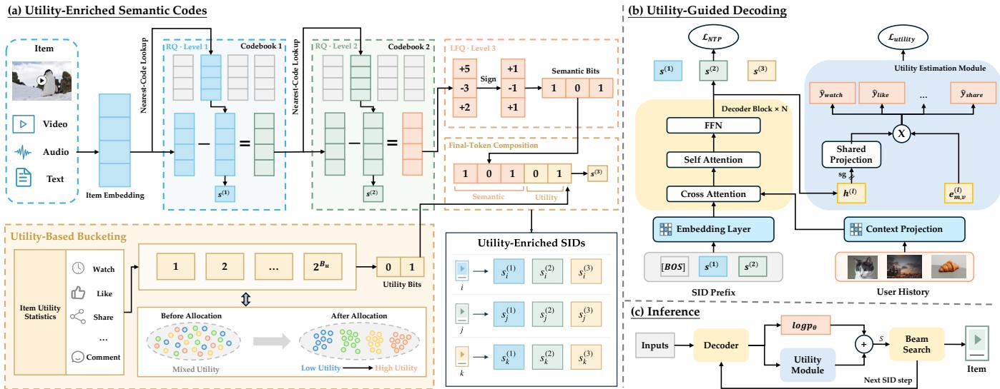
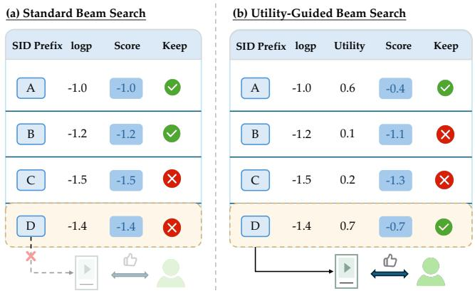
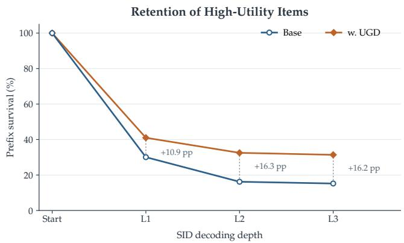

# Utility-Aware Generative Recommendation: Utility-Enriched Semantic Codes and Utility-Guided Decoding

Yang Hu∗,†, Duo Wang∗, Ning Li‡, Kang Li, Junda She, Chengcheng Guo,

Kuo Cai, Bin Liu, Youhua Liu, Xiaoshuang Chen

Kuaishou Technology, Beijing, China

{huyang13, wangduo06, lining10, likang14, shejunda03, guochengcheng03, caikuo, liubin21, liuyouhua, chenxiaoshuang}@kuaishou.com

## Abstract

Generative recommendation has been widely adopted in large-scale industrial recommendation systems, where multimodal item embeddings are quantized into ofline semantic identifiers (SIDs) and items are retrieved by autoregressively generating their SIDs. However, conventional SID construction often underrepresents item utility reflected in post-exposure behaviors such as shares, long views, and video completion, making semantically similar items with diferent utility insuficiently distinguishable while struggling to accommodate rapidly changing utility signals. Moreover, generation likelihood may be misaligned with downstream utility, caus ing high-utility candidates to be prematurely pruned during beam search before post-generation reranking or training-time reward alignment can efectively compensate. To address these limitations, we propose UAGR, which aligns both SID construction and decoding with downstream multi-objective utility. Our Utility-Enriched Semantic Codes preserve the original semantic information while incorporating item-level utility without increasing SID length or vocabulary size, supporting incremental utility updates with no additional tokenization or sequence-decoding cost. Meanwhile, our Utility-Guided Decoding estimates candidate utility by combining predictions of multiple post-exposure outcomes and incorporates these estimates into beam scoring, reducing the risk of prematurely pruning high-utility paths while enabling flexible utility control without interfering with generative backbone training. Extensive ofline experiments and online A/B tests under real-world trafic demonstrate the efectiveness and deployability of UAGR, which has been fully deployed on Kuaishou and increases video watch time by 0.206% online.

## CCS Concepts

• Information systems → Recommender systems.

## Keywords

Generative Recommendation, Semantic Identifiers, Multi-objective Recommendation

## 1 Introduction

Generative recommendation has emerged as a practical paradigm for large-scale industrial recommendation and has been deployed across short-video, advertising, live-streaming, and local-service platforms [8, 42, 45, 47]. Unlike conventional retrieval systems that score items independently, identifier-based generative recommenders represent each item as a semantic identifier (SID) composed of discrete tokens and autoregressively generate candidate SIDs conditioned on user interaction histories [20, 26, 33]. In a typical pipeline, multimodal item embeddings are discretized into hierarchical SIDs using residual vector quantization [8, 11], such as residual K-means [5] or RQ-VAE [23], and finite-width beam search is used to explore the resulting discrete identifier space.

Despite this progress, a common training objective for generative recommenders is to maximize the likelihood of items in users’ interaction histories. This objective captures relevance to past user behavior, but does not explicitly model the utility reflected in postexposure outcomes such as long views, video completion, watch time, likes, or shares. Candidates with similar generation probabilities can therefore yield substantially diferent post-exposure outcomes, and the ordering induced by generation likelihood may difer from that induced by downstream utility. This mismatch is particularly consequential under finite-width beam search: a path leading to a high-utility item may be pruned at an intermediate decoding step, thereby preventing the item from being recovered during subsequent decoding [36, 38, 41].

Recent studies have explored additional supervision and scoring mechanisms beyond standard next-token prediction to refine retrieved candidates or guide intermediate decoding. GRank [37] injects embeddings of target items and in-batch negatives during training to enhance candidate discrimination, retrieves candidates through vector search, and subsequently applies a lightweight target-aware ranker for refinement. However, such post-retrieval reranking can only reorder retrieved candidates and cannot recover items excluded from the initial candidate set. OneRec [8] unifies retrieval and ranking within a generative framework and further employs reinforcement learning to iteratively align SID generation with personalized preference signals. However, such training-time sequence-level alignment optimizes the generation policy over complete SID sequences, while beam search makes irreversible pruning decisions over intermediate SID prefixes, and therefore does not necessarily ensure that high-utility candidates survive intermediate pruning. RankGR [10] aligns generation probabilities with preference orderings derived from behavioral feedback and uses a target-aware scorer trained with binary supervision to rescore candidate codewords during stepwise beam refinement. However, its preference-based scoring does not explicitly estimate heterogeneous post-exposure outcomes that determine downstream multi-objective utility in production systems, potentially limiting its ability to identify and retain high-utility candidates during beam search.

Utility misalignment can also originate in SID construction. Conventional semantic tokenizers commonly organize items according to semantic similarity through residual quantization [20, 33]. To move beyond this purely semantic organization, recent methods [6, 11, 43, 55] incorporate collaborative signals derived from user-item interactions through representation alignment, contrastive learning, or collaborative-similarity-guided tokenization. Although these signals can improve item distinguishability and capture interactionlevel relationships beyond content semantics, they neither explicitly characterize the downstream utility reflected in heterogeneous postexposure outcomes nor necessarily preserve the original semantic structure when incorporated into the tokenizer. Consequently, utility-relevant distinctions may still be insuficiently preserved in the discrete identifier space, while perturbations to the learned semantic structure can ofset the benefits of collaborative enrichment and, in some cases, even degrade downstream performance relative to the original semantic tokenizer [7]. More importantly, collaborative signals are inherently time-varying and can shift substantially over short time scales, causing the information encoded in learned SIDs to become stale and limiting the practicality of such learning-based tokenizers in large-scale industrial deployment [1].

Motivated by these observations, we propose Utility-Aware Generative Recommendation (UAGR), which aligns both SID con struction and autoregressive decoding with downstream utility. At the representation level, we introduce Utility-Enriched Semantic Codes (UE-SID), which improves item distinguishability through lookup-free quantization at the final level and incorporates discretized item-level utility into the final SID token, while preserving the hierarchical semantic structure. This design explicitly encodes item-level utility in the discrete SID space without increasing SID length or vocabulary size, simultaneously supporting incremental utility updates without retraining the semantic quantizers. At the decoding level, we propose Utility-Guided Decoding (UGD), which aggregates predictions of multiple post-exposure outcomes from intermediate decoding states into a configurable utility score, which is combined with generation likelihood during beam pruning to reduce the risk of prematurely discarding high-utility paths. Meanwhile, during training, stop-gradient isolation prevents utilityrelated gradients from updating the generative backbone, thereby avoiding gradient interference between utility estimation and nexttoken prediction, preserving the backbone’s original generative capability. Extensive ofline experiments and online A/B tests on Kuaishou, a real-world recommendation platform serving hundreds of millions of daily active users, validate the efectiveness and practicality of UAGR, whose plug-and-play utility module supports flexible utility configuration without interfering with the training of the online generative model. UAGR has been fully deployed on Kuaishou.

Our main contributions are summarized as follows:

• We develop UGD to incorporate predictions of multiple postexposure outcomes into beam scoring, enabling flexible utility control without interfering with generative backbone training.

• We conduct extensive ofline experiments and online A/B tests on Kuaishou. The results demonstrate the efectiveness and production feasibility of UAGR, which has been fully deployed on Kuaishou platforms.

## 2 Related Work

## 2.1 Generative Recommendation

Early generative recommenders adapt pretrained language models to recommendation through fine-tuning. P5 [14] unifies multiple recommendation tasks in a text-to-text framework, while TALL-Rec [2] aligns language models with recommendation instructions and GPTRec [31] models personalized recommendation as autoregressive generation. Although flexible, these methods generate textual outputs that must be grounded to items in a large and continuously changing catalog.

TIGER [33] introduced identifier-based generative recommendation by quantizing item embeddings into hierarchical semantic IDs and autoregressively generating these IDs from user histories. This paradigm has since been validated in industrial systems. OneRec [8] unifies retrieval and ranking through generation and aligns the generator with user preferences; GR4AD [47] co-designs item tokenization, model learning, and online serving for advertising; and OneLive [42] adapts generative recommendation to highly dynamic live-streaming content. Related systems further extend the paradigm to local services and advertising [18, 45]. More recent studies have moved beyond conventional next-item prediction toward more complex settings that require joint optimization across candidates, tasks, or entire recommendation slates. RankGR [10] incorporates ranking-oriented preference optimization, SIGMA [51] supports instruction-driven multi-task recommendation, and HiGR [30] addresses hierarchical slate generation.

## 2.2 Semantic Identifiers for Recommendation

Semantic identifiers are a key component of identifier-based generative recommendation, determining how items are represented in the model’s discrete output space. Most SID construction methods first encode item content into continuous embeddings and then discretize them through vector quantization. VQ-VAE [40] integrates single-level vector quantization into a neural autoencoding framework. Hierarchical codes can be obtained by repeatedly quantizing the residual, either through classical residual vector quantization (RVQ) [5], which sequentially applies K-means, or through RQ-VAE [23], which learns residual codebooks within a neural autoencoder.

Recent SID studies address both the information encoded in identifiers and how those identifiers are learned. DAS [49] incorporates collaborative signals, while MMQ [46] combines multimodal information with behavior-aware adaptation. ETEGRec [25] jointly trains the tokenizer and recommender, whereas UniSID [19] learns item embeddings and SIDs end to end. GRID [20] and FORGE [11] systematically compare SID construction choices on public benchmarks and industrial data.

Utility-Aware Generative Recommendation: Utility-Enriched Semantic Codes and Utility-Guided Decoding

  
Figure 1: Overview of UAGR. (a) Utility-Enriched Semantic Codes encode item-level utility in the final SID token without increasing SID length or vocabulary size. (b) The utility estimation module, with stop-gradient isolation, predicts post-exposure feedback from decoder hidden states. (c) Utility-Guided Decoding combines cumulative generation log-likelihood with utility estimates to select candidate prefixes during beam search.

## 2.3 Preference and Reward Alignment for Generation

Preference and reward signals have been widely used to align language-model generation with desired objectives. RLHF [29] opti mizes language models against learned human-preference rewards, while DPO [32] directly learns from preference pairs without explicit reward modeling. GRPO [34] further performs group-relative policy optimization without a critic model. Beyond outcome-level alignment, process reward models provide supervision for intermediate reasoning steps [24] and can guide inference-time search toward more promising trajectories [17].

Similar alignment techniques have been introduced into industrial generative recommendation. OneRec [8] uses reinforcement learning to align identifier generation with personalized preference signals. RankGR [10] uses listwise direct preference optimization to align generation probabilities with ordered behavioral feedback, and trains a binary target-codeword scorer to refine the candidates retained at each decoding step. PROMISE [15] trains a path-level process reward model to distinguish ground-truth SID prefixes from sampled valid prefixes, and uses the resulting relevance scores to filter expanded intermediate candidates during beam search, thereby mitigating semantic drift.

## 3 Methodology

## 3.1 Overview

Figure 1 illustrates the overall framework of UAGR, which incorporates downstream utility into both SID construction and autoregressive decoding. Following the preliminaries in Section 3.2, we first introduce Utility-Guided Decoding (Section 3.3), which estimates postexposure outcomes and incorporates them into beam pruning, as illustrated in Figures 1(b) and 1(c). We then present Utility-Enriched

Semantic Codes (Section 3.4), which preserve utility-relevant distinctions in the SID space, as shown in Figure 1(a).

## 3.2 Preliminaries

In a typical SID-based generative recommender, each item’s multimodal embedding $\mathbf { x } _ { i } \in \mathbb { R } ^ { d }$ , which encodes textual, visual, and other item-side features, is quantized into a hierarchical SID using residual K-means. Starting from ${ \bf r } _ { i } ^ { ( 0 ) } = { \bf x } _ { i }$ , the quantizer selects the nearest centroid and computes the updated residual ${ \bf r } _ { i } ^ { ( l ) }$ at each level �:

$$
s _ { i } ^ { ( l ) } = \arg \operatorname* { m i n } _ { k } \left\| \mathbf { r } _ { i } ^ { ( l - 1 ) } - \mathbf { c } _ { k } ^ { ( l ) } \right\| _ { 2 } ^ { 2 } , \qquad \mathbf { r } _ { i } ^ { ( l ) } = \mathbf { r } _ { i } ^ { ( l - 1 ) } - \mathbf { c } _ { s _ { i } ^ { ( l ) } } ^ { ( l ) } ,\tag{1}
$$

where $\mathbf { c } _ { k } ^ { ( l ) }$ denotes the �-th centroid at level �. Repeating this procedure over � levels assigns each item a coarse-to-fine SID sequence:

$$
\mathbf { \boldsymbol { s } } _ { i } = \left( s _ { i } ^ { ( 1 ) } , s _ { i } ^ { ( 2 ) } , \ldots , s _ { i } ^ { ( L ) } \right) .\tag{2}
$$

Given the interaction history $\mathcal { H } _ { u } = ( i _ { 1 } , i _ { 2 } , . . . , i _ { n } )$ of user �, a generative recommender autoregressively predicts the SID of a target item �, with the cumulative log-probability given by:

$$
\log p _ { \theta } \left( \mathbf { s } _ { i } \mid \mathcal { H } _ { u } \right) = \sum _ { l = 1 } ^ { L } \log p _ { \theta } \left( s _ { i } ^ { ( l ) } \mid \mathbf { s } _ { i } ^ { ( < l ) } , \mathcal { H } _ { u } \right) .\tag{3}
$$

During inference, beam search iteratively expands SID prefixes and retains the top-� prefixes by cumulative generation log-likelihood at each step.

However, this likelihood-based pruning strategy does not explicitly account for downstream utility. Candidates with similar generation probabilities can yield substantially diferent post-exposure outcomes, while SID prefixes of potentially high-utility items may be prematurely pruned during beam search. To address this mismatch, we propose Utility-Guided Decoding (UGD), which combines gen eration log-likelihood with a utility score derived from predictions of multiple post-exposure outcomes to guide beam pruning.

## 3.3 Utility-Guided Decoding (UGD)

3.3.1 Utility Estimation Module. We consider � post-exposure behavioral signals, such as watch time, long views, likes, and shares, with � $\in \ \{ 1 , \ldots , M \}$ indexing each behavior. As shown in Figure 1(b), to estimate these signals for candidate SID prefixes, we reuse the hidden states of the generative backbone. Specifically, at SID position �, given user history $\mathcal { H } _ { u }$ and the generated prefix $\bar { \mathbf { s } ^ { ( < l ) } }$ the decoder produces

$$
\mathbf { h } ^ { ( l ) } = f _ { \theta } \left( \mathcal { H } _ { u } , \mathbf { s } ^ { ( < l ) } \right) ,\tag{4}
$$

where $f _ { \theta }$ denotes the generative backbone. We then project the hidden state into a shared low-dimensional utility representation:

$$
\mathbf { g } ^ { ( l ) } = P _ { \psi } \left( s \mathbf { g } ( \mathbf { h } ^ { ( l ) } ) \right) ,\tag{5}
$$

where $P _ { \psi }$ is a projection network parameterized by $\psi ,$ implemented as a multilayer perceptron (MLP). The stop-gradient operator sg(·) prevents utility-related gradients from updating the generative backbone, thereby avoiding interference from heterogeneous behavioral supervision and preserving its original generative capability.

Based on this shared representation, we introduce a separate token-wise prediction head for each behavior �. When expanding the current prefix with candidate token � at SID position �, the corresponding head uses a learnable token embedding $\mathbf { e } _ { m , v } ^ { ( l ) }$ and bias $b _ { m , v } ^ { ( l ) }$ to compute the behavioral prediction score:

$$
\begin{array} { r } { q _ { m , v } ^ { ( l ) } = \left( \mathbf { e } _ { m , v } ^ { ( l ) } \right) ^ { \top } \mathbf { g } ^ { ( l ) } + b _ { m , v } ^ { ( l ) } . } \end{array}\tag{6}
$$

3.3.2 Utility-Guided Beam Search. As shown in Figure 1(c), we incorporate the estimated utility scores directly into beam pruning to reduce the risk of prematurely discarding high-utility candidates during beam search. Figure 2 compares standard beam search with utility-guided beam search, illustrating how utility-aware scoring changes which candidate prefixes survive pruning.

Specifically, at SID position �, we compute an overall score for each prefix $\pmb { s } ^ { ( < l ) }$ expanded with candidate token � by combining generation likelihood and estimated utility:

$$
S ^ { ( l ) } = \log p _ { \theta } \left( s ^ { ( < l ) } , v \mid \mathcal { H } _ { u } \right) + \lambda \sum _ { m = 1 } ^ { M } w _ { m } \operatorname { N o r m } \left( q _ { m , v } ^ { ( l ) } \right) .\tag{7}
$$

Here, the first term is the cumulative generation log-likelihood, and the second term aggregates the normalized utility estimates of the � behavioral signals. The operator Norm(·) performs behaviorwise normalization to place heterogeneous behavioral predictions on a comparable scale before aggregation. The coeficient $w _ { m }$ specifies the contribution of behavior �, while � balances generation likelihood and downstream utility. The top-� expanded prefixes under $S ^ { ( l ) }$ are retained for the next decoding step.

Unlike the generation likelihood, which is accumulated across SID positions, the utility score is applied only at the current position and is not carried forward to subsequent decoding steps. This avoids repeatedly counting utility contributions across decoding steps while allowing utility to guide each pruning decision.

  
Figure 2: Illustration of utility-guided beam search. Expanded SID prefixes are scored by cumulative generation log-likelihood and current-step utility estimates before pruning to retain the top-� prefixes.

3.3.3 Training Objectives. For each training sample, the target item is represented by an SID $\pmb { s } = ( s ^ { ( 1 ) } , \dots , s ^ { ( \bar { L } ) } )$ and associated with observed post-exposure feedback $\mathbf { y } = \left( y _ { 1 } , \dots , y _ { M } \right)$ , where $y _ { m }$ denotes the feedback label for behavior � $\in \{ 1 , \ldots , M \}$ . We use the observed feedback to supervise behavioral predictions at each position of the target SID. Specifically, the utility-estimation loss for behavior � at position � is

$$
\mathcal { L } _ { m } ^ { ( l ) } = \ell _ { m } \left( q _ { m , s ^ { ( l ) } } ^ { ( l ) } , y _ { m } \right) ,\tag{8}
$$

where $\ell _ { m }$ denotes the task-specific loss function, using cross-entropy for classification tasks and mean squared error for regression tasks. Consequently, the utility loss is aggregated over � behaviors and � SID positions:

$$
\mathcal { L } _ { \mathrm { u t i l i t y } } = \sum _ { m = 1 } ^ { M } \alpha _ { m } \sum _ { l = 1 } ^ { L } \mathcal { L } _ { m } ^ { ( l ) } ,\tag{9}
$$

where $\alpha _ { m }$ controls the contribution of behavior �.

Combining with the standard next-token prediction objective $\mathcal { L } _ { \mathrm { N T P } }$ for the generative backbone, we define the overall training loss as

$$
\begin{array} { r } { \mathcal { L } = \mathcal { L } _ { \mathrm { N T P } } + \beta \mathcal { L } _ { \mathrm { u t i l i t y } } , } \\ { \mathcal { L } _ { \mathrm { N T P } } = - \displaystyle \sum _ { l = 1 } ^ { L } \log p _ { \theta } \left( s ^ { ( l ) } \mid \mathbf { s } ^ { ( < l ) } , \mathcal { H } _ { u } \right) . } \end{array}\tag{10}
$$

Here $\beta$ controls the contribution of utility estimation.

Practical Advantages The proposed design is lightweight, stable, and extensible, making it well suited for low-risk deployment in large-scale recommendation systems.

• Low training and inference costs. By reusing decoder hidden states and sharing a low-dimensional projection across behaviors, the module requires only lightweight behavior-specific tokenwise heads. During inference, these heads compute utility scores from the shared representation alongside next-token predictions, without additional backbone forward passes, thereby minimizing computational and memory overhead. Thus, this design is well suited to the strict model-update and online-latency constraints of large-scale industrial recommendation.

• Training stability. The stop-gradient operation isolates utility supervision from the next-token prediction objective, ensuring that utility-related gradients update only the estimation module without afecting the generative backbone. This separation preserves the backbone’s generation capability and improves training stability when behavioral labels are noisy, heterogeneous, or frequently revised.

• Modular multi-objective extension. New utility signals can be incorporated through additional behavior-specific heads and supervision losses, without modifying or retraining the generative backbone.

## 3.4 Utility-Enriched Semantic Codes (UE-SID)

Although UGD incorporates predicted utility into beam pruning, its efectiveness remains constrained by the underlying SID space. Conventional semantic tokenizers often face two limitations. First, residual quantization methods such as RQ-KMeans and RQ-VAE often sufer from SID collisions [33, 53], where multiple items share the same complete SID and become indistinguishable during generation, which substantially undermines the efectiveness of our UGD. Second, conventional SID construction primarily relies on multimodal semantics without explicitly incorporating downstream utility. Although collaborative signals can enrich item representations, their temporal variability creates a trade-of between stale SIDs and disruptive updates to the generator’s learned token space [1]. To address these limitations, we introduce Utility-Enriched Semantic Codes (UE-SID) by redesigning only the final quantization level.

3.4.1 Utility-Enriched Codebook Construction. To reduce SID collisions, we replace the final-level nearest-centroid assignment in residual K-means (Section 3.2) with lookup-free quantization (LFQ), inspired by MAGVIT-v2 [50], while retaining the first � − 1 quantization levels unchanged. LFQ employs an implicit binary code space instead of explicit nearest-neighbor codebook lookup and uses entropy regularization to encourage diverse code utilization. Specifically, a learnable linear projection $f _ { \mathrm { p r o j } }$ maps the resulting residual $\mathbf { r } _ { i } ^ { ( L - 1 ) }$ to a �-dimensional representation:

$$
\mathbf { z } _ { i } = f _ { \mathrm { p r o j } } ( \mathbf { r } _ { i } ^ { ( L - 1 ) } ) , \qquad \mathbf { z } _ { i } \in \mathbb { R } ^ { B } .\tag{11}
$$

Here, � denotes the total bit budget of the final-level token and each dimension is independently binarized as

$$
\widehat { z } _ { i , j } = \left\{ \begin{array} { l l } { + 1 , } & { z _ { i , j } > 0 , } \\ { - 1 , } & { z _ { i , j } \leq 0 , } \end{array} \right. \qquad j = 1 , . . . , B .\tag{12}
$$

We then map +1/−1 to 1/0 to form a �-bit semantic code.

During training, we employ a straight-through estimator [3] to propagate gradients through binary quantization. For an LFQ training mini-batch ${ \mathcal { B } } ,$ we define $p _ { i } ( c )$ as the temperature-scaled soft assignment of item � to an implicit binary code �. The entropy regularization objective is

$$
\mathcal { L } _ { \mathrm { e n t } } = \frac { 1 } { \left| \mathcal { B } \right| } \sum _ { i \in \mathcal { B } } H \left( \boldsymbol { p } _ { i } \right) - \gamma H \left( \frac { 1 } { \left| \mathcal { B } \right| } \sum _ { i \in \mathcal { B } } \boldsymbol { p } _ { i } \right) ,\tag{13}
$$

where the first term encourages confident assignments, while the second promotes diverse code utilization, weighted by �. We further introduce a commitment loss to constrain the projected representations toward their quantized values. The overall LFQ training objective is

$$
\begin{array} { r l } & { \mathcal { L } _ { \mathrm { L F Q } } = \mathcal { L } _ { \mathrm { c o m } } + \lambda _ { \mathrm { e n t } } \mathcal { L } _ { \mathrm { e n t } } , } \\ & { \mathcal { L } _ { \mathrm { c o m } } = \displaystyle \frac { 1 } { \left| \mathcal { B } \right| } \sum _ { i \in \mathcal { B } } \left\| \mathbf { z } _ { i } - s \mathbf { g } ( \widehat { \mathbf { z } } _ { i } ) \right\| _ { 2 } ^ { 2 } , } \end{array}\tag{14}
$$

where $s \mathrm { g } ( \cdot )$ denotes stop-gradient.

To incorporate item-level utility into semantic identifiers, we discretize the utility signal into buckets and encode the bucket index using $B _ { \mathrm { u } }$ bits. Observing that some LFQ bits contribute little to SID distinguishability (Appendix C.3), we select and mask the subset of $B _ { \mathrm { u } }$ bits whose removal causes the smallest increase in SID collisions. The remaining $B _ { \mathrm { s } } = B - B _ { \mathrm { u } }$ bits are packed into the semantic code $c _ { s , i } ,$ , while the released bit capacity is allocated to utility encoding without increasing the final-level vocabulary size.

Let $a _ { i }$ denote a utility statistic derived from historical behavioral feedback. We discretize $a _ { i }$ into $2 ^ { B _ { \mathrm { u } } }$ buckets and use its bucket index as the utility code:

$$
c _ { \mathrm { u } , i } = \mathrm { B u c k e t i z e } \left( a _ { i } \right) , \qquad c _ { \mathrm { u } , i } \in \left\{ 0 , \ldots , 2 ^ { B _ { \mathrm { u } } } - 1 \right\} .\tag{15}
$$

Formally, Bucketize $\begin{array} { r } { ( a _ { i } ) = \sum _ { k = 1 } ^ { 2 ^ { B _ { \mathrm { u } } } - 1 } \mathbb { I } [ a _ { i } \geq \tau _ { k } ] } \end{array}$ , where $\tau _ { 1 } < \cdots <$ $\tau _ { 2 } B _ { \mathrm { u } } - 1$ are the ordered bucket boundaries and I[·] denotes the indicator function.

Finally, we concatenate the semantic and utility codes to form the final-level SID token:

$$
s _ { i } ^ { ( L ) } = \mathrm { C o n c a t } ( c _ { s , i } , c _ { \mathrm { u } , i } ) , \qquad B _ { s } + B _ { \mathrm { u } } = B .\tag{16}
$$

3.4.2 Online SID Assignment and Update. For newly introduced items, we assign UE-SID through an online encoding pipeline: Given an item embedding $\mathbf { x } _ { i } ,$ the pipeline first applies the fixed residual Kmeans centroids, the trained LFQ module, and the selected bit mask to obtain the first � − 1 semantic tokens and the semantic code $c _ { \mathrm { s } , i } .$ It then retrieves the latest available behavioral statistics, computes the item-level utility statistic $a _ { i } ,$ and obtains the utility code $c _ { \mathrm { u } , i }$ through bucketization. The semantic and utility components are combined according to Eq. (16), and the resulting SID is published to the online code store. This process requires only fixed-model inference, behavioral-feature lookup, bucket assignment, and bit composition, without retraining the semantic quantizers, thereby supporting low-latency online serving.

To reflect evolving item utility, we periodically refresh the utility component for items with updated behavioral statistics. Every hour, the update pipeline recomputes $a _ { i }$ from the latest statistics and updates $c _ { \mathrm { u } , i }$ accordingly, while keeping the first � − 1 tokens and the LFQ semantic component $c _ { s , i }$ fixed. This incremental update keeps the utility information fresh without perturbing the item’s semantic representation.

Changes in item utility may also gradually shift the overall distribution of utility statistics. We therefore recalibrate the bucket boundaries weekly based on the aggregated distribution of itemlevel utility statistics. This two-timescale strategy balances freshness and stability: hourly updates capture recent changes in individual item utility, while weekly boundary adjustments accommodate gradual distribution shifts without frequently redefining utility levels.

Table 1: Overall ofline performance on KuaiRand (all metrics in %). The best result is bold, and the second-best is underlined.
<table><tr><td rowspan="2">Type</td><td rowspan="2">Method</td><td colspan="4">KuaiRand</td></tr><tr><td>Recall@3 ↑</td><td>NDCG@3↑</td><td>Recall@5 ↑</td><td>NDCG@5↑</td></tr><tr><td rowspan="5">Discriminative</td><td>Caser [39]</td><td>2.0462</td><td>1.5378</td><td>3.0924</td><td>1.9753</td></tr><tr><td>SASRec [21]</td><td>1.8460</td><td>1.4063</td><td>2.8637</td><td>1.8436</td></tr><tr><td>BERT4Rec [35]</td><td>1.6482</td><td>1.3563</td><td>2.6452</td><td>1.7629</td></tr><tr><td>S3-Rec [57]</td><td>2.3681</td><td>1.8630</td><td>3.4612</td><td>2.2975</td></tr><tr><td>HSTU [52]</td><td>2.4831</td><td>1.8742</td><td>3.6223</td><td>2.3593</td></tr><tr><td>Unified</td><td>LIGER [48]</td><td>1.9951</td><td>1.4632</td><td>3.0073</td><td>1.8872</td></tr><tr><td rowspan="5">Generative</td><td>TIGER [33]</td><td>2.0105</td><td>1.4941</td><td>2.9983</td><td>1.8999</td></tr><tr><td>RecForest [9]</td><td>2.5748</td><td>1.9516</td><td>3.6472</td><td>2.4063</td></tr><tr><td>EAGER [44]</td><td>2.5631</td><td>1.9480</td><td>3.5974</td><td>2.3810</td></tr><tr><td>OneRec-1.7B [56]</td><td>2.1114</td><td>1.6432</td><td>3.1493</td><td>2.0460</td></tr><tr><td>UAGR</td><td>2.7741</td><td>2.2740</td><td>3.9632</td><td>2.7764</td></tr></table>

## 4 Experiments

In this section, we conduct ofline and online experiments to answer the following research questions:

• RQ1: How does UAGR perform compared with existing recom mendation methods?

• RQ2: How does UE-SID construction compare with existing methods in codebook quality and downstream recommendation performance?

• RQ3: How does each component afect the performance ofUAGR?

• RQ4: How does UGD compare with diferent utility alignment strategies?

• RQ5: How does UAGR perform in a real-world online recommendation scenario?

## 4.1 Experimental Setup

4.1.1 Baselines. To evaluate the overall recommendation efectiveness of UAGR, we compare it with discriminative methods, including Caser [39], SASRec [21], BERT4Rec [35], S3-Rec [57], and HSTU [52]; generative methods, including TIGER [33], RecForest [9], EAGER [44], and OneRec-1.7B [56]; and a unified method, LIGER [48]. To assess the efectiveness of the proposed UE-SID component, we compare it with existing SID construction methods, including RQ-KMeans [5], OPQ [13], RQ-OPQ [4], LCRec [55], FORGE [11], LETTER [43], and UIST-RQ [27]. Detailed baseline descriptions are provided in Appendix B.1.

4.1.2 Dataset and Metrics. We use KuaiRand [12], a public recommendation dataset collected on Kuaishou that provides multiple types of user feedback. Further dataset details are provided in Appendix A. We evaluate recommendation performance using Recall and NDCG at cutofs 3 and 5. To evaluate codebook construction, we report Independent Coding Rate (ICR) [4], Gini coeficient [11], and code entropy [22]. ICR measures the proportion of items assigned unique, collision-free SIDs, while lower Gini and higher entropy indicate more balanced code utilization.

4.1.3 Implementation Details. For data splitting, we adopt the widely used leave-one-out protocol. We adopt OneRec-1.7B as the generative backbone and apply low-rank adaptation (LoRA) [16] for parameter-eficient fine-tuning. The model is trained for 4 epochs on NVIDIA L20 GPUs with a batch size of 64. We employ a cosine learning rate schedule with peak and minimum learning rates of $2 \times 1 0 ^ { - 5 } \mathrm { a n d } 1 \times 1 0 ^ { - 5 }$ , respectively, and clip the gradient norm at 1.0. The SID configuration is 3×8192 (three levels with 8,192 codes each), with a beam size of 200. For UE-SID, the final level uses $B _ { \mathrm { s } } = 1 0$ bits for semantic encoding and $B _ { \mathrm { u } } = 3$ bits for utility encoding. Further implementation details are provided in Appendix B.2.

## 4.2 Overall Ofline Evaluation (RQ1)

Table 1 reports the ofline performance of UAGR and the baselines on KuaiRand. UAGR achieves the best performance across all evaluation metrics, outperforming the strongest baseline by 7.74% in Recall@3 and 16.52% in NDCG@3. The improvement in Recall@� indicates that UAGR retrieves more items associated with positive user feedback, while the improvement in NDCG@� shows that these items are ranked higher in the recommendation list. These results demonstrate the efectiveness of UAGR in improving recommendation performance.

Specifically, UAGR outperforms all evaluated generative baselines, including methods that incorporate collaborative signals beyond semantic information. For example, although EAGER [44] integrates semantic and collaborative signals through a two-stream architecture, UAGR consistently outperforms EAGER across all evaluated metrics, highlighting the efectiveness of our explicit, stability-preserving utility integration compared with EAGER’s collaborative-signal fusion approach. UE-SID retains utility-relevant distinctions in the discrete identifier space, while UGD incorporates predicted utility into beam pruning to reduce the premature removal of high-utility candidates. Together, these components align item tokenization and generation with downstream utility, contributing to UAGR’s superior performance on KuaiRand.

Table 2: Comparison of diferent SID construction methods on KuaiRand (Recall and NDCG in %). The best result is highlighted in bold, and the second-best result is underlined.
<table><tr><td rowspan="2">Method</td><td colspan="7">KuaiRand</td></tr><tr><td>Recall@3 ↑</td><td>NDCG@3 ↑</td><td>Recall@5 ↑</td><td>NDCG@5 ↑</td><td>ICR↑</td><td>Gini↓</td><td>Entropy ↑</td></tr><tr><td>RQ-KMeans [5]</td><td>2.1114</td><td>1.6432</td><td>3.1493</td><td>2.0460</td><td>0.9571</td><td>0.02660</td><td>5.9732</td></tr><tr><td>OPQ [13]</td><td>2.0095</td><td>1.6174</td><td>3.0695</td><td>2.0323</td><td>0.9582</td><td>0.00941</td><td>7.9522</td></tr><tr><td>RQ-OPQ [4]</td><td>2.2364</td><td>1.8171</td><td>3.2123</td><td>2.2171</td><td>0.9843</td><td>0.01030</td><td>7.8756</td></tr><tr><td>UIST-RQ [27]</td><td>2.2137</td><td>1.7982</td><td>3.1641</td><td>2.1943</td><td>0.9842</td><td>0.00990</td><td>7.8642</td></tr><tr><td>LCRec [55]</td><td>2.1473</td><td>1.7463</td><td>3.3651</td><td>2.2579</td><td>0.9997</td><td>0.01250</td><td>7.5144</td></tr><tr><td>FORGE [11]</td><td>2.0744</td><td>1.4785</td><td>2.9784</td><td>1.8563</td><td>0.9687</td><td>0.01760</td><td>7.5762</td></tr><tr><td>LETTER [43]</td><td>2.1462</td><td>1.6853</td><td>3.0845</td><td>2.0753</td><td>0.9823</td><td>0.00980</td><td>8.0147</td></tr><tr><td>UE-SID</td><td>2.4089</td><td>1.9669</td><td>3.5851</td><td>2.4357</td><td>0.9902</td><td>0.00500</td><td>8.0918</td></tr></table>

## 4.3 Evaluation of Utility-Enriched Semantic Codes (RQ2)

To evaluate our SID construction method, we compare UE-SID with alternative construction methods on KuaiRand. For a fair comparison, all methods use the same OneRec-1.7B backbone for downstream generative recommendation. The results are presented in Table 2. UE-SID achieves strong results in both codebook construction quality and downstream recommendation performance.

Regarding SID construction quality, UE-SID achieves a high ICR, along with the lowest Gini coeficient and the highest code entropy among all compared methods. The high ICR benefits from LFQ and the replacement of weakly discriminative semantic bits with utility codes, which further distinguish items with similar semantic representations. In particular, utility-based bucketing further contributes to a reduction in SID collisions, as detailed in Appendix C.4. Meanwhile, the entropy regularization objective in Eq. (13) discourages code collapse and promotes balanced code utilization, contributing to the favorable Gini and entropy results.

Regarding downstream recommendation performance, UE-SID achieves the best results across all evaluated metrics. Several baselines, including LCRec [55], FORGE [11], and LETTER [43], also explore incorporating collaborative signals into SID construction. Specifically, LCRec learns quantized item indices and integrates collaborative semantics through language-model alignment tasks; FORGE incorporates item co-occurrence signals through contrastive learning before quantization; and LETTER aligns quantized item representations with collaborative-filtering embeddings through contrastive regularization. In contrast, UE-SID explicitly discretizes item-level utility into buckets and incorporates the resulting utility codes into the final-level token of each SID. This design enables stable utility integration without altering the learned semantic codes, thereby outperforming these collaborative-signal-enhanced methods across all recommendation metrics. Notably, although LCRec achieves the highest Independent Coding Rate, its downstream recommendation performance remains below that of UE-SID, suggesting that SID uniqueness alone does not guarantee superior recommendation performance.

## 4.4 Ablation Study (RQ3)

To assess the contribution of each proposed component in UAGR, we conduct an ablation study on KuaiRand. We add each component independently to the same OneRec-1.7B base model and evaluate its efect on downstream recommendation performance. We additionally report ICR for the codebook construction variants to assess their efect on SID distinguishability. The results are reported in Table 3.

The results show that each proposed component improves downstream recommendation performance when independently added to the same base model. Introducing LFQ alone increases ICR and improves recommendation performance, as it replaces nearestcentroid assignment with an implicit binary code space and encourages more balanced code utilization through entropy regularization, thereby reducing SID collisions. Incorporating utility codes further increases ICR and improves recommendation performance beyond LFQ alone. By distinguishing semantically similar items according to their utility levels, UE-SID further reduces collisions and preserves distinctions relevant to downstream recommendation.

Notably, Utility-Guided Decoding achieves the largest improvements in recommendation performance among the individual variants. These results suggest that likelihood-based next-item prediction alone is insuficient to fully address downstream recommendation objectives. UGD incorporates predicted utility into decoding, and its superior performance highlights the value of utility information as a complementary signal for retaining high-utility candidates during decoding.

To better illustrate how UGD reduces premature pruning, we track the survival of high-utility candidates, defined as those with positive long-view feedback (long\_view=1), during beam search. At each SID decoding position, we measure the proportion of these items whose corresponding prefixes survive beam pruning, using the initial high-utility item set as the fixed denominator. Both variants use the same beam width. As shown in Figure 3, UGD retains more high-utility candidates than the baseline, with the largest improvement observed at the second decoding level. These results demonstrate that incorporating utility information into beam search reduces the premature pruning of high-utility items, further validating the efectiveness of our UGD.

Table 3: Component ablations and comparisons of other utility alignment strategies on KuaiRand (Recall and NDCG in %). Each individual variant is independently added to Base.
<table><tr><td rowspan="2">Variant</td><td colspan="2">Recall@K</td><td colspan="2">NDCG@K</td><td rowspan="2">ICR</td></tr><tr><td> $K = 3$ </td><td> $K = 5$ </td><td> $K = 3$ </td><td> $K = 5$ </td></tr><tr><td>Full UAGR</td><td>2.774</td><td>3.963</td><td>2.274</td><td>2.776</td><td>0.9902</td></tr><tr><td>Base</td><td>2.111</td><td>3.149</td><td>1.643</td><td>2.046</td><td>0.9571</td></tr><tr><td>w. LFQ</td><td>2.246</td><td>3.288</td><td>1.654</td><td>2.064</td><td>0.9789</td></tr><tr><td>w. UE-SID</td><td>2.409</td><td>3.585</td><td>1.967</td><td>2.436</td><td>0.9902</td></tr><tr><td>w. UGD</td><td>2.578</td><td>3.712</td><td>2.047</td><td>2.499</td><td>一</td></tr><tr><td>w. Reranking</td><td>2.307</td><td>3.275</td><td>1.675</td><td>2.083</td><td>一</td></tr><tr><td>w. GRPO</td><td>2.418</td><td>3.602</td><td>1.953</td><td>2.450</td><td>一</td></tr></table>

Table 4: Online A/B test results on the Kuaishou platform. All reported user-consumption gains are statistically significant under a two-sided �-test with $\textstyle p < 0 . 0 5$
<table><tr><td></td><td>App Usage Time Video Watch Time Video Views</td><td></td><td>QPS</td></tr><tr><td>Δ +0.074%</td><td>+0.206%</td><td>+0.164%</td><td>-0.03%</td></tr></table>

## 4.5 Comparison of Utility Alignment Strategies (RQ4)

To more comprehensively evaluate our method, we compare strategies that incorporate utility information at diferent stages of generative recommendation. Specifically, we consider training-time util ity alignment through reinforcement learning, implemented using GRPO [34], and post-generation reranking, which reorders generated candidates according to their predicted utility. Both strategies are applied to the same OneRec-1.7B base model. For a fair comparison, GRPO rewards and reranking scores use the same utility objectives and corresponding weights as our method, with detailed configurations provided in Appendix B.2.

As shown in Table 3, UAGR outperforms both GRPO and postgeneration reranking across all evaluation metrics. In particular, Base with UGD alone also outperforms GRPO. Compared with Base, GRPO improves recommendation performance, demonstrating the efectiveness of reward-based training. However, GRPO optimizes rewards over complete SID sequences, whereas beam search makes irreversible pruning decisions over intermediate SID prefixes. Such sequence-level alignment does not necessarily ensure that highutility candidates survive intermediate pruning. In contrast, UGD explicitly estimates candidate utility at each SID decoding level and incorporates it into the corresponding beam-pruning scores, directly guiding prefix selection throughout generation. UGD also outperforms post-generation reranking, which can only reorder retained candidates and cannot recover high-utility items whose paths have already been pruned. These comparisons demonstrate the efectiveness of our method and support our design choices.

  
Figure 3: High-utility prefix retention during beam search for Base and Base with UGD at the same beam width. Annotated gaps show improvements in percentage points.

## 4.6 Online A/B Test Results (RQ5)

We deploy UAGR in the short-video recommendation scenario on the Kuaishou platform, replacing the production base model, and conduct a one-week online A/B test to evaluate its efectiveness in a large-scale recommendation environment. The reported improvements in user-consumption metrics are statistically significant under a two-sided �-test with $\textstyle p < 0 . 0 5$ . We additionally report the change in serving throughput, measured by queries per second (QPS). The results are presented in Table 4.

Compared with the production baseline, UAGR improves app usage time by 0.074%, video watch time by 0.206%, and video views by 0.164%, with only a 0.03% reduction in QPS. These online results demonstrate the efectiveness of UAGR in a large-scale production recommendation system and further highlight the value ofexplicitly incorporating downstream utility into generative recommendation. Further demonstrating its practical viability, UAGR has been fully deployed in Kuaishou’s production recommendation system since September 2026.

## 5 Conclusion

In this paper, we proposed UAGR to incorporate downstream utility into both SID construction and autoregressive decoding. Utility-Enriched Semantic Codes preserve utility-relevant item distinctions without disrupting the underlying hierarchical semantic structure or increasing SID length and vocabulary size. It also supports incremental utility updates without retraining the semantic quantizers. Utility-Guided Decoding incorporates predicted post-exposure utility into beam scoring to reduce premature pruning of high-utility candidates, without interfering with generative backbone training. It also enables flexible utility control through configurable weights for diferent behavioral objectives. Extensive ofline experiments and online A/B tests demonstrate the efectiveness of UAGR and support its design choices. UAGR has been fully deployed on Kuaishou. These findings highlight the importance of explicit util ity modeling at both the representation and decoding stages of generative recommendation, and we hope they will inspire further research in this direction.

## References

[1] Vladimir Baikalov, Iskander Bagautdinov, and Sergey Muravyov. 2026. Mitigating Collaborative Semantic ID Staleness in Generative Retrieval. In Proceedings of the 49th International ACM SIGIR Conference on Research and Development in Information Retrieval. ACM, 3602–3608. doi:10.1145/3805712.3809877

[2] Keqin Bao, Jizhi Zhang, Yang Zhang, et al. 2023. TALLRec: An Efective and Eficient Tuning Framework to Align Large Language Model with Recommendation. In Proceedings of the 17th ACM Conference on Recommender Systems. Association for Computing Machinery, New York, NY, USA, 1007–1014. doi:10.1145/3604915.3608857

[3] Yoshua Bengio, Nicholas Léonard, and Aaron Courville. 2013. Estimating or Propagating Gradients Through Stochastic Neurons for Conditional Computation. arXiv:1308.3432 [cs.LG] https://arxiv.org/abs/1308.3432

[4] Ben Chen, Xian Guo, Siyuan Wang, et al. 2025. OneSearch: A Preliminary Exploration of the Unified End-to-End Generative Framework for E-commerce Search. arXiv:2509.03236v5 https://arxiv.org/abs/2509.03236v5

[5] Yongjian Chen, Tao Guan, and Cheng Wang. 2010. Approximate Nearest Neighbor Search by Residual Vector Quantization. Sensors 10, 12 (2010), 11259–11273. doi:10.3390/s101211259

[6] Ziqiang Cui, Yunpeng Weng, Xing Tang, Xiaokun Zhang, Shiwei Li, Peiyang Liu, Bowei He, Dugang Liu, Weihong Luo, Xiuqiang He, and Chen Ma. 2025. Semantic Retrieval Augmented Contrastive Learning for Sequential Recommendation. In Advances in Neural Information Processing Systems, D. Belgrave, C. Zhang, H. Lin R. Pascanu, P. Koniusz, M. Ghassemi, and N. Chen (Eds.), Vol. 38, Main Conference. Curran Associates, Inc., 162621–162645. doi:10.52202/085713-5429

[7] Jiayi Dan, Weijian Li, Yongqi Liu, et al. 2026. Addressing Cross-Stage Decoupling of Semantic and Collaborative Signals in Generative Recommendation. In Proceedings ofthe 20th ACM Conference on Recommender Systems. Association for Computing Machinery, New York, NY, USA, 32–41. doi:10.1145/3773078.3831736

[8] Jiaxin Deng, Shiyao Wang, Kuo Cai, et al. 2025. OneRec: Unifying Retrieve and Rank with Generative Recommender and Iterative Preference Alignment. arXiv:2502.18965v1 https://arxiv.org/abs/2502.18965v1

[9] Chao Feng, Wuchao Li, Defu Lian, et al. 2022. Recommender Forest for Eficient Retrieval. In Advances in Neural Information Processing Systems, Vol. 35. Curran Associates, Inc., Red Hook, NY, USA, 38912–38924. doi:10.52202/068431-2820

[10] Kairui Fu, Changfa Wu, Kun Yuan, et al. 2026. RankGR: Rank-Enhanced Generative Retrieval with Listwise Direct Preference Optimization in Recommendation. arXiv:2602.08575v1 https://arxiv.org/abs/2602.08575v

[11] Kairui Fu, Tao Zhang, Shuwen Xiao, et al. 2026. FORGE: Forming Semantic Identifiers for Generative Retrieval in Industrial Datasets. In Proceedings ofthe 32nd ACM SIGKDD Conference on Knowledge Discovery and Data Mining V.2. Association for Computing Machinery, New York, NY, USA, 8858–8869. doi:10. 1145/3770855.3817477

[12] Chongming Gao, Shijun Li, Yuan Zhang, et al. 2022. KuaiRand: An Unbiased Sequential Recommendation Dataset with Randomly Exposed Videos. In Proceedings ofthe 31st ACM International Conference on Information and Knowledge Management. Association for Computing Machinery, New York, NY, USA, 3953– 3957. doi:10.1145/3511808.3557624

[13] Tiezheng Ge, Kaiming He, Qifa Ke, et al. 2013. Optimized Product Quantization for Approximate Nearest Neighbor Search. In 2013 IEEE Conference on Computer Vision and Pattern Recognition. IEEE, 2946–2953. doi:10.1109/CVPR.2013.379

[14] Shijie Geng, Shuchang Liu, Zuohui Fu, et al. 2022. Recommendation as Language Processing (RLP): A Unified Pretrain, Personalized Prompt & Predict Paradigm (P5). In Proceedings of the 16th ACM Conference on Recommender Systems. Association for Computing Machinery, New York, NY, USA, 299–315. doi:10.1145/3523227.3546767

[15] Chengcheng Guo, Kuo Cai, Yu Zhou, et al. 2026. PROMISE: Process Reward Models for Unlocking Test-Time Scaling Laws in Generative Recommendations. In Proceedings ofthe 20th ACM Conference on Recommender Systems. Association for Computing Machinery, New York, NY, USA, 1407–1416. doi:10.1145/3773078. 3831741

[16] Edward J Hu, Yelong Shen, Phillip Wallis, Zeyuan Allen-Zhu, Yuanzhi Li, Shean Wang, Lu Wang, and Weizhu Chen. 2022. LoRA: Low-Rank Adaptation of Large Language Models. In International Conference on Learning Representations. https:

//openreview.net/forum?id=nZeVKeeFYf9

[17] Chia-Yu Hung, Navonil Majumder, Ambuj Mehrish, et al. 2025. Reward-Guided Tree Search for Inference Time Alignment of Large Language Models. In Proceedings ofthe 2025 Conference ofthe Nations ofthe Americas Chapter ofthe Association for Computational Linguistics: Human Language Technologies (Volume 1: Long Papers). Association for Computational Linguistics, Albuquerque, New Mexico, 12575–12593. doi:10.18653/v1/2025.naacl-long.625

[18] Jie Jiang, Jun Zhang, Yi Li, et al. 2026. GPR: Towards a Generative Pre-trained One-Model Paradigm for Large-Scale Advertising Recommendation. In Proceedings of the 32nd ACM SIGKDD Conference on Knowledge Discovery and Data Mining V.2. Association for Computing Machinery, New York, NY, USA, 7477–7488. doi:10.1145/3770855.3818425

[19] Jie Jiang, Xinxun Zhang, Enming Zhang, et al. 2026. End-to-End Semantic ID Generation for Generative Advertisement Recommendation. arXiv:2602.10445v3 https://arxiv.org/abs/2602.10445v3

[20] Clark Mingxuan Ju, Liam Collins, Leonardo Neves, Bhuvesh Kumar, Louis Yufeng Wang, Tong Zhao, and Neil Shah. 2025. Generative Recommendation with Semantic IDs: A Practitioner’s Handbook. arXiv:2507.22224 [cs.IR] https://arxiv. org/abs/2507.22224

[21] Wang-Cheng Kang and Julian McAuley. 2018. Self-Attentive Sequential Recommendation. In 2018 IEEE International Conference on Data Mining (ICDM). IEEE, 197–206. doi:10.1109/ICDM.2018.00035

[22] Zhirui Kuai, Zuxu Chen, Huimu Wang, Mingming Li, Dadong Miao, Binbin Wang, Xusong Chen, Li Kuang, Yuxing Han, Jiaxing Wang, Guoyu Tang, Lin Liu, Songlin Wang, and Jingwei Zhuo. 2024. Breaking the Hourglass Phenomenon of Residual Quantization: Enhancing the Upper Bound of Generative Retrieval. arXiv:2407.21488 [cs.IR] https://arxiv.org/abs/2407.21488

[23] Doyup Lee, Chiheon Kim, Saehoon Kim, et al. 2022. Autoregressive Image Generation Using Residual Quantization. In Proceedings ofthe IEEE/CVF Conference on Computer Vision and Pattern Recognition (CVPR). IEEE, 11523–11532. doi:10.1109/CVPR52688.2022.01123

[24] Hunter Lightman, Vineet Kosaraju, Yuri Burda, et al. 2024. Let’s Verify Step by Step. In International Conference on Learning Representations. 39578–39601. https://proceedings.iclr.cc/paper\_files/paper/2024/hash/ aca97732e30bcf1303bc22ac3924fd16-Abstract-Conference.html

[25] Enze Liu, Bowen Zheng, Cheng Ling, et al. 2025. Generative Recommender with End-to-End Learnable Item Tokenization. In Proceedings ofthe 48th International ACM SIGIR Conference on Research and Development in Information Retrieval. Association for Computing Machinery, New York, NY, USA, 729–739. doi:10. 1145/3726302.3729989

[26] Jingzhe Liu, Liam Collins, Jiliang Tang, Tong Zhao, Neil Shah, and Mingxuan Ju. 2026. Understanding Generative Recommendation with Semantic IDs from a Model-scaling View. In Proceedings ofthe 32nd ACM SIGKDD Conference on Knowledge Discovery and Data Mining V.2. ACM, 3234–3245. doi:10.1145/3770855. 3817976

[27] Qijiong Liu, Hengchang Hu, Jiahao Wu, et al. 2024. Discrete Semantic Tokenization for Deep CTR Prediction. In Companion Proceedings ofthe ACM Web Conference 2024. Association for Computing Machinery, New York, NY, USA, 919–922. doi:10.1145/3589335.3651558

[28] Ilya Loshchilov and Frank Hutter. 2019. Decoupled Weight Decay Regularization. In International Conference on Learning Representations. https://openreview.net/ forum?id=Bkg6RiCqY7

[29] Long Ouyang, Jefrey Wu, Xu Jiang, et al. 2022. Training Language Models to Follow Instructions with Human Feedback. In Proceedings ofthe 36th International Conference on Neural Information Processing Systems, Vol. 35. Curran Associates, Inc., Red Hook, NY, USA, 27730–27744. doi:10.52202/068431-2011

[30] Yunsheng Pang, Zijian Liu, Yudong Li, et al. 2025. HiGR: Industrial-Scale Hierarchical Generative Slate Recommendation Framework in Tencent. arXiv:2512.24787v5 https://arxiv.org/abs/2512.24787v5

[31] Aleksandr V. Petrov and Craig Macdonald. 2023. Generative Sequential Recom mendation with GPTRec. arXiv:2306.11114v1 https://arxiv.org/abs/2306.11114v1

[32] Rafael Rafailov, Archit Sharma, Eric Mitchell, et al. 2023. Direct Preference Optimization: Your Language Model Is Secretly a Reward Model. In Proceedings of the 37th International Conference on Neural Information Processing Systems, Vol. 36. Curran Associates, Inc., Red Hook, NY, USA, 53728–53741. doi:10.52202/075280- 2338

[33] Shashank Rajput, Nikhil Mehta, Anima Singh, et al. 2023. Recommender Systems with Generative Retrieval. In Advances in Neural Information Processing Systems, Vol. 36. Curran Associates, Inc., Red Hook, NY, USA, 10299–10315. doi:10.52202/ 075280-0452

[34] Zhihong Shao, Peiyi Wang, Qihao Zhu, et al. 2024. DeepSeekMath: Pushing the Limits ofMathematical Reasoning in Open Language Models. arXiv:2402.03300v3 https://arxiv.org/abs/2402.03300v3

[35] Fei Sun, Jun Liu, Jian Wu, et al. 2019. BERT4Rec: Sequential Recommendation with Bidirectional Encoder Representations from Transformer. In Proceedings of the 28th ACM International Conference on Information and Knowledge Management. Association for Computing Machinery, New York, NY, USA, 1441–1450. doi:10. 1145/3357384.3357895

[36] Hongliang Sun, Lianjie Li, Bolin Zhang, Dianbo Sui, Dianhui Chu, and Zhiying Tu. 2026. History-Conditioned Joint-Prefix Alignment for Generative Recom mendation. arXiv:2608.29179 [cs.IR] https://arxiv.org/abs/2608.29179

[37] Yijia Sun, Shanshan Huang, Zhiyuan Guan, et al. 2026. GRank: Towards Target-Aware and Streamlined Industrial Retrieval with a Generate-Rank Framework. In Proceedings of the ACM Web Conference 2026. Association for Computing Machinery, New York, NY, USA, 7798–7808. doi:10.1145/3774904.3792810

[38] Yu Sun, Renkai Xiang, Zuodong Xiang, Junwei Zhou, Yike Zhang, Jianxin Zhang, Zhihao Zhu, Xiaoyu Cao, and Hailu Xu. 2026. Beyond Semantic IDs: Finite-Beam Reachability and Continuous-Query Generation in Generative Recommendation. arXiv:2610.12977 [cs.AI] https://arxiv.org/abs/2610.12977

[39] Jiaxi Tang and Ke Wang. 2018. Personalized Top-N Sequential Recommendation via Convolutional Sequence Embedding. In Proceedings ofthe Eleventh ACM International Conference on Web Search and Data Mining. Association for Computing Machinery, New York, NY, USA, 565–573. doi:10.1145/3159652.3159656

[40] Aaron van den Oord, Oriol Vinyals, and Koray Kavukcuoglu. 2017. Neural Discrete Representation Learning. In Advances in Neural Information Processing Systems, Vol. 30. Curran Associates, Inc., Red Hook, NY, USA, 10 pages. https://proceedings.neurips.cc/paper\_files/paper/2017/hash 7a98af17e63a0ac09ce2e96d03992fbc-Abstract.htm

[41] Junting Wang, Xinrui He, Yunzhe Li, and Hari Sundaram. 2026. Understand ing Semantic IDs: From Item Representation to Item Selection in Generative Recommendation. arXiv:2607.24995 [cs.AI] https://arxiv.org/abs/2607.24995

[42] Shen Wang, Yusheng Huang, Ruochen Yang, et al. 2026. OneLive: Dynamically Unified Generative Framework for Live-Streaming Recommendation. arXiv:2602.08612v1 https://arxiv.org/abs/2602.08612v1

[43] Wenjie Wang, Honghui Bao, Xinyu Lin, et al. 2024. Learnable Item Tokenization for Generative Recommendation. In Proceedings ofthe 33rd ACM International Conference on Information and Knowledge Management. Association for Computing Machinery, New York, NY, USA, 2400–2409. doi:10.1145/3627673.3679569

[44] Ye Wang, Jiahao Xun, Minjie Hong, et al. 2024. EAGER: Two-Stream Generative Recommender with Behavior-Semantic Collaboration. In Proceedings of the 30th ACM SIGKDD Conference on Knowledge Discovery and Data Mining. Association for Computing Machinery, New York, NY, USA, 3245–3254. doi:10.1145/3637528. 3671775

[45] Zhipeng Wei, Kuo Cai, Junda She, et al. 2026. OneLoc: Geo-Aware Generative Recommender Systems for Local Life Service. In Proceedings ofthe Nineteenth ACM International Conference on Web Search and Data Mining. Association for Com puting Machinery, New York, NY, USA, 735–744. doi:10.1145/3773966.3777963

[46] Yi Xu, Moyu Zhang, Chenxuan Li, et al. 2026. MMQ: Multimodal Mixture-of Quantization Tokenization for Semantic ID Generation and User Behavioral Adaptation. In Proceedings ofthe Nineteenth ACM International Conference on Web Search and Data Mining. Association for Computing Machinery, New York, NY, USA, 788–797. doi:10.1145/3773966.3777923

[47] Ben Xue, Dan Liu, Lixiang Wang, et al. 2026. Generative Recommendation for Large-Scale Advertising. arXiv:2602.22732v3 https://arxiv.org/abs/2602.22732v3

[48] Liu Yang, Fabian Paischer, Kaveh Hassani, et al. 2024. Unifying Generative and Dense Retrieval for Sequential Recommendation. arXiv:2411.18814v2 https: //arxiv.org/abs/2411.18814v2

[49] Wencai Ye, Mingjie Sun, Shaoyun Shi, et al. 2025. DAS: Dual-Aligned Semantic IDs Empowered Industrial Recommender System. In Proceedings ofthe 34th ACM International Conference on Information and Knowledge Management. Association for Computing Machinery, New York, NY, USA, 6217–6224. doi:10.1145/3746252. 3761529

[50] Lijun Yu, José Lezama, Nitesh Bharadwaj Gundavarapu, et al. 2024. Language Model Beats Difusion—Tokenizer Is Key to Visual Generation. In International Conference on Learning Representations. 765–783. https://proceedings.iclr.cc paper\_files/paper/2024/hash/036912a83bdbb1fd792baf6532f102d8-Abstract-Conference.html

[51] Yang Yu, Lei Kou, Huaikuan Yi, et al. 2026. SIGMA: A Semantic-Grounded Instruction-Driven Generative Multi-Task Recommender at AliExpress. In Proceedings ofthe 49th International ACM SIGIR Conference on Research and Development in Information Retrieval. Association for Computing Machinery, New York, NY, USA, 5055–5059. doi:10.1145/3805712.3808421

[52] Jiaqi Zhai, Lucy Liao, Xing Liu, et al. 2024. Actions Speak Louder than Words: Trillion-Parameter Sequential Transducers for Generative Recommendations. In Proceedings of the 41st International Conference on Machine Learning (Proceedings ofMachine Learning Research, Vol. 235). PMLR, 58484–58509. https://proceedings. mlr.press/v235/zhai24a.html

[53] Qian Zhang, Lech Szymanski, Haibo Zhang, and Jeremiah D Deng. 2026. How Reliable Are Semantic-ID Tokenizer Comparisons in Generative Recommendation? arXiv preprint arXiv:2605.25330 (2026).

[54] Yanzhao Zhang, Mingxin Li, Dingkun Long, Xin Zhang, Huan Lin, Baosong Yang, Pengjun Xie, An Yang, Dayiheng Liu, Junyang Lin, Fei Huang, and Jingren Zhou. 2025. Qwen3 Embedding: Advancing Text Embedding and Reranking Through Foundation Models. arXiv:2506.05176 [cs.CL] https://arxiv.org/abs/2506.05176

[55] Bowen Zheng, Yupeng Hou, Hongyu Lu, et al. 2024. Adapting Large Language Models by Integrating Collaborative Semantics for Recommendation. In 2024

IEEE 40th International Conference on Data Engineering (ICDE). IEEE, 1435–1448. doi:10.1109/ICDE60146.2024.00118

[56] Guorui Zhou, Honghui Bao, Jiaming Huang, et al. 2025. OpenOneRec Technical Report. arXiv:2512.24762v2 https://arxiv.org/abs/2512.24762v2

[57] Kun Zhou, Hui Wang, Wayne Xin Zhao, et al. 2020. S3-Rec: Self-Supervised Learning for Sequential Recommendation with Mutual Information Maximization. In Proceedings ofthe 29th ACM International Conference on Information & Knowledge Management. Association for Computing Machinery, New York, NY, USA, 1893–1902. doi:10.1145/3340531.3411954

## A Dataset Description

KuaiRand [12] is a public short-video recommendation dataset collected from real user interaction logs on the Kuaishou platform. To mitigate exposure bias, it introduces randomized exposure into normal recommendation feeds by replacing selected recommendations with videos uniformly sampled from a pool of 7,583 items. The dataset contains standard recommendation logs from 15 recommendation policies and randomized-exposure logs. It provides user and video identifiers, interaction timestamps, 30 user features, 62 video features, and 12 feedback-related signals, including clicks or efective plays, likes, follows, comments, shares, long views, and viewing duration. These heterogeneous behavioral signals support the modeling of post-exposure utility.

KuaiRand is released in three versions. KuaiRand-27K contains the complete released logs for 27,285 users, preserving their largescale interaction histories. KuaiRand-1K uniformly samples 1,000 users from KuaiRand-27K and retains their interaction logs and associated videos. KuaiRand-Pure retains only interactions involving videos in the randomized-exposure candidate pool, resulting in a smaller item space but incomplete user interaction histories. We use KuaiRand-27K for our ofline experiments. Table 5 summarizes the original release statistics of the three versions before experiment-specific preprocessing.

Table 5: Statistics of KuaiRand before preprocessing. Standard and Random denote standard recommendation and randomized exposure, respectively.
<table><tr><td>Dataset</td><td>Policy</td><td>Users</td><td></td><td>Videos Interactions</td></tr><tr><td rowspan="2">KuaiRand-27K</td><td>Standard 27,28532,038,725</td><td></td><td></td><td>322,278,385</td></tr><tr><td>Random 27,285</td><td></td><td>7,583</td><td>1,186,059</td></tr><tr><td rowspan="2">KuaiRand-1K</td><td>Standard</td><td>1,000</td><td>4,369,953</td><td>11,713,045</td></tr><tr><td>Random</td><td>1,000</td><td>7,388</td><td>43,028</td></tr><tr><td rowspan="2">KuaiRand-Pure</td><td>Standard 27,285</td><td></td><td>7,551</td><td>1,436,609</td></tr><tr><td>Random 27,285</td><td></td><td>7,583</td><td>1,186,059</td></tr></table>

## B Detailed Experimental Settings

## B.1 Baselines

We compare UAGR with representative discriminative, unified, and generative recommendation methods.

• Discriminative methods. Caser [39] uses convolutional sequence embedding to capture local patterns in user behavior. SAS-Rec [21] models sequential dependencies using unidirectional self-attention. BERT4Rec [35] learns bidirectional sequence representations through masked-item prediction. S3-Rec [57] enhances sequential recommendation through self-supervised pretraining. HSTU [52] introduces a scalable sequential transducer for large-scale recommendation.

Table 6: Detailed ablation and comparative studies of UE-SID on KuaiRand (Recall and NDCG in %). The best results are highlighted in bold, and the second-best results are underlined.
<table><tr><td>Method</td><td>Collision (%) ↓</td><td>Recall@3 ↑</td><td>NDCG@3 ↑</td><td>Recall@5 ↑</td><td>NDCG@5 ↑</td></tr><tr><td>Base (RQ-KMeans)</td><td>4.2915</td><td>2.1114</td><td>1.6432</td><td>3.1493</td><td>2.0460</td></tr><tr><td>LFQ-13</td><td>2.1122</td><td>2.2461</td><td>1.6538</td><td>3.2875</td><td>2.0643</td></tr><tr><td> $\mathrm { L F Q } { - } 1 3 + \mathrm { M a s k }$ </td><td>2.6793</td><td>2.3074</td><td>1.7147</td><td>3.2964</td><td>2.1117</td></tr><tr><td> $\mathrm { L F Q  – 1 3 } + \mathrm { M a s k } + \mathrm { U t i l i t y } \left( \mathrm { U E { \mathrm { - } } S I D } \right)$ </td><td>0.9801</td><td>2.4089</td><td>1.9669</td><td>3.5851</td><td>2.4357</td></tr><tr><td> $\mathrm { L F Q } { - } 1 0 + \mathrm { U t i l i t y }$ </td><td>0.9967</td><td>2.1675</td><td>1.6419</td><td>3.1972</td><td>2.0626</td></tr></table>

• Unified methods. LIGER [48] unifies generative retrieval and dense retrieval in a single sequential recommendation framework.

• Generative methods. TIGER [33] autoregressively generates semantic identifiers of target items. RecForest [9] represents items as paths in learned tree-structured indexes and retrieves them through hierarchical routing. EAGER [44] combines behavioral and semantic streams for generative recommendation. OneRec 1.7B from OpenOneRec [56] serves as the generative baseline and autoregressively generates item identifiers.

For SID construction, we compare UE-SID with the following methods.

• Reconstruction-based methods. RQ-KMeans [5] learns successive codebooks by applying K-means to the residuals from preceding quantization levels. OPQ [13] learns a rotation of the embedding space to reduce product quantization error. RQ-OPQ [4] combines residual quantization with optimized product quantization to construct discrete item codes.

• Collaborative-signal-enhanced methods. LCRec [55] aligns semantic identifiers with collaborative information through auxiliary training objectives. FORGE [11] incorporates interactionderived signals into semantic identifier construction for industrial generative retrieval. LETTER [43] learns item tokenization by incorporating collaborative signals and regularizing code utiliza tion.

• CTR-supervised methods. UIST-RQ [27] fine-tunes item embeddings through a CTR prediction task and applies residual quantization to obtain discrete semantic codes.

## B.2 Implementation Details

Data Splitting. We chronologically sort each user’s interactions and construct positive-feedback sequences using long-view interactions (long\_view=1). For each user, the last and second-to-last positive interactions are held out for testing and validation, respectively, while the remaining interactions are used for training. To prevent information leakage, item-level utility statistics and supervision for the utility prediction heads are derived exclusively from the full training-stage exposure logs, including both long-view and non-long-view exposures.

Model and Training Configuration. The backbone is fine-tuned using LoRA with a rank of 16, a scaling factor of 32, and a dropout rate of 0.05. The model is loaded in BF16 precision with scaled dotproduct attention (SDPA). Item representations are derived from 256-dimensional text embeddings encoded by Qwen3-Embedding-4B [54]. The LFQ module is trained for 15 epochs using AdamW [28] with a batch size of 256 and a learning rate of $1 \times 1 0 ^ { - 3 }$ . The inverse temperature for LFQ is set to 10, with $\lambda _ { \mathrm { e n t } } = 0 . 0 1 .$

For UE-SID, we use each item’s empirical click-through rate (CTR) as the utility statistic $a _ { i }$ for bucket assignment. For UGD, we use four utility signals: watch time, long view, like, and share, with decoding weights $w _ { 1 } = 0 . 6 , w _ { 2 } = 0 . 2 , w _ { 3 } = 0 . 1$ , and $w _ { 4 } = 0 . 1$ , respectively. The normalization operator Norm in Eq. (7) applies sigmoid to the predicted logits of binary classification heads. Regression outputs, such as predicted watch time, are first standardized within the candidate set at each beam-search step and then passed through sigmoid. The behavior-specific training weights in Eq. (9) are set to $\alpha _ { m } = 1$ for all four signals. The UGD coeficient is set to $\lambda = 1$ , and the utility loss weight is set to $\beta = 0 . 0 0 1$

For the comparisons in Section 4.5, GRPO and post-generation reranking use utility scores computed by the utility estimation module with the same four behavioral objectives and aggregation weights specified above. The aggregated utility score serves as the reward for complete SID sequences in GRPO and as the ranking criterion for generated candidates in post-generation reranking.

## C Detailed Ablation Studies on UE-SID

## C.1 Experimental Setup and Bit Selection

To further examine the design choices of UE-SID, we conduct detailed ablation studies on KuaiRand, as reported in Table 6. All variants retain the first two RQ-KMeans levels and modify only the final-level encoding, using the same OneRec-1.7B backbone and training settings. Specifically, LFQ-13 replaces the final-level RQ-KMeans with LFQ to produce a 13-bit semantic code. LFQ-13 + Mask removes the three least discriminative bits, retaining the remaining 10 semantic bits. LFQ-13 + Mask + Utility (UE-SID) further appends three utility bits, encoding item-level utility into eight discrete buckets based on historical behavioral feedback. For comparison, LFQ-10 + Utility directly learns a 10-bit LFQ semantic code and appends the same three utility bits.

To identify the least discriminative bits, we exhaustively evaluate all $\binom { 1 3 } { 3 } = 2 8 6$ three-bit combinations. For each combination, we mask the selected bits and measure the resulting increase in SID collision rate. The combination yielding the smallest increase is selected, minimizing the loss of item distinguishability.

## C.2 Efect of LFQ

Replacing RQ-KMeans with LFQ substantially reduces SID collisions while improving downstream recommendation performance. Originally introduced in MAGVIT-v2 [50], LFQ addresses the difficulty of learning and efectively utilizing large VQ codebooks, where improved reconstruction quality does not necessarily translate into better generation. By replacing explicit codebook lookup with independent binary decisions and encouraging balanced code utilization through entropy regularization, LFQ supports more scalable discrete representations. Our results further demonstrate its efectiveness in improving item distinguishability for generative recommendation.

## C.3 Efect of Masking Weakly Discriminative Bits

Masking the three least discriminative bits slightly increases the collision rate but yields marginal improvements in recommendation performance. This suggests that greater code distinguishability does not necessarily imply better downstream performance. Some weakly discriminative bits may introduce fine-grained partitions with limited relevance to recommendation, potentially increasing token sparsity and learning dificulty. Removing these bits may therefore act as a form of representation regularization while preserving the most informative semantic distinctions.

## C.4 Efect of Utility Injection

Appending three utility bits to the retained semantic code substantially reduces collisions and consistently improves all recommendation metrics. By assigning items to utility buckets based on historical behavioral feedback, UE-SID further distinguishes semantically similar items with diferent downstream utility. These results demonstrate that selectively reallocating code capacity from weak semantic distinctions to utility information improves both item distinguishability and downstream recommendation quality.

## C.5 Comparison with Direct 10-Bit LFQ

Finally, we compare UE-SID with directly learning a 10-bit LFQ semantic code followed by three utility bits. Despite their similar collision rates, UE-SID achieves substantially better recommendation performance. This indicates that identical code capacity and comparable collision rates do not guarantee equivalent representation quality. Directly restricting LFQ to 10 bits may impose an excessive information bottleneck during quantization, discarding semantic distinctions useful for recommendation. In contrast, UE-SID first learns a richer 13-bit representation and then selectively removes the least discriminative bits, better preserving informative semantic structure.

These findings highlight the importance of informed capacity allocation between semantic and utility information, rather than simply concatenating independently learned codes.