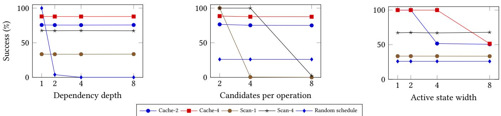

# What Structurally Breaks an Agent? Auditing Dificulty in Stateful Tool-Use Workflows

Shereen Anand pes1202201328@pesu.pes.edu PES University India

Ju Wang   
jun.wang@cs.ucl.ac.uk   
University College London   
United Kingdom   
Yali Du   
yali.du@kcl.ac.uk   
King’s College London   
United Kingdom

## Abstract

An aggregate task score does not distinguish failures of scheduling, state retention, and candidate selection. We develop a small exe cutable instrument that varies dependency depth, candidate count, active state width, and access to current-state snapshots while holding the number of required operations fixed. Two dependencygraph families expose an important limitation of structural control: increasing depth at fixed work changes both scheduling freedom and the number of reachable completion states. We quantify these couplings instead of treating the controls as universally independent. The primary study contains 49,152 generated tasks and 393,216 reference-controller rollouts. A separately frozen follow-on design adds 295,936 rollouts covering operation count, retention strategy, snapshot cadence, hidden state resampling, recovery, query locality, update removal, candidate indexing, redundant computation, and relabeling. The ablations expose representation dependence: residue caches and precomputed plans solve tasks that defeat limited raw-value caches, while indexed selection removes the serial-scan branching deficit. Hidden resampling instead imposes an exact success ceiling that additional state tracking cannot overcome. Retry-enabled elimination changes the apparent failure threshold at an explicit tool-call cost. The contribution is an executable diagnostic instrument, analytic calibration, and an audit of its assumptions; a small, single-model local CPU study adds an exploratory model-in-the-loop check, but its 256 tasks yielded no completed workflows for the 0.5B model. This floor result does not show that the task dimensions have no efect and supports no cross-provider or reasoning-budget claim. A separate 16-episode, two-seed fractional factorial with one Copilot-routed model completed half the tasks; its small sample and aliased interactions make the contrasts descriptive rather than confirmatory.

## Keywords

agent evaluation, task structure, dependency graphs, state retention, experimental design

## 1 Introduction

1 What makes a task dificult for an agent? A long sequence may require little planning if each next action is obvious. A short task may fail because a necessary value is no longer visible. Many avail able actions need not be problematic when their preconditions are easy to evaluate. These cases have diferent remedies, yet a single completion score treats them alike.

Existing work already establishes that task complexity matters. DyVal generates reasoning problems with controllable graph structure [1]; controlled puzzles examine performance as compositional complexity increases [2]; and task depth and capability breadth have been studied in multi-agent evaluation [15]. More directly, TRAJECT-Bench varies tool-trajectory breadth and depth and reports trajectory-level selection, argument, and ordering metrics [10]. The Reward Hacking Benchmark studies independent and chained multi-step tool tasks across frontier models, including harder task variants [11]. SynthAPI varies tool, task, and database diversity in synthetic executable environments, although its question is training-data scaling rather than capability diagnosis [12]. Synthetic POMDPs have also been designed with explicit, theoretically characterized memory-demand structures while preserving transition invariants [14]. Our remaining question is narrower: can a small tool-execution workflow isolate state-retention and feedback conditions while preserving required work and auditing unavoidable structural couplings?

The scope of novelty is necessarily narrow. Controllable graph dificulty, reasoning-budget comparisons, tool-trajectory diagnostics, multi-step tool tasks, and memory benchmarks all have substantial prior work [1, 2, 4–7, 9–13]. Our candidate distinction is the combination of a fixed-work, state-mutating workflow with explicit contrasts between state snapshots and history-reconstructible feedback, plus audits of how controller representation changes the resulting profile. This is a testable distinction, not a novelty finding: neither the reference controllers nor the two small, single-model evaluations validate a general capability-profile contribution, and no direct benchmark comparison has been performed.

We study four operational controls: the longest prerequisite chain, the number of candidates within an operation, the number of active state registers, and whether current register values are repeated in feedback. The total number of required operations is always eight. This is a fixed-work depth intervention: depth changes precedence, not episode length. Candidate count is likewise local to an operation, not the number of globally available actions. These distinctions are necessary for interpreting the experiment.

The present study is a methods and calibration paper. All evaluated controllers are short, inspectable programs with deliberately restricted resources. Their failures are not surprising discoveries about general reasoning. Instead, they are positive and negative controls: an instrument that cannot distinguish a known retention deficit from a known scheduling deficit should not be used to diagnose less interpretable systems. We now also report exploratory evidence from one small local model, a small Copilot-routed pilot, and a two-seed Copilot fractional factorial. None supports general capability claims.

Our contributions are an executable fixed-work factorial task family; an exact audit showing which structural metrics remain fixed and which necessarily move together; and a referencecontroller evaluation with paired uncertainty estimates and analytic success predictions, followed by controlled ablations of the assumptions underlying those profiles. We also report one local-model factorial, paired pilot traces, and a small fractional factorial from one Copilot-routed GPT model. We make no claim to introduce controlled complexity evaluation itself, to establish a universal failure threshold, or to estimate cross-model efects from the pilot.

The distinction between task structure and controller representation is especially important. Increasing the number of candidate slots makes serial examination expensive, but not an indexed lookup. Increasing the number of registers creates more values to retain, but a known deterministic workflow can be compiled into a list of future answers. Conversely, newly sampled unobserved values cannot be recovered by a better retention policy. A useful structural profile must say which of these cases its controls measure.

## 2 Related Work

Controlled complexity, memory demand, and tool trajectories. Dy-Val uses directed acyclic graphs to generate reasoning tasks at adjustable complexities [1]. Shojaee et al. use controlled puzzle environments to study complexity-dependent performance and computation, including reasoning efort under fixed inference budgets [2]. MorphoBench adapts question dificulty to model capability and evaluates GPT and Gemini models [3]. These works establish that controllable dificulty and model-based scaling studies are not new contributions by themselves. TRAJECT-Bench varies paral lel breadth and sequential depth in executable, production-style tool trajectories and analyzes tool selection, argument correctness, and ordering [10]. RHB evaluates chained tool workflows across 13 models and tests harder variants and environmental interven tions [11]. SynthAPI uses executable stateful environments and independently controls tool, task, and database diversity to study training-data composition across hundreds of thousands of tasks [12]. Their objectives difer from ours, but their scope makes broad claims about the first controlled or structural tool-use benchmark untenable. Wang et al. provide an especially relevant precedent for controllable memory dificulty: their synthetic POMDPs define memory-demand structures and construct tunable environments while preserving the beliefMDP [14]. Our snapshot/history contrast is not a partial-observability intervention, because successful action/update history is suficient to reconstruct the current registers. It measures the burden of maintaining state internally rather than a loss of information. The hidden-resampling extension introduces missing information, but is currently tested only with programmed policies. Tang et al. analyze depth and width in multi-agent systems [15]; their width denotes capability diversity, whereas ours counts mutable registers. Our narrower candidate contribution is an au dited, stateful execution design that separates retention, candidate selection, and feedback access, while measuring how controller representation changes the resulting profile. The current experi ments validate that design with programmed controllers; they do not establish the profile of a language model.

Diagnostic environments. The Behaviour Suite explicitly evaluates core capabilities through carefully designed tasks [16]. BabyAI provides synthetic instruction-following levels of increasing difficulty and a heuristic expert [17]. Our reference-policy design follows this diagnostic tradition. The workflow setting substitutes dependency-constrained operations for movement and makes the required work and failure rules directly inspectable. We have not experimentally compared our instrument with either platform.

Interactive and long-horizon evaluation. �-bench evaluates toolagent-user interaction using final database states [18]. Kwa et al. measure the human-duration horizons of software tasks [19]. Those evaluation targets difer from a fixed-work intervention on precedence. ARIES studies policies that transform interactive thought graphs [20]; it does not provide evidence for independence of the controls used here. The partial-observation literature distinguishes current observations from history-conditioned information [21]. That distinction is central to our observation intervention: omitted snapshots do not destroy information already recoverable from history.

Tool-use benchmarks and nearest overlap. API-Bank, ToolBench, and AppWorld evaluate tool-augmented models on runnable or interactive tasks, while AgentBench spans multiple interactive environments [5–8]. MCPAgentBench is a particularly close recent comparison: it evaluates multi-step tool invocation and presents candidate tool lists with distractors [9]. TRAJECT-Bench is a closer overlap for controlled trajectory structure and intermediate failure analysis; RHB is a closer overlap for multi-step tool-use dificulty and model-based experiments [10, 11]. MemCalib directly benchmarks model use of retrieved memory, although it measures the influence of natural-language propositions on responses rather than retention of mutable workflow state [13]. Accordingly, neither multi-step tool use, trajectory depth, candidate selection, nor memory evaluation is claimed as new here. Our candidate distinction is the fixed-work state-mutating intervention and its explicit separation ofvisible snapshots from history-reconstructible state. We have not reimplemented or directly compared against these benchmark suites, and the programmed-controller and single-model results cannot establish that this distinction improves evaluation of language models.

Reasoning-budget evaluation. Reasoning efort and inference compute have already been studied as experimental variables, including budget-matched comparisons of reasoning strategies [4]. The Illusion of Thinking also studies complexity-dependent reasoning efort [2]. The open empirical question for this project is not whether budget matters in general, but whether budget changes model performance diferently across audited state-retention, candidate-selection, and feedback interventions. That interaction has not been measured in this manuscript.

Workshop precedents. We inspected four published ALA 2025 papers as methodological precedents, not as a systematic review or an empirical comparison. Lipkis and Agogino study failure-probability estimation and the dificulty of sampling rare outcomes [22]. Our exact small-task probabilities serve a diferent purpose: they expose when an empirical zero is a sampling limitation. Dynamic Thinker optimizes decision-time search with compute-dependent objectives [23]. Our comparison counts explicit local checks and preparation work; it does not reproduce that learned metareasoning experiment. Nourzad et al. compare a task-graph scheduling architecture with heuristic and random baselines using makespan and scheduling time [24]. Our scheduler checks ordering validity, not assignment to heterogeneous processors or makespan optimization. Leal et al. vary deliberation cost in option-based learning [25]; our retry allowance changes execution opportunities, not option termination or a training objective.

These precedents motivate reporting the concrete intervention, the unrestricted reference, the resource charged, and the uncer tainty of the outcome. They do not establish that our task family is novel. The closest methodological overlap remains controlled graph generation and diagnostic environments; the claimed contribution is the combined audit of stateful execution, representation-sensitive profiles, and recoverability.

## 3 Executable Task Design

## 3.1 State, actions, and feedback

A task consists of a prerequisite graph $G = ( V , E )$ with $\vert V \vert = N = 8$ operations, $w \in \{ 1 , 2 , 4 , 8 \}$ active registers, and a candidate count $b \in \{ 2 , 4 , 8 \}$ . Registers take values in $\mathbb { Z } _ { 8 }$ . The initial eight-slot array is sampled uniformly and shown once. Slots outside the active width are unused padding. Each operation � specifies a query register $q _ { v } ,$ an update register $u _ { v } ,$ a nonzero increment $\delta _ { v } \in \{ 1 , \ldots , 7 \}$ , and a random permutation $\sigma _ { v }$ of the codes $0 , \ldots , b - 1$

The sole execution tool accepts an operation identifier and candidate slot:

$$
\mathsf { e x e c u t e } ( v , a ) .
$$

The action succeeds exactly when all predecessors are complete and

$$
\sigma _ { v } ( a ) = x _ { q _ { v } } \ \mathrm { m o d } \ b .
$$

It then marks � complete and applies $x _ { u _ { v } } \gets ( x _ { u _ { v } } + \delta _ { v } )$ mod 8. Each active register is queried exactly $N / w$ times; query positions are shufled. Updates are sampled independently and need not cover every register. Node labels, initial values, update draws, and candidate-order draws are seeded.

An invalid dependency or candidate terminates the episode immediately with an explicit failure category. Invalid tool arguments raise an error. The goal is to complete all eight operations. Thus every successful episode uses exactly eight execution calls. There is no reset, inspection tool, retry, reward shaping, or recovery allowance.

Both feedback conditions reveal completed operations and the applied register update. The snapshot condition also repeats all current register values. The history condition replaces the eight values with null entries after the initial observation. Since the initial state and all successful updates are available, an exact historytracking controller can reconstruct every value in either condition. The intervention removes convenient refreshes, not recoverable information. It therefore cannot establish robustness to unobserved stochastic changes.

## 3.2 Two fixed-work graph families

Depth $d \in \{ 1 , 2 , 4 , 8 \}$ is the longest prerequisite chain, measured in nodes. Let $k = N / d$ . The chains family has � disjoint chains of length �. The barriers family has � layers of � operations; every operation in a layer depends on every operation in the preceding layer. The two families coincide at $d = 1$ and $d = N$ but difer at intermediate depths. They are a graph-topology robustness check, not two independent domain generators: the state and candidate mechanics are shared.

<table><tr><td>Family</td><td> $d$ </td><td>Edges</td><td>Masks</td><td>Orders</td><td>Ready nodes</td></tr><tr><td>Chains</td><td>1</td><td>0</td><td>256</td><td>40320</td><td>4.02</td></tr><tr><td>Chains</td><td>2</td><td>4</td><td>81</td><td>2520</td><td>2.70</td></tr><tr><td>Chains</td><td>4</td><td>6</td><td>25</td><td>70</td><td>1.67</td></tr><tr><td>Chains</td><td>8</td><td>7</td><td>9</td><td>1</td><td>1.00</td></tr><tr><td>Barriers</td><td>1</td><td>0</td><td>256</td><td>40320</td><td>4.02</td></tr><tr><td>Barriers</td><td>2</td><td>16</td><td>31</td><td>576</td><td>2.13</td></tr><tr><td>Barriers</td><td>4</td><td>12</td><td>13</td><td>16</td><td>1.33</td></tr><tr><td>Barriers</td><td>8</td><td>7</td><td>9</td><td>1</td><td>1.00</td></tr></table>

Table 1: Exact structural audit at $N = 8 . { } ^ { \cdots } { \bf M a s k s ^ { \prime \prime } }$ counts reachable sets of completed operations; “orders” counts successful operation permutations. Ready nodes are averaged uniformly over nonterminal reachable completion masks, not over a controller’s trajectories.

Increasing depth changes precedence while preserving �, the state alphabet, candidate count, active width, and optimal executioncall count. Holding the seed fixed pairs node labels, register draws, and candidate orders across the snapshot intervention and, at fixed depth, across graph families. Across width and candidate levels, the same random draws are reused before level-specific projections. This reduces avoidable surface variation without asserting identical semantics across levels.

## 3.3 What is and is not controlled

We enumerate reachable completion masks and count valid schedules by dynamic programming. For chains, the mask count is $( d +$ $1 ) ^ { k } \colon$ ; for barriers, it is $d ( 2 ^ { k } - 1 ) + 1$ . The numbers of valid schedules are respectively

$$
L _ { \mathrm { c h a i n s } } = { \frac { N ! } { ( d ! ) ^ { k } } } , \qquad L _ { \mathrm { b a r r i e r s } } = ( k ! ) ^ { d } .
$$

Table 1 shows that depth necessarily changes reachable completion sets and scheduling freedom. Increasing local candidate count also multiplies the number of exposed slots across ready operations. These are not four orthogonal graph metrics.

For a fixed initial state, commuting additive updates make the register state a deterministic function of the completion mask. The mask audit is therefore exact for successful executions of an instance, but excludes failure sinks and does not claim to count a Cartesian product of all register assignments. Across the task distribution, active initial-state entropy is 3� bits; the entropy of the code tested by a candidate is log � bits. Width and candidate count consequently interact in decision-relevant information even though the register alphabet is fixed.

The construction preserves array-slot count and the single tool interface. It does not preserve serialized prompt length, token count, edge count, global action branching, or total state-space size. No prompt tokens are used by the local controllers. A causal statement in this study concerns an operational intervention inside this gen erator, including its documented couplings; it cannot be interpreted as an isolated efect of an abstract complexity measure.

## 4 Reference Controllers and Calibration

All controllers consume public task rules and returned observations. None can read simulator state. Except for the random scheduler, each chooses the smallest-labelled ready operation.

The Exact controller retains all active values and examines candidates until it finds the matching code. Cache-2 and Cache-4 retain only the first two or four active register values and apply public updates to that fixed cache. A visible snapshot may answer the current query even outside the cache. A missing value causes a uniform candidate guess. These controllers intentionally do not infer forgotten values from their successful guesses or precompute future answers.

Scan-1 and Scan-4 retain all registers but examine at most one or four candidate slots. If none matches, they choose uniformly among unexamined slots. Cache-2 + Scan-4 combines the two restrictions. The Random schedule controller retains all values and selects uniformly among incomplete operations without checking dependencies. The Uniform candidate controller schedules correctly but guesses every candidate. These are resource-restricted algorithms, not trained agents or models of human cognition.

Analytic predictions. For a known queried value and a uniformly permuted candidate list, a controller checking � candidates has average per-action success

$$
p _ { s } = \operatorname* { m i n } \{ 1 , ( s + 1 ) / b \} .
$$

The extra one comes from the final guess. More precisely, conditional on an instance’s actual state and candidate order, success is one when the correct slot is among those examined and $1 / ( b - s )$ otherwise. A query outside the cache without a snapshot has probability $1 / b .$ We multiply these instance-conditional probabilities along the deterministic ready schedule. The initial observation is visible in both conditions, so the first action is never incorrectly counted as a forgotten-state query. State along a successful path is deterministic, and new uniform guesses are independent, making this calculation exact for the specified policy.

Uniform candidate success is $b ^ { - N }$ . The random scheduler samples a uniform operation permutation, yielding

$$
P _ { \mathrm { c h a i n s } } = ( d ! ) ^ { - k } , \qquad P _ { \mathrm { b a r r i e r s } } = \frac { ( k ! ) ^ { d } } { N ! } .
$$

These formulas are calibration targets rather than fitted explanations. In particular, critical-path depth alone cannot determine success even for this simple scheduler: at $N = 8 , d = 2 ,$ its probability is $1 / 1 6$ for chains and $1 / 7 0$ for barriers.

## 5 Experimental Protocol

The full design has $2 \times 4 \times 3 \times 4 \times 2 = 1 9 2$ cells. Each uses seeds $0 , \ldots , 2 5 5$ and all eight controllers, for 49,152 tasks and 393,216 episodes. The same seed is a paired block across levels and policies.

Repeated conditions are not treated as independent trials. The configuration and analysis rules were written before the primary run in a local protocol file; this is not an external preregistration.

The primary outcome is complete task success. We also record completed operations, execution calls, candidate evaluations, and first failure type. There are no exclusions. An Exact-controller failure aborts the run. Tests verify the full grid over additional seeds, match graph schedule counts against exhaustive small-graph enumeration, check observation masking and public updates, and exercise explicit invalid-action behavior.

Within each family, a main contrast is the high-minus-low endpoint success-rate diference, averaged equally over every other level. We report all four contrasts and a specified width-byobservation diference-in-diferences:

$$
\begin{array} { r } { I _ { w , o } = \left[ S ( 8 , \mathrm { h i s t o r y } ) - S ( 1 , \mathrm { h i s t o r y } ) \right] \phantom { x x x x x x x x x x x x x x x x x x } } \\ { - \left[ S ( 8 , \mathrm { s n a p s h o t } ) - S ( 1 , \mathrm { s n a p s h o t } ) \right] . } \end{array}
$$

The remaining controls are averaged equally in each �. Percentile bootstrap bands use 2,000 resamples of the 256 paired seed blocks, with a fixed analysis seed. They are descriptive 95% bands, not simultaneous significance statements. All contrast intervals and secondary outcomes are included in the supplementary artifact.

## 5.1 Separately frozen follow-on design

After inspecting the primary results, we specified seven ablation grids containing 1,156 task–controller configurations (Table 2). Each uses seeds 10,000, . . . , 10,255, disjoint from the primary seeds, giving 295,936 additional episodes and 689,152 episodes overall. A configuration includes its controller; the count is not a count of distinct task environments. Some anchors deliberately recur across grids, and their repetitions do not create independent evidence.

The same seed is paired across each explicitly stated comparison. Changing � necessarily changes the number of generated operations and random draws; this is common-seed pairing, not identical task content. Follow-on contrasts average only their stated anchors, not the complete primary grid. All 77 selected contrasts are stored, including negative and zero diferences. The follow-on protocol was frozen locally before these runs, but after observing the first study; neither protocol is an external preregistration.

We additionally compute every endpoint interaction of orders two through four in the original factorial data: six pairwise, four three-way, and one four-way interaction for each controller and family, or 176 estimates. These are exploratory follow-on analyses. They use signed diferences of endpoint cell means, averaging all unafected controls equally. Bands again resample paired seed blocks 2,000 times, with no multiplicity-adjusted or causal-mechanism significance claims.

## 6 Results

## 6.1 Distinct structural profiles

Exact succeeds on every generated task. Cache-2 averages 75.57% success on chains and 75.63% on barriers; Cache-4 averages 87.87% and 87.89%. The observed Scan-1 success rates are 33.46% and 33.52%, whereas Scan-4 reaches 67.43% and 67.38% (Table 3). These averages reflect the chosen equal-weight grid, not a natural task distribution.

<table><tr><td>Grid</td><td>Intervention and anchors</td><td>Configurations</td></tr><tr><td>Work</td><td> $N = 4 , 8 , 1 6 ; d = 2 , 4 ; w = 4 ;$  initial-only or every-step snapshots</td><td>192</td></tr><tr><td>Memory</td><td> $N = 1 6 , d = 4 ;$  fixed, next-use, residue, plan, and stale retention; initial-only or every-fourth snapshots</td><td>96</td></tr><tr><td>Observation</td><td> $N = 8 , d = 4$  periods  $0 , 1 , 2 , 4$  crossed with public updates or hidden independent resampling error allowances 0, 2, 8, 56; trials with replacement or elimination; both</td><td>256</td></tr><tr><td>Recovery</td><td> $N = 8 , d = 4 ;$  snapshot endpoints</td><td>256</td></tr><tr><td>Locality</td><td> $N = 1 6 , d = 4 ;$  balanced, clustered, or concentrated queries crossed with additive or static state</td><td>192</td></tr><tr><td>Selection</td><td> $N = 8 , d = 4 , w = 4 ; b = 2 , 4 , 8$  ; serial, fixed, redundant, and indexed selection; every-step snapshots</td><td>36</td></tr><tr><td>Labels</td><td>N = 8, d = 4; original random identifiers versus reversed identifiers; both snapshot endpoints</td><td>128</td></tr></table>

Table 2: Follow-on design. Both graph families appear in every grid. Unless stated otherwise, $b = 4 ,$ 8 and $w = 4 ,$ 8. Grid-specific controller sets and the complete configuration manifest are supplied with the artifact.

<table><tr><td>Family</td><td>Controller</td><td>Success (%)</td><td>95% interval</td><td>Predicted (%)</td></tr><tr><td>Barriers</td><td>Exact</td><td>100.00</td><td>[100.00, 100.00]</td><td>100.00</td></tr><tr><td>Barriers</td><td>Cache-2</td><td>75.63</td><td>[75.51, 75.75]</td><td>75.56</td></tr><tr><td>Barriers</td><td>Cache-2 + Scan-4</td><td>51.06</td><td>[50.87, 51.27]</td><td>51.13</td></tr><tr><td>Barriers</td><td>Cache-4</td><td>87.89</td><td>[87.80, 88.00]</td><td>87.93</td></tr><tr><td>Barriers</td><td>Random schedule</td><td>25.00</td><td>[25.00, 25.00]</td><td>25.37</td></tr><tr><td>Barriers</td><td>Scan-1</td><td>33.52</td><td>[33.45, 33.61]</td><td>33.46</td></tr><tr><td>Barriers</td><td>Scan-4</td><td>67.38</td><td>[67.20, 67.56]</td><td>67.42</td></tr><tr><td>Barriers</td><td>Uniform candidate</td><td>0.11</td><td>[0.06, 0.18]</td><td>0.13</td></tr><tr><td>Chains</td><td>Exact</td><td>100.00</td><td>[100.00, 100.00]</td><td>100.00</td></tr><tr><td>Chains</td><td>Cache-2</td><td>75.57</td><td>[75.46, 75.68]</td><td>75.56</td></tr><tr><td>Chains</td><td>Cache-2 + Scan-4</td><td>51.18</td><td>[51.00, 51.38]</td><td>51.18</td></tr><tr><td>Chains</td><td>Cache-4</td><td>87.87</td><td>[87.78, 87.96]</td><td>87.93</td></tr><tr><td>Chains</td><td>Random schedule</td><td>25.98</td><td>[25.39, 26.66]</td><td>26.61</td></tr><tr><td>Chains</td><td>Scan-1</td><td>33.46</td><td>[33.40, 33.54]</td><td>33.45</td></tr><tr><td>Chains</td><td>Scan-4</td><td>67.43</td><td>[67.26, 67.64]</td><td>67.49</td></tr><tr><td>Chains</td><td>Uniform candidate</td><td>0.14</td><td>[0.07, 0.21]</td><td>0.13</td></tr></table>

Table 3: Measured and instance-conditional predicted success. Intervals are paired seed-bootstrap bands. Degenerate bootstrap bands do not bound unseen rare events; Table 5 provides nondegenerate binomial intervals for the sparse scheduling condition.

  
Figure 1: Marginal profiles in the chains family, averaging all other controls equally. Points are simulation results, not fitted curves. The width panel averages snapshot and history conditions, so its roughly 50% cache floor hides the near-complete failure of the history-only condition at width eight. Full curves for both families are supplied.

The largest depth contrast belongs to the random scheduler: −100 percentage points from depth one to eight in each family. The largest candidate contrast belongs to Scan-1, also −100 points. Cache-2 instead loses approximately 49 points as width rises from one to eight. Depth has negligible efects on the correctly scheduled cache and scan controls compared with their resource-specific interventions. Small residual diferences reflect instance permutations and finite simulation rather than a general equivalence claim (Table 4).

## 6.2 Observation refreshes and candidate checks difer

Both cache controllers succeed on every snapshot task, regardless of width. Without refreshes, Cache-2 succeeds on 51.15% of chains tasks averaged across widths, but only about 1.2% at width eight averaged over depth and candidate count. Its width-by-observation interaction is -98.80 percentage points in chains, versus −98.86 in barriers. The large interaction is expected: width creates no retention deficit when the current value is directly visible. Averaging observation conditions conceals this failure mode.

Increasing the scan limit changes the candidate profile but does not recover a forgotten value. With four candidates, Scan-4 always succeeds, while Scan-1 succeeds on fewer than 1% of tasks. With eight candidates, Scan-4 succeeds on 2.29% of chains tasks and 2.15% of barriers tasks, consistent with $( 5 / 8 ) ^ { 8 }$ ≈ 2.33% averaged over candidate-order draws. The combined Cache-2 + Scan-4 controller remains sensitive to both width and candidate count. Additional local checks and increased retained state are therefore noninterchangeable resources in this instrument.

This is not an experiment on reasoning-token budgets. Scan limits count predicate evaluations, not tokens or elapsed computation; early failures also shorten episodes. The follow-on redundant-check control matches checks per decision, not total episode computation, and supports no inference-budget conclusion.

## 6.3 Calibration and rare events

The maximum absolute discrepancy between an overall observed rate and its analytic prediction is 0.63 percentage points, for the chains random scheduler. Agreement is a useful implementation check, not an independent validation of external relevance.

At barrier depth two, zero successes were observed although the exact probability is 1/70. With 256 independent seeded instances and scheduling draws, this outcome has probability $( 6 9 / 7 0 ) ^ { 2 5 6 }$ ≈ 2.5%. The aggregate seed bootstrap then reports a degenerate 25% band because depth-one tasks always succeed and other sampled depths never do. It cannot resolve an unseen rare event. The Wilson interval for the depth-two cell extends to approximately 1.48%, including the exact 1.43% probability (Table 5). We therefore do not interpret a zero empirical rate or a zero-width bootstrap band as proof of impossibility. The Wilson intervals are a supplementary diagnostic added after observing the sparse scheduling outcomes, not a prespecified primary analysis.

## 6.4 Interactions beyond width and snapshots

The endpoint profiles are not additive. For the combined Cache-2 + Scan-4 controller, the candidate-by-width interaction is 47.90 percentage points in chains and 48.14 in barriers; the candidate-bywidth-by-observation interaction reaches 95.02 and 95.90 points. These large signed diferences arise partly from ceiling and floor efects: restoring a resource can matter little while another resource already prevents completion. They are not evidence for a universal three-factor law. The full pairwise and higher-order tables are in the appendix, and every interval is in the accompanying data.

## 7 Ablations of the Diagnostic Assumptions

## 7.1 Work is not fixed-work depth

The work grid increases � from four to sixteen while retaining $d = 2 , 4 , w = 4 ,$ and $b = 4 , 8 .$ Exact succeeds throughout. Without repeated snapshots, Cache-2 falls from 13.43% to zero observed success: a paired diference of −13.43 points with a descriptive band [−16.02, −10.94]. With snapshots every step, the same cache succeeds throughout. The scan-limited controller instead falls from 56.59% to 50.05% under either snapshot endpoint. The aggregate floor near 50% is an artifact ofaveraging four-candidate tasks, which Scan-4 always solves, with eight-candidate tasks, whose errors compound.

This is a work intervention, not a claim that dependency depth and episode length are equivalent. More operations also create more updates and repeated queries. The graph changes because its layer width is $N / d ;$ any interpretation of the work contrast includes those efects. The original fixed-work depth experiment and this follow-on experiment answer diferent questions.

## 7.2 Retention strategy and preparation

We compare fixed caches with a next-use cache that retains at most two registers, prioritizing their known upcoming queries. At each snapshot, it selects future-use registers rather than the lowest indices; a successful guess also confirms the queried value modulo �. Public updates adjust the retained residues. Its scheduling information is public, but this is a stronger retention strategy than the deliberately non-adaptive fixed cache.

At $N = 1 6$ with no intermediate snapshots, both limited-cache strategies remain near the floor: Cache-2 has zero observed successes, and Next-use-2 has 0.05%. With a snapshot every fourth successful operation, Next-use-2 reaches 9.52%, compared with zero observed success for Cache-2. The paired diference is 9.52 points [7.86, 11.18]. Thus a register-count profile depends on what the controller retains and how refreshes are used; the result does not make the two-register cache generally adequate.

Two unrestricted representation controls solve every deterministic memory task. Residue-8 tracks each active value modulo �, using � log � value bits rather than 3�. This follows because � divides eight: updates modulo eight preserve the residue needed by the candidate predicate. Precomputed plan uses the visible initial state and public deterministic updates to compute all � future candidate slots before execution. It then performs � plan lookups without an execution-time register cache. The log separately records � plan slots and �� candidate-table preparation units. This is neither zero memory nor free computation: initial planning uses state workspace and the plan itself stores information.

## 7.3 Snapshot cadence versus missing information

Snapshot periods count successful operations, not tool attempts. Period zero means the initial observation only; period one repeats state after every success. With public deterministic updates, Exact remains at 100% for periods zero, one, two, and four. Cache-2 reaches 0.29%, 100%, 4.64%, and 0.44%, respectively, on the $N = 8$ anchors. The diference is therefore a retention and refresh efect, not a lack of history-conditioned information.

<table><tr><td>Family</td><td>Controller</td><td>Depth</td><td>Candidates</td><td>Width</td><td>History</td></tr><tr><td>Barriers</td><td>Exact</td><td>0.00</td><td>0.00</td><td>0.00</td><td>0.00</td></tr><tr><td>Barriers</td><td>Cache-2</td><td>0.02</td><td>-1.68</td><td>-49.43</td><td>-48.75</td></tr><tr><td>Barriers</td><td>Cache-2 + Scan-4</td><td>-0.10</td><td>-74.79</td><td>-33.32</td><td>-32.63</td></tr><tr><td>Barriers</td><td>Cache-4</td><td>-0.08</td><td>-0.89</td><td>-48.42</td><td>-24.21</td></tr><tr><td>Barriers</td><td>Random schedule</td><td>-100.00</td><td>0.00</td><td>0.00</td><td>0.00</td></tr><tr><td>Barriers</td><td>Scan-1</td><td>0.07</td><td>-100.00</td><td>-0.23</td><td>0.00</td></tr><tr><td>Barriers</td><td>Scan-4</td><td>-0.36</td><td>-97.85</td><td>0.36</td><td>0.00</td></tr><tr><td>Barriers</td><td>Uniform candidate</td><td>0.13</td><td>-0.34</td><td>0.13</td><td>0.00</td></tr><tr><td>Chains</td><td>Exact</td><td>0.00</td><td>0.00</td><td>0.00</td><td>0.00</td></tr><tr><td>Chains</td><td>Cache-2</td><td>0.02</td><td>-1.51</td><td>-49.40</td><td>-48.85</td></tr><tr><td>Chains</td><td>Cache-2 + Scan-4</td><td>-0.10</td><td>-74.49</td><td>-33.32</td><td>-32.69</td></tr><tr><td>Chains</td><td>Cache-4</td><td>-0.08</td><td>-0.90</td><td>-48.54</td><td>-24.27</td></tr><tr><td>Chains</td><td>Random schedule</td><td>-100.00</td><td>0.00</td><td>0.00</td><td>0.00</td></tr><tr><td>Chains</td><td>Scan-1</td><td>0.07</td><td>-100.00</td><td>-0.07</td><td>0.00</td></tr><tr><td>Chains</td><td>Scan-4</td><td>-0.36</td><td>-97.71</td><td>0.65</td><td>0.00</td></tr><tr><td>Chains</td><td>Uniform candidate</td><td>0.13</td><td>-0.42</td><td>0.00</td><td>0.00</td></tr></table>

Table 4: High-minus-low main contrasts in percentage points. Depth: 8 minus ${ \bf 1 } ;$ candidates: 8 minus ${ \bf 2 ; }$ width: 8 minus 1; history: history minus snapshot. Each averages all remaining levels equally within its family. The supplement reports the corresponding paired intervals.

<table><tr><td>Family</td><td> $d$ </td><td>Observed (%)</td><td>Wilson interval</td><td>Exact (%)</td></tr><tr><td>Chains</td><td>1</td><td>100.00</td><td>[98.52, 100.00]</td><td>100.0000</td></tr><tr><td>Chains</td><td>2</td><td>3.91</td><td>[2.14, 7.04]</td><td>6.2500</td></tr><tr><td>Chains</td><td>4</td><td>0.00</td><td>[0.00, 1.48]</td><td>0.1736</td></tr><tr><td>Chains</td><td>8</td><td>0.00</td><td>[0.00, 1.48]</td><td>0.0025</td></tr><tr><td>Barriers</td><td>1</td><td>100.00</td><td>[98.52, 100.00]</td><td>100.0000</td></tr><tr><td>Barriers</td><td>2</td><td>0.00</td><td>[0.00, 1.48]</td><td>1.4286</td></tr><tr><td>Barriers</td><td>4</td><td>0.00</td><td>[0.00, 1.48]</td><td>0.0397</td></tr><tr><td>Barriers</td><td>8</td><td>0.00</td><td>[0.00, 1.48]</td><td>0.0025</td></tr></table>

Table 5: Random-scheduler calibration using one representative cell per depth and family, with 256 distinct seeds. Other candidate, width, and observation conditions repeat the same scheduling draws and do not increase this efective trial count. Wilson 95% binomial intervals retain uncertainty at zero observed successes.

We then independently resample all active registers uniformly after each successful operation. Feedback announces that resampling occurred but does not reveal new values unless a snapshot is due. Controllers invalidate stale cached values. Under initial-only feedback, Exact now has zero observed successes, despite its perfect tracking in the public-update condition. With every-step snapshots it returns to 100%; with period two it achieves 0.29%, and period four produces zero observed successes.

This case has an information bound, not merely an algorithmspecific failure rate. Without retries, let $v = \lceil N / h \rceil$ be the number of visible decisions at period $h > 0 ;$ , and let $v = 1$ for initial-only feedback. Any history-based controller has

$$
P ( \mathrm { c o m p l e t e } ) \le b ^ { - ( N - v ) } .
$$

At each masked decision the newly resampled target code is uniform, independent of the entire visible history. An otherwise exact controller attains the bound by selecting correctly at visible steps and guessing at masked steps. For $N = 8 ,$ , initial-only feedback gives $4 ^ { - 7 } \ \mathrm { o r } \ 8 ^ { - 7 }$ , not literal impossibility. The aggregate analytic probability across the two candidate counts is approximately 0.0031%, explaining why a modest seed budget is unlikely to observe success.

## 7.4 Recovery changes the experiment

In the recovery grid, an invalid candidate returns its failure category without changing state or marking an operation complete. The episode ends only when its global error allowance � is exceeded. Successful operations still apply updates. The maximum execution horizon is � + � calls. We compare independent uniform guesses with candidate elimination, which remembers failed codes for the current operation. This extra memory and failure feedback must not be mistaken for additional internal reasoning.

With eight allowed errors and initial-only snapshots, uniform elimination achieves 6.54% success versus 1.27% for replacement: a paired gain of 5.27 points $\left[ 4 . 1 5 , 6 . 4 9 \right]$ . Cache-2 with elimination reaches 44.63%. At $R = 5 6 ,$ , elimination solves every task, while replacement reaches 78.56%. The average elimination cost is 27.87 calls, compared with eight for an unrestricted exact controller.

The success of elimination at $R = N ( b - 1 )$ is guaranteed, not an empirical discovery: no operation can require more than $b - 1$ incorrect trials. For uniform replacement, the number of failed guesses before � successes is negative binomial. For elimination, failures per operation are uniform on $\{ 0 , \ldots , b - 1 \}$ ; convolving those counts gives the exact finite-budget probability. The appendix states both formulas. Retry budget, error feedback, and elimination memory together define a diferent task protocol from immediate termination.

## 7.5 Locality and removal of state updates

Balanced and clustered query schedules have the same active width and query counts. Clustering makes consecutive queries use the same register along the deterministic ready schedule. At � = 16 with public updates, Next-use-2 improves from 0.05% under balanced queries to 1.86% under clustered queries: a paired diference of 1.81 points [1.22, 2.44]. Reusing a confirmed residue can therefore help, but the controller still fails most tasks. Fixed Cache-2 has zero observed complete successes in both conditions; its progress and call counts nevertheless difer. A completion-only score misses that diference.

Concentrating every query on register zero yields 100% for both limited cache strategies. This is a deliberate invalid width control: the declared width remains four or eight, but the efective queried width is one. We report that audit failure instead of presenting concentration as a fair improvement at fixed memory demand.

The Stale-8 controller retains initial values but ignores updates. Removing updates restores it from zero observed success on balanced additive tasks to 100% on balanced static tasks; unrestricted tracking remains at 100% in both. This negative control confirms that the update mechanism matters. Static tasks are easier for this stale strategy, not evidence that tracking mutable state is an intrinsic universal dificulty.

## 7.6 Candidate indexing and redundant checks

The Fixed-check-4 controller evaluates four candidates per decision and uses every result. The Sham-check-4 controller also evaluates four, but only the first result is allowed to afect selection; the other three are redundant. With four candidates, Fixed-check-4 succeeds at 100% and Sham-check-4 at 0.59%. With eight candidates, they reach 1.17% and zero observed success. Sham-check-4 produces exactly the same action traces as Scan-1 under paired seeds, despite its higher comparison cost. Useful computation, rather than charged computation alone, explains the diference.

Indexed constructs code-to-slot maps before execution and retains all required state. It succeeds at 100% for all tested candidate counts, using eight execution lookups and �� preparation entries (Table 6). Branching is therefore costly for the serial-scan controller but not an inherent obstacle to this representation. Index preparation grows with �, and we do not compare total wall time, energy, or token costs. The experiment is a counterexample to representationfree interpretation of a branching profile, not proof that indexing is costless.

## 7.7 Identifiers, floors, and aggregation

Reversing the randomly assigned operation identifiers preserves the graph audit and Exact’s 100% success. It changes the deterministic ready order and hence some queried states. Scan-4’s paired diference is −0.24 points [−0.59, 0.15] with initial-only feedback, and Cache-2’s is −0.15 [−0.49, 0.15]. This limited relabeling check does not establish invariance to arbitrary wording, prompts, or tool names. Random scheduling remains too sparse at the selected depth to resolve subtle diferences.

Several ablations are dominated by ceiling and floor efects. We retain zero-result conditions, exact probabilities where derived, and secondary progress and resource outcomes rather than regenerate tasks after observing success. The follow-on grid is consequently useful for checking assumptions but not calibrated for ranking unfamiliar agents. Aggregate percentages must always be accompanied by the conditions averaged into them.

## 8 Interpretation and Limitations

The experiment shows that the instrument responds selectively to limitations introduced by construction. It also supplies a concrete counterexample to using depth alone as a universal dificulty measure: equal-depth, equal-work graphs can have diferent scheduling probabilities. For an unfamiliar controller, these profiles would be diagnostic evidence, not a unique identification of its internal mechanism.

Several limitations constrain the claims. The tasks are small and mechanical; the single execution tool omits natural-language instructions, tool discovery, and uncertain user goals. Immediate termination in the primary protocol magnifies compounding error and is a design choice, not a typical feature of software workflows. Even the follow-on maximum of sixteen operations does not represent long real-world workflows.

Active register count is not a lower bound on a controller’s required memory. A controller could retain values modulo �, compress state, or precompute future answers, as the new controls explicitly demonstrate. The restricted-cache results measure chosen strategies, not minimum memory requirements. The hidden-resampling extension is one extreme missing-information mechanism, not a general model of partial observation, ambiguous feedback, or hidden user intent.

The graph families share the same state mechanics and are identical at the endpoint depths. The comparison is limited topology replication, not independent-domain generalization. Main contrasts include documented couplings, and the equal-weight grid is arbitrary. The large rollout count must not be confused with an equally large number of independent samples. All endpoint interactions are reported, but their bootstrap bands are descriptive and can degenerate at rare-event floors. No fitted universal dificulty model or out-of-domain predictive validation is supplied.

The next-use controller receives the same public graph as other controllers, but exploits future query knowledge and learns residues from successful trials. Its cache entry count does not include graph metadata, readiness bookkeeping, or controller code. Likewise, the residue-bit counts cover stored values, not total implementation memory. Preparation entries, lookups, and predicate checks are separate operation categories; none is a hardware-neutral measure of compute.

Language-model evidence is exploratory and limited to one Copilot-routed model pilot, a 16-episode half-fraction over two task seeds, and one small local-model factorial with a success floor. The Copilot pilot uses three paired task seeds per intervention cell, with its third seed added after inspection of the first two. The fractional factorial’s last episode was completed after the first 15 outcomes had been inspected, though its prespecified condition was unchanged. These studies use one routed model and one quantized 0.5B model; none includes a reasoning-budget comparison, cross-provider comparison, or transfer to real tasks. They cannot establish which current model breaks first, whether more reasoning helps, or how the profiles predict real-task performance.

<table><tr><td>b</td><td>Controller</td><td>Success (%)</td><td>Checks/call</td><td>Build entries</td><td>Lookups</td></tr><tr><td>4</td><td>Exact</td><td>100.00</td><td>2.49</td><td>0</td><td>0.00</td></tr><tr><td>4</td><td>Indexed</td><td>100.00</td><td>0.00</td><td>32</td><td>8.00</td></tr><tr><td>4</td><td>Scan-1</td><td>0.59</td><td>1.00</td><td>0</td><td>0.00</td></tr><tr><td>4</td><td>Sham-check-4</td><td>0.59</td><td>4.00</td><td>0</td><td>0.00</td></tr><tr><td>4</td><td>Fixed-check-4</td><td>100.00</td><td>4.00</td><td>0</td><td>0.00</td></tr><tr><td>8</td><td>Exact</td><td>100.00</td><td>4.52</td><td>0</td><td>0.00</td></tr><tr><td>8</td><td>Indexed</td><td>100.00</td><td>0.00</td><td>64</td><td>8.00</td></tr><tr><td>8</td><td>Scan-1</td><td>0.00</td><td>1.00</td><td>0</td><td>0.00</td></tr><tr><td>8</td><td>Sham-check-4</td><td>0.00</td><td>4.00</td><td>0</td><td>0.00</td></tr><tr><td>8</td><td>Fixed-check-4</td><td>1.17</td><td>4.00</td><td>0</td><td>0.00</td></tr></table>

Table 6: Selection ablation with full snapshots. Checks per call are the aggregate comparison count divided by execution calls. Build entries charge candidate-table preparation separately; lookup calls are separate operations, not equivalent CPU-time units. Early termination changes total comparisons, so only the fixed and redundant controls match comparison counts per decision.

## 9 Exploratory Language-Model Pilot

At each decision, the model received the complete public task description, current observation, and interaction history, then returned one JSON action. The environment validated and executed the action; an invalid candidate or dependency choice ended the task. This is a serialized text-action interface, not native provider function calling. Copilot Auto selected the model, recorded as GPT-6 Luna throughout. The account did not expose a selectable Gemini or Qwen route or a reasoning-efort condition. This pilot therefore tests one model route, not providers or inference-budget scaling.

The pilot covers four paired low/high interventions in the chain family, with eight operations per task and three task seeds per cell. The first two seeds (16 episodes) were run before a third paired seed (eight episodes) was added; the latter was chosen after inspecting the initial outcomes. We therefore report only descriptive counts, without significance tests or generalization claims. Table 7 reports the first completed run for each unique factor– level–seed cell. The raw log contains 29 records, including five repeated/recovery records excluded from the 24-episode summaries. Success was 2/3 versus 3/3 for depth 1 versus 8, 2/3 versus 3/3 for branching 2 versus 8, 2/3 versus 2/3 for register width 1 versus 8, and 0/3 versus 2/3 for history versus snapshot feedback. These tiny counts are compatible with substantial sampling uncertainty; they do not establish that depth helps or that any factor has a stable model-level efect.

## 9.1 Two-seed fractional-factorial follow-up

We completed a second, separately frozen Copilot Auto study using the same text-action interface and GPT-6 Luna route. It covers eight conditions in a $2 ^ { 4 - 1 }$ resolution-IV half fraction of depth (2 or 8), branching (2 or 8), register width (1 or 8), and history or snapshot feedback; every task requires eight operations. Two task seeds yield 16 episodes. The design is balanced and orthogonal for its main efect contrasts, but main efects remain aliased with three-factor interactions, and two-factor interactions are mutually aliased. The two-seed sample is too small for reliable uncertainty estimates.

<table><tr><td>Intervention</td><td>Level</td><td>Success</td><td>Mean completed</td><td>n</td></tr><tr><td>Depth</td><td>1</td><td>2/3</td><td>5.67</td><td>3</td></tr><tr><td>Depth</td><td>8</td><td>3/3</td><td>8.00</td><td>3</td></tr><tr><td>Branching</td><td>2</td><td>2/3</td><td>7.33</td><td>3</td></tr><tr><td>Branching</td><td>8</td><td>3/3</td><td>8.00</td><td>3</td></tr><tr><td>Register width</td><td>1</td><td>2/3</td><td>7.33</td><td>3</td></tr><tr><td>Register width</td><td>8</td><td>2/3</td><td>6.33</td><td>3</td></tr><tr><td>Feedback</td><td>History</td><td>0/3</td><td>5.00</td><td>3</td></tr><tr><td>Feedback</td><td>Snapshot</td><td>2/3</td><td>5.33</td><td>3</td></tr></table>

Table 7: Exploratory Copilot-routed GPT-6 Luna pilot. Mean completed operations are out of eight. Each cell has three task seeds; no inferential claims are warranted.

The model completed 8/16 workflows and 88/128 required operations (5.5 per task on average). Seven episodes ended in candidateselection errors and one in a dependency error. The descriptive highminus-low success diferences were −25, +50, +25, and +50 percentage points for depth, branching, width, and snapshot feedback, respectively; mean completed-operation diferences were −1.50, +1.50, +2.50, and +2.00. Table 8 summarizes these raw contrasts. The signs, including the apparent benefit of branching, are not a basis for mechanistic interpretation: there are only two seeds, possible three-factor aliasing, and a single model route. The last of 16 episodes was run after the first 15 outcomes had been inspected following an interruption; its condition and seed had already been specified, and the design was not changed. This exploratory result does not rescue the floor-level local-model factorial or establish a reproducible agent capability profile.

## 10 Exploratory Local-Model Factorial

We ran a complete 25 factorial of 256 tasks using the local, quantized Qwen2.5-0.5B-Instruct model [26]. The five controls were graph family (chains or barriers), dependency depth (2 or 8), candidate count (2 or 8), active-register width (1 or 8), and feedback format (history or current-state snapshot). Every task required eight operations. Eight task seeds were paired across all 32 cells. The protocol,

<table><tr><td>Factor</td><td>Success difference</td><td>Operation difference</td><td>n per leveross-model, and reasoning-budget comparisons remain uncom-</td></tr><tr><td>Depth (8 vs. 2)</td><td>-25.0 pp</td><td>-1.50</td><td>BTeted.</td></tr><tr><td>Branching (8 vs. 2)</td><td>+50.0 pp</td><td>+1.50</td><td>i2</td></tr><tr><td>Register width (8 vs. 1)</td><td>+25.0 pp</td><td>+2.50</td><td>Conclusion</td></tr><tr><td>Snapshot vs. history</td><td>+50.0 pp</td><td>+2.00</td><td>Structural task controls are useful only when their invariants and</td></tr></table>

Table 8: Descriptive high-minus-low contrasts in the 16- episode Copilot-routed fractional factorial. Eight episodes contribute to each factor level; each of only two task seeds spans four conditions per level. Main efects may be aliased with three-factor interactions.

factor grid, seeds, and analysis were fixed before this planned run;   
the protocol is local rather than externally preregistered.

The model received the complete public task specification, current observation, and interaction history, and returned one JSON action per decision. Invalid JSON or an invalid action ended the episode without a retry. Inference used llama.cpp server b12030 on CPU, Q4\_K\_M weights, temperature zero, and a 64-token output limit [27]. No hosted provider or paid inference was used. This is a single, small-model evaluation, not a comparison of providers or reasoning budgets. The separate runtime smoke test was excluded from the factorial and is retained in the artifact.

Across the planned tasks, the model completed 0/256episodes (0.000 success rate) and completed only 21 of 2048 required oper ations (0.08 of eight per task on average). Of 277 decisions, 255 (0.921) were strictly schema-valid JSON. The first-failure counts were 162 dependency errors, 54 candidate-selection errors, 18 invalid actions, 16 invalid action schemas, and 6 invalid JSON outputs. Median decision latency was 9.00 seconds on the local CPU.

Table 9 reports marginal high-minus-low success diferences and seed-cluster bootstrap intervals. All are zero because every condi tion had zero completed workflows. These degenerate intervals are a floor efect, not evidence that the structural factors have no efect; the model was insuficiently capable on this interface to resolve their efects on the success endpoint. The run therefore documents a failed calibration of this model-task pairing, not a useful structural capability profile. It cannot establish generalization to larger or hosted models, and it does not test whether additional reasoning budget changes the profile.

## 11 Next Empirical Test

The next study should freeze the interaction harness and task protocol before inference; use larger paired samples; and compare mul tiple models and providers. It should record model version, every prompt and action, valid action rate, completed operations, token usage, provider-reported cost, and latency. A reasoning-budget intervention must use a supported, explicit budget control and a total-usage-matched comparison. Retries and extra tool calls must remain separate interventions. An independent state-transition family and realistic transfer tasks are necessary before claiming generality. The present account has a 24-episode pilot and a 16- episode, two-seed fractional factorial using one Auto-routed model, plus a local small-model run at the success floor. Provider-level,

8Structural task controls are useful only when their invariants and couplings are explicit. Our fixed-work workflow instrument distinguishes scheduling, candidate-search, and retention restrictions with executable controls and exact calibration targets. The reference experiments show why a structural profile is more interpretable than its aggregate score, while also showing why depth, state width, and observation access cannot be treated as universally independent dificulty variables.

The local-model factorial is a failed calibration of the model-task interface, not evidence that the instrument yields a generalizable profile: one quantized 0.5B model completed none of256 workflows, creating a floor on the success endpoint. The completed-operation and action-error records are useful diagnostics, but the zero marginal success contrasts cannot be interpreted as structural invariance. A second, 16-episode Copilot study shows nonzero contrasts, but two task seeds and fractional-factorial aliasing make them unstable descriptive observations, not evidence of dimension-specific efects. Claims about larger models, provider diferences, reasoningbudget efects, or transfer to real workflows remain open.

Reproducibility and research integrity. The accompanying artifact contains both reference-task generators, the model-pilot, fractional-factorial, and local-model harnesses, 35 tests, protocols, episode traces, provider-usage records, structural audits, analysis scripts, generated tables, and source hashes. The 24 unique Copilot-routed model episodes use three paired seeds per intervention cell; the third seed was added after inspection of the first two, and five repeated/recovery records are excluded from their summaries. The Copilot fractional factorial has 16 episodes, two task seeds across eight planned half-fraction conditions, and 96 logged model calls; the final episode was completed after inspecting the first 15 outcomes, without changing the prespecified design. The separate local factorial uses one quantized Qwen2.5-0.5B model, eight paired seeds, and 256 planned episodes; it uses no paid inference. Copilot usage logs report 264 premium-request units and 25.653 billion nano-AIU across the recorded smoke and pilot runs; these are usage units, not dollars, and the account-wide quota is unavailable. There are no human-subject data or externalsystem actions. The code and experiment records are available at https://github.com/Shereen20112003/what-structurally-breaksan-agent. Model weights and third-party binaries are not included in that repository.

## References

[1] Kaijie Zhu, Jiaao Chen, Jindong Wang, Neil Zhenqiang Gong, Diyi Yang, and Xing Xie. 2024. DyVal: Dynamic Evaluation of Large Language Models for Reasoning Tasks. In ICLR. https://arxiv.org/abs/2309.17167.

[2] Parshin Shojaee, Iman Mirzadeh, Keivan Alizadeh, Maxwell Horton, Samy Bengio, and Mehrdad Farajtabar. 2025. The Illusion of Thinking: Understanding the Strengths and Limitations of Reasoning Models via the Lens of Problem Complexity. In NeurIPS. https://arxiv.org/abs/2506.06941.

[3] Xukai Wang et al. 2026. MorphoBench: A Benchmark with Dificulty Adaptive to Model Reasoning. In Findings ofACL. https://aclanthology.org/2026.findingsacl.1171/.

<table><tr><td>Contrast</td><td>Low success</td><td>High success</td><td>Difference (95% interval)</td></tr><tr><td>family  $( \mathrm { b a r r i e r s \mathrm { ~ - ~ } c h a i n s } )$ </td><td>0/128 (0.000)</td><td> $0 / 1 2 8 \left( 0 . 0 0 0 \right)$ </td><td> $+ 0 . 0 \mathrm { p p } \left( + 0 . 0 , + 0 . 0 \right)$ </td></tr><tr><td>depth  $( 8 - 2 )$ </td><td>0/128 (0.000)</td><td>0/128 (0.000)</td><td> $+ 0 . 0 \mathrm { p p } \left( + 0 . 0 , + 0 . 0 \right)$ </td></tr><tr><td>branching  $\left( 8 - 2 \right)$ </td><td>0/128 (0.000)</td><td>0/128 (0.000)</td><td> $+ 0 . 0 \mathrm { p p } \left( + 0 . 0 , + 0 . 0 \right)$ </td></tr><tr><td>width  $( 8 - 1 )$ </td><td>0/128 (0.000)</td><td>0/128 (0.000)</td><td> $+ 0 . 0 \mathrm { p p } \left( + 0 . 0 , + 0 . 0 \right)$ </td></tr><tr><td>observation (snapshot – history)</td><td>0/128 (0.000)</td><td>0/128 (0.000)</td><td> $+ 0 . 0 \mathrm { p p } \left( + 0 . 0 , + 0 . 0 \right)$ </td></tr></table>

Table 9: Exploratory local-model factorial. Each level contains 128 tasks. Diferences are paired by task seed and averaged over the other factors; intervals resample the eight seed clusters.

[4] Junlin Wang, Siddhartha Jain, Dejiao Zhang, Baishakhi Ray, Varun Kumar, and Ben Athiwaratkun. 2024. Reasoning in Token Economies: Budget-Aware Evaluation of LLM Reasoning Strategies. In EMNLP. https://aclanthology.org/2024. emnlp-main.1112/.

[5] Minghao Li et al. 2023. API-Bank: A Comprehensive Benchmark for Tool-Augmented LLMs. In EMNLP. https://arxiv.org/abs/2304.08244.

[6] Yujia Qin et al. 2023. ToolLLM: Facilitating Large Language Models to Master 16000+ Real-world APIs. arXiv:2307.16789. https://arxiv.org/abs/2307.16789.

[7] Harsh Trivedi et al. 2024. AppWorld: A Controllable World of Apps and People for Benchmarking Interactive Coding Agents. In ACL. https://arxiv.org/abs/2407. 18901.

[8] Xiao Liu et al. 2024. AgentBench: Evaluating LLMs as Agents. In ICLR. https: //arxiv.org/abs/2308.03688.

[9] Zixiang Liu et al. 2026. MCPAgentBench: A Real-world Task Benchmark for Evaluating LLM Agent MCP Tool Use. In Proceedings ofthe Second Workshop for Research on Agent Language Models. https://aclanthology.org/2026.realm-1.51/.

[10] Pengfei He et al. 2025. TRAJECT-Bench: A Trajectory-Aware Benchmark for Evaluating Agentic Tool Use. arXiv:2510.04550. https://arxiv.org/abs/2510.04550.

[12] Andrew Szot et al. 2026. Scaling Laws for Tool-Use Agents via Controllable Environment Synthesis. arXiv:2610.37648. https://arxiv.org/abs/2610.37648.

[13] Ruike Cao et al. 2026. MemCalib: Benchmarking and Optimizing Memory Use in LLM Agents. arXiv:2609.24259. https://arxiv.org/abs/2609.24259.

[14] Yongyi Wang, Lingfeng Li, Bozhou Chen, Ang Li, Hanyu Liu, Qirui Zheng, Xionghui Yang, and Wenxin Li. 2026. Synthetic POMDPs to Challenge Memory-Augmented RL: Memory Demand Structure Modeling. Frontiers ofComputer Science. https://arxiv.org/abs/2508.04282.

[15] Bohan Tang, Huidong Liang, Keyue Jiang, and Xiaowen Dong. 2025. On the Importance of Task Complexity in Evaluating LLM-Based Multi-Agent Systems. arXiv:2510.04311. https://arxiv.org/abs/2510.04311.

[16] Ian Osband et al. 2019. Behaviour Suite for Reinforcement Learning. arXiv:1908.03568. https://arxiv.org/abs/1908.03568.

[17] Maxime Chevalier-Boisvert, Dzmitry Bahdanau, Salem Lahlou, Lucas Willems, Chitwan Saharia, Thien Huu Nguyen, and Yoshua Bengio. 2019. BabyAI: A Platform to Study the Sample Eficiency of Grounded Language Learning. In ICLR. https://arxiv.org/abs/1810.08272.

[18] Shunyu Yao, Noah Shinn, Pedram Razavi, and Karthik Narasimhan. 2024. �- bench: A Benchmark for Tool-Agent-User Interaction in Real-World Domains. arXiv:2406.12045. https://arxiv.org/abs/2406.12045.

[19] Thomas Kwa et al. 2025. Measuring AI Ability to Complete Long Software Tasks. In NeurIPS. https://arxiv.org/abs/2503.14499.

[20] Pedro Gimenes, Zeyu Cao, Jefrey Wong, and Yiren Zhao. 2025. ARIES: Autonomous Reasoning with LLMs on Interactive Thought Graph Environments. arXiv:2502.21208. https://arxiv.org/abs/2502.21208.

[21] Leslie Pack Kaelbling, Michael L. Littman, and Anthony R. Cassandra. 1998. Planning and Acting in Partially Observable Stochastic Domains. Artificial Intelligence 101, 1–2, 99–134. https://doi.org/10.1016/S0004-3702(98)00023-X.

[22] Rory Lipkis and Adrian Agogino. 2025. Failure Analysis of Autonomous Systems with RL-Guided MCMC Sampling. In Adaptive and Learning Agents Workshop. https://ala-workshop.github.io/papers/ALA2025\_paper\_45.pdf.

[23] Kevin A. Wang, Jerry Xia, Stephen Chung, and Amy Greenwald. 2025. Dynamic Thinker: Optimizing Decision-Time Planning with Costly Compute. In Adaptive and Learning Agents Workshop. https://ala-workshop.github.io/papers/ALA2025\_ paper\_44.pdf.

[24] Narjes Nourzad, Jared Coleman, Zhongyuan Zhao, Bhaskar Krishnamachari, Gunjan Verma, and Santiago Segarra. 2025. Actor-Twin Framework for Task Graph Scheduling. In Adaptive and Learning Agents Workshop. https://alaworkshop.github.io/papers/ALA2025\_paper\_17.pdf.

[25] Augusto Leal, Mateus Begnini Melchiades, and Gabriel de Oliveira Ramos. 2025. A Flexible Approach to Deliberation Cost in the Option-Critic Architecture. In Adaptive and Learning Agents Workshop. https://ala-workshop.github.io/papers

ALA2025\_paper\_28.pdf.

[26] An Yang et al. 2024. Qwen2.5 Technical Report. arXiv:2412.15115. https://arxiv. org/abs/2412.15115.

[27] ggml-org. 2026. llama.cpp, release b12030. https://github.com/ggml-org/llama. cpp/releases/tag/b12030.

## A Complete Experimental Specification

The primary experiment and follow-on experiment are separately recorded. The primary grid uses $N = 8 ,$ , depths {1, 2, 4, 8}, candidate counts {2, 4, 8}, active widths {1, 2, 4, 8}, both snapshot endpoints, and both graph families. Its seeds are 0–255 and each task is evaluated by eight programmed controllers. The follow-on grids use the anchors in the main-text ablation design; their full per-controller configurations are in results\_extended/case\_design.json.

Pairing and randomness. The base generator draws a fixed eight-slot initial array, a permutation of operation identifiers, a shufled balanced query assignment, update registers, nonzero increments, and candidate permutations. Candidate-count levels filter the same eight-code permutation; active-width levels project query and update indices into the active width. Across work levels, diferent numbers of operations cause diferent subsequent random draws, so seed pairing is not exact surface matching. Hidden resampling uses a separate seeded random stream, draws eight fresh values after each success, and replaces only active registers. Failed trials never advance that stream. Controller sampling uses its own stream. Common controller seeds pair variants, but difering controller logic can consume diferent numbers of draws. These choices are intended for reproducibility, not to certify statistical independence of every repeated condition.

Admission and positive controls. There is no outcome-based rejection or regeneration. All balanced tasks must query every active register; clustered assignments preserve that coverage and its multiplicities. Concentrated-query variants explicitly have efective width one and are tagged as a degenerate manipulation. Positive controls include unrestricted deterministic tracking, residue tracking, deterministic preplanning, unrestricted tracking with a snapshot after every hidden resampling, and candidate elimination with the worst-case error allowance. The runner aborts if a designated positive control fails, if the call horizon is exceeded, or if the adaptive cache exceeds two entries. Analytic probabilities are derived only for supported cases; unsupported predictions are labelled not\_derived, not replaced with a default or fitted estimate.

Adaptive-cache details. Next-use-2 uses the public deterministic ready schedule to prioritize registers queried in the future. On a visible snapshot, the current query can be answered directly, so future-use selection skips that operation. During history-only feedback, a successful action confirms the queried residue from the chosen candidate code. The controller inserts that residue, applies the public increment if relevant, and evicts values whose next use is furthest away. This is not a generic learned memory strategy; future-query metadata, successful-action feedback, and public updates are deliberate advantages of the control.

Preparation and storage accounting. Residue caches store values modulo �; raw-value caches store values modulo eight. Reported value bits exclude dictionary keys, graph metadata, controller code, temporary operands, and runtime overhead. Preplanning records � candidate slots, using the initial state as preparation workspace; indexed selection records � maps of � code-to-slot entries. The preparation counter charges �� table entries for each of these representations. It is a workload proxy, not a measurement of exact executed CPU instructions or comparison count in Python’s index function. Lookup counts are kept separate from predicate comparisons. The experiment does not aggregate these categories into an invented universal compute unit.

## B Calibration Derivations

## B.1 Completion states and schedule probabilities

For $k = N / d$ disjoint chains, a completion set is determined by the completed prefix length $0 , \ldots , d$ of each chain, giving $( d + 1 ) ^ { k }$ reachable masks. Each chain imposes one internal order on its � operations; interleaving the � orders gives $N ! / ( d ! ) ^ { k }$ valid permutations. A uniformly sampled operation permutation therefore succeeds with probability $( d ! ) ^ { - k }$

For barriers, all previous layers must be complete before any operation in the next layer succeeds. Each of the � layers contributes $2 ^ { k } - 1$ nonempty partial-completion choices, with one initial empty mask, giving $d ( 2 ^ { k } - 1 ) + 1$ distinct masks. Each layer’s operations can be internally permuted in �! ways, so the valid-order count is $( k ! ) ^ { d }$ and random-order success is $( k ! ) ^ { d } / { \cal N } !$ . Failed-action sinks are not included in these completion-mask counts.

## B.2 Deterministic history and residue suficiency

Let $C _ { t }$ be the completed-operation set after � successes. Because each update is additive and public,

$$
x _ { r } ( t ) = x _ { r } ( 0 ) + \sum _ { v \in C _ { t } : u _ { v } = r } \delta _ { v } { \pmod { 8 } } .
$$

Thus the initial observation and successful-action history determine every register exactly. Repeating snapshots cannot improve optimal information availability in this deterministic protocol, although it can help a restricted retention strategy. Since each tested � divides eight, the same equation modulo � determines every candidate predicate. Tracking � mod � is therefore suficient; storing all three raw value bits is not necessary for $b = 2 \ : \mathrm { o r } \ : b = 4$

A known ready schedule can also be simulated once using the initial observation. Recording its future candidate slots is an exact plan in the deterministic protocol. That construction establishes an alternative representation, not a lower bound on memory and not a claim that planning uses less total storage or preparation.

## B.3 Missing-information ceiling

In the hidden-resampling condition, all active values are freshly uniform after each success. Before a masked decision, conditioning on any visible history still leaves the queried code uniform on $0 , \ldots , b - 1$ . Choosing a diferent ready operation cannot change this fact, because every active register has the same independent fresh distribution. Consequently, the conditional probability of each hidden decision succeeding is at most $1 / b ,$ regardless of additional computation.

With no retries, the number of visible decisions on a successful path is $v = \lceil N / h \rceil$ for snapshot period $h > 0 ,$ , or � = 1 for initial-only feedback. Applying the chain rule gives � (complete) $\leq b ^ { - ( N - v ) }$ . An unrestricted exact controller attains this ceiling. The bound does not apply unchanged to recovery protocols: failed trials preserve state and provide information that can support elimination. For scanlimited controllers, formulas that average visible candidate-order draws are ensemble predictions and are labelled separately from exact instance-conditional predictions.

## B.4 Finite retry budgets

Uniform replacement guesses have success probability $\mathit { p } = 1 / b$ per attempt. If � is the number of errors before � successes, then

$$
\operatorname* { P r } ( F \leq R ) = \sum _ { r = 0 } ^ { R } { \binom { N + r - 1 } { r } } p ^ { N } ( 1 - p ) ^ { r } .
$$

Under uniform elimination, the correct code has a uniformly random rank in a permutation of the � candidates. Errors per operation are therefore independent uniform counts on $\{ 0 , \ldots , b - 1 \}$ }. The finite-budget probability is

$$
\operatorname* { P r } ( F \leq R ) = \frac { 1 } { b ^ { N } } \sum _ { r = 0 } ^ { R } [ z ^ { r } ] ( 1 + z + \cdot \cdot \cdot + z ^ { b - 1 } ) ^ { N } .
$$

The implementation evaluates this coeficient sum by a truncated convolution. If $R \geq N ( b - 1 )$ the probability is one. Mean calls without budget exhaustion are �� for replacement and $N ( b + 1 ) / 2$ for elimination. These are exact properties of the selected guessing policies, not general guarantees for arbitrary tool-using controllers.

## C All Follow-On Outcome Summaries

Each row below averages equally over the remaining anchors of its grid. Low and high are descriptive 95% percentile bands from 2,000 paired seed-block bootstrap resamples. They are not simultaneous confidence statements. Constants produce degenerate bands; a sampled zero is not a proof of zero probability. Calls include failed attempts and stop at termination. For exact analytic predictions, progress, error counts, comparison counts, preparation workload, lookups, and cache measurements, see results\_extended/summary.csv. All 77 paired contrast estimates and their bands are in results\_extended/paired\_contrasts.csv.

Condition notation uses n for operation count, p for snapshot period, r for global error allowance, and shock1 for independent hidden resampling. Period zero means initial-only state feedback. The reverse flag indicates operation identifier reversal. All grids use both graph families.

## C.1 Operation Count

<table><tr><td>Condition</td><td>Controller</td><td>Success (%)</td><td>Low</td><td>High</td><td>Calls</td></tr><tr><td>n16_p0</td><td>Cache-2</td><td>0.00</td><td>0.00</td><td>0.00</td><td>3.38</td></tr><tr><td> ${ \bf n } 1 6 _ { - } { \bf p } 0$ </td><td>Exact</td><td>100.00</td><td>100.00</td><td>100.00</td><td>16.00</td></tr><tr><td>n16_p0</td><td>Random schedule</td><td>0.00</td><td>0.00</td><td>0.00</td><td>1.69</td></tr><tr><td>n16_p0</td><td>Scan-4</td><td>50.05</td><td>50.00</td><td>50.15</td><td>9.44</td></tr><tr><td> $\mathrm { { n 1 6 _ { - } p 1 } }$ </td><td>Cache-2</td><td>100.00</td><td>100.00</td><td>100.00</td><td>16.00</td></tr><tr><td>n16_p1</td><td>Exact</td><td>100.00</td><td>100.00</td><td>100.00</td><td>16.00</td></tr><tr><td>n16_p1</td><td>Random schedule</td><td>0.00</td><td>0.00</td><td>0.00</td><td>1.69</td></tr><tr><td>n16_p1</td><td>Scan-4</td><td>50.05</td><td>50.00</td><td>50.15</td><td>9.44</td></tr><tr><td>n4_p0</td><td>Cache-2</td><td>13.43</td><td>10.94</td><td>16.21</td><td>2.93</td></tr><tr><td>n4_p0</td><td>Exact</td><td>100.00</td><td>100.00</td><td>100.00</td><td>4.00</td></tr><tr><td>n4_p0</td><td>Random schedule</td><td>10.94</td><td>8.11</td><td>13.96</td><td>1.60</td></tr><tr><td>n4_p0</td><td>Scan-4</td><td>56.59</td><td>54.88</td><td>58.50</td><td>3.13</td></tr><tr><td>n4_p1</td><td>Cache-2</td><td>100.00</td><td>100.00</td><td>100.00</td><td>4.00</td></tr><tr><td>n4_p1</td><td>Exact</td><td>100.00</td><td>100.00</td><td>100.00</td><td>4.00</td></tr><tr><td>n4_p1</td><td>Random schedule</td><td>10.94</td><td>8.01</td><td>13.96</td><td>1.60</td></tr><tr><td>n4_p1</td><td>Scan-4</td><td>56.59</td><td>54.88</td><td>58.40</td><td>3.13</td></tr><tr><td>n8_p0</td><td>Cache-2</td><td>0.73</td><td>0.29</td><td>1.22</td><td>3.17</td></tr><tr><td>n8_p0</td><td>Exact</td><td>100.00</td><td>100.00</td><td>100.00</td><td>8.00</td></tr><tr><td>n8_p0</td><td>Random schedule</td><td>1.17</td><td>0.49</td><td>1.95</td><td>1.63</td></tr><tr><td>n8_p0</td><td>Scan-4</td><td>50.59</td><td>50.24</td><td>51.03</td><td>5.18</td></tr><tr><td>n8_p1</td><td>Cache-2</td><td>100.00</td><td>100.00</td><td>100.00</td><td>8.00</td></tr><tr><td>n8_p1</td><td>Exact</td><td>100.00</td><td>100.00</td><td>100.00</td><td>8.00</td></tr><tr><td>n8_p1</td><td>Random schedule</td><td>1.17</td><td>0.49</td><td>1.95</td><td>1.63</td></tr><tr><td>n8_p1</td><td>Scan-4</td><td>50.59</td><td>50.20</td><td>51.03</td><td>5.18</td></tr></table>

## C.2 Retention Strategy

<table><tr><td>Condition</td><td>Controller</td><td>Success (%)</td><td>Low</td><td>High</td><td>Calls</td></tr><tr><td>p0</td><td>Next-use-2</td><td>0.05</td><td>0.00</td><td>0.15</td><td>5.05</td></tr><tr><td>p0</td><td>Cache-2</td><td>0.00</td><td>0.00</td><td>0.00</td><td>2.98</td></tr><tr><td>p0</td><td>Cache-4</td><td>50.00</td><td>50.00</td><td>50.00</td><td>9.66</td></tr><tr><td>p0</td><td>Residue-8</td><td>100.00</td><td>100.00</td><td>100.00</td><td>16.00</td></tr><tr><td>p0</td><td>Precomputed plan</td><td>100.00</td><td>100.00</td><td>100.00</td><td>16.00</td></tr><tr><td>p0</td><td>Stale-8</td><td>0.00</td><td>0.00</td><td>0.00</td><td>4.20</td></tr><tr><td>p4</td><td>Next-use-2</td><td>9.52</td><td>7.86</td><td>11.28</td><td>7.68</td></tr><tr><td>p4</td><td>Cache-2</td><td>0.00</td><td>0.00</td><td>0.00</td><td>3.10</td></tr><tr><td>p4</td><td>Cache-4</td><td>50.00</td><td>50.00</td><td>50.00</td><td>9.76</td></tr><tr><td>p4</td><td>Residue-8</td><td>100.00</td><td>100.00</td><td>100.00</td><td>16.00</td></tr><tr><td>p4</td><td>Precomputed plan</td><td>100.00</td><td>100.00</td><td>100.00</td><td>16.00</td></tr><tr><td>p4</td><td>Stale-8</td><td>2.98</td><td>2.05</td><td>4.05</td><td>5.33</td></tr></table>

## C.3 Snapshot Cadence and Hidden Resampling

<table><tr><td>Condition</td><td>Controller</td><td>Success (%)</td><td>Low</td><td>High</td><td>Calls</td></tr><tr><td>p0_shock0</td><td>Cache-2</td><td>0.29</td><td>0.05</td><td>0.59</td><td>2.85</td></tr><tr><td>p0_shock0</td><td>Exact</td><td>100.00</td><td>100.00</td><td>100.00</td><td>8.00</td></tr><tr><td>p0_shock0</td><td>Scan-4</td><td>50.68</td><td>50.34</td><td>51.12</td><td>5.18</td></tr><tr><td>p0_shock0</td><td>Uniform</td><td>0.00</td><td>0.00</td><td>0.00</td><td>1.25</td></tr><tr><td>p0_shock1</td><td>Cache-2</td><td>0.00</td><td>0.00</td><td>0.00</td><td>2.25</td></tr><tr><td>p0_shock1</td><td>Exact</td><td>0.00</td><td>0.00</td><td>0.00</td><td>2.25</td></tr><tr><td>p0_shock1</td><td>Scan-4</td><td>0.00</td><td>0.00</td><td>0.00</td><td>2.01</td></tr><tr><td>p0_shock1</td><td>Uniform</td><td>0.00</td><td>0.00</td><td>0.00</td><td>1.25</td></tr><tr><td>p1_shock0</td><td>Cache-2</td><td>100.00</td><td>100.00</td><td>100.00</td><td>8.00</td></tr><tr><td>p1_shock0</td><td>Exact</td><td>100.00</td><td>100.00</td><td>100.00</td><td>8.00</td></tr><tr><td>p1_shock0</td><td>Scan-4</td><td>50.68</td><td>50.34</td><td>51.12</td><td>5.18</td></tr><tr><td>p1_shock0</td><td>Uniform</td><td>0.00</td><td>0.00</td><td>0.00</td><td>1.25</td></tr><tr><td>p1_shock1</td><td>Cache-2</td><td>100.00</td><td>100.00</td><td>100.00</td><td>8.00</td></tr><tr><td>p1_shock1</td><td>Exact</td><td>100.00</td><td>100.00</td><td>100.00</td><td>8.00</td></tr><tr><td>p1_shock1</td><td>Scan-4</td><td>50.98</td><td>50.54</td><td>51.46</td><td>5.25</td></tr><tr><td>p1_shock1</td><td>Uniform</td><td>0.00</td><td>0.00</td><td>0.00</td><td>1.25</td></tr><tr><td>p2_shock0</td><td>Cache-2</td><td>4.64</td><td>3.66</td><td>5.71</td><td>3.58</td></tr><tr><td>p2_shock0</td><td>Exact</td><td>100.00</td><td>100.00</td><td>100.00</td><td>8.00</td></tr><tr><td>p2_shock0</td><td>Scan-4</td><td>50.68</td><td>50.34</td><td>51.17</td><td>5.18</td></tr><tr><td>p2_shock0</td><td>Uniform</td><td>0.00</td><td>0.00</td><td>0.00</td><td>1.25</td></tr><tr><td>p2_shock1</td><td>Cache-2</td><td>0.29</td><td>0.05</td><td>0.59</td><td>2.49</td></tr><tr><td>p2_shock1</td><td>Exact</td><td>0.29</td><td>0.05</td><td>0.59</td><td>2.49</td></tr><tr><td>p2_shock1</td><td>Scan-4</td><td>0.24</td><td>0.05</td><td>0.54</td><td>2.21</td></tr><tr><td>p2_shock1</td><td>Uniform</td><td>0.00</td><td>0.00</td><td>0.00</td><td>1.25</td></tr><tr><td>p4_shock0</td><td>Cache-2</td><td>0.44</td><td>0.20</td><td>0.73</td><td>2.93</td></tr><tr><td>p4_shock0</td><td>Exact</td><td>100.00</td><td>100.00</td><td>100.00</td><td>8.00</td></tr><tr><td>p4_shock0</td><td>Scan-4</td><td>50.68</td><td>50.29</td><td>51.07</td><td>5.18</td></tr><tr><td>p4_shock0</td><td>Uniform</td><td>0.00</td><td>0.00</td><td>0.00</td><td>1.25</td></tr><tr><td>p4_shock1</td><td>Cache-2</td><td>0.00</td><td>0.00</td><td>0.00</td><td>2.27</td></tr><tr><td>p4_shock1</td><td>Exact</td><td>0.00</td><td>0.00</td><td>0.00</td><td>2.27</td></tr><tr><td>p4_shock1</td><td>Scan-4</td><td>0.00</td><td>0.00</td><td>0.00</td><td>2.03</td></tr><tr><td>p4_shock1</td><td>Uniform</td><td>0.00</td><td>0.00</td><td>0.00</td><td>1.25</td></tr></table>

## C.4 Recovery and Candidate Elimination

## C.5 Query Locality and State Updates

<table><tr><td>Condition</td><td>Controller</td><td>Success (%)</td><td>Low</td><td>High</td><td>Calls</td></tr><tr><td> $\mathrm { { r 0 } _ { - \mathrm { { p 0 } } } }$ </td><td>Cache-2 + eliminate</td><td>0.29</td><td>0.05</td><td>0.59</td><td>2.85</td></tr><tr><td> $\mathrm { { r 0 } _ { - \mathrm { { p 0 } } } }$ </td><td>Scan-1 + eliminate</td><td>0.29</td><td>0.10</td><td>0.54</td><td>1.64</td></tr><tr><td> $\mathrm { { r 0 } _ { - \mathrm { { p 0 } } } }$ </td><td>Uniform</td><td>0.00</td><td>0.00</td><td>0.00</td><td>1.25</td></tr><tr><td> $\mathrm { { r 0 } _ { - \mathrm { { p 0 } } } }$ </td><td>Eliminate</td><td>0.00</td><td>0.00</td><td>0.00</td><td>1.25</td></tr><tr><td> $\mathrm { { r 0 } _ { - \mathrm { { p 1 } } } }$ </td><td>Cache-2 + eliminate</td><td>100.00</td><td>100.00</td><td>100.00</td><td>8.00</td></tr><tr><td> $\mathrm { { r 0 } _ { - \mathrm { { p 1 } } } }$ </td><td>Scan-1 + eliminate</td><td>0.29</td><td>0.10</td><td>0.54</td><td>1.64</td></tr><tr><td> $\mathrm { { r 0 } _ { - \mathrm { { p 1 } } } }$ </td><td>Uniform</td><td>0.00</td><td>0.00</td><td>0.00</td><td>1.25</td></tr><tr><td> $\mathrm { { r 0 } _ { - \mathrm { { p 1 } } } }$ </td><td>Eliminate</td><td>0.00</td><td>0.00</td><td>0.00</td><td>1.25</td></tr><tr><td> $\mathrm { { r 2 } \mathrm { { \_ p 0 } } }$ </td><td>Cache-2 + eliminate</td><td>3.52</td><td>2.59</td><td>4.49</td><td>5.86</td></tr><tr><td> $\mathrm { { r 2 } \mathrm { { \_ p 0 } } }$ </td><td>Scan-1 + eliminate</td><td>2.93</td><td>2.10</td><td>3.76</td><td>5.11</td></tr><tr><td> $\mathrm { { r 2 } \mathrm { { \_ p 0 } } }$ </td><td>Uniform</td><td>0.05</td><td>0.00</td><td>0.15</td><td>3.72</td></tr><tr><td> $\mathrm { { r 2 } \mathrm { { \_ p 0 } } }$ </td><td>Eliminate</td><td>0.00</td><td>0.00</td><td>0.00</td><td>3.92</td></tr><tr><td> $\mathrm { { r 2 } _ { \mathrm { { - p 1 } } } }$ </td><td>Cache-2 + eliminate</td><td>100.00</td><td>100.00</td><td>100.00</td><td>8.00</td></tr><tr><td> $\mathrm { { r 2 } _ { \mathrm { { - p 1 } } } }$ </td><td>Scan-1 + eliminate</td><td>2.93</td><td>2.10</td><td>3.81</td><td>5.11</td></tr><tr><td> $\mathrm { { r 2 } _ { \mathrm { { - p 1 } } } }$ </td><td>Uniform</td><td>0.05</td><td>0.00</td><td>0.15</td><td>3.72</td></tr><tr><td> $\mathrm { { r 2 } _ { \mathrm { { - p 1 } } } }$ </td><td>Eliminate</td><td>0.00</td><td>0.00</td><td>0.00</td><td>3.92</td></tr><tr><td> $\mathrm { r 5 6 \_ p 0 }$ </td><td>Cache-2 + eliminate</td><td>100.00</td><td>100.00</td><td>100.00</td><td>18.94</td></tr><tr><td> $\mathrm { r 5 6 \_ p 0 }$ </td><td>Scan-1 + eliminate</td><td>100.00</td><td>100.00</td><td>100.00</td><td>21.52</td></tr><tr><td> $\mathrm { r 5 6 \_ p 0 }$ </td><td>Uniform</td><td>78.56</td><td>76.61</td><td>80.52</td><td>43.27</td></tr><tr><td> $\mathrm { r 5 6 \_ p 0 }$ </td><td>Eliminate</td><td>100.00</td><td>100.00</td><td>100.00</td><td>27.87</td></tr><tr><td> $\mathrm { r } 5 6 _ { - } \mathrm { p } 1$ </td><td>Cache-2 + eliminate</td><td>100.00</td><td>100.00</td><td>100.00</td><td>8.00</td></tr><tr><td> $\mathrm { r } 5 6 _ { - } \mathrm { p } 1$ </td><td>Scan-1 + eliminate</td><td>100.00</td><td>100.00</td><td>100.00</td><td>21.52</td></tr><tr><td> $\mathrm { r } 5 6 _ { - } \mathrm { p } 1$ </td><td>Uniform</td><td>78.56</td><td>76.71</td><td>80.47</td><td>43.27</td></tr><tr><td> $\mathrm { r } 5 6 _ { - } \mathrm { p } 1$ </td><td>Eliminate</td><td>100.00</td><td>100.00</td><td>100.00</td><td>27.87</td></tr><tr><td> $\mathrm { { r 8 _ { - } p 0 } }$ </td><td>Cache-2 + eliminate</td><td>44.63</td><td>42.77</td><td>46.39</td><td>13.63</td></tr><tr><td> $\mathrm { { r 8 _ { - } p 0 } }$ </td><td>Scan-1 + eliminate</td><td>43.07</td><td>41.75</td><td>44.38</td><td>12.81</td></tr><tr><td> $\mathrm { { r 8 _ { - } p 0 } }$ </td><td>Uniform</td><td>1.27</td><td>0.78</td><td>1.81</td><td>11.09</td></tr><tr><td> $\mathrm { { r 8 _ { - } p 0 } }$ </td><td>Eliminate</td><td>6.54</td><td>5.42</td><td>7.67</td><td>12.64</td></tr><tr><td> $\mathrm { { r 8 _ { - } p 1 } }$ </td><td>Cache-2 + eliminate</td><td>100.00</td><td>100.00</td><td>100.00</td><td>8.00</td></tr><tr><td> $\mathrm { { r 8 _ { - } p 1 } }$ </td><td>Scan-1 + eliminate</td><td>43.07</td><td>41.75</td><td>44.43</td><td>12.81</td></tr><tr><td> $\mathrm { { r 8 _ { - } p 1 } }$ </td><td>Uniform</td><td>1.27</td><td>0.78</td><td>1.81</td><td>11.09</td></tr><tr><td> $\mathrm { { r 8 _ { - } p 1 } }$ </td><td>Eliminate</td><td>6.54</td><td>5.42</td><td>7.67</td><td>12.64</td></tr></table>

<table><tr><td>Condition</td><td>Controller</td><td>Success (%)</td><td>Low</td><td>High</td><td>Calls</td></tr><tr><td>balanced_additive</td><td>Next-use-2</td><td>0.05</td><td>0.00</td><td>0.15</td><td>5.05</td></tr><tr><td>balanced_additive</td><td>Cache-2</td><td>0.00</td><td>0.00</td><td>0.00</td><td>2.98</td></tr><tr><td>balanced_additive</td><td>Exact</td><td>100.00</td><td>100.00</td><td>100.00</td><td>16.00</td></tr><tr><td>balanced_additive</td><td>Stale-8</td><td>0.00</td><td>0.00</td><td>0.00</td><td>4.20</td></tr><tr><td>balanced_static</td><td>Next-use-2</td><td>0.05</td><td>0.00</td><td>0.15</td><td>5.05</td></tr><tr><td>balanced_static</td><td>Cache-2</td><td>0.00</td><td>0.00</td><td>0.00</td><td>3.04</td></tr><tr><td>balanced_static</td><td>Exact</td><td>100.00</td><td>100.00</td><td>100.00</td><td>16.00</td></tr><tr><td>balanced_static</td><td>Stale-8</td><td>100.00</td><td>100.00</td><td>100.00</td><td>16.00</td></tr><tr><td>clustered_additive</td><td>Next-use-2</td><td>1.86</td><td>1.32</td><td>2.44</td><td>7.67</td></tr><tr><td>clustered_additive</td><td>Cache-2</td><td>0.00</td><td>0.00</td><td>0.00</td><td>7.26</td></tr><tr><td>clustered_additive</td><td>Exact</td><td>100.00</td><td>100.00</td><td>100.00</td><td>16.00</td></tr><tr><td>clustered_additive</td><td>Stale-8</td><td>0.15</td><td>0.00</td><td>0.39</td><td>4.80</td></tr><tr><td>clustered_static</td><td>Next-use-2</td><td>1.76</td><td>1.17</td><td>2.34</td><td>7.68</td></tr><tr><td>clustered_static</td><td>Cache-2</td><td>0.00</td><td>0.00</td><td>0.00</td><td>7.24</td></tr><tr><td>clustered_static</td><td>Exact</td><td>100.00</td><td>100.00</td><td>100.00</td><td>16.00</td></tr><tr><td>clustered_static</td><td>Stale-8</td><td>100.00</td><td>100.00</td><td>100.00</td><td>16.00</td></tr><tr><td>concentrated_additive</td><td>Next-use-2</td><td>100.00</td><td>100.00</td><td>100.00</td><td>16.00</td></tr><tr><td>concentrated_additive</td><td>Cache-2</td><td>100.00</td><td>100.00</td><td>100.00</td><td>16.00</td></tr><tr><td>concentrated_additive</td><td>Exact</td><td>100.00</td><td>100.00</td><td>100.00</td><td>16.00</td></tr><tr><td>concentrated_additive</td><td>Stale-8</td><td>9.42</td><td>6.93</td><td>12.11</td><td>7.21</td></tr><tr><td>concentrated_static</td><td>Next-use-2</td><td>100.00</td><td>100.00</td><td>100.00</td><td>16.00</td></tr><tr><td>concentrated_static</td><td>Cache-2</td><td>100.00</td><td>100.00</td><td>100.00</td><td>16.00</td></tr><tr><td>concentrated_static</td><td>Exact</td><td>100.00</td><td>100.00</td><td>100.00</td><td>16.00</td></tr><tr><td>concentrated_static</td><td>Stale-8</td><td>100.00</td><td>100.00</td><td>100.00</td><td>16.00</td></tr></table>

## C.6 Candidate Selection and Resource Controls

<table><tr><td>Condition</td><td>Controller</td><td>Success (%)</td><td>Low</td><td>High</td><td>Calls</td></tr><tr><td>b2</td><td>Exact</td><td>100.00</td><td>100.00</td><td>100.00</td><td>8.00</td></tr><tr><td>b2</td><td>Indexed</td><td>100.00</td><td>100.00</td><td>100.00</td><td>8.00</td></tr><tr><td>b2</td><td>Scan-1</td><td>100.00</td><td>100.00</td><td>100.00</td><td>8.00</td></tr><tr><td>b2</td><td>Sham-check-4</td><td>100.00</td><td>100.00</td><td>100.00</td><td>8.00</td></tr><tr><td>b2</td><td>Scan-2</td><td>100.00</td><td>100.00</td><td>100.00</td><td>8.00</td></tr><tr><td>b2</td><td>Fixed-check-4</td><td>100.00</td><td>100.00</td><td>100.00</td><td>8.00</td></tr><tr><td>b4</td><td>Exact</td><td>100.00</td><td>100.00</td><td>100.00</td><td>8.00</td></tr><tr><td>b4</td><td>Indexed</td><td>100.00</td><td>100.00</td><td>100.00</td><td>8.00</td></tr><tr><td>b4</td><td>Scan-1</td><td>0.59</td><td>0.00</td><td>1.37</td><td>2.00</td></tr><tr><td>b4</td><td>Sham-check-4</td><td>0.59</td><td>0.00</td><td>1.37</td><td>2.00</td></tr><tr><td>b4</td><td>Scan-2</td><td>9.18</td><td>6.64</td><td>12.11</td><td>3.55</td></tr><tr><td>b4</td><td>Fixed-check-4</td><td>100.00</td><td>100.00</td><td>100.00</td><td>8.00</td></tr><tr><td>b8</td><td>Exact</td><td>100.00</td><td>100.00</td><td>100.00</td><td>8.00</td></tr><tr><td>b8</td><td>Indexed</td><td>100.00</td><td>100.00</td><td>100.00</td><td>8.00</td></tr><tr><td>b8</td><td>Scan-1</td><td>0.00</td><td>0.00</td><td>0.00</td><td>1.25</td></tr><tr><td>b8</td><td>Sham-check-4</td><td>0.00</td><td>0.00</td><td>0.00</td><td>1.25</td></tr><tr><td>b8</td><td>Scan-2</td><td>0.00</td><td>0.00</td><td>0.00</td><td>1.61</td></tr><tr><td>b8</td><td>Fixed-check-4</td><td>1.17</td><td>0.20</td><td>2.34</td><td>2.39</td></tr></table>

## C.7 Operation Identifiers

<table><tr><td>Condition</td><td>Controller</td><td>Success (%)</td><td>Low</td><td>High</td><td>Calls</td></tr><tr><td>reverse0_p0</td><td>Cache-2</td><td>0.29</td><td>0.05</td><td>0.59</td><td>2.85</td></tr><tr><td>reverse0_p0</td><td>Exact</td><td>100.00</td><td>100.00</td><td>100.00</td><td>8.00</td></tr><tr><td>reverse0_p0</td><td>Random schedule</td><td>0.00</td><td>0.00</td><td>0.00</td><td>1.29</td></tr><tr><td>reverse0_p0</td><td>Scan-4</td><td>50.68</td><td>50.34</td><td>51.12</td><td>5.18</td></tr><tr><td>reverse0_p1</td><td>Cache-2</td><td>100.00</td><td>100.00</td><td>100.00</td><td>8.00</td></tr><tr><td>reverse0_p1</td><td>Exact</td><td>100.00</td><td>100.00</td><td>100.00</td><td>8.00</td></tr><tr><td>reverse0_p1</td><td>Random schedule</td><td>0.00</td><td>0.00</td><td>0.00</td><td>1.29</td></tr><tr><td>reverse0_p1</td><td>Scan-4</td><td>50.68</td><td>50.29</td><td>51.12</td><td>5.18</td></tr><tr><td>reverse1_p0</td><td>Cache-2</td><td>0.15</td><td>0.00</td><td>0.34</td><td>2.88</td></tr><tr><td>reverse1_p0</td><td>Exact</td><td>100.00</td><td>100.00</td><td>100.00</td><td>8.00</td></tr><tr><td>reverse1_p0</td><td>Random schedule</td><td>0.00</td><td>0.00</td><td>0.00</td><td>1.35</td></tr><tr><td>reverse1_p0</td><td>Scan-4</td><td>50.44</td><td>50.15</td><td>50.83</td><td>5.23</td></tr><tr><td>reverse1_p1</td><td>Cache-2</td><td>100.00</td><td>100.00</td><td>100.00</td><td>8.00</td></tr><tr><td>reverse1_p1</td><td>Exact</td><td>100.00</td><td>100.00</td><td>100.00</td><td>8.00</td></tr><tr><td>reverse1_p1</td><td>Random schedule</td><td>0.00</td><td>0.00</td><td>0.00</td><td>1.35</td></tr><tr><td>reverse1_p1</td><td>Scan-4</td><td>50.44</td><td>50.10</td><td>50.83</td><td>5.23</td></tr></table>

## D All Endpoint Interaction Estimates

The following estimates are exploratory follow-on analyses of the original 192-cell factorial experiment. � � � � denote depth, candidate count, active width, and history-only versus snapshot feedback. Endpoint contrasts use high minus low for each participating dimension and average all nonparticipating controls over their original levels. A pairwise interaction is a diference-in-diferences; the corresponding signed construction generalizes to orders three and four. Values are percentage points, so an interaction is not itself a success probability. Per-estimate bootstrap bands are retained in results\_extended/all\_endpoint\_interactions.csv.

<table><tr><td>Family</td><td>Controller</td><td>D×B</td><td> $D \times W$ </td><td> $D \times O$ </td><td>B×W</td><td>B×O</td><td> $W \times O$ </td></tr><tr><td>Barriers</td><td>exact</td><td>0.00</td><td>0.00</td><td>0.00</td><td>0.00</td><td>0.00</td><td>0.00</td></tr><tr><td>Barriers</td><td>memory2</td><td>-0.10</td><td>0.10</td><td>0.10</td><td>-2.05</td><td>-2.05</td><td>-97.95</td></tr><tr><td>Barriers</td><td>memory2_scan4</td><td>0.49</td><td>-1.27</td><td>0.10</td><td>48.93</td><td>47.56</td><td>-50.68</td></tr><tr><td>Barriers</td><td>memory4</td><td>0.68</td><td>-0.68</td><td>-0.68</td><td>-4.00</td><td>-4.00</td><td>-95.61</td></tr><tr><td>Barriers</td><td>random_order</td><td>0.00</td><td>0.00</td><td>0.00</td><td>0.00</td><td>0.00</td><td>0.00</td></tr><tr><td>Barriers</td><td>scan1</td><td>0.00</td><td>0.00</td><td>0.00</td><td>0.00</td><td>0.00</td><td>0.00</td></tr><tr><td>Barriers</td><td>scan4</td><td>-0.59</td><td>0.59</td><td>0.00</td><td>2.93</td><td>0.00</td><td>0.00</td></tr><tr><td>Barriers</td><td>uniform</td><td>-0.59</td><td>0.98</td><td>0.00</td><td>-0.59</td><td>0.00</td><td>0.00</td></tr><tr><td>Chains</td><td>exact</td><td>0.00</td><td>0.00</td><td>0.00</td><td>0.00</td><td>0.00</td><td>0.00</td></tr><tr><td>Chains</td><td>memory2</td><td>-0.10</td><td>0.10</td><td>0.10</td><td>-2.05</td><td>-2.05</td><td>-97.95</td></tr><tr><td>Chains</td><td>memory2_scan4</td><td>0.49</td><td>-1.27</td><td>0.10</td><td>48.93</td><td>47.56</td><td>-50.68</td></tr><tr><td>Chains</td><td>memory4</td><td>0.68</td><td>-0.68</td><td>-0.68</td><td>-4.00</td><td>-4.00</td><td>-95.61</td></tr><tr><td>Chains</td><td>random_order</td><td>0.00</td><td>0.00</td><td>0.00</td><td>0.00</td><td>0.00</td><td>0.00</td></tr><tr><td>Chains</td><td>scan1</td><td>0.00</td><td>0.00</td><td>0.00</td><td>0.00</td><td>0.00</td><td>0.00</td></tr><tr><td>Chains</td><td>scan4</td><td>-0.59</td><td>0.59</td><td>0.00</td><td>2.93</td><td>0.00</td><td>0.00</td></tr><tr><td>Chains</td><td>uniform</td><td>-0.59</td><td>0.98</td><td>0.00</td><td>-0.59</td><td>0.00</td><td>0.00</td></tr></table>

<table><tr><td>Family</td><td>Controller</td><td>D×B×W</td><td>D×B×O</td><td>D×W×O</td><td>B×W×O</td><td>D×B×W× O</td></tr><tr><td>Barriers</td><td>exact</td><td>0.00</td><td>0.00</td><td>0.00</td><td>0.00</td><td>0.00</td></tr><tr><td>Barriers</td><td>memory2</td><td>-0.20</td><td>-0.20</td><td>0.20</td><td>-4.10</td><td>-0.39</td></tr><tr><td>Barriers</td><td>memory2_scan4</td><td>-1.37</td><td>1.37</td><td>0.20</td><td>95.12</td><td>2.73</td></tr><tr><td>Barriers</td><td>memory4</td><td>1.37</td><td>1.37</td><td>-1.37</td><td>-8.01</td><td>2.73</td></tr><tr><td>Barriers</td><td>random_order</td><td>0.00</td><td>0.00</td><td>0.00</td><td>0.00</td><td>0.00</td></tr><tr><td>Barriers</td><td>scan1</td><td>0.00</td><td>0.00</td><td>0.00</td><td>0.00</td><td>0.00</td></tr><tr><td>Barriers</td><td>scan4</td><td>1.17</td><td>0.00</td><td>0.00</td><td>0.00</td><td>0.00</td></tr><tr><td>Barriers</td><td>uniform</td><td>-1.95</td><td>0.00</td><td>0.00</td><td>0.00</td><td>0.00</td></tr><tr><td>Chains</td><td>exact</td><td>0.00</td><td>0.00</td><td>0.00</td><td>0.00</td><td>0.00</td></tr><tr><td>Chains</td><td>memory2</td><td>-0.20</td><td>-0.20</td><td>0.20</td><td>-4.10</td><td>-0.39</td></tr><tr><td>Chains</td><td>memory2_scan4</td><td>-1.37</td><td>1.37</td><td>0.20</td><td>95.12</td><td>2.73</td></tr><tr><td>Chains</td><td>memory4</td><td>1.37</td><td>1.37</td><td>-1.37</td><td>-8.01</td><td>2.73</td></tr><tr><td>Chains</td><td>random_order</td><td>0.00</td><td>0.00</td><td>0.00</td><td>0.00</td><td>0.00</td></tr><tr><td>Chains</td><td>scan1</td><td>0.00</td><td>0.00</td><td>0.00</td><td>0.00</td><td>0.00</td></tr><tr><td>Chains</td><td>scan4</td><td>1.17</td><td>0.00</td><td>0.00</td><td>0.00</td><td>0.00</td></tr><tr><td>Chains</td><td>uniform</td><td>-1.95</td><td>0.00</td><td>0.00</td><td>0.00</td><td>0.00</td></tr></table>

## E Workshop Comparison and Submission Scope

We inspected four ALA 2025 papers as a purposive sample, not all workshop papers and not a systematic novelty search. Their total PDF lengths are nine pages (failure sampling), ten (Dynamic Thinker), ten (task-graph scheduling), and eight (deliberation cost). References begin on pages nine, eight, seven, and eight, respectively. Total PDF length therefore does not equal the allowed main-text length.

The historical ALA 2025 call allows original work up to eight pages excluding references, and preliminary or outlook papers up to six pages. It specifies double-blind review and deanonymized camera-ready copies. Our expanded authored version is a preprint-style manuscript with an appendix; the separate review.tex source removes the author block and appendix, but must still be checked against the current workshop’s track and page rules. A longer document is not evidence of acceptance or of a stronger contribution. No current-edition acceptance, conference metadata, or submission date is asserted.

## F Reproduction and Evidence Boundaries

The benchmark, controllers, tests, and analysis use the Python standard library. Document inspection additionally uses the pinned PDF packages. From the project directory in a Windows PowerShell terminal:

.\.venv\Scripts\python.exe -m unittest -v test\_benchmark test\_extended

.\.venv\Scripts\python.exe run\_experiments.py --seeds 256

.\.venv\Scripts\python.exe analyze.py

.\.venv\Scripts\python.exe run\_extended.py

.\.venv\Scripts\python.exe analyze\_extended.py

.\build.ps1

.\.venv\Scripts\python.exe verify\_artifact.py

.\.venv\Scripts\python.exe package\_artifact.py

Re-running the primary experiment replaces its generated records; the source and protocol hashes must match the supplied metadata when reproducing that study. The original and follow-on episode files have separate hashes and execution metadata. The two locally frozen protocols and the time ordering of exploratory analyses are retained explicitly. Complete primary contrasts, rare-scheduler Wilson intervals, and example traces remain available in the original result directory.

This artifact contains only programmed-controller evidence. No frontier model, learned policy, training run, provider reasoning-budget intervention, human participant, or realistic transfer task has been evaluated. Source compilation and local reproducibility do not establish arXiv moderation approval, workshop acceptance, or compatibility with a particular submission processor. The author must review the manuscript and current submission rules before uploading it.