# When Is Tracking Affordable? A Movement-Budget Feasibility Threshold for Dynamic Regret

Ridham Patel Computer Science & Engineering Indian Institute of Technology Gandhinagar Gandhinagar, India ridham.patel@iitgn.ac.in

## Abstract

Dynamic regret measures an online learner against a moving comparator, and standard analyses assume the learner may move freely at every round. We study what happens when it may not: the learner is given a hard budget S on its total movement $\begin{array} { r } { \sum _ { t } \Vert x _ { t } - x _ { t - 1 } \Vert } \end{array}$ . Our main result is that a movement budget creates a feasibility barrier. On a domain of diameter D with G-Lipschitz convex losses, for every comparator path length $P _ { T } \in [ D , D T ]$ we exhibit a deterministic adversary that forces $R _ { d } = \mathsf { \bar { \Omega } } \Omega ( G D \bar { T } )$ on every budget-feasible algorithm whenever $S \subseteq$ $c P _ { T }$ for a universal constant $c > 0 .$ This barrier is caused by the budget rather than by a volatile environment: for fixed D, it applies when $P _ { T } = o ( T )$ , where the unconstrained minimax rate $\Theta ( G \sqrt { D ( D + P _ { T } ) T } )$ is sublinear, so the same instances are learnable with an unbounded budget and unlearnable without one. Conversely, projected online gradient descent with a budget-aware step size is budget-feasible and attains o(GDT) once $S = \omega ( D + \bar { P _ { T } } )$ Thus the critical movement scale is $D + P _ { T }$ : linear regret is unavoidable below a sufficiently small constant multiple of $P _ { T }$ , while sublinear regret is achievable when $S / ( D + \mathrm { \bar { { } } } \mathit { { P } } _ { T } ) $ ∞ in the learnable regime. The construction rests on a distinction we make explicit: what makes a comparator expensive to track under a movement budget is the distance it forces the learner to travel, not its path length. Above the threshold we give a budget-dependent upper bound and identify the tight minimax rate in this region as an open problem rather than claiming a product law. Experiments support the predicted transition location and the $1 / S$ decay.

## 1 Introduction

Dynamic regret in online convex optimization compares a learner's decisions $x _ { t }$ to a moving comparator $u _ { t }$ [Zinkevich, 2003, Hazan, 2016]. Without movement constraints, the key quantity is the comparator path length $\begin{array} { r } { P _ { T } = \sum _ { t \geq 2 } \left. u _ { t } - u _ { t - 1 } \right. } \end{array}$ : over convex G-Lipschitz losses on a set of diameter D, the minimax rate is $\Theta ( G \sqrt { D ( D + P _ { T } ) T } )$ [Zinkevich, 2003, Besbes et al., 2015], which is sublinear whenever $P _ { T } = o ( D \dot { T } )$

These guarantees treat movement as free. In temporal systems, however, adaptation is often an intervention: reconfiguring a controller, changing a served configuration, or rebalancing a portfolio consumes a limited resource. We impose a hard budget $\begin{array} { r } { \mathrm { S C } = \sum _ { t > 2 } ^ { - } \| x _ { t } - x _ { t - 1 } \| \leq S } \end{array}$ and ask when sublinear dynamic regret is feasible at all.

Our main point is that path length alone is not the right hardness measure under a movement budget. A random-walk comparator can have large path length while staying spatially concentrated, so a nearly static learner may still do well. The hard case is different: the comparator must force the learner to travel across the domain. We capture this with a deterministic full-range square wave that alternates between the endpoints of the decision set. The learner knows the sequence; the obstruction is purely whether it can afford to move.

Theorem 1 gives the resulting feasibility statement. For every $P _ { T } \in [ D , D T ]$ , the square-wave instance forces $R _ { d } = \Omega ( G { \bar { D T } } )$ on every learner with $S \leq c \bar { P } _ { T } .$ , for a universal constant $c > 0$ Conversely, projected OGD with a budget-aware step size is feasible and achieves $o ( G D T )$ once $S = \omega ( D + P _ { T } )$ . Thus a hard movement budget can make tracking impossible even when, for fixed $D$ and $P _ { T } = o ( T )$ , the unconstrained problem is learnable. Appendix A gives budget-dependent rates above the threshold, experiments, related work, limitations, and full proofs.

## 2 Problem Setup

Protocol. Fix a horizon $T$ and a compact convex decision set $\mathcal { K } \subset \mathbb { R } ^ { d }$ with diameter $D =$ $\begin{array} { r } { \operatorname* { s u p } _ { x , y \in \mathcal { K } } \| x - y \| } \end{array}$ . At each round $t = 1 , \cdot \cdot \cdot , T$ the learner selects $x _ { t } \in \mathcal { K }$ , then observes a convex loss $f _ { t } : { \mathcal { K } } $ R that is G-Lipschitz, and incurs $f _ { t } ( x _ { t } )$ . All norms are Euclidean.

Comparator and path length. A comparator sequence is any $\{ u _ { t } \} _ { t = 1 } ^ { T } \subset { \mathcal { K } } ;$ we take $u _ { t } ~ \in$ arg $\mathrm { m i n } _ { x \in \mathcal { K } } f _ { t } ( x )$ unless stated otherwise. Its path length is

$$
P _ { T } = \sum _ { t = 2 } ^ { T } \| u _ { t } - u _ { t - 1 } \| ,\tag{1}
$$

which measures how far the comparator travels in total. Note $P _ { T }$ can be large while the comparator stays in a small region; this range-versus-path distinction is what motivates the full-range construction below.

Dynamic regret and movement budget. Dynamic regret and switching cost are

$$
R _ { d } = \sum _ { t = 1 } ^ { T } \big [ f _ { t } ( x _ { t } ) - f _ { t } ( u _ { t } ) \big ] , \qquad \mathrm { S C } = \sum _ { t = 2 } ^ { T } \| x _ { t } - x _ { t - 1 } \| .\tag{2}
$$

We call an algorithm budget-feasible for budget S if it guarantees $\mathrm { S C } \le S$ on every loss sequence. Throughout, “linear"regret means $R _ { d } = \bar { \Omega _ { ( } G D T ) }$ and “sublinear"means $R _ { d } \stackrel { . } { = } o ( G D \bar { T } )$ the normalization by $G D$ is natural because $| f _ { t } ( x ) - f _ { t } ( y ) | \leq G \| x - y \| \leq G D$ gives the trivial bound $R _ { d } \leq G D T$ for any learner.

Unconstrained benchmark. Without a budget, the minimax dynamic regret is $\Theta ( G \sqrt { D ( D + P _ { T } ) T } )$ [Zinkevich, 2003, Besbes et al., 2015], and projected online gradient descent attains it. This is $o ( G D T )$ precisely when $P _ { T } = o ( D T )$ . For fixed $D ,$ the regime $\bar { P _ { T } } \bar { = } o ( T )$ therefore matters for us: it is where the unconstrained problem is learnable, and hence where any impossibility result can be attributed to the budget rather than to the environment.

The budgeted problem. Given $S ,$ we ask for which $S$ some budget-feasible algorithm achieves ${ \cal R } _ { d } = o ( \bar { G } D T )$ , and what rate is attainable when one does.

## 3 The Movement-Budget Feasibility Threshold

Path length can overstate hardness under a movement budget: a random-walk comparator has path length $\Theta ( T \sigma )$ but range only $\Theta ( \sigma { \sqrt { T } } )$ , so it need not force the learner to travel far. We instead use a deterministic full-range comparator. Let $\mathcal { K } = [ 0 , D ]$ and $f _ { t } ( x ) = G | x - u _ { t } |$ . For a target $P _ { T } \in [ D , D T ]$ , choose n = min $\{ \lfloor \ot { P } _ { T } / D \rfloor , T - 1 \}$ endpoint crossings and let $u _ { t }$ alternate between 0 and $D$ in $n + 1$ long blocks. The realized path length is at most $P _ { T }$ , and the learner knows the comparator exactly; the only obstacle is whether it can afford the crossings.

Theorem 1 (Movement-budget feasibility threshold). Fix a horizon $T ,$ a domain of diameter $D ,$ and a path length $P _ { T }$ with $D \le \mathsf { \bar { P } } _ { T } \le D T$

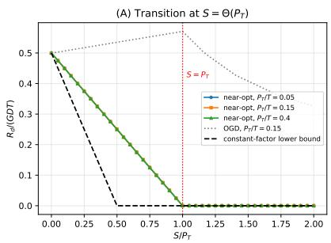

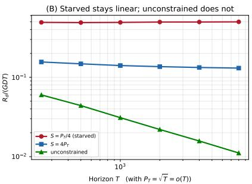  
Figure 1: Square-wave adversary. Left: normalized regret drops as the movement budget approaches the comparator path length; the proved lower bound has only constant-factor precision. Right: with $P _ { T } = \sqrt { T } = o ( T )$ , a budget-starved learner has constant normalized regret while the unconstrained learner decays, showing that the barrier is caused by the movement budget rather than by large path length.

1. (Impossibility.) There exist universal constants $c _ { 0 } , c _ { 1 } > 0$ such that for every algorithm with $\mathrm { S C } \le S$ there is a comparator sequence of path length at most $P _ { T }$ and a sequence of convex, G-Lipschitz losses on which

$$
R _ { d } \geq c _ { 0 } G D T \left( 1 - c _ { 1 } \frac { S } { P _ { T } } \right) .\tag{3}
$$

In particular $R _ { d } = \Omega ( G D T )$ whenever $S \le c P _ { T }$ for a sufficiently small universal constant $c > 0 .$

2. (Achievability.) $\begin{array} { r } { I f S = \omega ( D + P _ { T } ) } \end{array}$ and $S = o ( D T )$ , then projected OGD with $\eta = S / ( G T )$ satisfies $\mathrm { S C } \doteq S$ and $R _ { d } = o ( G D T )$

Thus the critical movement scale is $D + P _ { T } .$ : below a sufficiently small constant multiple of $P _ { T }$ linear regret is unavoidable, while $S / ( D + P _ { T } )  \infty$ is sufficient for sublinear regret in the learnable regime. Since the theorem assumes $P _ { T } \ge D _ { \mathrm { {  } } }$ this identifies PT as the asymptotic movement scale, without resolving the exact constant-factor band.

The lower bound is a counting argument over consecutive square-wave block pairs: on each pair, if the learner spends movement $M _ { i }$ , its cumulative tracking error is at least a constant multiple of the block length times $( D - M _ { i } )$ . Summing over $\Theta ( P _ { T } / { \cal D } )$ pairs and using $\textstyle \sum _ { i } M _ { i } \leq S$ gives (3); Appendix H gives the full proof with floor and ceiling effects. The constructive direction uses the standard OGD bound $R _ { d } \dot { \leq } D ( D + 2 P _ { T } ) / ( 2 \eta ) + \eta \dot { G } ^ { 2 } T / 2$ [Zinkevich, 2003]. With $\eta = S / ( G T )$ movement is at most $T \eta G = S$ and

$$
R _ { d } \leq \frac { G T D ( D + 2 P _ { T } ) } { 2 S } + \frac { G S } { 2 } ,\tag{4}
$$

which is o(GDT) when $S = \omega ( D + P _ { T } )$ and $S = o ( D T )$

For fixed $D ,$ the theorem is nonvacuous at $P _ { T } = o ( T )$ : the unconstrained rate $\Theta ( G \sqrt { D ( D + P _ { T } ) T } )$ is then $o ( G D T )$ , yet any learner with $S \le c P _ { T }$ suffers linear regret on the same type of instance. Figure 1 illustrates this transition and the sublinear-path regime; additional experiments and the remaining rate gap above the threshold are in Appendix A.

## 4 Rates Above the Threshold and Evidence

The feasibility theorem answers when sublinear regret is possible. Above that threshold, the finer rate is only partially characterized. Running projected OGD with

$$
\eta = \operatorname * { m i n } \left\{ \sqrt { \frac { D ( D + 2 P _ { T } ) } { G ^ { 2 } T } } , \frac { S } { G T } \right\}
$$

keeps $\mathrm { S C } \le S$ and gives

$$
R _ { d } \leq O \bigg ( \operatorname* { m i n } \bigg \{ G \sqrt { D ( D + 2 P _ { T } ) T } + \frac { G T D ( D + 2 P _ { T } ) } { S } , G D T \bigg \} \bigg ) .\tag{5}
$$

The first term is the usual unconstrained OGD rate; the second is the price of shrinking the step size to fit the movement budget. The standard unconstrained lower bound $\Omega ( G { \sqrt { D P _ { T } T } } )$ [Besbes et al., 2015] still applies, but we do not claim a matching lower bound for the budget-dependent $1 / S$ term. Determining the minimax rate above the feasibility threshold remains open.

Our experiments are designed around this separation. Figure 1 tests the theorem itself: the left panel shows the transition as $S / P _ { T }$ varies, while the right panel fixes $P _ { T } = \sqrt { T } = o ( T )$ and separates a budget-induced barrier from ordinary nonstationarity. Appendix D reports two further checks. First, random-walk and rotating-comparator experiments show an empirical $1 / S$ decay consistent with the upper bound (5), but we do not treat this as proof that the $1 / S$ term is minimax tight. Second, five real daily series, S&P 500, EUR/USD, crude oil via USO, Bitcoin, and New York City temperature, show regret remaining high for $S \ll P _ { T }$ and dropping near $S = P _ { T }$ . These finite-horizon experiments test transition location and budget-regret behavior; asymptotic linearity is certified by the square-wave construction, not by the real series.

The closest prior work studies adjacent but different questions. Classical dynamic-regret results characterize adaptation to a moving comparator when movement is free [Zinkevich, 2003, Besbes et al., 2015], with later work removing prior knowledge of $P _ { T }$ or improving constants in richer loss classes [Yang et al., 2016, Baby and Wang, 2021, Zhao et al., 2024]. Smoothed online optimization penalizes movement with a Lagrange multiplier rather than imposing a hard budget [Lin et al., 2011, Andrew et al., 2013, Chen et al., 2018, Goel et al., 2019, Zhang et al., 2021]. Hard switching-budget work is closest in spirit, but existing results focus on static regret or switching count rather than a distance budget for dynamic regret [Dekel et al., 2014, Chen et al., 2020, Sherman and Koren, 2021, Wang et al., 2021]. Our contribution is the feasibility barrier: even when unconstrained dynamic regret is sublinear, a hard movement budget below the scale $D + P _ { T }$ can make tracking impossible.

This perspective is useful for temporal systems because it separates two roles often conflated under the term “adaptation." Prediction asks whether the learner can infer where the moving optimum is; intervention asks whether the learner can afford to move there. The square-wave construction removes the prediction issue entirely: the comparator is deterministic and known, yet the learner still fails when its movement budget is too small. Thus the threshold is not a statistical limitation but a physical or operational one.

The remaining gap is also conceptually sharp. Below the threshold, range forces a feasibility barrier. Far above it, standard OGD rates reappear. In between, the known upper bound has a $1 / S$ term, but no matching budget-dependent lower bound is known. Deciding whether this term is an OGD artifact or an unavoidable cost is the main technical question left by the paper.

## References

Lachlan Andrew, Siddharth Barman, Katrina Ligett, Minghong Lin, Adam Meyerson, Alan Roytman, and Adam Wierman. A tale of two metrics: Simultaneous bounds on competitiveness and regret. In Conference on Learning Theory, pages 741–763. PMLR, 2013.

Dheeraj Baby and Yu-Xiang Wang. Optimal dynamic regret in exp-concave online learning. In Conference on Learning Theory, pages 359–409. PMLR, 2021.

Omar Besbes, Yonatan Gur, and Assaf Zeevi. Non-stationary stochastic optimization. Operations research, 63(5):1227–1244, 2015.

Marko Budišić, Ryan Mohr, and Igor Mezić. Applied koopmanism. Chaos: An Interdisciplinary Journal of Nonlinear Science, 22(4), 2012.

Lin Chen, Qian Yu, Hannah Lawrence, and Amin Karbasi. Minimax regret of switching-constrained online convex optimization: No phase transition. Advances in Neural Information Processing Systems, 33:3477–3486, 2020.

Niangjun Chen, Gautam Goel, and Adam Wierman. Smoothed online convex optimization in high dimensions via online balanced descent. In Conference On Learning Theory, pages 1574–1594. PMLR, 2018.

Daryl J Daley and David Vere-Jones. An introduction to the theory of point processes: volume II: general theory and structure. Springer, 2008.

Ofer Dekel, Jian Ding, Tomer Koren, and Yuval Peres. Bandits with switching costs: $T ^ { 2 / 3 }$ regret. In Proceedings of the forty-sixth annual ACM symposium on Theory of computing, pages 459–467, 2014.

Gautam Goel, Yiheng Lin, Haoyuan Sun, and Adam Wierman. Beyond online balanced descent: An optimal algorithm for smoothed online optimization. Advances in Neural Information Processing Systems, 32, 2019.

Elad Hazan. Introduction to online convex optimization. Foundations and Trends in Optimization, 2 (3-4):157–325, 2016.

Andrew Jacobsen and Francesco Orabona. An equivalence between static and dynamic regret minimization. Advances in Neural Information Processing Systems, 37:98835–98870, 2024.

Minghong Lin, Adam Wierman, Lachlan L. H. Andrew, and Eno Thereska. Dynamic right-sizing for power-proportional data centers. In 2011 Proceedings IEEE INFOCOM, pages 1098–1106, 2011. doi:10.1109/INFCOM.2011.5934885.

Igor Mezić. Spectral properties of dynamical systems, model reduction and decompositions. Nonlinear Dynamics, 41(1):309–325, 2005.

Uri Sherman and Tomer Koren. Lazy oco: Online convex optimization on a switching budget. In Conference on Learning Theory, pages 3972–3988. PMLR, 2021.

Guanghui Wang, Yuanyu Wan, Tianbao Yang, and Lijun Zhang. Online convex optimization with continuous switching constraint. Advances in Neural Information Processing Systems, 34:28636— 28647, 2021.

Tianbao Yang, Lijun Zhang, Rong Jin, and Jinfeng Yi. Tracking slowly moving clairvoyant: Optimal dynamic regret of online learning with true and noisy gradient. In International Conference on Machine Learning, pages 449–457. PMLR, 2016.

Lijun Zhang, Shiyin Lu, and Zhi-Hua Zhou. Adaptive online learning in dynamic environments. Advances in neural information processing systems, 31, 2018.

Lijun Zhang, Wei Jiang, Shiyin Lu, and Tianbao Yang. Revisiting smoothed online learning. Advances in Neural Information Processing Systems, 34:13599–13612, 2021.

Peng Zhao, Yu-Jie Zhang, Lijun Zhang, and Zhi-Hua Zhou. Dynamic regret of convex and smooth functions. Advances in Neural Information Processing Systems, 33:12510–12520, 2020.

Peng Zhao, Yu-Jie Zhang, Lijun Zhang, and Zhi-Hua Zhou. Adaptivity and non-stationarity: Problemdependent dynamic regret for online convex optimization. Journal of Machine Learning Research, 25(98):1–52, 2024.

Martin Zinkevich. Online convex programming and generalized infinitesimal gradient ascent. In Proceedings of the 20th international conference on machine learning (icml-03), pages 928–936, 2003.

## A Additional Rates, Experiments, and Discussion

We state this as a threshold in scale and not as a sharp threshold with a determined constant, and the distinction is real. The impossibility bound (3) has only universal-constant precision, while the experiments in Section D.1 indicate that the empirical transition is close to ${ \bf \nabla } S = P _ { T }$ . Section D.1 reports the empirical constant separately from the proved one, and we do not conflate them.

## B Dynamic Regret Above the Threshold

Above the threshold the question becomes quantitative. The results in this section refine Theorem 1 and are secondary to it; in particular they do not resolve the rate in the whole range of budgets.

Theorem 2 (Budget-dependent upper bound). Assume each $f _ { t }$ is convex and G-Lipschitz on $\kappa .$ Projected OGD with $\eta = \operatorname* { m i n } \bigl ( \sqrt { D ( D + 2 P _ { T } ) / ( G ^ { 2 } T ) } , S / ( G T ) \bigr )$ satisfies $\mathrm { S C } \le S$ and

$$
R _ { d } \ \leq \ O \bigg ( \operatorname* { m i n } \bigg \{ G \sqrt { D ( D + 2 P _ { T } ) T } + \frac { G T D ( D + 2 P _ { T } ) } { S } , \ G D T \bigg \} \bigg ) .\tag{6}
$$

The usual unconstrained lower bound $R _ { d } \ge \Omega ( G \sqrt { D P _ { T } T } )$ [Besbes et al., 2015] applies to this setting as well, since adding a movement budget cannot make the problem easier. We do not know whether the additional $1 / S$ term in (6) is minimax tight.

Remark 3 (What is and is not established). Theorem 2 is an upper bound, not a minimax characterization. We therefore do not claim a product law $R _ { d } \cdot S = \Theta ( \dot { G } \dot { T } D ( D + P _ { T } ) )$ . The exact rate above the feasibility threshold, and in particular the tightness of the $G T { \cal { D } } ( D + 2 \dot { P _ { T } } ) / S$ term, is open.

We also note that (6) is informative only when $S \gtrsim D { + } P _ { T }$ : for smaller S the term $G T D ( D { + } 2 P _ { T } ) / S$ exceeds the trivial bound $G D T$ , and Theorem 1 shows linear regret is in fact unavoidable there. The two results thus cover complementary ranges of S.

## C Budget-Controlled OGD

The algorithm used for both constructive results is projected OGD with a budget-aware step size:

$$
x _ { t + 1 } = \Pi _ { K } ( x _ { t } - \eta \nabla f _ { t } ( x _ { t } ) ) , \qquad \eta = \mathrm { m i n } \left( \sqrt { \frac { D ( D + 2 P _ { T } ) } { G ^ { 2 } T } } , \frac { S } { G T } \right) .\tag{7}
$$

Proposition 4 (Budget-Controlled OGD). Assume each $f _ { t }$ is convex and G-Lipschitz. The update (7) satisfies $\mathrm { S C } \le S$ and $\mathbb { E } [ R _ { d } ] \le O \big ( G \sqrt { D ( D + 2 P _ { T } ) T } + G T D ( D + 2 P _ { T } ) / S \big )$ . When $P _ { T }$ is unknown, a doubling trick preserves the rate up to constants.

The algorithm is not new: it is the standard OGD of Zinkevich [2003] run at a particular step size. What the analysis contributes is the identification of that step size. The two arguments of the minimum in (7) correspond to the two regimes: the first is the usual unconstrained optimum, the second is the largest step for which the budget is respected without any explicit projection onto the constraint, since per-round movement is bounded by $\eta G$ and there are $\dot { T }$ rounds. Budget feasibility is thus enforced by the step size alone. We do not claim (7) is a new optimization method, and by Remark 3 we use it as a constructive upper bound rather than as a fully minimax-optimal method above the threshold.

## D Experiments

The experiments are organized by which claim they test. Section D.1 uses the square wave, the instance our lower bound is actually proved against. Section D.2 isolates the regime $P _ { T } = o ( T )$ that makes the barrier attributable to the budget. The remaining subsections use a random-walk comparator and real series to examine the transition location and the $1 / S$ decay. A random-walk comparator is spatially concentrated, so it cannot certify a budget-induced barrier, and we do not use it for that purpose.

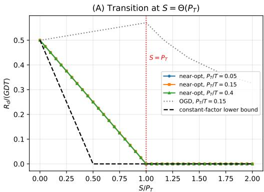

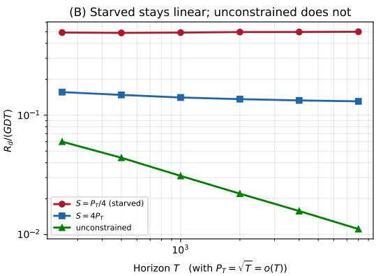  
Figure 2: Square-wave adversary on $\mathcal { K } = [ 0 , D ]$ with $f _ { t } ( x ) = G | x - u _ { t } | . ( \mathbf { A } )$ Normalized regret of a near-optimal budget-feasible tracker against $\bar { S } / P _ { T }$ . Curves for $P _ { T } / T \in \{ 0 . 0 5 , 0 . 1 5 , 0 . 4 \}$ collapse onto $\overset { 1 } { \underset { \oslash } { \chi } } \left( 1 - S / P _ { T } \right)$ and reach zero at $S = P _ { T }$ . The dashed line shows the scale of the proved lower boun in Theorem 1; its constants are conservative, and the empirical transition occurs closer to $S = P _ { T }$ . The dotted curve is Budget-Controlled OGD, which pays an additional lag penalty on this instance. (B) Fixing $P _ { T } = \sqrt { T } = o ( T )$ and growing $T \colon$ the starved learner $( S = P _ { T } / 4 )$ stays flat near 0.5, so its regret is linear, while the unconstrained learner decays as $T ^ { - 1 / 2 }$ . Both axes logarithmic.

## D.1 The budget-induced transition

Figure 2(A) sweeps $S / P _ { T }$ for a near-optimal budget-feasible tracker at $T = 4 0 0 0$ . The curves for three path lengths collapse onto a single line $R _ { d } / ( \bar { G } D T ) = \textstyle { \frac { 1 } { 2 } } ( 1 - S / P _ { T } )$ that vanishes at $S = P _ { T }$ The proved lower bound has more conservative constants and lies below this empirical curve.

We report these two constants separately on purpose. An exact dynamic program over discretized position and budget, which lower bounds every algorithm, places the true optimum slightly below $\bar { \Psi } ( 1 - S / P _ { T } )$ at $T = 2 4 0$ and $P _ { T } = 2 9$ it gives 0.364 versus 0.375 at $S = P _ { T } / 4$ , and 0.242 versus 0.250 at $S \stackrel { \cdot } { = } P _ { T } / 2$ , in units of $G D T$ . Crucially it vanishes only at $S = P _ { T } ^ { \dot { \mathbf { \alpha } } }$ . This is empirical evidence that the constants in Theorem 1 are conservative and that some slack sits in inequality (11). It is not a theorem, and we do not upgrade it to one; the proved statement remains (3).

The dotted curve shows Budget-Controlled OGD rising above the frozen-learner value before falling. This is a lag effect specific to this instance: at small step sizes the iterate arrives at one endpoint around the time the comparator leaves it, so part of the horizon is spent in antiphase. It does not contradict Theorem 2, whose upper bound is a worst-case statement and is not tight here, but it does show that the near-optimal tracker and OGD differ by more than a constant on this family.

## D.2 The sublinear-path-length regime

Figure 2(B) fixes $P _ { T } = { \sqrt { T } }$ sO $P _ { T } = o ( T )$ , and grows $T$ from 250 to 8000. The budget-starved learner at $S = P _ { T } / 4$ has normalized regret flat in T, moving from 0.492 to 0.500, so its regret is linear. The unconstrained learner decays from 0.060 to 0.011 over the same range, consistent with $T ^ { - 1 / 2 }$

This is the experiment that separates the two hypotheses. Both learners face identical loss sequences drawn from a regime where the unconstrained problem is learnable. One is starved of movement and is not. This is the empirical counterpart of the nonvacuity statement in Theorem 1: the same regime is learnable without a budget but not with insufficient movement. It is the claim a random-walk comparator cannot support.

Pareto Frontier: Regret vs. Switching Cost  
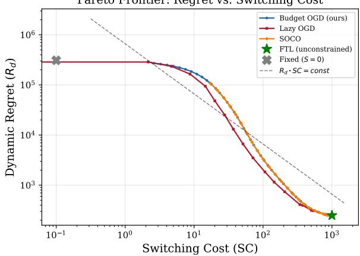  
Figure 3: Empirical budget-regret trade-off on a random-walk comparator. All methods trace a $1 / S$ decay over the mid-range of budgets, with Budget-Controlled OGD attaining the lowest regret at each budget. This is consistency with the upper bound (6) only. The dashed guide line is a $1 / S$ reference and is not evidence of a matched product law; by Remark 3 tightness of the $1 / S$ term is unproved.

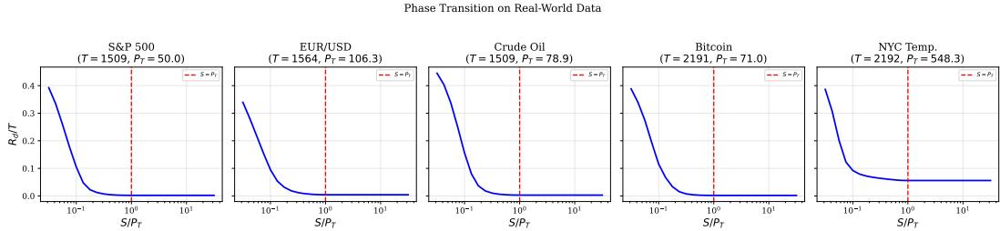  
Figure 4: Transition location on five real series (S&P 500, EUR/USD, crude oil, Bitcoin, NYC temperature). Regret stays elevated for $S \ll P _ { T }$ and drops near $S = P _ { T }$ on all five, placing the transition where Theorem 1 predicts. Finite horizons cannot separate $\Theta ( T )$ from $o ( \bar { T } )$ , so these panels test the location of the transition and the $1 / S$ decay, not asymptotic linearity; that claim rests on Figure 2(B).

## D.3 Budget-regret trade-off

Figure 3 plots the empirical $\mathrm { ( S C , } R _ { d } )$ trade-off for Budget-Controlled OGD, Lazy OGD, and SOCO on a random-walk comparator. All three trace $\mathbf { a } \ 1 / S$ decay over the mid-range of budgets, with Budget-Controlled OGD attaining the lowest regret at each budget level.

This is empirical consistency with the upper bound (6) only. By Remark 3, the tightness of the $1 / S$ term is open, so these curves must not be read as confirming a product law.

## D.4 Algorithm comparison

Across oscillating, rotating, and piecewise stationary synthetic environments, Budget-Controlled OGD matches or outperforms Lazy OGD, SOCO, and Periodic Restart at all budget levels $( \mathsf { A p - }$ pendix K, Figure 6); Periodic Restart is included as a standard baseline for non-stationary online optimization [Besbes et al., 2015]. Lazy OGD is handicapped by its threshold update rule, which spends budget on small moves during low-volatility stretches; Periodic Restart suffers when its restart boundaries are misaligned with the environment. On real data the same ordering holds on the S&P 500, Bitcoin, and NYC temperature series.

## D.5 Real-world series

We use five daily series as comparator sequences, each normalized: the S&P 500 index $\scriptstyle ( T = 1 5 0 9 )$ the EUR/USD exchange rate $( \dot { T } \mathrm { = } 1 5 6 4 )$ , crude oil via the USO ETF $\scriptstyle ( T = 1 5 0 9 )$ , Bitcoin $\scriptstyle ( T = 2 1 9 1 )$ and mean temperature in New York City (T=2192).

Figure 4 shows regret staying elevated for $S \ll P _ { T }$ and dropping near $S = P _ { T }$ on all five, locating the transition where Theorem 1 places it. The drop is sharpest for Bitcoin and temperature and more gradual for the S&P 500, whose trajectory is smoother. Trajectory-level behaviour matches: at $S = 0 . 0 5 P _ { T }$ the learner barely moves and incurs $R _ { d } / T \approx 0 . 4 \bar { 7 } ; \mathrm { a t } \bar { S ^ { } } = 0 . 3 P _ { T }$ tracking improves substantially; at $S = P _ { T }$ the learner tracks near-perfectly with $R _ { d } / T < 0 . 0 1$ (Appendix K).

Finite-horizon caveat. These series have modest path-length ratios: $P _ { T } / T$ is 0.033 (S&P 500), 0.032 (Bitcoin), 0.068 (EUR/USD), 0.052 (oil) and 0.250 (temperature), against $\sqrt { T ( 1 + P _ { T } ) }$ of 277, 397, 410, 347 and 1097 respectively. Every dataset therefore sits in the regime $P _ { T } \ll \sqrt { T ( 1 + P _ { T } ) }$ where the window $P _ { T } \lesssim S \lesssim \sqrt { D ( D + P _ { T } ) T }$ spans roughly half a decade in $S .$ At a single finite horizon one cannot separate $\Theta ( { \dot { T } } )$ from $o ( T )$ , so these experiments test the location of the transition and the $1 / S$ decay and cannot by themselves establish asymptotic linearity. That claim rests on Figure 2(B).

## E Related Work

Dynamic regret. Dynamic regret against a moving comparator originates with Zinkevich [2003], who gave the $\mathsf { \bar { O } } ( D ( D \bar { + } P _ { T } ) / \eta \bar { + } \eta G ^ { 2 } \bar { T } )$ bound for OGD that we use. Besbes et al. [2015] established minimax rates for non-stationary stochastic optimization and supply the $\Omega ( G { \sqrt { D P _ { T } T } } )$ lower bound in Theorem 2. Subsequent work develops adaptive and parameter-free methods that attain path-lengthdependent rates without knowing $P _ { T }$ [Yang et al., 2016, Zhang et al., 2018, Zhao et al., 2020, Baby and Wang, 2021, Zhao et al., 2024], and Jacobsen and Orabona [2024] relates static and dynamic regret through lifted constructions. All of this assumes movement is free.

Switching costs and smoothed online optimization. Smoothed online convex optimization augments the loss with a movement penalty, $\begin{array} { r } { \sum _ { t } f _ { t } ( x _ { t } ) + \lambda \sum _ { t } \| x _ { t } - x _ { t - 1 } \| } \end{array}$ , and yields competitive algorithms such as online balanced descent [Lin et al., 2011, Andrew et al., 2013, Chen et al., 2018, Goel et al., 2019]. Recent work also studies dynamic regret when the switching cost is part of the performance metric [Zhang et al., 2021]. A soft penalty selects a single operating point through $\lambda ;$ it does not answer whether learning is possible at a prescribed budget, which is the question Theorem 1 addresses.

Hard switching constraints. Closest to our setting are hard constraints on movement. Wang et al. [2021] study continuous switching distance constraints and Sherman and Koren [2021] constrain the switching count; both target static regret. Switching-budget lower bounds also appear in bandit and switching-constrained OCO models [Dekel et al., 2014, Chen et al., 2020]. Table 1 summarizes the positioning. To our knowledge no prior work identifies a feasibility threshold for dynamic regret under a hard movement-distance budget.

## F Limitations and Open Problems

Rates above the threshold. The main open problem is the minimax rate once $S$ exceeds the feasibility threshold. Resolving it appears to require understanding whether the $1 / S$ term in Theorem 2 is an OGD artifact or reflects an unavoidable budget-dependent price. The two natural lower-bound constructions each fail on one count. Our square wave is deterministic and becomes exactly trackable once $S \geq P _ { T } ,$ so it certifies nothing above the threshold. A drifting comparator can be followed with $O ( P _ { T } )$ additional movement once the observed losses reveal its position, so for $S \gg P _ { T }$ increasing $P _ { T }$ does not obviously help the adversary. We therefore do not claim minimax optimality for Theorem 2.

The constant in the threshold. Theorem 1 proves the threshold only up to universal constants, while the exact dynamic program of Section D.1 indicates the empirical transition is close to $S = P _ { T }$

Table 1: Positioning. "Dyn." and "Stat." denote dynamic and static regret; "Dist." and "Count" denote switching-distance and switching-count constraints.
<table><tr><td>Work</td><td>Regret</td><td>Constraint</td><td>Minimax</td><td>Threshold</td></tr><tr><td>Besbes et al. [2015]</td><td>Dyn.</td><td>None</td><td>Yes</td><td>No</td></tr><tr><td>Baby and Wang [2021]</td><td>Dyn.</td><td>None</td><td>Yes</td><td>No</td></tr><tr><td>Zhao et al. [2024]</td><td>Dyn.</td><td>None</td><td>No</td><td>No</td></tr><tr><td>Zhang et al. [2021]</td><td>Dyn.</td><td>Soft</td><td>Yes</td><td>No</td></tr><tr><td>Dekel et al. [2014]</td><td>Stat.</td><td>Switch cost</td><td>Yes</td><td>No</td></tr><tr><td>Chen et al. [2020]</td><td>Stat.</td><td>Count</td><td>Yes</td><td>No</td></tr><tr><td>Sherman and Koren [2021]</td><td>Stat.</td><td>Count</td><td>Yes</td><td>No</td></tr><tr><td>Wang et al. [2021]</td><td>Stat.</td><td>Dist.</td><td>Partial</td><td>No</td></tr><tr><td>Chen et al. [2018]</td><td>Dyn.</td><td>Soft</td><td>No</td><td>No</td></tr><tr><td>This work</td><td>Dyn.</td><td>Dist.</td><td>Open†</td><td>Yes</td></tr></table>

†Theorem 1 identifies $D + P _ { T }$ as the critical movement scale: a small constant multiple of $P _ { T }$ is insufficient, while $S / ( D + P _ { T } )  \infty$ is sufficient in the learnable regime. The exact minimax rate above that threshold remains open (Remark 3).

The result should therefore be read as identifying the asymptotic movement scale $D + P _ { T }$ , not as determining the exact constant-factor transition. The slack is localized to inequality (11).

What each piece of evidence supports. We distinguish three levels deliberately. The squarewave construction proves linear regret for $S \le c P _ { T }$ for a universal constant $c > 0$ , uniformly over $P _ { T } \in [ D , D T ]$ , and Figure 2(B) provides the corresponding empirical demonstration at $P _ { T } = o ( T )$ The random-walk and real-data experiments show that the transition sits near $S = P _ { T }$ and that regret decays as $1 / S ;$ because they run at fixed finite horizons they cannot distinguish $\Theta ( T )$ from $o ( T )$ , and because the random-walk comparator is spatially concentrated it could not certify a budget-induced barrier even asymptotically. The tight rate above the threshold, and the exact constant at the threshold, remain unknown.

Other limitations. The lower bound is one-dimensional; it lifts to $\mathbb { R } ^ { d }$ by embedding, but the dimension dependence of the constants is not resolved. Our synthetic non-square-wave experiments use quadratic losses, while the theory covers all convex Lipschitz losses. We assume full gradient feedback; we note that the square-wave argument is information-free, so it may transfer to bandit feedback directly, though we have not verified this.

## G Conclusion

A hard movement budget can make dynamic tracking impossible even when the underlying nonstationarity is mild enough that unconstrained dynamic regret is sublinear. Concretely: a deterministic full-range adversary forces linear regret on every budget-feasible algorithm whenever $S \le c P _ { T }$ for a universal constant $c > 0$ and every $P _ { T } \in [ D , \mathrm { \bar { \it D } } T ]$ ; projected OGD with a budget-aware step size achieves $o ( G D T )$ once $S = \omega ( D + P _ { T } ) ;$ together these identify $D + P _ { T }$ as the critical movement scale, with the constant-factor band left open. Above the threshold, budget-controlled OGD gives a concrete $1 / S$ upper bound, but its minimax tightness remains open. Experiments support the transition picture, locate it near $S = P _ { T }$ , and exhibit empirical $1 / S$ decay.

The construction turns on treating comparator range rather than path length as the relevant measure of difficulty, and we expect that distinction to be useful wherever a learner is charged for the distance it travels.

## H Proof of Theorem 1

We prove the two directions separately. The construction is deterministic, so no expectations are needed.

## H.1 Impossibility

Fix $D \leq P _ { T } \leq D T$ , take $\mathcal { K } = [ 0 , D ] \subset \mathbb { R }$ and the losses

$$
f _ { t } ( x ) = G | x - u _ { t } | ,\tag{8}
$$

which are convex, G-Lipschitz, and satisfy $f _ { t } ( u _ { t } ) = 0$ . Since these are a special case of the convex G-Lipschitz class, a lower bound against them applies to the whole class.

The comparator. Let $n = \operatorname* { m i n } \{ \lfloor P _ { T } / D \rfloor , T - 1 \} \geq 1 { \mathrm { ~ a n d ~ } } \tau = \lfloor T / ( n + 1 ) \rfloor \geq 1$ . For the first $( n + 1 ) $ r rounds set

$$
u _ { t } = \left\{ \begin{array} { l l } { 0 } & { \lfloor ( t - 1 ) / \tau \rfloor \mathrm { e v e n } , } \\ { D } & { \lfloor ( t - 1 ) / \tau \rfloor \mathrm { o d d } , } \end{array} \right.\tag{9}
$$

and hold the final value for any leftover rounds. Thus the comparator alternates between the endpoints of K for $n + 1$ blocks. There are exactly n switches, each of length D, so the realized path length is $n D \le P _ { T }$ and the instance is admissible.

Per-block-pair error. Group the first $n ~ + ~ 1$ blocks into disjoint consecutive pairs $( B _ { 1 } , B _ { 2 } ) , ( \bar { B } _ { 3 } , B _ { 4 } ) , . . . ,$ with $u \equiv 0$ on odd-indexed and $u \equiv D$ on even-indexed blocks. Let $\bar { N } =$ $\lfloor ( n + 1 ) / 2 \rfloor$ be the number of complete pairs. For the i-th pair put $\begin{array} { r } { M _ { i } = \sum _ { t \in B _ { 2 i - 1 } \cup B _ { 2 i } } \| x _ { t } - x _ { t - 1 } \| } \end{array}$ and $\begin{array} { r } { m _ { i } = \operatorname* { m i n } _ { t \in B _ { 2 i - 1 } \cup B _ { 2 i } } x _ { t } } \end{array}$ . The range of a trajectory is at most its total variation, so every $x _ { t }$ in the pair lies in $[ m _ { i } , m _ { i } + M _ { i } ]$ . Hence

$$
\sum _ { t \in B _ { 2 i - 1 } } | x _ { t } - 0 | \geq \tau m _ { i } , \qquad \sum _ { t \in B _ { 2 i } } | x _ { t } - D | \geq \tau ( D - m _ { i } - M _ { i } ) ,\tag{10}
$$

and adding gives

$$
\sum _ { t \in B _ { 2 i - 1 } \cup B _ { 2 i } } | x _ { t } - u _ { t } | \geq \tau ( D - M _ { i } ) .\tag{11}
$$

The right-hand side may be negative, in which case the inequality is vacuous but still valid, which is all we use.

Where the constant is lost. Inequality (11) bounds the two blocks by a common worst case, and this is where the factor of two enters. An exact dynamic program over discretized position and budget, which lower bounds every algorithm whether online or not, puts the true optimum slightly below $\begin{array} { r l r } {  { \frac { G D T } { 2 } \big ( 1 - S / P _ { T } \big ) } ; } \end{array}$ at $T =$ 240 and $P _ { T } = 2 9$ it gives 0.364 versus 0.375 at $\dot { S } = P _ { T } / \bar { 4 } ,$ and 0.242 versus 0.250 at ${ \dot { S } } = P _ { T } / 2$ , in units of $G D T$ . Crucially it vanishes only at $S = P _ { T }$ , not at $S = P _ { T } / 2$ Sharpening this step would recover the constant without changing the structure of the argument.

Summing. The pairs occupy disjoint sets of rounds, so $\textstyle \sum _ { i = 1 } ^ { N } M _ { i } \leq \mathrm { S C } \leq S$ . Summing (11) over the pairs,

$$
\sum _ { t = 1 } ^ { T } | x _ { t } - u _ { t } | \ \geq \ \tau \sum _ { i = 1 } ^ { N } ( D - M _ { i } ) \ \geq \ \tau \left( N D - S \right) .\tag{12}
$$

Since $N \geq n / 2$ and $\tau \geq T / ( 2 ( n + 1 ) )$ , while $n + 1 \leq 2 P _ { T } / D$ whenever $P _ { T } \ge D$ , we have $\tau N D \geq T D / 8$ . Also, because $n + 1 \geq P _ { T } / D$ , we have $\tau \leq T D / P _ { T }$ . Substituting these two estimates,

$$
R _ { d } = G \sum _ { t = 1 } ^ { T } | x _ { t } - u _ { t } | \geq \frac { G D T } { 8 } - \frac { G D T } { P _ { T } } S = \frac { G D T } { 8 } \left( 1 - \frac { 8 S } { P _ { T } } \right) ,\tag{13}
$$

which is (3) with universal constants. In particular $R _ { d } = \Omega ( G D T )$ whenever $S \ \le \ c P _ { T }$ for a sufficiently small universal constant $c > 0$

## H.2 Achievability

Run projected OGD with the fixed step size $\eta = S / ( G T )$ . Each step moves at most $\eta \| \nabla f _ { t } \| \le \eta G$ so $\mathrm { S C } \overset { \cdot } { \leq } \dot { T } \eta G = S$ and the constraint holds by construction. By Lemma 6, $R _ { d } \leq D ( \ddot { D _ { { + } } } \dot { 2 } \ddot { P } _ { T } ) / ( 2 \eta ) +$ $\eta G ^ { 2 } T / 2$ , which on substituting η gives (4). If $S = \omega ( D + P _ { T } )$ the first term is $o ( G D T )$ , and if $S = \overset { \cdot } { o (} D T )$ the second is $o ( G \bar { D } \dot { T } )$ . Hence $R _ { d } = o ( G D T )$

Combining, regret is linear whenever $S \le c P _ { T }$ for a universal constant $c > 0$ and sublinear whenever $S = \omega ( \bar { D { \mathrm { ~ + ~ } } \bar { P _ { T } } } )$ with $S = o ( D T )$ . Because $P _ { T } \ge D$ , both sides identify $P _ { T }$ as the asymptotic movement scale, while the exact constant-factor band remains unresolved. □ Remark 5 (Why a deterministic adversary). A random-walk comparator $u _ { t } = u _ { t - 1 } + \xi _ { t }$ with $\xi _ { t }$ Rademacher of scale $\sigma$ has path length $T \sigma$ but spatial range only $\Theta ( \sigma { \sqrt { T } } )$ , so a learner that never moves and sits at the centre of the range incurs $\Theta ( \sigma \sqrt { T } )$ per round rather than $\Theta ( D )$ . The resulting bound is $\Omega ( P _ { T } ^ { 2 } / T )$ , linear only when $P _ { T } = \Theta ( T )$ , a regime in which the unconstrained rate is already linear, so no budget-induced barrier can be concluded from that construction. The square wave forces the comparator to traverse the entire domain, making range and diameter coincide.

## I Proof of Theorem 2

We first restate the classical bound we build on.

Lemma 6 (Dynamic regret of OGD; Zinkevich, 2003). Let K have diameter D and let each $f _ { t }$ be convex and G-Lipschitz. Projected OGD with fixed step size $\eta > 0$ satisfies, for any comparator sequence with path length $P _ { T }$

$$
\sum _ { t = 1 } ^ { T } \left[ f _ { t } ( x _ { t } ) - f _ { t } ( u _ { t } ) \right] \ \leq \ \frac { D ( D + 2 P _ { T } ) } { 2 \eta } + \frac { \eta G ^ { 2 } T } { 2 } .\tag{14}
$$

Upper bound. Run projected OGD with the fixed, time-independent step size $\eta \quad =$ min $( \sqrt { D ( D + 2 P _ { T } ) / ( G ^ { 2 } T ) } , S / ( T G ) )$ . Per-round movement is at most $\eta G .$ so $\mathrm { S C } \le T \eta G \le S$

Case 1 (budget-rich). When $S \ge \sqrt { D T ( D + 2 P _ { T } ) }$ we have $\eta = \eta ^ { \star } = \sqrt { D ( D + 2 P _ { T } ) / ( G ^ { 2 } T ) }$ and Lemma 6 gives $R _ { d } \leq G \sqrt { D ( D + 2 P _ { T } ) T }$ . The dependence on the diameter here is $\sqrt { D }$ rather than $D \colon$ minimizing $D ( D + 2 P _ { T } ) / ( 2 \eta ) + \eta G ^ { 2 } T / 2$ yields $G \sqrt { D ( D + 2 P _ { T } ) T } \approx G \sqrt { 2 D } \sqrt { P _ { T } T }$ when $P _ { T } \ge D$ . We keep the exact form throughout.

Case 2 (budget-constrained). When $S < \sqrt { D T ( D + 2 P _ { T } ) }$ we have $\eta = S / ( T G )$ , and substituting,

$$
\frac { D ( D + 2 P _ { T } ) } { 2 \eta } = \frac { G T D ( D + 2 P _ { T } ) } { 2 S } , \qquad \frac { \eta G ^ { 2 } T } { 2 } = \frac { G S } { 2 } ,\tag{15}
$$

SO $R _ { d } \le { \cal O } ( G T D ( D + 2 P _ { T } ) / S )$ . Taking the minimum with the trivial bound $R _ { d } \leq G D T$ gives (6). □

For comparison: unconstrained lower bound. $R _ { d } \ge \Omega ( G \sqrt { D P _ { T } T } )$ is the unconstrained dynamic regret lower bound of Besbes et al. [2015]. Their construction does not rely on a movement constraint, so it remains a valid lower bound in the budgeted setting whenever the budget is large enough to permit the comparator-scale motion. We do not provide a matching lower bound for the $G T \bar { D ( { D + 2 P _ { T } ) / S } }$ term in (6); this is the main open rate question left by the paper.

## J Extensions

The following are corollaries of Theorem 1, obtained by computing an induced path length and invoking the main theorem; they contain no new argument. They are stated under the hypothesis $P _ { T } = \bar { \Theta ( T ) }$ ), which is the regime in which the unconstrained rate is already linear, so on their own they do not certify a budget-induced barrier. Applying the square-wave construction in these settings, which would require exhibiting latent dynamics whose induced comparator traverses the domain, is left to future work. We record them as illustrations of the reduction, not as independent contributions.

Latent dynamical systems. Let $\left\{ { z } _ { t } \right\}$ evolve as $\boldsymbol { z } _ { t + 1 } = \mathcal { T } ( \boldsymbol { z } _ { t } , \boldsymbol { \xi } _ { t } )$ for a possibly unknown transition operator $\bar { \tau }$ and exogenous noise $\left\{ \xi _ { t } \right\}$ , with losses $f _ { t } ( x ) \ = \ \ell ( x , z _ { t } )$ where $\ell ( \cdot , z )$ is convex and L-Lipschitz, and let $u _ { t } \in$ arg min $\overline { { x } } \in \mathcal { K } f _ { t } ( x )$ . If the induced path length satisfies $P _ { T } = \Theta ( T )$ , then any algorithm with $S = o ( T )$ has $\mathbb { E } [ \bar { R } _ { d } ] = \Theta ( T )$ , while $S = \Omega ( P _ { T } )$ makes sublinear dynamic regret achievable.

Event-driven environments. When environment changes arrive as a point process [Daley and Vere-Jones, 2008], the induced path length is governed by the expected number of events, and the same reduction applies once that quantity is $\Theta \bar { ( \cal T ) }$ ).

Spectral view. For environments generated by a linear evolution operator, the induced path length can be expressed through the operator's spectrum [Mezić, 2005, Budišić et al., 2012], and the feasibility condition again reduces to comparing S with $P _ { T }$

## K Additional Experimental Results

Setup. Synthetic experiments use two comparators, for two different purposes. The square wave of Appendix H is the instance the lower bound is proved against, and is used in Sections D.1 and D.2. The random walk $u _ { t } = u _ { t - 1 } + \xi _ { t }$ with $\xi _ { t }$ Rademacher is used for the transition-location and $1 / S$ plots; as Remark 5 explains it cannot certify a budget-induced barrier and we do not use it for that. Unless stated otherwise, results are averaged over 20 seeds

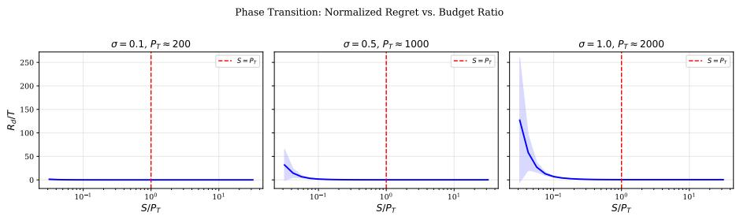  
Figure 5: Random-walk comparator: normalized regret $R _ { d } / T$ against $S / P _ { T }$ for drift magnitudes $\sigma \in \{ 0 . 1 , 0 . 5 , 1 . 0 \}$ at $T = 5 0 0 0 .$ , with the red dashed line at $S = P _ { T }$ and shading showing ±1 standard deviation over 20 seeds. The drop near $S \ = \ P _ { T }$ locates the transition; because this comparator is spatially concentrated, it does not by itself certify a budget-induced barrier (Remark 5).

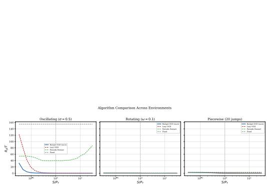  
Figure 6: Budget-Controlled OGD against Lazy OGD, SOCO, and Periodic Restart across oscillating, rotating, and piecewise stationary environments. Periodic Restart follows the standard restarting baseline for non-stationary online optimization [Besbes et al., 2015]. Budget-Controlled OGD matches or outperforms the baselines at all budget levels.

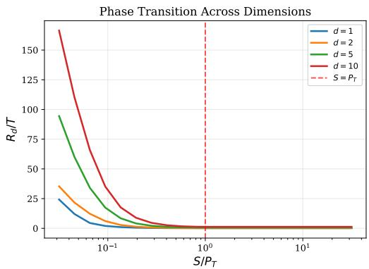  
Figure 7: Transition location for $d \in$ $\{ 1 , 2 , 5 , 1 0 , 2 0 \}$ . The location $S / P _ { T }$ ≈ 1 is flat in d because S and $P _ { T }$ are measured in the same norm; how the constants and D scale with dimension is not resolved here.

Tracking Under Budget Constraints — Real Data  
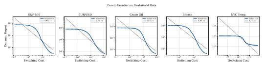  
Figure 8: Budget-regret trade-off on the five real series. The curves follow $R _ { d } \propto 1 / \mathrm { S C }$ over the mid-range of budgets, consistent with the upper bound (6) only.

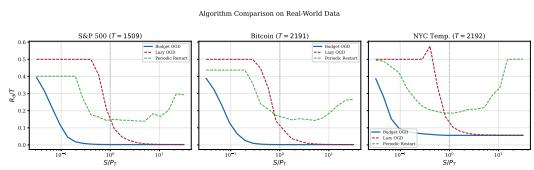  
Figure 9: Algorithm comparison on real series. Budget-Controlled OGD dominates Lazy OGD and Periodic Restart on the S&P 500, Bitcoin, and NYC temperature.

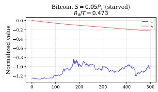

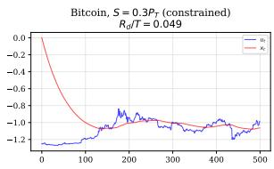

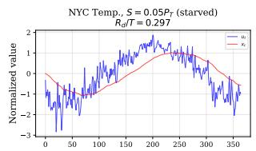

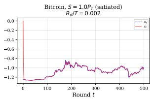

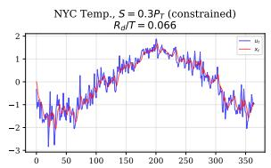

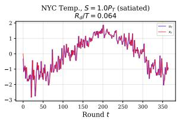  
Figure 10: Learner trajectories on Bitcoin and NYC temperature at three budget levels. $\mathbf { A } \mathbf { t } \ S =$ $0 . { \bar { 0 } } 5 P _ { T }$ the learner barely moves and incurs $R _ { d } / T \approx \bar { 0 . 4 7 } ;$ at $S ~ = ~ 0 . 3 P _ { T }$ tracking improves substantially; at $S = P _ { T }$ the learner tracks near-perfectly with $R _ { d } / T < 0 . 0 1$